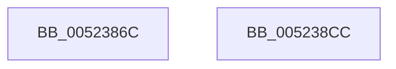

# SymCryptRsakeySetValue

- RVA: `0x0052386C`–`0x005238CD` (길이 `97` bytes)
- VA: `0x000000014052386C`
- 실행 섹션: `.text`
- PDB 이름 있음: `예`; PDB Function 태그: `아니요`
- unwind 정보 RVA: `0x0007A034`
- 디코드: `20`개 명령, `97/97` bytes 표시
- 미해석 바이트: `0` (있으면 어셈블리에 `.byte`로 보존)

> 이 문서는 커널 이미지의 기계어와 PDB 기호를 분석해 생성했습니다. 4번과 5번은 함수 원형과 자료형을 바이너리 사용 방식에서 추정한 C 해석이며 원본 소스 복구 결과는 아닙니다.

## 1. Dependencies

- 직접 호출 지점: **1**; 고유 호출 대상: **1**
- 직접 호출자로 확인된 함수: **2**
- RIP 상대 이미지 참조: **0**

### Outgoing calls
- `0x005238C2` → [SymCryptRsakeySetValueInternal](SymCryptRsakeySetValueInternal_function_005238D4.md) (function, `0x005238D4`)

### Direct callers
- [SymCryptRsaSelftest](SymCryptRsaSelftest_function_0052B638.md) at `0x0052B72A`
- [HashpVerifyPkcs1Signature](../../page/84/HashpVerifyPkcs1Signature_function_00841C68.md) at `0x00841E1E`

### Static image references
- 디코드된 RIP-relative 메모리 참조가 없습니다.

## 2. Other-region calls and transfers

- 다른 실행 섹션으로 향하는 call: **0**
- 별도 외부 분기/꼬리 이동을 확인하지 못했습니다.

## 3. Assembly (complete function range)

```asm
0052386C  4C 8B DC                        mov r11, rsp
0052386F  48 83 EC 68                     sub rsp, 0x68
00523873  48 8B 84 24 B8 00 00 00         mov rax, qword ptr [rsp + 0xb8]
0052387B  49 89 43 F0                     mov qword ptr [r11 - 0x10], rax
0052387F  8B 84 24 B0 00 00 00            mov eax, dword ptr [rsp + 0xb0]
00523886  89 44 24 50                     mov dword ptr [rsp + 0x50], eax
0052388A  8B 84 24 A8 00 00 00            mov eax, dword ptr [rsp + 0xa8]
00523891  89 44 24 48                     mov dword ptr [rsp + 0x48], eax
00523895  8B 84 24 A0 00 00 00            mov eax, dword ptr [rsp + 0xa0]
0052389C  89 44 24 40                     mov dword ptr [rsp + 0x40], eax
005238A0  48 8B 84 24 98 00 00 00         mov rax, qword ptr [rsp + 0x98]
005238A8  49 89 43 D0                     mov qword ptr [r11 - 0x30], rax
005238AC  48 8B 84 24 90 00 00 00         mov rax, qword ptr [rsp + 0x90]
005238B4  49 89 43 C8                     mov qword ptr [r11 - 0x38], rax
005238B8  49 83 63 C0 00                  and qword ptr [r11 - 0x40], 0
005238BD  49 83 63 B8 00                  and qword ptr [r11 - 0x48], 0
005238C2  E8 0D 00 00 00                  call 0x1405238d4
005238C7  48 83 C4 68                     add rsp, 0x68
005238CB  C3                              ret
005238CC  CC                              int3
```

## 4. C-style interpretation (structured pseudocode)

```c
__int64 __fastcall SymCryptRsakeySetValue(__int64 a1, __int64 a2, __int64 a3, __int64 a4, __int64 a5, __int64 a6, unsigned int a7, unsigned int a8, unsigned int a9, __int64 a10)
{
    __int64 result;
    __int64 v_rsp;
    unsigned int v_stack_m18;
    unsigned int v_stack_m20;
    unsigned int v_stack_m28;

    v_rsp = (v_rsp) - (104);
    *(unsigned __int64 *)(v_rsp - 16) = a10;
    v_stack_m18 = (unsigned int)((unsigned int)(a9));
    v_stack_m20 = (unsigned int)((unsigned int)(a8));
    v_stack_m28 = (unsigned int)((unsigned int)(a7));
    *(unsigned __int64 *)(v_rsp - 48) = a6;
    *(unsigned __int64 *)(v_rsp - 56) = a5;
    result = SymCryptRsakeySetValueInternal(a1, a2, a3, a4);
    v_rsp = (v_rsp) + (104);
    return result;
}
```

## 5. (Beta) C Style

```c
int64_t SymCryptRsakeySetValue(int64_t Arg1, int64_t Arg2, int64_t Arg3, int64_t Arg4, int64_t Arg5, int64_t Arg6, uint32_t Arg7, uint32_t Arg8, uint32_t Arg9, int64_t Arg10)
{
    int64_t result;
    int64_t local_rsp;
    uint32_t v_stack_m18;
    uint32_t v_stack_m20;
    uint32_t v_stack_m28;

    local_rsp = (local_rsp) - (104);
    *(uint64_t *)(local_rsp - 0x10) = Arg10;
    v_stack_m18 = (uint32_t)((uint32_t)(Arg9));
    v_stack_m20 = (uint32_t)((uint32_t)(Arg8));
    v_stack_m28 = (uint32_t)((uint32_t)(Arg7));
    *(uint64_t *)(local_rsp - 0x30) = Arg6;
    *(uint64_t *)(local_rsp - 0x38) = Arg5;
    result = SymCryptRsakeySetValueInternal(Arg1, Arg2, Arg3, Arg4);
    local_rsp = (local_rsp) + (104);
    return result;
}
```

## 6. Execution-region graph

[열기: 2D/3D 그래프와 함수 탐색 컨트롤 패널](../../../control-panel.html?section=text&rva=0x0052386C&view=graph)

- 2D 그래프는 위에서 아래로 흐르고, 3D 그래프는 빈 공간을 드래그해 회전합니다. Shift+드래그는 이동, 휠은 확대·축소, 함수 노드 선택은 대상 보고서 이동입니다.

### Static fallback


