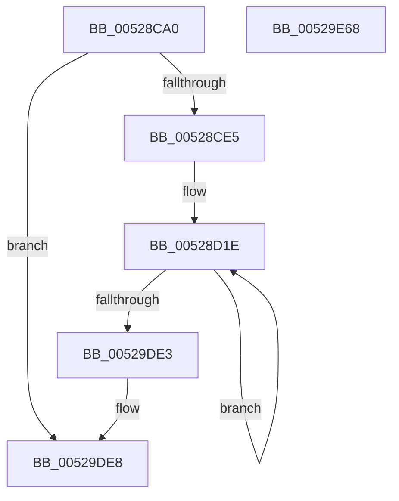

# SymCryptSha1AppendBlocks

- RVA: `0x00528CA0`–`0x00529E69` (길이 `4,553` bytes)
- VA: `0x0000000140528CA0`
- 실행 섹션: `.text`
- PDB 이름 있음: `예`; PDB Function 태그: `아니요`
- unwind 정보 RVA: `0x000C3358`
- 디코드: `1,381`개 명령, `4,553/4,553` bytes 표시
- 미해석 바이트: `0` (있으면 어셈블리에 `.byte`로 보존)

> 이 문서는 커널 이미지의 기계어와 PDB 기호를 분석해 생성했습니다. 4번과 5번은 함수 원형과 자료형을 바이너리 사용 방식에서 추정한 C 해석이며 원본 소스 복구 결과는 아닙니다.

## 1. Dependencies

- 직접 호출 지점: **0**; 고유 호출 대상: **0**
- 직접 호출자로 확인된 함수: **1**
- RIP 상대 이미지 참조: **0**

### Outgoing calls
- 직접 디코드된 call 명령이 없습니다.

### Direct callers
- [SymCryptSha1Result](SymCryptSha1Result_function_00529EA0.md) at `0x00529EF9`
- [SymCryptSha1Result](SymCryptSha1Result_function_00529EA0.md) at `0x00529F32`

### Static image references
- 디코드된 RIP-relative 메모리 참조가 없습니다.

## 2. Other-region calls and transfers

- 다른 실행 섹션으로 향하는 call: **0**
- 별도 외부 분기/꼬리 이동을 확인하지 못했습니다.

## 3. Assembly (complete function range)

```asm
00528CA0  48 89 5C 24 10                  mov qword ptr [rsp + 0x10], rbx
00528CA5  55                              push rbp
00528CA6  56                              push rsi
00528CA7  57                              push rdi
00528CA8  41 54                           push r12
00528CAA  41 55                           push r13
00528CAC  41 56                           push r14
00528CAE  41 57                           push r15
00528CB0  48 81 EC D0 00 00 00            sub rsp, 0xd0
00528CB7  44 8B 69 0C                     mov r13d, dword ptr [rcx + 0xc]
00528CBB  44 8B 19                        mov r11d, dword ptr [rcx]
00528CBE  8B 59 04                        mov ebx, dword ptr [rcx + 4]
00528CC1  44 8B 51 08                     mov r10d, dword ptr [rcx + 8]
00528CC5  44 8B 71 10                     mov r14d, dword ptr [rcx + 0x10]
00528CC9  44 89 6C 24 34                  mov dword ptr [rsp + 0x34], r13d
00528CCE  4C 89 8C 24 80 00 00 00         mov qword ptr [rsp + 0x80], r9
00528CD6  48 89 4C 24 70                  mov qword ptr [rsp + 0x70], rcx
00528CDB  49 83 F8 40                     cmp r8, 0x40
00528CDF  0F 82 03 11 00 00               jb 0x140529de8
00528CE5  49 8B C0                        mov rax, r8
00528CE8  44 89 5C 24 3C                  mov dword ptr [rsp + 0x3c], r11d
00528CED  48 C1 E8 06                     shr rax, 6
00528CF1  48 8D 6A 08                     lea rbp, [rdx + 8]
00528CF5  48 89 44 24 68                  mov qword ptr [rsp + 0x68], rax
00528CFA  48 6B C0 C0                     imul rax, rax, -0x40
00528CFE  89 5C 24 40                     mov dword ptr [rsp + 0x40], ebx
00528D02  4C 03 C0                        add r8, rax
00528D05  44 89 54 24 44                  mov dword ptr [rsp + 0x44], r10d
00528D0A  4C 89 44 24 78                  mov qword ptr [rsp + 0x78], r8
00528D0F  44 89 6C 24 48                  mov dword ptr [rsp + 0x48], r13d
00528D14  44 89 74 24 4C                  mov dword ptr [rsp + 0x4c], r14d
00528D19  48 89 6C 24 60                  mov qword ptr [rsp + 0x60], rbp
00528D1E  8B 7D F8                        mov edi, dword ptr [rbp - 8]
00528D21  45 8B C2                        mov r8d, r10d
00528D24  44 8B 7D 04                     mov r15d, dword ptr [rbp + 4]
00528D28  41 8B D5                        mov edx, r13d
00528D2B  44 8B 65 08                     mov r12d, dword ptr [rbp + 8]
00528D2F  41 33 D2                        xor edx, r10d
00528D32  23 D3                           and edx, ebx
00528D34  41 81 C6 99 79 82 5A            add r14d, 0x5a827999
00528D3B  41 33 D5                        xor edx, r13d
00528D3E  C1 CB 02                        ror ebx, 2
00528D41  44 8B 6D FC                     mov r13d, dword ptr [rbp - 4]
00528D45  44 33 C3                        xor r8d, ebx
00528D48  45 23 C3                        and r8d, r11d
00528D4B  41 8B C3                        mov eax, r11d
00528D4E  C1 C0 05                        rol eax, 5
00528D51  45 33 C2                        xor r8d, r10d
00528D54  41 81 C2 99 79 82 5A            add r10d, 0x5a827999
00528D5B  41 C1 CB 02                     ror r11d, 2
00528D5F  41 0F CD                        bswap r13d
00528D62  44 8B CB                        mov r9d, ebx
00528D65  44 89 2C 24                     mov dword ptr [rsp], r13d
00528D69  45 33 CB                        xor r9d, r11d
00528D6C  0F CF                           bswap edi
00528D6E  03 C7                           add eax, edi
00528D70  03 D0                           add edx, eax
00528D72  41 03 D6                        add edx, r14d
00528D75  44 8B 75 00                     mov r14d, dword ptr [rbp]
00528D79  44 23 CA                        and r9d, edx
00528D7C  8B C2                           mov eax, edx
00528D7E  C1 C0 05                        rol eax, 5
00528D81  44 33 CB                        xor r9d, ebx
00528D84  41 03 C5                        add eax, r13d
00528D87  C1 CA 02                        ror edx, 2
00528D8A  44 8B 6D 0C                     mov r13d, dword ptr [rbp + 0xc]
00528D8E  44 03 C0                        add r8d, eax
00528D91  8B 44 24 34                     mov eax, dword ptr [rsp + 0x34]
00528D95  8B CA                           mov ecx, edx
00528D97  05 99 79 82 5A                  add eax, 0x5a827999
00528D9C  44 03 C0                        add r8d, eax
00528D9F  41 8B C0                        mov eax, r8d
00528DA2  C1 C0 05                        rol eax, 5
00528DA5  41 0F CE                        bswap r14d
00528DA8  41 03 C6                        add eax, r14d
00528DAB  44 03 C8                        add r9d, eax
00528DAE  45 03 CA                        add r9d, r10d
00528DB1  44 8B D2                        mov r10d, edx
00528DB4  45 33 D3                        xor r10d, r11d
00528DB7  41 8B C1                        mov eax, r9d
00528DBA  C1 C0 05                        rol eax, 5
00528DBD  45 23 D0                        and r10d, r8d
00528DC0  05 99 79 82 5A                  add eax, 0x5a827999
00528DC5  41 C1 C8 02                     ror r8d, 2
00528DC9  41 33 C8                        xor ecx, r8d
00528DCC  45 33 D3                        xor r10d, r11d
00528DCF  41 23 C9                        and ecx, r9d
00528DD2  41 C1 C9 02                     ror r9d, 2
00528DD6  33 CA                           xor ecx, edx
00528DD8  41 0F CF                        bswap r15d
00528DDB  41 03 C7                        add eax, r15d
00528DDE  44 03 D0                        add r10d, eax
00528DE1  44 03 D3                        add r10d, ebx
00528DE4  8B 5D 10                        mov ebx, dword ptr [rbp + 0x10]
00528DE7  41 8B C2                        mov eax, r10d
00528DEA  C1 C0 05                        rol eax, 5
00528DED  05 99 79 82 5A                  add eax, 0x5a827999
00528DF2  41 0F CC                        bswap r12d
00528DF5  41 03 C4                        add eax, r12d
00528DF8  03 C8                           add ecx, eax
00528DFA  44 03 D9                        add r11d, ecx
00528DFD  41 8B C8                        mov ecx, r8d
00528E00  41 33 C9                        xor ecx, r9d
00528E03  41 8B C3                        mov eax, r11d
00528E06  C1 C0 05                        rol eax, 5
00528E09  41 23 CA                        and ecx, r10d
00528E0C  05 99 79 82 5A                  add eax, 0x5a827999
00528E11  41 33 C8                        xor ecx, r8d
00528E14  41 0F CD                        bswap r13d
00528E17  41 03 C5                        add eax, r13d
00528E1A  03 C8                           add ecx, eax
00528E1C  03 D1                           add edx, ecx
00528E1E  41 C1 CA 02                     ror r10d, 2
00528E22  8B 75 18                        mov esi, dword ptr [rbp + 0x18]
00528E25  8B C2                           mov eax, edx
00528E27  C1 C0 05                        rol eax, 5
00528E2A  41 8B C9                        mov ecx, r9d
00528E2D  41 33 CA                        xor ecx, r10d
00528E30  05 99 79 82 5A                  add eax, 0x5a827999
00528E35  41 23 CB                        and ecx, r11d
00528E38  41 C1 CB 02                     ror r11d, 2
00528E3C  41 33 C9                        xor ecx, r9d
00528E3F  0F CB                           bswap ebx
00528E41  03 C3                           add eax, ebx
00528E43  89 5C 24 2C                     mov dword ptr [rsp + 0x2c], ebx
00528E47  03 C8                           add ecx, eax
00528E49  8B 5D 14                        mov ebx, dword ptr [rbp + 0x14]
00528E4C  44 03 C1                        add r8d, ecx
00528E4F  41 8B CA                        mov ecx, r10d
00528E52  41 33 CB                        xor ecx, r11d
00528E55  41 8B C0                        mov eax, r8d
00528E58  23 CA                           and ecx, edx
00528E5A  C1 C0 05                        rol eax, 5
00528E5D  41 33 CA                        xor ecx, r10d
00528E60  C1 CA 02                        ror edx, 2
00528E63  05 99 79 82 5A                  add eax, 0x5a827999
00528E68  0F CB                           bswap ebx
00528E6A  03 C3                           add eax, ebx
00528E6C  89 5C 24 20                     mov dword ptr [rsp + 0x20], ebx
00528E70  03 C8                           add ecx, eax
00528E72  8B 5D 1C                        mov ebx, dword ptr [rbp + 0x1c]
00528E75  44 03 C9                        add r9d, ecx
00528E78  8B CA                           mov ecx, edx
00528E7A  41 33 CB                        xor ecx, r11d
00528E7D  41 8B C1                        mov eax, r9d
00528E80  41 23 C8                        and ecx, r8d
00528E83  C1 C0 05                        rol eax, 5
00528E86  41 33 CB                        xor ecx, r11d
00528E89  41 C1 C8 02                     ror r8d, 2
00528E8D  05 99 79 82 5A                  add eax, 0x5a827999
00528E92  0F CB                           bswap ebx
00528E94  89 5C 24 08                     mov dword ptr [rsp + 8], ebx
00528E98  81 C3 99 79 82 5A               add ebx, 0x5a827999
00528E9E  0F CE                           bswap esi
00528EA0  03 C6                           add eax, esi
00528EA2  89 74 24 1C                     mov dword ptr [rsp + 0x1c], esi
00528EA6  03 C8                           add ecx, eax
00528EA8  44 03 D1                        add r10d, ecx
00528EAB  8B CA                           mov ecx, edx
00528EAD  41 33 C8                        xor ecx, r8d
00528EB0  41 8B C2                        mov eax, r10d
00528EB3  41 23 C9                        and ecx, r9d
00528EB6  C1 C0 05                        rol eax, 5
00528EB9  03 C3                           add eax, ebx
00528EBB  41 C1 C9 02                     ror r9d, 2
00528EBF  8B 5D 20                        mov ebx, dword ptr [rbp + 0x20]
00528EC2  33 CA                           xor ecx, edx
00528EC4  03 C8                           add ecx, eax
00528EC6  44 03 D9                        add r11d, ecx
00528EC9  41 8B C8                        mov ecx, r8d
00528ECC  41 33 C9                        xor ecx, r9d
00528ECF  41 8B C3                        mov eax, r11d
00528ED2  41 23 CA                        and ecx, r10d
00528ED5  C1 C0 05                        rol eax, 5
00528ED8  41 33 C8                        xor ecx, r8d
00528EDB  41 C1 CA 02                     ror r10d, 2
00528EDF  0F CB                           bswap ebx
00528EE1  89 5C 24 34                     mov dword ptr [rsp + 0x34], ebx
00528EE5  81 C3 99 79 82 5A               add ebx, 0x5a827999
00528EEB  03 C3                           add eax, ebx
00528EED  8B 5D 24                        mov ebx, dword ptr [rbp + 0x24]
00528EF0  03 C8                           add ecx, eax
00528EF2  03 D1                           add edx, ecx
00528EF4  41 8B C9                        mov ecx, r9d
00528EF7  41 33 CA                        xor ecx, r10d
00528EFA  8B C2                           mov eax, edx
00528EFC  C1 C0 05                        rol eax, 5
00528EFF  41 23 CB                        and ecx, r11d
00528F02  05 99 79 82 5A                  add eax, 0x5a827999
00528F07  41 33 C9                        xor ecx, r9d
00528F0A  0F CB                           bswap ebx
00528F0C  03 C3                           add eax, ebx
00528F0E  89 5C 24 18                     mov dword ptr [rsp + 0x18], ebx
00528F12  03 C8                           add ecx, eax
00528F14  8B 5D 28                        mov ebx, dword ptr [rbp + 0x28]
00528F17  44 03 C1                        add r8d, ecx
00528F1A  0F CB                           bswap ebx
00528F1C  89 5C 24 04                     mov dword ptr [rsp + 4], ebx
00528F20  41 8B C0                        mov eax, r8d
00528F23  C1 C0 05                        rol eax, 5
00528F26  41 8B CA                        mov ecx, r10d
00528F29  05 99 79 82 5A                  add eax, 0x5a827999
00528F2E  41 C1 CB 02                     ror r11d, 2
00528F32  41 33 CB                        xor ecx, r11d
00528F35  03 C3                           add eax, ebx
00528F37  8B 5D 2C                        mov ebx, dword ptr [rbp + 0x2c]
00528F3A  23 CA                           and ecx, edx
00528F3C  41 33 CA                        xor ecx, r10d
00528F3F  C1 CA 02                        ror edx, 2
00528F42  03 C8                           add ecx, eax
00528F44  44 03 C9                        add r9d, ecx
00528F47  8B CA                           mov ecx, edx
00528F49  41 33 CB                        xor ecx, r11d
00528F4C  41 8B C1                        mov eax, r9d
00528F4F  41 23 C8                        and ecx, r8d
00528F52  C1 C0 05                        rol eax, 5
00528F55  41 33 CB                        xor ecx, r11d
00528F58  41 C1 C8 02                     ror r8d, 2
00528F5C  05 99 79 82 5A                  add eax, 0x5a827999
00528F61  41 81 C3 99 79 82 5A            add r11d, 0x5a827999
00528F68  0F CB                           bswap ebx
00528F6A  03 C3                           add eax, ebx
00528F6C  89 5C 24 30                     mov dword ptr [rsp + 0x30], ebx
00528F70  8B 5D 30                        mov ebx, dword ptr [rbp + 0x30]
00528F73  03 C8                           add ecx, eax
00528F75  44 03 D1                        add r10d, ecx
00528F78  8B CA                           mov ecx, edx
00528F7A  41 33 C8                        xor ecx, r8d
00528F7D  41 8B C2                        mov eax, r10d
00528F80  41 23 C9                        and ecx, r9d
00528F83  C1 C0 05                        rol eax, 5
00528F86  33 CA                           xor ecx, edx
00528F88  41 C1 C9 02                     ror r9d, 2
00528F8C  0F CB                           bswap ebx
00528F8E  89 5C 24 28                     mov dword ptr [rsp + 0x28], ebx
00528F92  03 D8                           add ebx, eax
00528F94  03 D9                           add ebx, ecx
00528F96  41 8B C8                        mov ecx, r8d
00528F99  41 33 C9                        xor ecx, r9d
00528F9C  41 03 DB                        add ebx, r11d
00528F9F  44 8B 5D 34                     mov r11d, dword ptr [rbp + 0x34]
00528FA3  41 23 CA                        and ecx, r10d
00528FA6  41 33 C8                        xor ecx, r8d
00528FA9  41 C1 CA 02                     ror r10d, 2
00528FAD  8D AA 99 79 82 5A               lea ebp, [rdx + 0x5a827999]
00528FB3  8B C3                           mov eax, ebx
00528FB5  C1 C0 05                        rol eax, 5
00528FB8  41 8B D6                        mov edx, r14d
00528FBB  33 54 24 30                     xor edx, dword ptr [rsp + 0x30]
00528FBF  33 D6                           xor edx, esi
00528FC1  41 8D B0 99 79 82 5A            lea esi, [r8 + 0x5a827999]
00528FC8  44 8B 04 24                     mov r8d, dword ptr [rsp]
00528FCC  33 D7                           xor edx, edi
00528FCE  44 33 44 24 08                  xor r8d, dword ptr [rsp + 8]
00528FD3  44 33 44 24 28                  xor r8d, dword ptr [rsp + 0x28]
00528FD8  D1 C2                           rol edx, 1
00528FDA  45 33 C7                        xor r8d, r15d
00528FDD  41 0F CB                        bswap r11d
00528FE0  41 03 C3                        add eax, r11d
00528FE3  44 89 5C 24 10                  mov dword ptr [rsp + 0x10], r11d
00528FE8  03 C8                           add ecx, eax
00528FEA  89 54 24 0C                     mov dword ptr [rsp + 0xc], edx
00528FEE  03 E9                           add ebp, ecx
00528FF0  41 8B C9                        mov ecx, r9d
00528FF3  41 33 CA                        xor ecx, r10d
00528FF6  8B C5                           mov eax, ebp
00528FF8  23 CB                           and ecx, ebx
00528FFA  C1 C0 05                        rol eax, 5
00528FFD  41 33 C9                        xor ecx, r9d
00529000  C1 CB 02                        ror ebx, 2
00529003  03 C2                           add eax, edx
00529005  03 C8                           add ecx, eax
00529007  03 F1                           add esi, ecx
00529009  41 D1 C0                        rol r8d, 1
0052900C  44 89 04 24                     mov dword ptr [rsp], r8d
00529010  8B 54 24 18                     mov edx, dword ptr [rsp + 0x18]
00529014  41 8D B9 99 79 82 5A            lea edi, [r9 + 0x5a827999]
0052901B  33 54 24 0C                     xor edx, dword ptr [rsp + 0xc]
0052901F  41 8B CA                        mov ecx, r10d
00529022  33 CB                           xor ecx, ebx
00529024  41 33 D5                        xor edx, r13d
00529027  23 CD                           and ecx, ebp
00529029  41 33 D7                        xor edx, r15d
0052902C  44 8B 7C 24 04                  mov r15d, dword ptr [rsp + 4]
00529031  41 33 CA                        xor ecx, r10d
00529034  D1 C2                           rol edx, 1
00529036  8B C6                           mov eax, esi
00529038  C1 C0 05                        rol eax, 5
0052903B  45 8B CC                        mov r9d, r12d
0052903E  41 03 C0                        add eax, r8d
00529041  C1 CD 02                        ror ebp, 2
00529044  03 C8                           add ecx, eax
00529046  89 54 24 14                     mov dword ptr [rsp + 0x14], edx
0052904A  03 F9                           add edi, ecx
0052904C  45 33 CE                        xor r9d, r14d
0052904F  44 8B 74 24 34                  mov r14d, dword ptr [rsp + 0x34]
00529054  45 33 CB                        xor r9d, r11d
00529057  45 33 CE                        xor r9d, r14d
0052905A  45 8D 9A 99 79 82 5A            lea r11d, [r10 + 0x5a827999]
00529061  44 8B 54 24 2C                  mov r10d, dword ptr [rsp + 0x2c]
00529066  8B C7                           mov eax, edi
00529068  41 D1 C1                        rol r9d, 1
0052906B  45 33 C2                        xor r8d, r10d
0052906E  C1 C0 05                        rol eax, 5
00529071  45 33 C7                        xor r8d, r15d
00529074  41 03 C1                        add eax, r9d
00529077  44 89 4C 24 34                  mov dword ptr [rsp + 0x34], r9d
0052907C  44 33 4C 24 20                  xor r9d, dword ptr [rsp + 0x20]
00529081  45 33 C4                        xor r8d, r12d
00529084  44 8B 64 24 30                  mov r12d, dword ptr [rsp + 0x30]
00529089  45 33 CD                        xor r9d, r13d
0052908C  44 8B 6C 24 14                  mov r13d, dword ptr [rsp + 0x14]
00529091  45 33 CC                        xor r9d, r12d
00529094  41 D1 C0                        rol r8d, 1
00529097  8B CD                           mov ecx, ebp
00529099  33 CB                           xor ecx, ebx
0052909B  41 D1 C1                        rol r9d, 1
0052909E  23 CE                           and ecx, esi
005290A0  44 89 4C 24 30                  mov dword ptr [rsp + 0x30], r9d
005290A5  33 CB                           xor ecx, ebx
005290A7  C1 CE 02                        ror esi, 2
005290AA  03 C8                           add ecx, eax
005290AC  44 89 44 24 2C                  mov dword ptr [rsp + 0x2c], r8d
005290B1  44 03 D9                        add r11d, ecx
005290B4  8B CD                           mov ecx, ebp
005290B6  33 CE                           xor ecx, esi
005290B8  41 8B C3                        mov eax, r11d
005290BB  23 CF                           and ecx, edi
005290BD  C1 C0 05                        rol eax, 5
005290C0  33 CD                           xor ecx, ebp
005290C2  C1 CF 02                        ror edi, 2
005290C5  81 C1 99 79 82 5A               add ecx, 0x5a827999
005290CB  03 D0                           add edx, eax
005290CD  03 D1                           add edx, ecx
005290CF  8B CE                           mov ecx, esi
005290D1  33 CF                           xor ecx, edi
005290D3  03 D3                           add edx, ebx
005290D5  41 33 CB                        xor ecx, r11d
005290D8  8B C2                           mov eax, edx
005290DA  C1 C0 05                        rol eax, 5
005290DD  41 03 C0                        add eax, r8d
005290E0  41 C1 CB 02                     ror r11d, 2
005290E4  03 C8                           add ecx, eax
005290E6  44 8D 85 A1 EB D9 6E            lea r8d, [rbp + 0x6ed9eba1]
005290ED  44 03 C1                        add r8d, ecx
005290F0  8B CF                           mov ecx, edi
005290F2  41 33 CB                        xor ecx, r11d
005290F5  41 8B C0                        mov eax, r8d
005290F8  33 CA                           xor ecx, edx
005290FA  C1 C0 05                        rol eax, 5
005290FD  44 03 C8                        add r9d, eax
00529100  C1 CA 02                        ror edx, 2
00529103  81 C1 A1 EB D9 6E               add ecx, 0x6ed9eba1
00529109  44 03 C9                        add r9d, ecx
0052910C  44 03 CE                        add r9d, esi
0052910F  45 33 EA                        xor r13d, r10d
00529112  8B 5C 24 08                     mov ebx, dword ptr [rsp + 8]
00529116  44 8D 97 A1 EB D9 6E            lea r10d, [rdi + 0x6ed9eba1]
0052911D  8B 6C 24 28                     mov ebp, dword ptr [rsp + 0x28]
00529121  41 8B C1                        mov eax, r9d
00529124  8B 7C 24 10                     mov edi, dword ptr [rsp + 0x10]
00529128  44 33 ED                        xor r13d, ebp
0052912B  44 33 6C 24 1C                  xor r13d, dword ptr [rsp + 0x1c]
00529130  41 8B C8                        mov ecx, r8d
00529133  8B 74 24 18                     mov esi, dword ptr [rsp + 0x18]
00529137  41 33 CB                        xor ecx, r11d
0052913A  33 CA                           xor ecx, edx
0052913C  41 D1 C5                        rol r13d, 1
0052913F  C1 C0 05                        rol eax, 5
00529142  41 03 C5                        add eax, r13d
00529145  44 89 6C 24 28                  mov dword ptr [rsp + 0x28], r13d
0052914A  44 8B 6C 24 2C                  mov r13d, dword ptr [rsp + 0x2c]
0052914F  03 C8                           add ecx, eax
00529151  44 33 6C 24 20                  xor r13d, dword ptr [rsp + 0x20]
00529156  44 03 D1                        add r10d, ecx
00529159  44 33 EB                        xor r13d, ebx
0052915C  41 C1 C8 02                     ror r8d, 2
00529160  44 33 EF                        xor r13d, edi
00529163  41 8B C2                        mov eax, r10d
00529166  C1 C0 05                        rol eax, 5
00529169  41 8B C8                        mov ecx, r8d
0052916C  41 33 C9                        xor ecx, r9d
0052916F  41 D1 C5                        rol r13d, 1
00529172  33 CA                           xor ecx, edx
00529174  44 89 6C 24 08                  mov dword ptr [rsp + 8], r13d
00529179  41 81 C5 A1 EB D9 6E            add r13d, 0x6ed9eba1
00529180  41 C1 C9 02                     ror r9d, 2
00529184  41 03 C5                        add eax, r13d
00529187  44 8B 6C 24 0C                  mov r13d, dword ptr [rsp + 0xc]
0052918C  44 33 6C 24 30                  xor r13d, dword ptr [rsp + 0x30]
00529191  03 C8                           add ecx, eax
00529193  44 33 6C 24 1C                  xor r13d, dword ptr [rsp + 0x1c]
00529198  44 03 D9                        add r11d, ecx
0052919B  45 33 EE                        xor r13d, r14d
0052919E  41 8B C3                        mov eax, r11d
005291A1  C1 C0 05                        rol eax, 5
005291A4  41 8B C8                        mov ecx, r8d
005291A7  41 33 C9                        xor ecx, r9d
005291AA  41 D1 C5                        rol r13d, 1
005291AD  41 33 CA                        xor ecx, r10d
005291B0  44 89 6C 24 04                  mov dword ptr [rsp + 4], r13d
005291B5  41 81 C5 A1 EB D9 6E            add r13d, 0x6ed9eba1
005291BC  41 C1 CA 02                     ror r10d, 2
005291C0  41 03 C5                        add eax, r13d
005291C3  44 8B 2C 24                     mov r13d, dword ptr [rsp]
005291C7  03 C8                           add ecx, eax
005291C9  41 33 F5                        xor esi, r13d
005291CC  03 D1                           add edx, ecx
005291CE  33 F3                           xor esi, ebx
005291D0  33 74 24 28                     xor esi, dword ptr [rsp + 0x28]
005291D4  8B C2                           mov eax, edx
005291D6  D1 C6                           rol esi, 1
005291D8  41 8B C9                        mov ecx, r9d
005291DB  41 33 CA                        xor ecx, r10d
005291DE  89 34 24                        mov dword ptr [rsp], esi
005291E1  81 C6 A1 EB D9 6E               add esi, 0x6ed9eba1
005291E7  C1 C0 05                        rol eax, 5
005291EA  03 C6                           add eax, esi
005291EC  41 33 CB                        xor ecx, r11d
005291EF  8B 74 24 34                     mov esi, dword ptr [rsp + 0x34]
005291F3  03 C8                           add ecx, eax
005291F5  44 03 C1                        add r8d, ecx
005291F8  41 C1 CB 02                     ror r11d, 2
005291FC  41 33 F7                        xor esi, r15d
005291FF  41 8B C0                        mov eax, r8d
00529202  33 74 24 08                     xor esi, dword ptr [rsp + 8]
00529206  41 8B CA                        mov ecx, r10d
00529209  C1 C0 05                        rol eax, 5
0052920C  41 33 CB                        xor ecx, r11d
0052920F  41 33 F6                        xor esi, r14d
00529212  05 A1 EB D9 6E                  add eax, 0x6ed9eba1
00529217  D1 C6                           rol esi, 1
00529219  33 CA                           xor ecx, edx
0052921B  03 C6                           add eax, esi
0052921D  03 C8                           add ecx, eax
0052921F  44 03 C9                        add r9d, ecx
00529222  C1 CA 02                        ror edx, 2
00529225  8B 5C 24 18                     mov ebx, dword ptr [rsp + 0x18]
00529229  41 8B C8                        mov ecx, r8d
0052922C  44 8B 74 24 14                  mov r14d, dword ptr [rsp + 0x14]
00529231  41 33 CB                        xor ecx, r11d
00529234  41 33 DE                        xor ebx, r14d
00529237  41 C1 C8 02                     ror r8d, 2
0052923B  33 5C 24 04                     xor ebx, dword ptr [rsp + 4]
0052923F  33 CA                           xor ecx, edx
00529241  41 33 DC                        xor ebx, r12d
00529244  41 8B C1                        mov eax, r9d
00529247  D1 C3                           rol ebx, 1
00529249  89 5C 24 18                     mov dword ptr [rsp + 0x18], ebx
0052924D  81 C3 A1 EB D9 6E               add ebx, 0x6ed9eba1
00529253  C1 C0 05                        rol eax, 5
00529256  03 C3                           add eax, ebx
00529258  03 C8                           add ecx, eax
0052925A  8B 44 24 2C                     mov eax, dword ptr [rsp + 0x2c]
0052925E  44 03 D1                        add r10d, ecx
00529261  41 33 C7                        xor eax, r15d
00529264  33 C5                           xor eax, ebp
00529266  41 8B C8                        mov ecx, r8d
00529269  33 04 24                        xor eax, dword ptr [rsp]
0052926C  41 33 C9                        xor ecx, r9d
0052926F  D1 C0                           rol eax, 1
00529271  33 CA                           xor ecx, edx
00529273  89 44 24 24                     mov dword ptr [rsp + 0x24], eax
00529277  41 8B C2                        mov eax, r10d
0052927A  8B 5C 24 24                     mov ebx, dword ptr [rsp + 0x24]
0052927E  81 C3 A1 EB D9 6E               add ebx, 0x6ed9eba1
00529284  C1 C0 05                        rol eax, 5
00529287  03 C3                           add eax, ebx
00529289  41 C1 C9 02                     ror r9d, 2
0052928D  8B 5C 24 30                     mov ebx, dword ptr [rsp + 0x30]
00529291  03 C8                           add ecx, eax
00529293  41 33 DC                        xor ebx, r12d
00529296  44 03 D9                        add r11d, ecx
00529299  44 8B 64 24 28                  mov r12d, dword ptr [rsp + 0x28]
0052929E  33 DE                           xor ebx, esi
005292A0  33 DF                           xor ebx, edi
005292A2  41 8B C3                        mov eax, r11d
005292A5  D1 C3                           rol ebx, 1
005292A7  41 8B C8                        mov ecx, r8d
005292AA  89 5C 24 10                     mov dword ptr [rsp + 0x10], ebx
005292AE  41 33 C9                        xor ecx, r9d
005292B1  81 C3 A1 EB D9 6E               add ebx, 0x6ed9eba1
005292B7  C1 C0 05                        rol eax, 5
005292BA  03 C3                           add eax, ebx
005292BC  41 33 CA                        xor ecx, r10d
005292BF  8B 5C 24 0C                     mov ebx, dword ptr [rsp + 0xc]
005292C3  03 C8                           add ecx, eax
005292C5  41 33 DC                        xor ebx, r12d
005292C8  41 C1 CA 02                     ror r10d, 2
005292CC  33 DD                           xor ebx, ebp
005292CE  03 D1                           add edx, ecx
005292D0  33 5C 24 18                     xor ebx, dword ptr [rsp + 0x18]
005292D4  8B C2                           mov eax, edx
005292D6  8B 6C 24 08                     mov ebp, dword ptr [rsp + 8]
005292DA  41 8B C9                        mov ecx, r9d
005292DD  D1 C3                           rol ebx, 1
005292DF  41 33 CA                        xor ecx, r10d
005292E2  89 5C 24 1C                     mov dword ptr [rsp + 0x1c], ebx
005292E6  41 33 CB                        xor ecx, r11d
005292E9  81 C3 A1 EB D9 6E               add ebx, 0x6ed9eba1
005292EF  C1 C0 05                        rol eax, 5
005292F2  03 C3                           add eax, ebx
005292F4  41 C1 CB 02                     ror r11d, 2
005292F8  03 C8                           add ecx, eax
005292FA  41 8B DD                        mov ebx, r13d
005292FD  44 03 C1                        add r8d, ecx
00529300  33 DD                           xor ebx, ebp
00529302  33 5C 24 24                     xor ebx, dword ptr [rsp + 0x24]
00529306  41 8B C0                        mov eax, r8d
00529309  C1 C0 05                        rol eax, 5
0052930C  33 DF                           xor ebx, edi
0052930E  D1 C3                           rol ebx, 1
00529310  41 8B CA                        mov ecx, r10d
00529313  41 33 CB                        xor ecx, r11d
00529316  89 5C 24 20                     mov dword ptr [rsp + 0x20], ebx
0052931A  05 A1 EB D9 6E                  add eax, 0x6ed9eba1
0052931F  33 CA                           xor ecx, edx
00529321  03 C3                           add eax, ebx
00529323  03 C8                           add ecx, eax
00529325  8B 7C 24 0C                     mov edi, dword ptr [rsp + 0xc]
00529329  33 7C 24 34                     xor edi, dword ptr [rsp + 0x34]
0052932D  44 03 C9                        add r9d, ecx
00529330  33 7C 24 04                     xor edi, dword ptr [rsp + 4]
00529334  41 8B C1                        mov eax, r9d
00529337  33 7C 24 10                     xor edi, dword ptr [rsp + 0x10]
0052933B  41 8B C8                        mov ecx, r8d
0052933E  44 8B 7C 24 2C                  mov r15d, dword ptr [rsp + 0x2c]
00529343  41 33 CB                        xor ecx, r11d
00529346  C1 C0 05                        rol eax, 5
00529349  D1 C7                           rol edi, 1
0052934B  89 7C 24 0C                     mov dword ptr [rsp + 0xc], edi
0052934F  81 C7 A1 EB D9 6E               add edi, 0x6ed9eba1
00529355  03 C7                           add eax, edi
00529357  C1 CA 02                        ror edx, 2
0052935A  33 CA                           xor ecx, edx
0052935C  41 C1 C8 02                     ror r8d, 2
00529360  03 C8                           add ecx, eax
00529362  41 8B FE                        mov edi, r14d
00529365  44 03 D1                        add r10d, ecx
00529368  41 33 FD                        xor edi, r13d
0052936B  33 3C 24                        xor edi, dword ptr [rsp]
0052936E  41 8B C2                        mov eax, r10d
00529371  33 7C 24 1C                     xor edi, dword ptr [rsp + 0x1c]
00529375  41 8B C8                        mov ecx, r8d
00529378  44 8B 6C 24 30                  mov r13d, dword ptr [rsp + 0x30]
0052937D  41 33 C9                        xor ecx, r9d
00529380  33 CA                           xor ecx, edx
00529382  C1 C0 05                        rol eax, 5
00529385  D1 C7                           rol edi, 1
00529387  45 33 F5                        xor r14d, r13d
0052938A  44 33 74 24 18                  xor r14d, dword ptr [rsp + 0x18]
0052938F  44 33 74 24 0C                  xor r14d, dword ptr [rsp + 0xc]
00529394  89 7C 24 14                     mov dword ptr [rsp + 0x14], edi
00529398  81 C7 A1 EB D9 6E               add edi, 0x6ed9eba1
0052939E  03 C7                           add eax, edi
005293A0  41 C1 C9 02                     ror r9d, 2
005293A4  03 C8                           add ecx, eax
005293A6  41 D1 C6                        rol r14d, 1
005293A9  44 03 D9                        add r11d, ecx
005293AC  41 8B FF                        mov edi, r15d
005293AF  33 7C 24 34                     xor edi, dword ptr [rsp + 0x34]
005293B3  45 33 FC                        xor r15d, r12d
005293B6  44 33 7C 24 24                  xor r15d, dword ptr [rsp + 0x24]
005293BB  33 FB                           xor edi, ebx
005293BD  44 33 7C 24 14                  xor r15d, dword ptr [rsp + 0x14]
005293C2  41 8B C3                        mov eax, r11d
005293C5  C1 C0 05                        rol eax, 5
005293C8  33 FE                           xor edi, esi
005293CA  05 A1 EB D9 6E                  add eax, 0x6ed9eba1
005293CF  D1 C7                           rol edi, 1
005293D1  03 C7                           add eax, edi
005293D3  41 D1 C7                        rol r15d, 1
005293D6  41 8B C8                        mov ecx, r8d
005293D9  41 33 C9                        xor ecx, r9d
005293DC  41 33 CA                        xor ecx, r10d
005293DF  41 C1 CA 02                     ror r10d, 2
005293E3  03 C8                           add ecx, eax
005293E5  03 D1                           add edx, ecx
005293E7  41 8B C9                        mov ecx, r9d
005293EA  41 33 CA                        xor ecx, r10d
005293ED  8B C2                           mov eax, edx
005293EF  C1 C0 05                        rol eax, 5
005293F2  41 33 CB                        xor ecx, r11d
005293F5  05 A1 EB D9 6E                  add eax, 0x6ed9eba1
005293FA  41 C1 CB 02                     ror r11d, 2
005293FE  41 03 C6                        add eax, r14d
00529401  03 C8                           add ecx, eax
00529403  44 03 C1                        add r8d, ecx
00529406  41 8B CA                        mov ecx, r10d
00529409  41 33 CB                        xor ecx, r11d
0052940C  41 8B C0                        mov eax, r8d
0052940F  C1 C0 05                        rol eax, 5
00529412  33 CA                           xor ecx, edx
00529414  05 A1 EB D9 6E                  add eax, 0x6ed9eba1
00529419  C1 CA 02                        ror edx, 2
0052941C  41 03 C7                        add eax, r15d
0052941F  03 C8                           add ecx, eax
00529421  44 03 C9                        add r9d, ecx
00529424  44 33 ED                        xor r13d, ebp
00529427  33 2C 24                        xor ebp, dword ptr [rsp]
0052942A  41 8B C1                        mov eax, r9d
0052942D  44 33 64 24 04                  xor r12d, dword ptr [rsp + 4]
00529432  33 EB                           xor ebp, ebx
00529434  44 33 6C 24 10                  xor r13d, dword ptr [rsp + 0x10]
00529439  8D 9A A1 EB D9 6E               lea ebx, [rdx + 0x6ed9eba1]
0052943F  44 33 64 24 1C                  xor r12d, dword ptr [rsp + 0x1c]
00529444  41 33 EF                        xor ebp, r15d
00529447  D1 C5                           rol ebp, 1
00529449  41 8B C8                        mov ecx, r8d
0052944C  41 33 CB                        xor ecx, r11d
0052944F  C1 C0 05                        rol eax, 5
00529452  33 CA                           xor ecx, edx
00529454  89 6C 24 08                     mov dword ptr [rsp + 8], ebp
00529458  05 A1 EB D9 6E                  add eax, 0x6ed9eba1
0052945D  41 C1 C8 02                     ror r8d, 2
00529461  44 33 EF                        xor r13d, edi
00529464  45 33 E6                        xor r12d, r14d
00529467  41 D1 C4                        rol r12d, 1
0052946A  41 D1 C5                        rol r13d, 1
0052946D  41 03 C5                        add eax, r13d
00529470  44 89 64 24 28                  mov dword ptr [rsp + 0x28], r12d
00529475  03 C8                           add ecx, eax
00529477  44 03 D1                        add r10d, ecx
0052947A  41 8B C8                        mov ecx, r8d
0052947D  41 33 C9                        xor ecx, r9d
00529480  41 8B C2                        mov eax, r10d
00529483  33 CA                           xor ecx, edx
00529485  C1 C0 05                        rol eax, 5
00529488  05 A1 EB D9 6E                  add eax, 0x6ed9eba1
0052948D  41 C1 C9 02                     ror r9d, 2
00529491  41 03 C4                        add eax, r12d
00529494  03 C8                           add ecx, eax
00529496  44 03 D9                        add r11d, ecx
00529499  41 8B C8                        mov ecx, r8d
0052949C  41 33 C9                        xor ecx, r9d
0052949F  41 8B C3                        mov eax, r11d
005294A2  41 33 CA                        xor ecx, r10d
005294A5  C1 C0 05                        rol eax, 5
005294A8  03 C5                           add eax, ebp
005294AA  41 C1 CA 02                     ror r10d, 2
005294AE  8B 6C 24 04                     mov ebp, dword ptr [rsp + 4]
005294B2  03 C8                           add ecx, eax
005294B4  33 6C 24 0C                     xor ebp, dword ptr [rsp + 0xc]
005294B8  03 D9                           add ebx, ecx
005294BA  41 33 ED                        xor ebp, r13d
005294BD  8B D3                           mov edx, ebx
005294BF  33 EE                           xor ebp, esi
005294C1  C1 C2 05                        rol edx, 5
005294C4  D1 C5                           rol ebp, 1
005294C6  44 03 C2                        add r8d, edx
005294C9  89 6C 24 04                     mov dword ptr [rsp + 4], ebp
005294CD  41 8B CA                        mov ecx, r10d
005294D0  41 0B CB                        or ecx, r11d
005294D3  81 C5 DC BC 1B 8F               add ebp, 0x8f1bbcdc
005294D9  41 23 C9                        and ecx, r9d
005294DC  41 8B C2                        mov eax, r10d
005294DF  41 23 C3                        and eax, r11d
005294E2  41 C1 CB 02                     ror r11d, 2
005294E6  0B C8                           or ecx, eax
005294E8  41 8B C3                        mov eax, r11d
005294EB  03 CD                           add ecx, ebp
005294ED  23 C3                           and eax, ebx
005294EF  8B 2C 24                        mov ebp, dword ptr [rsp]
005294F2  44 03 C1                        add r8d, ecx
005294F5  33 6C 24 18                     xor ebp, dword ptr [rsp + 0x18]
005294F9  41 8B CB                        mov ecx, r11d
005294FC  33 6C 24 14                     xor ebp, dword ptr [rsp + 0x14]
00529500  0B CB                           or ecx, ebx
00529502  41 33 EC                        xor ebp, r12d
00529505  41 23 CA                        and ecx, r10d
00529508  D1 C5                           rol ebp, 1
0052950A  0B C8                           or ecx, eax
0052950C  41 8B D0                        mov edx, r8d
0052950F  89 2C 24                        mov dword ptr [rsp], ebp
00529512  81 C5 DC BC 1B 8F               add ebp, 0x8f1bbcdc
00529518  C1 C2 05                        rol edx, 5
0052951B  03 CD                           add ecx, ebp
0052951D  44 03 CA                        add r9d, edx
00529520  44 03 C9                        add r9d, ecx
00529523  C1 CB 02                        ror ebx, 2
00529526  8B 6C 24 24                     mov ebp, dword ptr [rsp + 0x24]
0052952A  41 8B C8                        mov ecx, r8d
0052952D  0B CB                           or ecx, ebx
0052952F  41 8B C0                        mov eax, r8d
00529532  23 C3                           and eax, ebx
00529534  41 C1 C8 02                     ror r8d, 2
00529538  41 23 CB                        and ecx, r11d
0052953B  33 EF                           xor ebp, edi
0052953D  0B C8                           or ecx, eax
0052953F  33 6C 24 08                     xor ebp, dword ptr [rsp + 8]
00529543  8B 44 24 18                     mov eax, dword ptr [rsp + 0x18]
00529547  81 C1 DC BC 1B 8F               add ecx, 0x8f1bbcdc
0052954D  33 44 24 10                     xor eax, dword ptr [rsp + 0x10]
00529551  33 EE                           xor ebp, esi
00529553  41 33 C6                        xor eax, r14d
00529556  D1 C5                           rol ebp, 1
00529558  33 44 24 04                     xor eax, dword ptr [rsp + 4]
0052955C  03 CD                           add ecx, ebp
0052955E  D1 C0                           rol eax, 1
00529560  41 8B D1                        mov edx, r9d
00529563  89 44 24 18                     mov dword ptr [rsp + 0x18], eax
00529567  41 8B C0                        mov eax, r8d
0052956A  41 23 C1                        and eax, r9d
0052956D  C1 C2 05                        rol edx, 5
00529570  44 03 D2                        add r10d, edx
00529573  89 6C 24 2C                     mov dword ptr [rsp + 0x2c], ebp
00529577  44 03 D1                        add r10d, ecx
0052957A  41 8B C8                        mov ecx, r8d
0052957D  41 0B C9                        or ecx, r9d
00529580  41 8B D2                        mov edx, r10d
00529583  23 CB                           and ecx, ebx
00529585  C1 C2 05                        rol edx, 5
00529588  0B C8                           or ecx, eax
0052958A  41 C1 C9 02                     ror r9d, 2
0052958E  8B 44 24 24                     mov eax, dword ptr [rsp + 0x24]
00529592  81 C1 DC BC 1B 8F               add ecx, 0x8f1bbcdc
00529598  33 44 24 1C                     xor eax, dword ptr [rsp + 0x1c]
0052959C  44 03 DA                        add r11d, edx
0052959F  03 4C 24 18                     add ecx, dword ptr [rsp + 0x18]
005295A3  41 33 C7                        xor eax, r15d
005295A6  33 04 24                        xor eax, dword ptr [rsp]
005295A9  44 03 D9                        add r11d, ecx
005295AC  D1 C0                           rol eax, 1
005295AE  41 8B D3                        mov edx, r11d
005295B1  89 44 24 24                     mov dword ptr [rsp + 0x24], eax
005295B5  41 8B C9                        mov ecx, r9d
005295B8  41 0B CA                        or ecx, r10d
005295BB  C1 C2 05                        rol edx, 5
005295BE  41 23 C8                        and ecx, r8d
005295C1  03 DA                           add ebx, edx
005295C3  41 8B C1                        mov eax, r9d
005295C6  41 23 C2                        and eax, r10d
005295C9  41 C1 CA 02                     ror r10d, 2
005295CD  0B C8                           or ecx, eax
005295CF  8B 44 24 10                     mov eax, dword ptr [rsp + 0x10]
005295D3  33 44 24 20                     xor eax, dword ptr [rsp + 0x20]
005295D7  81 C1 DC BC 1B 8F               add ecx, 0x8f1bbcdc
005295DD  03 4C 24 24                     add ecx, dword ptr [rsp + 0x24]
005295E1  33 C5                           xor eax, ebp
005295E3  41 33 C5                        xor eax, r13d
005295E6  03 D9                           add ebx, ecx
005295E8  D1 C0                           rol eax, 1
005295EA  41 8B CA                        mov ecx, r10d
005295ED  89 44 24 10                     mov dword ptr [rsp + 0x10], eax
005295F1  41 0B CB                        or ecx, r11d
005295F4  41 23 C9                        and ecx, r9d
005295F7  41 8B C2                        mov eax, r10d
005295FA  41 23 C3                        and eax, r11d
005295FD  8B D3                           mov edx, ebx
005295FF  0B C8                           or ecx, eax
00529601  C1 C2 05                        rol edx, 5
00529604  8B 44 24 1C                     mov eax, dword ptr [rsp + 0x1c]
00529608  81 C1 DC BC 1B 8F               add ecx, 0x8f1bbcdc
0052960E  33 44 24 0C                     xor eax, dword ptr [rsp + 0xc]
00529612  44 03 C2                        add r8d, edx
00529615  03 4C 24 10                     add ecx, dword ptr [rsp + 0x10]
00529619  41 33 C4                        xor eax, r12d
0052961C  33 44 24 18                     xor eax, dword ptr [rsp + 0x18]
00529620  44 03 C1                        add r8d, ecx
00529623  41 C1 CB 02                     ror r11d, 2
00529627  D1 C0                           rol eax, 1
00529629  8B 74 24 14                     mov esi, dword ptr [rsp + 0x14]
0052962D  41 8B CB                        mov ecx, r11d
00529630  0B CB                           or ecx, ebx
00529632  89 44 24 1C                     mov dword ptr [rsp + 0x1c], eax
00529636  41 23 CA                        and ecx, r10d
00529639  41 33 F6                        xor esi, r14d
0052963C  33 34 24                        xor esi, dword ptr [rsp]
0052963F  41 8B C3                        mov eax, r11d
00529642  33 74 24 1C                     xor esi, dword ptr [rsp + 0x1c]
00529646  23 C3                           and eax, ebx
00529648  0B C8                           or ecx, eax
0052964A  D1 C6                           rol esi, 1
0052964C  8B 44 24 20                     mov eax, dword ptr [rsp + 0x20]
00529650  81 C1 DC BC 1B 8F               add ecx, 0x8f1bbcdc
00529656  03 4C 24 1C                     add ecx, dword ptr [rsp + 0x1c]
0052965A  41 8B D0                        mov edx, r8d
0052965D  33 44 24 14                     xor eax, dword ptr [rsp + 0x14]
00529661  33 44 24 08                     xor eax, dword ptr [rsp + 8]
00529665  33 44 24 24                     xor eax, dword ptr [rsp + 0x24]
00529669  D1 C0                           rol eax, 1
0052966B  89 44 24 20                     mov dword ptr [rsp + 0x20], eax
0052966F  41 8B C0                        mov eax, r8d
00529672  C1 C2 05                        rol edx, 5
00529675  44 03 CA                        add r9d, edx
00529678  C1 CB 02                        ror ebx, 2
0052967B  44 03 C9                        add r9d, ecx
0052967E  89 74 24 14                     mov dword ptr [rsp + 0x14], esi
00529682  23 C3                           and eax, ebx
00529684  81 C6 DC BC 1B 8F               add esi, 0x8f1bbcdc
0052968A  41 8B C8                        mov ecx, r8d
0052968D  41 8B D1                        mov edx, r9d
00529690  0B CB                           or ecx, ebx
00529692  C1 C2 05                        rol edx, 5
00529695  41 23 CB                        and ecx, r11d
00529698  41 C1 C8 02                     ror r8d, 2
0052969C  0B C8                           or ecx, eax
0052969E  44 03 D2                        add r10d, edx
005296A1  8B 44 24 0C                     mov eax, dword ptr [rsp + 0xc]
005296A5  81 C1 DC BC 1B 8F               add ecx, 0x8f1bbcdc
005296AB  03 4C 24 20                     add ecx, dword ptr [rsp + 0x20]
005296AF  33 C7                           xor eax, edi
005296B1  33 44 24 04                     xor eax, dword ptr [rsp + 4]
005296B5  44 03 D1                        add r10d, ecx
005296B8  33 44 24 10                     xor eax, dword ptr [rsp + 0x10]
005296BC  41 8B D2                        mov edx, r10d
005296BF  D1 C0                           rol eax, 1
005296C1  41 8B C8                        mov ecx, r8d
005296C4  41 0B C9                        or ecx, r9d
005296C7  C1 C2 05                        rol edx, 5
005296CA  23 CB                           and ecx, ebx
005296CC  89 44 24 0C                     mov dword ptr [rsp + 0xc], eax
005296D0  44 03 DA                        add r11d, edx
005296D3  41 8B C0                        mov eax, r8d
005296D6  41 23 C1                        and eax, r9d
005296D9  41 C1 C9 02                     ror r9d, 2
005296DD  0B C8                           or ecx, eax
005296DF  41 8B C1                        mov eax, r9d
005296E2  81 C1 DC BC 1B 8F               add ecx, 0x8f1bbcdc
005296E8  41 23 C2                        and eax, r10d
005296EB  03 4C 24 0C                     add ecx, dword ptr [rsp + 0xc]
005296EF  44 03 D9                        add r11d, ecx
005296F2  41 8B C9                        mov ecx, r9d
005296F5  41 0B CA                        or ecx, r10d
005296F8  41 8B D3                        mov edx, r11d
005296FB  41 23 C8                        and ecx, r8d
005296FE  C1 C2 05                        rol edx, 5
00529701  03 DA                           add ebx, edx
00529703  41 C1 CA 02                     ror r10d, 2
00529707  0B C8                           or ecx, eax
00529709  03 CE                           add ecx, esi
0052970B  8B F5                           mov esi, ebp
0052970D  33 F7                           xor esi, edi
0052970F  03 D9                           add ebx, ecx
00529711  41 33 F7                        xor esi, r15d
00529714  8B D3                           mov edx, ebx
00529716  33 74 24 20                     xor esi, dword ptr [rsp + 0x20]
0052971A  41 8B CA                        mov ecx, r10d
0052971D  D1 C6                           rol esi, 1
0052971F  C1 C2 05                        rol edx, 5
00529722  89 74 24 30                     mov dword ptr [rsp + 0x30], esi
00529726  41 0B CB                        or ecx, r11d
00529729  8B 6C 24 0C                     mov ebp, dword ptr [rsp + 0xc]
0052972D  41 23 C9                        and ecx, r9d
00529730  44 03 C2                        add r8d, edx
00529733  41 33 EE                        xor ebp, r14d
00529736  44 8B 74 24 14                  mov r14d, dword ptr [rsp + 0x14]
0052973B  41 33 ED                        xor ebp, r13d
0052973E  33 6C 24 18                     xor ebp, dword ptr [rsp + 0x18]
00529742  45 33 F7                        xor r14d, r15d
00529745  45 33 F4                        xor r14d, r12d
00529748  D1 C5                           rol ebp, 1
0052974A  44 33 74 24 24                  xor r14d, dword ptr [rsp + 0x24]
0052974F  41 8B C2                        mov eax, r10d
00529752  41 23 C3                        and eax, r11d
00529755  41 D1 C6                        rol r14d, 1
00529758  0B C8                           or ecx, eax
0052975A  41 C1 CB 02                     ror r11d, 2
0052975E  81 C1 DC BC 1B 8F               add ecx, 0x8f1bbcdc
00529764  89 6C 24 34                     mov dword ptr [rsp + 0x34], ebp
00529768  03 CE                           add ecx, esi
0052976A  44 89 74 24 50                  mov dword ptr [rsp + 0x50], r14d
0052976F  44 03 C1                        add r8d, ecx
00529772  41 8B C3                        mov eax, r11d
00529775  23 C3                           and eax, ebx
00529777  41 8B CB                        mov ecx, r11d
0052977A  0B CB                           or ecx, ebx
0052977C  41 8B D0                        mov edx, r8d
0052977F  41 23 CA                        and ecx, r10d
00529782  C1 C2 05                        rol edx, 5
00529785  0B C8                           or ecx, eax
00529787  C1 CB 02                        ror ebx, 2
0052978A  81 C1 DC BC 1B 8F               add ecx, 0x8f1bbcdc
00529790  44 03 CA                        add r9d, edx
00529793  03 CD                           add ecx, ebp
00529795  41 8B C0                        mov eax, r8d
00529798  44 03 C9                        add r9d, ecx
0052979B  23 C3                           and eax, ebx
0052979D  41 8B C8                        mov ecx, r8d
005297A0  41 8B D1                        mov edx, r9d
005297A3  0B CB                           or ecx, ebx
005297A5  C1 C2 05                        rol edx, 5
005297A8  41 23 CB                        and ecx, r11d
005297AB  41 C1 C8 02                     ror r8d, 2
005297AF  0B C8                           or ecx, eax
005297B1  44 03 D2                        add r10d, edx
005297B4  81 C1 DC BC 1B 8F               add ecx, 0x8f1bbcdc
005297BA  44 8B E6                        mov r12d, esi
005297BD  41 03 CE                        add ecx, r14d
005297C0  45 33 E5                        xor r12d, r13d
005297C3  44 33 64 24 08                  xor r12d, dword ptr [rsp + 8]
005297C8  44 03 D1                        add r10d, ecx
005297CB  44 33 64 24 10                  xor r12d, dword ptr [rsp + 0x10]
005297D0  41 8B C8                        mov ecx, r8d
005297D3  41 0B C9                        or ecx, r9d
005297D6  41 D1 C4                        rol r12d, 1
005297D9  23 CB                           and ecx, ebx
005297DB  44 89 64 24 58                  mov dword ptr [rsp + 0x58], r12d
005297E0  41 8B C0                        mov eax, r8d
005297E3  41 8B D2                        mov edx, r10d
005297E6  41 23 C1                        and eax, r9d
005297E9  C1 C2 05                        rol edx, 5
005297EC  0B C8                           or ecx, eax
005297EE  41 C1 C9 02                     ror r9d, 2
005297F2  81 C1 DC BC 1B 8F               add ecx, 0x8f1bbcdc
005297F8  44 03 DA                        add r11d, edx
005297FB  41 03 CC                        add ecx, r12d
005297FE  44 8B ED                        mov r13d, ebp
00529801  44 33 6C 24 28                  xor r13d, dword ptr [rsp + 0x28]
00529806  44 03 D9                        add r11d, ecx
00529809  44 33 6C 24 04                  xor r13d, dword ptr [rsp + 4]
0052980E  41 8B C9                        mov ecx, r9d
00529811  44 33 6C 24 1C                  xor r13d, dword ptr [rsp + 0x1c]
00529816  41 0B CA                        or ecx, r10d
00529819  41 23 C8                        and ecx, r8d
0052981C  41 D1 C5                        rol r13d, 1
0052981F  41 8B C1                        mov eax, r9d
00529822  44 89 6C 24 38                  mov dword ptr [rsp + 0x38], r13d
00529827  41 23 C2                        and eax, r10d
0052982A  41 8B FB                        mov edi, r11d
0052982D  0B C8                           or ecx, eax
0052982F  C1 C7 05                        rol edi, 5
00529832  81 C1 DC BC 1B 8F               add ecx, 0x8f1bbcdc
00529838  41 03 CD                        add ecx, r13d
0052983B  41 C1 CA 02                     ror r10d, 2
0052983F  03 FB                           add edi, ebx
00529841  41 8B C2                        mov eax, r10d
00529844  03 F9                           add edi, ecx
00529846  41 23 C3                        and eax, r11d
00529849  41 8B CA                        mov ecx, r10d
0052984C  8B DF                           mov ebx, edi
0052984E  41 0B CB                        or ecx, r11d
00529851  C1 C3 05                        rol ebx, 5
00529854  41 23 C9                        and ecx, r9d
00529857  41 C1 CB 02                     ror r11d, 2
0052985B  0B C8                           or ecx, eax
0052985D  41 03 D8                        add ebx, r8d
00529860  44 8B 44 24 2C                  mov r8d, dword ptr [rsp + 0x2c]
00529865  81 C1 DC BC 1B 8F               add ecx, 0x8f1bbcdc
0052986B  41 8B C3                        mov eax, r11d
0052986E  41 8B F6                        mov esi, r14d
00529871  33 74 24 08                     xor esi, dword ptr [rsp + 8]
00529875  23 C7                           and eax, edi
00529877  33 34 24                        xor esi, dword ptr [rsp]
0052987A  45 8B FC                        mov r15d, r12d
0052987D  44 33 7C 24 0C                  xor r15d, dword ptr [rsp + 0xc]
00529882  33 74 24 20                     xor esi, dword ptr [rsp + 0x20]
00529886  45 33 F8                        xor r15d, r8d
00529889  44 33 7C 24 04                  xor r15d, dword ptr [rsp + 4]
0052988E  D1 C6                           rol esi, 1
00529890  03 CE                           add ecx, esi
00529892  41 D1 C7                        rol r15d, 1
00529895  03 D9                           add ebx, ecx
00529897  89 74 24 54                     mov dword ptr [rsp + 0x54], esi
0052989B  41 8B CB                        mov ecx, r11d
0052989E  44 89 7C 24 2C                  mov dword ptr [rsp + 0x2c], r15d
005298A3  0B CF                           or ecx, edi
005298A5  8B D3                           mov edx, ebx
005298A7  41 23 CA                        and ecx, r10d
005298AA  C1 C2 05                        rol edx, 5
005298AD  0B C8                           or ecx, eax
005298AF  C1 CF 02                        ror edi, 2
005298B2  81 C1 DC BC 1B 8F               add ecx, 0x8f1bbcdc
005298B8  44 03 CA                        add r9d, edx
005298BB  41 03 CF                        add ecx, r15d
005298BE  41 8B C5                        mov eax, r13d
005298C1  33 44 24 14                     xor eax, dword ptr [rsp + 0x14]
005298C5  44 03 C9                        add r9d, ecx
005298C8  33 04 24                        xor eax, dword ptr [rsp]
005298CB  8B CB                           mov ecx, ebx
005298CD  33 44 24 18                     xor eax, dword ptr [rsp + 0x18]
005298D1  0B CF                           or ecx, edi
005298D3  41 23 CB                        and ecx, r11d
005298D6  D1 C0                           rol eax, 1
005298D8  89 44 24 04                     mov dword ptr [rsp + 4], eax
005298DC  41 8B D1                        mov edx, r9d
005298DF  C1 C2 05                        rol edx, 5
005298E2  8B C3                           mov eax, ebx
005298E4  23 C7                           and eax, edi
005298E6  C1 CB 02                        ror ebx, 2
005298E9  0B C8                           or ecx, eax
005298EB  44 03 D2                        add r10d, edx
005298EE  81 C1 DC BC 1B 8F               add ecx, 0x8f1bbcdc
005298F4  8B C6                           mov eax, esi
005298F6  03 4C 24 04                     add ecx, dword ptr [rsp + 4]
005298FA  33 44 24 30                     xor eax, dword ptr [rsp + 0x30]
005298FE  44 03 D1                        add r10d, ecx
00529901  41 33 C0                        xor eax, r8d
00529904  8B CB                           mov ecx, ebx
00529906  33 44 24 24                     xor eax, dword ptr [rsp + 0x24]
0052990A  41 0B C9                        or ecx, r9d
0052990D  D1 C0                           rol eax, 1
0052990F  23 CF                           and ecx, edi
00529911  89 04 24                        mov dword ptr [rsp], eax
00529914  41 8B D2                        mov edx, r10d
00529917  C1 C2 05                        rol edx, 5
0052991A  8B C3                           mov eax, ebx
0052991C  41 23 C1                        and eax, r9d
0052991F  44 03 DA                        add r11d, edx
00529922  0B C8                           or ecx, eax
00529924  81 C1 DC BC 1B 8F               add ecx, 0x8f1bbcdc
0052992A  03 0C 24                        add ecx, dword ptr [rsp]
0052992D  44 03 D9                        add r11d, ecx
00529930  41 C1 C9 02                     ror r9d, 2
00529934  33 74 24 14                     xor esi, dword ptr [rsp + 0x14]
00529938  41 8B C9                        mov ecx, r9d
0052993B  41 0B CA                        or ecx, r10d
0052993E  41 8B D3                        mov edx, r11d
00529941  23 CB                           and ecx, ebx
00529943  C1 C2 05                        rol edx, 5
00529946  81 C3 D6 C1 62 CA               add ebx, 0xca62c1d6
0052994C  41 8B C1                        mov eax, r9d
0052994F  41 23 C2                        and eax, r10d
00529952  45 8B C7                        mov r8d, r15d
00529955  0B C8                           or ecx, eax
00529957  41 C1 CA 02                     ror r10d, 2
0052995B  44 33 C5                        xor r8d, ebp
0052995E  41 8B C1                        mov eax, r9d
00529961  44 33 44 24 18                  xor r8d, dword ptr [rsp + 0x18]
00529966  41 33 C2                        xor eax, r10d
00529969  44 33 44 24 10                  xor r8d, dword ptr [rsp + 0x10]
0052996E  41 33 C3                        xor eax, r11d
00529971  8B 6C 24 04                     mov ebp, dword ptr [rsp + 4]
00529975  03 C3                           add eax, ebx
00529977  8B 1C 24                        mov ebx, dword ptr [rsp]
0052997A  41 33 EE                        xor ebp, r14d
0052997D  33 6C 24 24                     xor ebp, dword ptr [rsp + 0x24]
00529981  41 33 DC                        xor ebx, r12d
00529984  33 5C 24 10                     xor ebx, dword ptr [rsp + 0x10]
00529988  45 8B F5                        mov r14d, r13d
0052998B  33 5C 24 20                     xor ebx, dword ptr [rsp + 0x20]
0052998F  33 6C 24 1C                     xor ebp, dword ptr [rsp + 0x1c]
00529993  41 D1 C0                        rol r8d, 1
00529996  41 03 C8                        add ecx, r8d
00529999  41 C1 CB 02                     ror r11d, 2
0052999D  81 C1 DC BC 1B 8F               add ecx, 0x8f1bbcdc
005299A3  44 89 44 24 08                  mov dword ptr [rsp + 8], r8d
005299A8  44 33 74 24 08                  xor r14d, dword ptr [rsp + 8]
005299AD  44 8D 04 17                     lea r8d, [rdi + rdx]
005299B1  44 33 74 24 0C                  xor r14d, dword ptr [rsp + 0xc]
005299B6  44 03 C1                        add r8d, ecx
005299B9  44 33 74 24 1C                  xor r14d, dword ptr [rsp + 0x1c]
005299BE  41 8B D0                        mov edx, r8d
005299C1  C1 C2 05                        rol edx, 5
005299C4  D1 C5                           rol ebp, 1
005299C6  33 F5                           xor esi, ebp
005299C8  D1 C3                           rol ebx, 1
005299CA  33 74 24 20                     xor esi, dword ptr [rsp + 0x20]
005299CE  03 D5                           add edx, ebp
005299D0  03 D0                           add edx, eax
005299D2  41 D1 C6                        rol r14d, 1
005299D5  8B CA                           mov ecx, edx
005299D7  D1 C6                           rol esi, 1
005299D9  C1 C1 05                        rol ecx, 5
005299DC  41 8B C2                        mov eax, r10d
005299DF  41 33 C3                        xor eax, r11d
005299E2  89 6C 24 24                     mov dword ptr [rsp + 0x24], ebp
005299E6  41 33 C0                        xor eax, r8d
005299E9  89 5C 24 28                     mov dword ptr [rsp + 0x28], ebx
005299ED  41 03 C1                        add eax, r9d
005299F0  41 C1 C8 02                     ror r8d, 2
005299F4  05 D6 C1 62 CA                  add eax, 0xca62c1d6
005299F9  44 89 74 24 1C                  mov dword ptr [rsp + 0x1c], r14d
005299FE  44 8D 0C 0B                     lea r9d, [rbx + rcx]
00529A02  89 74 24 20                     mov dword ptr [rsp + 0x20], esi
00529A06  44 03 C8                        add r9d, eax
00529A09  8B C2                           mov eax, edx
00529A0B  41 33 C3                        xor eax, r11d
00529A0E  C1 CA 02                        ror edx, 2
00529A11  41 33 C0                        xor eax, r8d
00529A14  41 8B C9                        mov ecx, r9d
00529A17  41 03 C2                        add eax, r10d
00529A1A  C1 C1 05                        rol ecx, 5
00529A1D  05 D6 C1 62 CA                  add eax, 0xca62c1d6
00529A22  45 8D 14 0E                     lea r10d, [r14 + rcx]
00529A26  44 03 D0                        add r10d, eax
00529A29  8B C2                           mov eax, edx
00529A2B  41 33 C1                        xor eax, r9d
00529A2E  41 8B CA                        mov ecx, r10d
00529A31  41 33 C0                        xor eax, r8d
00529A34  C1 C1 05                        rol ecx, 5
00529A37  41 03 C3                        add eax, r11d
00529A3A  05 D6 C1 62 CA                  add eax, 0xca62c1d6
00529A3F  44 8D 1C 0E                     lea r11d, [rsi + rcx]
00529A43  44 03 D8                        add r11d, eax
00529A46  44 33 64 24 34                  xor r12d, dword ptr [rsp + 0x34]
00529A4B  41 8B FF                        mov edi, r15d
00529A4E  33 7C 24 30                     xor edi, dword ptr [rsp + 0x30]
00529A52  41 8B CB                        mov ecx, r11d
00529A55  33 7C 24 0C                     xor edi, dword ptr [rsp + 0xc]
00529A59  8B C2                           mov eax, edx
00529A5B  44 33 64 24 08                  xor r12d, dword ptr [rsp + 8]
00529A60  33 FB                           xor edi, ebx
00529A62  44 33 6C 24 50                  xor r13d, dword ptr [rsp + 0x50]
00529A67  8B 5C 24 04                     mov ebx, dword ptr [rsp + 4]
00529A6B  44 33 ED                        xor r13d, ebp
00529A6E  33 5C 24 34                     xor ebx, dword ptr [rsp + 0x34]
00529A72  33 5C 24 14                     xor ebx, dword ptr [rsp + 0x14]
00529A76  44 8B 3C 24                     mov r15d, dword ptr [rsp]
00529A7A  41 33 DE                        xor ebx, r14d
00529A7D  44 33 7C 24 50                  xor r15d, dword ptr [rsp + 0x50]
00529A82  44 33 7C 24 30                  xor r15d, dword ptr [rsp + 0x30]
00529A87  44 8B 74 24 54                  mov r14d, dword ptr [rsp + 0x54]
00529A8C  44 33 FE                        xor r15d, esi
00529A8F  44 33 74 24 58                  xor r14d, dword ptr [rsp + 0x58]
00529A94  44 33 74 24 28                  xor r14d, dword ptr [rsp + 0x28]
00529A99  C1 C1 05                        rol ecx, 5
00529A9C  D1 C3                           rol ebx, 1
00529A9E  41 C1 C9 02                     ror r9d, 2
00529AA2  44 33 EB                        xor r13d, ebx
00529AA5  41 33 C1                        xor eax, r9d
00529AA8  D1 C7                           rol edi, 1
00529AAA  41 33 C2                        xor eax, r10d
00529AAD  89 5C 24 14                     mov dword ptr [rsp + 0x14], ebx
00529AB1  41 03 C0                        add eax, r8d
00529AB4  41 C1 CA 02                     ror r10d, 2
00529AB8  05 D6 C1 62 CA                  add eax, 0xca62c1d6
00529ABD  41 D1 C7                        rol r15d, 1
00529AC0  44 8D 04 0F                     lea r8d, [rdi + rcx]
00529AC4  41 D1 C5                        rol r13d, 1
00529AC7  44 03 C0                        add r8d, eax
00529ACA  89 7C 24 10                     mov dword ptr [rsp + 0x10], edi
00529ACE  41 8B C8                        mov ecx, r8d
00529AD1  41 8B C1                        mov eax, r9d
00529AD4  41 33 C2                        xor eax, r10d
00529AD7  C1 C1 05                        rol ecx, 5
00529ADA  41 33 C3                        xor eax, r11d
00529ADD  44 33 E7                        xor r12d, edi
00529AE0  03 C2                           add eax, edx
00529AE2  41 C1 CB 02                     ror r11d, 2
00529AE6  05 D6 C1 62 CA                  add eax, 0xca62c1d6
00529AEB  41 D1 C4                        rol r12d, 1
00529AEE  8D 14 0B                        lea edx, [rbx + rcx]
00529AF1  45 33 F7                        xor r14d, r15d
00529AF4  03 D0                           add edx, eax
00529AF6  41 8B C2                        mov eax, r10d
00529AF9  41 33 C3                        xor eax, r11d
00529AFC  8B CA                           mov ecx, edx
00529AFE  41 33 C0                        xor eax, r8d
00529B01  C1 C1 05                        rol ecx, 5
00529B04  41 03 C1                        add eax, r9d
00529B07  41 C1 C8 02                     ror r8d, 2
00529B0B  05 D6 C1 62 CA                  add eax, 0xca62c1d6
00529B10  45 8D 0C 0F                     lea r9d, [r15 + rcx]
00529B14  44 03 C8                        add r9d, eax
00529B17  8B C2                           mov eax, edx
00529B19  41 33 C3                        xor eax, r11d
00529B1C  C1 CA 02                        ror edx, 2
00529B1F  41 33 C0                        xor eax, r8d
00529B22  41 8B C9                        mov ecx, r9d
00529B25  41 03 C2                        add eax, r10d
00529B28  C1 C1 05                        rol ecx, 5
00529B2B  05 D6 C1 62 CA                  add eax, 0xca62c1d6
00529B30  45 8D 14 0C                     lea r10d, [r12 + rcx]
00529B34  44 03 D0                        add r10d, eax
00529B37  8B C2                           mov eax, edx
00529B39  41 33 C1                        xor eax, r9d
00529B3C  41 8B DA                        mov ebx, r10d
00529B3F  41 33 C0                        xor eax, r8d
00529B42  C1 C3 05                        rol ebx, 5
00529B45  05 D6 C1 62 CA                  add eax, 0xca62c1d6
00529B4A  41 C1 C9 02                     ror r9d, 2
00529B4E  41 03 C3                        add eax, r11d
00529B51  41 03 DD                        add ebx, r13d
00529B54  03 D8                           add ebx, eax
00529B56  41 D1 C6                        rol r14d, 1
00529B59  8B 74 24 04                     mov esi, dword ptr [rsp + 4]
00529B5D  8B C2                           mov eax, edx
00529B5F  41 33 C1                        xor eax, r9d
00529B62  33 74 24 54                     xor esi, dword ptr [rsp + 0x54]
00529B66  33 74 24 20                     xor esi, dword ptr [rsp + 0x20]
00529B6A  41 33 C2                        xor eax, r10d
00529B6D  8B 6C 24 2C                     mov ebp, dword ptr [rsp + 0x2c]
00529B71  41 03 C0                        add eax, r8d
00529B74  33 6C 24 38                     xor ebp, dword ptr [rsp + 0x38]
00529B78  05 D6 C1 62 CA                  add eax, 0xca62c1d6
00529B7D  33 6C 24 1C                     xor ebp, dword ptr [rsp + 0x1c]
00529B81  81 C2 D6 C1 62 CA               add edx, 0xca62c1d6
00529B87  41 C1 CA 02                     ror r10d, 2
00529B8B  8B CB                           mov ecx, ebx
00529B8D  C1 C1 05                        rol ecx, 5
00529B90  41 33 EC                        xor ebp, r12d
00529B93  D1 C5                           rol ebp, 1
00529B95  41 33 F5                        xor esi, r13d
00529B98  D1 C6                           rol esi, 1
00529B9A  45 8D 04 0E                     lea r8d, [r14 + rcx]
00529B9E  44 03 C0                        add r8d, eax
00529BA1  41 8B C1                        mov eax, r9d
00529BA4  41 33 C2                        xor eax, r10d
00529BA7  41 81 C1 D6 C1 62 CA            add r9d, 0xca62c1d6
00529BAE  33 C3                           xor eax, ebx
00529BB0  41 8B F8                        mov edi, r8d
00529BB3  03 C2                           add eax, edx
00529BB5  C1 C7 05                        rol edi, 5
00529BB8  8B 14 24                        mov edx, dword ptr [rsp]
00529BBB  03 FD                           add edi, ebp
00529BBD  33 54 24 2C                     xor edx, dword ptr [rsp + 0x2c]
00529BC1  03 F8                           add edi, eax
00529BC3  C1 CB 02                        ror ebx, 2
00529BC6  41 33 D6                        xor edx, r14d
00529BC9  33 54 24 10                     xor edx, dword ptr [rsp + 0x10]
00529BCD  41 8B C2                        mov eax, r10d
00529BD0  33 C3                           xor eax, ebx
00529BD2  D1 C2                           rol edx, 1
00529BD4  41 33 C0                        xor eax, r8d
00529BD7  44 8B DF                        mov r11d, edi
00529BDA  41 03 C1                        add eax, r9d
00529BDD  41 C1 C3 05                     rol r11d, 5
00529BE1  44 8B 4C 24 04                  mov r9d, dword ptr [rsp + 4]
00529BE6  44 03 DE                        add r11d, esi
00529BE9  44 33 4C 24 08                  xor r9d, dword ptr [rsp + 8]
00529BEE  44 03 D8                        add r11d, eax
00529BF1  44 33 4C 24 14                  xor r9d, dword ptr [rsp + 0x14]
00529BF6  41 8B CB                        mov ecx, r11d
00529BF9  C1 C1 05                        rol ecx, 5
00529BFC  44 33 CD                        xor r9d, ebp
00529BFF  41 D1 C1                        rol r9d, 1
00529C02  8B C7                           mov eax, edi
00529C04  33 C3                           xor eax, ebx
00529C06  41 C1 C8 02                     ror r8d, 2
00529C0A  41 33 C0                        xor eax, r8d
00529C0D  C1 CF 02                        ror edi, 2
00529C10  41 03 C2                        add eax, r10d
00529C13  44 89 4C 24 04                  mov dword ptr [rsp + 4], r9d
00529C18  05 D6 C1 62 CA                  add eax, 0xca62c1d6
00529C1D  44 8D 14 0A                     lea r10d, [rdx + rcx]
00529C21  44 03 D0                        add r10d, eax
00529C24  8B C7                           mov eax, edi
00529C26  41 33 C3                        xor eax, r11d
00529C29  41 8B CA                        mov ecx, r10d
00529C2C  41 33 C0                        xor eax, r8d
00529C2F  C1 C1 05                        rol ecx, 5
00529C32  05 D6 C1 62 CA                  add eax, 0xca62c1d6
00529C37  41 C1 CB 02                     ror r11d, 2
00529C3B  03 C3                           add eax, ebx
00529C3D  44 03 C9                        add r9d, ecx
00529C40  44 03 C8                        add r9d, eax
00529C43  8B 04 24                        mov eax, dword ptr [rsp]
00529C46  33 44 24 24                     xor eax, dword ptr [rsp + 0x24]
00529C4A  41 8B C9                        mov ecx, r9d
00529C4D  33 C6                           xor eax, esi
00529C4F  C1 C1 05                        rol ecx, 5
00529C52  41 33 C7                        xor eax, r15d
00529C55  D1 C0                           rol eax, 1
00529C57  89 04 24                        mov dword ptr [rsp], eax
00529C5A  8B C7                           mov eax, edi
00529C5C  41 33 C3                        xor eax, r11d
00529C5F  03 0C 24                        add ecx, dword ptr [rsp]
00529C62  41 33 C2                        xor eax, r10d
00529C65  44 8B 7C 24 28                  mov r15d, dword ptr [rsp + 0x28]
00529C6A  41 03 C0                        add eax, r8d
00529C6D  8B 5C 24 1C                     mov ebx, dword ptr [rsp + 0x1c]
00529C71  41 C1 CA 02                     ror r10d, 2
00529C75  44 8D 81 D6 C1 62 CA            lea r8d, [rcx - 0x359d3e2a]
00529C7C  44 03 C0                        add r8d, eax
00529C7F  8B 44 24 08                     mov eax, dword ptr [rsp + 8]
00529C83  33 C2                           xor eax, edx
00529C85  41 8B C8                        mov ecx, r8d
00529C88  C1 C1 05                        rol ecx, 5
00529C8B  41 33 C7                        xor eax, r15d
00529C8E  41 33 C4                        xor eax, r12d
00529C91  44 8B 64 24 04                  mov r12d, dword ptr [rsp + 4]
00529C96  44 33 64 24 24                  xor r12d, dword ptr [rsp + 0x24]
00529C9B  D1 C0                           rol eax, 1
00529C9D  44 33 E3                        xor r12d, ebx
00529CA0  89 44 24 08                     mov dword ptr [rsp + 8], eax
00529CA4  45 33 E5                        xor r12d, r13d
00529CA7  03 4C 24 08                     add ecx, dword ptr [rsp + 8]
00529CAB  41 8B C3                        mov eax, r11d
00529CAE  33 5C 24 08                     xor ebx, dword ptr [rsp + 8]
00529CB2  41 33 C2                        xor eax, r10d
00529CB5  33 5C 24 10                     xor ebx, dword ptr [rsp + 0x10]
00529CB9  41 33 C1                        xor eax, r9d
00529CBC  05 D6 C1 62 CA                  add eax, 0xca62c1d6
00529CC1  41 C1 C9 02                     ror r9d, 2
00529CC5  03 C7                           add eax, edi
00529CC7  41 D1 C4                        rol r12d, 1
00529CCA  03 C8                           add ecx, eax
00529CCC  33 DD                           xor ebx, ebp
00529CCE  89 4C 24 38                     mov dword ptr [rsp + 0x38], ecx
00529CD2  41 8B C2                        mov eax, r10d
00529CD5  C1 C1 05                        rol ecx, 5
00529CD8  41 33 C1                        xor eax, r9d
00529CDB  D1 C3                           rol ebx, 1
00529CDD  41 33 C0                        xor eax, r8d
00529CE0  41 03 C3                        add eax, r11d
00529CE3  41 C1 C8 02                     ror r8d, 2
00529CE7  44 8B 5C 24 20                  mov r11d, dword ptr [rsp + 0x20]
00529CEC  41 03 D9                        add ebx, r9d
00529CEF  45 8D 2C 0C                     lea r13d, [r12 + rcx]
00529CF3  45 33 FB                        xor r15d, r11d
00529CF6  45 33 FE                        xor r15d, r14d
00529CF9  44 33 DE                        xor r11d, esi
00529CFC  44 33 5C 24 14                  xor r11d, dword ptr [rsp + 0x14]
00529D01  41 81 C5 D6 C1 62 CA            add r13d, 0xca62c1d6
00529D08  44 8B 74 24 38                  mov r14d, dword ptr [rsp + 0x38]
00529D0D  44 03 E8                        add r13d, eax
00529D10  44 33 3C 24                     xor r15d, dword ptr [rsp]
00529D14  45 33 DC                        xor r11d, r12d
00529D17  41 8B CE                        mov ecx, r14d
00529D1A  41 D1 C7                        rol r15d, 1
00529D1D  41 33 C9                        xor ecx, r9d
00529D20  41 C1 CE 02                     ror r14d, 2
00529D24  41 33 C8                        xor ecx, r8d
00529D27  41 D1 C3                        rol r11d, 1
00529D2A  81 C1 D6 C1 62 CA               add ecx, 0xca62c1d6
00529D30  45 03 D7                        add r10d, r15d
00529D33  41 8B D5                        mov edx, r13d
00529D36  41 81 C3 D6 C1 62 CA            add r11d, 0xca62c1d6
00529D3D  C1 C2 05                        rol edx, 5
00529D40  44 03 D2                        add r10d, edx
00529D43  44 03 D1                        add r10d, ecx
00529D46  41 8B CE                        mov ecx, r14d
00529D49  41 33 CD                        xor ecx, r13d
00529D4C  41 8B D2                        mov edx, r10d
00529D4F  41 33 C8                        xor ecx, r8d
00529D52  C1 C2 05                        rol edx, 5
00529D55  81 C1 D6 C1 62 CA               add ecx, 0xca62c1d6
00529D5B  41 C1 CD 02                     ror r13d, 2
00529D5F  03 DA                           add ebx, edx
00529D61  03 D9                           add ebx, ecx
00529D63  41 8B CE                        mov ecx, r14d
00529D66  41 33 CD                        xor ecx, r13d
00529D69  8B D3                           mov edx, ebx
00529D6B  41 33 CA                        xor ecx, r10d
00529D6E  C1 C2 05                        rol edx, 5
00529D71  03 4C 24 3C                     add ecx, dword ptr [rsp + 0x3c]
00529D75  45 03 D8                        add r11d, r8d
00529D78  48 8B 44 24 70                  mov rax, qword ptr [rsp + 0x70]
00529D7D  44 03 DA                        add r11d, edx
00529D80  44 03 6C 24 48                  add r13d, dword ptr [rsp + 0x48]
00529D85  44 03 D9                        add r11d, ecx
00529D88  03 5C 24 40                     add ebx, dword ptr [rsp + 0x40]
00529D8C  44 03 74 24 4C                  add r14d, dword ptr [rsp + 0x4c]
00529D91  48 8B 6C 24 60                  mov rbp, qword ptr [rsp + 0x60]
00529D96  41 C1 CA 02                     ror r10d, 2
00529D9A  48 83 C5 40                     add rbp, 0x40
00529D9E  44 03 54 24 44                  add r10d, dword ptr [rsp + 0x44]
00529DA3  48 83 6C 24 68 01               sub qword ptr [rsp + 0x68], 1
00529DA9  44 89 18                        mov dword ptr [rax], r11d
00529DAC  89 58 04                        mov dword ptr [rax + 4], ebx
00529DAF  44 89 50 08                     mov dword ptr [rax + 8], r10d
00529DB3  44 89 68 0C                     mov dword ptr [rax + 0xc], r13d
00529DB7  44 89 70 10                     mov dword ptr [rax + 0x10], r14d
00529DBB  44 89 6C 24 34                  mov dword ptr [rsp + 0x34], r13d
00529DC0  48 89 6C 24 60                  mov qword ptr [rsp + 0x60], rbp
00529DC5  44 89 5C 24 3C                  mov dword ptr [rsp + 0x3c], r11d
00529DCA  89 5C 24 40                     mov dword ptr [rsp + 0x40], ebx
00529DCE  44 89 54 24 44                  mov dword ptr [rsp + 0x44], r10d
00529DD3  44 89 6C 24 48                  mov dword ptr [rsp + 0x48], r13d
00529DD8  44 89 74 24 4C                  mov dword ptr [rsp + 0x4c], r14d
00529DDD  0F 85 3B EF FF FF               jne 0x140528d1e
00529DE3  4C 8B 44 24 78                  mov r8, qword ptr [rsp + 0x78]
00529DE8  48 8B 84 24 80 00 00 00         mov rax, qword ptr [rsp + 0x80]
00529DF0  48 8B 9C 24 18 01 00 00         mov rbx, qword ptr [rsp + 0x118]
00529DF8  4C 89 00                        mov qword ptr [rax], r8
00529DFB  33 C0                           xor eax, eax
00529DFD  48 89 84 24 90 00 00 00         mov qword ptr [rsp + 0x90], rax
00529E05  48 89 84 24 98 00 00 00         mov qword ptr [rsp + 0x98], rax
00529E0D  48 89 84 24 A0 00 00 00         mov qword ptr [rsp + 0xa0], rax
00529E15  48 89 84 24 A8 00 00 00         mov qword ptr [rsp + 0xa8], rax
00529E1D  48 89 84 24 B0 00 00 00         mov qword ptr [rsp + 0xb0], rax
00529E25  48 89 84 24 B8 00 00 00         mov qword ptr [rsp + 0xb8], rax
00529E2D  48 89 84 24 C0 00 00 00         mov qword ptr [rsp + 0xc0], rax
00529E35  48 89 84 24 C8 00 00 00         mov qword ptr [rsp + 0xc8], rax
00529E3D  89 44 24 38                     mov dword ptr [rsp + 0x38], eax
00529E41  89 44 24 38                     mov dword ptr [rsp + 0x38], eax
00529E45  89 44 24 38                     mov dword ptr [rsp + 0x38], eax
00529E49  89 44 24 38                     mov dword ptr [rsp + 0x38], eax
00529E4D  89 44 24 38                     mov dword ptr [rsp + 0x38], eax
00529E51  89 44 24 38                     mov dword ptr [rsp + 0x38], eax
00529E55  48 81 C4 D0 00 00 00            add rsp, 0xd0
00529E5C  41 5F                           pop r15
00529E5E  41 5E                           pop r14
00529E60  41 5D                           pop r13
00529E62  41 5C                           pop r12
00529E64  5F                              pop rdi
00529E65  5E                              pop rsi
00529E66  5D                              pop rbp
00529E67  C3                              ret
00529E68  CC                              int3
```

## 4. C-style interpretation (structured pseudocode)

```c
__int64 __fastcall SymCryptSha1AppendBlocks(__int64 a1, __int64 a2, __int64 a3, __int64 a4)
{
    __int64 result;
    __int64 v_r10;
    __int64 v_r11;
    __int64 v_r12;
    __int64 v_r13;
    __int64 v_r14;
    __int64 v_r15;
    __int64 v_rbp;
    __int64 v_rbx;
    __int64 v_rdi;
    __int64 v_rsi;
    __int64 v_rsp;
    unsigned int v_stack_m100;
    unsigned int v_stack_m104;
    unsigned int v_stack_m108;
    unsigned __int64 v_stack_m40;
    unsigned __int64 v_stack_m48;
    unsigned __int64 v_stack_m50;
    unsigned __int64 v_stack_m58;
    unsigned __int64 v_stack_m60;
    unsigned __int64 v_stack_m68;
    unsigned __int64 v_stack_m70;
    unsigned __int64 v_stack_m78;
    unsigned __int64 v_stack_m88;
    unsigned __int64 v_stack_m90;
    unsigned __int64 v_stack_m98;
    unsigned __int64 v_stack_mA0;
    unsigned __int64 v_stack_mA8;
    unsigned int v_stack_mB0;
    unsigned int v_stack_mB4;
    unsigned int v_stack_mB8;
    unsigned int v_stack_mBC;
    unsigned int v_stack_mC0;
    unsigned int v_stack_mC4;
    unsigned int v_stack_mC8;
    unsigned int v_stack_mCC;
    unsigned int v_stack_mD0;
    unsigned int v_stack_mD4;
    unsigned int v_stack_mD8;
    unsigned int v_stack_mDC;
    unsigned int v_stack_mE0;
    unsigned int v_stack_mE4;
    unsigned int v_stack_mE8;
    unsigned int v_stack_mEC;
    unsigned int v_stack_mF0;
    unsigned int v_stack_mF4;
    unsigned int v_stack_mF8;
    unsigned int v_stack_mFC;
    unsigned __int64 v_stack_p10;

    v_stack_p10 = v_rbx;
    v_rsp = (v_rsp) - (208);
    v_stack_mD4 = (unsigned int)((unsigned int)(*(unsigned int *)(a1 + 12)));
    v_stack_m88 = a4;
    v_stack_m98 = a1;
    if (a3 < 64) goto loc_00529DE8;
    v_stack_mCC = (unsigned int)((unsigned int)(*(unsigned int *)(a1)));
    result = (a3) >> (6);
    v_stack_mA0 = result;
    result = (result) * (result);
    v_stack_mC8 = (unsigned int)((unsigned int)(*(unsigned int *)(a1 + 4)));
    a3 = (a3) + (result);
    v_stack_mC4 = (unsigned int)((unsigned int)(*(unsigned int *)(a1 + 8)));
    v_stack_m90 = a3;
    v_stack_mC0 = (unsigned int)((unsigned int)(*(unsigned int *)(a1 + 12)));
    v_stack_mBC = (unsigned int)((unsigned int)(*(unsigned int *)(a1 + 16)));
    v_stack_mA8 = a2 + 8;
loc_00528D1E:
    a2 = (unsigned int)(((unsigned int)((unsigned int)((unsigned int)(*(unsigned int *)(a1 + 12))))) ^ ((unsigned int)((unsigned int)(*(unsigned int *)(a1 + 8)))));
    a2 = (unsigned int)((a2) & ((unsigned int)((unsigned int)(*(unsigned int *)(a1 + 4)))));
    v_r14 = (unsigned int)(((unsigned int)(*(unsigned int *)(a1 + 16))) + (0x5A827999ULL));
    a2 = (unsigned int)((a2) ^ ((unsigned int)((unsigned int)(*(unsigned int *)(a1 + 12)))));
    a3 = (unsigned int)(((unsigned int)((unsigned int)((unsigned int)(*(unsigned int *)(a1 + 8))))) ^ ((unsigned int)((unsigned int)(*(unsigned int *)(a1 + 4)))));
    a3 = (unsigned int)((a3) & ((unsigned int)((unsigned int)(*(unsigned int *)(a1)))));
    a3 = (unsigned int)((a3) ^ ((unsigned int)((unsigned int)(*(unsigned int *)(a1 + 8)))));
    v_r10 = (unsigned int)(((unsigned int)(*(unsigned int *)(a1 + 8))) + (0x5A827999ULL));
    v_stack_m108 = (unsigned int)((unsigned int)(*(unsigned int *)(a2 + 8 - 4)));
    a4 = (unsigned int)(((unsigned int)((unsigned int)((unsigned int)(*(unsigned int *)(a1 + 4))))) ^ ((unsigned int)((unsigned int)(*(unsigned int *)(a1)))));
    result = (unsigned int)(((unsigned int)((unsigned int)((unsigned int)(*(unsigned int *)(a1))))) + ((unsigned int)((unsigned int)(*(unsigned int *)(a2 + 8 - 8)))));
    a2 = (unsigned int)((a2) + ((unsigned int)(result)));
    a2 = (unsigned int)((a2) + ((unsigned int)(v_r14)));
    a4 = (unsigned int)((a4) & ((unsigned int)(a2)));
    a4 = (unsigned int)((a4) ^ ((unsigned int)((unsigned int)(*(unsigned int *)(a1 + 4)))));
    result = (unsigned int)(((unsigned int)((unsigned int)(a2))) + ((unsigned int)((unsigned int)(*(unsigned int *)(a2 + 8 - 4)))));
    a3 = (unsigned int)((a3) + ((unsigned int)(result)));
    result = (unsigned int)(((unsigned int)(v_stack_mD4)) + (0x5A827999ULL));
    a3 = (unsigned int)((a3) + ((unsigned int)(result)));
    result = (unsigned int)(((unsigned int)((unsigned int)(a3))) + ((unsigned int)((unsigned int)(*(unsigned int *)(a2 + 8)))));
    a4 = (unsigned int)((a4) + ((unsigned int)(result)));
    a4 = (unsigned int)((a4) + ((unsigned int)(v_r10)));
    v_r10 = (unsigned int)(((unsigned int)((unsigned int)(a2))) ^ ((unsigned int)((unsigned int)(*(unsigned int *)(a1)))));
    v_r10 = (unsigned int)((v_r10) & ((unsigned int)(a3)));
    result = (unsigned int)(((unsigned int)((unsigned int)(a4))) + (0x5A827999ULL));
    a1 = (unsigned int)(((unsigned int)((unsigned int)(a2))) ^ ((unsigned int)(a3)));
    v_r10 = (unsigned int)((v_r10) ^ ((unsigned int)((unsigned int)(*(unsigned int *)(a1)))));
    a1 = (unsigned int)((a1) & ((unsigned int)(a4)));
    a1 = (unsigned int)((a1) ^ ((unsigned int)(a2)));
    result = (unsigned int)((result) + ((unsigned int)((unsigned int)(*(unsigned int *)(a2 + 8 + 4)))));
    v_r10 = (unsigned int)((v_r10) + ((unsigned int)(result)));
    v_r10 = (unsigned int)((v_r10) + ((unsigned int)((unsigned int)(*(unsigned int *)(a1 + 4)))));
    result = (unsigned int)(((unsigned int)((unsigned int)(v_r10))) + (0x5A827999ULL));
    result = (unsigned int)((result) + ((unsigned int)((unsigned int)(*(unsigned int *)(a2 + 8 + 8)))));
    a1 = (unsigned int)((a1) + ((unsigned int)(result)));
    v_r11 = (unsigned int)(((unsigned int)(*(unsigned int *)(a1))) + ((unsigned int)(a1)));
    a1 = (unsigned int)(((unsigned int)((unsigned int)(a3))) ^ ((unsigned int)(a4)));
    a1 = (unsigned int)((a1) & ((unsigned int)(v_r10)));
    result = (unsigned int)(((unsigned int)((unsigned int)(v_r11))) + (0x5A827999ULL));
    a1 = (unsigned int)((a1) ^ ((unsigned int)(a3)));
    result = (unsigned int)((result) + ((unsigned int)((unsigned int)(*(unsigned int *)(a2 + 8 + 12)))));
    a1 = (unsigned int)((a1) + ((unsigned int)(result)));
    a2 = (unsigned int)((a2) + ((unsigned int)(a1)));
    a1 = (unsigned int)(((unsigned int)((unsigned int)(a4))) ^ ((unsigned int)(v_r10)));
    result = (unsigned int)(((unsigned int)((unsigned int)(a2))) + (0x5A827999ULL));
    a1 = (unsigned int)((a1) & ((unsigned int)(v_r11)));
    a1 = (unsigned int)((a1) ^ ((unsigned int)(a4)));
    result = (unsigned int)((result) + ((unsigned int)((unsigned int)(*(unsigned int *)(a2 + 8 + 16)))));
    v_stack_mDC = (unsigned int)((unsigned int)(*(unsigned int *)(a2 + 8 + 16)));
    a1 = (unsigned int)((a1) + ((unsigned int)(result)));
    a3 = (unsigned int)((a3) + ((unsigned int)(a1)));
    a1 = (unsigned int)(((unsigned int)((unsigned int)(v_r10))) ^ ((unsigned int)(v_r11)));
    a1 = (unsigned int)((a1) & ((unsigned int)(a2)));
    a1 = (unsigned int)((a1) ^ ((unsigned int)(v_r10)));
    result = (unsigned int)(((unsigned int)((unsigned int)(a3))) + (0x5A827999ULL));
    result = (unsigned int)((result) + ((unsigned int)((unsigned int)(*(unsigned int *)(a2 + 8 + 20)))));
    v_stack_mE8 = (unsigned int)((unsigned int)(*(unsigned int *)(a2 + 8 + 20)));
    a1 = (unsigned int)((a1) + ((unsigned int)(result)));
    a4 = (unsigned int)((a4) + ((unsigned int)(a1)));
    a1 = (unsigned int)(((unsigned int)((unsigned int)(a2))) ^ ((unsigned int)(v_r11)));
    a1 = (unsigned int)((a1) & ((unsigned int)(a3)));
    a1 = (unsigned int)((a1) ^ ((unsigned int)(v_r11)));
    result = (unsigned int)(((unsigned int)((unsigned int)(a4))) + (0x5A827999ULL));
    v_stack_m100 = (unsigned int)((unsigned int)(*(unsigned int *)(a2 + 8 + 28)));
    v_rbx = (unsigned int)(((unsigned int)(*(unsigned int *)(a2 + 8 + 28))) + (0x5A827999ULL));
    result = (unsigned int)((result) + ((unsigned int)((unsigned int)(*(unsigned int *)(a2 + 8 + 24)))));
    v_stack_mEC = (unsigned int)((unsigned int)(*(unsigned int *)(a2 + 8 + 24)));
    a1 = (unsigned int)((a1) + ((unsigned int)(result)));
    v_r10 = (unsigned int)((v_r10) + ((unsigned int)(a1)));
    a1 = (unsigned int)(((unsigned int)((unsigned int)(a2))) ^ ((unsigned int)(a3)));
    a1 = (unsigned int)((a1) & ((unsigned int)(a4)));
    result = (unsigned int)(((unsigned int)((unsigned int)(v_r10))) + ((unsigned int)(v_rbx)));
    a1 = (unsigned int)((a1) ^ ((unsigned int)(a2)));
    a1 = (unsigned int)((a1) + ((unsigned int)(result)));
    v_r11 = (unsigned int)((v_r11) + ((unsigned int)(a1)));
    a1 = (unsigned int)(((unsigned int)((unsigned int)(a3))) ^ ((unsigned int)(a4)));
    a1 = (unsigned int)((a1) & ((unsigned int)(v_r10)));
    a1 = (unsigned int)((a1) ^ ((unsigned int)(a3)));
    v_stack_mD4 = (unsigned int)((unsigned int)(*(unsigned int *)(a2 + 8 + 32)));
    v_rbx = (unsigned int)(((unsigned int)(*(unsigned int *)(a2 + 8 + 32))) + (0x5A827999ULL));
    result = (unsigned int)(((unsigned int)((unsigned int)(v_r11))) + ((unsigned int)(v_rbx)));
    a1 = (unsigned int)((a1) + ((unsigned int)(result)));
    a2 = (unsigned int)((a2) + ((unsigned int)(a1)));
    a1 = (unsigned int)(((unsigned int)((unsigned int)(a4))) ^ ((unsigned int)(v_r10)));
    a1 = (unsigned int)((a1) & ((unsigned int)(v_r11)));
    result = (unsigned int)(((unsigned int)((unsigned int)(a2))) + (0x5A827999ULL));
    a1 = (unsigned int)((a1) ^ ((unsigned int)(a4)));
    result = (unsigned int)((result) + ((unsigned int)((unsigned int)(*(unsigned int *)(a2 + 8 + 36)))));
    v_stack_mF0 = (unsigned int)((unsigned int)(*(unsigned int *)(a2 + 8 + 36)));
    a1 = (unsigned int)((a1) + ((unsigned int)(result)));
    a3 = (unsigned int)((a3) + ((unsigned int)(a1)));
    v_stack_m104 = (unsigned int)((unsigned int)(*(unsigned int *)(a2 + 8 + 40)));
    result = (unsigned int)(((unsigned int)((unsigned int)(a3))) + (0x5A827999ULL));
    a1 = (unsigned int)(((unsigned int)((unsigned int)(v_r10))) ^ ((unsigned int)(v_r11)));
    result = (unsigned int)((result) + ((unsigned int)((unsigned int)(*(unsigned int *)(a2 + 8 + 40)))));
    a1 = (unsigned int)((a1) & ((unsigned int)(a2)));
    a1 = (unsigned int)((a1) ^ ((unsigned int)(v_r10)));
    a1 = (unsigned int)((a1) + ((unsigned int)(result)));
    a4 = (unsigned int)((a4) + ((unsigned int)(a1)));
    a1 = (unsigned int)(((unsigned int)((unsigned int)(a2))) ^ ((unsigned int)(v_r11)));
    a1 = (unsigned int)((a1) & ((unsigned int)(a3)));
    a1 = (unsigned int)((a1) ^ ((unsigned int)(v_r11)));
    result = (unsigned int)(((unsigned int)((unsigned int)(a4))) + (0x5A827999ULL));
    v_r11 = (unsigned int)((v_r11) + (0x5A827999ULL));
    result = (unsigned int)((result) + ((unsigned int)((unsigned int)(*(unsigned int *)(a2 + 8 + 44)))));
    v_stack_mD8 = (unsigned int)((unsigned int)(*(unsigned int *)(a2 + 8 + 44)));
    a1 = (unsigned int)((a1) + ((unsigned int)(result)));
    v_r10 = (unsigned int)((v_r10) + ((unsigned int)(a1)));
    a1 = (unsigned int)(((unsigned int)((unsigned int)(a2))) ^ ((unsigned int)(a3)));
    a1 = (unsigned int)((a1) & ((unsigned int)(a4)));
    a1 = (unsigned int)((a1) ^ ((unsigned int)(a2)));
    v_stack_mE0 = (unsigned int)((unsigned int)(*(unsigned int *)(a2 + 8 + 48)));
    v_rbx = (unsigned int)(((unsigned int)(*(unsigned int *)(a2 + 8 + 48))) + ((unsigned int)((unsigned int)((unsigned int)(v_r10)))));
    v_rbx = (unsigned int)((v_rbx) + ((unsigned int)(a1)));
    a1 = (unsigned int)(((unsigned int)((unsigned int)(a3))) ^ ((unsigned int)(a4)));
    v_rbx = (unsigned int)((v_rbx) + ((unsigned int)(v_r11)));
    a1 = (unsigned int)((a1) & ((unsigned int)(v_r10)));
    a1 = (unsigned int)((a1) ^ ((unsigned int)(a3)));
    a2 = (unsigned int)(((unsigned int)((unsigned int)((unsigned int)(*(unsigned int *)(a2 + 8))))) ^ (v_stack_mD8));
    a2 = (unsigned int)((a2) ^ ((unsigned int)((unsigned int)(*(unsigned int *)(a2 + 8 + 24)))));
    a2 = (unsigned int)((a2) ^ ((unsigned int)((unsigned int)(*(unsigned int *)(a2 + 8 - 8)))));
    a3 = (unsigned int)(((unsigned int)(v_stack_m108)) ^ (v_stack_m100));
    a3 = (unsigned int)((a3) ^ (v_stack_mE0));
    a3 = (unsigned int)((a3) ^ ((unsigned int)((unsigned int)(*(unsigned int *)(a2 + 8 + 4)))));
    result = (unsigned int)(((unsigned int)((unsigned int)(v_rbx))) + ((unsigned int)((unsigned int)(*(unsigned int *)(a2 + 8 + 52)))));
    v_stack_mF8 = (unsigned int)((unsigned int)(*(unsigned int *)(a2 + 8 + 52)));
    a1 = (unsigned int)((a1) + ((unsigned int)(result)));
    v_stack_mFC = (unsigned int)(a2);
    v_rbp = (unsigned int)((a2 + 1518500249) + ((unsigned int)(a1)));
    a1 = (unsigned int)(((unsigned int)((unsigned int)(a4))) ^ ((unsigned int)(v_r10)));
    a1 = (unsigned int)((a1) & ((unsigned int)(v_rbx)));
    a1 = (unsigned int)((a1) ^ ((unsigned int)(a4)));
    result = (unsigned int)(((unsigned int)((unsigned int)(v_rbp))) + ((unsigned int)(a2)));
    a1 = (unsigned int)((a1) + ((unsigned int)(result)));
    v_rsi = (unsigned int)((a3 + 1518500249) + ((unsigned int)(a1)));
    v_stack_m108 = (unsigned int)(a3);
    a2 = (unsigned int)(((unsigned int)(v_stack_mF0)) ^ (v_stack_mFC));
    a1 = (unsigned int)(((unsigned int)((unsigned int)(v_r10))) ^ ((unsigned int)(v_rbx)));
    a2 = (unsigned int)((a2) ^ ((unsigned int)((unsigned int)(*(unsigned int *)(a2 + 8 + 12)))));
    a1 = (unsigned int)((a1) & ((unsigned int)(v_rbp)));
    a2 = (unsigned int)((a2) ^ ((unsigned int)((unsigned int)(*(unsigned int *)(a2 + 8 + 4)))));
    a1 = (unsigned int)((a1) ^ ((unsigned int)(v_r10)));
    result = (unsigned int)(((unsigned int)((unsigned int)(v_rsi))) + ((unsigned int)(a3)));
    a1 = (unsigned int)((a1) + ((unsigned int)(result)));
    v_stack_mF4 = (unsigned int)(a2);
    v_rdi = (unsigned int)((a4 + 1518500249) + ((unsigned int)(a1)));
    a4 = (unsigned int)(((unsigned int)((unsigned int)((unsigned int)(*(unsigned int *)(a2 + 8 + 8))))) ^ ((unsigned int)((unsigned int)(*(unsigned int *)(a2 + 8)))));
    a4 = (unsigned int)((a4) ^ ((unsigned int)((unsigned int)(*(unsigned int *)(a2 + 8 + 52)))));
    a4 = (unsigned int)((a4) ^ ((unsigned int)((unsigned int)(v_stack_mD4))));
    a3 = (unsigned int)((a3) ^ ((unsigned int)((unsigned int)(v_stack_mDC))));
    a3 = (unsigned int)((a3) ^ ((unsigned int)((unsigned int)(v_stack_m104))));
    result = (unsigned int)(((unsigned int)((unsigned int)(v_rdi))) + ((unsigned int)(a4)));
    v_stack_mD4 = (unsigned int)(a4);
    a4 = (unsigned int)((a4) ^ (v_stack_mE8));
    a3 = (unsigned int)((a3) ^ ((unsigned int)((unsigned int)(*(unsigned int *)(a2 + 8 + 8)))));
    a4 = (unsigned int)((a4) ^ ((unsigned int)((unsigned int)(*(unsigned int *)(a2 + 8 + 12)))));
    a4 = (unsigned int)((a4) ^ ((unsigned int)((unsigned int)(v_stack_mD8))));
    a1 = (unsigned int)(((unsigned int)((unsigned int)(v_rbp))) ^ ((unsigned int)(v_rbx)));
    a1 = (unsigned int)((a1) & ((unsigned int)(v_rsi)));
    v_stack_mD8 = (unsigned int)(a4);
    a1 = (unsigned int)((a1) ^ ((unsigned int)(v_rbx)));
    a1 = (unsigned int)((a1) + ((unsigned int)(result)));
    v_stack_mDC = (unsigned int)(a3);
    v_r11 = (unsigned int)((v_r10 + 1518500249) + ((unsigned int)(a1)));
    a1 = (unsigned int)(((unsigned int)((unsigned int)(v_rbp))) ^ ((unsigned int)(v_rsi)));
    a1 = (unsigned int)((a1) & ((unsigned int)(v_rdi)));
    a1 = (unsigned int)((a1) ^ ((unsigned int)(v_rbp)));
    a1 = (unsigned int)((a1) + (0x5A827999ULL));
    a2 = (unsigned int)((a2) + ((unsigned int)((unsigned int)((unsigned int)(v_r11)))));
    a2 = (unsigned int)((a2) + ((unsigned int)(a1)));
    a1 = (unsigned int)(((unsigned int)((unsigned int)(v_rsi))) ^ ((unsigned int)(v_rdi)));
    a2 = (unsigned int)((a2) + ((unsigned int)(v_rbx)));
    a1 = (unsigned int)((a1) ^ ((unsigned int)(v_r11)));
    result = (unsigned int)(((unsigned int)((unsigned int)(a2))) + ((unsigned int)(a3)));
    a1 = (unsigned int)((a1) + ((unsigned int)(result)));
    a3 = (unsigned int)((v_rbp + 1859775393) + ((unsigned int)(a1)));
    a1 = (unsigned int)(((unsigned int)((unsigned int)(v_rdi))) ^ ((unsigned int)(v_r11)));
    a1 = (unsigned int)((a1) ^ ((unsigned int)(a2)));
    a4 = (unsigned int)((a4) + ((unsigned int)((unsigned int)((unsigned int)(a3)))));
    a1 = (unsigned int)((a1) + (0x6ED9EBA1ULL));
    a4 = (unsigned int)((a4) + ((unsigned int)(a1)));
    a4 = (unsigned int)((a4) + ((unsigned int)(v_rsi)));
    v_r13 = (unsigned int)(((unsigned int)(v_stack_mF4)) ^ ((unsigned int)((unsigned int)(v_stack_mDC))));
    v_r13 = (unsigned int)((v_r13) ^ ((unsigned int)((unsigned int)(v_stack_mE0))));
    v_r13 = (unsigned int)((v_r13) ^ (v_stack_mEC));
    a1 = (unsigned int)(((unsigned int)((unsigned int)(a3))) ^ ((unsigned int)(v_r11)));
    a1 = (unsigned int)((a1) ^ ((unsigned int)(a2)));
    result = (unsigned int)(((unsigned int)((unsigned int)(a4))) + ((unsigned int)(v_r13)));
    v_stack_mE0 = (unsigned int)(v_r13);
    a1 = (unsigned int)((a1) + ((unsigned int)(result)));
    v_r13 = (unsigned int)(((unsigned int)(v_stack_mDC)) ^ (v_stack_mE8));
    v_r10 = (unsigned int)((v_rdi + 1859775393) + ((unsigned int)(a1)));
    v_r13 = (unsigned int)((v_r13) ^ ((unsigned int)((unsigned int)(v_stack_m100))));
    v_r13 = (unsigned int)((v_r13) ^ ((unsigned int)((unsigned int)(v_stack_mF8))));
    a1 = (unsigned int)(((unsigned int)((unsigned int)(a3))) ^ ((unsigned int)(a4)));
    a1 = (unsigned int)((a1) ^ ((unsigned int)(a2)));
    v_stack_m100 = (unsigned int)(v_r13);
    v_r13 = (unsigned int)((v_r13) + (0x6ED9EBA1ULL));
    result = (unsigned int)(((unsigned int)((unsigned int)(v_r10))) + ((unsigned int)(v_r13)));
    v_r13 = (unsigned int)(((unsigned int)(v_stack_mFC)) ^ (v_stack_mD8));
    a1 = (unsigned int)((a1) + ((unsigned int)(result)));
    v_r13 = (unsigned int)((v_r13) ^ (v_stack_mEC));
    v_r11 = (unsigned int)((v_r11) + ((unsigned int)(a1)));
    v_r13 = (unsigned int)((v_r13) ^ ((unsigned int)((unsigned int)(v_stack_mD4))));
    a1 = (unsigned int)(((unsigned int)((unsigned int)(a3))) ^ ((unsigned int)(a4)));
    a1 = (unsigned int)((a1) ^ ((unsigned int)(v_r10)));
    v_stack_m104 = (unsigned int)(v_r13);
    v_r13 = (unsigned int)((v_r13) + (0x6ED9EBA1ULL));
    result = (unsigned int)(((unsigned int)((unsigned int)(v_r11))) + ((unsigned int)(v_r13)));
    a1 = (unsigned int)((a1) + ((unsigned int)(result)));
    v_rsi = (unsigned int)(((unsigned int)(v_stack_mF0)) ^ ((unsigned int)((unsigned int)(v_stack_m108))));
    a2 = (unsigned int)((a2) + ((unsigned int)(a1)));
    v_rsi = (unsigned int)((v_rsi) ^ ((unsigned int)((unsigned int)(v_stack_m100))));
    v_rsi = (unsigned int)((v_rsi) ^ (v_stack_mE0));
    a1 = (unsigned int)(((unsigned int)((unsigned int)(a4))) ^ ((unsigned int)(v_r10)));
    v_stack_m108 = (unsigned int)(v_rsi);
    v_rsi = (unsigned int)((v_rsi) + (0x6ED9EBA1ULL));
    result = (unsigned int)(((unsigned int)((unsigned int)(a2))) + ((unsigned int)(v_rsi)));
    a1 = (unsigned int)((a1) ^ ((unsigned int)(v_r11)));
    a1 = (unsigned int)((a1) + ((unsigned int)(result)));
    a3 = (unsigned int)((a3) + ((unsigned int)(a1)));
    v_rsi = (unsigned int)(((unsigned int)(v_stack_mD4)) ^ ((unsigned int)((unsigned int)(v_stack_m104))));
    v_rsi = (unsigned int)((v_rsi) ^ (v_stack_m100));
    a1 = (unsigned int)(((unsigned int)((unsigned int)(v_r10))) ^ ((unsigned int)(v_r11)));
    v_rsi = (unsigned int)((v_rsi) ^ ((unsigned int)((unsigned int)(v_stack_mD4))));
    result = (unsigned int)(((unsigned int)((unsigned int)(a3))) + (0x6ED9EBA1ULL));
    a1 = (unsigned int)((a1) ^ ((unsigned int)(a2)));
    result = (unsigned int)((result) + ((unsigned int)(v_rsi)));
    a1 = (unsigned int)((a1) + ((unsigned int)(result)));
    a4 = (unsigned int)((a4) + ((unsigned int)(a1)));
    a1 = (unsigned int)(((unsigned int)((unsigned int)(a3))) ^ ((unsigned int)(v_r11)));
    v_rbx = (unsigned int)(((unsigned int)(v_stack_mF0)) ^ ((unsigned int)((unsigned int)(v_stack_mF4))));
    v_rbx = (unsigned int)((v_rbx) ^ (v_stack_m104));
    a1 = (unsigned int)((a1) ^ ((unsigned int)(a2)));
    v_rbx = (unsigned int)((v_rbx) ^ ((unsigned int)((unsigned int)(v_stack_mD8))));
    v_stack_mF0 = (unsigned int)(v_rbx);
    v_rbx = (unsigned int)((v_rbx) + (0x6ED9EBA1ULL));
    result = (unsigned int)(((unsigned int)((unsigned int)(a4))) + ((unsigned int)(v_rbx)));
    a1 = (unsigned int)((a1) + ((unsigned int)(result)));
    v_r10 = (unsigned int)((v_r10) + ((unsigned int)(a1)));
    result = (unsigned int)(((unsigned int)(v_stack_mDC)) ^ ((unsigned int)((unsigned int)(v_stack_m104))));
    result = (unsigned int)((result) ^ ((unsigned int)((unsigned int)(v_stack_mE0))));
    result = (unsigned int)((result) ^ (v_stack_m108));
    a1 = (unsigned int)(((unsigned int)((unsigned int)(a3))) ^ ((unsigned int)(a4)));
    a1 = (unsigned int)((a1) ^ ((unsigned int)(a2)));
    v_stack_mE4 = (unsigned int)(result);
    v_rbx = (unsigned int)(((unsigned int)(v_stack_mE4)) + (0x6ED9EBA1ULL));
    result = (unsigned int)(((unsigned int)((unsigned int)(v_r10))) + ((unsigned int)(v_rbx)));
    a1 = (unsigned int)((a1) + ((unsigned int)(result)));
    v_rbx = (unsigned int)(((unsigned int)(v_stack_mD8)) ^ ((unsigned int)((unsigned int)(v_stack_mD8))));
    v_r11 = (unsigned int)((v_r11) + ((unsigned int)(a1)));
    v_rbx = (unsigned int)((v_rbx) ^ ((unsigned int)(v_rsi)));
    v_rbx = (unsigned int)((v_rbx) ^ ((unsigned int)((unsigned int)(v_stack_mF8))));
    v_stack_mF8 = (unsigned int)(v_rbx);
    a1 = (unsigned int)(((unsigned int)((unsigned int)(a3))) ^ ((unsigned int)(a4)));
    v_rbx = (unsigned int)((v_rbx) + (0x6ED9EBA1ULL));
    result = (unsigned int)(((unsigned int)((unsigned int)(v_r11))) + ((unsigned int)(v_rbx)));
    a1 = (unsigned int)((a1) ^ ((unsigned int)(v_r10)));
    a1 = (unsigned int)((a1) + ((unsigned int)(result)));
    v_rbx = (unsigned int)(((unsigned int)(v_stack_mFC)) ^ ((unsigned int)((unsigned int)(v_stack_mE0))));
    v_rbx = (unsigned int)((v_rbx) ^ ((unsigned int)((unsigned int)(v_stack_mE0))));
    a2 = (unsigned int)((a2) + ((unsigned int)(a1)));
    v_rbx = (unsigned int)((v_rbx) ^ (v_stack_mF0));
    a1 = (unsigned int)(((unsigned int)((unsigned int)(a4))) ^ ((unsigned int)(v_r10)));
    v_stack_mEC = (unsigned int)(v_rbx);
    a1 = (unsigned int)((a1) ^ ((unsigned int)(v_r11)));
    v_rbx = (unsigned int)((v_rbx) + (0x6ED9EBA1ULL));
    result = (unsigned int)(((unsigned int)((unsigned int)(a2))) + ((unsigned int)(v_rbx)));
    a1 = (unsigned int)((a1) + ((unsigned int)(result)));
    a3 = (unsigned int)((a3) + ((unsigned int)(a1)));
    v_rbx = (unsigned int)(((unsigned int)((unsigned int)((unsigned int)(v_stack_m108)))) ^ ((unsigned int)((unsigned int)(v_stack_m100))));
    v_rbx = (unsigned int)((v_rbx) ^ (v_stack_mE4));
    v_rbx = (unsigned int)((v_rbx) ^ ((unsigned int)((unsigned int)(v_stack_mF8))));
    a1 = (unsigned int)(((unsigned int)((unsigned int)(v_r10))) ^ ((unsigned int)(v_r11)));
    v_stack_mE8 = (unsigned int)(v_rbx);
    result = (unsigned int)(((unsigned int)((unsigned int)(a3))) + (0x6ED9EBA1ULL));
    a1 = (unsigned int)((a1) ^ ((unsigned int)(a2)));
    result = (unsigned int)((result) + ((unsigned int)(v_rbx)));
    a1 = (unsigned int)((a1) + ((unsigned int)(result)));
    v_rdi = (unsigned int)(((unsigned int)(v_stack_mFC)) ^ (v_stack_mD4));
    a4 = (unsigned int)((a4) + ((unsigned int)(a1)));
    v_rdi = (unsigned int)((v_rdi) ^ (v_stack_m104));
    v_rdi = (unsigned int)((v_rdi) ^ (v_stack_mF8));
    a1 = (unsigned int)(((unsigned int)((unsigned int)(a3))) ^ ((unsigned int)(v_r11)));
    v_stack_mFC = (unsigned int)(v_rdi);
    v_rdi = (unsigned int)((v_rdi) + (0x6ED9EBA1ULL));
    result = (unsigned int)(((unsigned int)((unsigned int)(a4))) + ((unsigned int)(v_rdi)));
    a1 = (unsigned int)((a1) ^ ((unsigned int)(a2)));
    a1 = (unsigned int)((a1) + ((unsigned int)(result)));
    v_r10 = (unsigned int)((v_r10) + ((unsigned int)(a1)));
    v_rdi = (unsigned int)(((unsigned int)((unsigned int)((unsigned int)(v_stack_mF4)))) ^ ((unsigned int)((unsigned int)(v_stack_m108))));
    v_rdi = (unsigned int)((v_rdi) ^ (v_stack_m108));
    v_rdi = (unsigned int)((v_rdi) ^ (v_stack_mEC));
    a1 = (unsigned int)(((unsigned int)((unsigned int)(a3))) ^ ((unsigned int)(a4)));
    a1 = (unsigned int)((a1) ^ ((unsigned int)(a2)));
    v_r14 = (unsigned int)(((unsigned int)(v_stack_mF4)) ^ ((unsigned int)((unsigned int)(v_stack_mD8))));
    v_r14 = (unsigned int)((v_r14) ^ (v_stack_mF0));
    v_r14 = (unsigned int)((v_r14) ^ (v_stack_mFC));
    v_stack_mF4 = (unsigned int)(v_rdi);
    v_rdi = (unsigned int)((v_rdi) + (0x6ED9EBA1ULL));
    result = (unsigned int)(((unsigned int)((unsigned int)(v_r10))) + ((unsigned int)(v_rdi)));
    a1 = (unsigned int)((a1) + ((unsigned int)(result)));
    v_r11 = (unsigned int)((v_r11) + ((unsigned int)(a1)));
    v_rdi = (unsigned int)(((unsigned int)((unsigned int)((unsigned int)(v_stack_mDC)))) ^ (v_stack_mD4));
    v_r15 = (unsigned int)(((unsigned int)(v_stack_mDC)) ^ ((unsigned int)((unsigned int)(v_stack_mE0))));
    v_r15 = (unsigned int)((v_r15) ^ (v_stack_mE4));
    v_rdi = (unsigned int)((v_rdi) ^ ((unsigned int)(v_rbx)));
    v_r15 = (unsigned int)((v_r15) ^ (v_stack_mF4));
    v_rdi = (unsigned int)((v_rdi) ^ ((unsigned int)(v_rsi)));
    result = (unsigned int)(((unsigned int)((unsigned int)(v_r11))) + (0x6ED9EBA1ULL));
    result = (unsigned int)((result) + ((unsigned int)(v_rdi)));
    a1 = (unsigned int)(((unsigned int)((unsigned int)(a3))) ^ ((unsigned int)(a4)));
    a1 = (unsigned int)((a1) ^ ((unsigned int)(v_r10)));
    a1 = (unsigned int)((a1) + ((unsigned int)(result)));
    a2 = (unsigned int)((a2) + ((unsigned int)(a1)));
    a1 = (unsigned int)(((unsigned int)((unsigned int)(a4))) ^ ((unsigned int)(v_r10)));
    a1 = (unsigned int)((a1) ^ ((unsigned int)(v_r11)));
    result = (unsigned int)(((unsigned int)((unsigned int)(a2))) + (0x6ED9EBA1ULL));
    result = (unsigned int)((result) + ((unsigned int)(v_r14)));
    a1 = (unsigned int)((a1) + ((unsigned int)(result)));
    a3 = (unsigned int)((a3) + ((unsigned int)(a1)));
    a1 = (unsigned int)(((unsigned int)((unsigned int)(v_r10))) ^ ((unsigned int)(v_r11)));
    a1 = (unsigned int)((a1) ^ ((unsigned int)(a2)));
    result = (unsigned int)(((unsigned int)((unsigned int)(a3))) + (0x6ED9EBA1ULL));
    result = (unsigned int)((result) + ((unsigned int)(v_r15)));
    a1 = (unsigned int)((a1) + ((unsigned int)(result)));
    a4 = (unsigned int)((a4) + ((unsigned int)(a1)));
    v_r13 = (unsigned int)(((unsigned int)(v_stack_mD8)) ^ ((unsigned int)((unsigned int)(v_stack_m100))));
    v_rbp = (unsigned int)(((unsigned int)(v_stack_m100)) ^ (v_stack_m108));
    v_r12 = (unsigned int)(((unsigned int)(v_stack_mE0)) ^ (v_stack_m104));
    v_rbp = (unsigned int)((v_rbp) ^ ((unsigned int)(v_rbx)));
    v_r13 = (unsigned int)((v_r13) ^ (v_stack_mF8));
    v_r12 = (unsigned int)((v_r12) ^ (v_stack_mEC));
    v_rbp = (unsigned int)((v_rbp) ^ ((unsigned int)(v_r15)));
    a1 = (unsigned int)(((unsigned int)((unsigned int)(a3))) ^ ((unsigned int)(v_r11)));
    a1 = (unsigned int)((a1) ^ ((unsigned int)(a2)));
    v_stack_m100 = (unsigned int)(v_rbp);
    result = (unsigned int)(((unsigned int)((unsigned int)(a4))) + (0x6ED9EBA1ULL));
    v_r13 = (unsigned int)((v_r13) ^ ((unsigned int)(v_rdi)));
    v_r12 = (unsigned int)((v_r12) ^ ((unsigned int)(v_r14)));
    result = (unsigned int)((result) + ((unsigned int)(v_r13)));
    v_stack_mE0 = (unsigned int)(v_r12);
    a1 = (unsigned int)((a1) + ((unsigned int)(result)));
    v_r10 = (unsigned int)((v_r10) + ((unsigned int)(a1)));
    a1 = (unsigned int)(((unsigned int)((unsigned int)(a3))) ^ ((unsigned int)(a4)));
    a1 = (unsigned int)((a1) ^ ((unsigned int)(a2)));
    result = (unsigned int)(((unsigned int)((unsigned int)(v_r10))) + (0x6ED9EBA1ULL));
    result = (unsigned int)((result) + ((unsigned int)(v_r12)));
    a1 = (unsigned int)((a1) + ((unsigned int)(result)));
    v_r11 = (unsigned int)((v_r11) + ((unsigned int)(a1)));
    a1 = (unsigned int)(((unsigned int)((unsigned int)(a3))) ^ ((unsigned int)(a4)));
    a1 = (unsigned int)((a1) ^ ((unsigned int)(v_r10)));
    result = (unsigned int)(((unsigned int)((unsigned int)(v_r11))) + ((unsigned int)(v_rbp)));
    a1 = (unsigned int)((a1) + ((unsigned int)(result)));
    v_rbp = (unsigned int)(((unsigned int)(v_stack_m104)) ^ (v_stack_mFC));
    v_rbx = (unsigned int)((a2 + 1859775393) + ((unsigned int)(a1)));
    v_rbp = (unsigned int)((v_rbp) ^ ((unsigned int)(v_r13)));
    v_rbp = (unsigned int)((v_rbp) ^ ((unsigned int)(v_rsi)));
    a3 = (unsigned int)((a3) + ((unsigned int)((unsigned int)((unsigned int)(v_rbx)))));
    v_stack_m104 = (unsigned int)(v_rbp);
    a1 = (unsigned int)(((unsigned int)((unsigned int)(v_r10))) | ((unsigned int)(v_r11)));
    v_rbp = (unsigned int)((v_rbp) + (0x8F1BBCDCULL));
    a1 = (unsigned int)((a1) & ((unsigned int)(a4)));
    result = (unsigned int)(((unsigned int)((unsigned int)(v_r10))) & ((unsigned int)(v_r11)));
    a1 = (unsigned int)((a1) | ((unsigned int)(result)));
    a1 = (unsigned int)((a1) + ((unsigned int)(v_rbp)));
    result = (unsigned int)(((unsigned int)((unsigned int)(v_r11))) & ((unsigned int)(v_rbx)));
    a3 = (unsigned int)((a3) + ((unsigned int)(a1)));
    v_rbp = (unsigned int)(((unsigned int)(v_stack_m108)) ^ (v_stack_mF0));
    v_rbp = (unsigned int)((v_rbp) ^ (v_stack_mF4));
    a1 = (unsigned int)(((unsigned int)((unsigned int)(v_r11))) | ((unsigned int)(v_rbx)));
    v_rbp = (unsigned int)((v_rbp) ^ ((unsigned int)(v_r12)));
    a1 = (unsigned int)((a1) & ((unsigned int)(v_r10)));
    a1 = (unsigned int)((a1) | ((unsigned int)(result)));
    v_stack_m108 = (unsigned int)(v_rbp);
    v_rbp = (unsigned int)((v_rbp) + (0x8F1BBCDCULL));
    a1 = (unsigned int)((a1) + ((unsigned int)(v_rbp)));
    a4 = (unsigned int)((a4) + ((unsigned int)((unsigned int)((unsigned int)(a3)))));
    a4 = (unsigned int)((a4) + ((unsigned int)(a1)));
    a1 = (unsigned int)(((unsigned int)((unsigned int)(a3))) | ((unsigned int)(v_rbx)));
    result = (unsigned int)(((unsigned int)((unsigned int)(a3))) & ((unsigned int)(v_rbx)));
    a1 = (unsigned int)((a1) & ((unsigned int)(v_r11)));
    v_rbp = (unsigned int)(((unsigned int)(v_stack_mE4)) ^ ((unsigned int)(v_rdi)));
    a1 = (unsigned int)((a1) | ((unsigned int)(result)));
    v_rbp = (unsigned int)((v_rbp) ^ (v_stack_m100));
    a1 = (unsigned int)((a1) + (0x8F1BBCDCULL));
    result = (unsigned int)(((unsigned int)(v_stack_mF0)) ^ (v_stack_mF8));
    v_rbp = (unsigned int)((v_rbp) ^ ((unsigned int)(v_rsi)));
    result = (unsigned int)((result) ^ ((unsigned int)(v_r14)));
    result = (unsigned int)((result) ^ (v_stack_m104));
    a1 = (unsigned int)((a1) + ((unsigned int)(v_rbp)));
    v_stack_mF0 = (unsigned int)(result);
    result = (unsigned int)(((unsigned int)((unsigned int)(a3))) & ((unsigned int)(a4)));
    v_r10 = (unsigned int)((v_r10) + ((unsigned int)((unsigned int)((unsigned int)(a4)))));
    v_stack_mDC = (unsigned int)(v_rbp);
    v_r10 = (unsigned int)((v_r10) + ((unsigned int)(a1)));
    a1 = (unsigned int)(((unsigned int)((unsigned int)(a3))) | ((unsigned int)(a4)));
    a1 = (unsigned int)((a1) & ((unsigned int)(v_rbx)));
    a1 = (unsigned int)((a1) | ((unsigned int)(result)));
    a1 = (unsigned int)((a1) + (0x8F1BBCDCULL));
    result = (unsigned int)(((unsigned int)(v_stack_mE4)) ^ (v_stack_mEC));
    v_r11 = (unsigned int)((v_r11) + ((unsigned int)((unsigned int)((unsigned int)(v_r10)))));
    a1 = (unsigned int)((a1) + (v_stack_mF0));
    result = (unsigned int)((result) ^ ((unsigned int)(v_r15)));
    result = (unsigned int)((result) ^ (v_stack_m108));
    v_r11 = (unsigned int)((v_r11) + ((unsigned int)(a1)));
    v_stack_mE4 = (unsigned int)(result);
    a1 = (unsigned int)(((unsigned int)((unsigned int)(a4))) | ((unsigned int)(v_r10)));
    a1 = (unsigned int)((a1) & ((unsigned int)(a3)));
    v_rbx = (unsigned int)((v_rbx) + ((unsigned int)((unsigned int)((unsigned int)(v_r11)))));
    result = (unsigned int)(((unsigned int)((unsigned int)(a4))) & ((unsigned int)(v_r10)));
    a1 = (unsigned int)((a1) | ((unsigned int)(result)));
    result = (unsigned int)(((unsigned int)(v_stack_mF8)) ^ (v_stack_mE8));
    a1 = (unsigned int)((a1) + (0x8F1BBCDCULL));
    a1 = (unsigned int)((a1) + (v_stack_mE4));
    result = (unsigned int)((result) ^ ((unsigned int)(v_rbp)));
    result = (unsigned int)((result) ^ ((unsigned int)(v_r13)));
    v_rbx = (unsigned int)((v_rbx) + ((unsigned int)(a1)));
    v_stack_mF8 = (unsigned int)(result);
    a1 = (unsigned int)(((unsigned int)((unsigned int)(v_r10))) | ((unsigned int)(v_r11)));
    a1 = (unsigned int)((a1) & ((unsigned int)(a4)));
    result = (unsigned int)(((unsigned int)((unsigned int)(v_r10))) & ((unsigned int)(v_r11)));
    a1 = (unsigned int)((a1) | ((unsigned int)(result)));
    a1 = (unsigned int)((a1) + (0x8F1BBCDCULL));
    result = (unsigned int)(((unsigned int)(v_stack_mEC)) ^ (v_stack_mFC));
    a3 = (unsigned int)((a3) + ((unsigned int)((unsigned int)((unsigned int)(v_rbx)))));
    a1 = (unsigned int)((a1) + (v_stack_mF8));
    result = (unsigned int)((result) ^ ((unsigned int)(v_r12)));
    result = (unsigned int)((result) ^ (v_stack_mF0));
    a3 = (unsigned int)((a3) + ((unsigned int)(a1)));
    a1 = (unsigned int)(((unsigned int)((unsigned int)(v_r11))) | ((unsigned int)(v_rbx)));
    v_stack_mEC = (unsigned int)(result);
    a1 = (unsigned int)((a1) & ((unsigned int)(v_r10)));
    v_rsi = (unsigned int)(((unsigned int)(v_stack_mF4)) ^ ((unsigned int)(v_r14)));
    v_rsi = (unsigned int)((v_rsi) ^ (v_stack_m108));
    v_rsi = (unsigned int)((v_rsi) ^ (v_stack_mEC));
    result = (unsigned int)(((unsigned int)((unsigned int)(v_r11))) & ((unsigned int)(v_rbx)));
    a1 = (unsigned int)((a1) | ((unsigned int)(result)));
    a1 = (unsigned int)((a1) + (0x8F1BBCDCULL));
    a1 = (unsigned int)((a1) + (v_stack_mEC));
    result = (unsigned int)(((unsigned int)(v_stack_mE8)) ^ (v_stack_mF4));
    result = (unsigned int)((result) ^ (v_stack_m100));
    result = (unsigned int)((result) ^ (v_stack_mE4));
    v_stack_mE8 = (unsigned int)(result);
    a4 = (unsigned int)((a4) + ((unsigned int)((unsigned int)((unsigned int)(a3)))));
    a4 = (unsigned int)((a4) + ((unsigned int)(a1)));
    v_stack_mF4 = (unsigned int)(v_rsi);
    result = (unsigned int)(((unsigned int)((unsigned int)(a3))) & ((unsigned int)(v_rbx)));
    v_rsi = (unsigned int)((v_rsi) + (0x8F1BBCDCULL));
    a1 = (unsigned int)(((unsigned int)((unsigned int)(a3))) | ((unsigned int)(v_rbx)));
    a1 = (unsigned int)((a1) & ((unsigned int)(v_r11)));
    a1 = (unsigned int)((a1) | ((unsigned int)(result)));
    v_r10 = (unsigned int)((v_r10) + ((unsigned int)((unsigned int)((unsigned int)(a4)))));
    a1 = (unsigned int)((a1) + (0x8F1BBCDCULL));
    a1 = (unsigned int)((a1) + (v_stack_mE8));
    result = (unsigned int)(((unsigned int)(v_stack_mFC)) ^ ((unsigned int)(v_rdi)));
    result = (unsigned int)((result) ^ (v_stack_m104));
    v_r10 = (unsigned int)((v_r10) + ((unsigned int)(a1)));
    result = (unsigned int)((result) ^ (v_stack_mF8));
    a1 = (unsigned int)(((unsigned int)((unsigned int)(a3))) | ((unsigned int)(a4)));
    a1 = (unsigned int)((a1) & ((unsigned int)(v_rbx)));
    v_stack_mFC = (unsigned int)(result);
    v_r11 = (unsigned int)((v_r11) + ((unsigned int)((unsigned int)((unsigned int)(v_r10)))));
    result = (unsigned int)(((unsigned int)((unsigned int)(a3))) & ((unsigned int)(a4)));
    a1 = (unsigned int)((a1) | ((unsigned int)(result)));
    a1 = (unsigned int)((a1) + (0x8F1BBCDCULL));
    result = (unsigned int)(((unsigned int)((unsigned int)(a4))) & ((unsigned int)(v_r10)));
    a1 = (unsigned int)((a1) + (v_stack_mFC));
    v_r11 = (unsigned int)((v_r11) + ((unsigned int)(a1)));
    a1 = (unsigned int)(((unsigned int)((unsigned int)(a4))) | ((unsigned int)(v_r10)));
    a1 = (unsigned int)((a1) & ((unsigned int)(a3)));
    v_rbx = (unsigned int)((v_rbx) + ((unsigned int)((unsigned int)((unsigned int)(v_r11)))));
    a1 = (unsigned int)((a1) | ((unsigned int)(result)));
    a1 = (unsigned int)((a1) + ((unsigned int)(v_rsi)));
    v_rsi = (unsigned int)(((unsigned int)((unsigned int)(v_rbp))) ^ ((unsigned int)(v_rdi)));
    v_rbx = (unsigned int)((v_rbx) + ((unsigned int)(a1)));
    v_rsi = (unsigned int)((v_rsi) ^ ((unsigned int)(v_r15)));
    v_rsi = (unsigned int)((v_rsi) ^ (v_stack_mE8));
    v_stack_mD8 = (unsigned int)(v_rsi);
    a1 = (unsigned int)(((unsigned int)((unsigned int)(v_r10))) | ((unsigned int)(v_r11)));
    a1 = (unsigned int)((a1) & ((unsigned int)(a4)));
    a3 = (unsigned int)((a3) + ((unsigned int)((unsigned int)((unsigned int)(v_rbx)))));
    v_rbp = (unsigned int)(((unsigned int)(v_stack_mFC)) ^ ((unsigned int)(v_r14)));
    v_rbp = (unsigned int)((v_rbp) ^ ((unsigned int)(v_r13)));
    v_rbp = (unsigned int)((v_rbp) ^ (v_stack_mF0));
    v_r14 = (unsigned int)(((unsigned int)(v_stack_mF4)) ^ ((unsigned int)(v_r15)));
    v_r14 = (unsigned int)((v_r14) ^ ((unsigned int)(v_r12)));
    v_r14 = (unsigned int)((v_r14) ^ (v_stack_mE4));
    result = (unsigned int)(((unsigned int)((unsigned int)(v_r10))) & ((unsigned int)(v_r11)));
    a1 = (unsigned int)((a1) | ((unsigned int)(result)));
    a1 = (unsigned int)((a1) + (0x8F1BBCDCULL));
    v_stack_mD4 = (unsigned int)(v_rbp);
    a1 = (unsigned int)((a1) + ((unsigned int)(v_rsi)));
    v_stack_mB8 = (unsigned int)(v_r14);
    a3 = (unsigned int)((a3) + ((unsigned int)(a1)));
    result = (unsigned int)(((unsigned int)((unsigned int)(v_r11))) & ((unsigned int)(v_rbx)));
    a1 = (unsigned int)(((unsigned int)((unsigned int)(v_r11))) | ((unsigned int)(v_rbx)));
    a1 = (unsigned int)((a1) & ((unsigned int)(v_r10)));
    a1 = (unsigned int)((a1) | ((unsigned int)(result)));
    a1 = (unsigned int)((a1) + (0x8F1BBCDCULL));
    a4 = (unsigned int)((a4) + ((unsigned int)((unsigned int)((unsigned int)(a3)))));
    a1 = (unsigned int)((a1) + ((unsigned int)(v_rbp)));
    a4 = (unsigned int)((a4) + ((unsigned int)(a1)));
    result = (unsigned int)(((unsigned int)((unsigned int)(a3))) & ((unsigned int)(v_rbx)));
    a1 = (unsigned int)(((unsigned int)((unsigned int)(a3))) | ((unsigned int)(v_rbx)));
    a1 = (unsigned int)((a1) & ((unsigned int)(v_r11)));
    a1 = (unsigned int)((a1) | ((unsigned int)(result)));
    v_r10 = (unsigned int)((v_r10) + ((unsigned int)((unsigned int)((unsigned int)(a4)))));
    a1 = (unsigned int)((a1) + (0x8F1BBCDCULL));
    a1 = (unsigned int)((a1) + ((unsigned int)(v_r14)));
    v_r12 = (unsigned int)(((unsigned int)((unsigned int)(v_rsi))) ^ ((unsigned int)(v_r13)));
    v_r12 = (unsigned int)((v_r12) ^ (v_stack_m100));
    v_r10 = (unsigned int)((v_r10) + ((unsigned int)(a1)));
    v_r12 = (unsigned int)((v_r12) ^ (v_stack_mF8));
    a1 = (unsigned int)(((unsigned int)((unsigned int)(a3))) | ((unsigned int)(a4)));
    a1 = (unsigned int)((a1) & ((unsigned int)(v_rbx)));
    v_stack_mB0 = (unsigned int)(v_r12);
    result = (unsigned int)(((unsigned int)((unsigned int)(a3))) & ((unsigned int)(a4)));
    a1 = (unsigned int)((a1) | ((unsigned int)(result)));
    a1 = (unsigned int)((a1) + (0x8F1BBCDCULL));
    v_r11 = (unsigned int)((v_r11) + ((unsigned int)((unsigned int)((unsigned int)(v_r10)))));
    a1 = (unsigned int)((a1) + ((unsigned int)(v_r12)));
    v_r13 = (unsigned int)(((unsigned int)((unsigned int)(v_rbp))) ^ (v_stack_mE0));
    v_r11 = (unsigned int)((v_r11) + ((unsigned int)(a1)));
    v_r13 = (unsigned int)((v_r13) ^ (v_stack_m104));
    v_r13 = (unsigned int)((v_r13) ^ (v_stack_mEC));
    a1 = (unsigned int)(((unsigned int)((unsigned int)(a4))) | ((unsigned int)(v_r10)));
    a1 = (unsigned int)((a1) & ((unsigned int)(a3)));
    v_stack_mD0 = (unsigned int)(v_r13);
    result = (unsigned int)(((unsigned int)((unsigned int)(a4))) & ((unsigned int)(v_r10)));
    a1 = (unsigned int)((a1) | ((unsigned int)(result)));
    a1 = (unsigned int)((a1) + (0x8F1BBCDCULL));
    a1 = (unsigned int)((a1) + ((unsigned int)(v_r13)));
    v_rdi = (unsigned int)(((unsigned int)((unsigned int)(v_r11))) + ((unsigned int)(v_rbx)));
    v_rdi = (unsigned int)((v_rdi) + ((unsigned int)(a1)));
    result = (unsigned int)(((unsigned int)((unsigned int)(v_r10))) & ((unsigned int)(v_r11)));
    a1 = (unsigned int)(((unsigned int)((unsigned int)(v_r10))) | ((unsigned int)(v_r11)));
    a1 = (unsigned int)((a1) & ((unsigned int)(a4)));
    a1 = (unsigned int)((a1) | ((unsigned int)(result)));
    v_rbx = (unsigned int)(((unsigned int)((unsigned int)(v_rdi))) + ((unsigned int)(a3)));
    a1 = (unsigned int)((a1) + (0x8F1BBCDCULL));
    v_rsi = (unsigned int)(((unsigned int)((unsigned int)(v_r14))) ^ (v_stack_m100));
    result = (unsigned int)(((unsigned int)((unsigned int)(v_r11))) & ((unsigned int)(v_rdi)));
    v_rsi = (unsigned int)((v_rsi) ^ (v_stack_m108));
    v_r15 = (unsigned int)(((unsigned int)((unsigned int)(v_r12))) ^ (v_stack_mFC));
    v_rsi = (unsigned int)((v_rsi) ^ (v_stack_mE8));
    v_r15 = (unsigned int)((v_r15) ^ ((unsigned int)((unsigned int)(v_stack_mDC))));
    v_r15 = (unsigned int)((v_r15) ^ (v_stack_m104));
    a1 = (unsigned int)((a1) + ((unsigned int)(v_rsi)));
    v_rbx = (unsigned int)((v_rbx) + ((unsigned int)(a1)));
    v_stack_mB4 = (unsigned int)(v_rsi);
    v_stack_mDC = (unsigned int)(v_r15);
    a1 = (unsigned int)(((unsigned int)((unsigned int)(v_r11))) | ((unsigned int)(v_rdi)));
    a1 = (unsigned int)((a1) & ((unsigned int)(v_r10)));
    a1 = (unsigned int)((a1) | ((unsigned int)(result)));
    a1 = (unsigned int)((a1) + (0x8F1BBCDCULL));
    a4 = (unsigned int)((a4) + ((unsigned int)((unsigned int)((unsigned int)(v_rbx)))));
    a1 = (unsigned int)((a1) + ((unsigned int)(v_r15)));
    result = (unsigned int)(((unsigned int)((unsigned int)(v_r13))) ^ (v_stack_mF4));
    a4 = (unsigned int)((a4) + ((unsigned int)(a1)));
    result = (unsigned int)((result) ^ (v_stack_m108));
    result = (unsigned int)((result) ^ (v_stack_mF0));
    a1 = (unsigned int)(((unsigned int)((unsigned int)(v_rbx))) | ((unsigned int)(v_rdi)));
    a1 = (unsigned int)((a1) & ((unsigned int)(v_r11)));
    v_stack_m104 = (unsigned int)(result);
    result = (unsigned int)(((unsigned int)((unsigned int)(v_rbx))) & ((unsigned int)(v_rdi)));
    a1 = (unsigned int)((a1) | ((unsigned int)(result)));
    v_r10 = (unsigned int)((v_r10) + ((unsigned int)((unsigned int)((unsigned int)(a4)))));
    a1 = (unsigned int)((a1) + (0x8F1BBCDCULL));
    a1 = (unsigned int)((a1) + (v_stack_m104));
    result = (unsigned int)(((unsigned int)((unsigned int)(v_rsi))) ^ (v_stack_mD8));
    v_r10 = (unsigned int)((v_r10) + ((unsigned int)(a1)));
    result = (unsigned int)((result) ^ ((unsigned int)((unsigned int)(v_stack_mDC))));
    result = (unsigned int)((result) ^ (v_stack_mE4));
    a1 = (unsigned int)(((unsigned int)((unsigned int)(v_rbx))) | ((unsigned int)(a4)));
    a1 = (unsigned int)((a1) & ((unsigned int)(v_rdi)));
    v_stack_m108 = (unsigned int)(result);
    result = (unsigned int)(((unsigned int)((unsigned int)(v_rbx))) & ((unsigned int)(a4)));
    v_r11 = (unsigned int)((v_r11) + ((unsigned int)((unsigned int)((unsigned int)(v_r10)))));
    a1 = (unsigned int)((a1) | ((unsigned int)(result)));
    a1 = (unsigned int)((a1) + (0x8F1BBCDCULL));
    a1 = (unsigned int)((a1) + (v_stack_m108));
    v_r11 = (unsigned int)((v_r11) + ((unsigned int)(a1)));
    v_rsi = (unsigned int)((v_rsi) ^ (v_stack_mF4));
    a1 = (unsigned int)(((unsigned int)((unsigned int)(a4))) | ((unsigned int)(v_r10)));
    a1 = (unsigned int)((a1) & ((unsigned int)(v_rbx)));
    v_rbx = (unsigned int)((v_rbx) + (0xCA62C1D6ULL));
    result = (unsigned int)(((unsigned int)((unsigned int)(a4))) & ((unsigned int)(v_r10)));
    a1 = (unsigned int)((a1) | ((unsigned int)(result)));
    a3 = (unsigned int)(((unsigned int)((unsigned int)(v_r15))) ^ ((unsigned int)(v_rbp)));
    a3 = (unsigned int)((a3) ^ (v_stack_mF0));
    result = (unsigned int)(((unsigned int)((unsigned int)(a4))) ^ ((unsigned int)(v_r10)));
    a3 = (unsigned int)((a3) ^ (v_stack_mF8));
    result = (unsigned int)((result) ^ ((unsigned int)(v_r11)));
    result = (unsigned int)((result) + ((unsigned int)(v_rbx)));
    v_rbp = (unsigned int)(((unsigned int)(v_stack_m104)) ^ ((unsigned int)(v_r14)));
    v_rbp = (unsigned int)((v_rbp) ^ (v_stack_mE4));
    v_rbx = (unsigned int)(((unsigned int)(v_stack_m108)) ^ ((unsigned int)(v_r12)));
    v_rbx = (unsigned int)((v_rbx) ^ (v_stack_mF8));
    v_rbx = (unsigned int)((v_rbx) ^ (v_stack_mE8));
    v_rbp = (unsigned int)((v_rbp) ^ (v_stack_mEC));
    a1 = (unsigned int)((a1) + ((unsigned int)(a3)));
    a1 = (unsigned int)((a1) + (0x8F1BBCDCULL));
    v_stack_m100 = (unsigned int)(a3);
    v_r14 = (unsigned int)(((unsigned int)((unsigned int)(v_r13))) ^ (v_stack_m100));
    v_r14 = (unsigned int)((v_r14) ^ (v_stack_mFC));
    a3 = (unsigned int)((v_rdi + (unsigned int)((unsigned int)(v_r11)) * 1) + ((unsigned int)(a1)));
    v_r14 = (unsigned int)((v_r14) ^ (v_stack_mEC));
    v_rsi = (unsigned int)((v_rsi) ^ ((unsigned int)(v_rbp)));
    v_rsi = (unsigned int)((v_rsi) ^ (v_stack_mE8));
    a2 = (unsigned int)(((unsigned int)((unsigned int)(a3))) + ((unsigned int)(v_rbp)));
    a2 = (unsigned int)((a2) + ((unsigned int)(result)));
    result = (unsigned int)(((unsigned int)((unsigned int)(v_r10))) ^ ((unsigned int)(v_r11)));
    v_stack_mE4 = (unsigned int)(v_rbp);
    result = (unsigned int)((result) ^ ((unsigned int)(a3)));
    v_stack_mE0 = (unsigned int)(v_rbx);
    result = (unsigned int)((result) + ((unsigned int)(a4)));
    result = (unsigned int)((result) + (0xCA62C1D6ULL));
    v_stack_mEC = (unsigned int)(v_r14);
    v_stack_mE8 = (unsigned int)(v_rsi);
    a4 = (unsigned int)((v_rbx + (unsigned int)((unsigned int)(a2)) * 1) + ((unsigned int)(result)));
    result = (unsigned int)(((unsigned int)((unsigned int)(a2))) ^ ((unsigned int)(v_r11)));
    result = (unsigned int)((result) ^ ((unsigned int)(a3)));
    result = (unsigned int)((result) + ((unsigned int)(v_r10)));
    result = (unsigned int)((result) + (0xCA62C1D6ULL));
    v_r10 = (unsigned int)((v_r14 + (unsigned int)((unsigned int)(a4)) * 1) + ((unsigned int)(result)));
    result = (unsigned int)(((unsigned int)((unsigned int)(a2))) ^ ((unsigned int)(a4)));
    result = (unsigned int)((result) ^ ((unsigned int)(a3)));
    result = (unsigned int)((result) + ((unsigned int)(v_r11)));
    result = (unsigned int)((result) + (0xCA62C1D6ULL));
    v_r11 = (unsigned int)((v_rsi + (unsigned int)((unsigned int)(v_r10)) * 1) + ((unsigned int)(result)));
    v_r12 = (unsigned int)((v_r12) ^ (v_stack_mD4));
    v_rdi = (unsigned int)(((unsigned int)((unsigned int)(v_r15))) ^ (v_stack_mD8));
    v_rdi = (unsigned int)((v_rdi) ^ (v_stack_mFC));
    v_r12 = (unsigned int)((v_r12) ^ (v_stack_m100));
    v_rdi = (unsigned int)((v_rdi) ^ ((unsigned int)(v_rbx)));
    v_r13 = (unsigned int)((v_r13) ^ (v_stack_mB8));
    v_r13 = (unsigned int)((v_r13) ^ ((unsigned int)(v_rbp)));
    v_rbx = (unsigned int)(((unsigned int)(v_stack_m104)) ^ (v_stack_mD4));
    v_rbx = (unsigned int)((v_rbx) ^ (v_stack_mF4));
    v_rbx = (unsigned int)((v_rbx) ^ ((unsigned int)(v_r14)));
    v_r15 = (unsigned int)(((unsigned int)(v_stack_m108)) ^ (v_stack_mB8));
    v_r15 = (unsigned int)((v_r15) ^ (v_stack_mD8));
    v_r15 = (unsigned int)((v_r15) ^ ((unsigned int)(v_rsi)));
    v_r14 = (unsigned int)(((unsigned int)(v_stack_mB4)) ^ (v_stack_mB0));
    v_r14 = (unsigned int)((v_r14) ^ (v_stack_mE0));
    v_r13 = (unsigned int)((v_r13) ^ ((unsigned int)(v_rbx)));
    result = (unsigned int)(((unsigned int)((unsigned int)(a2))) ^ ((unsigned int)(a4)));
    result = (unsigned int)((result) ^ ((unsigned int)(v_r10)));
    v_stack_mF4 = (unsigned int)(v_rbx);
    result = (unsigned int)((result) + ((unsigned int)(a3)));
    result = (unsigned int)((result) + (0xCA62C1D6ULL));
    a3 = (unsigned int)((v_rdi + (unsigned int)((unsigned int)(v_r11)) * 1) + ((unsigned int)(result)));
    v_stack_mF8 = (unsigned int)(v_rdi);
    result = (unsigned int)(((unsigned int)((unsigned int)(a4))) ^ ((unsigned int)(v_r10)));
    result = (unsigned int)((result) ^ ((unsigned int)(v_r11)));
    v_r12 = (unsigned int)((v_r12) ^ ((unsigned int)(v_rdi)));
    result = (unsigned int)((result) + ((unsigned int)(a2)));
    result = (unsigned int)((result) + (0xCA62C1D6ULL));
    v_r14 = (unsigned int)((v_r14) ^ ((unsigned int)(v_r15)));
    a2 = (unsigned int)((v_rbx + (unsigned int)((unsigned int)(a3)) * 1) + ((unsigned int)(result)));
    result = (unsigned int)(((unsigned int)((unsigned int)(v_r10))) ^ ((unsigned int)(v_r11)));
    result = (unsigned int)((result) ^ ((unsigned int)(a3)));
    result = (unsigned int)((result) + ((unsigned int)(a4)));
    result = (unsigned int)((result) + (0xCA62C1D6ULL));
    a4 = (unsigned int)((v_r15 + (unsigned int)((unsigned int)(a2)) * 1) + ((unsigned int)(result)));
    result = (unsigned int)(((unsigned int)((unsigned int)(a2))) ^ ((unsigned int)(v_r11)));
    result = (unsigned int)((result) ^ ((unsigned int)(a3)));
    result = (unsigned int)((result) + ((unsigned int)(v_r10)));
    result = (unsigned int)((result) + (0xCA62C1D6ULL));
    v_r10 = (unsigned int)((v_r12 + (unsigned int)((unsigned int)(a4)) * 1) + ((unsigned int)(result)));
    result = (unsigned int)(((unsigned int)((unsigned int)(a2))) ^ ((unsigned int)(a4)));
    result = (unsigned int)((result) ^ ((unsigned int)(a3)));
    result = (unsigned int)((result) + (0xCA62C1D6ULL));
    result = (unsigned int)((result) + ((unsigned int)(v_r11)));
    v_rbx = (unsigned int)(((unsigned int)((unsigned int)(v_r10))) + ((unsigned int)(v_r13)));
    v_rbx = (unsigned int)((v_rbx) + ((unsigned int)(result)));
    result = (unsigned int)(((unsigned int)((unsigned int)(a2))) ^ ((unsigned int)(a4)));
    v_rsi = (unsigned int)(((unsigned int)(v_stack_m104)) ^ (v_stack_mB4));
    v_rsi = (unsigned int)((v_rsi) ^ (v_stack_mE8));
    result = (unsigned int)((result) ^ ((unsigned int)(v_r10)));
    result = (unsigned int)((result) + ((unsigned int)(a3)));
    v_rbp = (unsigned int)(((unsigned int)(v_stack_mDC)) ^ (v_stack_mD0));
    result = (unsigned int)((result) + (0xCA62C1D6ULL));
    v_rbp = (unsigned int)((v_rbp) ^ (v_stack_mEC));
    a2 = (unsigned int)((a2) + (0xCA62C1D6ULL));
    v_rbp = (unsigned int)((v_rbp) ^ ((unsigned int)(v_r12)));
    v_rsi = (unsigned int)((v_rsi) ^ ((unsigned int)(v_r13)));
    a3 = (unsigned int)((v_r14 + (unsigned int)((unsigned int)(v_rbx)) * 1) + ((unsigned int)(result)));
    result = (unsigned int)(((unsigned int)((unsigned int)(a4))) ^ ((unsigned int)(v_r10)));
    a4 = (unsigned int)((a4) + (0xCA62C1D6ULL));
    result = (unsigned int)((result) ^ ((unsigned int)(v_rbx)));
    result = (unsigned int)((result) + ((unsigned int)(a2)));
    v_rdi = (unsigned int)(((unsigned int)((unsigned int)(a3))) + ((unsigned int)(v_rbp)));
    a2 = (unsigned int)(((unsigned int)(v_stack_m108)) ^ (v_stack_mDC));
    v_rdi = (unsigned int)((v_rdi) + ((unsigned int)(result)));
    a2 = (unsigned int)((a2) ^ ((unsigned int)(v_r14)));
    a2 = (unsigned int)((a2) ^ (v_stack_mF8));
    result = (unsigned int)(((unsigned int)((unsigned int)(v_r10))) ^ ((unsigned int)(v_rbx)));
    result = (unsigned int)((result) ^ ((unsigned int)(a3)));
    result = (unsigned int)((result) + ((unsigned int)(a4)));
    v_r11 = (unsigned int)(((unsigned int)((unsigned int)(v_rdi))) + ((unsigned int)(v_rsi)));
    a4 = (unsigned int)(((unsigned int)(v_stack_m104)) ^ (v_stack_m100));
    v_r11 = (unsigned int)((v_r11) + ((unsigned int)(result)));
    a4 = (unsigned int)((a4) ^ (v_stack_mF4));
    a4 = (unsigned int)((a4) ^ ((unsigned int)(v_rbp)));
    result = (unsigned int)(((unsigned int)((unsigned int)(v_rdi))) ^ ((unsigned int)(v_rbx)));
    result = (unsigned int)((result) ^ ((unsigned int)(a3)));
    result = (unsigned int)((result) + ((unsigned int)(v_r10)));
    v_stack_m104 = (unsigned int)(a4);
    result = (unsigned int)((result) + (0xCA62C1D6ULL));
    v_r10 = (unsigned int)((a2 + (unsigned int)((unsigned int)(v_r11)) * 1) + ((unsigned int)(result)));
    result = (unsigned int)(((unsigned int)((unsigned int)(v_rdi))) ^ ((unsigned int)(v_r11)));
    result = (unsigned int)((result) ^ ((unsigned int)(a3)));
    result = (unsigned int)((result) + (0xCA62C1D6ULL));
    result = (unsigned int)((result) + ((unsigned int)(v_rbx)));
    a4 = (unsigned int)((a4) + ((unsigned int)((unsigned int)((unsigned int)(v_r10)))));
    a4 = (unsigned int)((a4) + ((unsigned int)(result)));
    result = (unsigned int)(((unsigned int)(v_stack_m108)) ^ (v_stack_mE4));
    result = (unsigned int)((result) ^ ((unsigned int)(v_rsi)));
    result = (unsigned int)((result) ^ ((unsigned int)(v_r15)));
    v_stack_m108 = (unsigned int)(result);
    result = (unsigned int)(((unsigned int)((unsigned int)(v_rdi))) ^ ((unsigned int)(v_r11)));
    a1 = (unsigned int)(((unsigned int)((unsigned int)(a4))) + (v_stack_m108));
    result = (unsigned int)((result) ^ ((unsigned int)(v_r10)));
    result = (unsigned int)((result) + ((unsigned int)(a3)));
    a3 = (unsigned int)((a1 - 899497514) + ((unsigned int)(result)));
    result = (unsigned int)(((unsigned int)(v_stack_m100)) ^ ((unsigned int)(a2)));
    result = (unsigned int)((result) ^ ((unsigned int)((unsigned int)(v_stack_mE0))));
    result = (unsigned int)((result) ^ ((unsigned int)(v_r12)));
    v_r12 = (unsigned int)(((unsigned int)(v_stack_m104)) ^ (v_stack_mE4));
    v_r12 = (unsigned int)((v_r12) ^ ((unsigned int)((unsigned int)(v_stack_mEC))));
    v_stack_m100 = (unsigned int)(result);
    v_r12 = (unsigned int)((v_r12) ^ ((unsigned int)(v_r13)));
    a1 = (unsigned int)(((unsigned int)((unsigned int)(a3))) + (v_stack_m100));
    v_rbx = (unsigned int)(((unsigned int)(v_stack_mEC)) ^ (v_stack_m100));
    result = (unsigned int)(((unsigned int)((unsigned int)(v_r11))) ^ ((unsigned int)(v_r10)));
    v_rbx = (unsigned int)((v_rbx) ^ (v_stack_mF8));
    result = (unsigned int)((result) ^ ((unsigned int)(a4)));
    result = (unsigned int)((result) + (0xCA62C1D6ULL));
    result = (unsigned int)((result) + ((unsigned int)(v_rdi)));
    a1 = (unsigned int)((a1) + ((unsigned int)(result)));
    v_rbx = (unsigned int)((v_rbx) ^ ((unsigned int)(v_rbp)));
    v_stack_mD0 = (unsigned int)(a1);
    result = (unsigned int)(((unsigned int)((unsigned int)(v_r10))) ^ ((unsigned int)(a4)));
    result = (unsigned int)((result) ^ ((unsigned int)(a3)));
    result = (unsigned int)((result) + ((unsigned int)(v_r11)));
    v_rbx = (unsigned int)((v_rbx) + ((unsigned int)(a4)));
    v_r15 = (unsigned int)(((unsigned int)(v_stack_mE0)) ^ ((unsigned int)((unsigned int)(v_stack_mE8))));
    v_r15 = (unsigned int)((v_r15) ^ ((unsigned int)(v_r14)));
    v_r11 = (unsigned int)(((unsigned int)(v_stack_mE8)) ^ ((unsigned int)(v_rsi)));
    v_r11 = (unsigned int)((v_r11) ^ (v_stack_mF4));
    v_r13 = (unsigned int)((v_r12 + a1 * 1) + (0xCA62C1D6ULL));
    v_r13 = (unsigned int)((v_r13) + ((unsigned int)(result)));
    v_r15 = (unsigned int)((v_r15) ^ (v_stack_m108));
    v_r11 = (unsigned int)((v_r11) ^ ((unsigned int)(v_r12)));
    a1 = (unsigned int)(((unsigned int)((unsigned int)((unsigned int)(v_stack_mD0)))) ^ ((unsigned int)(a4)));
    a1 = (unsigned int)((a1) ^ ((unsigned int)(a3)));
    a1 = (unsigned int)((a1) + (0xCA62C1D6ULL));
    v_r10 = (unsigned int)((v_r10) + ((unsigned int)(v_r15)));
    v_r11 = (unsigned int)((v_r11) + (0xCA62C1D6ULL));
    v_r10 = (unsigned int)((v_r10) + ((unsigned int)((unsigned int)((unsigned int)(v_r13)))));
    v_r10 = (unsigned int)((v_r10) + ((unsigned int)(a1)));
    a1 = (unsigned int)(((unsigned int)((unsigned int)((unsigned int)(v_stack_mD0)))) ^ ((unsigned int)(v_r13)));
    a1 = (unsigned int)((a1) ^ ((unsigned int)(a3)));
    a1 = (unsigned int)((a1) + (0xCA62C1D6ULL));
    v_rbx = (unsigned int)((v_rbx) + ((unsigned int)((unsigned int)((unsigned int)(v_r10)))));
    v_rbx = (unsigned int)((v_rbx) + ((unsigned int)(a1)));
    a1 = (unsigned int)(((unsigned int)((unsigned int)((unsigned int)(v_stack_mD0)))) ^ ((unsigned int)(v_r13)));
    a1 = (unsigned int)((a1) ^ ((unsigned int)(v_r10)));
    a1 = (unsigned int)((a1) + (v_stack_mCC));
    v_r11 = (unsigned int)((v_r11) + ((unsigned int)(a3)));
    v_r11 = (unsigned int)((v_r11) + ((unsigned int)((unsigned int)((unsigned int)(v_rbx)))));
    v_r13 = (unsigned int)((v_r13) + (v_stack_mC0));
    v_r11 = (unsigned int)((v_r11) + ((unsigned int)(a1)));
    v_rbx = (unsigned int)((v_rbx) + (v_stack_mC8));
    v_r14 = (unsigned int)(((unsigned int)(v_stack_mD0)) + (v_stack_mBC));
    v_rbp = (v_stack_mA8) + (64);
    v_r10 = (unsigned int)((v_r10) + (v_stack_mC4));
    *(unsigned int *)(v_stack_m98) = (unsigned int)(v_r11);
    *(unsigned int *)(v_stack_m98 + 4) = (unsigned int)(v_rbx);
    *(unsigned int *)(v_stack_m98 + 8) = (unsigned int)(v_r10);
    *(unsigned int *)(v_stack_m98 + 12) = (unsigned int)(v_r13);
    *(unsigned int *)(v_stack_m98 + 16) = (unsigned int)(v_r14);
    v_stack_mD4 = (unsigned int)(v_r13);
    v_stack_mA8 = v_rbp;
    v_stack_mCC = (unsigned int)(v_r11);
    v_stack_mC8 = (unsigned int)(v_rbx);
    v_stack_mC4 = (unsigned int)(v_r10);
    v_stack_mC0 = (unsigned int)(v_r13);
    v_stack_mBC = (unsigned int)(v_r14);
    if (condition_is_not_equal) goto loc_00528D1E;
loc_00529DE8:
    *(unsigned __int64 *)(v_stack_m88) = v_stack_m90;
    result = 0;
    v_stack_m78 = 0;
    v_stack_m70 = 0;
    v_stack_m68 = 0;
    v_stack_m60 = 0;
    v_stack_m58 = 0;
    v_stack_m50 = 0;
    v_stack_m48 = 0;
    v_stack_m40 = 0;
    v_stack_mD0 = 0;
    v_stack_mD0 = 0;
    v_stack_mD0 = 0;
    v_stack_mD0 = 0;
    v_stack_mD0 = 0;
    v_stack_mD0 = 0;
    v_rsp = (v_rsp) + (208);
    return result;
}
```

## 5. (Beta) C Style

```c
int64_t SymCryptSha1AppendBlocks(void *Arg1, void *Arg2, int64_t Arg3, int64_t Arg4)
{
    uint8_t *arg1 = (uint8_t *)Arg1;
    uint8_t *arg2 = (uint8_t *)Arg2;

    int64_t result;
    int64_t local_r10;
    int64_t local_r11;
    int64_t local_r12;
    int64_t local_r13;
    int64_t local_r14;
    int64_t local_r15;
    int64_t local_rbp;
    int64_t local_rbx;
    int64_t local_rdi;
    int64_t local_rsi;
    int64_t local_rsp;
    uint32_t v_stack_m100;
    uint32_t v_stack_m104;
    uint32_t v_stack_m108;
    uint64_t v_stack_m40;
    uint64_t v_stack_m48;
    uint64_t v_stack_m50;
    uint64_t v_stack_m58;
    uint64_t v_stack_m60;
    uint64_t v_stack_m68;
    uint64_t v_stack_m70;
    uint64_t v_stack_m78;
    uint64_t v_stack_m88;
    uint64_t v_stack_m90;
    uint64_t v_stack_m98;
    uint64_t v_stack_mA0;
    uint64_t v_stack_mA8;
    uint32_t v_stack_mB0;
    uint32_t v_stack_mB4;
    uint32_t v_stack_mB8;
    uint32_t v_stack_mBC;
    uint32_t v_stack_mC0;
    uint32_t v_stack_mC4;
    uint32_t v_stack_mC8;
    uint32_t v_stack_mCC;
    uint32_t v_stack_mD0;
    uint32_t v_stack_mD4;
    uint32_t v_stack_mD8;
    uint32_t v_stack_mDC;
    uint32_t v_stack_mE0;
    uint32_t v_stack_mE4;
    uint32_t v_stack_mE8;
    uint32_t v_stack_mEC;
    uint32_t v_stack_mF0;
    uint32_t v_stack_mF4;
    uint32_t v_stack_mF8;
    uint32_t v_stack_mFC;
    uint64_t v_stack_p10;

    v_stack_p10 = local_rbx;
    local_rsp = (local_rsp) - (208);
    v_stack_mD4 = (uint32_t)((uint32_t)(*(uint32_t *)(arg1 + 0xC)));
    v_stack_m88 = Arg4;
    v_stack_m98 = Arg1;
    if (Arg3 < 64) goto loc_00529DE8;
    v_stack_mCC = (uint32_t)((uint32_t)(*(uint32_t *)(arg1)));
    result = (Arg3) >> (6);
    v_stack_mA0 = result;
    result = (result) * (result);
    v_stack_mC8 = (uint32_t)((uint32_t)(*(uint32_t *)(arg1 + 0x4)));
    Arg3 = (Arg3) + (result);
    v_stack_mC4 = (uint32_t)((uint32_t)(*(uint32_t *)(arg1 + 0x8)));
    v_stack_m90 = Arg3;
    v_stack_mC0 = (uint32_t)((uint32_t)(*(uint32_t *)(arg1 + 0xC)));
    v_stack_mBC = (uint32_t)((uint32_t)(*(uint32_t *)(arg1 + 0x10)));
    v_stack_mA8 = Arg2 + 8;
loc_00528D1E:
    Arg2 = (uint32_t)(((uint32_t)((uint32_t)((uint32_t)(*(uint32_t *)(arg1 + 0xC))))) ^ ((uint32_t)((uint32_t)(*(uint32_t *)(arg1 + 0x8)))));
    Arg2 = (uint32_t)((Arg2) & ((uint32_t)((uint32_t)(*(uint32_t *)(arg1 + 0x4)))));
    local_r14 = (uint32_t)(((uint32_t)(*(uint32_t *)(arg1 + 0x10))) + (0x5A827999ULL));
    Arg2 = (uint32_t)((Arg2) ^ ((uint32_t)((uint32_t)(*(uint32_t *)(arg1 + 0xC)))));
    Arg3 = (uint32_t)(((uint32_t)((uint32_t)((uint32_t)(*(uint32_t *)(arg1 + 0x8))))) ^ ((uint32_t)((uint32_t)(*(uint32_t *)(arg1 + 0x4)))));
    Arg3 = (uint32_t)((Arg3) & ((uint32_t)((uint32_t)(*(uint32_t *)(arg1)))));
    Arg3 = (uint32_t)((Arg3) ^ ((uint32_t)((uint32_t)(*(uint32_t *)(arg1 + 0x8)))));
    local_r10 = (uint32_t)(((uint32_t)(*(uint32_t *)(arg1 + 0x8))) + (0x5A827999ULL));
    v_stack_m108 = (uint32_t)((uint32_t)(*(uint32_t *)(arg2 + 0x8 - 0x4)));
    Arg4 = (uint32_t)(((uint32_t)((uint32_t)((uint32_t)(*(uint32_t *)(arg1 + 0x4))))) ^ ((uint32_t)((uint32_t)(*(uint32_t *)(arg1)))));
    result = (uint32_t)(((uint32_t)((uint32_t)((uint32_t)(*(uint32_t *)(arg1))))) + ((uint32_t)((uint32_t)(*(uint32_t *)(arg2 + 0x8 - 0x8)))));
    Arg2 = (uint32_t)((Arg2) + ((uint32_t)(result)));
    Arg2 = (uint32_t)((Arg2) + ((uint32_t)(local_r14)));
    Arg4 = (uint32_t)((Arg4) & ((uint32_t)(Arg2)));
    Arg4 = (uint32_t)((Arg4) ^ ((uint32_t)((uint32_t)(*(uint32_t *)(arg1 + 0x4)))));
    result = (uint32_t)(((uint32_t)((uint32_t)(Arg2))) + ((uint32_t)((uint32_t)(*(uint32_t *)(arg2 + 0x8 - 0x4)))));
    Arg3 = (uint32_t)((Arg3) + ((uint32_t)(result)));
    result = (uint32_t)(((uint32_t)(v_stack_mD4)) + (0x5A827999ULL));
    Arg3 = (uint32_t)((Arg3) + ((uint32_t)(result)));
    result = (uint32_t)(((uint32_t)((uint32_t)(Arg3))) + ((uint32_t)((uint32_t)(*(uint32_t *)(arg2 + 0x8)))));
    Arg4 = (uint32_t)((Arg4) + ((uint32_t)(result)));
    Arg4 = (uint32_t)((Arg4) + ((uint32_t)(local_r10)));
    local_r10 = (uint32_t)(((uint32_t)((uint32_t)(Arg2))) ^ ((uint32_t)((uint32_t)(*(uint32_t *)(arg1)))));
    local_r10 = (uint32_t)((local_r10) & ((uint32_t)(Arg3)));
    result = (uint32_t)(((uint32_t)((uint32_t)(Arg4))) + (0x5A827999ULL));
    Arg1 = (uint32_t)(((uint32_t)((uint32_t)(Arg2))) ^ ((uint32_t)(Arg3)));
    local_r10 = (uint32_t)((local_r10) ^ ((uint32_t)((uint32_t)(*(uint32_t *)(arg1)))));
    Arg1 = (uint32_t)((Arg1) & ((uint32_t)(Arg4)));
    Arg1 = (uint32_t)((Arg1) ^ ((uint32_t)(Arg2)));
    result = (uint32_t)((result) + ((uint32_t)((uint32_t)(*(uint32_t *)(arg2 + 0x8 + 0x4)))));
    local_r10 = (uint32_t)((local_r10) + ((uint32_t)(result)));
    local_r10 = (uint32_t)((local_r10) + ((uint32_t)((uint32_t)(*(uint32_t *)(arg1 + 0x4)))));
    result = (uint32_t)(((uint32_t)((uint32_t)(local_r10))) + (0x5A827999ULL));
    result = (uint32_t)((result) + ((uint32_t)((uint32_t)(*(uint32_t *)(arg2 + 0x8 + 0x8)))));
    Arg1 = (uint32_t)((Arg1) + ((uint32_t)(result)));
    local_r11 = (uint32_t)(((uint32_t)(*(uint32_t *)(arg1))) + ((uint32_t)(Arg1)));
    Arg1 = (uint32_t)(((uint32_t)((uint32_t)(Arg3))) ^ ((uint32_t)(Arg4)));
    Arg1 = (uint32_t)((Arg1) & ((uint32_t)(local_r10)));
    result = (uint32_t)(((uint32_t)((uint32_t)(local_r11))) + (0x5A827999ULL));
    Arg1 = (uint32_t)((Arg1) ^ ((uint32_t)(Arg3)));
    result = (uint32_t)((result) + ((uint32_t)((uint32_t)(*(uint32_t *)(arg2 + 0x8 + 0xC)))));
    Arg1 = (uint32_t)((Arg1) + ((uint32_t)(result)));
    Arg2 = (uint32_t)((Arg2) + ((uint32_t)(Arg1)));
    Arg1 = (uint32_t)(((uint32_t)((uint32_t)(Arg4))) ^ ((uint32_t)(local_r10)));
    result = (uint32_t)(((uint32_t)((uint32_t)(Arg2))) + (0x5A827999ULL));
    Arg1 = (uint32_t)((Arg1) & ((uint32_t)(local_r11)));
    Arg1 = (uint32_t)((Arg1) ^ ((uint32_t)(Arg4)));
    result = (uint32_t)((result) + ((uint32_t)((uint32_t)(*(uint32_t *)(arg2 + 0x8 + 0x10)))));
    v_stack_mDC = (uint32_t)((uint32_t)(*(uint32_t *)(arg2 + 0x8 + 0x10)));
    Arg1 = (uint32_t)((Arg1) + ((uint32_t)(result)));
    Arg3 = (uint32_t)((Arg3) + ((uint32_t)(Arg1)));
    Arg1 = (uint32_t)(((uint32_t)((uint32_t)(local_r10))) ^ ((uint32_t)(local_r11)));
    Arg1 = (uint32_t)((Arg1) & ((uint32_t)(Arg2)));
    Arg1 = (uint32_t)((Arg1) ^ ((uint32_t)(local_r10)));
    result = (uint32_t)(((uint32_t)((uint32_t)(Arg3))) + (0x5A827999ULL));
    result = (uint32_t)((result) + ((uint32_t)((uint32_t)(*(uint32_t *)(arg2 + 0x8 + 0x14)))));
    v_stack_mE8 = (uint32_t)((uint32_t)(*(uint32_t *)(arg2 + 0x8 + 0x14)));
    Arg1 = (uint32_t)((Arg1) + ((uint32_t)(result)));
    Arg4 = (uint32_t)((Arg4) + ((uint32_t)(Arg1)));
    Arg1 = (uint32_t)(((uint32_t)((uint32_t)(Arg2))) ^ ((uint32_t)(local_r11)));
    Arg1 = (uint32_t)((Arg1) & ((uint32_t)(Arg3)));
    Arg1 = (uint32_t)((Arg1) ^ ((uint32_t)(local_r11)));
    result = (uint32_t)(((uint32_t)((uint32_t)(Arg4))) + (0x5A827999ULL));
    v_stack_m100 = (uint32_t)((uint32_t)(*(uint32_t *)(arg2 + 0x8 + 0x1C)));
    local_rbx = (uint32_t)(((uint32_t)(*(uint32_t *)(arg2 + 0x8 + 0x1C))) + (0x5A827999ULL));
    result = (uint32_t)((result) + ((uint32_t)((uint32_t)(*(uint32_t *)(arg2 + 0x8 + 0x18)))));
    v_stack_mEC = (uint32_t)((uint32_t)(*(uint32_t *)(arg2 + 0x8 + 0x18)));
    Arg1 = (uint32_t)((Arg1) + ((uint32_t)(result)));
    local_r10 = (uint32_t)((local_r10) + ((uint32_t)(Arg1)));
    Arg1 = (uint32_t)(((uint32_t)((uint32_t)(Arg2))) ^ ((uint32_t)(Arg3)));
    Arg1 = (uint32_t)((Arg1) & ((uint32_t)(Arg4)));
    result = (uint32_t)(((uint32_t)((uint32_t)(local_r10))) + ((uint32_t)(local_rbx)));
    Arg1 = (uint32_t)((Arg1) ^ ((uint32_t)(Arg2)));
    Arg1 = (uint32_t)((Arg1) + ((uint32_t)(result)));
    local_r11 = (uint32_t)((local_r11) + ((uint32_t)(Arg1)));
    Arg1 = (uint32_t)(((uint32_t)((uint32_t)(Arg3))) ^ ((uint32_t)(Arg4)));
    Arg1 = (uint32_t)((Arg1) & ((uint32_t)(local_r10)));
    Arg1 = (uint32_t)((Arg1) ^ ((uint32_t)(Arg3)));
    v_stack_mD4 = (uint32_t)((uint32_t)(*(uint32_t *)(arg2 + 0x8 + 0x20)));
    local_rbx = (uint32_t)(((uint32_t)(*(uint32_t *)(arg2 + 0x8 + 0x20))) + (0x5A827999ULL));
    result = (uint32_t)(((uint32_t)((uint32_t)(local_r11))) + ((uint32_t)(local_rbx)));
    Arg1 = (uint32_t)((Arg1) + ((uint32_t)(result)));
    Arg2 = (uint32_t)((Arg2) + ((uint32_t)(Arg1)));
    Arg1 = (uint32_t)(((uint32_t)((uint32_t)(Arg4))) ^ ((uint32_t)(local_r10)));
    Arg1 = (uint32_t)((Arg1) & ((uint32_t)(local_r11)));
    result = (uint32_t)(((uint32_t)((uint32_t)(Arg2))) + (0x5A827999ULL));
    Arg1 = (uint32_t)((Arg1) ^ ((uint32_t)(Arg4)));
    result = (uint32_t)((result) + ((uint32_t)((uint32_t)(*(uint32_t *)(arg2 + 0x8 + 0x24)))));
    v_stack_mF0 = (uint32_t)((uint32_t)(*(uint32_t *)(arg2 + 0x8 + 0x24)));
    Arg1 = (uint32_t)((Arg1) + ((uint32_t)(result)));
    Arg3 = (uint32_t)((Arg3) + ((uint32_t)(Arg1)));
    v_stack_m104 = (uint32_t)((uint32_t)(*(uint32_t *)(arg2 + 0x8 + 0x28)));
    result = (uint32_t)(((uint32_t)((uint32_t)(Arg3))) + (0x5A827999ULL));
    Arg1 = (uint32_t)(((uint32_t)((uint32_t)(local_r10))) ^ ((uint32_t)(local_r11)));
    result = (uint32_t)((result) + ((uint32_t)((uint32_t)(*(uint32_t *)(arg2 + 0x8 + 0x28)))));
    Arg1 = (uint32_t)((Arg1) & ((uint32_t)(Arg2)));
    Arg1 = (uint32_t)((Arg1) ^ ((uint32_t)(local_r10)));
    Arg1 = (uint32_t)((Arg1) + ((uint32_t)(result)));
    Arg4 = (uint32_t)((Arg4) + ((uint32_t)(Arg1)));
    Arg1 = (uint32_t)(((uint32_t)((uint32_t)(Arg2))) ^ ((uint32_t)(local_r11)));
    Arg1 = (uint32_t)((Arg1) & ((uint32_t)(Arg3)));
    Arg1 = (uint32_t)((Arg1) ^ ((uint32_t)(local_r11)));
    result = (uint32_t)(((uint32_t)((uint32_t)(Arg4))) + (0x5A827999ULL));
    local_r11 = (uint32_t)((local_r11) + (0x5A827999ULL));
    result = (uint32_t)((result) + ((uint32_t)((uint32_t)(*(uint32_t *)(arg2 + 0x8 + 0x2C)))));
    v_stack_mD8 = (uint32_t)((uint32_t)(*(uint32_t *)(arg2 + 0x8 + 0x2C)));
    Arg1 = (uint32_t)((Arg1) + ((uint32_t)(result)));
    local_r10 = (uint32_t)((local_r10) + ((uint32_t)(Arg1)));
    Arg1 = (uint32_t)(((uint32_t)((uint32_t)(Arg2))) ^ ((uint32_t)(Arg3)));
    Arg1 = (uint32_t)((Arg1) & ((uint32_t)(Arg4)));
    Arg1 = (uint32_t)((Arg1) ^ ((uint32_t)(Arg2)));
    v_stack_mE0 = (uint32_t)((uint32_t)(*(uint32_t *)(arg2 + 0x8 + 0x30)));
    local_rbx = (uint32_t)(((uint32_t)(*(uint32_t *)(arg2 + 0x8 + 0x30))) + ((uint32_t)((uint32_t)((uint32_t)(local_r10)))));
    local_rbx = (uint32_t)((local_rbx) + ((uint32_t)(Arg1)));
    Arg1 = (uint32_t)(((uint32_t)((uint32_t)(Arg3))) ^ ((uint32_t)(Arg4)));
    local_rbx = (uint32_t)((local_rbx) + ((uint32_t)(local_r11)));
    Arg1 = (uint32_t)((Arg1) & ((uint32_t)(local_r10)));
    Arg1 = (uint32_t)((Arg1) ^ ((uint32_t)(Arg3)));
    Arg2 = (uint32_t)(((uint32_t)((uint32_t)((uint32_t)(*(uint32_t *)(arg2 + 0x8))))) ^ (v_stack_mD8));
    Arg2 = (uint32_t)((Arg2) ^ ((uint32_t)((uint32_t)(*(uint32_t *)(arg2 + 0x8 + 0x18)))));
    Arg2 = (uint32_t)((Arg2) ^ ((uint32_t)((uint32_t)(*(uint32_t *)(arg2 + 0x8 - 0x8)))));
    Arg3 = (uint32_t)(((uint32_t)(v_stack_m108)) ^ (v_stack_m100));
    Arg3 = (uint32_t)((Arg3) ^ (v_stack_mE0));
    Arg3 = (uint32_t)((Arg3) ^ ((uint32_t)((uint32_t)(*(uint32_t *)(arg2 + 0x8 + 0x4)))));
    result = (uint32_t)(((uint32_t)((uint32_t)(local_rbx))) + ((uint32_t)((uint32_t)(*(uint32_t *)(arg2 + 0x8 + 0x34)))));
    v_stack_mF8 = (uint32_t)((uint32_t)(*(uint32_t *)(arg2 + 0x8 + 0x34)));
    Arg1 = (uint32_t)((Arg1) + ((uint32_t)(result)));
    v_stack_mFC = (uint32_t)(Arg2);
    local_rbp = (uint32_t)((Arg2 + 1518500249) + ((uint32_t)(Arg1)));
    Arg1 = (uint32_t)(((uint32_t)((uint32_t)(Arg4))) ^ ((uint32_t)(local_r10)));
    Arg1 = (uint32_t)((Arg1) & ((uint32_t)(local_rbx)));
    Arg1 = (uint32_t)((Arg1) ^ ((uint32_t)(Arg4)));
    result = (uint32_t)(((uint32_t)((uint32_t)(local_rbp))) + ((uint32_t)(Arg2)));
    Arg1 = (uint32_t)((Arg1) + ((uint32_t)(result)));
    local_rsi = (uint32_t)((Arg3 + 1518500249) + ((uint32_t)(Arg1)));
    v_stack_m108 = (uint32_t)(Arg3);
    Arg2 = (uint32_t)(((uint32_t)(v_stack_mF0)) ^ (v_stack_mFC));
    Arg1 = (uint32_t)(((uint32_t)((uint32_t)(local_r10))) ^ ((uint32_t)(local_rbx)));
    Arg2 = (uint32_t)((Arg2) ^ ((uint32_t)((uint32_t)(*(uint32_t *)(arg2 + 0x8 + 0xC)))));
    Arg1 = (uint32_t)((Arg1) & ((uint32_t)(local_rbp)));
    Arg2 = (uint32_t)((Arg2) ^ ((uint32_t)((uint32_t)(*(uint32_t *)(arg2 + 0x8 + 0x4)))));
    Arg1 = (uint32_t)((Arg1) ^ ((uint32_t)(local_r10)));
    result = (uint32_t)(((uint32_t)((uint32_t)(local_rsi))) + ((uint32_t)(Arg3)));
    Arg1 = (uint32_t)((Arg1) + ((uint32_t)(result)));
    v_stack_mF4 = (uint32_t)(Arg2);
    local_rdi = (uint32_t)((Arg4 + 1518500249) + ((uint32_t)(Arg1)));
    Arg4 = (uint32_t)(((uint32_t)((uint32_t)((uint32_t)(*(uint32_t *)(arg2 + 0x8 + 0x8))))) ^ ((uint32_t)((uint32_t)(*(uint32_t *)(arg2 + 0x8)))));
    Arg4 = (uint32_t)((Arg4) ^ ((uint32_t)((uint32_t)(*(uint32_t *)(arg2 + 0x8 + 0x34)))));
    Arg4 = (uint32_t)((Arg4) ^ ((uint32_t)((uint32_t)(v_stack_mD4))));
    Arg3 = (uint32_t)((Arg3) ^ ((uint32_t)((uint32_t)(v_stack_mDC))));
    Arg3 = (uint32_t)((Arg3) ^ ((uint32_t)((uint32_t)(v_stack_m104))));
    result = (uint32_t)(((uint32_t)((uint32_t)(local_rdi))) + ((uint32_t)(Arg4)));
    v_stack_mD4 = (uint32_t)(Arg4);
    Arg4 = (uint32_t)((Arg4) ^ (v_stack_mE8));
    Arg3 = (uint32_t)((Arg3) ^ ((uint32_t)((uint32_t)(*(uint32_t *)(arg2 + 0x8 + 0x8)))));
    Arg4 = (uint32_t)((Arg4) ^ ((uint32_t)((uint32_t)(*(uint32_t *)(arg2 + 0x8 + 0xC)))));
    Arg4 = (uint32_t)((Arg4) ^ ((uint32_t)((uint32_t)(v_stack_mD8))));
    Arg1 = (uint32_t)(((uint32_t)((uint32_t)(local_rbp))) ^ ((uint32_t)(local_rbx)));
    Arg1 = (uint32_t)((Arg1) & ((uint32_t)(local_rsi)));
    v_stack_mD8 = (uint32_t)(Arg4);
    Arg1 = (uint32_t)((Arg1) ^ ((uint32_t)(local_rbx)));
    Arg1 = (uint32_t)((Arg1) + ((uint32_t)(result)));
    v_stack_mDC = (uint32_t)(Arg3);
    local_r11 = (uint32_t)((local_r10 + 1518500249) + ((uint32_t)(Arg1)));
    Arg1 = (uint32_t)(((uint32_t)((uint32_t)(local_rbp))) ^ ((uint32_t)(local_rsi)));
    Arg1 = (uint32_t)((Arg1) & ((uint32_t)(local_rdi)));
    Arg1 = (uint32_t)((Arg1) ^ ((uint32_t)(local_rbp)));
    Arg1 = (uint32_t)((Arg1) + (0x5A827999ULL));
    Arg2 = (uint32_t)((Arg2) + ((uint32_t)((uint32_t)((uint32_t)(local_r11)))));
    Arg2 = (uint32_t)((Arg2) + ((uint32_t)(Arg1)));
    Arg1 = (uint32_t)(((uint32_t)((uint32_t)(local_rsi))) ^ ((uint32_t)(local_rdi)));
    Arg2 = (uint32_t)((Arg2) + ((uint32_t)(local_rbx)));
    Arg1 = (uint32_t)((Arg1) ^ ((uint32_t)(local_r11)));
    result = (uint32_t)(((uint32_t)((uint32_t)(Arg2))) + ((uint32_t)(Arg3)));
    Arg1 = (uint32_t)((Arg1) + ((uint32_t)(result)));
    Arg3 = (uint32_t)((local_rbp + 1859775393) + ((uint32_t)(Arg1)));
    Arg1 = (uint32_t)(((uint32_t)((uint32_t)(local_rdi))) ^ ((uint32_t)(local_r11)));
    Arg1 = (uint32_t)((Arg1) ^ ((uint32_t)(Arg2)));
    Arg4 = (uint32_t)((Arg4) + ((uint32_t)((uint32_t)((uint32_t)(Arg3)))));
    Arg1 = (uint32_t)((Arg1) + (0x6ED9EBA1ULL));
    Arg4 = (uint32_t)((Arg4) + ((uint32_t)(Arg1)));
    Arg4 = (uint32_t)((Arg4) + ((uint32_t)(local_rsi)));
    local_r13 = (uint32_t)(((uint32_t)(v_stack_mF4)) ^ ((uint32_t)((uint32_t)(v_stack_mDC))));
    local_r13 = (uint32_t)((local_r13) ^ ((uint32_t)((uint32_t)(v_stack_mE0))));
    local_r13 = (uint32_t)((local_r13) ^ (v_stack_mEC));
    Arg1 = (uint32_t)(((uint32_t)((uint32_t)(Arg3))) ^ ((uint32_t)(local_r11)));
    Arg1 = (uint32_t)((Arg1) ^ ((uint32_t)(Arg2)));
    result = (uint32_t)(((uint32_t)((uint32_t)(Arg4))) + ((uint32_t)(local_r13)));
    v_stack_mE0 = (uint32_t)(local_r13);
    Arg1 = (uint32_t)((Arg1) + ((uint32_t)(result)));
    local_r13 = (uint32_t)(((uint32_t)(v_stack_mDC)) ^ (v_stack_mE8));
    local_r10 = (uint32_t)((local_rdi + 1859775393) + ((uint32_t)(Arg1)));
    local_r13 = (uint32_t)((local_r13) ^ ((uint32_t)((uint32_t)(v_stack_m100))));
    local_r13 = (uint32_t)((local_r13) ^ ((uint32_t)((uint32_t)(v_stack_mF8))));
    Arg1 = (uint32_t)(((uint32_t)((uint32_t)(Arg3))) ^ ((uint32_t)(Arg4)));
    Arg1 = (uint32_t)((Arg1) ^ ((uint32_t)(Arg2)));
    v_stack_m100 = (uint32_t)(local_r13);
    local_r13 = (uint32_t)((local_r13) + (0x6ED9EBA1ULL));
    result = (uint32_t)(((uint32_t)((uint32_t)(local_r10))) + ((uint32_t)(local_r13)));
    local_r13 = (uint32_t)(((uint32_t)(v_stack_mFC)) ^ (v_stack_mD8));
    Arg1 = (uint32_t)((Arg1) + ((uint32_t)(result)));
    local_r13 = (uint32_t)((local_r13) ^ (v_stack_mEC));
    local_r11 = (uint32_t)((local_r11) + ((uint32_t)(Arg1)));
    local_r13 = (uint32_t)((local_r13) ^ ((uint32_t)((uint32_t)(v_stack_mD4))));
    Arg1 = (uint32_t)(((uint32_t)((uint32_t)(Arg3))) ^ ((uint32_t)(Arg4)));
    Arg1 = (uint32_t)((Arg1) ^ ((uint32_t)(local_r10)));
    v_stack_m104 = (uint32_t)(local_r13);
    local_r13 = (uint32_t)((local_r13) + (0x6ED9EBA1ULL));
    result = (uint32_t)(((uint32_t)((uint32_t)(local_r11))) + ((uint32_t)(local_r13)));
    Arg1 = (uint32_t)((Arg1) + ((uint32_t)(result)));
    local_rsi = (uint32_t)(((uint32_t)(v_stack_mF0)) ^ ((uint32_t)((uint32_t)(v_stack_m108))));
    Arg2 = (uint32_t)((Arg2) + ((uint32_t)(Arg1)));
    local_rsi = (uint32_t)((local_rsi) ^ ((uint32_t)((uint32_t)(v_stack_m100))));
    local_rsi = (uint32_t)((local_rsi) ^ (v_stack_mE0));
    Arg1 = (uint32_t)(((uint32_t)((uint32_t)(Arg4))) ^ ((uint32_t)(local_r10)));
    v_stack_m108 = (uint32_t)(local_rsi);
    local_rsi = (uint32_t)((local_rsi) + (0x6ED9EBA1ULL));
    result = (uint32_t)(((uint32_t)((uint32_t)(Arg2))) + ((uint32_t)(local_rsi)));
    Arg1 = (uint32_t)((Arg1) ^ ((uint32_t)(local_r11)));
    Arg1 = (uint32_t)((Arg1) + ((uint32_t)(result)));
    Arg3 = (uint32_t)((Arg3) + ((uint32_t)(Arg1)));
    local_rsi = (uint32_t)(((uint32_t)(v_stack_mD4)) ^ ((uint32_t)((uint32_t)(v_stack_m104))));
    local_rsi = (uint32_t)((local_rsi) ^ (v_stack_m100));
    Arg1 = (uint32_t)(((uint32_t)((uint32_t)(local_r10))) ^ ((uint32_t)(local_r11)));
    local_rsi = (uint32_t)((local_rsi) ^ ((uint32_t)((uint32_t)(v_stack_mD4))));
    result = (uint32_t)(((uint32_t)((uint32_t)(Arg3))) + (0x6ED9EBA1ULL));
    Arg1 = (uint32_t)((Arg1) ^ ((uint32_t)(Arg2)));
    result = (uint32_t)((result) + ((uint32_t)(local_rsi)));
    Arg1 = (uint32_t)((Arg1) + ((uint32_t)(result)));
    Arg4 = (uint32_t)((Arg4) + ((uint32_t)(Arg1)));
    Arg1 = (uint32_t)(((uint32_t)((uint32_t)(Arg3))) ^ ((uint32_t)(local_r11)));
    local_rbx = (uint32_t)(((uint32_t)(v_stack_mF0)) ^ ((uint32_t)((uint32_t)(v_stack_mF4))));
    local_rbx = (uint32_t)((local_rbx) ^ (v_stack_m104));
    Arg1 = (uint32_t)((Arg1) ^ ((uint32_t)(Arg2)));
    local_rbx = (uint32_t)((local_rbx) ^ ((uint32_t)((uint32_t)(v_stack_mD8))));
    v_stack_mF0 = (uint32_t)(local_rbx);
    local_rbx = (uint32_t)((local_rbx) + (0x6ED9EBA1ULL));
    result = (uint32_t)(((uint32_t)((uint32_t)(Arg4))) + ((uint32_t)(local_rbx)));
    Arg1 = (uint32_t)((Arg1) + ((uint32_t)(result)));
    local_r10 = (uint32_t)((local_r10) + ((uint32_t)(Arg1)));
    result = (uint32_t)(((uint32_t)(v_stack_mDC)) ^ ((uint32_t)((uint32_t)(v_stack_m104))));
    result = (uint32_t)((result) ^ ((uint32_t)((uint32_t)(v_stack_mE0))));
    result = (uint32_t)((result) ^ (v_stack_m108));
    Arg1 = (uint32_t)(((uint32_t)((uint32_t)(Arg3))) ^ ((uint32_t)(Arg4)));
    Arg1 = (uint32_t)((Arg1) ^ ((uint32_t)(Arg2)));
    v_stack_mE4 = (uint32_t)(result);
    local_rbx = (uint32_t)(((uint32_t)(v_stack_mE4)) + (0x6ED9EBA1ULL));
    result = (uint32_t)(((uint32_t)((uint32_t)(local_r10))) + ((uint32_t)(local_rbx)));
    Arg1 = (uint32_t)((Arg1) + ((uint32_t)(result)));
    local_rbx = (uint32_t)(((uint32_t)(v_stack_mD8)) ^ ((uint32_t)((uint32_t)(v_stack_mD8))));
    local_r11 = (uint32_t)((local_r11) + ((uint32_t)(Arg1)));
    local_rbx = (uint32_t)((local_rbx) ^ ((uint32_t)(local_rsi)));
    local_rbx = (uint32_t)((local_rbx) ^ ((uint32_t)((uint32_t)(v_stack_mF8))));
    v_stack_mF8 = (uint32_t)(local_rbx);
    Arg1 = (uint32_t)(((uint32_t)((uint32_t)(Arg3))) ^ ((uint32_t)(Arg4)));
    local_rbx = (uint32_t)((local_rbx) + (0x6ED9EBA1ULL));
    result = (uint32_t)(((uint32_t)((uint32_t)(local_r11))) + ((uint32_t)(local_rbx)));
    Arg1 = (uint32_t)((Arg1) ^ ((uint32_t)(local_r10)));
    Arg1 = (uint32_t)((Arg1) + ((uint32_t)(result)));
    local_rbx = (uint32_t)(((uint32_t)(v_stack_mFC)) ^ ((uint32_t)((uint32_t)(v_stack_mE0))));
    local_rbx = (uint32_t)((local_rbx) ^ ((uint32_t)((uint32_t)(v_stack_mE0))));
    Arg2 = (uint32_t)((Arg2) + ((uint32_t)(Arg1)));
    local_rbx = (uint32_t)((local_rbx) ^ (v_stack_mF0));
    Arg1 = (uint32_t)(((uint32_t)((uint32_t)(Arg4))) ^ ((uint32_t)(local_r10)));
    v_stack_mEC = (uint32_t)(local_rbx);
    Arg1 = (uint32_t)((Arg1) ^ ((uint32_t)(local_r11)));
    local_rbx = (uint32_t)((local_rbx) + (0x6ED9EBA1ULL));
    result = (uint32_t)(((uint32_t)((uint32_t)(Arg2))) + ((uint32_t)(local_rbx)));
    Arg1 = (uint32_t)((Arg1) + ((uint32_t)(result)));
    Arg3 = (uint32_t)((Arg3) + ((uint32_t)(Arg1)));
    local_rbx = (uint32_t)(((uint32_t)((uint32_t)((uint32_t)(v_stack_m108)))) ^ ((uint32_t)((uint32_t)(v_stack_m100))));
    local_rbx = (uint32_t)((local_rbx) ^ (v_stack_mE4));
    local_rbx = (uint32_t)((local_rbx) ^ ((uint32_t)((uint32_t)(v_stack_mF8))));
    Arg1 = (uint32_t)(((uint32_t)((uint32_t)(local_r10))) ^ ((uint32_t)(local_r11)));
    v_stack_mE8 = (uint32_t)(local_rbx);
    result = (uint32_t)(((uint32_t)((uint32_t)(Arg3))) + (0x6ED9EBA1ULL));
    Arg1 = (uint32_t)((Arg1) ^ ((uint32_t)(Arg2)));
    result = (uint32_t)((result) + ((uint32_t)(local_rbx)));
    Arg1 = (uint32_t)((Arg1) + ((uint32_t)(result)));
    local_rdi = (uint32_t)(((uint32_t)(v_stack_mFC)) ^ (v_stack_mD4));
    Arg4 = (uint32_t)((Arg4) + ((uint32_t)(Arg1)));
    local_rdi = (uint32_t)((local_rdi) ^ (v_stack_m104));
    local_rdi = (uint32_t)((local_rdi) ^ (v_stack_mF8));
    Arg1 = (uint32_t)(((uint32_t)((uint32_t)(Arg3))) ^ ((uint32_t)(local_r11)));
    v_stack_mFC = (uint32_t)(local_rdi);
    local_rdi = (uint32_t)((local_rdi) + (0x6ED9EBA1ULL));
    result = (uint32_t)(((uint32_t)((uint32_t)(Arg4))) + ((uint32_t)(local_rdi)));
    Arg1 = (uint32_t)((Arg1) ^ ((uint32_t)(Arg2)));
    Arg1 = (uint32_t)((Arg1) + ((uint32_t)(result)));
    local_r10 = (uint32_t)((local_r10) + ((uint32_t)(Arg1)));
    local_rdi = (uint32_t)(((uint32_t)((uint32_t)((uint32_t)(v_stack_mF4)))) ^ ((uint32_t)((uint32_t)(v_stack_m108))));
    local_rdi = (uint32_t)((local_rdi) ^ (v_stack_m108));
    local_rdi = (uint32_t)((local_rdi) ^ (v_stack_mEC));
    Arg1 = (uint32_t)(((uint32_t)((uint32_t)(Arg3))) ^ ((uint32_t)(Arg4)));
    Arg1 = (uint32_t)((Arg1) ^ ((uint32_t)(Arg2)));
    local_r14 = (uint32_t)(((uint32_t)(v_stack_mF4)) ^ ((uint32_t)((uint32_t)(v_stack_mD8))));
    local_r14 = (uint32_t)((local_r14) ^ (v_stack_mF0));
    local_r14 = (uint32_t)((local_r14) ^ (v_stack_mFC));
    v_stack_mF4 = (uint32_t)(local_rdi);
    local_rdi = (uint32_t)((local_rdi) + (0x6ED9EBA1ULL));
    result = (uint32_t)(((uint32_t)((uint32_t)(local_r10))) + ((uint32_t)(local_rdi)));
    Arg1 = (uint32_t)((Arg1) + ((uint32_t)(result)));
    local_r11 = (uint32_t)((local_r11) + ((uint32_t)(Arg1)));
    local_rdi = (uint32_t)(((uint32_t)((uint32_t)((uint32_t)(v_stack_mDC)))) ^ (v_stack_mD4));
    local_r15 = (uint32_t)(((uint32_t)(v_stack_mDC)) ^ ((uint32_t)((uint32_t)(v_stack_mE0))));
    local_r15 = (uint32_t)((local_r15) ^ (v_stack_mE4));
    local_rdi = (uint32_t)((local_rdi) ^ ((uint32_t)(local_rbx)));
    local_r15 = (uint32_t)((local_r15) ^ (v_stack_mF4));
    local_rdi = (uint32_t)((local_rdi) ^ ((uint32_t)(local_rsi)));
    result = (uint32_t)(((uint32_t)((uint32_t)(local_r11))) + (0x6ED9EBA1ULL));
    result = (uint32_t)((result) + ((uint32_t)(local_rdi)));
    Arg1 = (uint32_t)(((uint32_t)((uint32_t)(Arg3))) ^ ((uint32_t)(Arg4)));
    Arg1 = (uint32_t)((Arg1) ^ ((uint32_t)(local_r10)));
    Arg1 = (uint32_t)((Arg1) + ((uint32_t)(result)));
    Arg2 = (uint32_t)((Arg2) + ((uint32_t)(Arg1)));
    Arg1 = (uint32_t)(((uint32_t)((uint32_t)(Arg4))) ^ ((uint32_t)(local_r10)));
    Arg1 = (uint32_t)((Arg1) ^ ((uint32_t)(local_r11)));
    result = (uint32_t)(((uint32_t)((uint32_t)(Arg2))) + (0x6ED9EBA1ULL));
    result = (uint32_t)((result) + ((uint32_t)(local_r14)));
    Arg1 = (uint32_t)((Arg1) + ((uint32_t)(result)));
    Arg3 = (uint32_t)((Arg3) + ((uint32_t)(Arg1)));
    Arg1 = (uint32_t)(((uint32_t)((uint32_t)(local_r10))) ^ ((uint32_t)(local_r11)));
    Arg1 = (uint32_t)((Arg1) ^ ((uint32_t)(Arg2)));
    result = (uint32_t)(((uint32_t)((uint32_t)(Arg3))) + (0x6ED9EBA1ULL));
    result = (uint32_t)((result) + ((uint32_t)(local_r15)));
    Arg1 = (uint32_t)((Arg1) + ((uint32_t)(result)));
    Arg4 = (uint32_t)((Arg4) + ((uint32_t)(Arg1)));
    local_r13 = (uint32_t)(((uint32_t)(v_stack_mD8)) ^ ((uint32_t)((uint32_t)(v_stack_m100))));
    local_rbp = (uint32_t)(((uint32_t)(v_stack_m100)) ^ (v_stack_m108));
    local_r12 = (uint32_t)(((uint32_t)(v_stack_mE0)) ^ (v_stack_m104));
    local_rbp = (uint32_t)((local_rbp) ^ ((uint32_t)(local_rbx)));
    local_r13 = (uint32_t)((local_r13) ^ (v_stack_mF8));
    local_r12 = (uint32_t)((local_r12) ^ (v_stack_mEC));
    local_rbp = (uint32_t)((local_rbp) ^ ((uint32_t)(local_r15)));
    Arg1 = (uint32_t)(((uint32_t)((uint32_t)(Arg3))) ^ ((uint32_t)(local_r11)));
    Arg1 = (uint32_t)((Arg1) ^ ((uint32_t)(Arg2)));
    v_stack_m100 = (uint32_t)(local_rbp);
    result = (uint32_t)(((uint32_t)((uint32_t)(Arg4))) + (0x6ED9EBA1ULL));
    local_r13 = (uint32_t)((local_r13) ^ ((uint32_t)(local_rdi)));
    local_r12 = (uint32_t)((local_r12) ^ ((uint32_t)(local_r14)));
    result = (uint32_t)((result) + ((uint32_t)(local_r13)));
    v_stack_mE0 = (uint32_t)(local_r12);
    Arg1 = (uint32_t)((Arg1) + ((uint32_t)(result)));
    local_r10 = (uint32_t)((local_r10) + ((uint32_t)(Arg1)));
    Arg1 = (uint32_t)(((uint32_t)((uint32_t)(Arg3))) ^ ((uint32_t)(Arg4)));
    Arg1 = (uint32_t)((Arg1) ^ ((uint32_t)(Arg2)));
    result = (uint32_t)(((uint32_t)((uint32_t)(local_r10))) + (0x6ED9EBA1ULL));
    result = (uint32_t)((result) + ((uint32_t)(local_r12)));
    Arg1 = (uint32_t)((Arg1) + ((uint32_t)(result)));
    local_r11 = (uint32_t)((local_r11) + ((uint32_t)(Arg1)));
    Arg1 = (uint32_t)(((uint32_t)((uint32_t)(Arg3))) ^ ((uint32_t)(Arg4)));
    Arg1 = (uint32_t)((Arg1) ^ ((uint32_t)(local_r10)));
    result = (uint32_t)(((uint32_t)((uint32_t)(local_r11))) + ((uint32_t)(local_rbp)));
    Arg1 = (uint32_t)((Arg1) + ((uint32_t)(result)));
    local_rbp = (uint32_t)(((uint32_t)(v_stack_m104)) ^ (v_stack_mFC));
    local_rbx = (uint32_t)((Arg2 + 1859775393) + ((uint32_t)(Arg1)));
    local_rbp = (uint32_t)((local_rbp) ^ ((uint32_t)(local_r13)));
    local_rbp = (uint32_t)((local_rbp) ^ ((uint32_t)(local_rsi)));
    Arg3 = (uint32_t)((Arg3) + ((uint32_t)((uint32_t)((uint32_t)(local_rbx)))));
    v_stack_m104 = (uint32_t)(local_rbp);
    Arg1 = (uint32_t)(((uint32_t)((uint32_t)(local_r10))) | ((uint32_t)(local_r11)));
    local_rbp = (uint32_t)((local_rbp) + (0x8F1BBCDCULL));
    Arg1 = (uint32_t)((Arg1) & ((uint32_t)(Arg4)));
    result = (uint32_t)(((uint32_t)((uint32_t)(local_r10))) & ((uint32_t)(local_r11)));
    Arg1 = (uint32_t)((Arg1) | ((uint32_t)(result)));
    Arg1 = (uint32_t)((Arg1) + ((uint32_t)(local_rbp)));
    result = (uint32_t)(((uint32_t)((uint32_t)(local_r11))) & ((uint32_t)(local_rbx)));
    Arg3 = (uint32_t)((Arg3) + ((uint32_t)(Arg1)));
    local_rbp = (uint32_t)(((uint32_t)(v_stack_m108)) ^ (v_stack_mF0));
    local_rbp = (uint32_t)((local_rbp) ^ (v_stack_mF4));
    Arg1 = (uint32_t)(((uint32_t)((uint32_t)(local_r11))) | ((uint32_t)(local_rbx)));
    local_rbp = (uint32_t)((local_rbp) ^ ((uint32_t)(local_r12)));
    Arg1 = (uint32_t)((Arg1) & ((uint32_t)(local_r10)));
    Arg1 = (uint32_t)((Arg1) | ((uint32_t)(result)));
    v_stack_m108 = (uint32_t)(local_rbp);
    local_rbp = (uint32_t)((local_rbp) + (0x8F1BBCDCULL));
    Arg1 = (uint32_t)((Arg1) + ((uint32_t)(local_rbp)));
    Arg4 = (uint32_t)((Arg4) + ((uint32_t)((uint32_t)((uint32_t)(Arg3)))));
    Arg4 = (uint32_t)((Arg4) + ((uint32_t)(Arg1)));
    Arg1 = (uint32_t)(((uint32_t)((uint32_t)(Arg3))) | ((uint32_t)(local_rbx)));
    result = (uint32_t)(((uint32_t)((uint32_t)(Arg3))) & ((uint32_t)(local_rbx)));
    Arg1 = (uint32_t)((Arg1) & ((uint32_t)(local_r11)));
    local_rbp = (uint32_t)(((uint32_t)(v_stack_mE4)) ^ ((uint32_t)(local_rdi)));
    Arg1 = (uint32_t)((Arg1) | ((uint32_t)(result)));
    local_rbp = (uint32_t)((local_rbp) ^ (v_stack_m100));
    Arg1 = (uint32_t)((Arg1) + (0x8F1BBCDCULL));
    result = (uint32_t)(((uint32_t)(v_stack_mF0)) ^ (v_stack_mF8));
    local_rbp = (uint32_t)((local_rbp) ^ ((uint32_t)(local_rsi)));
    result = (uint32_t)((result) ^ ((uint32_t)(local_r14)));
    result = (uint32_t)((result) ^ (v_stack_m104));
    Arg1 = (uint32_t)((Arg1) + ((uint32_t)(local_rbp)));
    v_stack_mF0 = (uint32_t)(result);
    result = (uint32_t)(((uint32_t)((uint32_t)(Arg3))) & ((uint32_t)(Arg4)));
    local_r10 = (uint32_t)((local_r10) + ((uint32_t)((uint32_t)((uint32_t)(Arg4)))));
    v_stack_mDC = (uint32_t)(local_rbp);
    local_r10 = (uint32_t)((local_r10) + ((uint32_t)(Arg1)));
    Arg1 = (uint32_t)(((uint32_t)((uint32_t)(Arg3))) | ((uint32_t)(Arg4)));
    Arg1 = (uint32_t)((Arg1) & ((uint32_t)(local_rbx)));
    Arg1 = (uint32_t)((Arg1) | ((uint32_t)(result)));
    Arg1 = (uint32_t)((Arg1) + (0x8F1BBCDCULL));
    result = (uint32_t)(((uint32_t)(v_stack_mE4)) ^ (v_stack_mEC));
    local_r11 = (uint32_t)((local_r11) + ((uint32_t)((uint32_t)((uint32_t)(local_r10)))));
    Arg1 = (uint32_t)((Arg1) + (v_stack_mF0));
    result = (uint32_t)((result) ^ ((uint32_t)(local_r15)));
    result = (uint32_t)((result) ^ (v_stack_m108));
    local_r11 = (uint32_t)((local_r11) + ((uint32_t)(Arg1)));
    v_stack_mE4 = (uint32_t)(result);
    Arg1 = (uint32_t)(((uint32_t)((uint32_t)(Arg4))) | ((uint32_t)(local_r10)));
    Arg1 = (uint32_t)((Arg1) & ((uint32_t)(Arg3)));
    local_rbx = (uint32_t)((local_rbx) + ((uint32_t)((uint32_t)((uint32_t)(local_r11)))));
    result = (uint32_t)(((uint32_t)((uint32_t)(Arg4))) & ((uint32_t)(local_r10)));
    Arg1 = (uint32_t)((Arg1) | ((uint32_t)(result)));
    result = (uint32_t)(((uint32_t)(v_stack_mF8)) ^ (v_stack_mE8));
    Arg1 = (uint32_t)((Arg1) + (0x8F1BBCDCULL));
    Arg1 = (uint32_t)((Arg1) + (v_stack_mE4));
    result = (uint32_t)((result) ^ ((uint32_t)(local_rbp)));
    result = (uint32_t)((result) ^ ((uint32_t)(local_r13)));
    local_rbx = (uint32_t)((local_rbx) + ((uint32_t)(Arg1)));
    v_stack_mF8 = (uint32_t)(result);
    Arg1 = (uint32_t)(((uint32_t)((uint32_t)(local_r10))) | ((uint32_t)(local_r11)));
    Arg1 = (uint32_t)((Arg1) & ((uint32_t)(Arg4)));
    result = (uint32_t)(((uint32_t)((uint32_t)(local_r10))) & ((uint32_t)(local_r11)));
    Arg1 = (uint32_t)((Arg1) | ((uint32_t)(result)));
    Arg1 = (uint32_t)((Arg1) + (0x8F1BBCDCULL));
    result = (uint32_t)(((uint32_t)(v_stack_mEC)) ^ (v_stack_mFC));
    Arg3 = (uint32_t)((Arg3) + ((uint32_t)((uint32_t)((uint32_t)(local_rbx)))));
    Arg1 = (uint32_t)((Arg1) + (v_stack_mF8));
    result = (uint32_t)((result) ^ ((uint32_t)(local_r12)));
    result = (uint32_t)((result) ^ (v_stack_mF0));
    Arg3 = (uint32_t)((Arg3) + ((uint32_t)(Arg1)));
    Arg1 = (uint32_t)(((uint32_t)((uint32_t)(local_r11))) | ((uint32_t)(local_rbx)));
    v_stack_mEC = (uint32_t)(result);
    Arg1 = (uint32_t)((Arg1) & ((uint32_t)(local_r10)));
    local_rsi = (uint32_t)(((uint32_t)(v_stack_mF4)) ^ ((uint32_t)(local_r14)));
    local_rsi = (uint32_t)((local_rsi) ^ (v_stack_m108));
    local_rsi = (uint32_t)((local_rsi) ^ (v_stack_mEC));
    result = (uint32_t)(((uint32_t)((uint32_t)(local_r11))) & ((uint32_t)(local_rbx)));
    Arg1 = (uint32_t)((Arg1) | ((uint32_t)(result)));
    Arg1 = (uint32_t)((Arg1) + (0x8F1BBCDCULL));
    Arg1 = (uint32_t)((Arg1) + (v_stack_mEC));
    result = (uint32_t)(((uint32_t)(v_stack_mE8)) ^ (v_stack_mF4));
    result = (uint32_t)((result) ^ (v_stack_m100));
    result = (uint32_t)((result) ^ (v_stack_mE4));
    v_stack_mE8 = (uint32_t)(result);
    Arg4 = (uint32_t)((Arg4) + ((uint32_t)((uint32_t)((uint32_t)(Arg3)))));
    Arg4 = (uint32_t)((Arg4) + ((uint32_t)(Arg1)));
    v_stack_mF4 = (uint32_t)(local_rsi);
    result = (uint32_t)(((uint32_t)((uint32_t)(Arg3))) & ((uint32_t)(local_rbx)));
    local_rsi = (uint32_t)((local_rsi) + (0x8F1BBCDCULL));
    Arg1 = (uint32_t)(((uint32_t)((uint32_t)(Arg3))) | ((uint32_t)(local_rbx)));
    Arg1 = (uint32_t)((Arg1) & ((uint32_t)(local_r11)));
    Arg1 = (uint32_t)((Arg1) | ((uint32_t)(result)));
    local_r10 = (uint32_t)((local_r10) + ((uint32_t)((uint32_t)((uint32_t)(Arg4)))));
    Arg1 = (uint32_t)((Arg1) + (0x8F1BBCDCULL));
    Arg1 = (uint32_t)((Arg1) + (v_stack_mE8));
    result = (uint32_t)(((uint32_t)(v_stack_mFC)) ^ ((uint32_t)(local_rdi)));
    result = (uint32_t)((result) ^ (v_stack_m104));
    local_r10 = (uint32_t)((local_r10) + ((uint32_t)(Arg1)));
    result = (uint32_t)((result) ^ (v_stack_mF8));
    Arg1 = (uint32_t)(((uint32_t)((uint32_t)(Arg3))) | ((uint32_t)(Arg4)));
    Arg1 = (uint32_t)((Arg1) & ((uint32_t)(local_rbx)));
    v_stack_mFC = (uint32_t)(result);
    local_r11 = (uint32_t)((local_r11) + ((uint32_t)((uint32_t)((uint32_t)(local_r10)))));
    result = (uint32_t)(((uint32_t)((uint32_t)(Arg3))) & ((uint32_t)(Arg4)));
    Arg1 = (uint32_t)((Arg1) | ((uint32_t)(result)));
    Arg1 = (uint32_t)((Arg1) + (0x8F1BBCDCULL));
    result = (uint32_t)(((uint32_t)((uint32_t)(Arg4))) & ((uint32_t)(local_r10)));
    Arg1 = (uint32_t)((Arg1) + (v_stack_mFC));
    local_r11 = (uint32_t)((local_r11) + ((uint32_t)(Arg1)));
    Arg1 = (uint32_t)(((uint32_t)((uint32_t)(Arg4))) | ((uint32_t)(local_r10)));
    Arg1 = (uint32_t)((Arg1) & ((uint32_t)(Arg3)));
    local_rbx = (uint32_t)((local_rbx) + ((uint32_t)((uint32_t)((uint32_t)(local_r11)))));
    Arg1 = (uint32_t)((Arg1) | ((uint32_t)(result)));
    Arg1 = (uint32_t)((Arg1) + ((uint32_t)(local_rsi)));
    local_rsi = (uint32_t)(((uint32_t)((uint32_t)(local_rbp))) ^ ((uint32_t)(local_rdi)));
    local_rbx = (uint32_t)((local_rbx) + ((uint32_t)(Arg1)));
    local_rsi = (uint32_t)((local_rsi) ^ ((uint32_t)(local_r15)));
    local_rsi = (uint32_t)((local_rsi) ^ (v_stack_mE8));
    v_stack_mD8 = (uint32_t)(local_rsi);
    Arg1 = (uint32_t)(((uint32_t)((uint32_t)(local_r10))) | ((uint32_t)(local_r11)));
    Arg1 = (uint32_t)((Arg1) & ((uint32_t)(Arg4)));
    Arg3 = (uint32_t)((Arg3) + ((uint32_t)((uint32_t)((uint32_t)(local_rbx)))));
    local_rbp = (uint32_t)(((uint32_t)(v_stack_mFC)) ^ ((uint32_t)(local_r14)));
    local_rbp = (uint32_t)((local_rbp) ^ ((uint32_t)(local_r13)));
    local_rbp = (uint32_t)((local_rbp) ^ (v_stack_mF0));
    local_r14 = (uint32_t)(((uint32_t)(v_stack_mF4)) ^ ((uint32_t)(local_r15)));
    local_r14 = (uint32_t)((local_r14) ^ ((uint32_t)(local_r12)));
    local_r14 = (uint32_t)((local_r14) ^ (v_stack_mE4));
    result = (uint32_t)(((uint32_t)((uint32_t)(local_r10))) & ((uint32_t)(local_r11)));
    Arg1 = (uint32_t)((Arg1) | ((uint32_t)(result)));
    Arg1 = (uint32_t)((Arg1) + (0x8F1BBCDCULL));
    v_stack_mD4 = (uint32_t)(local_rbp);
    Arg1 = (uint32_t)((Arg1) + ((uint32_t)(local_rsi)));
    v_stack_mB8 = (uint32_t)(local_r14);
    Arg3 = (uint32_t)((Arg3) + ((uint32_t)(Arg1)));
    result = (uint32_t)(((uint32_t)((uint32_t)(local_r11))) & ((uint32_t)(local_rbx)));
    Arg1 = (uint32_t)(((uint32_t)((uint32_t)(local_r11))) | ((uint32_t)(local_rbx)));
    Arg1 = (uint32_t)((Arg1) & ((uint32_t)(local_r10)));
    Arg1 = (uint32_t)((Arg1) | ((uint32_t)(result)));
    Arg1 = (uint32_t)((Arg1) + (0x8F1BBCDCULL));
    Arg4 = (uint32_t)((Arg4) + ((uint32_t)((uint32_t)((uint32_t)(Arg3)))));
    Arg1 = (uint32_t)((Arg1) + ((uint32_t)(local_rbp)));
    Arg4 = (uint32_t)((Arg4) + ((uint32_t)(Arg1)));
    result = (uint32_t)(((uint32_t)((uint32_t)(Arg3))) & ((uint32_t)(local_rbx)));
    Arg1 = (uint32_t)(((uint32_t)((uint32_t)(Arg3))) | ((uint32_t)(local_rbx)));
    Arg1 = (uint32_t)((Arg1) & ((uint32_t)(local_r11)));
    Arg1 = (uint32_t)((Arg1) | ((uint32_t)(result)));
    local_r10 = (uint32_t)((local_r10) + ((uint32_t)((uint32_t)((uint32_t)(Arg4)))));
    Arg1 = (uint32_t)((Arg1) + (0x8F1BBCDCULL));
    Arg1 = (uint32_t)((Arg1) + ((uint32_t)(local_r14)));
    local_r12 = (uint32_t)(((uint32_t)((uint32_t)(local_rsi))) ^ ((uint32_t)(local_r13)));
    local_r12 = (uint32_t)((local_r12) ^ (v_stack_m100));
    local_r10 = (uint32_t)((local_r10) + ((uint32_t)(Arg1)));
    local_r12 = (uint32_t)((local_r12) ^ (v_stack_mF8));
    Arg1 = (uint32_t)(((uint32_t)((uint32_t)(Arg3))) | ((uint32_t)(Arg4)));
    Arg1 = (uint32_t)((Arg1) & ((uint32_t)(local_rbx)));
    v_stack_mB0 = (uint32_t)(local_r12);
    result = (uint32_t)(((uint32_t)((uint32_t)(Arg3))) & ((uint32_t)(Arg4)));
    Arg1 = (uint32_t)((Arg1) | ((uint32_t)(result)));
    Arg1 = (uint32_t)((Arg1) + (0x8F1BBCDCULL));
    local_r11 = (uint32_t)((local_r11) + ((uint32_t)((uint32_t)((uint32_t)(local_r10)))));
    Arg1 = (uint32_t)((Arg1) + ((uint32_t)(local_r12)));
    local_r13 = (uint32_t)(((uint32_t)((uint32_t)(local_rbp))) ^ (v_stack_mE0));
    local_r11 = (uint32_t)((local_r11) + ((uint32_t)(Arg1)));
    local_r13 = (uint32_t)((local_r13) ^ (v_stack_m104));
    local_r13 = (uint32_t)((local_r13) ^ (v_stack_mEC));
    Arg1 = (uint32_t)(((uint32_t)((uint32_t)(Arg4))) | ((uint32_t)(local_r10)));
    Arg1 = (uint32_t)((Arg1) & ((uint32_t)(Arg3)));
    v_stack_mD0 = (uint32_t)(local_r13);
    result = (uint32_t)(((uint32_t)((uint32_t)(Arg4))) & ((uint32_t)(local_r10)));
    Arg1 = (uint32_t)((Arg1) | ((uint32_t)(result)));
    Arg1 = (uint32_t)((Arg1) + (0x8F1BBCDCULL));
    Arg1 = (uint32_t)((Arg1) + ((uint32_t)(local_r13)));
    local_rdi = (uint32_t)(((uint32_t)((uint32_t)(local_r11))) + ((uint32_t)(local_rbx)));
    local_rdi = (uint32_t)((local_rdi) + ((uint32_t)(Arg1)));
    result = (uint32_t)(((uint32_t)((uint32_t)(local_r10))) & ((uint32_t)(local_r11)));
    Arg1 = (uint32_t)(((uint32_t)((uint32_t)(local_r10))) | ((uint32_t)(local_r11)));
    Arg1 = (uint32_t)((Arg1) & ((uint32_t)(Arg4)));
    Arg1 = (uint32_t)((Arg1) | ((uint32_t)(result)));
    local_rbx = (uint32_t)(((uint32_t)((uint32_t)(local_rdi))) + ((uint32_t)(Arg3)));
    Arg1 = (uint32_t)((Arg1) + (0x8F1BBCDCULL));
    local_rsi = (uint32_t)(((uint32_t)((uint32_t)(local_r14))) ^ (v_stack_m100));
    result = (uint32_t)(((uint32_t)((uint32_t)(local_r11))) & ((uint32_t)(local_rdi)));
    local_rsi = (uint32_t)((local_rsi) ^ (v_stack_m108));
    local_r15 = (uint32_t)(((uint32_t)((uint32_t)(local_r12))) ^ (v_stack_mFC));
    local_rsi = (uint32_t)((local_rsi) ^ (v_stack_mE8));
    local_r15 = (uint32_t)((local_r15) ^ ((uint32_t)((uint32_t)(v_stack_mDC))));
    local_r15 = (uint32_t)((local_r15) ^ (v_stack_m104));
    Arg1 = (uint32_t)((Arg1) + ((uint32_t)(local_rsi)));
    local_rbx = (uint32_t)((local_rbx) + ((uint32_t)(Arg1)));
    v_stack_mB4 = (uint32_t)(local_rsi);
    v_stack_mDC = (uint32_t)(local_r15);
    Arg1 = (uint32_t)(((uint32_t)((uint32_t)(local_r11))) | ((uint32_t)(local_rdi)));
    Arg1 = (uint32_t)((Arg1) & ((uint32_t)(local_r10)));
    Arg1 = (uint32_t)((Arg1) | ((uint32_t)(result)));
    Arg1 = (uint32_t)((Arg1) + (0x8F1BBCDCULL));
    Arg4 = (uint32_t)((Arg4) + ((uint32_t)((uint32_t)((uint32_t)(local_rbx)))));
    Arg1 = (uint32_t)((Arg1) + ((uint32_t)(local_r15)));
    result = (uint32_t)(((uint32_t)((uint32_t)(local_r13))) ^ (v_stack_mF4));
    Arg4 = (uint32_t)((Arg4) + ((uint32_t)(Arg1)));
    result = (uint32_t)((result) ^ (v_stack_m108));
    result = (uint32_t)((result) ^ (v_stack_mF0));
    Arg1 = (uint32_t)(((uint32_t)((uint32_t)(local_rbx))) | ((uint32_t)(local_rdi)));
    Arg1 = (uint32_t)((Arg1) & ((uint32_t)(local_r11)));
    v_stack_m104 = (uint32_t)(result);
    result = (uint32_t)(((uint32_t)((uint32_t)(local_rbx))) & ((uint32_t)(local_rdi)));
    Arg1 = (uint32_t)((Arg1) | ((uint32_t)(result)));
    local_r10 = (uint32_t)((local_r10) + ((uint32_t)((uint32_t)((uint32_t)(Arg4)))));
    Arg1 = (uint32_t)((Arg1) + (0x8F1BBCDCULL));
    Arg1 = (uint32_t)((Arg1) + (v_stack_m104));
    result = (uint32_t)(((uint32_t)((uint32_t)(local_rsi))) ^ (v_stack_mD8));
    local_r10 = (uint32_t)((local_r10) + ((uint32_t)(Arg1)));
    result = (uint32_t)((result) ^ ((uint32_t)((uint32_t)(v_stack_mDC))));
    result = (uint32_t)((result) ^ (v_stack_mE4));
    Arg1 = (uint32_t)(((uint32_t)((uint32_t)(local_rbx))) | ((uint32_t)(Arg4)));
    Arg1 = (uint32_t)((Arg1) & ((uint32_t)(local_rdi)));
    v_stack_m108 = (uint32_t)(result);
    result = (uint32_t)(((uint32_t)((uint32_t)(local_rbx))) & ((uint32_t)(Arg4)));
    local_r11 = (uint32_t)((local_r11) + ((uint32_t)((uint32_t)((uint32_t)(local_r10)))));
    Arg1 = (uint32_t)((Arg1) | ((uint32_t)(result)));
    Arg1 = (uint32_t)((Arg1) + (0x8F1BBCDCULL));
    Arg1 = (uint32_t)((Arg1) + (v_stack_m108));
    local_r11 = (uint32_t)((local_r11) + ((uint32_t)(Arg1)));
    local_rsi = (uint32_t)((local_rsi) ^ (v_stack_mF4));
    Arg1 = (uint32_t)(((uint32_t)((uint32_t)(Arg4))) | ((uint32_t)(local_r10)));
    Arg1 = (uint32_t)((Arg1) & ((uint32_t)(local_rbx)));
    local_rbx = (uint32_t)((local_rbx) + (0xCA62C1D6ULL));
    result = (uint32_t)(((uint32_t)((uint32_t)(Arg4))) & ((uint32_t)(local_r10)));
    Arg1 = (uint32_t)((Arg1) | ((uint32_t)(result)));
    Arg3 = (uint32_t)(((uint32_t)((uint32_t)(local_r15))) ^ ((uint32_t)(local_rbp)));
    Arg3 = (uint32_t)((Arg3) ^ (v_stack_mF0));
    result = (uint32_t)(((uint32_t)((uint32_t)(Arg4))) ^ ((uint32_t)(local_r10)));
    Arg3 = (uint32_t)((Arg3) ^ (v_stack_mF8));
    result = (uint32_t)((result) ^ ((uint32_t)(local_r11)));
    result = (uint32_t)((result) + ((uint32_t)(local_rbx)));
    local_rbp = (uint32_t)(((uint32_t)(v_stack_m104)) ^ ((uint32_t)(local_r14)));
    local_rbp = (uint32_t)((local_rbp) ^ (v_stack_mE4));
    local_rbx = (uint32_t)(((uint32_t)(v_stack_m108)) ^ ((uint32_t)(local_r12)));
    local_rbx = (uint32_t)((local_rbx) ^ (v_stack_mF8));
    local_rbx = (uint32_t)((local_rbx) ^ (v_stack_mE8));
    local_rbp = (uint32_t)((local_rbp) ^ (v_stack_mEC));
    Arg1 = (uint32_t)((Arg1) + ((uint32_t)(Arg3)));
    Arg1 = (uint32_t)((Arg1) + (0x8F1BBCDCULL));
    v_stack_m100 = (uint32_t)(Arg3);
    local_r14 = (uint32_t)(((uint32_t)((uint32_t)(local_r13))) ^ (v_stack_m100));
    local_r14 = (uint32_t)((local_r14) ^ (v_stack_mFC));
    Arg3 = (uint32_t)((local_rdi + (uint32_t)((uint32_t)(local_r11)) * 1) + ((uint32_t)(Arg1)));
    local_r14 = (uint32_t)((local_r14) ^ (v_stack_mEC));
    local_rsi = (uint32_t)((local_rsi) ^ ((uint32_t)(local_rbp)));
    local_rsi = (uint32_t)((local_rsi) ^ (v_stack_mE8));
    Arg2 = (uint32_t)(((uint32_t)((uint32_t)(Arg3))) + ((uint32_t)(local_rbp)));
    Arg2 = (uint32_t)((Arg2) + ((uint32_t)(result)));
    result = (uint32_t)(((uint32_t)((uint32_t)(local_r10))) ^ ((uint32_t)(local_r11)));
    v_stack_mE4 = (uint32_t)(local_rbp);
    result = (uint32_t)((result) ^ ((uint32_t)(Arg3)));
    v_stack_mE0 = (uint32_t)(local_rbx);
    result = (uint32_t)((result) + ((uint32_t)(Arg4)));
    result = (uint32_t)((result) + (0xCA62C1D6ULL));
    v_stack_mEC = (uint32_t)(local_r14);
    v_stack_mE8 = (uint32_t)(local_rsi);
    Arg4 = (uint32_t)((local_rbx + (uint32_t)((uint32_t)(Arg2)) * 1) + ((uint32_t)(result)));
    result = (uint32_t)(((uint32_t)((uint32_t)(Arg2))) ^ ((uint32_t)(local_r11)));
    result = (uint32_t)((result) ^ ((uint32_t)(Arg3)));
    result = (uint32_t)((result) + ((uint32_t)(local_r10)));
    result = (uint32_t)((result) + (0xCA62C1D6ULL));
    local_r10 = (uint32_t)((local_r14 + (uint32_t)((uint32_t)(Arg4)) * 1) + ((uint32_t)(result)));
    result = (uint32_t)(((uint32_t)((uint32_t)(Arg2))) ^ ((uint32_t)(Arg4)));
    result = (uint32_t)((result) ^ ((uint32_t)(Arg3)));
    result = (uint32_t)((result) + ((uint32_t)(local_r11)));
    result = (uint32_t)((result) + (0xCA62C1D6ULL));
    local_r11 = (uint32_t)((local_rsi + (uint32_t)((uint32_t)(local_r10)) * 1) + ((uint32_t)(result)));
    local_r12 = (uint32_t)((local_r12) ^ (v_stack_mD4));
    local_rdi = (uint32_t)(((uint32_t)((uint32_t)(local_r15))) ^ (v_stack_mD8));
    local_rdi = (uint32_t)((local_rdi) ^ (v_stack_mFC));
    local_r12 = (uint32_t)((local_r12) ^ (v_stack_m100));
    local_rdi = (uint32_t)((local_rdi) ^ ((uint32_t)(local_rbx)));
    local_r13 = (uint32_t)((local_r13) ^ (v_stack_mB8));
    local_r13 = (uint32_t)((local_r13) ^ ((uint32_t)(local_rbp)));
    local_rbx = (uint32_t)(((uint32_t)(v_stack_m104)) ^ (v_stack_mD4));
    local_rbx = (uint32_t)((local_rbx) ^ (v_stack_mF4));
    local_rbx = (uint32_t)((local_rbx) ^ ((uint32_t)(local_r14)));
    local_r15 = (uint32_t)(((uint32_t)(v_stack_m108)) ^ (v_stack_mB8));
    local_r15 = (uint32_t)((local_r15) ^ (v_stack_mD8));
    local_r15 = (uint32_t)((local_r15) ^ ((uint32_t)(local_rsi)));
    local_r14 = (uint32_t)(((uint32_t)(v_stack_mB4)) ^ (v_stack_mB0));
    local_r14 = (uint32_t)((local_r14) ^ (v_stack_mE0));
    local_r13 = (uint32_t)((local_r13) ^ ((uint32_t)(local_rbx)));
    result = (uint32_t)(((uint32_t)((uint32_t)(Arg2))) ^ ((uint32_t)(Arg4)));
    result = (uint32_t)((result) ^ ((uint32_t)(local_r10)));
    v_stack_mF4 = (uint32_t)(local_rbx);
    result = (uint32_t)((result) + ((uint32_t)(Arg3)));
    result = (uint32_t)((result) + (0xCA62C1D6ULL));
    Arg3 = (uint32_t)((local_rdi + (uint32_t)((uint32_t)(local_r11)) * 1) + ((uint32_t)(result)));
    v_stack_mF8 = (uint32_t)(local_rdi);
    result = (uint32_t)(((uint32_t)((uint32_t)(Arg4))) ^ ((uint32_t)(local_r10)));
    result = (uint32_t)((result) ^ ((uint32_t)(local_r11)));
    local_r12 = (uint32_t)((local_r12) ^ ((uint32_t)(local_rdi)));
    result = (uint32_t)((result) + ((uint32_t)(Arg2)));
    result = (uint32_t)((result) + (0xCA62C1D6ULL));
    local_r14 = (uint32_t)((local_r14) ^ ((uint32_t)(local_r15)));
    Arg2 = (uint32_t)((local_rbx + (uint32_t)((uint32_t)(Arg3)) * 1) + ((uint32_t)(result)));
    result = (uint32_t)(((uint32_t)((uint32_t)(local_r10))) ^ ((uint32_t)(local_r11)));
    result = (uint32_t)((result) ^ ((uint32_t)(Arg3)));
    result = (uint32_t)((result) + ((uint32_t)(Arg4)));
    result = (uint32_t)((result) + (0xCA62C1D6ULL));
    Arg4 = (uint32_t)((local_r15 + (uint32_t)((uint32_t)(Arg2)) * 1) + ((uint32_t)(result)));
    result = (uint32_t)(((uint32_t)((uint32_t)(Arg2))) ^ ((uint32_t)(local_r11)));
    result = (uint32_t)((result) ^ ((uint32_t)(Arg3)));
    result = (uint32_t)((result) + ((uint32_t)(local_r10)));
    result = (uint32_t)((result) + (0xCA62C1D6ULL));
    local_r10 = (uint32_t)((local_r12 + (uint32_t)((uint32_t)(Arg4)) * 1) + ((uint32_t)(result)));
    result = (uint32_t)(((uint32_t)((uint32_t)(Arg2))) ^ ((uint32_t)(Arg4)));
    result = (uint32_t)((result) ^ ((uint32_t)(Arg3)));
    result = (uint32_t)((result) + (0xCA62C1D6ULL));
    result = (uint32_t)((result) + ((uint32_t)(local_r11)));
    local_rbx = (uint32_t)(((uint32_t)((uint32_t)(local_r10))) + ((uint32_t)(local_r13)));
    local_rbx = (uint32_t)((local_rbx) + ((uint32_t)(result)));
    result = (uint32_t)(((uint32_t)((uint32_t)(Arg2))) ^ ((uint32_t)(Arg4)));
    local_rsi = (uint32_t)(((uint32_t)(v_stack_m104)) ^ (v_stack_mB4));
    local_rsi = (uint32_t)((local_rsi) ^ (v_stack_mE8));
    result = (uint32_t)((result) ^ ((uint32_t)(local_r10)));
    result = (uint32_t)((result) + ((uint32_t)(Arg3)));
    local_rbp = (uint32_t)(((uint32_t)(v_stack_mDC)) ^ (v_stack_mD0));
    result = (uint32_t)((result) + (0xCA62C1D6ULL));
    local_rbp = (uint32_t)((local_rbp) ^ (v_stack_mEC));
    Arg2 = (uint32_t)((Arg2) + (0xCA62C1D6ULL));
    local_rbp = (uint32_t)((local_rbp) ^ ((uint32_t)(local_r12)));
    local_rsi = (uint32_t)((local_rsi) ^ ((uint32_t)(local_r13)));
    Arg3 = (uint32_t)((local_r14 + (uint32_t)((uint32_t)(local_rbx)) * 1) + ((uint32_t)(result)));
    result = (uint32_t)(((uint32_t)((uint32_t)(Arg4))) ^ ((uint32_t)(local_r10)));
    Arg4 = (uint32_t)((Arg4) + (0xCA62C1D6ULL));
    result = (uint32_t)((result) ^ ((uint32_t)(local_rbx)));
    result = (uint32_t)((result) + ((uint32_t)(Arg2)));
    local_rdi = (uint32_t)(((uint32_t)((uint32_t)(Arg3))) + ((uint32_t)(local_rbp)));
    Arg2 = (uint32_t)(((uint32_t)(v_stack_m108)) ^ (v_stack_mDC));
    local_rdi = (uint32_t)((local_rdi) + ((uint32_t)(result)));
    Arg2 = (uint32_t)((Arg2) ^ ((uint32_t)(local_r14)));
    Arg2 = (uint32_t)((Arg2) ^ (v_stack_mF8));
    result = (uint32_t)(((uint32_t)((uint32_t)(local_r10))) ^ ((uint32_t)(local_rbx)));
    result = (uint32_t)((result) ^ ((uint32_t)(Arg3)));
    result = (uint32_t)((result) + ((uint32_t)(Arg4)));
    local_r11 = (uint32_t)(((uint32_t)((uint32_t)(local_rdi))) + ((uint32_t)(local_rsi)));
    Arg4 = (uint32_t)(((uint32_t)(v_stack_m104)) ^ (v_stack_m100));
    local_r11 = (uint32_t)((local_r11) + ((uint32_t)(result)));
    Arg4 = (uint32_t)((Arg4) ^ (v_stack_mF4));
    Arg4 = (uint32_t)((Arg4) ^ ((uint32_t)(local_rbp)));
    result = (uint32_t)(((uint32_t)((uint32_t)(local_rdi))) ^ ((uint32_t)(local_rbx)));
    result = (uint32_t)((result) ^ ((uint32_t)(Arg3)));
    result = (uint32_t)((result) + ((uint32_t)(local_r10)));
    v_stack_m104 = (uint32_t)(Arg4);
    result = (uint32_t)((result) + (0xCA62C1D6ULL));
    local_r10 = (uint32_t)((Arg2 + (uint32_t)((uint32_t)(local_r11)) * 1) + ((uint32_t)(result)));
    result = (uint32_t)(((uint32_t)((uint32_t)(local_rdi))) ^ ((uint32_t)(local_r11)));
    result = (uint32_t)((result) ^ ((uint32_t)(Arg3)));
    result = (uint32_t)((result) + (0xCA62C1D6ULL));
    result = (uint32_t)((result) + ((uint32_t)(local_rbx)));
    Arg4 = (uint32_t)((Arg4) + ((uint32_t)((uint32_t)((uint32_t)(local_r10)))));
    Arg4 = (uint32_t)((Arg4) + ((uint32_t)(result)));
    result = (uint32_t)(((uint32_t)(v_stack_m108)) ^ (v_stack_mE4));
    result = (uint32_t)((result) ^ ((uint32_t)(local_rsi)));
    result = (uint32_t)((result) ^ ((uint32_t)(local_r15)));
    v_stack_m108 = (uint32_t)(result);
    result = (uint32_t)(((uint32_t)((uint32_t)(local_rdi))) ^ ((uint32_t)(local_r11)));
    Arg1 = (uint32_t)(((uint32_t)((uint32_t)(Arg4))) + (v_stack_m108));
    result = (uint32_t)((result) ^ ((uint32_t)(local_r10)));
    result = (uint32_t)((result) + ((uint32_t)(Arg3)));
    Arg3 = (uint32_t)((Arg1 - 899497514) + ((uint32_t)(result)));
    result = (uint32_t)(((uint32_t)(v_stack_m100)) ^ ((uint32_t)(Arg2)));
    result = (uint32_t)((result) ^ ((uint32_t)((uint32_t)(v_stack_mE0))));
    result = (uint32_t)((result) ^ ((uint32_t)(local_r12)));
    local_r12 = (uint32_t)(((uint32_t)(v_stack_m104)) ^ (v_stack_mE4));
    local_r12 = (uint32_t)((local_r12) ^ ((uint32_t)((uint32_t)(v_stack_mEC))));
    v_stack_m100 = (uint32_t)(result);
    local_r12 = (uint32_t)((local_r12) ^ ((uint32_t)(local_r13)));
    Arg1 = (uint32_t)(((uint32_t)((uint32_t)(Arg3))) + (v_stack_m100));
    local_rbx = (uint32_t)(((uint32_t)(v_stack_mEC)) ^ (v_stack_m100));
    result = (uint32_t)(((uint32_t)((uint32_t)(local_r11))) ^ ((uint32_t)(local_r10)));
    local_rbx = (uint32_t)((local_rbx) ^ (v_stack_mF8));
    result = (uint32_t)((result) ^ ((uint32_t)(Arg4)));
    result = (uint32_t)((result) + (0xCA62C1D6ULL));
    result = (uint32_t)((result) + ((uint32_t)(local_rdi)));
    Arg1 = (uint32_t)((Arg1) + ((uint32_t)(result)));
    local_rbx = (uint32_t)((local_rbx) ^ ((uint32_t)(local_rbp)));
    v_stack_mD0 = (uint32_t)(Arg1);
    result = (uint32_t)(((uint32_t)((uint32_t)(local_r10))) ^ ((uint32_t)(Arg4)));
    result = (uint32_t)((result) ^ ((uint32_t)(Arg3)));
    result = (uint32_t)((result) + ((uint32_t)(local_r11)));
    local_rbx = (uint32_t)((local_rbx) + ((uint32_t)(Arg4)));
    local_r15 = (uint32_t)(((uint32_t)(v_stack_mE0)) ^ ((uint32_t)((uint32_t)(v_stack_mE8))));
    local_r15 = (uint32_t)((local_r15) ^ ((uint32_t)(local_r14)));
    local_r11 = (uint32_t)(((uint32_t)(v_stack_mE8)) ^ ((uint32_t)(local_rsi)));
    local_r11 = (uint32_t)((local_r11) ^ (v_stack_mF4));
    local_r13 = (uint32_t)((local_r12 + Arg1 * 1) + (0xCA62C1D6ULL));
    local_r13 = (uint32_t)((local_r13) + ((uint32_t)(result)));
    local_r15 = (uint32_t)((local_r15) ^ (v_stack_m108));
    local_r11 = (uint32_t)((local_r11) ^ ((uint32_t)(local_r12)));
    Arg1 = (uint32_t)(((uint32_t)((uint32_t)((uint32_t)(v_stack_mD0)))) ^ ((uint32_t)(Arg4)));
    Arg1 = (uint32_t)((Arg1) ^ ((uint32_t)(Arg3)));
    Arg1 = (uint32_t)((Arg1) + (0xCA62C1D6ULL));
    local_r10 = (uint32_t)((local_r10) + ((uint32_t)(local_r15)));
    local_r11 = (uint32_t)((local_r11) + (0xCA62C1D6ULL));
    local_r10 = (uint32_t)((local_r10) + ((uint32_t)((uint32_t)((uint32_t)(local_r13)))));
    local_r10 = (uint32_t)((local_r10) + ((uint32_t)(Arg1)));
    Arg1 = (uint32_t)(((uint32_t)((uint32_t)((uint32_t)(v_stack_mD0)))) ^ ((uint32_t)(local_r13)));
    Arg1 = (uint32_t)((Arg1) ^ ((uint32_t)(Arg3)));
    Arg1 = (uint32_t)((Arg1) + (0xCA62C1D6ULL));
    local_rbx = (uint32_t)((local_rbx) + ((uint32_t)((uint32_t)((uint32_t)(local_r10)))));
    local_rbx = (uint32_t)((local_rbx) + ((uint32_t)(Arg1)));
    Arg1 = (uint32_t)(((uint32_t)((uint32_t)((uint32_t)(v_stack_mD0)))) ^ ((uint32_t)(local_r13)));
    Arg1 = (uint32_t)((Arg1) ^ ((uint32_t)(local_r10)));
    Arg1 = (uint32_t)((Arg1) + (v_stack_mCC));
    local_r11 = (uint32_t)((local_r11) + ((uint32_t)(Arg3)));
    local_r11 = (uint32_t)((local_r11) + ((uint32_t)((uint32_t)((uint32_t)(local_rbx)))));
    local_r13 = (uint32_t)((local_r13) + (v_stack_mC0));
    local_r11 = (uint32_t)((local_r11) + ((uint32_t)(Arg1)));
    local_rbx = (uint32_t)((local_rbx) + (v_stack_mC8));
    local_r14 = (uint32_t)(((uint32_t)(v_stack_mD0)) + (v_stack_mBC));
    local_rbp = (v_stack_mA8) + (64);
    local_r10 = (uint32_t)((local_r10) + (v_stack_mC4));
    *(uint32_t *)(v_stack_m98) = (uint32_t)(local_r11);
    *(uint32_t *)(v_stack_m98 + 0x4) = (uint32_t)(local_rbx);
    *(uint32_t *)(v_stack_m98 + 0x8) = (uint32_t)(local_r10);
    *(uint32_t *)(v_stack_m98 + 0xC) = (uint32_t)(local_r13);
    *(uint32_t *)(v_stack_m98 + 0x10) = (uint32_t)(local_r14);
    v_stack_mD4 = (uint32_t)(local_r13);
    v_stack_mA8 = local_rbp;
    v_stack_mCC = (uint32_t)(local_r11);
    v_stack_mC8 = (uint32_t)(local_rbx);
    v_stack_mC4 = (uint32_t)(local_r10);
    v_stack_mC0 = (uint32_t)(local_r13);
    v_stack_mBC = (uint32_t)(local_r14);
    if (condition_is_not_equal) goto loc_00528D1E;
loc_00529DE8:
    *(uint64_t *)(v_stack_m88) = v_stack_m90;
    result = 0;
    v_stack_m78 = 0;
    v_stack_m70 = 0;
    v_stack_m68 = 0;
    v_stack_m60 = 0;
    v_stack_m58 = 0;
    v_stack_m50 = 0;
    v_stack_m48 = 0;
    v_stack_m40 = 0;
    v_stack_mD0 = 0;
    v_stack_mD0 = 0;
    v_stack_mD0 = 0;
    v_stack_mD0 = 0;
    v_stack_mD0 = 0;
    v_stack_mD0 = 0;
    local_rsp = (local_rsp) + (208);
    return result;
}
```

### 관측된 메모리 오프셋

구조체 형식이 확인되지 않은 접근은 인자 기준의 오프셋으로만 기록했습니다.

| 기준 인자 | 오프셋 표현 | 폭 (bit) | 접근 |
|---|---:|---:|---|
| `Arg1` | `+ 0x0` | `32` | `R` |
| `Arg1` | `+ 0x4` | `32` | `R` |
| `Arg1` | `+ 0x8` | `32` | `R` |
| `Arg1` | `+ 0xC` | `32` | `R` |
| `Arg1` | `+ 0x10` | `32` | `R` |
| `Arg2` | `+ 0x8` | `64` | `R` |

## 6. Execution-region graph

[열기: 2D/3D 그래프와 함수 탐색 컨트롤 패널](../../../control-panel.html?section=text&rva=0x00528CA0&view=graph)

- 2D 그래프는 위에서 아래로 흐르고, 3D 그래프는 빈 공간을 드래그해 회전합니다. Shift+드래그는 이동, 휠은 확대·축소, 함수 노드 선택은 대상 보고서 이동입니다.

### Static fallback


