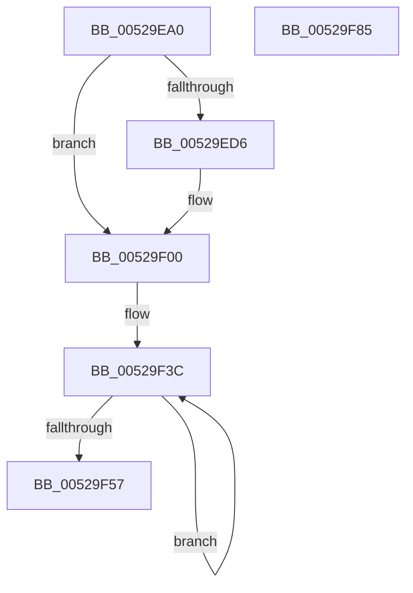

# SymCryptSha1Result

- RVA: `0x00529EA0`–`0x00529F86` (길이 `230` bytes)
- VA: `0x0000000140529EA0`
- 실행 섹션: `.text`
- PDB 이름 있음: `예`; PDB Function 태그: `아니요`
- unwind 정보 RVA: `0x000701D4`
- 디코드: `68`개 명령, `230/230` bytes 표시
- 미해석 바이트: `0` (있으면 어셈블리에 `.byte`로 보존)

> 이 문서는 커널 이미지의 기계어와 PDB 기호를 분석해 생성했습니다. 4번과 5번은 함수 원형과 자료형을 바이너리 사용 방식에서 추정한 C 해석이며 원본 소스 복구 결과는 아닙니다.

## 1. Dependencies

- 직접 호출 지점: **6**; 고유 호출 대상: **4**
- 직접 호출자로 확인된 함수: **1**
- RIP 상대 이미지 참조: **0**

### Outgoing calls
- `0x00529EE5` → [memset](../6C/memset_function_006C6C40.md) (function, `0x006C6C40`)
- `0x00529EF9` → [SymCryptSha1AppendBlocks](SymCryptSha1AppendBlocks_function_00528CA0.md) (function, `0x00528CA0`)
- `0x00529F0F` → [memset](../6C/memset_function_006C6C40.md) (function, `0x006C6C40`)
- `0x00529F32` → [SymCryptSha1AppendBlocks](SymCryptSha1AppendBlocks_function_00528CA0.md) (function, `0x00528CA0`)
- `0x00529F65` → [SymCryptWipe](../51/SymCryptWipe_function_0051F914.md) (function, `0x0051F914`)
- `0x00529F6D` → [SymCryptSha1Init](SymCryptSha1Init_function_00529E70.md) (function, `0x00529E70`)

### Direct callers
- [HashpFinalizeHash](../../page/84/HashpFinalizeHash_function_00841F34.md) at `0x00841F81`

### Static image references
- 디코드된 RIP-relative 메모리 참조가 없습니다.

## 2. Other-region calls and transfers

- 다른 실행 섹션으로 향하는 call: **0**
- 별도 외부 분기/꼬리 이동을 확인하지 못했습니다.

## 3. Assembly (complete function range)

```asm
00529EA0  48 89 5C 24 10                  mov qword ptr [rsp + 0x10], rbx
00529EA5  48 89 6C 24 18                  mov qword ptr [rsp + 0x18], rbp
00529EAA  56                              push rsi
00529EAB  57                              push rdi
00529EAC  41 56                           push r14
00529EAE  48 83 EC 20                     sub rsp, 0x20
00529EB2  48 83 64 24 40 00               and qword ptr [rsp + 0x40], 0
00529EB8  48 8B D9                        mov rbx, rcx
00529EBB  8B 09                           mov ecx, dword ptr [rcx]
00529EBD  48 8B F2                        mov rsi, rdx
00529EC0  41 BE 40 00 00 00               mov r14d, 0x40
00529EC6  48 8D 7B 60                     lea rdi, [rbx + 0x60]
00529ECA  C6 44 19 20 80                  mov byte ptr [rcx + rbx + 0x20], 0x80
00529ECF  FF C1                           inc ecx
00529ED1  83 F9 38                        cmp ecx, 0x38
00529ED4  76 2A                           jbe 0x140529f00
00529ED6  45 8B C6                        mov r8d, r14d
00529ED9  33 D2                           xor edx, edx
00529EDB  44 2B C1                        sub r8d, ecx
00529EDE  48 83 C1 20                     add rcx, 0x20
00529EE2  48 03 CB                        add rcx, rbx
00529EE5  E8 56 CD 19 00                  call 0x1406c6c40
00529EEA  4C 8D 4C 24 40                  lea r9, [rsp + 0x40]
00529EEF  45 8B C6                        mov r8d, r14d
00529EF2  48 8D 53 20                     lea rdx, [rbx + 0x20]
00529EF6  48 8B CF                        mov rcx, rdi
00529EF9  E8 A2 ED FF FF                  call 0x140528ca0
00529EFE  33 C9                           xor ecx, ecx
00529F00  45 8B C6                        mov r8d, r14d
00529F03  33 D2                           xor edx, edx
00529F05  44 2B C1                        sub r8d, ecx
00529F08  48 83 C1 20                     add rcx, 0x20
00529F0C  48 03 CB                        add rcx, rbx
00529F0F  E8 2C CD 19 00                  call 0x1406c6c40
00529F14  48 8B 43 10                     mov rax, qword ptr [rbx + 0x10]
00529F18  4C 8D 4C 24 40                  lea r9, [rsp + 0x40]
00529F1D  48 C1 E0 03                     shl rax, 3
00529F21  48 8D 53 20                     lea rdx, [rbx + 0x20]
00529F25  48 0F C8                        bswap rax
00529F28  4D 8B C6                        mov r8, r14
00529F2B  48 89 43 58                     mov qword ptr [rbx + 0x58], rax
00529F2F  48 8B CF                        mov rcx, rdi
00529F32  E8 69 ED FF FF                  call 0x140528ca0
00529F37  B9 02 00 00 00                  mov ecx, 2
00529F3C  48 8B 07                        mov rax, qword ptr [rdi]
00529F3F  48 8D 7F 08                     lea rdi, [rdi + 8]
00529F43  48 C1 C0 20                     rol rax, 0x20
00529F47  48 0F C8                        bswap rax
00529F4A  48 89 06                        mov qword ptr [rsi], rax
00529F4D  48 8D 76 08                     lea rsi, [rsi + 8]
00529F51  48 83 E9 01                     sub rcx, 1
00529F55  75 E5                           jne 0x140529f3c
00529F57  8B 07                           mov eax, dword ptr [rdi]
00529F59  BA 80 00 00 00                  mov edx, 0x80
00529F5E  0F C8                           bswap eax
00529F60  48 8B CB                        mov rcx, rbx
00529F63  89 06                           mov dword ptr [rsi], eax
00529F65  E8 AA 59 FF FF                  call 0x14051f914
00529F6A  48 8B CB                        mov rcx, rbx
00529F6D  E8 FE FE FF FF                  call 0x140529e70
00529F72  48 8B 5C 24 48                  mov rbx, qword ptr [rsp + 0x48]
00529F77  48 8B 6C 24 50                  mov rbp, qword ptr [rsp + 0x50]
00529F7C  48 83 C4 20                     add rsp, 0x20
00529F80  41 5E                           pop r14
00529F82  5F                              pop rdi
00529F83  5E                              pop rsi
00529F84  C3                              ret
00529F85  CC                              int3
```

## 4. C-style interpretation (structured pseudocode)

```c
__int64 __fastcall SymCryptSha1Result(__int64 a1, __int64 a2)
{
    __int64 result;
    __int64 v_rsp;
    unsigned __int64 v_stack_p10;
    unsigned __int64 v_stack_p18;
    unsigned __int64 v_stack_p8;

    v_stack_p10 = v_rbx;
    v_stack_p18 = v_rbp;
    v_rsp = (v_rsp) - (32);
    *(unsigned __int8 *)((unsigned int)(*(unsigned int *)(a1)) + a1 * 1 + 32) = 128;
    a1 = (unsigned int)(((unsigned int)(*(unsigned int *)(a1))) + 1);
    if (((unsigned int)(a1)) >= = 56) {
        a3 = 64;
        a2 = 0;
        a3 = (unsigned int)((a3) - ((unsigned int)(a1)));
        a1 = (a1) + (32);
        a1 = (a1) + (a1);
        result = memset(a1, a2, a3, a4);
        a4 = v_stack_p8;
        a3 = 64;
        a2 = a1 + 32;
        a1 = a1 + 96;
        result = SymCryptSha1AppendBlocks(a1, a2, a3, a4);
        a1 = 0;
    }
    a2 = 0;
    a3 = (unsigned int)((64) - (0));
    a1 = (a1) + (32);
    a1 = (a1) + (a1);
    result = memset(a1, a2, a3, a4);
    result = (*(unsigned __int64 *)(a1 + 16)) << (3);
    *(unsigned __int64 *)(a1 + 88) = result;
    result = SymCryptSha1AppendBlocks(a1 + 96, a1 + 32, 64, v_stack_p8);
loc_00529F3C:
    *(unsigned __int64 *)(a2) = *(unsigned __int64 *)(a1 + 96);
    a1 = (2) - (1);
    if (condition_is_not_equal) goto loc_00529F3C;
    *(unsigned int *)(a2 + 8) = (unsigned int)((unsigned int)(*(unsigned int *)(a1 + 96 + 8)));
    result = SymCryptWipe(a1, 128, 64, v_stack_p8);
    result = SymCryptSha1Init(a1, 128, 64, v_stack_p8);
    v_rsp = (v_rsp) + (32);
    return result;
}
```

## 5. (Beta) C Style

```c
int64_t SymCryptSha1Result(void *Arg1, void *Arg2)
{
    uint8_t *arg1 = (uint8_t *)Arg1;
    uint8_t *arg2 = (uint8_t *)Arg2;

    int64_t result;
    int64_t local_rsp;
    uint64_t v_stack_p10;
    uint64_t v_stack_p18;
    uint64_t v_stack_p8;

    v_stack_p10 = local_rbx;
    v_stack_p18 = local_rbp;
    local_rsp = (local_rsp) - (32);
    *(uint8_t *)((uint32_t)(*(uint32_t *)(arg1)) + arg1 * 1 + 0x20) = 128;
    Arg1 = (uint32_t)(((uint32_t)(*(uint32_t *)(arg1))) + 1);
    if (((uint32_t)(Arg1)) >= = 56) {
        a3 = 64;
        Arg2 = 0;
        a3 = (uint32_t)((a3) - ((uint32_t)(Arg1)));
        Arg1 = (Arg1) + (32);
        Arg1 = (Arg1) + (Arg1);
        result = memset(Arg1, Arg2, a3, a4);
        a4 = v_stack_p8;
        a3 = 64;
        Arg2 = Arg1 + 32;
        Arg1 = Arg1 + 96;
        result = SymCryptSha1AppendBlocks(Arg1, Arg2, a3, a4);
        Arg1 = 0;
    }
    Arg2 = 0;
    a3 = (uint32_t)((64) - (0));
    Arg1 = (Arg1) + (32);
    Arg1 = (Arg1) + (Arg1);
    result = memset(Arg1, Arg2, a3, a4);
    result = (*(uint64_t *)(arg1 + 0x10)) << (3);
    *(uint64_t *)(arg1 + 0x58) = result;
    result = SymCryptSha1AppendBlocks(Arg1 + 96, Arg1 + 32, 64, v_stack_p8);
loc_00529F3C:
    *(uint64_t *)(arg2) = *(uint64_t *)(arg1 + 0x60);
    Arg1 = (2) - (1);
    if (condition_is_not_equal) goto loc_00529F3C;
    *(uint32_t *)(arg2 + 0x8) = (uint32_t)((uint32_t)(*(uint32_t *)(arg1 + 0x60 + 0x8)));
    result = SymCryptWipe(Arg1, 128, 64, v_stack_p8);
    result = SymCryptSha1Init(Arg1, 128, 64, v_stack_p8);
    local_rsp = (local_rsp) + (32);
    return result;
}
```

### 관측된 메모리 오프셋

구조체 형식이 확인되지 않은 접근은 인자 기준의 오프셋으로만 기록했습니다.

| 기준 인자 | 오프셋 표현 | 폭 (bit) | 접근 |
|---|---:|---:|---|
| `Arg1` | `+ 0x0` | `32` | `R` |
| `Arg1` | `+ 0x0` | `64` | `R` |
| `Arg1` | `+ 0x8` | `64` | `R` |
| `Arg1` | `+ 0x10` | `64` | `R` |
| `Arg1` | `+ 0x20` | `64` | `R` |
| `Arg1` | `+ 0x58` | `64` | `W` |
| `Arg1` | `+ 0x60` | `64` | `R` |
| `Arg2` | `+ 0x0` | `32` | `W` |
| `Arg2` | `+ 0x0` | `64` | `W` |
| `Arg2` | `+ 0x8` | `64` | `R` |

## 6. Execution-region graph

[열기: 2D/3D 그래프와 함수 탐색 컨트롤 패널](../../../control-panel.html?section=text&rva=0x00529EA0&view=graph)

- 2D 그래프는 위에서 아래로 흐르고, 3D 그래프는 빈 공간을 드래그해 회전합니다. Shift+드래그는 이동, 휠은 확대·축소, 함수 노드 선택은 대상 보고서 이동입니다.

### Static fallback


