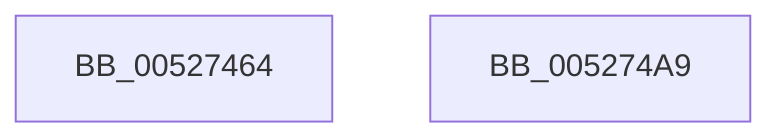

# SymCryptSha384Init

- RVA: `0x00527464`–`0x005274AA` (길이 `70` bytes)
- VA: `0x0000000140527464`
- 실행 섹션: `.text`
- PDB 이름 있음: `예`; PDB Function 태그: `아니요`
- unwind 정보 RVA: `0x000DB714`
- 디코드: `14`개 명령, `70/70` bytes 표시
- 미해석 바이트: `0` (있으면 어셈블리에 `.byte`로 보존)

> 이 문서는 커널 이미지의 기계어와 PDB 기호를 분석해 생성했습니다. 4번과 5번은 함수 원형과 자료형을 바이너리 사용 방식에서 추정한 C 해석이며 원본 소스 복구 결과는 아닙니다.

## 1. Dependencies

- 직접 호출 지점: **0**; 고유 호출 대상: **0**
- 직접 호출자로 확인된 함수: **2**
- RIP 상대 이미지 참조: **4**

### Outgoing calls
- 직접 디코드된 call 명령이 없습니다.

### Direct callers
- [SymCryptSha384Result](SymCryptSha384Result_function_005274B0.md) at `0x005274F9`
- [HashpInitHash](../../page/84/HashpInitHash_function_00842018.md) at `0x00842067`

### Static image references
- `0x00527470` → RVA `0x00020350` (`.rdata`; read)
- `0x0052747E` → RVA `0x00020360` (`.rdata`; read)
- `0x0052748C` → RVA `0x00020370` (`.rdata`; read)
- `0x0052749A` → RVA `0x00020380` (`.rdata`; read)

## 2. Other-region calls and transfers

- 다른 실행 섹션으로 향하는 call: **0**
- 별도 외부 분기/꼬리 이동을 확인하지 못했습니다.

## 3. Assembly (complete function range)

```asm
00527464  33 C0                           xor eax, eax
00527466  48 89 41 18                     mov qword ptr [rcx + 0x18], rax
0052746A  48 89 41 10                     mov qword ptr [rcx + 0x10], rax
0052746E  89 01                           mov dword ptr [rcx], eax
00527470  0F 28 05 D9 8E AF FF            movaps xmm0, xmmword ptr [rip - 0x507127]
00527477  0F 11 81 A0 00 00 00            movups xmmword ptr [rcx + 0xa0], xmm0
0052747E  0F 28 0D DB 8E AF FF            movaps xmm1, xmmword ptr [rip - 0x507125]
00527485  0F 11 89 B0 00 00 00            movups xmmword ptr [rcx + 0xb0], xmm1
0052748C  0F 28 05 DD 8E AF FF            movaps xmm0, xmmword ptr [rip - 0x507123]
00527493  0F 11 81 C0 00 00 00            movups xmmword ptr [rcx + 0xc0], xmm0
0052749A  0F 28 0D DF 8E AF FF            movaps xmm1, xmmword ptr [rip - 0x507121]
005274A1  0F 11 89 D0 00 00 00            movups xmmword ptr [rcx + 0xd0], xmm1
005274A8  C3                              ret
005274A9  CC                              int3
```

## 4. C-style interpretation (structured pseudocode)

```c
__int64 __fastcall SymCryptSha384Init(__int64 a1)
{
    __int64 result;

    result = 0;
    *(unsigned __int64 *)(a1 + 24) = 0;
    *(unsigned __int64 *)(a1 + 16) = 0;
    *(unsigned int *)(a1) = 0;
    *(unsigned __int64 *)(a1 + 160) = v_xmm0;
    *(unsigned __int64 *)(a1 + 176) = v_xmm1;
    *(unsigned __int64 *)(a1 + 192) = v_xmm0;
    *(unsigned __int64 *)(a1 + 208) = v_xmm1;
    return result;
}
```

## 5. (Beta) C Style

```c
int64_t SymCryptSha384Init(void *Arg1)
{
    uint8_t *arg1 = (uint8_t *)Arg1;

    int64_t result;

    result = 0;
    *(uint64_t *)(arg1 + 0x18) = 0;
    *(uint64_t *)(arg1 + 0x10) = 0;
    *(uint32_t *)(arg1) = 0;
    *(uint64_t *)(arg1 + 0xA0) = v_xmm0;
    *(uint64_t *)(arg1 + 0xB0) = v_xmm1;
    *(uint64_t *)(arg1 + 0xC0) = v_xmm0;
    *(uint64_t *)(arg1 + 0xD0) = v_xmm1;
    return result;
}
```

### 관측된 메모리 오프셋

구조체 형식이 확인되지 않은 접근은 인자 기준의 오프셋으로만 기록했습니다.

| 기준 인자 | 오프셋 표현 | 폭 (bit) | 접근 |
|---|---:|---:|---|
| `Arg1` | `+ 0x0` | `32` | `W` |
| `Arg1` | `+ 0x10` | `64` | `W` |
| `Arg1` | `+ 0x18` | `64` | `W` |
| `Arg1` | `+ 0xA0` | `128` | `R` |
| `Arg1` | `+ 0xB0` | `128` | `R` |
| `Arg1` | `+ 0xC0` | `128` | `R` |
| `Arg1` | `+ 0xD0` | `128` | `R` |

## 6. Execution-region graph

[열기: 2D/3D 그래프와 함수 탐색 컨트롤 패널](../../../control-panel.html?section=text&rva=0x00527464&view=graph)

- 2D 그래프는 위에서 아래로 흐르고, 3D 그래프는 빈 공간을 드래그해 회전합니다. Shift+드래그는 이동, 휠은 확대·축소, 함수 노드 선택은 대상 보고서 이동입니다.

### Static fallback


