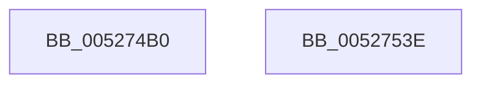

# SymCryptSha384Result

- RVA: `0x005274B0`–`0x0052753F` (길이 `143` bytes)
- VA: `0x00000001405274B0`
- 실행 섹션: `.text`
- PDB 이름 있음: `예`; PDB Function 태그: `아니요`
- unwind 정보 RVA: `0x000C333C`
- 디코드: `39`개 명령, `143/143` bytes 표시
- 미해석 바이트: `0` (있으면 어셈블리에 `.byte`로 보존)

> 이 문서는 커널 이미지의 기계어와 PDB 기호를 분석해 생성했습니다. 4번과 5번은 함수 원형과 자료형을 바이너리 사용 방식에서 추정한 C 해석이며 원본 소스 복구 결과는 아닙니다.

## 1. Dependencies

- 직접 호출 지점: **3**; 고유 호출 대상: **3**
- 직접 호출자로 확인된 함수: **1**
- RIP 상대 이미지 참조: **1**

### Outgoing calls
- `0x005274DA` → [SymCryptSha512Result](SymCryptSha512Result_function_00528B40.md) (function, `0x00528B40`)
- `0x005274F9` → [SymCryptSha384Init](SymCryptSha384Init_function_00527464.md) (function, `0x00527464`)
- `0x00527527` → [_security_check_cookie](../6A/_security_check_cookie_function_006AC640.md) (function, `0x006AC640`)

### Direct callers
- [HashpFinalizeHash](../../page/84/HashpFinalizeHash_function_00841F34.md) at `0x00841F6B`

### Static image references
- `0x005274C2` → RVA `0x00E0A740` (`.data`; read)

## 2. Other-region calls and transfers

- 다른 실행 섹션으로 향하는 call: **0**
- 별도 외부 분기/꼬리 이동을 확인하지 못했습니다.

## 3. Assembly (complete function range)

```asm
005274B0  48 89 5C 24 18                  mov qword ptr [rsp + 0x18], rbx
005274B5  48 89 7C 24 20                  mov qword ptr [rsp + 0x20], rdi
005274BA  55                              push rbp
005274BB  48 8B EC                        mov rbp, rsp
005274BE  48 83 EC 70                     sub rsp, 0x70
005274C2  48 8B 05 77 32 8E 00            mov rax, qword ptr [rip + 0x8e3277]
005274C9  48 33 C4                        xor rax, rsp
005274CC  48 89 45 F0                     mov qword ptr [rbp - 0x10], rax
005274D0  48 8B FA                        mov rdi, rdx
005274D3  48 8B D9                        mov rbx, rcx
005274D6  48 8D 55 B0                     lea rdx, [rbp - 0x50]
005274DA  E8 61 16 00 00                  call 0x140528b40
005274DF  0F 28 45 B0                     movaps xmm0, xmmword ptr [rbp - 0x50]
005274E3  48 8B CB                        mov rcx, rbx
005274E6  0F 28 4D C0                     movaps xmm1, xmmword ptr [rbp - 0x40]
005274EA  0F 11 07                        movups xmmword ptr [rdi], xmm0
005274ED  0F 28 45 D0                     movaps xmm0, xmmword ptr [rbp - 0x30]
005274F1  0F 11 4F 10                     movups xmmword ptr [rdi + 0x10], xmm1
005274F5  0F 11 47 20                     movups xmmword ptr [rdi + 0x20], xmm0
005274F9  E8 66 FF FF FF                  call 0x140527464
005274FE  33 C0                           xor eax, eax
00527500  48 89 45 B0                     mov qword ptr [rbp - 0x50], rax
00527504  48 89 45 B8                     mov qword ptr [rbp - 0x48], rax
00527508  48 89 45 C0                     mov qword ptr [rbp - 0x40], rax
0052750C  48 89 45 C8                     mov qword ptr [rbp - 0x38], rax
00527510  48 89 45 D0                     mov qword ptr [rbp - 0x30], rax
00527514  48 89 45 D8                     mov qword ptr [rbp - 0x28], rax
00527518  48 89 45 E0                     mov qword ptr [rbp - 0x20], rax
0052751C  48 89 45 E8                     mov qword ptr [rbp - 0x18], rax
00527520  48 8B 4D F0                     mov rcx, qword ptr [rbp - 0x10]
00527524  48 33 CC                        xor rcx, rsp
00527527  E8 14 51 18 00                  call 0x1406ac640
0052752C  4C 8D 5C 24 70                  lea r11, [rsp + 0x70]
00527531  49 8B 5B 20                     mov rbx, qword ptr [r11 + 0x20]
00527535  49 8B 7B 28                     mov rdi, qword ptr [r11 + 0x28]
00527539  49 8B E3                        mov rsp, r11
0052753C  5D                              pop rbp
0052753D  C3                              ret
0052753E  CC                              int3
```

## 4. C-style interpretation (structured pseudocode)

```c
__int64 __fastcall SymCryptSha384Result(__int64 a1, __int64 a2)
{
    __int64 result;
    __int64 v_rsp;
    unsigned __int64 v_stack_m18;
    unsigned __int64 v_stack_m20;
    unsigned __int64 v_stack_m28;
    unsigned __int64 v_stack_m30;
    unsigned __int64 v_stack_m38;
    unsigned __int64 v_stack_m40;
    unsigned __int64 v_stack_m48;
    unsigned __int64 v_stack_m50;
    unsigned __int64 v_stack_m58;
    unsigned __int64 v_stack_m8;
    unsigned __int64 v_stack_p18;
    unsigned __int64 v_stack_p20;

    v_stack_p18 = v_rbx;
    v_stack_p20 = v_rdi;
    v_rsp = (v_rsp) - (112);
    result = (*(unsigned __int64 *)(v_rip + 9319031)) ^ (v_rsp);
    v_stack_m18 = result;
    result = SymCryptSha512Result(a1, v_stack_m58, a3, a4);
    *(unsigned __int64 *)(a2) = v_xmm0;
    *(unsigned __int64 *)(a2 + 16) = v_xmm1;
    *(unsigned __int64 *)(a2 + 32) = v_xmm0;
    result = SymCryptSha384Init(a1, v_stack_m58, a3, a4);
    result = 0;
    v_stack_m58 = 0;
    v_stack_m50 = 0;
    v_stack_m48 = 0;
    v_stack_m40 = 0;
    v_stack_m38 = 0;
    v_stack_m30 = 0;
    v_stack_m28 = 0;
    v_stack_m20 = 0;
    a1 = (v_stack_m18) ^ (v_rsp);
    result = _security_check_cookie(a1, v_stack_m58, a3, a4);
    return result;
}
```

## 5. (Beta) C Style

```c
int64_t SymCryptSha384Result(int64_t Arg1, void *Arg2)
{
    uint8_t *arg2 = (uint8_t *)Arg2;

    int64_t result;
    int64_t local_rsp;
    uint64_t v_stack_m18;
    uint64_t v_stack_m20;
    uint64_t v_stack_m28;
    uint64_t v_stack_m30;
    uint64_t v_stack_m38;
    uint64_t v_stack_m40;
    uint64_t v_stack_m48;
    uint64_t v_stack_m50;
    uint64_t v_stack_m58;
    uint64_t v_stack_m8;
    uint64_t v_stack_p18;
    uint64_t v_stack_p20;

    v_stack_p18 = local_rbx;
    v_stack_p20 = local_rdi;
    local_rsp = (local_rsp) - (112);
    result = (*(uint64_t *)(v_rip + 0x8E3277)) ^ (local_rsp);
    v_stack_m18 = result;
    result = SymCryptSha512Result(Arg1, v_stack_m58, a3, a4);
    *(uint64_t *)(arg2) = v_xmm0;
    *(uint64_t *)(arg2 + 0x10) = v_xmm1;
    *(uint64_t *)(arg2 + 0x20) = v_xmm0;
    result = SymCryptSha384Init(Arg1, v_stack_m58, a3, a4);
    result = 0;
    v_stack_m58 = 0;
    v_stack_m50 = 0;
    v_stack_m48 = 0;
    v_stack_m40 = 0;
    v_stack_m38 = 0;
    v_stack_m30 = 0;
    v_stack_m28 = 0;
    v_stack_m20 = 0;
    Arg1 = (v_stack_m18) ^ (local_rsp);
    result = _security_check_cookie(Arg1, v_stack_m58, a3, a4);
    return result;
}
```

### 관측된 메모리 오프셋

구조체 형식이 확인되지 않은 접근은 인자 기준의 오프셋으로만 기록했습니다.

| 기준 인자 | 오프셋 표현 | 폭 (bit) | 접근 |
|---|---:|---:|---|
| `Arg2` | `+ 0x0` | `128` | `R` |
| `Arg2` | `+ 0x10` | `128` | `R` |
| `Arg2` | `+ 0x20` | `128` | `R` |

## 6. Execution-region graph

[열기: 2D/3D 그래프와 함수 탐색 컨트롤 패널](../../../control-panel.html?section=text&rva=0x005274B0&view=graph)

- 2D 그래프는 위에서 아래로 흐르고, 3D 그래프는 빈 공간을 드래그해 회전합니다. Shift+드래그는 이동, 휠은 확대·축소, 함수 노드 선택은 대상 보고서 이동입니다.

### Static fallback


