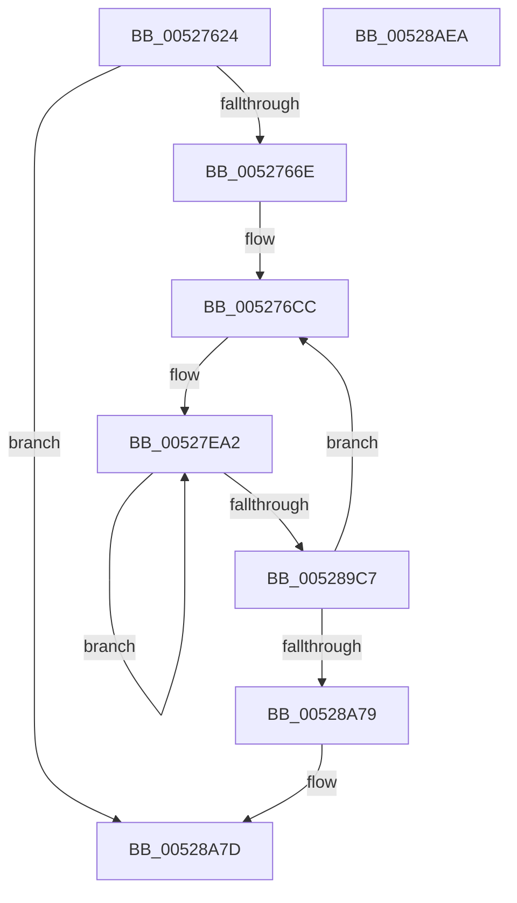

# SymCryptSha512AppendBlocks_ull

- RVA: `0x00527624`–`0x00528AEB` (길이 `5,319` bytes)
- VA: `0x0000000140527624`
- 실행 섹션: `.text`
- PDB 이름 있음: `예`; PDB Function 태그: `아니요`
- unwind 정보 RVA: `0x000C3314`
- 디코드: `1,516`개 명령, `5,319/5,319` bytes 표시
- 미해석 바이트: `0` (있으면 어셈블리에 `.byte`로 보존)

> 이 문서는 커널 이미지의 기계어와 PDB 기호를 분석해 생성했습니다. 4번과 5번은 함수 원형과 자료형을 바이너리 사용 방식에서 추정한 C 해석이며 원본 소스 복구 결과는 아닙니다.

## 1. Dependencies

- 직접 호출 지점: **2**; 고유 호출 대상: **2**
- 직접 호출자로 확인된 함수: **2**
- RIP 상대 이미지 참조: **3**

### Outgoing calls
- `0x00528A8C` → [SymCryptWipe](../51/SymCryptWipe_function_0051F914.md) (function, `0x0051F914`)
- `0x00528ACA` → [_security_check_cookie](../6A/_security_check_cookie_function_006AC640.md) (function, `0x006AC640`)

### Direct callers
- [SymCryptSha512Append](SymCryptSha512Append_function_00527548.md) at `0x005275B6`
- [SymCryptSha512Append](SymCryptSha512Append_function_00527548.md) at `0x005275D8`
- [SymCryptSha512Result](SymCryptSha512Result_function_00528B40.md) at `0x00528B99`
- [SymCryptSha512Result](SymCryptSha512Result_function_00528B40.md) at `0x00528BEF`

### Static image references
- `0x00527643` → RVA `0x00E0A740` (`.data`; read)
- `0x00527E87` → RVA `0x00020150` (`.rdata`; read)
- `0x005289A4` → RVA `0x00020350` (`.rdata`; read)

## 2. Other-region calls and transfers

- 다른 실행 섹션으로 향하는 call: **0**
- 별도 외부 분기/꼬리 이동을 확인하지 못했습니다.

## 3. Assembly (complete function range)

```asm
00527624  48 89 5C 24 10                  mov qword ptr [rsp + 0x10], rbx
00527629  55                              push rbp
0052762A  56                              push rsi
0052762B  57                              push rdi
0052762C  41 54                           push r12
0052762E  41 55                           push r13
00527630  41 56                           push r14
00527632  41 57                           push r15
00527634  48 8D AC 24 00 FF FF FF         lea rbp, [rsp - 0x100]
0052763C  48 81 EC 00 02 00 00            sub rsp, 0x200
00527643  48 8B 05 F6 30 8E 00            mov rax, qword ptr [rip + 0x8e30f6]
0052764A  48 33 C4                        xor rax, rsp
0052764D  48 89 85 F0 00 00 00            mov qword ptr [rbp + 0xf0], rax
00527654  48 8B C1                        mov rax, rcx
00527657  48 89 4D 58                     mov qword ptr [rbp + 0x58], rcx
0052765B  B9 80 00 00 00                  mov ecx, 0x80
00527660  4C 89 4C 24 28                  mov qword ptr [rsp + 0x28], r9
00527665  4C 3B C1                        cmp r8, rcx
00527668  0F 82 0F 14 00 00               jb 0x140528a7d
0052766E  48 8B 18                        mov rbx, qword ptr [rax]
00527671  4C 8D 7A 10                     lea r15, [rdx + 0x10]
00527675  48 8B 78 08                     mov rdi, qword ptr [rax + 8]
00527679  4C 8B 70 10                     mov r14, qword ptr [rax + 0x10]
0052767D  4C 8B 68 20                     mov r13, qword ptr [rax + 0x20]
00527681  4C 8B 50 28                     mov r10, qword ptr [rax + 0x28]
00527685  4C 8B 48 30                     mov r9, qword ptr [rax + 0x30]
00527689  4C 8B 58 38                     mov r11, qword ptr [rax + 0x38]
0052768D  48 8B 70 18                     mov rsi, qword ptr [rax + 0x18]
00527691  49 8B C0                        mov rax, r8
00527694  48 C1 E8 07                     shr rax, 7
00527698  48 89 45 50                     mov qword ptr [rbp + 0x50], rax
0052769C  48 6B C0 80                     imul rax, rax, -0x80
005276A0  48 89 5D 20                     mov qword ptr [rbp + 0x20], rbx
005276A4  4C 03 C0                        add r8, rax
005276A7  48 89 7D 28                     mov qword ptr [rbp + 0x28], rdi
005276AB  4C 89 45 60                     mov qword ptr [rbp + 0x60], r8
005276AF  4C 89 75 30                     mov qword ptr [rbp + 0x30], r14
005276B3  4C 89 6D 40                     mov qword ptr [rbp + 0x40], r13
005276B7  4C 89 55 00                     mov qword ptr [rbp], r10
005276BB  4C 89 4D 08                     mov qword ptr [rbp + 8], r9
005276BF  4C 89 5D 48                     mov qword ptr [rbp + 0x48], r11
005276C3  48 89 75 38                     mov qword ptr [rbp + 0x38], rsi
005276C7  4C 89 7C 24 40                  mov qword ptr [rsp + 0x40], r15
005276CC  4D 8B 47 F0                     mov r8, qword ptr [r15 - 0x10]
005276D0  49 8B CA                        mov rcx, r10
005276D3  49 0F C8                        bswap r8
005276D6  49 33 C9                        xor rcx, r9
005276D9  4C 89 45 F0                     mov qword ptr [rbp - 0x10], r8
005276DD  49 23 CD                        and rcx, r13
005276E0  49 8B D5                        mov rdx, r13
005276E3  48 C1 CA 1B                     ror rdx, 0x1b
005276E7  49 33 C9                        xor rcx, r9
005276EA  49 8B C5                        mov rax, r13
005276ED  48 C1 C8 04                     ror rax, 4
005276F1  48 33 C2                        xor rax, rdx
005276F4  48 8B D3                        mov rdx, rbx
005276F7  49 33 C5                        xor rax, r13
005276FA  48 C1 CA 0B                     ror rdx, 0xb
005276FE  48 C1 C8 0E                     ror rax, 0xe
00527702  49 03 C0                        add rax, r8
00527705  49 B8 22 AE 28 D7 98 2F 8A 42   movabs r8, 0x428a2f98d728ae22
0052770F  48 03 C8                        add rcx, rax
00527712  48 8B C3                        mov rax, rbx
00527715  48 C1 C8 06                     ror rax, 6
00527719  4C 03 C1                        add r8, rcx
0052771C  48 33 D0                        xor rdx, rax
0052771F  4D 03 C3                        add r8, r11
00527722  48 33 D3                        xor rdx, rbx
00527725  48 8B C7                        mov rax, rdi
00527728  49 23 C6                        and rax, r14
0052772B  48 C1 CA 1C                     ror rdx, 0x1c
0052772F  49 8B CD                        mov rcx, r13
00527732  4E 8D 0C 06                     lea r9, [rsi + r8]
00527736  49 33 CA                        xor rcx, r10
00527739  49 23 C9                        and rcx, r9
0052773C  48 8B F7                        mov rsi, rdi
0052773F  49 0B F6                        or rsi, r14
00527742  49 33 CA                        xor rcx, r10
00527745  48 23 F3                        and rsi, rbx
00527748  48 0B F0                        or rsi, rax
0052774B  49 8B C1                        mov rax, r9
0052774E  48 C1 C8 04                     ror rax, 4
00527752  49 03 F0                        add rsi, r8
00527755  4D 8B 47 F8                     mov r8, qword ptr [r15 - 8]
00527759  48 03 F2                        add rsi, rdx
0052775C  49 0F C8                        bswap r8
0052775F  4C 89 45 E0                     mov qword ptr [rbp - 0x20], r8
00527763  49 8B D1                        mov rdx, r9
00527766  48 C1 CA 1B                     ror rdx, 0x1b
0052776A  48 33 C2                        xor rax, rdx
0052776D  48 8B D6                        mov rdx, rsi
00527770  49 33 C1                        xor rax, r9
00527773  48 C1 CA 0B                     ror rdx, 0xb
00527777  48 C1 C8 0E                     ror rax, 0xe
0052777B  49 03 C0                        add rax, r8
0052777E  49 B8 CD 65 EF 23 91 44 37 71   movabs r8, 0x7137449123ef65cd
00527788  48 03 C8                        add rcx, rax
0052778B  48 8B C6                        mov rax, rsi
0052778E  48 C1 C8 06                     ror rax, 6
00527792  4C 03 C1                        add r8, rcx
00527795  4C 03 45 08                     add r8, qword ptr [rbp + 8]
00527799  48 33 D0                        xor rdx, rax
0052779C  48 33 D6                        xor rdx, rsi
0052779F  48 8B C3                        mov rax, rbx
005277A2  48 C1 CA 1C                     ror rdx, 0x1c
005277A6  48 23 C7                        and rax, rdi
005277A9  49 8B CD                        mov rcx, r13
005277AC  4F 8D 14 06                     lea r10, [r14 + r8]
005277B0  4C 8B F3                        mov r14, rbx
005277B3  4C 0B F7                        or r14, rdi
005277B6  4C 23 F6                        and r14, rsi
005277B9  4C 0B F0                        or r14, rax
005277BC  49 8B C2                        mov rax, r10
005277BF  4D 03 F0                        add r14, r8
005277C2  48 C1 C8 04                     ror rax, 4
005277C6  4D 8B 07                        mov r8, qword ptr [r15]
005277C9  4C 03 F2                        add r14, rdx
005277CC  49 8B D2                        mov rdx, r10
005277CF  48 C1 CA 1B                     ror rdx, 0x1b
005277D3  48 33 D0                        xor rdx, rax
005277D6  49 33 D2                        xor rdx, r10
005277D9  49 0F C8                        bswap r8
005277DC  48 C1 CA 0E                     ror rdx, 0xe
005277E0  4C 89 45 D0                     mov qword ptr [rbp - 0x30], r8
005277E4  48 8B 45 00                     mov rax, qword ptr [rbp]
005277E8  49 33 C9                        xor rcx, r9
005277EB  48 03 C2                        add rax, rdx
005277EE  49 23 CA                        and rcx, r10
005277F1  49 33 CD                        xor rcx, r13
005277F4  4C 8B FB                        mov r15, rbx
005277F7  48 03 C8                        add rcx, rax
005277FA  4C 0B FE                        or r15, rsi
005277FD  4D 23 FE                        and r15, r14
00527800  48 B8 2F 3B 4D EC CF FB C0 B5   movabs rax, 0xb5c0fbcfec4d3b2f
0052780A  48 03 C1                        add rax, rcx
0052780D  49 8B D6                        mov rdx, r14
00527810  4C 03 C0                        add r8, rax
00527813  48 C1 CA 0B                     ror rdx, 0xb
00527817  49 8B C6                        mov rax, r14
0052781A  4C 8B E6                        mov r12, rsi
0052781D  48 C1 C8 06                     ror rax, 6
00527821  4D 0B E6                        or r12, r14
00527824  48 33 D0                        xor rdx, rax
00527827  49 8B C9                        mov rcx, r9
0052782A  4E 8D 1C 07                     lea r11, [rdi + r8]
0052782E  49 33 D6                        xor rdx, r14
00527831  48 8B 7C 24 40                  mov rdi, qword ptr [rsp + 0x40]
00527836  49 33 CA                        xor rcx, r10
00527839  48 C1 CA 1C                     ror rdx, 0x1c
0052783D  49 23 CB                        and rcx, r11
00527840  49 33 C9                        xor rcx, r9
00527843  48 8B C3                        mov rax, rbx
00527846  48 23 C6                        and rax, rsi
00527849  4C 0B F8                        or r15, rax
0052784C  49 8B C3                        mov rax, r11
0052784F  48 C1 C8 04                     ror rax, 4
00527853  4D 03 F8                        add r15, r8
00527856  4C 8B 47 08                     mov r8, qword ptr [rdi + 8]
0052785A  4C 03 FA                        add r15, rdx
0052785D  49 0F C8                        bswap r8
00527860  4C 89 44 24 48                  mov qword ptr [rsp + 0x48], r8
00527865  4D 23 E7                        and r12, r15
00527868  49 8B D3                        mov rdx, r11
0052786B  48 C1 CA 1B                     ror rdx, 0x1b
0052786F  48 33 C2                        xor rax, rdx
00527872  49 8B D7                        mov rdx, r15
00527875  49 33 C3                        xor rax, r11
00527878  48 C1 CA 0B                     ror rdx, 0xb
0052787C  48 C1 C8 0E                     ror rax, 0xe
00527880  49 03 C5                        add rax, r13
00527883  48 03 C8                        add rcx, rax
00527886  48 B8 BC DB 89 81 A5 DB B5 E9   movabs rax, 0xe9b5dba58189dbbc
00527890  48 03 C1                        add rax, rcx
00527893  49 8B CA                        mov rcx, r10
00527896  4C 03 C0                        add r8, rax
00527899  49 33 CB                        xor rcx, r11
0052789C  49 03 D8                        add rbx, r8
0052789F  49 8B C7                        mov rax, r15
005278A2  48 C1 C8 06                     ror rax, 6
005278A6  48 23 CB                        and rcx, rbx
005278A9  48 33 D0                        xor rdx, rax
005278AC  49 33 CA                        xor rcx, r10
005278AF  49 33 D7                        xor rdx, r15
005278B2  48 8B C6                        mov rax, rsi
005278B5  49 23 C6                        and rax, r14
005278B8  48 C1 CA 1C                     ror rdx, 0x1c
005278BC  4C 0B E0                        or r12, rax
005278BF  48 8B C3                        mov rax, rbx
005278C2  4D 03 E0                        add r12, r8
005278C5  48 C1 C8 04                     ror rax, 4
005278C9  4C 8B 47 10                     mov r8, qword ptr [rdi + 0x10]
005278CD  4C 03 E2                        add r12, rdx
005278D0  49 0F C8                        bswap r8
005278D3  4C 89 44 24 50                  mov qword ptr [rsp + 0x50], r8
005278D8  48 8B D3                        mov rdx, rbx
005278DB  48 C1 CA 1B                     ror rdx, 0x1b
005278DF  48 33 C2                        xor rax, rdx
005278E2  48 33 C3                        xor rax, rbx
005278E5  48 C1 C8 0E                     ror rax, 0xe
005278E9  49 03 C0                        add rax, r8
005278EC  49 B8 38 B5 48 F3 5B C2 56 39   movabs r8, 0x3956c25bf348b538
005278F6  48 03 C8                        add rcx, rax
005278F9  4C 03 C1                        add r8, rcx
005278FC  4D 03 C1                        add r8, r9
005278FF  49 03 F0                        add rsi, r8
00527902  4D 8B EE                        mov r13, r14
00527905  49 8B D4                        mov rdx, r12
00527908  48 C1 CA 0B                     ror rdx, 0xb
0052790C  4D 0B EF                        or r13, r15
0052790F  4D 23 EC                        and r13, r12
00527912  49 8B C4                        mov rax, r12
00527915  48 C1 C8 06                     ror rax, 6
00527919  49 8B CB                        mov rcx, r11
0052791C  48 33 D0                        xor rdx, rax
0052791F  48 33 CB                        xor rcx, rbx
00527922  49 33 D4                        xor rdx, r12
00527925  48 23 CE                        and rcx, rsi
00527928  48 C1 CA 1C                     ror rdx, 0x1c
0052792C  49 33 CB                        xor rcx, r11
0052792F  49 8B C6                        mov rax, r14
00527932  49 23 C7                        and rax, r15
00527935  4C 0B E8                        or r13, rax
00527938  48 8B C6                        mov rax, rsi
0052793B  48 C1 C8 04                     ror rax, 4
0052793F  4D 03 E8                        add r13, r8
00527942  4C 8B 47 18                     mov r8, qword ptr [rdi + 0x18]
00527946  4C 03 EA                        add r13, rdx
00527949  49 0F C8                        bswap r8
0052794C  4C 89 44 24 70                  mov qword ptr [rsp + 0x70], r8
00527951  49 8B FF                        mov rdi, r15
00527954  49 0B FC                        or rdi, r12
00527957  48 8B D6                        mov rdx, rsi
0052795A  48 C1 CA 1B                     ror rdx, 0x1b
0052795E  49 23 FD                        and rdi, r13
00527961  48 33 C2                        xor rax, rdx
00527964  49 8B D5                        mov rdx, r13
00527967  48 33 C6                        xor rax, rsi
0052796A  48 C1 CA 0B                     ror rdx, 0xb
0052796E  48 C1 C8 0E                     ror rax, 0xe
00527972  49 03 C0                        add rax, r8
00527975  49 B8 19 D0 05 B6 F1 11 F1 59   movabs r8, 0x59f111f1b605d019
0052797F  48 03 C8                        add rcx, rax
00527982  49 8B C5                        mov rax, r13
00527985  48 C1 C8 06                     ror rax, 6
00527989  4C 03 C1                        add r8, rcx
0052798C  48 33 D0                        xor rdx, rax
0052798F  4D 03 C2                        add r8, r10
00527992  4D 03 F0                        add r14, r8
00527995  49 33 D5                        xor rdx, r13
00527998  48 C1 CA 1C                     ror rdx, 0x1c
0052799C  49 8B C7                        mov rax, r15
0052799F  49 23 C4                        and rax, r12
005279A2  48 8B CE                        mov rcx, rsi
005279A5  48 0B F8                        or rdi, rax
005279A8  48 33 CB                        xor rcx, rbx
005279AB  48 8B 44 24 40                  mov rax, qword ptr [rsp + 0x40]
005279B0  49 03 F8                        add rdi, r8
005279B3  48 03 FA                        add rdi, rdx
005279B6  49 23 CE                        and rcx, r14
005279B9  48 33 CB                        xor rcx, rbx
005279BC  49 8B D6                        mov rdx, r14
005279BF  48 C1 CA 1B                     ror rdx, 0x1b
005279C3  4D 8B D4                        mov r10, r12
005279C6  4C 8B 40 20                     mov r8, qword ptr [rax + 0x20]
005279CA  4D 0B D5                        or r10, r13
005279CD  49 0F C8                        bswap r8
005279D0  4C 89 45 80                     mov qword ptr [rbp - 0x80], r8
005279D4  49 8B C6                        mov rax, r14
005279D7  48 C1 C8 04                     ror rax, 4
005279DB  48 33 C2                        xor rax, rdx
005279DE  48 8B D7                        mov rdx, rdi
005279E1  49 33 C6                        xor rax, r14
005279E4  48 C1 CA 0B                     ror rdx, 0xb
005279E8  48 C1 C8 0E                     ror rax, 0xe
005279EC  49 03 C0                        add rax, r8
005279EF  49 B8 9B 4F 19 AF A4 82 3F 92   movabs r8, 0x923f82a4af194f9b
005279F9  48 03 C8                        add rcx, rax
005279FC  48 8B C7                        mov rax, rdi
005279FF  48 C1 C8 06                     ror rax, 6
00527A03  4C 03 C1                        add r8, rcx
00527A06  48 33 D0                        xor rdx, rax
00527A09  4D 03 C3                        add r8, r11
00527A0C  48 33 D7                        xor rdx, rdi
00527A0F  4D 03 F8                        add r15, r8
00527A12  48 C1 CA 1C                     ror rdx, 0x1c
00527A16  4C 23 D7                        and r10, rdi
00527A19  4C 8B 5C 24 40                  mov r11, qword ptr [rsp + 0x40]
00527A1E  49 8B C4                        mov rax, r12
00527A21  49 23 C5                        and rax, r13
00527A24  4D 8B CD                        mov r9, r13
00527A27  4C 0B D0                        or r10, rax
00527A2A  4C 0B CF                        or r9, rdi
00527A2D  4D 03 D0                        add r10, r8
00527A30  49 8B C7                        mov rax, r15
00527A33  4D 8B 43 28                     mov r8, qword ptr [r11 + 0x28]
00527A37  4C 03 D2                        add r10, rdx
00527A3A  48 C1 C8 04                     ror rax, 4
00527A3E  4D 23 CA                        and r9, r10
00527A41  49 0F C8                        bswap r8
00527A44  4C 89 45 90                     mov qword ptr [rbp - 0x70], r8
00527A48  49 8B D7                        mov rdx, r15
00527A4B  48 C1 CA 1B                     ror rdx, 0x1b
00527A4F  48 8B CE                        mov rcx, rsi
00527A52  48 33 C2                        xor rax, rdx
00527A55  49 33 CE                        xor rcx, r14
00527A58  49 33 C7                        xor rax, r15
00527A5B  49 23 CF                        and rcx, r15
00527A5E  48 C1 C8 0E                     ror rax, 0xe
00527A62  48 33 CE                        xor rcx, rsi
00527A65  49 03 C0                        add rax, r8
00527A68  49 8B D2                        mov rdx, r10
00527A6B  48 03 C8                        add rcx, rax
00527A6E  48 C1 CA 0B                     ror rdx, 0xb
00527A72  49 8B C2                        mov rax, r10
00527A75  49 B8 18 81 6D DA D5 5E 1C AB   movabs r8, 0xab1c5ed5da6d8118
00527A7F  48 C1 C8 06                     ror rax, 6
00527A83  4C 03 C1                        add r8, rcx
00527A86  48 33 D0                        xor rdx, rax
00527A89  4C 03 C3                        add r8, rbx
00527A8C  49 33 D2                        xor rdx, r10
00527A8F  4D 03 E0                        add r12, r8
00527A92  48 C1 CA 1C                     ror rdx, 0x1c
00527A96  49 8B C5                        mov rax, r13
00527A99  48 23 C7                        and rax, rdi
00527A9C  49 8B CE                        mov rcx, r14
00527A9F  4C 0B C8                        or r9, rax
00527AA2  49 33 CF                        xor rcx, r15
00527AA5  4D 03 C8                        add r9, r8
00527AA8  49 23 CC                        and rcx, r12
00527AAB  4D 8B 43 30                     mov r8, qword ptr [r11 + 0x30]
00527AAF  4C 03 CA                        add r9, rdx
00527AB2  49 0F C8                        bswap r8
00527AB5  4C 89 45 B0                     mov qword ptr [rbp - 0x50], r8
00527AB9  49 33 CE                        xor rcx, r14
00527ABC  49 8B D4                        mov rdx, r12
00527ABF  49 8B C4                        mov rax, r12
00527AC2  48 C1 C8 04                     ror rax, 4
00527AC6  48 8B DF                        mov rbx, rdi
00527AC9  48 C1 CA 1B                     ror rdx, 0x1b
00527ACD  49 0B DA                        or rbx, r10
00527AD0  48 33 C2                        xor rax, rdx
00527AD3  49 23 D9                        and rbx, r9
00527AD6  49 33 C4                        xor rax, r12
00527AD9  49 8B D1                        mov rdx, r9
00527ADC  48 C1 C8 0E                     ror rax, 0xe
00527AE0  48 03 C6                        add rax, rsi
00527AE3  48 C1 CA 0B                     ror rdx, 0xb
00527AE7  48 03 C8                        add rcx, rax
00527AEA  48 B8 42 02 03 A3 98 AA 07 D8   movabs rax, 0xd807aa98a3030242
00527AF4  48 03 C1                        add rax, rcx
00527AF7  4C 03 C0                        add r8, rax
00527AFA  49 8B C1                        mov rax, r9
00527AFD  48 C1 C8 06                     ror rax, 6
00527B01  4D 03 E8                        add r13, r8
00527B04  48 33 D0                        xor rdx, rax
00527B07  48 8B C7                        mov rax, rdi
00527B0A  49 33 D1                        xor rdx, r9
00527B0D  49 23 C2                        and rax, r10
00527B10  48 0B D8                        or rbx, rax
00527B13  48 C1 CA 1C                     ror rdx, 0x1c
00527B17  49 03 D8                        add rbx, r8
00527B1A  4D 8B 43 38                     mov r8, qword ptr [r11 + 0x38]
00527B1E  48 03 DA                        add rbx, rdx
00527B21  49 8B D5                        mov rdx, r13
00527B24  49 0F C8                        bswap r8
00527B27  4C 89 45 E8                     mov qword ptr [rbp - 0x18], r8
00527B2B  48 89 5C 24 38                  mov qword ptr [rsp + 0x38], rbx
00527B30  48 C1 CA 1B                     ror rdx, 0x1b
00527B34  49 8B CF                        mov rcx, r15
00527B37  49 33 CC                        xor rcx, r12
00527B3A  49 8B C5                        mov rax, r13
00527B3D  48 C1 C8 04                     ror rax, 4
00527B41  49 23 CD                        and rcx, r13
00527B44  48 33 C2                        xor rax, rdx
00527B47  49 33 CF                        xor rcx, r15
00527B4A  49 33 C5                        xor rax, r13
00527B4D  48 8B D3                        mov rdx, rbx
00527B50  48 C1 C8 0E                     ror rax, 0xe
00527B54  49 03 C6                        add rax, r14
00527B57  48 C1 CA 0B                     ror rdx, 0xb
00527B5B  48 03 C8                        add rcx, rax
00527B5E  48 B8 BE 6F 70 45 01 5B 83 12   movabs rax, 0x12835b0145706fbe
00527B68  48 03 C1                        add rax, rcx
00527B6B  49 8B CA                        mov rcx, r10
00527B6E  4C 03 C0                        add r8, rax
00527B71  49 0B C9                        or rcx, r9
00527B74  48 23 CB                        and rcx, rbx
00527B77  49 03 F8                        add rdi, r8
00527B7A  48 8B C3                        mov rax, rbx
00527B7D  48 C1 C8 06                     ror rax, 6
00527B81  48 33 D0                        xor rdx, rax
00527B84  49 8B C2                        mov rax, r10
00527B87  49 23 C1                        and rax, r9
00527B8A  48 33 D3                        xor rdx, rbx
00527B8D  48 0B C1                        or rax, rcx
00527B90  48 C1 CA 1C                     ror rdx, 0x1c
00527B94  49 03 C0                        add rax, r8
00527B97  49 8B CC                        mov rcx, r12
00527B9A  4D 8B 43 40                     mov r8, qword ptr [r11 + 0x40]
00527B9E  48 03 C2                        add rax, rdx
00527BA1  48 89 44 24 30                  mov qword ptr [rsp + 0x30], rax
00527BA6  49 33 CD                        xor rcx, r13
00527BA9  4C 8B 5C 24 30                  mov r11, qword ptr [rsp + 0x30]
00527BAE  48 23 CF                        and rcx, rdi
00527BB1  49 33 CC                        xor rcx, r12
00527BB4  48 8B C7                        mov rax, rdi
00527BB7  48 C1 C8 04                     ror rax, 4
00527BBB  48 8B D7                        mov rdx, rdi
00527BBE  48 C1 CA 1B                     ror rdx, 0x1b
00527BC2  48 33 C2                        xor rax, rdx
00527BC5  49 8B D3                        mov rdx, r11
00527BC8  48 33 C7                        xor rax, rdi
00527BCB  48 C1 CA 0B                     ror rdx, 0xb
00527BCF  48 C1 C8 0E                     ror rax, 0xe
00527BD3  49 03 C7                        add rax, r15
00527BD6  4C 8B 7C 24 40                  mov r15, qword ptr [rsp + 0x40]
00527BDB  48 03 C8                        add rcx, rax
00527BDE  48 B8 8C B2 E4 4E BE 85 31 24   movabs rax, 0x243185be4ee4b28c
00527BE8  48 03 C1                        add rax, rcx
00527BEB  48 8B CB                        mov rcx, rbx
00527BEE  49 0F C8                        bswap r8
00527BF1  49 0B C9                        or rcx, r9
00527BF4  4C 89 44 24 60                  mov qword ptr [rsp + 0x60], r8
00527BF9  4C 03 C0                        add r8, rax
00527BFC  49 23 CB                        and rcx, r11
00527BFF  4D 03 D0                        add r10, r8
00527C02  49 23 D9                        and rbx, r9
00527C05  48 0B D9                        or rbx, rcx
00527C08  49 8B C3                        mov rax, r11
00527C0B  48 C1 C8 06                     ror rax, 6
00527C0F  49 03 D8                        add rbx, r8
00527C12  4D 8B 47 48                     mov r8, qword ptr [r15 + 0x48]
00527C16  48 33 D0                        xor rdx, rax
00527C19  49 33 D3                        xor rdx, r11
00527C1C  49 8B C2                        mov rax, r10
00527C1F  48 C1 CA 1C                     ror rdx, 0x1c
00527C23  49 8B CD                        mov rcx, r13
00527C26  48 C1 C8 04                     ror rax, 4
00527C2A  48 03 DA                        add rbx, rdx
00527C2D  49 8B D2                        mov rdx, r10
00527C30  48 33 CF                        xor rcx, rdi
00527C33  48 C1 CA 1B                     ror rdx, 0x1b
00527C37  48 33 C2                        xor rax, rdx
00527C3A  49 33 C2                        xor rax, r10
00527C3D  48 C1 C8 0E                     ror rax, 0xe
00527C41  49 0F C8                        bswap r8
00527C44  49 23 CA                        and rcx, r10
00527C47  4C 89 45 C0                     mov qword ptr [rbp - 0x40], r8
00527C4B  49 03 C4                        add rax, r12
00527C4E  49 33 CD                        xor rcx, r13
00527C51  48 03 C8                        add rcx, rax
00527C54  4C 8B 64 24 38                  mov r12, qword ptr [rsp + 0x38]
00527C59  48 B8 E2 B4 FF D5 C3 7D 0C 55   movabs rax, 0x550c7dc3d5ffb4e2
00527C63  48 8B D3                        mov rdx, rbx
00527C66  48 03 C1                        add rax, rcx
00527C69  48 C1 CA 0B                     ror rdx, 0xb
00527C6D  4C 03 C0                        add r8, rax
00527C70  49 8B CC                        mov rcx, r12
00527C73  4D 03 C8                        add r9, r8
00527C76  49 0B CB                        or rcx, r11
00527C79  48 23 CB                        and rcx, rbx
00527C7C  48 8B C3                        mov rax, rbx
00527C7F  48 C1 C8 06                     ror rax, 6
00527C83  49 8B F3                        mov rsi, r11
00527C86  48 33 D0                        xor rdx, rax
00527C89  48 0B F3                        or rsi, rbx
00527C8C  48 33 D3                        xor rdx, rbx
00527C8F  49 8B C4                        mov rax, r12
00527C92  49 23 C3                        and rax, r11
00527C95  48 C1 CA 1C                     ror rdx, 0x1c
00527C99  48 0B C8                        or rcx, rax
00527C9C  49 8B C1                        mov rax, r9
00527C9F  48 C1 C8 04                     ror rax, 4
00527CA3  4C 03 C1                        add r8, rcx
00527CA6  4C 03 C2                        add r8, rdx
00527CA9  48 8B CF                        mov rcx, rdi
00527CAC  49 33 CA                        xor rcx, r10
00527CAF  4C 89 44 24 30                  mov qword ptr [rsp + 0x30], r8
00527CB4  4D 8B 47 50                     mov r8, qword ptr [r15 + 0x50]
00527CB8  49 23 C9                        and rcx, r9
00527CBB  48 33 CF                        xor rcx, rdi
00527CBE  49 8B D1                        mov rdx, r9
00527CC1  48 C1 CA 1B                     ror rdx, 0x1b
00527CC5  48 33 C2                        xor rax, rdx
00527CC8  49 33 C1                        xor rax, r9
00527CCB  48 C1 C8 0E                     ror rax, 0xe
00527CCF  49 03 C5                        add rax, r13
00527CD2  4C 8B 6C 24 30                  mov r13, qword ptr [rsp + 0x30]
00527CD7  48 03 C8                        add rcx, rax
00527CDA  49 23 F5                        and rsi, r13
00527CDD  49 0F C8                        bswap r8
00527CE0  4C 89 45 10                     mov qword ptr [rbp + 0x10], r8
00527CE4  48 B8 6F 89 7B F2 74 5D BE 72   movabs rax, 0x72be5d74f27b896f
00527CEE  48 03 C1                        add rax, rcx
00527CF1  49 8B D5                        mov rdx, r13
00527CF4  4C 03 C0                        add r8, rax
00527CF7  48 C1 CA 0B                     ror rdx, 0xb
00527CFB  4D 03 E0                        add r12, r8
00527CFE  49 8B C5                        mov rax, r13
00527D01  48 C1 C8 06                     ror rax, 6
00527D05  49 8B CA                        mov rcx, r10
00527D08  48 33 D0                        xor rdx, rax
00527D0B  49 33 C9                        xor rcx, r9
00527D0E  49 33 D5                        xor rdx, r13
00527D11  49 23 CC                        and rcx, r12
00527D14  48 C1 CA 1C                     ror rdx, 0x1c
00527D18  49 8B C3                        mov rax, r11
00527D1B  48 23 C3                        and rax, rbx
00527D1E  49 33 CA                        xor rcx, r10
00527D21  48 0B F0                        or rsi, rax
00527D24  49 8B C4                        mov rax, r12
00527D27  48 C1 C8 04                     ror rax, 4
00527D2B  49 03 F0                        add rsi, r8
00527D2E  4D 8B 47 58                     mov r8, qword ptr [r15 + 0x58]
00527D32  48 03 F2                        add rsi, rdx
00527D35  49 0F C8                        bswap r8
00527D38  49 8B D4                        mov rdx, r12
00527D3B  4C 89 44 24 38                  mov qword ptr [rsp + 0x38], r8
00527D40  48 C1 CA 1B                     ror rdx, 0x1b
00527D44  48 33 C2                        xor rax, rdx
00527D47  48 8B D6                        mov rdx, rsi
00527D4A  49 33 C4                        xor rax, r12
00527D4D  48 C1 C8 0E                     ror rax, 0xe
00527D51  48 03 C7                        add rax, rdi
00527D54  48 03 C8                        add rcx, rax
00527D57  48 B8 B1 96 16 3B FE B1 DE 80   movabs rax, 0x80deb1fe3b1696b1
00527D61  48 03 C1                        add rax, rcx
00527D64  4C 03 C0                        add r8, rax
00527D67  4D 03 D8                        add r11, r8
00527D6A  49 8B 7F 68                     mov rdi, qword ptr [r15 + 0x68]
00527D6E  4C 8B F3                        mov r14, rbx
00527D71  48 C1 CA 0B                     ror rdx, 0xb
00527D75  4D 0B F5                        or r14, r13
00527D78  4C 23 F6                        and r14, rsi
00527D7B  48 8B C6                        mov rax, rsi
00527D7E  48 C1 C8 06                     ror rax, 6
00527D82  49 8B CC                        mov rcx, r12
00527D85  48 33 D0                        xor rdx, rax
00527D88  49 33 C9                        xor rcx, r9
00527D8B  48 33 D6                        xor rdx, rsi
00527D8E  49 23 CB                        and rcx, r11
00527D91  48 C1 CA 1C                     ror rdx, 0x1c
00527D95  49 33 C9                        xor rcx, r9
00527D98  48 8B C3                        mov rax, rbx
00527D9B  49 23 C5                        and rax, r13
00527D9E  4C 0B F0                        or r14, rax
00527DA1  49 8B C3                        mov rax, r11
00527DA4  48 C1 C8 04                     ror rax, 4
00527DA8  4D 03 F0                        add r14, r8
00527DAB  4D 8B 47 60                     mov r8, qword ptr [r15 + 0x60]
00527DAF  4C 03 F2                        add r14, rdx
00527DB2  49 0F C8                        bswap r8
00527DB5  4C 89 45 A0                     mov qword ptr [rbp - 0x60], r8
00527DB9  49 8B D3                        mov rdx, r11
00527DBC  48 C1 CA 1B                     ror rdx, 0x1b
00527DC0  48 33 C2                        xor rax, rdx
00527DC3  49 8B D6                        mov rdx, r14
00527DC6  49 33 C3                        xor rax, r11
00527DC9  48 C1 CA 0B                     ror rdx, 0xb
00527DCD  48 C1 C8 0E                     ror rax, 0xe
00527DD1  49 03 C2                        add rax, r10
00527DD4  48 03 C8                        add rcx, rax
00527DD7  48 B8 35 12 C7 25 A7 06 DC 9B   movabs rax, 0x9bdc06a725c71235
00527DE1  48 03 C1                        add rax, rcx
00527DE4  49 8B CD                        mov rcx, r13
00527DE7  4C 03 C0                        add r8, rax
00527DEA  48 0B CE                        or rcx, rsi
00527DED  49 23 CE                        and rcx, r14
00527DF0  49 03 D8                        add rbx, r8
00527DF3  49 8B C6                        mov rax, r14
00527DF6  48 C1 C8 06                     ror rax, 6
00527DFA  48 33 D0                        xor rdx, rax
00527DFD  49 8B C5                        mov rax, r13
00527E00  48 23 C6                        and rax, rsi
00527E03  49 33 D6                        xor rdx, r14
00527E06  48 0B C1                        or rax, rcx
00527E09  48 C1 CA 1C                     ror rdx, 0x1c
00527E0D  49 03 C0                        add rax, r8
00527E10  49 8B CC                        mov rcx, r12
00527E13  48 03 C2                        add rax, rdx
00527E16  49 33 CB                        xor rcx, r11
00527E19  48 89 44 24 20                  mov qword ptr [rsp + 0x20], rax
00527E1E  48 23 CB                        and rcx, rbx
00527E21  49 33 CC                        xor rcx, r12
00527E24  48 8B C3                        mov rax, rbx
00527E27  48 C1 C8 04                     ror rax, 4
00527E2B  48 8B D3                        mov rdx, rbx
00527E2E  48 C1 CA 1B                     ror rdx, 0x1b
00527E32  49 B8 94 26 69 CF 74 F1 9B C1   movabs r8, 0xc19bf174cf692694
00527E3C  48 33 C2                        xor rax, rdx
00527E3F  48 33 C3                        xor rax, rbx
00527E42  48 C1 C8 0E                     ror rax, 0xe
00527E46  49 03 C1                        add rax, r9
00527E49  4C 8B 4C 24 20                  mov r9, qword ptr [rsp + 0x20]
00527E4E  48 03 C8                        add rcx, rax
00527E51  49 8B D1                        mov rdx, r9
00527E54  48 C1 CA 0B                     ror rdx, 0xb
00527E58  4C 03 C1                        add r8, rcx
00527E5B  48 0F CF                        bswap rdi
00527E5E  4C 03 C7                        add r8, rdi
00527E61  48 89 7C 24 30                  mov qword ptr [rsp + 0x30], rdi
00527E66  49 8B C1                        mov rax, r9
00527E69  48 8B CE                        mov rcx, rsi
00527E6C  48 C1 C8 06                     ror rax, 6
00527E70  4D 03 E8                        add r13, r8
00527E73  48 33 D0                        xor rdx, rax
00527E76  49 0B CE                        or rcx, r14
00527E79  49 33 D1                        xor rdx, r9
00527E7C  48 C1 CA 1C                     ror rdx, 0x1c
00527E80  49 23 C9                        and rcx, r9
00527E83  4C 8B 7D 10                     mov r15, qword ptr [rbp + 0x10]
00527E87  4C 8D 15 C2 82 AF FF            lea r10, [rip - 0x507d3e]
00527E8E  48 8B C6                        mov rax, rsi
00527E91  4C 89 54 24 20                  mov qword ptr [rsp + 0x20], r10
00527E96  49 23 C6                        and rax, r14
00527E99  48 0B C8                        or rcx, rax
00527E9C  4C 03 C1                        add r8, rcx
00527E9F  4C 03 C2                        add r8, rdx
00527EA2  48 8B 45 A0                     mov rax, qword ptr [rbp - 0x60]
00527EA6  48 8B D0                        mov rdx, rax
00527EA9  48 C1 CA 2A                     ror rdx, 0x2a
00527EAD  48 33 D0                        xor rdx, rax
00527EB0  48 C1 E8 06                     shr rax, 6
00527EB4  48 C1 CA 13                     ror rdx, 0x13
00527EB8  48 33 D0                        xor rdx, rax
00527EBB  48 8B 45 E0                     mov rax, qword ptr [rbp - 0x20]
00527EBF  48 03 55 E8                     add rdx, qword ptr [rbp - 0x18]
00527EC3  48 8B C8                        mov rcx, rax
00527EC6  48 C1 C9 07                     ror rcx, 7
00527ECA  48 33 C8                        xor rcx, rax
00527ECD  48 C1 E8 07                     shr rax, 7
00527ED1  48 D1 C9                        ror rcx, 1
00527ED4  48 33 C8                        xor rcx, rax
00527ED7  49 8B C5                        mov rax, r13
00527EDA  48 03 D1                        add rdx, rcx
00527EDD  48 C1 C8 04                     ror rax, 4
00527EE1  48 03 55 F0                     add rdx, qword ptr [rbp - 0x10]
00527EE5  49 8B CD                        mov rcx, r13
00527EE8  48 C1 C9 1B                     ror rcx, 0x1b
00527EEC  48 33 C8                        xor rcx, rax
00527EEF  48 89 55 F0                     mov qword ptr [rbp - 0x10], rdx
00527EF3  49 33 CD                        xor rcx, r13
00527EF6  48 89 55 70                     mov qword ptr [rbp + 0x70], rdx
00527EFA  48 C1 C9 0E                     ror rcx, 0xe
00527EFE  49 8B C3                        mov rax, r11
00527F01  48 33 C3                        xor rax, rbx
00527F04  49 23 C5                        and rax, r13
00527F07  49 33 C3                        xor rax, r11
00527F0A  48 03 C8                        add rcx, rax
00527F0D  49 8B C0                        mov rax, r8
00527F10  49 03 4A F0                     add rcx, qword ptr [r10 - 0x10]
00527F14  4D 8B D6                        mov r10, r14
00527F17  48 03 CA                        add rcx, rdx
00527F1A  48 C1 C8 06                     ror rax, 6
00527F1E  4C 03 E1                        add r12, rcx
00527F21  4D 0B D1                        or r10, r9
00527F24  49 03 F4                        add rsi, r12
00527F27  4D 23 D0                        and r10, r8
00527F2A  49 8B D0                        mov rdx, r8
00527F2D  48 8B CE                        mov rcx, rsi
00527F30  48 C1 CA 0B                     ror rdx, 0xb
00527F34  48 33 D0                        xor rdx, rax
00527F37  48 C1 C9 1B                     ror rcx, 0x1b
00527F3B  49 33 D0                        xor rdx, r8
00527F3E  49 8B C6                        mov rax, r14
00527F41  49 23 C1                        and rax, r9
00527F44  48 C1 CA 1C                     ror rdx, 0x1c
00527F48  4C 0B D0                        or r10, rax
00527F4B  48 8B C7                        mov rax, rdi
00527F4E  48 C1 E8 06                     shr rax, 6
00527F52  4D 03 D4                        add r10, r12
00527F55  4C 03 D2                        add r10, rdx
00527F58  48 8B D7                        mov rdx, rdi
00527F5B  48 C1 CA 2A                     ror rdx, 0x2a
00527F5F  48 33 D7                        xor rdx, rdi
00527F62  48 C1 CA 13                     ror rdx, 0x13
00527F66  48 33 D0                        xor rdx, rax
00527F69  48 8B 45 D0                     mov rax, qword ptr [rbp - 0x30]
00527F6D  48 8B F8                        mov rdi, rax
00527F70  48 C1 CF 07                     ror rdi, 7
00527F74  48 33 F8                        xor rdi, rax
00527F77  48 C1 E8 07                     shr rax, 7
00527F7B  48 D1 CF                        ror rdi, 1
00527F7E  48 33 F8                        xor rdi, rax
00527F81  48 8B 44 24 60                  mov rax, qword ptr [rsp + 0x60]
00527F86  48 03 C2                        add rax, rdx
00527F89  48 03 F8                        add rdi, rax
00527F8C  48 8B C6                        mov rax, rsi
00527F8F  48 03 7D E0                     add rdi, qword ptr [rbp - 0x20]
00527F93  48 C1 C8 04                     ror rax, 4
00527F97  48 33 C8                        xor rcx, rax
00527F9A  48 89 7D E0                     mov qword ptr [rbp - 0x20], rdi
00527F9E  48 33 CE                        xor rcx, rsi
00527FA1  48 89 7D 78                     mov qword ptr [rbp + 0x78], rdi
00527FA5  48 8B C3                        mov rax, rbx
00527FA8  48 C1 C9 0E                     ror rcx, 0xe
00527FAC  49 33 C5                        xor rax, r13
00527FAF  48 23 C6                        and rax, rsi
00527FB2  48 33 C3                        xor rax, rbx
00527FB5  48 03 C8                        add rcx, rax
00527FB8  4C 8B 65 F0                     mov r12, qword ptr [rbp - 0x10]
00527FBC  48 8B 44 24 20                  mov rax, qword ptr [rsp + 0x20]
00527FC1  49 8B D2                        mov rdx, r10
00527FC4  48 C1 CA 0B                     ror rdx, 0xb
00527FC8  48 03 48 F8                     add rcx, qword ptr [rax - 8]
00527FCC  49 8B C2                        mov rax, r10
00527FCF  48 03 CF                        add rcx, rdi
00527FD2  48 C1 C8 06                     ror rax, 6
00527FD6  48 33 D0                        xor rdx, rax
00527FD9  4C 03 D9                        add r11, rcx
00527FDC  49 33 D2                        xor rdx, r10
00527FDF  4D 03 F3                        add r14, r11
00527FE2  48 C1 CA 1C                     ror rdx, 0x1c
00527FE6  49 8B C9                        mov rcx, r9
00527FE9  49 0B C8                        or rcx, r8
00527FEC  49 8B C1                        mov rax, r9
00527FEF  49 23 C0                        and rax, r8
00527FF2  49 23 CA                        and rcx, r10
00527FF5  48 0B C8                        or rcx, rax
00527FF8  49 8B C4                        mov rax, r12
00527FFB  4C 03 D9                        add r11, rcx
00527FFE  48 C1 E8 06                     shr rax, 6
00528002  4C 03 DA                        add r11, rdx
00528005  49 8B D4                        mov rdx, r12
00528008  48 C1 CA 2A                     ror rdx, 0x2a
0052800C  49 33 D4                        xor rdx, r12
0052800F  48 C1 CA 13                     ror rdx, 0x13
00528013  48 33 D0                        xor rdx, rax
00528016  48 8B 44 24 48                  mov rax, qword ptr [rsp + 0x48]
0052801B  48 03 55 C0                     add rdx, qword ptr [rbp - 0x40]
0052801F  48 8B C8                        mov rcx, rax
00528022  48 C1 C9 07                     ror rcx, 7
00528026  48 33 C8                        xor rcx, rax
00528029  48 C1 E8 07                     shr rax, 7
0052802D  48 D1 C9                        ror rcx, 1
00528030  48 33 C8                        xor rcx, rax
00528033  49 8B C6                        mov rax, r14
00528036  48 03 D1                        add rdx, rcx
00528039  48 C1 C8 04                     ror rax, 4
0052803D  48 03 55 D0                     add rdx, qword ptr [rbp - 0x30]
00528041  49 8B CE                        mov rcx, r14
00528044  48 C1 C9 1B                     ror rcx, 0x1b
00528048  48 33 C8                        xor rcx, rax
0052804B  48 89 55 D0                     mov qword ptr [rbp - 0x30], rdx
0052804F  48 89 95 80 00 00 00            mov qword ptr [rbp + 0x80], rdx
00528056  49 33 CE                        xor rcx, r14
00528059  48 C1 C9 0E                     ror rcx, 0xe
0052805D  49 8B C5                        mov rax, r13
00528060  48 33 C6                        xor rax, rsi
00528063  49 23 C6                        and rax, r14
00528066  49 33 C5                        xor rax, r13
00528069  48 03 C8                        add rcx, rax
0052806C  48 8B 44 24 20                  mov rax, qword ptr [rsp + 0x20]
00528071  48 03 08                        add rcx, qword ptr [rax]
00528074  49 8B C3                        mov rax, r11
00528077  48 03 CA                        add rcx, rdx
0052807A  48 C1 C8 06                     ror rax, 6
0052807E  48 03 D9                        add rbx, rcx
00528081  49 8B D3                        mov rdx, r11
00528084  48 C1 CA 0B                     ror rdx, 0xb
00528088  4C 03 CB                        add r9, rbx
0052808B  48 33 D0                        xor rdx, rax
0052808E  49 8B CA                        mov rcx, r10
00528091  49 33 D3                        xor rdx, r11
00528094  49 0B C8                        or rcx, r8
00528097  48 C1 CA 1C                     ror rdx, 0x1c
0052809B  49 23 CB                        and rcx, r11
0052809E  49 8B C2                        mov rax, r10
005280A1  49 23 C0                        and rax, r8
005280A4  48 0B C8                        or rcx, rax
005280A7  48 8B C7                        mov rax, rdi
005280AA  48 03 D9                        add rbx, rcx
005280AD  48 C1 E8 06                     shr rax, 6
005280B1  48 03 DA                        add rbx, rdx
005280B4  48 8B D7                        mov rdx, rdi
005280B7  48 C1 CA 2A                     ror rdx, 0x2a
005280BB  48 33 D7                        xor rdx, rdi
005280BE  48 C1 CA 13                     ror rdx, 0x13
005280C2  48 33 D0                        xor rdx, rax
005280C5  48 8B 44 24 50                  mov rax, qword ptr [rsp + 0x50]
005280CA  48 8B C8                        mov rcx, rax
005280CD  49 03 D7                        add rdx, r15
005280D0  48 C1 C9 07                     ror rcx, 7
005280D4  49 8B FA                        mov rdi, r10
005280D7  48 33 C8                        xor rcx, rax
005280DA  49 0B FB                        or rdi, r11
005280DD  48 C1 E8 07                     shr rax, 7
005280E1  48 23 FB                        and rdi, rbx
005280E4  48 D1 C9                        ror rcx, 1
005280E7  48 33 C8                        xor rcx, rax
005280EA  49 8B C1                        mov rax, r9
005280ED  48 03 D1                        add rdx, rcx
005280F0  48 C1 C8 04                     ror rax, 4
005280F4  48 03 54 24 48                  add rdx, qword ptr [rsp + 0x48]
005280F9  49 8B C9                        mov rcx, r9
005280FC  48 C1 C9 1B                     ror rcx, 0x1b
00528100  48 33 C8                        xor rcx, rax
00528103  48 89 54 24 48                  mov qword ptr [rsp + 0x48], rdx
00528108  49 33 C9                        xor rcx, r9
0052810B  48 89 95 88 00 00 00            mov qword ptr [rbp + 0x88], rdx
00528112  48 C1 C9 0E                     ror rcx, 0xe
00528116  48 8B C6                        mov rax, rsi
00528119  49 33 C6                        xor rax, r14
0052811C  49 23 C1                        and rax, r9
0052811F  48 33 C6                        xor rax, rsi
00528122  48 03 C8                        add rcx, rax
00528125  48 8B 44 24 20                  mov rax, qword ptr [rsp + 0x20]
0052812A  48 03 48 08                     add rcx, qword ptr [rax + 8]
0052812E  48 8B C3                        mov rax, rbx
00528131  48 03 CA                        add rcx, rdx
00528134  48 C1 C8 06                     ror rax, 6
00528138  4C 03 E9                        add r13, rcx
0052813B  48 8B D3                        mov rdx, rbx
0052813E  48 C1 CA 0B                     ror rdx, 0xb
00528142  4D 03 C5                        add r8, r13
00528145  48 33 D0                        xor rdx, rax
00528148  49 8B C2                        mov rax, r10
0052814B  49 23 C3                        and rax, r11
0052814E  48 33 D3                        xor rdx, rbx
00528151  48 0B F8                        or rdi, rax
00528154  48 C1 CA 1C                     ror rdx, 0x1c
00528158  49 03 FD                        add rdi, r13
0052815B  4C 8B 6D D0                     mov r13, qword ptr [rbp - 0x30]
0052815F  48 03 FA                        add rdi, rdx
00528162  49 8B C5                        mov rax, r13
00528165  48 C1 E8 06                     shr rax, 6
00528169  49 8B D5                        mov rdx, r13
0052816C  48 C1 CA 2A                     ror rdx, 0x2a
00528170  49 33 D5                        xor rdx, r13
00528173  48 C1 CA 13                     ror rdx, 0x13
00528177  48 33 D0                        xor rdx, rax
0052817A  48 8B 44 24 70                  mov rax, qword ptr [rsp + 0x70]
0052817F  48 03 54 24 38                  add rdx, qword ptr [rsp + 0x38]
00528184  48 8B C8                        mov rcx, rax
00528187  48 C1 C9 07                     ror rcx, 7
0052818B  48 33 C8                        xor rcx, rax
0052818E  48 C1 E8 07                     shr rax, 7
00528192  48 D1 C9                        ror rcx, 1
00528195  48 33 C8                        xor rcx, rax
00528198  49 8B C0                        mov rax, r8
0052819B  48 03 D1                        add rdx, rcx
0052819E  48 C1 C8 04                     ror rax, 4
005281A2  48 03 54 24 50                  add rdx, qword ptr [rsp + 0x50]
005281A7  49 8B C8                        mov rcx, r8
005281AA  48 C1 C9 1B                     ror rcx, 0x1b
005281AE  48 33 C8                        xor rcx, rax
005281B1  48 89 54 24 50                  mov qword ptr [rsp + 0x50], rdx
005281B6  49 33 C8                        xor rcx, r8
005281B9  48 89 95 90 00 00 00            mov qword ptr [rbp + 0x90], rdx
005281C0  48 C1 C9 0E                     ror rcx, 0xe
005281C4  49 8B C6                        mov rax, r14
005281C7  49 33 C1                        xor rax, r9
005281CA  49 23 C0                        and rax, r8
005281CD  49 33 C6                        xor rax, r14
005281D0  48 03 C8                        add rcx, rax
005281D3  48 8B 44 24 20                  mov rax, qword ptr [rsp + 0x20]
005281D8  48 03 48 10                     add rcx, qword ptr [rax + 0x10]
005281DC  48 03 CA                        add rcx, rdx
005281DF  48 8B D7                        mov rdx, rdi
005281E2  48 03 F1                        add rsi, rcx
005281E5  4C 03 D6                        add r10, rsi
005281E8  48 C1 CA 0B                     ror rdx, 0xb
005281EC  49 8B CB                        mov rcx, r11
005281EF  48 0B CB                        or rcx, rbx
005281F2  48 8B C7                        mov rax, rdi
005281F5  48 23 CF                        and rcx, rdi
005281F8  48 C1 C8 06                     ror rax, 6
005281FC  48 33 D0                        xor rdx, rax
005281FF  49 8B C3                        mov rax, r11
00528202  48 23 C3                        and rax, rbx
00528205  48 33 D7                        xor rdx, rdi
00528208  48 0B C8                        or rcx, rax
0052820B  48 C1 CA 1C                     ror rdx, 0x1c
0052820F  48 8B 44 24 48                  mov rax, qword ptr [rsp + 0x48]
00528214  48 03 F1                        add rsi, rcx
00528217  48 03 F2                        add rsi, rdx
0052821A  48 8B D0                        mov rdx, rax
0052821D  48 C1 CA 2A                     ror rdx, 0x2a
00528221  48 33 D0                        xor rdx, rax
00528224  48 C1 E8 06                     shr rax, 6
00528228  48 C1 CA 13                     ror rdx, 0x13
0052822C  48 33 D0                        xor rdx, rax
0052822F  48 8B 45 80                     mov rax, qword ptr [rbp - 0x80]
00528233  48 03 55 A0                     add rdx, qword ptr [rbp - 0x60]
00528237  48 8B C8                        mov rcx, rax
0052823A  48 C1 C9 07                     ror rcx, 7
0052823E  48 33 C8                        xor rcx, rax
00528241  48 C1 E8 07                     shr rax, 7
00528245  48 D1 C9                        ror rcx, 1
00528248  48 33 C8                        xor rcx, rax
0052824B  49 8B C2                        mov rax, r10
0052824E  48 03 D1                        add rdx, rcx
00528251  48 C1 C8 04                     ror rax, 4
00528255  48 03 54 24 70                  add rdx, qword ptr [rsp + 0x70]
0052825A  49 8B CA                        mov rcx, r10
0052825D  48 C1 C9 1B                     ror rcx, 0x1b
00528261  48 33 C8                        xor rcx, rax
00528264  48 89 54 24 70                  mov qword ptr [rsp + 0x70], rdx
00528269  49 33 CA                        xor rcx, r10
0052826C  48 89 95 98 00 00 00            mov qword ptr [rbp + 0x98], rdx
00528273  48 C1 C9 0E                     ror rcx, 0xe
00528277  49 8B C1                        mov rax, r9
0052827A  49 33 C0                        xor rax, r8
0052827D  49 23 C2                        and rax, r10
00528280  49 33 C1                        xor rax, r9
00528283  48 03 C8                        add rcx, rax
00528286  48 8B 44 24 20                  mov rax, qword ptr [rsp + 0x20]
0052828B  48 03 48 18                     add rcx, qword ptr [rax + 0x18]
0052828F  48 8B C6                        mov rax, rsi
00528292  48 03 CA                        add rcx, rdx
00528295  48 C1 C8 06                     ror rax, 6
00528299  4C 03 F1                        add r14, rcx
0052829C  48 8B D6                        mov rdx, rsi
0052829F  48 C1 CA 0B                     ror rdx, 0xb
005282A3  4D 03 DE                        add r11, r14
005282A6  48 33 D0                        xor rdx, rax
005282A9  48 8B CB                        mov rcx, rbx
005282AC  48 0B CF                        or rcx, rdi
005282AF  48 33 D6                        xor rdx, rsi
005282B2  48 C1 CA 1C                     ror rdx, 0x1c
005282B6  48 23 CE                        and rcx, rsi
005282B9  48 8B C3                        mov rax, rbx
005282BC  48 23 C7                        and rax, rdi
005282BF  48 0B C8                        or rcx, rax
005282C2  48 8B 44 24 50                  mov rax, qword ptr [rsp + 0x50]
005282C7  4C 03 F1                        add r14, rcx
005282CA  4C 03 F2                        add r14, rdx
005282CD  48 8B D0                        mov rdx, rax
005282D0  48 C1 CA 2A                     ror rdx, 0x2a
005282D4  48 33 D0                        xor rdx, rax
005282D7  48 C1 E8 06                     shr rax, 6
005282DB  48 C1 CA 13                     ror rdx, 0x13
005282DF  48 33 D0                        xor rdx, rax
005282E2  48 8B 45 90                     mov rax, qword ptr [rbp - 0x70]
005282E6  48 03 54 24 30                  add rdx, qword ptr [rsp + 0x30]
005282EB  48 8B C8                        mov rcx, rax
005282EE  48 C1 C9 07                     ror rcx, 7
005282F2  48 33 C8                        xor rcx, rax
005282F5  48 C1 E8 07                     shr rax, 7
005282F9  48 D1 C9                        ror rcx, 1
005282FC  48 33 C8                        xor rcx, rax
005282FF  48 03 D1                        add rdx, rcx
00528302  48 03 55 80                     add rdx, qword ptr [rbp - 0x80]
00528306  49 8B CB                        mov rcx, r11
00528309  48 C1 C9 1B                     ror rcx, 0x1b
0052830D  49 8B C3                        mov rax, r11
00528310  48 C1 C8 04                     ror rax, 4
00528314  48 33 C8                        xor rcx, rax
00528317  48 89 55 80                     mov qword ptr [rbp - 0x80], rdx
0052831B  49 33 CB                        xor rcx, r11
0052831E  48 89 95 A0 00 00 00            mov qword ptr [rbp + 0xa0], rdx
00528325  48 C1 C9 0E                     ror rcx, 0xe
00528329  49 8B C2                        mov rax, r10
0052832C  49 33 C0                        xor rax, r8
0052832F  49 23 C3                        and rax, r11
00528332  49 33 C0                        xor rax, r8
00528335  48 03 C8                        add rcx, rax
00528338  48 8B 44 24 20                  mov rax, qword ptr [rsp + 0x20]
0052833D  48 03 48 20                     add rcx, qword ptr [rax + 0x20]
00528341  49 8B C6                        mov rax, r14
00528344  48 03 CA                        add rcx, rdx
00528347  48 C1 C8 06                     ror rax, 6
0052834B  4C 03 C9                        add r9, rcx
0052834E  49 8B D6                        mov rdx, r14
00528351  48 C1 CA 0B                     ror rdx, 0xb
00528355  49 03 D9                        add rbx, r9
00528358  48 33 D0                        xor rdx, rax
0052835B  48 8B CF                        mov rcx, rdi
0052835E  48 0B CE                        or rcx, rsi
00528361  49 33 D6                        xor rdx, r14
00528364  49 23 CE                        and rcx, r14
00528367  48 C1 CA 1C                     ror rdx, 0x1c
0052836B  48 8B C7                        mov rax, rdi
0052836E  48 23 C6                        and rax, rsi
00528371  48 0B C8                        or rcx, rax
00528374  48 8B 44 24 70                  mov rax, qword ptr [rsp + 0x70]
00528379  4C 03 C9                        add r9, rcx
0052837C  4C 03 CA                        add r9, rdx
0052837F  48 8B D0                        mov rdx, rax
00528382  48 C1 CA 2A                     ror rdx, 0x2a
00528386  48 33 D0                        xor rdx, rax
00528389  48 C1 E8 06                     shr rax, 6
0052838D  48 C1 CA 13                     ror rdx, 0x13
00528391  48 33 D0                        xor rdx, rax
00528394  48 8B 45 B0                     mov rax, qword ptr [rbp - 0x50]
00528398  48 8B C8                        mov rcx, rax
0052839B  49 03 D4                        add rdx, r12
0052839E  4C 8B 64 24 20                  mov r12, qword ptr [rsp + 0x20]
005283A3  48 C1 C9 07                     ror rcx, 7
005283A7  48 33 C8                        xor rcx, rax
005283AA  48 C1 E8 07                     shr rax, 7
005283AE  48 D1 C9                        ror rcx, 1
005283B1  48 33 C8                        xor rcx, rax
005283B4  48 8B C3                        mov rax, rbx
005283B7  48 03 D1                        add rdx, rcx
005283BA  48 C1 C8 04                     ror rax, 4
005283BE  48 03 55 90                     add rdx, qword ptr [rbp - 0x70]
005283C2  48 8B CB                        mov rcx, rbx
005283C5  48 C1 C9 1B                     ror rcx, 0x1b
005283C9  48 33 C8                        xor rcx, rax
005283CC  48 89 55 90                     mov qword ptr [rbp - 0x70], rdx
005283D0  48 33 CB                        xor rcx, rbx
005283D3  48 89 95 A8 00 00 00            mov qword ptr [rbp + 0xa8], rdx
005283DA  48 C1 C9 0E                     ror rcx, 0xe
005283DE  49 8B C2                        mov rax, r10
005283E1  49 33 C3                        xor rax, r11
005283E4  48 23 C3                        and rax, rbx
005283E7  49 33 C2                        xor rax, r10
005283EA  48 03 C8                        add rcx, rax
005283ED  49 8B C1                        mov rax, r9
005283F0  49 03 4C 24 28                  add rcx, qword ptr [r12 + 0x28]
005283F5  48 03 CA                        add rcx, rdx
005283F8  48 C1 C8 06                     ror rax, 6
005283FC  4C 03 C1                        add r8, rcx
005283FF  49 8B D1                        mov rdx, r9
00528402  48 C1 CA 0B                     ror rdx, 0xb
00528406  48 8B CE                        mov rcx, rsi
00528409  48 33 D0                        xor rdx, rax
0052840C  49 03 F8                        add rdi, r8
0052840F  49 33 D1                        xor rdx, r9
00528412  49 0B CE                        or rcx, r14
00528415  48 C1 CA 1C                     ror rdx, 0x1c
00528419  49 23 C9                        and rcx, r9
0052841C  48 8B C6                        mov rax, rsi
0052841F  49 23 C6                        and rax, r14
00528422  48 0B C8                        or rcx, rax
00528425  48 8B 45 80                     mov rax, qword ptr [rbp - 0x80]
00528429  4C 03 C1                        add r8, rcx
0052842C  4C 03 C2                        add r8, rdx
0052842F  48 8B D0                        mov rdx, rax
00528432  48 C1 CA 2A                     ror rdx, 0x2a
00528436  48 33 D0                        xor rdx, rax
00528439  48 C1 E8 06                     shr rax, 6
0052843D  48 C1 CA 13                     ror rdx, 0x13
00528441  48 33 D0                        xor rdx, rax
00528444  48 8B 45 E8                     mov rax, qword ptr [rbp - 0x18]
00528448  48 03 55 E0                     add rdx, qword ptr [rbp - 0x20]
0052844C  48 8B C8                        mov rcx, rax
0052844F  48 C1 C9 07                     ror rcx, 7
00528453  48 33 C8                        xor rcx, rax
00528456  48 C1 E8 07                     shr rax, 7
0052845A  48 D1 C9                        ror rcx, 1
0052845D  48 33 C8                        xor rcx, rax
00528460  48 8B C7                        mov rax, rdi
00528463  48 03 D1                        add rdx, rcx
00528466  48 C1 C8 04                     ror rax, 4
0052846A  48 03 55 B0                     add rdx, qword ptr [rbp - 0x50]
0052846E  48 8B CF                        mov rcx, rdi
00528471  48 C1 C9 1B                     ror rcx, 0x1b
00528475  48 33 C8                        xor rcx, rax
00528478  48 89 55 B0                     mov qword ptr [rbp - 0x50], rdx
0052847C  48 89 95 B0 00 00 00            mov qword ptr [rbp + 0xb0], rdx
00528483  48 33 CF                        xor rcx, rdi
00528486  48 C1 C9 0E                     ror rcx, 0xe
0052848A  49 8B C3                        mov rax, r11
0052848D  48 33 C3                        xor rax, rbx
00528490  48 23 C7                        and rax, rdi
00528493  49 33 C3                        xor rax, r11
00528496  48 03 C8                        add rcx, rax
00528499  49 8B C0                        mov rax, r8
0052849C  49 03 4C 24 30                  add rcx, qword ptr [r12 + 0x30]
005284A1  4D 8B E6                        mov r12, r14
005284A4  48 03 CA                        add rcx, rdx
005284A7  48 C1 C8 06                     ror rax, 6
005284AB  4C 03 D1                        add r10, rcx
005284AE  4D 0B E1                        or r12, r9
005284B1  49 03 F2                        add rsi, r10
005284B4  4D 23 E0                        and r12, r8
005284B7  49 8B D0                        mov rdx, r8
005284BA  48 8B CE                        mov rcx, rsi
005284BD  48 C1 CA 0B                     ror rdx, 0xb
005284C1  48 33 D0                        xor rdx, rax
005284C4  48 C1 C9 1B                     ror rcx, 0x1b
005284C8  49 33 D0                        xor rdx, r8
005284CB  49 8B C6                        mov rax, r14
005284CE  49 23 C1                        and rax, r9
005284D1  48 C1 CA 1C                     ror rdx, 0x1c
005284D5  4C 0B E0                        or r12, rax
005284D8  48 8B 45 90                     mov rax, qword ptr [rbp - 0x70]
005284DC  4D 03 E2                        add r12, r10
005284DF  4C 03 E2                        add r12, rdx
005284E2  48 8B D0                        mov rdx, rax
005284E5  48 C1 CA 2A                     ror rdx, 0x2a
005284E9  48 33 D0                        xor rdx, rax
005284EC  48 C1 E8 06                     shr rax, 6
005284F0  48 C1 CA 13                     ror rdx, 0x13
005284F4  48 33 D0                        xor rdx, rax
005284F7  48 8B 44 24 60                  mov rax, qword ptr [rsp + 0x60]
005284FC  4C 8B D0                        mov r10, rax
005284FF  49 C1 CA 07                     ror r10, 7
00528503  4C 33 D0                        xor r10, rax
00528506  48 C1 E8 07                     shr rax, 7
0052850A  49 D1 CA                        ror r10, 1
0052850D  4C 33 D0                        xor r10, rax
00528510  4A 8D 04 2A                     lea rax, [rdx + r13]
00528514  4C 03 D0                        add r10, rax
00528517  48 8B C6                        mov rax, rsi
0052851A  4C 03 55 E8                     add r10, qword ptr [rbp - 0x18]
0052851E  48 C1 C8 04                     ror rax, 4
00528522  48 33 C8                        xor rcx, rax
00528525  4C 89 55 E8                     mov qword ptr [rbp - 0x18], r10
00528529  48 33 CE                        xor rcx, rsi
0052852C  4C 89 95 B8 00 00 00            mov qword ptr [rbp + 0xb8], r10
00528533  48 C1 C9 0E                     ror rcx, 0xe
00528537  4C 8B 6D C0                     mov r13, qword ptr [rbp - 0x40]
0052853B  48 8B C3                        mov rax, rbx
0052853E  48 33 C7                        xor rax, rdi
00528541  49 8B D4                        mov rdx, r12
00528544  48 23 C6                        and rax, rsi
00528547  48 C1 CA 0B                     ror rdx, 0xb
0052854B  48 33 C3                        xor rax, rbx
0052854E  48 03 C8                        add rcx, rax
00528551  48 8B 44 24 20                  mov rax, qword ptr [rsp + 0x20]
00528556  48 03 48 38                     add rcx, qword ptr [rax + 0x38]
0052855A  49 8B C4                        mov rax, r12
0052855D  49 03 CA                        add rcx, r10
00528560  48 C1 C8 06                     ror rax, 6
00528564  48 33 D0                        xor rdx, rax
00528567  4C 03 D9                        add r11, rcx
0052856A  49 33 D4                        xor rdx, r12
0052856D  4D 03 F3                        add r14, r11
00528570  48 C1 CA 1C                     ror rdx, 0x1c
00528574  49 8B C9                        mov rcx, r9
00528577  49 0B C8                        or rcx, r8
0052857A  49 8B C1                        mov rax, r9
0052857D  49 23 CC                        and rcx, r12
00528580  49 23 C0                        and rax, r8
00528583  48 0B C8                        or rcx, rax
00528586  48 8B 45 B0                     mov rax, qword ptr [rbp - 0x50]
0052858A  4C 03 D9                        add r11, rcx
0052858D  49 8B CD                        mov rcx, r13
00528590  4C 03 DA                        add r11, rdx
00528593  48 C1 C9 07                     ror rcx, 7
00528597  48 8B D0                        mov rdx, rax
0052859A  49 33 CD                        xor rcx, r13
0052859D  48 C1 CA 2A                     ror rdx, 0x2a
005285A1  48 33 D0                        xor rdx, rax
005285A4  48 D1 C9                        ror rcx, 1
005285A7  48 C1 E8 06                     shr rax, 6
005285AB  48 C1 CA 13                     ror rdx, 0x13
005285AF  48 33 D0                        xor rdx, rax
005285B2  49 8B C5                        mov rax, r13
005285B5  48 03 54 24 48                  add rdx, qword ptr [rsp + 0x48]
005285BA  48 C1 E8 07                     shr rax, 7
005285BE  48 33 C8                        xor rcx, rax
005285C1  49 8B C6                        mov rax, r14
005285C4  48 03 D1                        add rdx, rcx
005285C7  48 C1 C8 04                     ror rax, 4
005285CB  48 03 54 24 60                  add rdx, qword ptr [rsp + 0x60]
005285D0  49 8B CE                        mov rcx, r14
005285D3  48 C1 C9 1B                     ror rcx, 0x1b
005285D7  48 33 C8                        xor rcx, rax
005285DA  48 89 54 24 60                  mov qword ptr [rsp + 0x60], rdx
005285DF  49 33 CE                        xor rcx, r14
005285E2  48 89 95 C0 00 00 00            mov qword ptr [rbp + 0xc0], rdx
005285E9  48 C1 C9 0E                     ror rcx, 0xe
005285ED  48 8B C7                        mov rax, rdi
005285F0  48 33 C6                        xor rax, rsi
005285F3  49 23 C6                        and rax, r14
005285F6  48 33 C7                        xor rax, rdi
005285F9  48 03 C8                        add rcx, rax
005285FC  48 8B 44 24 20                  mov rax, qword ptr [rsp + 0x20]
00528601  48 03 48 40                     add rcx, qword ptr [rax + 0x40]
00528605  49 8B C3                        mov rax, r11
00528608  48 03 CA                        add rcx, rdx
0052860B  48 C1 C8 06                     ror rax, 6
0052860F  48 03 D9                        add rbx, rcx
00528612  49 8B D3                        mov rdx, r11
00528615  48 C1 CA 0B                     ror rdx, 0xb
00528619  4C 03 CB                        add r9, rbx
0052861C  48 33 D0                        xor rdx, rax
0052861F  49 8B CC                        mov rcx, r12
00528622  49 33 D3                        xor rdx, r11
00528625  49 0B C8                        or rcx, r8
00528628  48 C1 CA 1C                     ror rdx, 0x1c
0052862C  49 23 CB                        and rcx, r11
0052862F  49 8B C4                        mov rax, r12
00528632  49 23 C0                        and rax, r8
00528635  48 0B C8                        or rcx, rax
00528638  48 03 D9                        add rbx, rcx
0052863B  48 03 DA                        add rbx, rdx
0052863E  49 8B D2                        mov rdx, r10
00528641  48 C1 CA 2A                     ror rdx, 0x2a
00528645  49 33 D2                        xor rdx, r10
00528648  48 C1 CA 13                     ror rdx, 0x13
0052864C  49 8B C2                        mov rax, r10
0052864F  49 8B C9                        mov rcx, r9
00528652  48 C1 E8 06                     shr rax, 6
00528656  4D 8B D7                        mov r10, r15
00528659  48 33 D0                        xor rdx, rax
0052865C  48 C1 C9 1B                     ror rcx, 0x1b
00528660  49 C1 CA 07                     ror r10, 7
00528664  49 8B C7                        mov rax, r15
00528667  48 C1 E8 07                     shr rax, 7
0052866B  4D 33 D7                        xor r10, r15
0052866E  49 D1 CA                        ror r10, 1
00528671  4C 33 D0                        xor r10, rax
00528674  48 8B 44 24 50                  mov rax, qword ptr [rsp + 0x50]
00528679  48 03 C2                        add rax, rdx
0052867C  48 8B D3                        mov rdx, rbx
0052867F  4C 03 D0                        add r10, rax
00528682  48 C1 CA 0B                     ror rdx, 0xb
00528686  4D 03 D5                        add r10, r13
00528689  49 8B C1                        mov rax, r9
0052868C  48 C1 C8 04                     ror rax, 4
00528690  4D 8B EC                        mov r13, r12
00528693  48 33 C8                        xor rcx, rax
00528696  4C 89 55 C0                     mov qword ptr [rbp - 0x40], r10
0052869A  49 33 C9                        xor rcx, r9
0052869D  4C 89 95 C8 00 00 00            mov qword ptr [rbp + 0xc8], r10
005286A4  48 C1 C9 0E                     ror rcx, 0xe
005286A8  4D 0B EB                        or r13, r11
005286AB  4C 23 EB                        and r13, rbx
005286AE  48 8B C6                        mov rax, rsi
005286B1  49 33 C6                        xor rax, r14
005286B4  49 23 C1                        and rax, r9
005286B7  48 33 C6                        xor rax, rsi
005286BA  48 03 C8                        add rcx, rax
005286BD  48 8B 44 24 20                  mov rax, qword ptr [rsp + 0x20]
005286C2  48 03 48 48                     add rcx, qword ptr [rax + 0x48]
005286C6  48 8B C3                        mov rax, rbx
005286C9  48 C1 C8 06                     ror rax, 6
005286CD  49 03 CA                        add rcx, r10
005286D0  48 33 D0                        xor rdx, rax
005286D3  48 03 F9                        add rdi, rcx
005286D6  48 33 D3                        xor rdx, rbx
005286D9  4C 03 C7                        add r8, rdi
005286DC  48 C1 CA 1C                     ror rdx, 0x1c
005286E0  49 8B C4                        mov rax, r12
005286E3  49 23 C3                        and rax, r11
005286E6  4C 0B E8                        or r13, rax
005286E9  48 8B 44 24 60                  mov rax, qword ptr [rsp + 0x60]
005286EE  4C 03 EF                        add r13, rdi
005286F1  48 8B 7C 24 38                  mov rdi, qword ptr [rsp + 0x38]
005286F6  4C 03 EA                        add r13, rdx
005286F9  48 8B CF                        mov rcx, rdi
005286FC  48 8B D0                        mov rdx, rax
005286FF  48 C1 C9 07                     ror rcx, 7
00528703  48 33 CF                        xor rcx, rdi
00528706  48 C1 CA 2A                     ror rdx, 0x2a
0052870A  48 33 D0                        xor rdx, rax
0052870D  48 D1 C9                        ror rcx, 1
00528710  48 C1 E8 06                     shr rax, 6
00528714  48 C1 CA 13                     ror rdx, 0x13
00528718  48 33 D0                        xor rdx, rax
0052871B  48 8B C7                        mov rax, rdi
0052871E  48 C1 E8 07                     shr rax, 7
00528722  4C 03 FA                        add r15, rdx
00528725  48 33 C8                        xor rcx, rax
00528728  49 8B C0                        mov rax, r8
0052872B  4C 03 F9                        add r15, rcx
0052872E  48 C1 C8 04                     ror rax, 4
00528732  4C 03 7C 24 70                  add r15, qword ptr [rsp + 0x70]
00528737  49 8B C8                        mov rcx, r8
0052873A  48 C1 C9 1B                     ror rcx, 0x1b
0052873E  48 33 C8                        xor rcx, rax
00528741  49 8B C6                        mov rax, r14
00528744  49 33 C1                        xor rax, r9
00528747  49 33 C8                        xor rcx, r8
0052874A  49 23 C0                        and rax, r8
0052874D  48 C1 C9 0E                     ror rcx, 0xe
00528751  49 33 C6                        xor rax, r14
00528754  48 03 C8                        add rcx, rax
00528757  48 8B 44 24 20                  mov rax, qword ptr [rsp + 0x20]
0052875C  48 03 48 50                     add rcx, qword ptr [rax + 0x50]
00528760  49 03 CF                        add rcx, r15
00528763  48 03 F1                        add rsi, rcx
00528766  49 8B D5                        mov rdx, r13
00528769  48 C1 CA 0B                     ror rdx, 0xb
0052876D  4C 03 E6                        add r12, rsi
00528770  49 8B CB                        mov rcx, r11
00528773  49 8B C5                        mov rax, r13
00528776  48 0B CB                        or rcx, rbx
00528779  48 C1 C8 06                     ror rax, 6
0052877D  48 33 D0                        xor rdx, rax
00528780  49 23 CD                        and rcx, r13
00528783  49 33 D5                        xor rdx, r13
00528786  49 8B C3                        mov rax, r11
00528789  48 23 C3                        and rax, rbx
0052878C  48 C1 CA 1C                     ror rdx, 0x1c
00528790  48 0B C8                        or rcx, rax
00528793  49 8B C2                        mov rax, r10
00528796  48 03 F1                        add rsi, rcx
00528799  48 C1 E8 06                     shr rax, 6
0052879D  48 03 F2                        add rsi, rdx
005287A0  49 8B D2                        mov rdx, r10
005287A3  48 C1 CA 2A                     ror rdx, 0x2a
005287A7  49 33 D2                        xor rdx, r10
005287AA  4C 8B 54 24 30                  mov r10, qword ptr [rsp + 0x30]
005287AF  48 C1 CA 13                     ror rdx, 0x13
005287B3  48 33 D0                        xor rdx, rax
005287B6  48 8B 45 A0                     mov rax, qword ptr [rbp - 0x60]
005287BA  48 8B C8                        mov rcx, rax
005287BD  48 C1 C9 07                     ror rcx, 7
005287C1  48 33 C8                        xor rcx, rax
005287C4  48 C1 E8 07                     shr rax, 7
005287C8  48 D1 C9                        ror rcx, 1
005287CB  48 33 C8                        xor rcx, rax
005287CE  48 8B 45 80                     mov rax, qword ptr [rbp - 0x80]
005287D2  48 03 C2                        add rax, rdx
005287D5  48 8B D6                        mov rdx, rsi
005287D8  48 03 C8                        add rcx, rax
005287DB  48 C1 CA 0B                     ror rdx, 0xb
005287DF  48 03 F9                        add rdi, rcx
005287E2  49 8B C4                        mov rax, r12
005287E5  48 C1 C8 04                     ror rax, 4
005287E9  49 8B CC                        mov rcx, r12
005287EC  48 C1 C9 1B                     ror rcx, 0x1b
005287F0  48 33 C8                        xor rcx, rax
005287F3  48 89 7C 24 38                  mov qword ptr [rsp + 0x38], rdi
005287F8  49 33 CC                        xor rcx, r12
005287FB  48 89 BD D8 00 00 00            mov qword ptr [rbp + 0xd8], rdi
00528802  48 C1 C9 0E                     ror rcx, 0xe
00528806  49 8B C1                        mov rax, r9
00528809  49 33 C0                        xor rax, r8
0052880C  49 23 C4                        and rax, r12
0052880F  49 33 C1                        xor rax, r9
00528812  48 03 C8                        add rcx, rax
00528815  48 8B 44 24 20                  mov rax, qword ptr [rsp + 0x20]
0052881A  48 03 48 58                     add rcx, qword ptr [rax + 0x58]
0052881E  48 8B C6                        mov rax, rsi
00528821  48 03 CF                        add rcx, rdi
00528824  48 C1 C8 06                     ror rax, 6
00528828  48 33 D0                        xor rdx, rax
0052882B  4C 03 F1                        add r14, rcx
0052882E  48 33 D6                        xor rdx, rsi
00528831  4D 03 DE                        add r11, r14
00528834  48 C1 CA 1C                     ror rdx, 0x1c
00528838  48 8B CB                        mov rcx, rbx
0052883B  49 0B CD                        or rcx, r13
0052883E  48 8B C3                        mov rax, rbx
00528841  48 23 CE                        and rcx, rsi
00528844  49 23 C5                        and rax, r13
00528847  48 0B C8                        or rcx, rax
0052884A  49 8B C7                        mov rax, r15
0052884D  4C 03 F1                        add r14, rcx
00528850  48 C1 E8 06                     shr rax, 6
00528854  4C 03 F2                        add r14, rdx
00528857  49 8B CA                        mov rcx, r10
0052885A  48 C1 C9 07                     ror rcx, 7
0052885E  49 8B D7                        mov rdx, r15
00528861  48 C1 CA 2A                     ror rdx, 0x2a
00528865  49 33 CA                        xor rcx, r10
00528868  49 33 D7                        xor rdx, r15
0052886B  48 C1 CA 13                     ror rdx, 0x13
0052886F  48 33 D0                        xor rdx, rax
00528872  48 D1 C9                        ror rcx, 1
00528875  48 03 55 90                     add rdx, qword ptr [rbp - 0x70]
00528879  49 8B C2                        mov rax, r10
0052887C  48 C1 E8 07                     shr rax, 7
00528880  48 33 C8                        xor rcx, rax
00528883  49 8B C3                        mov rax, r11
00528886  48 03 D1                        add rdx, rcx
00528889  48 C1 C8 04                     ror rax, 4
0052888D  48 03 55 A0                     add rdx, qword ptr [rbp - 0x60]
00528891  49 8B CB                        mov rcx, r11
00528894  48 C1 C9 1B                     ror rcx, 0x1b
00528898  48 33 C8                        xor rcx, rax
0052889B  48 89 55 A0                     mov qword ptr [rbp - 0x60], rdx
0052889F  49 33 CB                        xor rcx, r11
005288A2  48 89 95 E0 00 00 00            mov qword ptr [rbp + 0xe0], rdx
005288A9  48 C1 C9 0E                     ror rcx, 0xe
005288AD  49 8B C4                        mov rax, r12
005288B0  49 33 C0                        xor rax, r8
005288B3  49 23 C3                        and rax, r11
005288B6  49 33 C0                        xor rax, r8
005288B9  48 03 C8                        add rcx, rax
005288BC  48 8B 44 24 20                  mov rax, qword ptr [rsp + 0x20]
005288C1  48 03 48 60                     add rcx, qword ptr [rax + 0x60]
005288C5  49 8B C6                        mov rax, r14
005288C8  48 03 CA                        add rcx, rdx
005288CB  48 C1 C8 06                     ror rax, 6
005288CF  4C 03 C9                        add r9, rcx
005288D2  49 8B D6                        mov rdx, r14
005288D5  48 C1 CA 0B                     ror rdx, 0xb
005288D9  49 03 D9                        add rbx, r9
005288DC  48 33 D0                        xor rdx, rax
005288DF  49 8B CD                        mov rcx, r13
005288E2  48 0B CE                        or rcx, rsi
005288E5  49 33 D6                        xor rdx, r14
005288E8  49 23 CE                        and rcx, r14
005288EB  48 C1 CA 1C                     ror rdx, 0x1c
005288EF  49 8B C5                        mov rax, r13
005288F2  48 23 C6                        and rax, rsi
005288F5  48 0B C8                        or rcx, rax
005288F8  48 8B 45 F0                     mov rax, qword ptr [rbp - 0x10]
005288FC  4C 03 C9                        add r9, rcx
005288FF  48 8B C8                        mov rcx, rax
00528902  48 C1 C9 07                     ror rcx, 7
00528906  4C 03 CA                        add r9, rdx
00528909  48 33 C8                        xor rcx, rax
0052890C  48 8B D7                        mov rdx, rdi
0052890F  48 D1 C9                        ror rcx, 1
00528912  48 C1 E8 07                     shr rax, 7
00528916  48 33 C8                        xor rcx, rax
00528919  48 C1 CA 2A                     ror rdx, 0x2a
0052891D  48 33 D7                        xor rdx, rdi
00528920  48 8B C3                        mov rax, rbx
00528923  48 C1 C8 04                     ror rax, 4
00528927  48 C1 CA 13                     ror rdx, 0x13
0052892B  48 C1 EF 06                     shr rdi, 6
0052892F  48 33 FA                        xor rdi, rdx
00528932  49 8B D1                        mov rdx, r9
00528935  49 03 FA                        add rdi, r10
00528938  48 C1 CA 0B                     ror rdx, 0xb
0052893C  4C 8B 54 24 20                  mov r10, qword ptr [rsp + 0x20]
00528941  48 03 F9                        add rdi, rcx
00528944  48 03 7D B0                     add rdi, qword ptr [rbp - 0x50]
00528948  48 8B CB                        mov rcx, rbx
0052894B  48 C1 C9 1B                     ror rcx, 0x1b
0052894F  48 33 C8                        xor rcx, rax
00528952  48 89 7C 24 30                  mov qword ptr [rsp + 0x30], rdi
00528957  48 33 CB                        xor rcx, rbx
0052895A  48 89 BD E8 00 00 00            mov qword ptr [rbp + 0xe8], rdi
00528961  48 C1 C9 0E                     ror rcx, 0xe
00528965  49 8B C4                        mov rax, r12
00528968  49 33 C3                        xor rax, r11
0052896B  48 23 C3                        and rax, rbx
0052896E  49 33 C4                        xor rax, r12
00528971  48 03 C8                        add rcx, rax
00528974  49 8B C1                        mov rax, r9
00528977  49 03 4A 68                     add rcx, qword ptr [r10 + 0x68]
0052897B  48 03 CF                        add rcx, rdi
0052897E  48 C1 C8 06                     ror rax, 6
00528982  4C 03 C1                        add r8, rcx
00528985  48 33 D0                        xor rdx, rax
00528988  4D 03 E8                        add r13, r8
0052898B  49 33 D1                        xor rdx, r9
0052898E  48 C1 CA 1C                     ror rdx, 0x1c
00528992  48 8B CE                        mov rcx, rsi
00528995  49 0B CE                        or rcx, r14
00528998  48 8B C6                        mov rax, rsi
0052899B  49 23 C9                        and rcx, r9
0052899E  49 23 C6                        and rax, r14
005289A1  48 0B C8                        or rcx, rax
005289A4  48 8D 05 A5 79 AF FF            lea rax, [rip - 0x50865b]
005289AB  4C 03 C1                        add r8, rcx
005289AE  B9 80 00 00 00                  mov ecx, 0x80
005289B3  4C 03 D1                        add r10, rcx
005289B6  4C 03 C2                        add r8, rdx
005289B9  4C 89 54 24 20                  mov qword ptr [rsp + 0x20], r10
005289BE  4C 3B D0                        cmp r10, rax
005289C1  0F 8C DB F4 FF FF               jl 0x140527ea2
005289C7  48 8B 45 58                     mov rax, qword ptr [rbp + 0x58]
005289CB  48 8B 7D 28                     mov rdi, qword ptr [rbp + 0x28]
005289CF  4C 8B 55 00                     mov r10, qword ptr [rbp]
005289D3  49 03 F9                        add rdi, r9
005289D6  4C 8B 4D 08                     mov r9, qword ptr [rbp + 8]
005289DA  4D 03 CB                        add r9, r11
005289DD  48 89 5D C0                     mov qword ptr [rbp - 0x40], rbx
005289E1  4C 03 55 C0                     add r10, qword ptr [rbp - 0x40]
005289E5  4C 8B 5D 48                     mov r11, qword ptr [rbp + 0x48]
005289E9  48 8B 5D 20                     mov rbx, qword ptr [rbp + 0x20]
005289ED  4D 03 DC                        add r11, r12
005289F0  49 03 D8                        add rbx, r8
005289F3  4C 89 BD D0 00 00 00            mov qword ptr [rbp + 0xd0], r15
005289FA  4C 8B 7C 24 40                  mov r15, qword ptr [rsp + 0x40]
005289FF  4C 89 75 10                     mov qword ptr [rbp + 0x10], r14
00528A03  4C 03 F9                        add r15, rcx
00528A06  4C 8B 75 30                     mov r14, qword ptr [rbp + 0x30]
00528A0A  4C 03 75 10                     add r14, qword ptr [rbp + 0x10]
00528A0E  48 89 74 24 38                  mov qword ptr [rsp + 0x38], rsi
00528A13  48 8B 75 38                     mov rsi, qword ptr [rbp + 0x38]
00528A17  48 03 74 24 38                  add rsi, qword ptr [rsp + 0x38]
00528A1C  4C 89 6C 24 30                  mov qword ptr [rsp + 0x30], r13
00528A21  4C 8B 6D 40                     mov r13, qword ptr [rbp + 0x40]
00528A25  4C 03 6C 24 30                  add r13, qword ptr [rsp + 0x30]
00528A2A  48 83 6D 50 01                  sub qword ptr [rbp + 0x50], 1
00528A2F  48 89 5D 20                     mov qword ptr [rbp + 0x20], rbx
00528A33  48 89 18                        mov qword ptr [rax], rbx
00528A36  48 89 7D 28                     mov qword ptr [rbp + 0x28], rdi
00528A3A  48 89 78 08                     mov qword ptr [rax + 8], rdi
00528A3E  4C 89 75 30                     mov qword ptr [rbp + 0x30], r14
00528A42  4C 89 70 10                     mov qword ptr [rax + 0x10], r14
00528A46  48 89 75 38                     mov qword ptr [rbp + 0x38], rsi
00528A4A  48 89 70 18                     mov qword ptr [rax + 0x18], rsi
00528A4E  4C 89 6D 40                     mov qword ptr [rbp + 0x40], r13
00528A52  4C 89 68 20                     mov qword ptr [rax + 0x20], r13
00528A56  4C 89 55 00                     mov qword ptr [rbp], r10
00528A5A  4C 89 50 28                     mov qword ptr [rax + 0x28], r10
00528A5E  4C 89 4D 08                     mov qword ptr [rbp + 8], r9
00528A62  4C 89 48 30                     mov qword ptr [rax + 0x30], r9
00528A66  4C 89 5D 48                     mov qword ptr [rbp + 0x48], r11
00528A6A  4C 89 58 38                     mov qword ptr [rax + 0x38], r11
00528A6E  4C 89 7C 24 40                  mov qword ptr [rsp + 0x40], r15
00528A73  0F 85 53 EC FF FF               jne 0x1405276cc
00528A79  4C 8B 45 60                     mov r8, qword ptr [rbp + 0x60]
00528A7D  48 8B 44 24 28                  mov rax, qword ptr [rsp + 0x28]
00528A82  48 8B D1                        mov rdx, rcx
00528A85  48 8D 4D 70                     lea rcx, [rbp + 0x70]
00528A89  4C 89 00                        mov qword ptr [rax], r8
00528A8C  E8 83 6E FF FF                  call 0x14051f914
00528A91  33 C0                           xor eax, eax
00528A93  48 89 44 24 28                  mov qword ptr [rsp + 0x28], rax
00528A98  48 89 44 24 28                  mov qword ptr [rsp + 0x28], rax
00528A9D  48 89 44 24 28                  mov qword ptr [rsp + 0x28], rax
00528AA2  48 89 44 24 28                  mov qword ptr [rsp + 0x28], rax
00528AA7  48 89 44 24 28                  mov qword ptr [rsp + 0x28], rax
00528AAC  48 89 44 24 28                  mov qword ptr [rsp + 0x28], rax
00528AB1  48 89 44 24 28                  mov qword ptr [rsp + 0x28], rax
00528AB6  48 89 44 24 28                  mov qword ptr [rsp + 0x28], rax
00528ABB  48 89 44 24 28                  mov qword ptr [rsp + 0x28], rax
00528AC0  48 8B 8D F0 00 00 00            mov rcx, qword ptr [rbp + 0xf0]
00528AC7  48 33 CC                        xor rcx, rsp
00528ACA  E8 71 3B 18 00                  call 0x1406ac640
00528ACF  48 8B 9C 24 48 02 00 00         mov rbx, qword ptr [rsp + 0x248]
00528AD7  48 81 C4 00 02 00 00            add rsp, 0x200
00528ADE  41 5F                           pop r15
00528AE0  41 5E                           pop r14
00528AE2  41 5D                           pop r13
00528AE4  41 5C                           pop r12
00528AE6  5F                              pop rdi
00528AE7  5E                              pop rsi
00528AE8  5D                              pop rbp
00528AE9  C3                              ret
00528AEA  CC                              int3
```

## 4. C-style interpretation (structured pseudocode)

```c
__int64 __fastcall SymCryptSha512AppendBlocks_ull(__int64 a1, __int64 a2, __int64 a3, __int64 a4)
{
    __int64 result;
    __int64 v_r10;
    __int64 v_r11;
    __int64 v_r12;
    __int64 v_r13;
    __int64 v_r14;
    __int64 v_r15;
    __int64 v_rbx;
    __int64 v_rdi;
    __int64 v_rsi;
    __int64 v_rsp;
    unsigned __int64 v_stack_m100;
    unsigned __int64 v_stack_m108;
    unsigned __int64 v_stack_m110;
    unsigned __int64 v_stack_m118;
    unsigned __int64 v_stack_m128;
    unsigned __int64 v_stack_m130;
    unsigned __int64 v_stack_m138;
    unsigned __int64 v_stack_m148;
    unsigned __int64 v_stack_m150;
    unsigned __int64 v_stack_m158;
    unsigned __int64 v_stack_m168;
    unsigned __int64 v_stack_m178;
    unsigned __int64 v_stack_m188;
    unsigned __int64 v_stack_m198;
    unsigned __int64 v_stack_m1A8;
    unsigned __int64 v_stack_m1B8;
    unsigned __int64 v_stack_m1C8;
    unsigned __int64 v_stack_m1D8;
    unsigned __int64 v_stack_m1E8;
    unsigned __int64 v_stack_m1F0;
    unsigned __int64 v_stack_m1F8;
    unsigned __int64 v_stack_m200;
    unsigned __int64 v_stack_m208;
    unsigned __int64 v_stack_m210;
    unsigned __int64 v_stack_m218;
    unsigned __int64 v_stack_m48;
    unsigned __int64 v_stack_m50;
    unsigned __int64 v_stack_m58;
    unsigned __int64 v_stack_m60;
    unsigned __int64 v_stack_m68;
    unsigned __int64 v_stack_m70;
    unsigned __int64 v_stack_m78;
    unsigned __int64 v_stack_m80;
    unsigned __int64 v_stack_m88;
    unsigned __int64 v_stack_m90;
    unsigned __int64 v_stack_m98;
    unsigned __int64 v_stack_mA0;
    unsigned __int64 v_stack_mA8;
    unsigned __int64 v_stack_mB0;
    unsigned __int64 v_stack_mB8;
    unsigned __int64 v_stack_mC0;
    unsigned __int64 v_stack_mC8;
    unsigned __int64 v_stack_mD8;
    unsigned __int64 v_stack_mE0;
    unsigned __int64 v_stack_mE8;
    unsigned __int64 v_stack_mF0;
    unsigned __int64 v_stack_mF8;
    unsigned __int64 v_stack_p10;

    v_stack_p10 = v_rbx;
    v_rsp = (v_rsp) - (512);
    result = (*(unsigned __int64 *)(v_rip + 9318646)) ^ (v_rsp);
    v_stack_m48 = result;
    v_stack_mE0 = a1;
    v_stack_m210 = a4;
    if (a3 < 128) goto loc_00528A7D;
    result = (a3) >> (7);
    v_stack_mE8 = result;
    result = (result) * (result);
    v_stack_m118 = *(unsigned __int64 *)(a1);
    a3 = (a3) + (result);
    v_stack_m110 = *(unsigned __int64 *)(a1 + 8);
    v_stack_mD8 = a3;
    v_stack_m108 = *(unsigned __int64 *)(a1 + 16);
    v_stack_mF8 = *(unsigned __int64 *)(a1 + 32);
    v_stack_m138 = *(unsigned __int64 *)(a1 + 40);
    v_stack_m130 = *(unsigned __int64 *)(a1 + 48);
    v_stack_mF0 = *(unsigned __int64 *)(a1 + 56);
    v_stack_m100 = *(unsigned __int64 *)(a1 + 24);
    v_stack_m1F8 = a2 + 16;
loc_005276CC:
    a1 = (*(unsigned __int64 *)(a1 + 40)) ^ (*(unsigned __int64 *)(a1 + 48));
    v_stack_m148 = *(unsigned __int64 *)(a2 + 16 - 16);
    a1 = (a1) & (*(unsigned __int64 *)(a1 + 32));
    a1 = (a1) ^ (*(unsigned __int64 *)(a1 + 48));
    result = (*(unsigned __int64 *)(a1 + 32)) ^ (*(unsigned __int64 *)(a1 + 32));
    result = (result) ^ (*(unsigned __int64 *)(a1 + 32));
    result = (result) + (*(unsigned __int64 *)(a2 + 16 - 16));
    a1 = (a1) + (result);
    a3 = (*(unsigned __int64 *)(a2 + 16 - 16)) + (a1);
    a2 = (*(unsigned __int64 *)(a1)) ^ (*(unsigned __int64 *)(a1));
    a3 = (a3) + (*(unsigned __int64 *)(a1 + 56));
    a2 = (a2) ^ (*(unsigned __int64 *)(a1));
    result = (*(unsigned __int64 *)(a1 + 8)) & (*(unsigned __int64 *)(a1 + 16));
    a1 = (*(unsigned __int64 *)(a1 + 32)) ^ (*(unsigned __int64 *)(a1 + 40));
    a1 = (a1) & (*(unsigned __int64 *)(a1 + 24) + a3 * 1);
    v_rsi = (*(unsigned __int64 *)(a1 + 8)) | (*(unsigned __int64 *)(a1 + 16));
    a1 = (a1) ^ (*(unsigned __int64 *)(a1 + 40));
    v_rsi = (v_rsi) & (*(unsigned __int64 *)(a1));
    v_rsi = (v_rsi) | (result);
    v_rsi = (v_rsi) + (a3);
    v_rsi = (v_rsi) + (a2);
    v_stack_m158 = *(unsigned __int64 *)(a2 + 16 - 8);
    result = (*(unsigned __int64 *)(a1 + 24) + a3 * 1) ^ (*(unsigned __int64 *)(a1 + 24) + a3 * 1);
    result = (result) ^ (*(unsigned __int64 *)(a1 + 24) + a3 * 1);
    result = (result) + (*(unsigned __int64 *)(a2 + 16 - 8));
    a1 = (a1) + (result);
    a3 = (*(unsigned __int64 *)(a2 + 16 - 8)) + (a1);
    a3 = (a3) + (v_stack_m130);
    a2 = (v_rsi) ^ (v_rsi);
    a2 = (a2) ^ (v_rsi);
    result = (*(unsigned __int64 *)(a1)) & (*(unsigned __int64 *)(a1 + 8));
    v_r14 = (*(unsigned __int64 *)(a1)) | (*(unsigned __int64 *)(a1 + 8));
    v_r14 = (v_r14) & (v_rsi);
    v_r14 = (v_r14) | (result);
    v_r14 = (v_r14) + (a3);
    v_r14 = (v_r14) + (a2);
    a2 = (*(unsigned __int64 *)(a1 + 16) + a3 * 1) ^ (*(unsigned __int64 *)(a1 + 16) + a3 * 1);
    a2 = (a2) ^ (*(unsigned __int64 *)(a1 + 16) + a3 * 1);
    v_stack_m168 = *(unsigned __int64 *)(a2 + 16);
    a1 = (*(unsigned __int64 *)(a1 + 32)) ^ (*(unsigned __int64 *)(a1 + 24) + a3 * 1);
    result = (v_stack_m138) + (a2);
    a1 = (a1) & (*(unsigned __int64 *)(a1 + 16) + a3 * 1);
    a1 = (a1) ^ (*(unsigned __int64 *)(a1 + 32));
    a1 = (a1) + (result);
    v_r15 = (*(unsigned __int64 *)(a1)) | (v_rsi);
    v_r15 = (v_r15) & (v_r14);
    result = (result) + (a1);
    a3 = (*(unsigned __int64 *)(a2 + 16)) + (result);
    v_r12 = (v_rsi) | (v_r14);
    a2 = (v_r14) ^ (v_r14);
    a2 = (a2) ^ (v_r14);
    a1 = (*(unsigned __int64 *)(a1 + 24) + a3 * 1) ^ (*(unsigned __int64 *)(a1 + 16) + a3 * 1);
    a1 = (a1) & (*(unsigned __int64 *)(a1 + 8) + a3 * 1);
    a1 = (a1) ^ (*(unsigned __int64 *)(a1 + 24) + a3 * 1);
    result = (*(unsigned __int64 *)(a1)) & (v_rsi);
    v_r15 = (v_r15) | (result);
    v_r15 = (v_r15) + (a3);
    v_r15 = (v_r15) + (a2);
    v_stack_m1F0 = *(unsigned __int64 *)(v_stack_m1F8 + 8);
    v_r12 = (v_r12) & (v_r15);
    result = (*(unsigned __int64 *)(a1 + 8) + a3 * 1) ^ (*(unsigned __int64 *)(a1 + 8) + a3 * 1);
    result = (result) ^ (*(unsigned __int64 *)(a1 + 8) + a3 * 1);
    result = (result) + (*(unsigned __int64 *)(a1 + 32));
    a1 = (a1) + (result);
    result = (result) + (a1);
    a3 = (*(unsigned __int64 *)(v_stack_m1F8 + 8)) + (result);
    a1 = (*(unsigned __int64 *)(a1 + 16) + a3 * 1) ^ (*(unsigned __int64 *)(a1 + 8) + a3 * 1);
    v_rbx = (*(unsigned __int64 *)(a1)) + (a3);
    a1 = (a1) & (v_rbx);
    a2 = (v_r15) ^ (v_r15);
    a1 = (a1) ^ (*(unsigned __int64 *)(a1 + 16) + a3 * 1);
    a2 = (a2) ^ (v_r15);
    result = (v_rsi) & (v_r14);
    v_r12 = (v_r12) | (result);
    v_r12 = (v_r12) + (a3);
    v_r12 = (v_r12) + (a2);
    v_stack_m1E8 = *(unsigned __int64 *)(v_stack_m1F8 + 16);
    result = (v_rbx) ^ (v_rbx);
    result = (result) ^ (v_rbx);
    result = (result) + (*(unsigned __int64 *)(v_stack_m1F8 + 16));
    a1 = (a1) + (result);
    a3 = (*(unsigned __int64 *)(v_stack_m1F8 + 16)) + (a1);
    a3 = (a3) + (*(unsigned __int64 *)(a1 + 24) + a3 * 1);
    v_rsi = (v_rsi) + (a3);
    v_r13 = (v_r14) | (v_r15);
    v_r13 = (v_r13) & (v_r12);
    a2 = (v_r12) ^ (v_r12);
    a1 = (*(unsigned __int64 *)(a1 + 8) + a3 * 1) ^ (v_rbx);
    a2 = (a2) ^ (v_r12);
    a1 = (a1) & (v_rsi);
    a1 = (a1) ^ (*(unsigned __int64 *)(a1 + 8) + a3 * 1);
    result = (v_r14) & (v_r15);
    v_r13 = (v_r13) | (result);
    v_r13 = (v_r13) + (a3);
    v_r13 = (v_r13) + (a2);
    v_stack_m1C8 = *(unsigned __int64 *)(v_stack_m1F8 + 24);
    v_rdi = (v_r15) | (v_r12);
    v_rdi = (v_rdi) & (v_r13);
    result = (v_rsi) ^ (v_rsi);
    result = (result) ^ (v_rsi);
    result = (result) + (*(unsigned __int64 *)(v_stack_m1F8 + 24));
    a1 = (a1) + (result);
    a3 = (*(unsigned __int64 *)(v_stack_m1F8 + 24)) + (a1);
    a2 = (v_r13) ^ (v_r13);
    a3 = (a3) + (*(unsigned __int64 *)(a1 + 16) + a3 * 1);
    v_r14 = (v_r14) + (a3);
    a2 = (a2) ^ (v_r13);
    result = (v_r15) & (v_r12);
    v_rdi = (v_rdi) | (result);
    a1 = (v_rsi) ^ (v_rbx);
    v_rdi = (v_rdi) + (a3);
    v_rdi = (v_rdi) + (a2);
    a1 = (a1) & (v_r14);
    a1 = (a1) ^ (v_rbx);
    v_r10 = (v_r12) | (v_r13);
    v_stack_m1B8 = *(unsigned __int64 *)(v_stack_m1F8 + 32);
    result = (v_r14) ^ (v_r14);
    result = (result) ^ (v_r14);
    result = (result) + (*(unsigned __int64 *)(v_stack_m1F8 + 32));
    a1 = (a1) + (result);
    a3 = (*(unsigned __int64 *)(v_stack_m1F8 + 32)) + (a1);
    a2 = (v_rdi) ^ (v_rdi);
    a3 = (a3) + (*(unsigned __int64 *)(a1 + 8) + a3 * 1);
    a2 = (a2) ^ (v_rdi);
    v_r15 = (v_r15) + (a3);
    v_r10 = (v_r10) & (v_rdi);
    result = (v_r12) & (v_r13);
    v_r10 = (v_r10) | (result);
    a4 = (v_r13) | (v_rdi);
    v_r10 = (v_r10) + (a3);
    v_r10 = (v_r10) + (a2);
    a4 = (a4) & (v_r10);
    v_stack_m1A8 = *(unsigned __int64 *)(v_stack_m1F8 + 40);
    result = (v_r15) ^ (v_r15);
    a1 = (v_rsi) ^ (v_r14);
    result = (result) ^ (v_r15);
    a1 = (a1) & (v_r15);
    a1 = (a1) ^ (v_rsi);
    result = (result) + (*(unsigned __int64 *)(v_stack_m1F8 + 40));
    a1 = (a1) + (result);
    a3 = (*(unsigned __int64 *)(v_stack_m1F8 + 40)) + (a1);
    a2 = (v_r10) ^ (v_r10);
    a3 = (a3) + (v_rbx);
    a2 = (a2) ^ (v_r10);
    v_r12 = (v_r12) + (a3);
    result = (v_r13) & (v_rdi);
    a4 = (a4) | (result);
    a1 = (v_r14) ^ (v_r15);
    a4 = (a4) + (a3);
    a1 = (a1) & (v_r12);
    a4 = (a4) + (a2);
    v_stack_m188 = *(unsigned __int64 *)(v_stack_m1F8 + 48);
    a1 = (a1) ^ (v_r14);
    v_rbx = (v_rdi) | (v_r10);
    result = (v_r12) ^ (v_r12);
    v_rbx = (v_rbx) & (a4);
    result = (result) ^ (v_r12);
    result = (result) + (v_rsi);
    a1 = (a1) + (result);
    result = (result) + (a1);
    a3 = (*(unsigned __int64 *)(v_stack_m1F8 + 48)) + (result);
    v_r13 = (v_r13) + (a3);
    a2 = (a4) ^ (a4);
    a2 = (a2) ^ (a4);
    result = (v_rdi) & (v_r10);
    v_rbx = (v_rbx) | (result);
    v_rbx = (v_rbx) + (a3);
    v_rbx = (v_rbx) + (a2);
    v_stack_m150 = *(unsigned __int64 *)(v_stack_m1F8 + 56);
    v_stack_m200 = v_rbx;
    a1 = (v_r15) ^ (v_r12);
    a1 = (a1) & (v_r13);
    result = (v_r13) ^ (v_r13);
    a1 = (a1) ^ (v_r15);
    result = (result) ^ (v_r13);
    result = (result) + (v_r14);
    a1 = (a1) + (result);
    result = (result) + (a1);
    a3 = (*(unsigned __int64 *)(v_stack_m1F8 + 56)) + (result);
    a1 = (v_r10) | (a4);
    a1 = (a1) & (v_rbx);
    v_rdi = (v_rdi) + (a3);
    a2 = (v_rbx) ^ (v_rbx);
    result = (v_r10) & (a4);
    a2 = (a2) ^ (v_rbx);
    result = (result) | (a1);
    result = (result) + (a3);
    result = (result) + (a2);
    v_stack_m208 = result;
    a1 = (v_r12) ^ (v_r13);
    a1 = (a1) & (v_rdi);
    a1 = (a1) ^ (v_r12);
    result = (v_rdi) ^ (v_rdi);
    result = (result) ^ (v_rdi);
    result = (result) + (v_r15);
    a1 = (a1) + (result);
    result = (result) + (a1);
    a1 = (v_rbx) | (a4);
    v_stack_m1D8 = *(unsigned __int64 *)(v_stack_m1F8 + 64);
    a3 = (*(unsigned __int64 *)(v_stack_m1F8 + 64)) + (result);
    a1 = (a1) & (v_stack_m208);
    v_r10 = (v_r10) + (a3);
    v_rbx = (v_rbx) & (a4);
    v_rbx = (v_rbx) | (a1);
    v_rbx = (v_rbx) + (a3);
    a2 = (v_stack_m208) ^ (v_stack_m208);
    a2 = (a2) ^ (v_stack_m208);
    v_rbx = (v_rbx) + (a2);
    a1 = (v_r13) ^ (v_rdi);
    result = (v_r10) ^ (v_r10);
    result = (result) ^ (v_r10);
    a1 = (a1) & (v_r10);
    v_stack_m178 = *(unsigned __int64 *)(v_stack_m1F8 + 72);
    result = (result) + (v_r12);
    a1 = (a1) ^ (v_r13);
    a1 = (a1) + (result);
    result = (result) + (a1);
    a3 = (*(unsigned __int64 *)(v_stack_m1F8 + 72)) + (result);
    a4 = (a4) + (a3);
    a1 = (v_stack_m200) | (v_stack_m208);
    a1 = (a1) & (v_rbx);
    a2 = (v_rbx) ^ (v_rbx);
    v_rsi = (v_stack_m208) | (v_rbx);
    a2 = (a2) ^ (v_rbx);
    result = (v_stack_m200) & (v_stack_m208);
    a1 = (a1) | (result);
    a3 = (a3) + (a1);
    a3 = (a3) + (a2);
    a1 = (v_rdi) ^ (v_r10);
    v_stack_m208 = a3;
    a1 = (a1) & (a4);
    a1 = (a1) ^ (v_rdi);
    result = (a4) ^ (a4);
    result = (result) ^ (a4);
    result = (result) + (v_r13);
    a1 = (a1) + (result);
    v_rsi = (v_rsi) & (v_stack_m208);
    v_stack_m128 = *(unsigned __int64 *)(v_stack_m1F8 + 80);
    result = (result) + (a1);
    a3 = (*(unsigned __int64 *)(v_stack_m1F8 + 80)) + (result);
    v_r12 = (v_stack_m200) + (a3);
    a2 = (v_stack_m208) ^ (v_stack_m208);
    a1 = (v_r10) ^ (a4);
    a2 = (a2) ^ (v_stack_m208);
    a1 = (a1) & (v_r12);
    result = (v_stack_m208) & (v_rbx);
    a1 = (a1) ^ (v_r10);
    v_rsi = (v_rsi) | (result);
    v_rsi = (v_rsi) + (a3);
    v_rsi = (v_rsi) + (a2);
    v_stack_m200 = *(unsigned __int64 *)(v_stack_m1F8 + 88);
    result = (v_r12) ^ (v_r12);
    result = (result) ^ (v_r12);
    result = (result) + (v_rdi);
    a1 = (a1) + (result);
    result = (result) + (a1);
    a3 = (*(unsigned __int64 *)(v_stack_m1F8 + 88)) + (result);
    v_r11 = (v_stack_m208) + (a3);
    v_r14 = (v_rbx) | (v_stack_m208);
    v_r14 = (v_r14) & (v_rsi);
    a2 = (v_rsi) ^ (v_rsi);
    a1 = (v_r12) ^ (a4);
    a2 = (a2) ^ (v_rsi);
    a1 = (a1) & (v_r11);
    a1 = (a1) ^ (a4);
    result = (v_rbx) & (v_stack_m208);
    v_r14 = (v_r14) | (result);
    v_r14 = (v_r14) + (a3);
    v_r14 = (v_r14) + (a2);
    v_stack_m198 = *(unsigned __int64 *)(v_stack_m1F8 + 96);
    result = (v_r11) ^ (v_r11);
    result = (result) ^ (v_r11);
    result = (result) + (v_r10);
    a1 = (a1) + (result);
    result = (result) + (a1);
    a3 = (*(unsigned __int64 *)(v_stack_m1F8 + 96)) + (result);
    a1 = (v_stack_m208) | (v_rsi);
    a1 = (a1) & (v_r14);
    v_rbx = (v_rbx) + (a3);
    a2 = (v_r14) ^ (v_r14);
    result = (v_stack_m208) & (v_rsi);
    a2 = (a2) ^ (v_r14);
    result = (result) | (a1);
    result = (result) + (a3);
    result = (result) + (a2);
    a1 = (v_r12) ^ (v_r11);
    v_stack_m218 = result;
    a1 = (a1) & (v_rbx);
    a1 = (a1) ^ (v_r12);
    result = (v_rbx) ^ (v_rbx);
    result = (result) ^ (v_rbx);
    result = (result) + (a4);
    a1 = (a1) + (result);
    a3 = (a3) + (a1);
    a3 = (a3) + (*(unsigned __int64 *)(v_stack_m1F8 + 104));
    v_stack_m208 = *(unsigned __int64 *)(v_stack_m1F8 + 104);
    v_r13 = (v_stack_m208) + (a3);
    a2 = (v_stack_m218) ^ (v_stack_m218);
    a1 = (v_rsi) | (v_r14);
    a2 = (a2) ^ (v_stack_m218);
    a1 = (a1) & (v_stack_m218);
    v_stack_m218 = v_rip - 5274942;
    result = (v_rsi) & (v_r14);
    a1 = (a1) | (result);
    a3 = (a3) + (a1);
    a3 = (a3) + (a2);
loc_00527EA2:
    a2 = (v_stack_m198) ^ (v_stack_m198);
    result = (v_stack_m198) >> (6);
    a2 = (a2) ^ (result);
    a2 = (a2) + (v_stack_m150);
    a1 = (v_stack_m158) ^ (v_stack_m158);
    result = (v_stack_m158) >> (7);
    a1 = (a1) ^ (result);
    a2 = (a2) + (a1);
    a2 = (a2) + (v_stack_m148);
    a1 = (v_r13) ^ (v_r13);
    v_stack_m148 = a2;
    a1 = (a1) ^ (v_r13);
    v_stack_mC8 = a2;
    result = (v_r11) ^ (v_rbx);
    result = (result) & (v_r13);
    result = (result) ^ (v_r11);
    a1 = (a1) + (result);
    a1 = (a1) + (*(unsigned __int64 *)(v_rip - 5274942 - 16));
    a1 = (a1) + (a2);
    v_r12 = (v_r12) + (a1);
    v_r10 = (v_r14) | (v_stack_m218);
    v_rsi = (v_rsi) + (v_r12);
    v_r10 = (v_r10) & (a3);
    a2 = (a3) ^ (a3);
    a2 = (a2) ^ (a3);
    result = (v_r14) & (v_stack_m218);
    v_r10 = (v_r10) | (result);
    result = (*(unsigned __int64 *)(v_stack_m1F8 + 104)) >> (6);
    v_r10 = (v_r10) + (v_r12);
    v_r10 = (v_r10) + (a2);
    a2 = (*(unsigned __int64 *)(v_stack_m1F8 + 104)) ^ (*(unsigned __int64 *)(v_stack_m1F8 + 104));
    a2 = (a2) ^ (result);
    v_rdi = (v_stack_m168) ^ (v_stack_m168);
    result = (v_stack_m168) >> (7);
    v_rdi = (v_rdi) ^ (result);
    result = (v_stack_m1D8) + (a2);
    v_rdi = (v_rdi) + (result);
    v_rdi = (v_rdi) + (v_stack_m158);
    a1 = (v_rsi) ^ (v_rsi);
    v_stack_m158 = v_rdi;
    a1 = (a1) ^ (v_rsi);
    v_stack_mC0 = v_rdi;
    result = (v_rbx) ^ (v_r13);
    result = (result) & (v_rsi);
    result = (result) ^ (v_rbx);
    a1 = (a1) + (result);
    a1 = (a1) + (*(unsigned __int64 *)(v_stack_m218 - 8));
    a1 = (a1) + (v_rdi);
    a2 = (v_r10) ^ (v_r10);
    v_r11 = (v_r11) + (a1);
    a2 = (a2) ^ (v_r10);
    v_r14 = (v_r14) + (v_r11);
    a1 = (v_stack_m218) | (a3);
    result = (v_stack_m218) & (a3);
    a1 = (a1) & (v_r10);
    a1 = (a1) | (result);
    v_r11 = (v_r11) + (a1);
    result = (v_stack_m148) >> (6);
    v_r11 = (v_r11) + (a2);
    a2 = (v_stack_m148) ^ (v_stack_m148);
    a2 = (a2) ^ (result);
    a2 = (a2) + (v_stack_m178);
    a1 = (v_stack_m1F0) ^ (v_stack_m1F0);
    result = (v_stack_m1F0) >> (7);
    a1 = (a1) ^ (result);
    a2 = (a2) + (a1);
    a2 = (a2) + (v_stack_m168);
    a1 = (v_r14) ^ (v_r14);
    v_stack_m168 = a2;
    v_stack_mB8 = a2;
    a1 = (a1) ^ (v_r14);
    result = (v_r13) ^ (v_rsi);
    result = (result) & (v_r14);
    result = (result) ^ (v_r13);
    a1 = (a1) + (result);
    a1 = (a1) + (*(unsigned __int64 *)(v_stack_m218));
    a1 = (a1) + (a2);
    v_rbx = (v_rbx) + (a1);
    a4 = (v_stack_m218) + (v_rbx);
    a2 = (v_r11) ^ (v_r11);
    a2 = (a2) ^ (v_r11);
    a1 = (v_r10) | (a3);
    a1 = (a1) & (v_r11);
    result = (v_r10) & (a3);
    a1 = (a1) | (result);
    v_rbx = (v_rbx) + (a1);
    result = (v_rdi) >> (6);
    v_rbx = (v_rbx) + (a2);
    a2 = (v_rdi) ^ (v_rdi);
    a2 = (a2) ^ (result);
    a2 = (a2) + (v_stack_m128);
    a1 = (v_stack_m1E8) ^ (v_stack_m1E8);
    v_rdi = (v_r10) | (v_r11);
    result = (v_stack_m1E8) >> (7);
    v_rdi = (v_rdi) & (v_rbx);
    a1 = (a1) ^ (result);
    a2 = (a2) + (a1);
    a2 = (a2) + (v_stack_m1F0);
    a1 = (a4) ^ (a4);
    v_stack_m1F0 = a2;
    a1 = (a1) ^ (a4);
    v_stack_mB0 = a2;
    result = (v_rsi) ^ (v_r14);
    result = (result) & (a4);
    result = (result) ^ (v_rsi);
    a1 = (a1) + (result);
    a1 = (a1) + (*(unsigned __int64 *)(v_stack_m218 + 8));
    a1 = (a1) + (a2);
    v_r13 = (v_r13) + (a1);
    a3 = (a3) + (v_r13);
    a2 = (v_rbx) ^ (v_rbx);
    result = (v_r10) & (v_r11);
    a2 = (a2) ^ (v_rbx);
    v_rdi = (v_rdi) | (result);
    v_rdi = (v_rdi) + (v_r13);
    v_rdi = (v_rdi) + (a2);
    result = (v_stack_m168) >> (6);
    a2 = (v_stack_m168) ^ (v_stack_m168);
    a2 = (a2) ^ (result);
    a2 = (a2) + (v_stack_m200);
    a1 = (v_stack_m1C8) ^ (v_stack_m1C8);
    result = (v_stack_m1C8) >> (7);
    a1 = (a1) ^ (result);
    a2 = (a2) + (a1);
    a2 = (a2) + (v_stack_m1E8);
    a1 = (a3) ^ (a3);
    v_stack_m1E8 = a2;
    a1 = (a1) ^ (a3);
    v_stack_mA8 = a2;
    result = (v_r14) ^ (a4);
    result = (result) & (a3);
    result = (result) ^ (v_r14);
    a1 = (a1) + (result);
    a1 = (a1) + (*(unsigned __int64 *)(v_stack_m218 + 16));
    a1 = (a1) + (a2);
    v_rsi = (v_rsi) + (a1);
    v_r10 = (v_r10) + (v_rsi);
    a1 = (v_r11) | (v_rbx);
    a1 = (a1) & (v_rdi);
    a2 = (v_rdi) ^ (v_rdi);
    result = (v_r11) & (v_rbx);
    a2 = (a2) ^ (v_rdi);
    a1 = (a1) | (result);
    v_rsi = (v_rsi) + (a1);
    v_rsi = (v_rsi) + (a2);
    a2 = (v_stack_m1F0) ^ (v_stack_m1F0);
    result = (v_stack_m1F0) >> (6);
    a2 = (a2) ^ (result);
    a2 = (a2) + (v_stack_m198);
    a1 = (v_stack_m1B8) ^ (v_stack_m1B8);
    result = (v_stack_m1B8) >> (7);
    a1 = (a1) ^ (result);
    a2 = (a2) + (a1);
    a2 = (a2) + (v_stack_m1C8);
    a1 = (v_r10) ^ (v_r10);
    v_stack_m1C8 = a2;
    a1 = (a1) ^ (v_r10);
    v_stack_mA0 = a2;
    result = (a4) ^ (a3);
    result = (result) & (v_r10);
    result = (result) ^ (a4);
    a1 = (a1) + (result);
    a1 = (a1) + (*(unsigned __int64 *)(v_stack_m218 + 24));
    a1 = (a1) + (a2);
    v_r14 = (v_r14) + (a1);
    v_r11 = (v_r11) + (v_r14);
    a2 = (v_rsi) ^ (v_rsi);
    a1 = (v_rbx) | (v_rdi);
    a2 = (a2) ^ (v_rsi);
    a1 = (a1) & (v_rsi);
    result = (v_rbx) & (v_rdi);
    a1 = (a1) | (result);
    v_r14 = (v_r14) + (a1);
    v_r14 = (v_r14) + (a2);
    a2 = (v_stack_m1E8) ^ (v_stack_m1E8);
    result = (v_stack_m1E8) >> (6);
    a2 = (a2) ^ (result);
    a2 = (a2) + (v_stack_m208);
    a1 = (v_stack_m1A8) ^ (v_stack_m1A8);
    result = (v_stack_m1A8) >> (7);
    a1 = (a1) ^ (result);
    a2 = (a2) + (a1);
    a2 = (a2) + (v_stack_m1B8);
    a1 = (v_r11) ^ (v_r11);
    v_stack_m1B8 = a2;
    a1 = (a1) ^ (v_r11);
    v_stack_m98 = a2;
    result = (v_r10) ^ (a3);
    result = (result) & (v_r11);
    result = (result) ^ (a3);
    a1 = (a1) + (result);
    a1 = (a1) + (*(unsigned __int64 *)(v_stack_m218 + 32));
    a1 = (a1) + (a2);
    a4 = (a4) + (a1);
    v_rbx = (v_rbx) + (a4);
    a2 = (v_r14) ^ (v_r14);
    a1 = (v_rdi) | (v_rsi);
    a2 = (a2) ^ (v_r14);
    a1 = (a1) & (v_r14);
    result = (v_rdi) & (v_rsi);
    a1 = (a1) | (result);
    a4 = (a4) + (a1);
    a4 = (a4) + (a2);
    a2 = (v_stack_m1C8) ^ (v_stack_m1C8);
    result = (v_stack_m1C8) >> (6);
    a2 = (a2) ^ (result);
    a2 = (a2) + (v_stack_m148);
    a1 = (v_stack_m188) ^ (v_stack_m188);
    result = (v_stack_m188) >> (7);
    a1 = (a1) ^ (result);
    a2 = (a2) + (a1);
    a2 = (a2) + (v_stack_m1A8);
    a1 = (v_rbx) ^ (v_rbx);
    v_stack_m1A8 = a2;
    a1 = (a1) ^ (v_rbx);
    v_stack_m90 = a2;
    result = (v_r10) ^ (v_r11);
    result = (result) & (v_rbx);
    result = (result) ^ (v_r10);
    a1 = (a1) + (result);
    a1 = (a1) + (*(unsigned __int64 *)(v_stack_m218 + 40));
    a1 = (a1) + (a2);
    a3 = (a3) + (a1);
    a2 = (a4) ^ (a4);
    v_rdi = (v_rdi) + (a3);
    a2 = (a2) ^ (a4);
    a1 = (v_rsi) | (v_r14);
    a1 = (a1) & (a4);
    result = (v_rsi) & (v_r14);
    a1 = (a1) | (result);
    a3 = (a3) + (a1);
    a3 = (a3) + (a2);
    a2 = (v_stack_m1B8) ^ (v_stack_m1B8);
    result = (v_stack_m1B8) >> (6);
    a2 = (a2) ^ (result);
    a2 = (a2) + (v_stack_m158);
    a1 = (v_stack_m150) ^ (v_stack_m150);
    result = (v_stack_m150) >> (7);
    a1 = (a1) ^ (result);
    a2 = (a2) + (a1);
    a2 = (a2) + (v_stack_m188);
    a1 = (v_rdi) ^ (v_rdi);
    v_stack_m188 = a2;
    v_stack_m88 = a2;
    a1 = (a1) ^ (v_rdi);
    result = (v_r11) ^ (v_rbx);
    result = (result) & (v_rdi);
    result = (result) ^ (v_r11);
    a1 = (a1) + (result);
    a1 = (a1) + (*(unsigned __int64 *)(v_stack_m218 + 48));
    a1 = (a1) + (a2);
    v_r10 = (v_r10) + (a1);
    v_r12 = (v_r14) | (a4);
    v_rsi = (v_rsi) + (v_r10);
    v_r12 = (v_r12) & (a3);
    a2 = (a3) ^ (a3);
    a2 = (a2) ^ (a3);
    result = (v_r14) & (a4);
    v_r12 = (v_r12) | (result);
    v_r12 = (v_r12) + (v_r10);
    v_r12 = (v_r12) + (a2);
    a2 = (v_stack_m1A8) ^ (v_stack_m1A8);
    result = (v_stack_m1A8) >> (6);
    a2 = (a2) ^ (result);
    v_r10 = (v_stack_m1D8) ^ (v_stack_m1D8);
    result = (v_stack_m1D8) >> (7);
    v_r10 = (v_r10) ^ (result);
    v_r10 = (v_r10) + (a2 + v_stack_m168 * 1);
    v_r10 = (v_r10) + (v_stack_m150);
    a1 = (v_rsi) ^ (v_rsi);
    v_stack_m150 = v_r10;
    a1 = (a1) ^ (v_rsi);
    v_stack_m80 = v_r10;
    result = (v_rbx) ^ (v_rdi);
    result = (result) & (v_rsi);
    result = (result) ^ (v_rbx);
    a1 = (a1) + (result);
    a1 = (a1) + (*(unsigned __int64 *)(v_stack_m218 + 56));
    a1 = (a1) + (v_r10);
    a2 = (v_r12) ^ (v_r12);
    v_r11 = (v_r11) + (a1);
    a2 = (a2) ^ (v_r12);
    v_r14 = (v_r14) + (v_r11);
    a1 = (a4) | (a3);
    a1 = (a1) & (v_r12);
    result = (a4) & (a3);
    a1 = (a1) | (result);
    v_r11 = (v_r11) + (a1);
    v_r11 = (v_r11) + (a2);
    a1 = (v_stack_m178) ^ (v_stack_m178);
    a2 = (v_stack_m188) ^ (v_stack_m188);
    result = (v_stack_m188) >> (6);
    a2 = (a2) ^ (result);
    a2 = (a2) + (v_stack_m1F0);
    result = (v_stack_m178) >> (7);
    a1 = (a1) ^ (result);
    a2 = (a2) + (a1);
    a2 = (a2) + (v_stack_m1D8);
    a1 = (v_r14) ^ (v_r14);
    v_stack_m1D8 = a2;
    a1 = (a1) ^ (v_r14);
    v_stack_m78 = a2;
    result = (v_rdi) ^ (v_rsi);
    result = (result) & (v_r14);
    result = (result) ^ (v_rdi);
    a1 = (a1) + (result);
    a1 = (a1) + (*(unsigned __int64 *)(v_stack_m218 + 64));
    a1 = (a1) + (a2);
    v_rbx = (v_rbx) + (a1);
    a4 = (a4) + (v_rbx);
    a2 = (v_r11) ^ (v_r11);
    a2 = (a2) ^ (v_r11);
    a1 = (v_r12) | (a3);
    a1 = (a1) & (v_r11);
    result = (v_r12) & (a3);
    a1 = (a1) | (result);
    v_rbx = (v_rbx) + (a1);
    v_rbx = (v_rbx) + (a2);
    a2 = (v_r10) ^ (v_r10);
    result = (v_r10) >> (6);
    a2 = (a2) ^ (result);
    result = (v_stack_m128) >> (7);
    v_r10 = (v_stack_m128) ^ (v_stack_m128);
    v_r10 = (v_r10) ^ (result);
    result = (v_stack_m1E8) + (a2);
    v_r10 = (v_r10) + (result);
    v_r10 = (v_r10) + (v_stack_m178);
    a1 = (a4) ^ (a4);
    v_stack_m178 = v_r10;
    a1 = (a1) ^ (a4);
    v_stack_m70 = v_r10;
    v_r13 = (v_r12) | (v_r11);
    v_r13 = (v_r13) & (v_rbx);
    result = (v_rsi) ^ (v_r14);
    result = (result) & (a4);
    result = (result) ^ (v_rsi);
    a1 = (a1) + (result);
    a1 = (a1) + (*(unsigned __int64 *)(v_stack_m218 + 72));
    a1 = (a1) + (v_r10);
    a2 = (v_rbx) ^ (v_rbx);
    v_rdi = (v_rdi) + (a1);
    a2 = (a2) ^ (v_rbx);
    a3 = (a3) + (v_rdi);
    result = (v_r12) & (v_r11);
    v_r13 = (v_r13) | (result);
    v_r13 = (v_r13) + (v_rdi);
    v_r13 = (v_r13) + (a2);
    a1 = (v_stack_m200) ^ (v_stack_m200);
    a2 = (v_stack_m1D8) ^ (v_stack_m1D8);
    result = (v_stack_m1D8) >> (6);
    a2 = (a2) ^ (result);
    result = (v_stack_m200) >> (7);
    v_r15 = (v_stack_m128) + (a2);
    a1 = (a1) ^ (result);
    v_r15 = (v_r15) + (a1);
    v_r15 = (v_r15) + (v_stack_m1C8);
    a1 = (a3) ^ (a3);
    result = (v_r14) ^ (a4);
    a1 = (a1) ^ (a3);
    result = (result) & (a3);
    result = (result) ^ (v_r14);
    a1 = (a1) + (result);
    a1 = (a1) + (*(unsigned __int64 *)(v_stack_m218 + 80));
    a1 = (a1) + (v_r15);
    v_rsi = (v_rsi) + (a1);
    v_r12 = (v_r12) + (v_rsi);
    a1 = (v_r11) | (v_rbx);
    a2 = (v_r13) ^ (v_r13);
    a1 = (a1) & (v_r13);
    a2 = (a2) ^ (v_r13);
    result = (v_r11) & (v_rbx);
    a1 = (a1) | (result);
    v_rsi = (v_rsi) + (a1);
    result = (v_r10) >> (6);
    v_rsi = (v_rsi) + (a2);
    a2 = (v_r10) ^ (v_r10);
    a2 = (a2) ^ (result);
    a1 = (v_stack_m198) ^ (v_stack_m198);
    result = (v_stack_m198) >> (7);
    a1 = (a1) ^ (result);
    result = (v_stack_m1B8) + (a2);
    a1 = (a1) + (result);
    v_rdi = (v_stack_m200) + (a1);
    a1 = (v_r12) ^ (v_r12);
    v_stack_m200 = v_rdi;
    a1 = (a1) ^ (v_r12);
    v_stack_m60 = v_rdi;
    result = (a4) ^ (a3);
    result = (result) & (v_r12);
    result = (result) ^ (a4);
    a1 = (a1) + (result);
    a1 = (a1) + (*(unsigned __int64 *)(v_stack_m218 + 88));
    a1 = (a1) + (v_rdi);
    a2 = (v_rsi) ^ (v_rsi);
    v_r14 = (v_r14) + (a1);
    a2 = (a2) ^ (v_rsi);
    v_r11 = (v_r11) + (v_r14);
    a1 = (v_rbx) | (v_r13);
    a1 = (a1) & (v_rsi);
    result = (v_rbx) & (v_r13);
    a1 = (a1) | (result);
    v_r14 = (v_r14) + (a1);
    result = (v_r15) >> (6);
    v_r14 = (v_r14) + (a2);
    a1 = (v_stack_m208) ^ (v_stack_m208);
    a2 = (v_r15) ^ (v_r15);
    a2 = (a2) ^ (result);
    a2 = (a2) + (v_stack_m1A8);
    result = (v_stack_m208) >> (7);
    a1 = (a1) ^ (result);
    a2 = (a2) + (a1);
    a2 = (a2) + (v_stack_m198);
    a1 = (v_r11) ^ (v_r11);
    v_stack_m198 = a2;
    a1 = (a1) ^ (v_r11);
    v_stack_m58 = a2;
    result = (v_r12) ^ (a3);
    result = (result) & (v_r11);
    result = (result) ^ (a3);
    a1 = (a1) + (result);
    a1 = (a1) + (*(unsigned __int64 *)(v_stack_m218 + 96));
    a1 = (a1) + (a2);
    a4 = (a4) + (a1);
    v_rbx = (v_rbx) + (a4);
    a2 = (v_r14) ^ (v_r14);
    a1 = (v_r13) | (v_rsi);
    a2 = (a2) ^ (v_r14);
    a1 = (a1) & (v_r14);
    result = (v_r13) & (v_rsi);
    a1 = (a1) | (result);
    a4 = (a4) + (a1);
    a4 = (a4) + (a2);
    a1 = (v_stack_m148) ^ (v_stack_m148);
    result = (v_stack_m148) >> (7);
    a1 = (a1) ^ (result);
    a2 = (v_rdi) ^ (v_rdi);
    v_rdi = (v_rdi) >> (6);
    v_rdi = (v_rdi) ^ (a2);
    v_rdi = (v_rdi) + (v_stack_m208);
    v_rdi = (v_rdi) + (a1);
    v_rdi = (v_rdi) + (v_stack_m188);
    a1 = (v_rbx) ^ (v_rbx);
    v_stack_m208 = v_rdi;
    a1 = (a1) ^ (v_rbx);
    v_stack_m50 = v_rdi;
    result = (v_r12) ^ (v_r11);
    result = (result) & (v_rbx);
    result = (result) ^ (v_r12);
    a1 = (a1) + (result);
    a1 = (a1) + (*(unsigned __int64 *)(v_stack_m218 + 104));
    a1 = (a1) + (v_rdi);
    a3 = (a3) + (a1);
    a2 = (a4) ^ (a4);
    v_r13 = (v_r13) + (a3);
    a2 = (a2) ^ (a4);
    a1 = (v_rsi) | (v_r14);
    a1 = (a1) & (a4);
    result = (v_rsi) & (v_r14);
    a1 = (a1) | (result);
    a3 = (a3) + (a1);
    v_r10 = (v_stack_m218) + (128);
    a3 = (a3) + (a2);
    v_stack_m218 = v_r10;
    if (v_r10 < (v_rip - 5277275)) goto loc_00527EA2;
    v_rdi = (v_stack_m110) + (a4);
    a4 = (v_stack_m130) + (v_r11);
    v_stack_m178 = v_rbx;
    v_r10 = (v_stack_m138) + (v_stack_m178);
    v_r11 = (v_stack_mF0) + (v_r12);
    v_rbx = (v_stack_m118) + (a3);
    v_stack_m68 = v_r15;
    v_stack_m128 = v_r14;
    v_r15 = (v_stack_m1F8) + (128);
    v_r14 = (v_stack_m108) + (v_stack_m128);
    v_stack_m200 = v_rsi;
    v_rsi = (v_stack_m100) + (v_stack_m200);
    v_stack_m208 = v_r13;
    v_r13 = (v_stack_mF8) + (v_stack_m208);
    v_stack_m118 = v_rbx;
    *(unsigned __int64 *)(v_stack_mE0) = v_rbx;
    v_stack_m110 = v_rdi;
    *(unsigned __int64 *)(v_stack_mE0 + 8) = v_rdi;
    v_stack_m108 = v_r14;
    *(unsigned __int64 *)(v_stack_mE0 + 16) = v_r14;
    v_stack_m100 = v_rsi;
    *(unsigned __int64 *)(v_stack_mE0 + 24) = v_rsi;
    v_stack_mF8 = v_r13;
    *(unsigned __int64 *)(v_stack_mE0 + 32) = v_r13;
    v_stack_m138 = v_r10;
    *(unsigned __int64 *)(v_stack_mE0 + 40) = v_r10;
    v_stack_m130 = a4;
    *(unsigned __int64 *)(v_stack_mE0 + 48) = a4;
    v_stack_mF0 = v_r11;
    *(unsigned __int64 *)(v_stack_mE0 + 56) = v_r11;
    v_stack_m1F8 = v_r15;
    if (condition_is_not_equal) goto loc_005276CC;
loc_00528A7D:
    *(unsigned __int64 *)(v_stack_m210) = v_stack_mD8;
    result = SymCryptWipe(v_stack_mC8, 128, v_stack_mD8, a4);
    result = 0;
    v_stack_m210 = 0;
    v_stack_m210 = 0;
    v_stack_m210 = 0;
    v_stack_m210 = 0;
    v_stack_m210 = 0;
    v_stack_m210 = 0;
    v_stack_m210 = 0;
    v_stack_m210 = 0;
    v_stack_m210 = 0;
    a1 = (v_stack_m48) ^ (v_rsp);
    result = _security_check_cookie(a1, 128, v_stack_mD8, a4);
    v_rsp = (v_rsp) + (512);
    return result;
}
```

## 5. (Beta) C Style

```c
int64_t SymCryptSha512AppendBlocks_ull(void *Arg1, void *Arg2, int64_t Arg3, int64_t Arg4)
{
    uint8_t *arg1 = (uint8_t *)Arg1;
    uint8_t *arg2 = (uint8_t *)Arg2;

    int64_t result;
    int64_t local_r10;
    int64_t local_r11;
    int64_t local_r12;
    int64_t local_r13;
    int64_t local_r14;
    int64_t local_r15;
    int64_t local_rbx;
    int64_t local_rdi;
    int64_t local_rsi;
    int64_t local_rsp;
    uint64_t v_stack_m100;
    uint64_t v_stack_m108;
    uint64_t v_stack_m110;
    uint64_t v_stack_m118;
    uint64_t v_stack_m128;
    uint64_t v_stack_m130;
    uint64_t v_stack_m138;
    uint64_t v_stack_m148;
    uint64_t v_stack_m150;
    uint64_t v_stack_m158;
    uint64_t v_stack_m168;
    uint64_t v_stack_m178;
    uint64_t v_stack_m188;
    uint64_t v_stack_m198;
    uint64_t v_stack_m1A8;
    uint64_t v_stack_m1B8;
    uint64_t v_stack_m1C8;
    uint64_t v_stack_m1D8;
    uint64_t v_stack_m1E8;
    uint64_t v_stack_m1F0;
    uint64_t v_stack_m1F8;
    uint64_t v_stack_m200;
    uint64_t v_stack_m208;
    uint64_t v_stack_m210;
    uint64_t v_stack_m218;
    uint64_t v_stack_m48;
    uint64_t v_stack_m50;
    uint64_t v_stack_m58;
    uint64_t v_stack_m60;
    uint64_t v_stack_m68;
    uint64_t v_stack_m70;
    uint64_t v_stack_m78;
    uint64_t v_stack_m80;
    uint64_t v_stack_m88;
    uint64_t v_stack_m90;
    uint64_t v_stack_m98;
    uint64_t v_stack_mA0;
    uint64_t v_stack_mA8;
    uint64_t v_stack_mB0;
    uint64_t v_stack_mB8;
    uint64_t v_stack_mC0;
    uint64_t v_stack_mC8;
    uint64_t v_stack_mD8;
    uint64_t v_stack_mE0;
    uint64_t v_stack_mE8;
    uint64_t v_stack_mF0;
    uint64_t v_stack_mF8;
    uint64_t v_stack_p10;

    v_stack_p10 = local_rbx;
    local_rsp = (local_rsp) - (512);
    result = (*(uint64_t *)(v_rip + 0x8E30F6)) ^ (local_rsp);
    v_stack_m48 = result;
    v_stack_mE0 = Arg1;
    v_stack_m210 = Arg4;
    if (Arg3 < 128) goto loc_00528A7D;
    result = (Arg3) >> (7);
    v_stack_mE8 = result;
    result = (result) * (result);
    v_stack_m118 = *(uint64_t *)(arg1);
    Arg3 = (Arg3) + (result);
    v_stack_m110 = *(uint64_t *)(arg1 + 0x8);
    v_stack_mD8 = Arg3;
    v_stack_m108 = *(uint64_t *)(arg1 + 0x10);
    v_stack_mF8 = *(uint64_t *)(arg1 + 0x20);
    v_stack_m138 = *(uint64_t *)(arg1 + 0x28);
    v_stack_m130 = *(uint64_t *)(arg1 + 0x30);
    v_stack_mF0 = *(uint64_t *)(arg1 + 0x38);
    v_stack_m100 = *(uint64_t *)(arg1 + 0x18);
    v_stack_m1F8 = Arg2 + 16;
loc_005276CC:
    Arg1 = (*(uint64_t *)(arg1 + 0x28)) ^ (*(uint64_t *)(arg1 + 0x30));
    v_stack_m148 = *(uint64_t *)(arg2 + 0x10 - 0x10);
    Arg1 = (Arg1) & (*(uint64_t *)(arg1 + 0x20));
    Arg1 = (Arg1) ^ (*(uint64_t *)(arg1 + 0x30));
    result = (*(uint64_t *)(arg1 + 0x20)) ^ (*(uint64_t *)(arg1 + 0x20));
    result = (result) ^ (*(uint64_t *)(arg1 + 0x20));
    result = (result) + (*(uint64_t *)(arg2 + 0x10 - 0x10));
    Arg1 = (Arg1) + (result);
    Arg3 = (*(uint64_t *)(arg2 + 0x10 - 0x10)) + (Arg1);
    Arg2 = (*(uint64_t *)(arg1)) ^ (*(uint64_t *)(arg1));
    Arg3 = (Arg3) + (*(uint64_t *)(arg1 + 0x38));
    Arg2 = (Arg2) ^ (*(uint64_t *)(arg1));
    result = (*(uint64_t *)(arg1 + 0x8)) & (*(uint64_t *)(arg1 + 0x10));
    Arg1 = (*(uint64_t *)(arg1 + 0x20)) ^ (*(uint64_t *)(arg1 + 0x28));
    Arg1 = (Arg1) & (*(uint64_t *)(arg1 + 0x18) + Arg3 * 1);
    local_rsi = (*(uint64_t *)(arg1 + 0x8)) | (*(uint64_t *)(arg1 + 0x10));
    Arg1 = (Arg1) ^ (*(uint64_t *)(arg1 + 0x28));
    local_rsi = (local_rsi) & (*(uint64_t *)(arg1));
    local_rsi = (local_rsi) | (result);
    local_rsi = (local_rsi) + (Arg3);
    local_rsi = (local_rsi) + (Arg2);
    v_stack_m158 = *(uint64_t *)(arg2 + 0x10 - 0x8);
    result = (*(uint64_t *)(arg1 + 0x18) + Arg3 * 1) ^ (*(uint64_t *)(arg1 + 0x18) + Arg3 * 1);
    result = (result) ^ (*(uint64_t *)(arg1 + 0x18) + Arg3 * 1);
    result = (result) + (*(uint64_t *)(arg2 + 0x10 - 0x8));
    Arg1 = (Arg1) + (result);
    Arg3 = (*(uint64_t *)(arg2 + 0x10 - 0x8)) + (Arg1);
    Arg3 = (Arg3) + (v_stack_m130);
    Arg2 = (local_rsi) ^ (local_rsi);
    Arg2 = (Arg2) ^ (local_rsi);
    result = (*(uint64_t *)(arg1)) & (*(uint64_t *)(arg1 + 0x8));
    local_r14 = (*(uint64_t *)(arg1)) | (*(uint64_t *)(arg1 + 0x8));
    local_r14 = (local_r14) & (local_rsi);
    local_r14 = (local_r14) | (result);
    local_r14 = (local_r14) + (Arg3);
    local_r14 = (local_r14) + (Arg2);
    Arg2 = (*(uint64_t *)(arg1 + 0x10) + Arg3 * 1) ^ (*(uint64_t *)(arg1 + 0x10) + Arg3 * 1);
    Arg2 = (Arg2) ^ (*(uint64_t *)(arg1 + 0x10) + Arg3 * 1);
    v_stack_m168 = *(uint64_t *)(arg2 + 0x10);
    Arg1 = (*(uint64_t *)(arg1 + 0x20)) ^ (*(uint64_t *)(arg1 + 0x18) + Arg3 * 1);
    result = (v_stack_m138) + (Arg2);
    Arg1 = (Arg1) & (*(uint64_t *)(arg1 + 0x10) + Arg3 * 1);
    Arg1 = (Arg1) ^ (*(uint64_t *)(arg1 + 0x20));
    Arg1 = (Arg1) + (result);
    local_r15 = (*(uint64_t *)(arg1)) | (local_rsi);
    local_r15 = (local_r15) & (local_r14);
    result = (result) + (Arg1);
    Arg3 = (*(uint64_t *)(arg2 + 0x10)) + (result);
    local_r12 = (local_rsi) | (local_r14);
    Arg2 = (local_r14) ^ (local_r14);
    Arg2 = (Arg2) ^ (local_r14);
    Arg1 = (*(uint64_t *)(arg1 + 0x18) + Arg3 * 1) ^ (*(uint64_t *)(arg1 + 0x10) + Arg3 * 1);
    Arg1 = (Arg1) & (*(uint64_t *)(arg1 + 0x8) + Arg3 * 1);
    Arg1 = (Arg1) ^ (*(uint64_t *)(arg1 + 0x18) + Arg3 * 1);
    result = (*(uint64_t *)(arg1)) & (local_rsi);
    local_r15 = (local_r15) | (result);
    local_r15 = (local_r15) + (Arg3);
    local_r15 = (local_r15) + (Arg2);
    v_stack_m1F0 = *(uint64_t *)(v_stack_m1F8 + 0x8);
    local_r12 = (local_r12) & (local_r15);
    result = (*(uint64_t *)(arg1 + 0x8) + Arg3 * 1) ^ (*(uint64_t *)(arg1 + 0x8) + Arg3 * 1);
    result = (result) ^ (*(uint64_t *)(arg1 + 0x8) + Arg3 * 1);
    result = (result) + (*(uint64_t *)(arg1 + 0x20));
    Arg1 = (Arg1) + (result);
    result = (result) + (Arg1);
    Arg3 = (*(uint64_t *)(v_stack_m1F8 + 0x8)) + (result);
    Arg1 = (*(uint64_t *)(arg1 + 0x10) + Arg3 * 1) ^ (*(uint64_t *)(arg1 + 0x8) + Arg3 * 1);
    local_rbx = (*(uint64_t *)(arg1)) + (Arg3);
    Arg1 = (Arg1) & (local_rbx);
    Arg2 = (local_r15) ^ (local_r15);
    Arg1 = (Arg1) ^ (*(uint64_t *)(arg1 + 0x10) + Arg3 * 1);
    Arg2 = (Arg2) ^ (local_r15);
    result = (local_rsi) & (local_r14);
    local_r12 = (local_r12) | (result);
    local_r12 = (local_r12) + (Arg3);
    local_r12 = (local_r12) + (Arg2);
    v_stack_m1E8 = *(uint64_t *)(v_stack_m1F8 + 0x10);
    result = (local_rbx) ^ (local_rbx);
    result = (result) ^ (local_rbx);
    result = (result) + (*(uint64_t *)(v_stack_m1F8 + 0x10));
    Arg1 = (Arg1) + (result);
    Arg3 = (*(uint64_t *)(v_stack_m1F8 + 0x10)) + (Arg1);
    Arg3 = (Arg3) + (*(uint64_t *)(arg1 + 0x18) + Arg3 * 1);
    local_rsi = (local_rsi) + (Arg3);
    local_r13 = (local_r14) | (local_r15);
    local_r13 = (local_r13) & (local_r12);
    Arg2 = (local_r12) ^ (local_r12);
    Arg1 = (*(uint64_t *)(arg1 + 0x8) + Arg3 * 1) ^ (local_rbx);
    Arg2 = (Arg2) ^ (local_r12);
    Arg1 = (Arg1) & (local_rsi);
    Arg1 = (Arg1) ^ (*(uint64_t *)(arg1 + 0x8) + Arg3 * 1);
    result = (local_r14) & (local_r15);
    local_r13 = (local_r13) | (result);
    local_r13 = (local_r13) + (Arg3);
    local_r13 = (local_r13) + (Arg2);
    v_stack_m1C8 = *(uint64_t *)(v_stack_m1F8 + 0x18);
    local_rdi = (local_r15) | (local_r12);
    local_rdi = (local_rdi) & (local_r13);
    result = (local_rsi) ^ (local_rsi);
    result = (result) ^ (local_rsi);
    result = (result) + (*(uint64_t *)(v_stack_m1F8 + 0x18));
    Arg1 = (Arg1) + (result);
    Arg3 = (*(uint64_t *)(v_stack_m1F8 + 0x18)) + (Arg1);
    Arg2 = (local_r13) ^ (local_r13);
    Arg3 = (Arg3) + (*(uint64_t *)(arg1 + 0x10) + Arg3 * 1);
    local_r14 = (local_r14) + (Arg3);
    Arg2 = (Arg2) ^ (local_r13);
    result = (local_r15) & (local_r12);
    local_rdi = (local_rdi) | (result);
    Arg1 = (local_rsi) ^ (local_rbx);
    local_rdi = (local_rdi) + (Arg3);
    local_rdi = (local_rdi) + (Arg2);
    Arg1 = (Arg1) & (local_r14);
    Arg1 = (Arg1) ^ (local_rbx);
    local_r10 = (local_r12) | (local_r13);
    v_stack_m1B8 = *(uint64_t *)(v_stack_m1F8 + 0x20);
    result = (local_r14) ^ (local_r14);
    result = (result) ^ (local_r14);
    result = (result) + (*(uint64_t *)(v_stack_m1F8 + 0x20));
    Arg1 = (Arg1) + (result);
    Arg3 = (*(uint64_t *)(v_stack_m1F8 + 0x20)) + (Arg1);
    Arg2 = (local_rdi) ^ (local_rdi);
    Arg3 = (Arg3) + (*(uint64_t *)(arg1 + 0x8) + Arg3 * 1);
    Arg2 = (Arg2) ^ (local_rdi);
    local_r15 = (local_r15) + (Arg3);
    local_r10 = (local_r10) & (local_rdi);
    result = (local_r12) & (local_r13);
    local_r10 = (local_r10) | (result);
    Arg4 = (local_r13) | (local_rdi);
    local_r10 = (local_r10) + (Arg3);
    local_r10 = (local_r10) + (Arg2);
    Arg4 = (Arg4) & (local_r10);
    v_stack_m1A8 = *(uint64_t *)(v_stack_m1F8 + 0x28);
    result = (local_r15) ^ (local_r15);
    Arg1 = (local_rsi) ^ (local_r14);
    result = (result) ^ (local_r15);
    Arg1 = (Arg1) & (local_r15);
    Arg1 = (Arg1) ^ (local_rsi);
    result = (result) + (*(uint64_t *)(v_stack_m1F8 + 0x28));
    Arg1 = (Arg1) + (result);
    Arg3 = (*(uint64_t *)(v_stack_m1F8 + 0x28)) + (Arg1);
    Arg2 = (local_r10) ^ (local_r10);
    Arg3 = (Arg3) + (local_rbx);
    Arg2 = (Arg2) ^ (local_r10);
    local_r12 = (local_r12) + (Arg3);
    result = (local_r13) & (local_rdi);
    Arg4 = (Arg4) | (result);
    Arg1 = (local_r14) ^ (local_r15);
    Arg4 = (Arg4) + (Arg3);
    Arg1 = (Arg1) & (local_r12);
    Arg4 = (Arg4) + (Arg2);
    v_stack_m188 = *(uint64_t *)(v_stack_m1F8 + 0x30);
    Arg1 = (Arg1) ^ (local_r14);
    local_rbx = (local_rdi) | (local_r10);
    result = (local_r12) ^ (local_r12);
    local_rbx = (local_rbx) & (Arg4);
    result = (result) ^ (local_r12);
    result = (result) + (local_rsi);
    Arg1 = (Arg1) + (result);
    result = (result) + (Arg1);
    Arg3 = (*(uint64_t *)(v_stack_m1F8 + 0x30)) + (result);
    local_r13 = (local_r13) + (Arg3);
    Arg2 = (Arg4) ^ (Arg4);
    Arg2 = (Arg2) ^ (Arg4);
    result = (local_rdi) & (local_r10);
    local_rbx = (local_rbx) | (result);
    local_rbx = (local_rbx) + (Arg3);
    local_rbx = (local_rbx) + (Arg2);
    v_stack_m150 = *(uint64_t *)(v_stack_m1F8 + 0x38);
    v_stack_m200 = local_rbx;
    Arg1 = (local_r15) ^ (local_r12);
    Arg1 = (Arg1) & (local_r13);
    result = (local_r13) ^ (local_r13);
    Arg1 = (Arg1) ^ (local_r15);
    result = (result) ^ (local_r13);
    result = (result) + (local_r14);
    Arg1 = (Arg1) + (result);
    result = (result) + (Arg1);
    Arg3 = (*(uint64_t *)(v_stack_m1F8 + 0x38)) + (result);
    Arg1 = (local_r10) | (Arg4);
    Arg1 = (Arg1) & (local_rbx);
    local_rdi = (local_rdi) + (Arg3);
    Arg2 = (local_rbx) ^ (local_rbx);
    result = (local_r10) & (Arg4);
    Arg2 = (Arg2) ^ (local_rbx);
    result = (result) | (Arg1);
    result = (result) + (Arg3);
    result = (result) + (Arg2);
    v_stack_m208 = result;
    Arg1 = (local_r12) ^ (local_r13);
    Arg1 = (Arg1) & (local_rdi);
    Arg1 = (Arg1) ^ (local_r12);
    result = (local_rdi) ^ (local_rdi);
    result = (result) ^ (local_rdi);
    result = (result) + (local_r15);
    Arg1 = (Arg1) + (result);
    result = (result) + (Arg1);
    Arg1 = (local_rbx) | (Arg4);
    v_stack_m1D8 = *(uint64_t *)(v_stack_m1F8 + 0x40);
    Arg3 = (*(uint64_t *)(v_stack_m1F8 + 0x40)) + (result);
    Arg1 = (Arg1) & (v_stack_m208);
    local_r10 = (local_r10) + (Arg3);
    local_rbx = (local_rbx) & (Arg4);
    local_rbx = (local_rbx) | (Arg1);
    local_rbx = (local_rbx) + (Arg3);
    Arg2 = (v_stack_m208) ^ (v_stack_m208);
    Arg2 = (Arg2) ^ (v_stack_m208);
    local_rbx = (local_rbx) + (Arg2);
    Arg1 = (local_r13) ^ (local_rdi);
    result = (local_r10) ^ (local_r10);
    result = (result) ^ (local_r10);
    Arg1 = (Arg1) & (local_r10);
    v_stack_m178 = *(uint64_t *)(v_stack_m1F8 + 0x48);
    result = (result) + (local_r12);
    Arg1 = (Arg1) ^ (local_r13);
    Arg1 = (Arg1) + (result);
    result = (result) + (Arg1);
    Arg3 = (*(uint64_t *)(v_stack_m1F8 + 0x48)) + (result);
    Arg4 = (Arg4) + (Arg3);
    Arg1 = (v_stack_m200) | (v_stack_m208);
    Arg1 = (Arg1) & (local_rbx);
    Arg2 = (local_rbx) ^ (local_rbx);
    local_rsi = (v_stack_m208) | (local_rbx);
    Arg2 = (Arg2) ^ (local_rbx);
    result = (v_stack_m200) & (v_stack_m208);
    Arg1 = (Arg1) | (result);
    Arg3 = (Arg3) + (Arg1);
    Arg3 = (Arg3) + (Arg2);
    Arg1 = (local_rdi) ^ (local_r10);
    v_stack_m208 = Arg3;
    Arg1 = (Arg1) & (Arg4);
    Arg1 = (Arg1) ^ (local_rdi);
    result = (Arg4) ^ (Arg4);
    result = (result) ^ (Arg4);
    result = (result) + (local_r13);
    Arg1 = (Arg1) + (result);
    local_rsi = (local_rsi) & (v_stack_m208);
    v_stack_m128 = *(uint64_t *)(v_stack_m1F8 + 0x50);
    result = (result) + (Arg1);
    Arg3 = (*(uint64_t *)(v_stack_m1F8 + 0x50)) + (result);
    local_r12 = (v_stack_m200) + (Arg3);
    Arg2 = (v_stack_m208) ^ (v_stack_m208);
    Arg1 = (local_r10) ^ (Arg4);
    Arg2 = (Arg2) ^ (v_stack_m208);
    Arg1 = (Arg1) & (local_r12);
    result = (v_stack_m208) & (local_rbx);
    Arg1 = (Arg1) ^ (local_r10);
    local_rsi = (local_rsi) | (result);
    local_rsi = (local_rsi) + (Arg3);
    local_rsi = (local_rsi) + (Arg2);
    v_stack_m200 = *(uint64_t *)(v_stack_m1F8 + 0x58);
    result = (local_r12) ^ (local_r12);
    result = (result) ^ (local_r12);
    result = (result) + (local_rdi);
    Arg1 = (Arg1) + (result);
    result = (result) + (Arg1);
    Arg3 = (*(uint64_t *)(v_stack_m1F8 + 0x58)) + (result);
    local_r11 = (v_stack_m208) + (Arg3);
    local_r14 = (local_rbx) | (v_stack_m208);
    local_r14 = (local_r14) & (local_rsi);
    Arg2 = (local_rsi) ^ (local_rsi);
    Arg1 = (local_r12) ^ (Arg4);
    Arg2 = (Arg2) ^ (local_rsi);
    Arg1 = (Arg1) & (local_r11);
    Arg1 = (Arg1) ^ (Arg4);
    result = (local_rbx) & (v_stack_m208);
    local_r14 = (local_r14) | (result);
    local_r14 = (local_r14) + (Arg3);
    local_r14 = (local_r14) + (Arg2);
    v_stack_m198 = *(uint64_t *)(v_stack_m1F8 + 0x60);
    result = (local_r11) ^ (local_r11);
    result = (result) ^ (local_r11);
    result = (result) + (local_r10);
    Arg1 = (Arg1) + (result);
    result = (result) + (Arg1);
    Arg3 = (*(uint64_t *)(v_stack_m1F8 + 0x60)) + (result);
    Arg1 = (v_stack_m208) | (local_rsi);
    Arg1 = (Arg1) & (local_r14);
    local_rbx = (local_rbx) + (Arg3);
    Arg2 = (local_r14) ^ (local_r14);
    result = (v_stack_m208) & (local_rsi);
    Arg2 = (Arg2) ^ (local_r14);
    result = (result) | (Arg1);
    result = (result) + (Arg3);
    result = (result) + (Arg2);
    Arg1 = (local_r12) ^ (local_r11);
    v_stack_m218 = result;
    Arg1 = (Arg1) & (local_rbx);
    Arg1 = (Arg1) ^ (local_r12);
    result = (local_rbx) ^ (local_rbx);
    result = (result) ^ (local_rbx);
    result = (result) + (Arg4);
    Arg1 = (Arg1) + (result);
    Arg3 = (Arg3) + (Arg1);
    Arg3 = (Arg3) + (*(uint64_t *)(v_stack_m1F8 + 0x68));
    v_stack_m208 = *(uint64_t *)(v_stack_m1F8 + 0x68);
    local_r13 = (v_stack_m208) + (Arg3);
    Arg2 = (v_stack_m218) ^ (v_stack_m218);
    Arg1 = (local_rsi) | (local_r14);
    Arg2 = (Arg2) ^ (v_stack_m218);
    Arg1 = (Arg1) & (v_stack_m218);
    v_stack_m218 = v_rip - 5274942;
    result = (local_rsi) & (local_r14);
    Arg1 = (Arg1) | (result);
    Arg3 = (Arg3) + (Arg1);
    Arg3 = (Arg3) + (Arg2);
loc_00527EA2:
    Arg2 = (v_stack_m198) ^ (v_stack_m198);
    result = (v_stack_m198) >> (6);
    Arg2 = (Arg2) ^ (result);
    Arg2 = (Arg2) + (v_stack_m150);
    Arg1 = (v_stack_m158) ^ (v_stack_m158);
    result = (v_stack_m158) >> (7);
    Arg1 = (Arg1) ^ (result);
    Arg2 = (Arg2) + (Arg1);
    Arg2 = (Arg2) + (v_stack_m148);
    Arg1 = (local_r13) ^ (local_r13);
    v_stack_m148 = Arg2;
    Arg1 = (Arg1) ^ (local_r13);
    v_stack_mC8 = Arg2;
    result = (local_r11) ^ (local_rbx);
    result = (result) & (local_r13);
    result = (result) ^ (local_r11);
    Arg1 = (Arg1) + (result);
    Arg1 = (Arg1) + (*(uint64_t *)(v_rip - 0x507D3E - 0x10));
    Arg1 = (Arg1) + (Arg2);
    local_r12 = (local_r12) + (Arg1);
    local_r10 = (local_r14) | (v_stack_m218);
    local_rsi = (local_rsi) + (local_r12);
    local_r10 = (local_r10) & (Arg3);
    Arg2 = (Arg3) ^ (Arg3);
    Arg2 = (Arg2) ^ (Arg3);
    result = (local_r14) & (v_stack_m218);
    local_r10 = (local_r10) | (result);
    result = (*(uint64_t *)(v_stack_m1F8 + 0x68)) >> (6);
    local_r10 = (local_r10) + (local_r12);
    local_r10 = (local_r10) + (Arg2);
    Arg2 = (*(uint64_t *)(v_stack_m1F8 + 0x68)) ^ (*(uint64_t *)(v_stack_m1F8 + 0x68));
    Arg2 = (Arg2) ^ (result);
    local_rdi = (v_stack_m168) ^ (v_stack_m168);
    result = (v_stack_m168) >> (7);
    local_rdi = (local_rdi) ^ (result);
    result = (v_stack_m1D8) + (Arg2);
    local_rdi = (local_rdi) + (result);
    local_rdi = (local_rdi) + (v_stack_m158);
    Arg1 = (local_rsi) ^ (local_rsi);
    v_stack_m158 = local_rdi;
    Arg1 = (Arg1) ^ (local_rsi);
    v_stack_mC0 = local_rdi;
    result = (local_rbx) ^ (local_r13);
    result = (result) & (local_rsi);
    result = (result) ^ (local_rbx);
    Arg1 = (Arg1) + (result);
    Arg1 = (Arg1) + (*(uint64_t *)(v_stack_m218 - 0x8));
    Arg1 = (Arg1) + (local_rdi);
    Arg2 = (local_r10) ^ (local_r10);
    local_r11 = (local_r11) + (Arg1);
    Arg2 = (Arg2) ^ (local_r10);
    local_r14 = (local_r14) + (local_r11);
    Arg1 = (v_stack_m218) | (Arg3);
    result = (v_stack_m218) & (Arg3);
    Arg1 = (Arg1) & (local_r10);
    Arg1 = (Arg1) | (result);
    local_r11 = (local_r11) + (Arg1);
    result = (v_stack_m148) >> (6);
    local_r11 = (local_r11) + (Arg2);
    Arg2 = (v_stack_m148) ^ (v_stack_m148);
    Arg2 = (Arg2) ^ (result);
    Arg2 = (Arg2) + (v_stack_m178);
    Arg1 = (v_stack_m1F0) ^ (v_stack_m1F0);
    result = (v_stack_m1F0) >> (7);
    Arg1 = (Arg1) ^ (result);
    Arg2 = (Arg2) + (Arg1);
    Arg2 = (Arg2) + (v_stack_m168);
    Arg1 = (local_r14) ^ (local_r14);
    v_stack_m168 = Arg2;
    v_stack_mB8 = Arg2;
    Arg1 = (Arg1) ^ (local_r14);
    result = (local_r13) ^ (local_rsi);
    result = (result) & (local_r14);
    result = (result) ^ (local_r13);
    Arg1 = (Arg1) + (result);
    Arg1 = (Arg1) + (*(uint64_t *)(v_stack_m218));
    Arg1 = (Arg1) + (Arg2);
    local_rbx = (local_rbx) + (Arg1);
    Arg4 = (v_stack_m218) + (local_rbx);
    Arg2 = (local_r11) ^ (local_r11);
    Arg2 = (Arg2) ^ (local_r11);
    Arg1 = (local_r10) | (Arg3);
    Arg1 = (Arg1) & (local_r11);
    result = (local_r10) & (Arg3);
    Arg1 = (Arg1) | (result);
    local_rbx = (local_rbx) + (Arg1);
    result = (local_rdi) >> (6);
    local_rbx = (local_rbx) + (Arg2);
    Arg2 = (local_rdi) ^ (local_rdi);
    Arg2 = (Arg2) ^ (result);
    Arg2 = (Arg2) + (v_stack_m128);
    Arg1 = (v_stack_m1E8) ^ (v_stack_m1E8);
    local_rdi = (local_r10) | (local_r11);
    result = (v_stack_m1E8) >> (7);
    local_rdi = (local_rdi) & (local_rbx);
    Arg1 = (Arg1) ^ (result);
    Arg2 = (Arg2) + (Arg1);
    Arg2 = (Arg2) + (v_stack_m1F0);
    Arg1 = (Arg4) ^ (Arg4);
    v_stack_m1F0 = Arg2;
    Arg1 = (Arg1) ^ (Arg4);
    v_stack_mB0 = Arg2;
    result = (local_rsi) ^ (local_r14);
    result = (result) & (Arg4);
    result = (result) ^ (local_rsi);
    Arg1 = (Arg1) + (result);
    Arg1 = (Arg1) + (*(uint64_t *)(v_stack_m218 + 0x8));
    Arg1 = (Arg1) + (Arg2);
    local_r13 = (local_r13) + (Arg1);
    Arg3 = (Arg3) + (local_r13);
    Arg2 = (local_rbx) ^ (local_rbx);
    result = (local_r10) & (local_r11);
    Arg2 = (Arg2) ^ (local_rbx);
    local_rdi = (local_rdi) | (result);
    local_rdi = (local_rdi) + (local_r13);
    local_rdi = (local_rdi) + (Arg2);
    result = (v_stack_m168) >> (6);
    Arg2 = (v_stack_m168) ^ (v_stack_m168);
    Arg2 = (Arg2) ^ (result);
    Arg2 = (Arg2) + (v_stack_m200);
    Arg1 = (v_stack_m1C8) ^ (v_stack_m1C8);
    result = (v_stack_m1C8) >> (7);
    Arg1 = (Arg1) ^ (result);
    Arg2 = (Arg2) + (Arg1);
    Arg2 = (Arg2) + (v_stack_m1E8);
    Arg1 = (Arg3) ^ (Arg3);
    v_stack_m1E8 = Arg2;
    Arg1 = (Arg1) ^ (Arg3);
    v_stack_mA8 = Arg2;
    result = (local_r14) ^ (Arg4);
    result = (result) & (Arg3);
    result = (result) ^ (local_r14);
    Arg1 = (Arg1) + (result);
    Arg1 = (Arg1) + (*(uint64_t *)(v_stack_m218 + 0x10));
    Arg1 = (Arg1) + (Arg2);
    local_rsi = (local_rsi) + (Arg1);
    local_r10 = (local_r10) + (local_rsi);
    Arg1 = (local_r11) | (local_rbx);
    Arg1 = (Arg1) & (local_rdi);
    Arg2 = (local_rdi) ^ (local_rdi);
    result = (local_r11) & (local_rbx);
    Arg2 = (Arg2) ^ (local_rdi);
    Arg1 = (Arg1) | (result);
    local_rsi = (local_rsi) + (Arg1);
    local_rsi = (local_rsi) + (Arg2);
    Arg2 = (v_stack_m1F0) ^ (v_stack_m1F0);
    result = (v_stack_m1F0) >> (6);
    Arg2 = (Arg2) ^ (result);
    Arg2 = (Arg2) + (v_stack_m198);
    Arg1 = (v_stack_m1B8) ^ (v_stack_m1B8);
    result = (v_stack_m1B8) >> (7);
    Arg1 = (Arg1) ^ (result);
    Arg2 = (Arg2) + (Arg1);
    Arg2 = (Arg2) + (v_stack_m1C8);
    Arg1 = (local_r10) ^ (local_r10);
    v_stack_m1C8 = Arg2;
    Arg1 = (Arg1) ^ (local_r10);
    v_stack_mA0 = Arg2;
    result = (Arg4) ^ (Arg3);
    result = (result) & (local_r10);
    result = (result) ^ (Arg4);
    Arg1 = (Arg1) + (result);
    Arg1 = (Arg1) + (*(uint64_t *)(v_stack_m218 + 0x18));
    Arg1 = (Arg1) + (Arg2);
    local_r14 = (local_r14) + (Arg1);
    local_r11 = (local_r11) + (local_r14);
    Arg2 = (local_rsi) ^ (local_rsi);
    Arg1 = (local_rbx) | (local_rdi);
    Arg2 = (Arg2) ^ (local_rsi);
    Arg1 = (Arg1) & (local_rsi);
    result = (local_rbx) & (local_rdi);
    Arg1 = (Arg1) | (result);
    local_r14 = (local_r14) + (Arg1);
    local_r14 = (local_r14) + (Arg2);
    Arg2 = (v_stack_m1E8) ^ (v_stack_m1E8);
    result = (v_stack_m1E8) >> (6);
    Arg2 = (Arg2) ^ (result);
    Arg2 = (Arg2) + (v_stack_m208);
    Arg1 = (v_stack_m1A8) ^ (v_stack_m1A8);
    result = (v_stack_m1A8) >> (7);
    Arg1 = (Arg1) ^ (result);
    Arg2 = (Arg2) + (Arg1);
    Arg2 = (Arg2) + (v_stack_m1B8);
    Arg1 = (local_r11) ^ (local_r11);
    v_stack_m1B8 = Arg2;
    Arg1 = (Arg1) ^ (local_r11);
    v_stack_m98 = Arg2;
    result = (local_r10) ^ (Arg3);
    result = (result) & (local_r11);
    result = (result) ^ (Arg3);
    Arg1 = (Arg1) + (result);
    Arg1 = (Arg1) + (*(uint64_t *)(v_stack_m218 + 0x20));
    Arg1 = (Arg1) + (Arg2);
    Arg4 = (Arg4) + (Arg1);
    local_rbx = (local_rbx) + (Arg4);
    Arg2 = (local_r14) ^ (local_r14);
    Arg1 = (local_rdi) | (local_rsi);
    Arg2 = (Arg2) ^ (local_r14);
    Arg1 = (Arg1) & (local_r14);
    result = (local_rdi) & (local_rsi);
    Arg1 = (Arg1) | (result);
    Arg4 = (Arg4) + (Arg1);
    Arg4 = (Arg4) + (Arg2);
    Arg2 = (v_stack_m1C8) ^ (v_stack_m1C8);
    result = (v_stack_m1C8) >> (6);
    Arg2 = (Arg2) ^ (result);
    Arg2 = (Arg2) + (v_stack_m148);
    Arg1 = (v_stack_m188) ^ (v_stack_m188);
    result = (v_stack_m188) >> (7);
    Arg1 = (Arg1) ^ (result);
    Arg2 = (Arg2) + (Arg1);
    Arg2 = (Arg2) + (v_stack_m1A8);
    Arg1 = (local_rbx) ^ (local_rbx);
    v_stack_m1A8 = Arg2;
    Arg1 = (Arg1) ^ (local_rbx);
    v_stack_m90 = Arg2;
    result = (local_r10) ^ (local_r11);
    result = (result) & (local_rbx);
    result = (result) ^ (local_r10);
    Arg1 = (Arg1) + (result);
    Arg1 = (Arg1) + (*(uint64_t *)(v_stack_m218 + 0x28));
    Arg1 = (Arg1) + (Arg2);
    Arg3 = (Arg3) + (Arg1);
    Arg2 = (Arg4) ^ (Arg4);
    local_rdi = (local_rdi) + (Arg3);
    Arg2 = (Arg2) ^ (Arg4);
    Arg1 = (local_rsi) | (local_r14);
    Arg1 = (Arg1) & (Arg4);
    result = (local_rsi) & (local_r14);
    Arg1 = (Arg1) | (result);
    Arg3 = (Arg3) + (Arg1);
    Arg3 = (Arg3) + (Arg2);
    Arg2 = (v_stack_m1B8) ^ (v_stack_m1B8);
    result = (v_stack_m1B8) >> (6);
    Arg2 = (Arg2) ^ (result);
    Arg2 = (Arg2) + (v_stack_m158);
    Arg1 = (v_stack_m150) ^ (v_stack_m150);
    result = (v_stack_m150) >> (7);
    Arg1 = (Arg1) ^ (result);
    Arg2 = (Arg2) + (Arg1);
    Arg2 = (Arg2) + (v_stack_m188);
    Arg1 = (local_rdi) ^ (local_rdi);
    v_stack_m188 = Arg2;
    v_stack_m88 = Arg2;
    Arg1 = (Arg1) ^ (local_rdi);
    result = (local_r11) ^ (local_rbx);
    result = (result) & (local_rdi);
    result = (result) ^ (local_r11);
    Arg1 = (Arg1) + (result);
    Arg1 = (Arg1) + (*(uint64_t *)(v_stack_m218 + 0x30));
    Arg1 = (Arg1) + (Arg2);
    local_r10 = (local_r10) + (Arg1);
    local_r12 = (local_r14) | (Arg4);
    local_rsi = (local_rsi) + (local_r10);
    local_r12 = (local_r12) & (Arg3);
    Arg2 = (Arg3) ^ (Arg3);
    Arg2 = (Arg2) ^ (Arg3);
    result = (local_r14) & (Arg4);
    local_r12 = (local_r12) | (result);
    local_r12 = (local_r12) + (local_r10);
    local_r12 = (local_r12) + (Arg2);
    Arg2 = (v_stack_m1A8) ^ (v_stack_m1A8);
    result = (v_stack_m1A8) >> (6);
    Arg2 = (Arg2) ^ (result);
    local_r10 = (v_stack_m1D8) ^ (v_stack_m1D8);
    result = (v_stack_m1D8) >> (7);
    local_r10 = (local_r10) ^ (result);
    local_r10 = (local_r10) + (Arg2 + v_stack_m168 * 1);
    local_r10 = (local_r10) + (v_stack_m150);
    Arg1 = (local_rsi) ^ (local_rsi);
    v_stack_m150 = local_r10;
    Arg1 = (Arg1) ^ (local_rsi);
    v_stack_m80 = local_r10;
    result = (local_rbx) ^ (local_rdi);
    result = (result) & (local_rsi);
    result = (result) ^ (local_rbx);
    Arg1 = (Arg1) + (result);
    Arg1 = (Arg1) + (*(uint64_t *)(v_stack_m218 + 0x38));
    Arg1 = (Arg1) + (local_r10);
    Arg2 = (local_r12) ^ (local_r12);
    local_r11 = (local_r11) + (Arg1);
    Arg2 = (Arg2) ^ (local_r12);
    local_r14 = (local_r14) + (local_r11);
    Arg1 = (Arg4) | (Arg3);
    Arg1 = (Arg1) & (local_r12);
    result = (Arg4) & (Arg3);
    Arg1 = (Arg1) | (result);
    local_r11 = (local_r11) + (Arg1);
    local_r11 = (local_r11) + (Arg2);
    Arg1 = (v_stack_m178) ^ (v_stack_m178);
    Arg2 = (v_stack_m188) ^ (v_stack_m188);
    result = (v_stack_m188) >> (6);
    Arg2 = (Arg2) ^ (result);
    Arg2 = (Arg2) + (v_stack_m1F0);
    result = (v_stack_m178) >> (7);
    Arg1 = (Arg1) ^ (result);
    Arg2 = (Arg2) + (Arg1);
    Arg2 = (Arg2) + (v_stack_m1D8);
    Arg1 = (local_r14) ^ (local_r14);
    v_stack_m1D8 = Arg2;
    Arg1 = (Arg1) ^ (local_r14);
    v_stack_m78 = Arg2;
    result = (local_rdi) ^ (local_rsi);
    result = (result) & (local_r14);
    result = (result) ^ (local_rdi);
    Arg1 = (Arg1) + (result);
    Arg1 = (Arg1) + (*(uint64_t *)(v_stack_m218 + 0x40));
    Arg1 = (Arg1) + (Arg2);
    local_rbx = (local_rbx) + (Arg1);
    Arg4 = (Arg4) + (local_rbx);
    Arg2 = (local_r11) ^ (local_r11);
    Arg2 = (Arg2) ^ (local_r11);
    Arg1 = (local_r12) | (Arg3);
    Arg1 = (Arg1) & (local_r11);
    result = (local_r12) & (Arg3);
    Arg1 = (Arg1) | (result);
    local_rbx = (local_rbx) + (Arg1);
    local_rbx = (local_rbx) + (Arg2);
    Arg2 = (local_r10) ^ (local_r10);
    result = (local_r10) >> (6);
    Arg2 = (Arg2) ^ (result);
    result = (v_stack_m128) >> (7);
    local_r10 = (v_stack_m128) ^ (v_stack_m128);
    local_r10 = (local_r10) ^ (result);
    result = (v_stack_m1E8) + (Arg2);
    local_r10 = (local_r10) + (result);
    local_r10 = (local_r10) + (v_stack_m178);
    Arg1 = (Arg4) ^ (Arg4);
    v_stack_m178 = local_r10;
    Arg1 = (Arg1) ^ (Arg4);
    v_stack_m70 = local_r10;
    local_r13 = (local_r12) | (local_r11);
    local_r13 = (local_r13) & (local_rbx);
    result = (local_rsi) ^ (local_r14);
    result = (result) & (Arg4);
    result = (result) ^ (local_rsi);
    Arg1 = (Arg1) + (result);
    Arg1 = (Arg1) + (*(uint64_t *)(v_stack_m218 + 0x48));
    Arg1 = (Arg1) + (local_r10);
    Arg2 = (local_rbx) ^ (local_rbx);
    local_rdi = (local_rdi) + (Arg1);
    Arg2 = (Arg2) ^ (local_rbx);
    Arg3 = (Arg3) + (local_rdi);
    result = (local_r12) & (local_r11);
    local_r13 = (local_r13) | (result);
    local_r13 = (local_r13) + (local_rdi);
    local_r13 = (local_r13) + (Arg2);
    Arg1 = (v_stack_m200) ^ (v_stack_m200);
    Arg2 = (v_stack_m1D8) ^ (v_stack_m1D8);
    result = (v_stack_m1D8) >> (6);
    Arg2 = (Arg2) ^ (result);
    result = (v_stack_m200) >> (7);
    local_r15 = (v_stack_m128) + (Arg2);
    Arg1 = (Arg1) ^ (result);
    local_r15 = (local_r15) + (Arg1);
    local_r15 = (local_r15) + (v_stack_m1C8);
    Arg1 = (Arg3) ^ (Arg3);
    result = (local_r14) ^ (Arg4);
    Arg1 = (Arg1) ^ (Arg3);
    result = (result) & (Arg3);
    result = (result) ^ (local_r14);
    Arg1 = (Arg1) + (result);
    Arg1 = (Arg1) + (*(uint64_t *)(v_stack_m218 + 0x50));
    Arg1 = (Arg1) + (local_r15);
    local_rsi = (local_rsi) + (Arg1);
    local_r12 = (local_r12) + (local_rsi);
    Arg1 = (local_r11) | (local_rbx);
    Arg2 = (local_r13) ^ (local_r13);
    Arg1 = (Arg1) & (local_r13);
    Arg2 = (Arg2) ^ (local_r13);
    result = (local_r11) & (local_rbx);
    Arg1 = (Arg1) | (result);
    local_rsi = (local_rsi) + (Arg1);
    result = (local_r10) >> (6);
    local_rsi = (local_rsi) + (Arg2);
    Arg2 = (local_r10) ^ (local_r10);
    Arg2 = (Arg2) ^ (result);
    Arg1 = (v_stack_m198) ^ (v_stack_m198);
    result = (v_stack_m198) >> (7);
    Arg1 = (Arg1) ^ (result);
    result = (v_stack_m1B8) + (Arg2);
    Arg1 = (Arg1) + (result);
    local_rdi = (v_stack_m200) + (Arg1);
    Arg1 = (local_r12) ^ (local_r12);
    v_stack_m200 = local_rdi;
    Arg1 = (Arg1) ^ (local_r12);
    v_stack_m60 = local_rdi;
    result = (Arg4) ^ (Arg3);
    result = (result) & (local_r12);
    result = (result) ^ (Arg4);
    Arg1 = (Arg1) + (result);
    Arg1 = (Arg1) + (*(uint64_t *)(v_stack_m218 + 0x58));
    Arg1 = (Arg1) + (local_rdi);
    Arg2 = (local_rsi) ^ (local_rsi);
    local_r14 = (local_r14) + (Arg1);
    Arg2 = (Arg2) ^ (local_rsi);
    local_r11 = (local_r11) + (local_r14);
    Arg1 = (local_rbx) | (local_r13);
    Arg1 = (Arg1) & (local_rsi);
    result = (local_rbx) & (local_r13);
    Arg1 = (Arg1) | (result);
    local_r14 = (local_r14) + (Arg1);
    result = (local_r15) >> (6);
    local_r14 = (local_r14) + (Arg2);
    Arg1 = (v_stack_m208) ^ (v_stack_m208);
    Arg2 = (local_r15) ^ (local_r15);
    Arg2 = (Arg2) ^ (result);
    Arg2 = (Arg2) + (v_stack_m1A8);
    result = (v_stack_m208) >> (7);
    Arg1 = (Arg1) ^ (result);
    Arg2 = (Arg2) + (Arg1);
    Arg2 = (Arg2) + (v_stack_m198);
    Arg1 = (local_r11) ^ (local_r11);
    v_stack_m198 = Arg2;
    Arg1 = (Arg1) ^ (local_r11);
    v_stack_m58 = Arg2;
    result = (local_r12) ^ (Arg3);
    result = (result) & (local_r11);
    result = (result) ^ (Arg3);
    Arg1 = (Arg1) + (result);
    Arg1 = (Arg1) + (*(uint64_t *)(v_stack_m218 + 0x60));
    Arg1 = (Arg1) + (Arg2);
    Arg4 = (Arg4) + (Arg1);
    local_rbx = (local_rbx) + (Arg4);
    Arg2 = (local_r14) ^ (local_r14);
    Arg1 = (local_r13) | (local_rsi);
    Arg2 = (Arg2) ^ (local_r14);
    Arg1 = (Arg1) & (local_r14);
    result = (local_r13) & (local_rsi);
    Arg1 = (Arg1) | (result);
    Arg4 = (Arg4) + (Arg1);
    Arg4 = (Arg4) + (Arg2);
    Arg1 = (v_stack_m148) ^ (v_stack_m148);
    result = (v_stack_m148) >> (7);
    Arg1 = (Arg1) ^ (result);
    Arg2 = (local_rdi) ^ (local_rdi);
    local_rdi = (local_rdi) >> (6);
    local_rdi = (local_rdi) ^ (Arg2);
    local_rdi = (local_rdi) + (v_stack_m208);
    local_rdi = (local_rdi) + (Arg1);
    local_rdi = (local_rdi) + (v_stack_m188);
    Arg1 = (local_rbx) ^ (local_rbx);
    v_stack_m208 = local_rdi;
    Arg1 = (Arg1) ^ (local_rbx);
    v_stack_m50 = local_rdi;
    result = (local_r12) ^ (local_r11);
    result = (result) & (local_rbx);
    result = (result) ^ (local_r12);
    Arg1 = (Arg1) + (result);
    Arg1 = (Arg1) + (*(uint64_t *)(v_stack_m218 + 0x68));
    Arg1 = (Arg1) + (local_rdi);
    Arg3 = (Arg3) + (Arg1);
    Arg2 = (Arg4) ^ (Arg4);
    local_r13 = (local_r13) + (Arg3);
    Arg2 = (Arg2) ^ (Arg4);
    Arg1 = (local_rsi) | (local_r14);
    Arg1 = (Arg1) & (Arg4);
    result = (local_rsi) & (local_r14);
    Arg1 = (Arg1) | (result);
    Arg3 = (Arg3) + (Arg1);
    local_r10 = (v_stack_m218) + (128);
    Arg3 = (Arg3) + (Arg2);
    v_stack_m218 = local_r10;
    if (local_r10 < (v_rip - 5277275)) goto loc_00527EA2;
    local_rdi = (v_stack_m110) + (Arg4);
    Arg4 = (v_stack_m130) + (local_r11);
    v_stack_m178 = local_rbx;
    local_r10 = (v_stack_m138) + (v_stack_m178);
    local_r11 = (v_stack_mF0) + (local_r12);
    local_rbx = (v_stack_m118) + (Arg3);
    v_stack_m68 = local_r15;
    v_stack_m128 = local_r14;
    local_r15 = (v_stack_m1F8) + (128);
    local_r14 = (v_stack_m108) + (v_stack_m128);
    v_stack_m200 = local_rsi;
    local_rsi = (v_stack_m100) + (v_stack_m200);
    v_stack_m208 = local_r13;
    local_r13 = (v_stack_mF8) + (v_stack_m208);
    v_stack_m118 = local_rbx;
    *(uint64_t *)(v_stack_mE0) = local_rbx;
    v_stack_m110 = local_rdi;
    *(uint64_t *)(v_stack_mE0 + 0x8) = local_rdi;
    v_stack_m108 = local_r14;
    *(uint64_t *)(v_stack_mE0 + 0x10) = local_r14;
    v_stack_m100 = local_rsi;
    *(uint64_t *)(v_stack_mE0 + 0x18) = local_rsi;
    v_stack_mF8 = local_r13;
    *(uint64_t *)(v_stack_mE0 + 0x20) = local_r13;
    v_stack_m138 = local_r10;
    *(uint64_t *)(v_stack_mE0 + 0x28) = local_r10;
    v_stack_m130 = Arg4;
    *(uint64_t *)(v_stack_mE0 + 0x30) = Arg4;
    v_stack_mF0 = local_r11;
    *(uint64_t *)(v_stack_mE0 + 0x38) = local_r11;
    v_stack_m1F8 = local_r15;
    if (condition_is_not_equal) goto loc_005276CC;
loc_00528A7D:
    *(uint64_t *)(v_stack_m210) = v_stack_mD8;
    result = SymCryptWipe(v_stack_mC8, 128, v_stack_mD8, Arg4);
    result = 0;
    v_stack_m210 = 0;
    v_stack_m210 = 0;
    v_stack_m210 = 0;
    v_stack_m210 = 0;
    v_stack_m210 = 0;
    v_stack_m210 = 0;
    v_stack_m210 = 0;
    v_stack_m210 = 0;
    v_stack_m210 = 0;
    Arg1 = (v_stack_m48) ^ (local_rsp);
    result = _security_check_cookie(Arg1, 128, v_stack_mD8, Arg4);
    local_rsp = (local_rsp) + (512);
    return result;
}
```

### 관측된 메모리 오프셋

구조체 형식이 확인되지 않은 접근은 인자 기준의 오프셋으로만 기록했습니다.

| 기준 인자 | 오프셋 표현 | 폭 (bit) | 접근 |
|---|---:|---:|---|
| `Arg1` | `+ 0x0` | `64` | `R` |
| `Arg1` | `+ 0x8` | `64` | `R` |
| `Arg1` | `+ 0x10` | `64` | `R` |
| `Arg1` | `+ 0x18` | `64` | `R` |
| `Arg1` | `+ 0x20` | `64` | `R` |
| `Arg1` | `+ 0x28` | `64` | `R` |
| `Arg1` | `+ 0x30` | `64` | `R` |
| `Arg1` | `+ 0x38` | `64` | `R` |
| `Arg2` | `+ 0x10` | `64` | `R` |

## 6. Execution-region graph

[열기: 2D/3D 그래프와 함수 탐색 컨트롤 패널](../../../control-panel.html?section=text&rva=0x00527624&view=graph)

- 2D 그래프는 위에서 아래로 흐르고, 3D 그래프는 빈 공간을 드래그해 회전합니다. Shift+드래그는 이동, 휠은 확대·축소, 함수 노드 선택은 대상 보고서 이동입니다.

### Static fallback


