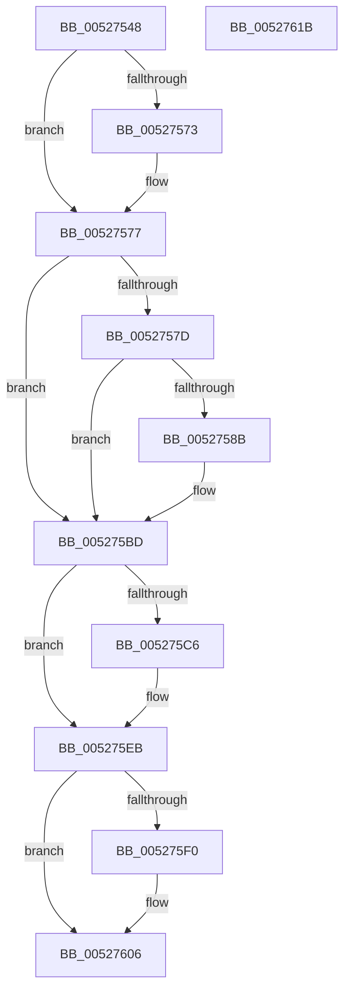

# SymCryptSha512Append

- RVA: `0x00527548`–`0x0052761C` (길이 `212` bytes)
- VA: `0x0000000140527548`
- 실행 섹션: `.text`
- PDB 이름 있음: `예`; PDB Function 태그: `아니요`
- unwind 정보 RVA: `0x000701D4`
- 디코드: `62`개 명령, `212/212` bytes 표시
- 미해석 바이트: `0` (있으면 어셈블리에 `.byte`로 보존)

> 이 문서는 커널 이미지의 기계어와 PDB 기호를 분석해 생성했습니다. 4번과 5번은 함수 원형과 자료형을 바이너리 사용 방식에서 추정한 C 해석이며 원본 소스 복구 결과는 아닙니다.

## 1. Dependencies

- 직접 호출 지점: **4**; 고유 호출 대상: **2**
- 직접 호출자로 확인된 함수: **2**
- RIP 상대 이미지 참조: **0**

### Outgoing calls
- `0x00527595` → [memcpy](../6C/memcpy_function_006C6840.md) (function, `0x006C6840`)
- `0x005275B6` → [SymCryptSha512AppendBlocks_ull](SymCryptSha512AppendBlocks_ull_function_00527624.md) (function, `0x00527624`)
- `0x005275D8` → [SymCryptSha512AppendBlocks_ull](SymCryptSha512AppendBlocks_ull_function_00527624.md) (function, `0x00527624`)
- `0x005275FF` → [memcpy](../6C/memcpy_function_006C6840.md) (function, `0x006C6840`)

### Direct callers
- [SymCryptSha384Append](SymCryptSha384Append_function_0052744C.md) at `0x00527450`
- [HashpHashBytes](../../page/84/HashpHashBytes_function_00841FA0.md) at `0x00841FCF`

### Static image references
- 디코드된 RIP-relative 메모리 참조가 없습니다.

## 2. Other-region calls and transfers

- 다른 실행 섹션으로 향하는 call: **0**
- 별도 외부 분기/꼬리 이동을 확인하지 못했습니다.

## 3. Assembly (complete function range)

```asm
00527548  48 89 5C 24 10                  mov qword ptr [rsp + 0x10], rbx
0052754D  48 89 6C 24 18                  mov qword ptr [rsp + 0x18], rbp
00527552  56                              push rsi
00527553  57                              push rdi
00527554  41 56                           push r14
00527556  48 83 EC 20                     sub rsp, 0x20
0052755A  48 83 64 24 40 00               and qword ptr [rsp + 0x40], 0
00527560  49 8B F8                        mov rdi, r8
00527563  4C 01 41 10                     add qword ptr [rcx + 0x10], r8
00527567  48 8B EA                        mov rbp, rdx
0052756A  48 8B D9                        mov rbx, rcx
0052756D  4C 39 41 10                     cmp qword ptr [rcx + 0x10], r8
00527571  73 04                           jae 0x140527577
00527573  48 FF 41 18                     inc qword ptr [rcx + 0x18]
00527577  8B 31                           mov esi, dword ptr [rcx]
00527579  85 F6                           test esi, esi
0052757B  74 40                           je 0x1405275bd
0052757D  41 BE 80 00 00 00               mov r14d, 0x80
00527583  44 2B F6                        sub r14d, esi
00527586  49 3B FE                        cmp rdi, r14
00527589  72 32                           jb 0x1405275bd
0052758B  48 8D 4E 20                     lea rcx, [rsi + 0x20]
0052758F  45 8B C6                        mov r8d, r14d
00527592  48 03 CB                        add rcx, rbx
00527595  E8 A6 F2 19 00                  call 0x1406c6840
0052759A  48 8D 53 20                     lea rdx, [rbx + 0x20]
0052759E  41 B8 80 00 00 00               mov r8d, 0x80
005275A4  48 8D 8B A0 00 00 00            lea rcx, [rbx + 0xa0]
005275AB  49 03 EE                        add rbp, r14
005275AE  4C 8D 4C 24 40                  lea r9, [rsp + 0x40]
005275B3  49 2B FE                        sub rdi, r14
005275B6  E8 69 00 00 00                  call 0x140527624
005275BB  33 F6                           xor esi, esi
005275BD  48 81 FF 80 00 00 00            cmp rdi, 0x80
005275C4  72 25                           jb 0x1405275eb
005275C6  48 8D 8B A0 00 00 00            lea rcx, [rbx + 0xa0]
005275CD  4C 8B C7                        mov r8, rdi
005275D0  4C 8D 4C 24 40                  lea r9, [rsp + 0x40]
005275D5  48 8B D5                        mov rdx, rbp
005275D8  E8 47 00 00 00                  call 0x140527624
005275DD  48 8B C7                        mov rax, rdi
005275E0  48 8B 7C 24 40                  mov rdi, qword ptr [rsp + 0x40]
005275E5  48 2B C7                        sub rax, rdi
005275E8  48 03 E8                        add rbp, rax
005275EB  48 85 FF                        test rdi, rdi
005275EE  74 16                           je 0x140527606
005275F0  8B CE                           mov ecx, esi
005275F2  4C 8B C7                        mov r8, rdi
005275F5  48 83 C1 20                     add rcx, 0x20
005275F9  48 8B D5                        mov rdx, rbp
005275FC  48 03 CB                        add rcx, rbx
005275FF  E8 3C F2 19 00                  call 0x1406c6840
00527604  03 F7                           add esi, edi
00527606  48 8B 6C 24 50                  mov rbp, qword ptr [rsp + 0x50]
0052760B  89 33                           mov dword ptr [rbx], esi
0052760D  48 8B 5C 24 48                  mov rbx, qword ptr [rsp + 0x48]
00527612  48 83 C4 20                     add rsp, 0x20
00527616  41 5E                           pop r14
00527618  5F                              pop rdi
00527619  5E                              pop rsi
0052761A  C3                              ret
0052761B  CC                              int3
```

## 4. C-style interpretation (structured pseudocode)

```c
__int64 __fastcall SymCryptSha512Append(__int64 a1, __int64 a2, __int64 a3)
{
    __int64 result;
    __int64 v_r14;
    __int64 v_rbp;
    __int64 v_rdi;
    __int64 v_rsi;
    __int64 v_rsp;
    unsigned __int64 v_stack_p10;
    unsigned __int64 v_stack_p18;
    unsigned __int64 v_stack_p8;

    v_stack_p10 = v_rbx;
    v_stack_p18 = v_rbp;
    v_rsp = (v_rsp) - (32);
    if ((*(unsigned __int64 *)(a1 + 16)) < a3) {
    }
    if ((unsigned int)((unsigned int)(*(unsigned int *)(a1))) == 0) goto loc_005275BD;
    v_r14 = (unsigned int)((128) - ((unsigned int)((unsigned int)(*(unsigned int *)(a1)))));
    v_rsi = (unsigned int)(*(unsigned int *)(a1));
    v_rdi = a3;
    v_rbp = a2;
    if (a3 >= v_r14) {
        a1 = (unsigned int)(*(unsigned int *)(a1)) + 32;
        a3 = (unsigned int)(v_r14);
        a1 = (a1) + (a1);
        result = memcpy(a1, a2, a3, a4);
        a2 = a1 + 32;
        a3 = 128;
        a1 = a1 + 160;
        v_rbp = (a2) + (v_r14);
        a4 = v_stack_p8;
        v_rdi = (a3) - (v_r14);
        result = SymCryptSha512AppendBlocks_ull(a1, a2, a3, a4);
        v_rsi = 0;
    }
    if (v_rdi >= 128) {
        a1 = a1 + 160;
        a3 = v_rdi;
        a4 = v_stack_p8;
        a2 = v_rbp;
        result = SymCryptSha512AppendBlocks_ull(a1, a2, a3, a4);
        result = v_rdi;
        v_rdi = v_stack_p8;
        result = (result) - (v_rdi);
        v_rbp = (v_rbp) + (result);
    }
    if (v_rdi != 0) {
        a1 = 0;
        a3 = v_rdi;
        a1 = (a1) + (32);
        a2 = v_rbp;
        a1 = (a1) + (a1);
        result = memcpy(a1, a2, a3, a4);
        v_rsi = (unsigned int)((v_rsi) + ((unsigned int)(v_rdi)));
    }
    *(unsigned int *)(a1) = (unsigned int)(v_rsi);
    v_rsp = (v_rsp) + (32);
    return result;
}
```

## 5. (Beta) C Style

```c
int64_t SymCryptSha512Append(void *Arg1, int64_t Arg2, int64_t Arg3)
{
    uint8_t *arg1 = (uint8_t *)Arg1;

    int64_t result;
    int64_t local_r14;
    int64_t local_rbp;
    int64_t local_rdi;
    int64_t local_rsi;
    int64_t local_rsp;
    uint64_t v_stack_p10;
    uint64_t v_stack_p18;
    uint64_t v_stack_p8;

    v_stack_p10 = local_rbx;
    v_stack_p18 = local_rbp;
    local_rsp = (local_rsp) - (32);
    if ((*(uint64_t *)(arg1 + 0x10)) < Arg3) {
    }
    if ((uint32_t)((uint32_t)(*(uint32_t *)(arg1))) == 0) goto loc_005275BD;
    local_r14 = (uint32_t)((128) - ((uint32_t)((uint32_t)(*(uint32_t *)(arg1)))));
    local_rsi = (uint32_t)(*(uint32_t *)(arg1));
    local_rdi = Arg3;
    local_rbp = Arg2;
    if (Arg3 >= local_r14) {
        Arg1 = (uint32_t)(*(uint32_t *)(arg1)) + 32;
        Arg3 = (uint32_t)(local_r14);
        Arg1 = (Arg1) + (Arg1);
        result = memcpy(Arg1, Arg2, Arg3, a4);
        Arg2 = Arg1 + 32;
        Arg3 = 128;
        Arg1 = Arg1 + 160;
        local_rbp = (Arg2) + (local_r14);
        a4 = v_stack_p8;
        local_rdi = (Arg3) - (local_r14);
        result = SymCryptSha512AppendBlocks_ull(Arg1, Arg2, Arg3, a4);
        local_rsi = 0;
    }
    if (local_rdi >= 128) {
        Arg1 = Arg1 + 160;
        Arg3 = local_rdi;
        a4 = v_stack_p8;
        Arg2 = local_rbp;
        result = SymCryptSha512AppendBlocks_ull(Arg1, Arg2, Arg3, a4);
        result = local_rdi;
        local_rdi = v_stack_p8;
        result = (result) - (local_rdi);
        local_rbp = (local_rbp) + (result);
    }
    if (local_rdi != 0) {
        Arg1 = 0;
        Arg3 = local_rdi;
        Arg1 = (Arg1) + (32);
        Arg2 = local_rbp;
        Arg1 = (Arg1) + (Arg1);
        result = memcpy(Arg1, Arg2, Arg3, a4);
        local_rsi = (uint32_t)((local_rsi) + ((uint32_t)(local_rdi)));
    }
    *(uint32_t *)(arg1) = (uint32_t)(local_rsi);
    local_rsp = (local_rsp) + (32);
    return result;
}
```

### 관측된 메모리 오프셋

구조체 형식이 확인되지 않은 접근은 인자 기준의 오프셋으로만 기록했습니다.

| 기준 인자 | 오프셋 표현 | 폭 (bit) | 접근 |
|---|---:|---:|---|
| `Arg1` | `+ 0x0` | `32` | `R` |
| `Arg1` | `+ 0x0` | `32` | `W` |
| `Arg1` | `+ 0x10` | `64` | `R` |
| `Arg1` | `+ 0x10` | `64` | `R/W` |
| `Arg1` | `+ 0x18` | `64` | `R/W` |
| `Arg1` | `+ 0x20` | `64` | `R` |
| `Arg1` | `+ 0xA0` | `64` | `R` |

## 6. Execution-region graph

[열기: 2D/3D 그래프와 함수 탐색 컨트롤 패널](../../../control-panel.html?section=text&rva=0x00527548&view=graph)

- 2D 그래프는 위에서 아래로 흐르고, 3D 그래프는 빈 공간을 드래그해 회전합니다. Shift+드래그는 이동, 휠은 확대·축소, 함수 노드 선택은 대상 보고서 이동입니다.

### Static fallback


