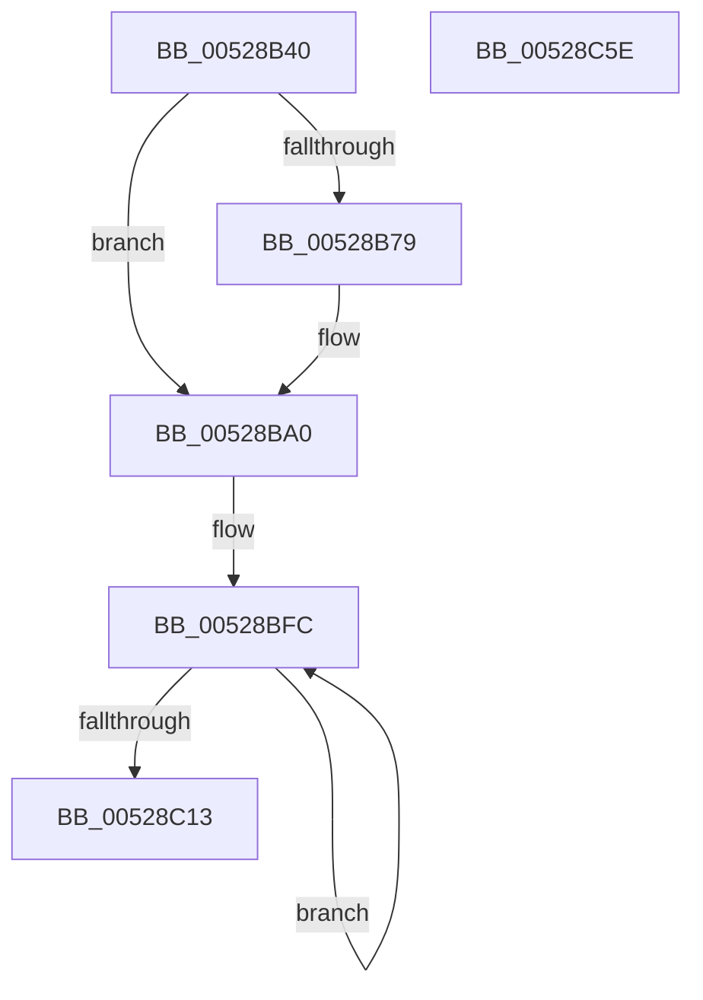

# SymCryptSha512Result

- RVA: `0x00528B40`–`0x00528C5F` (길이 `287` bytes)
- VA: `0x0000000140528B40`
- 실행 섹션: `.text`
- PDB 이름 있음: `예`; PDB Function 태그: `아니요`
- unwind 정보 RVA: `0x000701D4`
- 디코드: `75`개 명령, `287/287` bytes 표시
- 미해석 바이트: `0` (있으면 어셈블리에 `.byte`로 보존)

> 이 문서는 커널 이미지의 기계어와 PDB 기호를 분석해 생성했습니다. 4번과 5번은 함수 원형과 자료형을 바이너리 사용 방식에서 추정한 C 해석이며 원본 소스 복구 결과는 아닙니다.

## 1. Dependencies

- 직접 호출 지점: **5**; 고유 호출 대상: **2**
- 직접 호출자로 확인된 함수: **2**
- RIP 상대 이미지 참조: **4**

### Outgoing calls
- `0x00528B85` → [SymCryptWipe](../51/SymCryptWipe_function_0051F914.md) (function, `0x0051F914`)
- `0x00528B99` → [SymCryptSha512AppendBlocks_ull](SymCryptSha512AppendBlocks_ull_function_00527624.md) (function, `0x00527624`)
- `0x00528BAC` → [SymCryptWipe](../51/SymCryptWipe_function_0051F914.md) (function, `0x0051F914`)
- `0x00528BEF` → [SymCryptSha512AppendBlocks_ull](SymCryptSha512AppendBlocks_ull_function_00527624.md) (function, `0x00527624`)
- `0x00528C1B` → [SymCryptWipe](../51/SymCryptWipe_function_0051F914.md) (function, `0x0051F914`)

### Direct callers
- [SymCryptSha384Result](SymCryptSha384Result_function_005274B0.md) at `0x005274DA`
- [HashpFinalizeHash](../../page/84/HashpFinalizeHash_function_00841F34.md) at `0x00841F60`

### Static image references
- `0x00528C20` → RVA `0x00020390` (`.rdata`; read)
- `0x00528C34` → RVA `0x000203A0` (`.rdata`; read)
- `0x00528C3F` → RVA `0x000203B0` (`.rdata`; read)
- `0x00528C4A` → RVA `0x000203C0` (`.rdata`; read)

## 2. Other-region calls and transfers

- 다른 실행 섹션으로 향하는 call: **0**
- 별도 외부 분기/꼬리 이동을 확인하지 못했습니다.

## 3. Assembly (complete function range)

```asm
00528B40  48 89 5C 24 10                  mov qword ptr [rsp + 0x10], rbx
00528B45  48 89 6C 24 18                  mov qword ptr [rsp + 0x18], rbp
00528B4A  56                              push rsi
00528B4B  57                              push rdi
00528B4C  41 56                           push r14
00528B4E  48 83 EC 20                     sub rsp, 0x20
00528B52  48 83 64 24 40 00               and qword ptr [rsp + 0x40], 0
00528B58  48 8B D9                        mov rbx, rcx
00528B5B  8B 09                           mov ecx, dword ptr [rcx]
00528B5D  41 BE 80 00 00 00               mov r14d, 0x80
00528B63  48 8B F2                        mov rsi, rdx
00528B66  48 8D BB A0 00 00 00            lea rdi, [rbx + 0xa0]
00528B6D  44 88 74 19 20                  mov byte ptr [rcx + rbx + 0x20], r14b
00528B72  FF C1                           inc ecx
00528B74  83 F9 70                        cmp ecx, 0x70
00528B77  76 27                           jbe 0x140528ba0
00528B79  41 8B D6                        mov edx, r14d
00528B7C  2B D1                           sub edx, ecx
00528B7E  48 83 C1 20                     add rcx, 0x20
00528B82  48 03 CB                        add rcx, rbx
00528B85  E8 8A 6D FF FF                  call 0x14051f914
00528B8A  4C 8D 4C 24 40                  lea r9, [rsp + 0x40]
00528B8F  45 8B C6                        mov r8d, r14d
00528B92  48 8D 53 20                     lea rdx, [rbx + 0x20]
00528B96  48 8B CF                        mov rcx, rdi
00528B99  E8 86 EA FF FF                  call 0x140527624
00528B9E  33 C9                           xor ecx, ecx
00528BA0  41 8B D6                        mov edx, r14d
00528BA3  2B D1                           sub edx, ecx
00528BA5  48 83 C1 20                     add rcx, 0x20
00528BA9  48 03 CB                        add rcx, rbx
00528BAC  E8 63 6D FF FF                  call 0x14051f914
00528BB1  4C 8B 4B 10                     mov r9, qword ptr [rbx + 0x10]
00528BB5  48 8D 53 20                     lea rdx, [rbx + 0x20]
00528BB9  48 8B 4B 18                     mov rcx, qword ptr [rbx + 0x18]
00528BBD  49 8B C1                        mov rax, r9
00528BC0  48 C1 E8 3D                     shr rax, 0x3d
00528BC4  4D 8B C6                        mov r8, r14
00528BC7  48 8D 0C C8                     lea rcx, [rax + rcx*8]
00528BCB  48 0F C9                        bswap rcx
00528BCE  4A 8D 04 CD 00 00 00 00         lea rax, [r9*8]
00528BD6  48 89 8B 90 00 00 00            mov qword ptr [rbx + 0x90], rcx
00528BDD  48 0F C8                        bswap rax
00528BE0  48 8B CF                        mov rcx, rdi
00528BE3  48 89 83 98 00 00 00            mov qword ptr [rbx + 0x98], rax
00528BEA  4C 8D 4C 24 40                  lea r9, [rsp + 0x40]
00528BEF  E8 30 EA FF FF                  call 0x140527624
00528BF4  48 8B CF                        mov rcx, rdi
00528BF7  BA 08 00 00 00                  mov edx, 8
00528BFC  48 8B 01                        mov rax, qword ptr [rcx]
00528BFF  48 8D 49 08                     lea rcx, [rcx + 8]
00528C03  48 0F C8                        bswap rax
00528C06  48 89 06                        mov qword ptr [rsi], rax
00528C09  48 8D 76 08                     lea rsi, [rsi + 8]
00528C0D  48 83 EA 01                     sub rdx, 1
00528C11  75 E9                           jne 0x140528bfc
00528C13  BA E0 00 00 00                  mov edx, 0xe0
00528C18  48 8B CB                        mov rcx, rbx
00528C1B  E8 F4 6C FF FF                  call 0x14051f914
00528C20  0F 28 05 69 77 AF FF            movaps xmm0, xmmword ptr [rip - 0x508897]
00528C27  48 8B 5C 24 48                  mov rbx, qword ptr [rsp + 0x48]
00528C2C  48 8B 6C 24 50                  mov rbp, qword ptr [rsp + 0x50]
00528C31  0F 11 07                        movups xmmword ptr [rdi], xmm0
00528C34  0F 28 0D 65 77 AF FF            movaps xmm1, xmmword ptr [rip - 0x50889b]
00528C3B  0F 11 4F 10                     movups xmmword ptr [rdi + 0x10], xmm1
00528C3F  0F 28 05 6A 77 AF FF            movaps xmm0, xmmword ptr [rip - 0x508896]
00528C46  0F 11 47 20                     movups xmmword ptr [rdi + 0x20], xmm0
00528C4A  0F 28 0D 6F 77 AF FF            movaps xmm1, xmmword ptr [rip - 0x508891]
00528C51  0F 11 4F 30                     movups xmmword ptr [rdi + 0x30], xmm1
00528C55  48 83 C4 20                     add rsp, 0x20
00528C59  41 5E                           pop r14
00528C5B  5F                              pop rdi
00528C5C  5E                              pop rsi
00528C5D  C3                              ret
00528C5E  CC                              int3
```

## 4. C-style interpretation (structured pseudocode)

```c
__int64 __fastcall SymCryptSha512Result(__int64 a1, __int64 a2)
{
    __int64 result;
    __int64 v_rsp;
    unsigned __int64 v_stack_p10;
    unsigned __int64 v_stack_p18;
    unsigned __int64 v_stack_p8;

    v_stack_p10 = v_rbx;
    v_stack_p18 = v_rbp;
    v_rsp = (v_rsp) - (32);
    *(unsigned __int8 *)((unsigned int)(*(unsigned int *)(a1)) + a1 * 1 + 32) = 128;
    a1 = (unsigned int)(((unsigned int)(*(unsigned int *)(a1))) + 1);
    if (((unsigned int)(a1)) >= = 112) {
        a2 = 128;
        a2 = (unsigned int)((a2) - ((unsigned int)(a1)));
        a1 = (a1) + (32);
        a1 = (a1) + (a1);
        result = SymCryptWipe(a1, a2, a3, a4);
        a4 = v_stack_p8;
        a3 = 128;
        a2 = a1 + 32;
        a1 = a1 + 160;
        result = SymCryptSha512AppendBlocks_ull(a1, a2, a3, a4);
        a1 = 0;
    }
    a2 = (unsigned int)((128) - (0));
    a1 = (a1) + (32);
    a1 = (a1) + (a1);
    result = SymCryptWipe(a1, a2, a3, a4);
    result = (*(unsigned __int64 *)(a1 + 16)) >> (61);
    *(unsigned __int64 *)(a1 + 144) = result + *(unsigned __int64 *)(a1 + 24) * 8;
    *(unsigned __int64 *)(a1 + 152) = *(unsigned __int64 *)(a1 + 16) * 8;
    result = SymCryptSha512AppendBlocks_ull(a1 + 160, a1 + 32, 128, v_stack_p8);
loc_00528BFC:
    *(unsigned __int64 *)(a2) = *(unsigned __int64 *)(a1 + 160);
    a2 = (8) - (1);
    if (condition_is_not_equal) goto loc_00528BFC;
    result = SymCryptWipe(a1, 224, 128, v_stack_p8);
    *(unsigned __int64 *)(a1 + 160) = v_xmm0;
    *(unsigned __int64 *)(a1 + 160 + 16) = v_xmm1;
    *(unsigned __int64 *)(a1 + 160 + 32) = v_xmm0;
    *(unsigned __int64 *)(a1 + 160 + 48) = v_xmm1;
    v_rsp = (v_rsp) + (32);
    return result;
}
```

## 5. (Beta) C Style

```c
int64_t SymCryptSha512Result(void *Arg1, void *Arg2)
{
    uint8_t *arg1 = (uint8_t *)Arg1;
    uint8_t *arg2 = (uint8_t *)Arg2;

    int64_t result;
    int64_t local_rsp;
    uint64_t v_stack_p10;
    uint64_t v_stack_p18;
    uint64_t v_stack_p8;

    v_stack_p10 = local_rbx;
    v_stack_p18 = local_rbp;
    local_rsp = (local_rsp) - (32);
    *(uint8_t *)((uint32_t)(*(uint32_t *)(arg1)) + arg1 * 1 + 0x20) = 128;
    Arg1 = (uint32_t)(((uint32_t)(*(uint32_t *)(arg1))) + 1);
    if (((uint32_t)(Arg1)) >= = 112) {
        Arg2 = 128;
        Arg2 = (uint32_t)((Arg2) - ((uint32_t)(Arg1)));
        Arg1 = (Arg1) + (32);
        Arg1 = (Arg1) + (Arg1);
        result = SymCryptWipe(Arg1, Arg2, a3, a4);
        a4 = v_stack_p8;
        a3 = 128;
        Arg2 = Arg1 + 32;
        Arg1 = Arg1 + 160;
        result = SymCryptSha512AppendBlocks_ull(Arg1, Arg2, a3, a4);
        Arg1 = 0;
    }
    Arg2 = (uint32_t)((128) - (0));
    Arg1 = (Arg1) + (32);
    Arg1 = (Arg1) + (Arg1);
    result = SymCryptWipe(Arg1, Arg2, a3, a4);
    result = (*(uint64_t *)(arg1 + 0x10)) >> (61);
    *(uint64_t *)(arg1 + 0x90) = result + *(uint64_t *)(arg1 + 0x18) * 8;
    *(uint64_t *)(arg1 + 0x98) = *(uint64_t *)(arg1 + 0x10) * 8;
    result = SymCryptSha512AppendBlocks_ull(Arg1 + 160, Arg1 + 32, 128, v_stack_p8);
loc_00528BFC:
    *(uint64_t *)(arg2) = *(uint64_t *)(arg1 + 0xA0);
    Arg2 = (8) - (1);
    if (condition_is_not_equal) goto loc_00528BFC;
    result = SymCryptWipe(Arg1, 224, 128, v_stack_p8);
    *(uint64_t *)(arg1 + 0xA0) = v_xmm0;
    *(uint64_t *)(arg1 + 0xA0 + 0x10) = v_xmm1;
    *(uint64_t *)(arg1 + 0xA0 + 0x20) = v_xmm0;
    *(uint64_t *)(arg1 + 0xA0 + 0x30) = v_xmm1;
    local_rsp = (local_rsp) + (32);
    return result;
}
```

### 관측된 메모리 오프셋

구조체 형식이 확인되지 않은 접근은 인자 기준의 오프셋으로만 기록했습니다.

| 기준 인자 | 오프셋 표현 | 폭 (bit) | 접근 |
|---|---:|---:|---|
| `Arg1` | `+ 0x0` | `32` | `R` |
| `Arg1` | `+ 0x0` | `64` | `R` |
| `Arg1` | `+ 0x0` | `128` | `R` |
| `Arg1` | `+ 0x8` | `64` | `R` |
| `Arg1` | `+ 0x10` | `64` | `R` |
| `Arg1` | `+ 0x10` | `128` | `R` |
| `Arg1` | `+ 0x18` | `64` | `R` |
| `Arg1` | `+ 0x20` | `64` | `R` |
| `Arg1` | `+ 0x20` | `128` | `R` |
| `Arg1` | `+ 0x30` | `128` | `R` |
| `Arg1` | `+ 0x90` | `64` | `W` |
| `Arg1` | `+ 0x98` | `64` | `W` |
| `Arg1` | `+ 0xA0` | `64` | `R` |
| `Arg2` | `+ 0x0` | `64` | `W` |
| `Arg2` | `+ 0x8` | `64` | `R` |

## 6. Execution-region graph

[열기: 2D/3D 그래프와 함수 탐색 컨트롤 패널](../../../control-panel.html?section=text&rva=0x00528B40&view=graph)

- 2D 그래프는 위에서 아래로 흐르고, 3D 그래프는 빈 공간을 드래그해 회전합니다. Shift+드래그는 이동, 휠은 확대·축소, 함수 노드 선택은 대상 보고서 이동입니다.

### Static fallback


