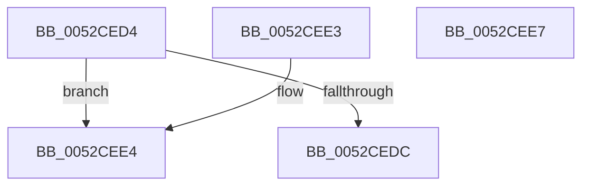

# SymCryptSizeofEcpointEx

- RVA: `0x0052CED4`–`0x0052CEE8` (길이 `20` bytes)
- VA: `0x000000014052CED4`
- 실행 섹션: `.text`
- PDB 이름 있음: `예`; PDB Function 태그: `아니요`
- unwind 정보 RVA: `0x000DB714`
- 디코드: `10`개 명령, `20/20` bytes 표시
- 미해석 바이트: `0` (있으면 어셈블리에 `.byte`로 보존)

> 이 문서는 커널 이미지의 기계어와 PDB 기호를 분석해 생성했습니다. 4번과 5번은 함수 원형과 자료형을 바이너리 사용 방식에서 추정한 C 해석이며 원본 소스 복구 결과는 아닙니다.

## 1. Dependencies

- 직접 호출 지점: **0**; 고유 호출 대상: **0**
- 직접 호출자로 확인된 함수: **4**
- RIP 상대 이미지 참조: **0**

### Outgoing calls
- 직접 디코드된 call 명령이 없습니다.

### Direct callers
- [SymCryptEcurveValidateAndComputeSizes](SymCryptEcurveValidateAndComputeSizes_function_00524814.md) at `0x00524912`
- [SymCryptEcurveValidateAndComputeSizes](SymCryptEcurveValidateAndComputeSizes_function_00524814.md) at `0x00524974`
- [SymCryptShortWeierstrassFillScratchSpaces](../53/SymCryptShortWeierstrassFillScratchSpaces_function_00538F60.md) at `0x0053901F`
- [SymCryptTwistedEdwardsFillScratchSpaces](../53/SymCryptTwistedEdwardsFillScratchSpaces_function_00539E40.md) at `0x00539EF6`
- [SymCryptMontgomeryFillScratchSpaces](../53/SymCryptMontgomeryFillScratchSpaces_function_0053A870.md) at `0x0053A945`

### Static image references
- 디코드된 RIP-relative 메모리 참조가 없습니다.

## 2. Other-region calls and transfers

- 다른 실행 섹션으로 향하는 call: **0**
- 별도 외부 분기/꼬리 이동을 확인하지 못했습니다.

## 3. Assembly (complete function range)

```asm
0052CED4  8D 42 FF                        lea eax, [rdx - 1]
0052CED7  83 F8 03                        cmp eax, 3
0052CEDA  77 08                           ja 0x14052cee4
0052CEDC  0F AF CA                        imul ecx, edx
0052CEDF  8D 41 20                        lea eax, [rcx + 0x20]
0052CEE2  C3                              ret
0052CEE3  CC                              int3
0052CEE4  33 C0                           xor eax, eax
0052CEE6  C3                              ret
0052CEE7  CC                              int3
```

## 4. C-style interpretation (structured pseudocode)

```c
__int64 __fastcall SymCryptSizeofEcpointEx(int a1, __int64 a2)
{
    __int64 result;

    if (((unsigned int)(a2 - 1)) > 3) goto loc_0052CEE4;
    a1 = (unsigned int)((a1) * ((unsigned int)(a2)));
    return a1 + 32;
loc_0052CEE4:
    result = 0;
    return result;
}
```

## 5. (Beta) C Style

```c
void *SymCryptSizeofEcpointEx(void *Arg1, void *Arg2)
{
    uint8_t *arg1 = (uint8_t *)Arg1;
    uint8_t *arg2 = (uint8_t *)Arg2;

    int64_t result;

    if (((uint32_t)(Arg2 - 1)) > 3) goto loc_0052CEE4;
    Arg1 = (uint32_t)((Arg1) * ((uint32_t)(Arg2)));
    return Arg1 + 32;
loc_0052CEE4:
    result = 0;
    return result;
}
```

### 관측된 메모리 오프셋

구조체 형식이 확인되지 않은 접근은 인자 기준의 오프셋으로만 기록했습니다.

| 기준 인자 | 오프셋 표현 | 폭 (bit) | 접근 |
|---|---:|---:|---|
| `Arg1` | `+ 0x20` | `32` | `R` |
| `Arg2` | `- 0x1` | `32` | `R` |

## 6. Execution-region graph

[열기: 2D/3D 그래프와 함수 탐색 컨트롤 패널](../../../control-panel.html?section=text&rva=0x0052CED4&view=graph)

- 2D 그래프는 위에서 아래로 흐르고, 3D 그래프는 빈 공간을 드래그해 회전합니다. Shift+드래그는 이동, 휠은 확대·축소, 함수 노드 선택은 대상 보고서 이동입니다.

### Static fallback


