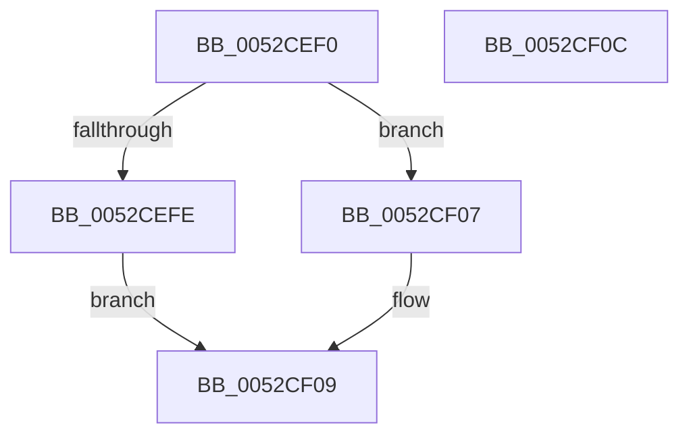

# SymCryptSizeofEcpointFromCurve

- RVA: `0x0052CEF0`–`0x0052CF0D` (길이 `29` bytes)
- VA: `0x000000014052CEF0`
- 실행 섹션: `.text`
- PDB 이름 있음: `예`; PDB Function 태그: `아니요`
- unwind 정보 RVA: `0x000DB714`
- 디코드: `12`개 명령, `29/29` bytes 표시
- 미해석 바이트: `0` (있으면 어셈블리에 `.byte`로 보존)

> 이 문서는 커널 이미지의 기계어와 PDB 기호를 분석해 생성했습니다. 4번과 5번은 함수 원형과 자료형을 바이너리 사용 방식에서 추정한 C 해석이며 원본 소스 복구 결과는 아닙니다.

## 1. Dependencies

- 직접 호출 지점: **0**; 고유 호출 대상: **0**
- 직접 호출자로 확인된 함수: **14**
- RIP 상대 이미지 참조: **0**

### Outgoing calls
- 직접 디코드된 call 명령이 없습니다.

### Direct callers
- [SymCryptEckeyCreate](SymCryptEckeyCreate_function_00524A60.md) at `0x00524A8C`
- [SymCryptEckeyPerformPublicKeyValidation](SymCryptEckeyPerformPublicKeyValidation_function_00524B1C.md) at `0x00524B46`
- [SymCryptEckeySetValue](SymCryptEckeySetValue_function_00524C34.md) at `0x00524FD2`
- [SymCryptSizeofEckeyFromCurve](SymCryptSizeofEckeyFromCurve_function_00525124.md) at `0x00525142`
- [SymCryptEcDsaSignEx](SymCryptEcDsaSignEx_function_00525D6C.md) at `0x00525E02`
- [SymCryptEcDsaVerify](SymCryptEcDsaVerify_function_00526400.md) at `0x005264D4`
- [SymCryptEcpointMultiScalarMulWnafWithInterleaving](SymCryptEcpointMultiScalarMulWnafWithInterleaving_function_0052B920.md) at `0x0052B9CF`
- [SymCryptEcpointScalarMulFixedWindow](SymCryptEcpointScalarMulFixedWindow_function_0052BE30.md) at `0x0052BEE3`
- [SymCryptOfflinePrecomputation](SymCryptOfflinePrecomputation_function_0052C450.md) at `0x0052C46D`
- [SymCryptEcDhSecretAgreement](../53/SymCryptEcDhSecretAgreement_function_00537798.md) at `0x005377FA`
- [SymCryptShortWeierstrassAdd](../53/SymCryptShortWeierstrassAdd_function_00537BC0.md) at `0x00537BEE`
- [SymCryptShortWeierstrassFillScratchSpaces](../53/SymCryptShortWeierstrassFillScratchSpaces_function_00538F60.md) at `0x00538F89`
- [SymCryptShortWeierstrassFillScratchSpaces](../53/SymCryptShortWeierstrassFillScratchSpaces_function_00538F60.md) at `0x00538FB7`
- [SymCryptShortWeierstrassFillScratchSpaces](../53/SymCryptShortWeierstrassFillScratchSpaces_function_00538F60.md) at `0x00538FD9`
- [SymCryptShortWeierstrassFillScratchSpaces](../53/SymCryptShortWeierstrassFillScratchSpaces_function_00538F60.md) at `0x00539067`
- [SymCryptShortWeierstrassFillScratchSpaces](../53/SymCryptShortWeierstrassFillScratchSpaces_function_00538F60.md) at `0x00539084`
- [SymCryptTwistedEdwardsFillScratchSpaces](../53/SymCryptTwistedEdwardsFillScratchSpaces_function_00539E40.md) at `0x00539E9D`
- [SymCryptTwistedEdwardsFillScratchSpaces](../53/SymCryptTwistedEdwardsFillScratchSpaces_function_00539E40.md) at `0x00539EC1`
- [SymCryptTwistedEdwardsFillScratchSpaces](../53/SymCryptTwistedEdwardsFillScratchSpaces_function_00539E40.md) at `0x00539F5F`
- [SymCryptTwistedEdwardsFillScratchSpaces](../53/SymCryptTwistedEdwardsFillScratchSpaces_function_00539E40.md) at `0x00539F7D`
- [SymCryptMontgomeryFillScratchSpaces](../53/SymCryptMontgomeryFillScratchSpaces_function_0053A870.md) at `0x0053A9AC`
- [SymCryptMontgomeryFillScratchSpaces](../53/SymCryptMontgomeryFillScratchSpaces_function_0053A870.md) at `0x0053A9C9`

### Static image references
- 디코드된 RIP-relative 메모리 참조가 없습니다.

## 2. Other-region calls and transfers

- 다른 실행 섹션으로 향하는 call: **0**
- 별도 외부 분기/꼬리 이동을 확인하지 못했습니다.

## 3. Assembly (complete function range)

```asm
0052CEF0  8B 51 08                        mov edx, dword ptr [rcx + 8]
0052CEF3  83 E2 0F                        and edx, 0xf
0052CEF6  8D 42 FF                        lea eax, [rdx - 1]
0052CEF9  83 F8 03                        cmp eax, 3
0052CEFC  77 09                           ja 0x14052cf07
0052CEFE  0F AF 51 24                     imul edx, dword ptr [rcx + 0x24]
0052CF02  83 C2 20                        add edx, 0x20
0052CF05  EB 02                           jmp 0x14052cf09
0052CF07  33 D2                           xor edx, edx
0052CF09  8B C2                           mov eax, edx
0052CF0B  C3                              ret
0052CF0C  CC                              int3
```

## 4. C-style interpretation (structured pseudocode)

```c
__int64 __fastcall SymCryptSizeofEcpointFromCurve(__int64 a1)
{
    a2 = (unsigned int)(((unsigned int)(*(unsigned int *)(a1 + 8))) & (15));
    if (((unsigned int)(a2 - 1)) > 3) goto loc_0052CF07;
    a2 = (unsigned int)((a2) * (*(unsigned int *)(a1 + 36)));
    a2 = (unsigned int)((a2) + (32));
    goto loc_0052CF09;
loc_0052CF07:
    a2 = 0;
loc_0052CF09:
    return 0;
}
```

## 5. (Beta) C Style

```c
int64_t SymCryptSizeofEcpointFromCurve(void *Arg1)
{
    uint8_t *arg1 = (uint8_t *)Arg1;

    a2 = (uint32_t)(((uint32_t)(*(uint32_t *)(arg1 + 0x8))) & (15));
    if (((uint32_t)(a2 - 1)) > 3) goto loc_0052CF07;
    a2 = (uint32_t)((a2) * (*(uint32_t *)(arg1 + 0x24)));
    a2 = (uint32_t)((a2) + (32));
    goto loc_0052CF09;
loc_0052CF07:
    a2 = 0;
loc_0052CF09:
    return 0;
}
```

### 관측된 메모리 오프셋

구조체 형식이 확인되지 않은 접근은 인자 기준의 오프셋으로만 기록했습니다.

| 기준 인자 | 오프셋 표현 | 폭 (bit) | 접근 |
|---|---:|---:|---|
| `Arg1` | `+ 0x8` | `32` | `R` |
| `Arg1` | `+ 0x24` | `32` | `R` |

## 6. Execution-region graph

[열기: 2D/3D 그래프와 함수 탐색 컨트롤 패널](../../../control-panel.html?section=text&rva=0x0052CEF0&view=graph)

- 2D 그래프는 위에서 아래로 흐르고, 3D 그래프는 빈 공간을 드래그해 회전합니다. Shift+드래그는 이동, 휠은 확대·축소, 함수 노드 선택은 대상 보고서 이동입니다.

### Static fallback


