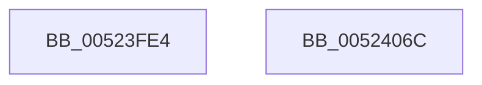

# SymCryptSizeofRsakeyFromParams

- RVA: `0x00523FE4`–`0x0052406D` (길이 `137` bytes)
- VA: `0x0000000140523FE4`
- 실행 섹션: `.text`
- PDB 이름 있음: `예`; PDB Function 태그: `아니요`
- unwind 정보 RVA: `0x0005C954`
- 디코드: `43`개 명령, `137/137` bytes 표시
- 미해석 바이트: `0` (있으면 어셈블리에 `.byte`로 보존)

> 이 문서는 커널 이미지의 기계어와 PDB 기호를 분석해 생성했습니다. 4번과 5번은 함수 원형과 자료형을 바이너리 사용 방식에서 추정한 C 해석이며 원본 소스 복구 결과는 아닙니다.

## 1. Dependencies

- 직접 호출 지점: **5**; 고유 호출 대상: **3**
- 직접 호출자로 확인된 함수: **2**
- RIP 상대 이미지 참조: **0**

### Outgoing calls
- `0x00523FFE` → [SymCryptDigitsFromBits](SymCryptDigitsFromBits_function_0052544C.md) (function, `0x0052544C`)
- `0x00524007` → [SymCryptSizeofIntFromDigits](SymCryptSizeofIntFromDigits_function_00525D24.md) (function, `0x00525D24`)
- `0x00524014` → [SymCryptSizeofModulusFromDigits](SymCryptSizeofModulusFromDigits_function_00525D54.md) (function, `0x00525D54`)
- `0x0052403C` → [SymCryptSizeofIntFromDigits](SymCryptSizeofIntFromDigits_function_00525D24.md) (function, `0x00525D24`)
- `0x0052404B` → [SymCryptSizeofModulusFromDigits](SymCryptSizeofModulusFromDigits_function_00525D54.md) (function, `0x00525D54`)

### Direct callers
- [SymCryptRsakeyAllocate](SymCryptRsakeyAllocate_function_00522CF4.md) at `0x00522D08`
- [SymCryptRsakeyCreate](SymCryptRsakeyCreate_function_00523594.md) at `0x005235BD`

### Static image references
- 디코드된 RIP-relative 메모리 참조가 없습니다.

## 2. Other-region calls and transfers

- 다른 실행 섹션으로 향하는 call: **0**
- 별도 외부 분기/꼬리 이동을 확인하지 못했습니다.

## 3. Assembly (complete function range)

```asm
00523FE4  48 89 5C 24 08                  mov qword ptr [rsp + 8], rbx
00523FE9  48 89 6C 24 10                  mov qword ptr [rsp + 0x10], rbp
00523FEE  48 89 74 24 18                  mov qword ptr [rsp + 0x18], rsi
00523FF3  57                              push rdi
00523FF4  48 83 EC 20                     sub rsp, 0x20
00523FF8  48 8B E9                        mov rbp, rcx
00523FFB  8B 49 04                        mov ecx, dword ptr [rcx + 4]
00523FFE  E8 49 14 00 00                  call 0x14052544c
00524003  8B C8                           mov ecx, eax
00524005  8B F0                           mov esi, eax
00524007  E8 18 1D 00 00                  call 0x140525d24
0052400C  8B D8                           mov ebx, eax
0052400E  8B CE                           mov ecx, esi
00524010  0F AF 5D 0C                     imul ebx, dword ptr [rbp + 0xc]
00524014  E8 3B 1D 00 00                  call 0x140525d54
00524019  8B 4D 04                        mov ecx, dword ptr [rbp + 4]
0052401C  BA FF 01 00 00                  mov edx, 0x1ff
00524021  8B F9                           mov edi, ecx
00524023  03 C3                           add eax, ebx
00524025  23 FA                           and edi, edx
00524027  C1 E9 09                        shr ecx, 9
0052402A  03 FA                           add edi, edx
0052402C  C1 EF 09                        shr edi, 9
0052402F  03 F9                           add edi, ecx
00524031  8B CE                           mov ecx, esi
00524033  C1 E7 06                        shl edi, 6
00524036  03 F8                           add edi, eax
00524038  0F AF 7D 08                     imul edi, dword ptr [rbp + 8]
0052403C  E8 E3 1C 00 00                  call 0x140525d24
00524041  8B D8                           mov ebx, eax
00524043  8B CE                           mov ecx, esi
00524045  0F AF 5D 0C                     imul ebx, dword ptr [rbp + 0xc]
00524049  03 DF                           add ebx, edi
0052404B  E8 04 1D 00 00                  call 0x140525d54
00524050  48 8B 6C 24 38                  mov rbp, qword ptr [rsp + 0x38]
00524055  05 C0 00 00 00                  add eax, 0xc0
0052405A  48 8B 74 24 40                  mov rsi, qword ptr [rsp + 0x40]
0052405F  03 C3                           add eax, ebx
00524061  48 8B 5C 24 30                  mov rbx, qword ptr [rsp + 0x30]
00524066  48 83 C4 20                     add rsp, 0x20
0052406A  5F                              pop rdi
0052406B  C3                              ret
0052406C  CC                              int3
```

## 4. C-style interpretation (structured pseudocode)

```c
__int64 __fastcall SymCryptSizeofRsakeyFromParams(__int64 a1)
{
    __int64 result;
    __int64 v_rbx;
    __int64 v_rdi;
    __int64 v_rsp;
    unsigned __int64 v_stack_p10;
    unsigned __int64 v_stack_p18;
    unsigned __int64 v_stack_p8;

    v_stack_p8 = v_rbx;
    v_stack_p10 = v_rbp;
    v_stack_p18 = v_rsi;
    v_rsp = (v_rsp) - (32);
    result = SymCryptDigitsFromBits((unsigned int)(*(unsigned int *)(a1 + 4)), a2, a3, a4);
    result = SymCryptSizeofIntFromDigits((unsigned int)((unsigned int)(result)), a2, a3, a4);
    v_rbx = (unsigned int)(((unsigned int)((unsigned int)(result))) * (*(unsigned int *)(a1 + 12)));
    result = SymCryptSizeofModulusFromDigits((unsigned int)((unsigned int)((unsigned int)((unsigned int)(result)))), a2, a3, a4);
    result = (unsigned int)((result) + ((unsigned int)(v_rbx)));
    v_rdi = (unsigned int)(((unsigned int)((unsigned int)((unsigned int)(*(unsigned int *)(a1 + 4))))) & (511));
    a1 = (unsigned int)(((unsigned int)(*(unsigned int *)(a1 + 4))) >> (9));
    v_rdi = (unsigned int)((v_rdi) + (511));
    v_rdi = (unsigned int)((v_rdi) >> (9));
    v_rdi = (unsigned int)((v_rdi) + ((unsigned int)(a1)));
    v_rdi = (unsigned int)((v_rdi) << (6));
    v_rdi = (unsigned int)((v_rdi) + ((unsigned int)(result)));
    v_rdi = (unsigned int)((v_rdi) * (*(unsigned int *)(a1 + 8)));
    result = SymCryptSizeofIntFromDigits((unsigned int)((unsigned int)((unsigned int)((unsigned int)(result)))), 511, a3, a4);
    v_rbx = (unsigned int)(((unsigned int)((unsigned int)(result))) * (*(unsigned int *)(a1 + 12)));
    v_rbx = (unsigned int)((v_rbx) + ((unsigned int)(v_rdi)));
    result = SymCryptSizeofModulusFromDigits((unsigned int)((unsigned int)((unsigned int)((unsigned int)(result)))), 511, a3, a4);
    result = (unsigned int)((result) + (192));
    result = (unsigned int)((result) + ((unsigned int)(v_rbx)));
    v_rsp = (v_rsp) + (32);
    return result;
}
```

## 5. (Beta) C Style

```c
int64_t SymCryptSizeofRsakeyFromParams(void *Arg1)
{
    uint8_t *arg1 = (uint8_t *)Arg1;

    int64_t result;
    int64_t local_rbx;
    int64_t local_rdi;
    int64_t local_rsp;
    uint64_t v_stack_p10;
    uint64_t v_stack_p18;
    uint64_t v_stack_p8;

    v_stack_p8 = local_rbx;
    v_stack_p10 = local_rbp;
    v_stack_p18 = local_rsi;
    local_rsp = (local_rsp) - (32);
    result = SymCryptDigitsFromBits((uint32_t)(*(uint32_t *)(arg1 + 0x4)), a2, a3, a4);
    result = SymCryptSizeofIntFromDigits((uint32_t)((uint32_t)(result)), a2, a3, a4);
    local_rbx = (uint32_t)(((uint32_t)((uint32_t)(result))) * (*(uint32_t *)(arg1 + 0xC)));
    result = SymCryptSizeofModulusFromDigits((uint32_t)((uint32_t)((uint32_t)((uint32_t)(result)))), a2, a3, a4);
    result = (uint32_t)((result) + ((uint32_t)(local_rbx)));
    local_rdi = (uint32_t)(((uint32_t)((uint32_t)((uint32_t)(*(uint32_t *)(arg1 + 0x4))))) & (511));
    Arg1 = (uint32_t)(((uint32_t)(*(uint32_t *)(arg1 + 0x4))) >> (9));
    local_rdi = (uint32_t)((local_rdi) + (511));
    local_rdi = (uint32_t)((local_rdi) >> (9));
    local_rdi = (uint32_t)((local_rdi) + ((uint32_t)(Arg1)));
    local_rdi = (uint32_t)((local_rdi) << (6));
    local_rdi = (uint32_t)((local_rdi) + ((uint32_t)(result)));
    local_rdi = (uint32_t)((local_rdi) * (*(uint32_t *)(arg1 + 0x8)));
    result = SymCryptSizeofIntFromDigits((uint32_t)((uint32_t)((uint32_t)((uint32_t)(result)))), 511, a3, a4);
    local_rbx = (uint32_t)(((uint32_t)((uint32_t)(result))) * (*(uint32_t *)(arg1 + 0xC)));
    local_rbx = (uint32_t)((local_rbx) + ((uint32_t)(local_rdi)));
    result = SymCryptSizeofModulusFromDigits((uint32_t)((uint32_t)((uint32_t)((uint32_t)(result)))), 511, a3, a4);
    result = (uint32_t)((result) + (192));
    result = (uint32_t)((result) + ((uint32_t)(local_rbx)));
    local_rsp = (local_rsp) + (32);
    return result;
}
```

### 관측된 메모리 오프셋

구조체 형식이 확인되지 않은 접근은 인자 기준의 오프셋으로만 기록했습니다.

| 기준 인자 | 오프셋 표현 | 폭 (bit) | 접근 |
|---|---:|---:|---|
| `Arg1` | `+ 0x4` | `32` | `R` |
| `Arg1` | `+ 0x8` | `32` | `R` |
| `Arg1` | `+ 0xC` | `32` | `R` |

## 6. Execution-region graph

[열기: 2D/3D 그래프와 함수 탐색 컨트롤 패널](../../../control-panel.html?section=text&rva=0x00523FE4&view=graph)

- 2D 그래프는 위에서 아래로 흐르고, 3D 그래프는 빈 공간을 드래그해 회전합니다. Shift+드래그는 이동, 휠은 확대·축소, 함수 노드 선택은 대상 보고서 이동입니다.

### Static fallback


