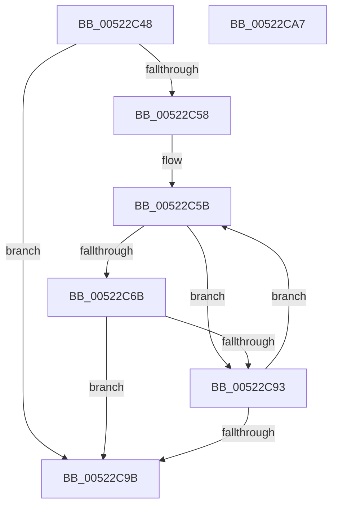

# _ascii_memicmp

- RVA: `0x00522C48`–`0x00522CA8` (길이 `96` bytes)
- VA: `0x0000000140522C48`
- 실행 섹션: `.text`
- PDB 이름 있음: `예`; PDB Function 태그: `아니요`
- unwind 정보 RVA: `0x00071750`
- 디코드: `31`개 명령, `96/96` bytes 표시
- 미해석 바이트: `0` (있으면 어셈블리에 `.byte`로 보존)

> 이 문서는 커널 이미지의 기계어와 PDB 기호를 분석해 생성했습니다. 4번과 5번은 함수 원형과 자료형을 바이너리 사용 방식에서 추정한 C 해석이며 원본 소스 복구 결과는 아닙니다.

## 1. Dependencies

- 직접 호출 지점: **0**; 고유 호출 대상: **0**
- 직접 호출자로 확인된 함수: **1**
- RIP 상대 이미지 참조: **0**

### Outgoing calls
- 직접 디코드된 call 명령이 없습니다.

### Direct callers
- [memicmp](memicmp_function_00522CB0.md) at `0x00522CB4`

### Static image references
- 디코드된 RIP-relative 메모리 참조가 없습니다.

## 2. Other-region calls and transfers

- 다른 실행 섹션으로 향하는 call: **0**
- 별도 외부 분기/꼬리 이동을 확인하지 못했습니다.

## 3. Assembly (complete function range)

```asm
00522C48  48 89 5C 24 08                  mov qword ptr [rsp + 8], rbx
00522C4D  45 33 C9                        xor r9d, r9d
00522C50  45 33 D2                        xor r10d, r10d
00522C53  4D 85 C0                        test r8, r8
00522C56  74 43                           je 0x140522c9b
00522C58  48 2B CA                        sub rcx, rdx
00522C5B  44 0F B6 1C 11                  movzx r11d, byte ptr [rcx + rdx]
00522C60  49 FF C8                        dec r8
00522C63  0F B6 1A                        movzx ebx, byte ptr [rdx]
00522C66  44 3A DB                        cmp r11b, bl
00522C69  74 28                           je 0x140522c93
00522C6B  41 8B C3                        mov eax, r11d
00522C6E  41 80 EB 41                     sub r11b, 0x41
00522C72  41 80 FB 19                     cmp r11b, 0x19
00522C76  44 8D 48 20                     lea r9d, [rax + 0x20]
00522C7A  44 0F 47 C8                     cmova r9d, eax
00522C7E  8B C3                           mov eax, ebx
00522C80  80 EB 41                        sub bl, 0x41
00522C83  80 FB 19                        cmp bl, 0x19
00522C86  44 8D 50 20                     lea r10d, [rax + 0x20]
00522C8A  44 0F 47 D0                     cmova r10d, eax
00522C8E  45 3B CA                        cmp r9d, r10d
00522C91  75 08                           jne 0x140522c9b
00522C93  48 FF C2                        inc rdx
00522C96  4D 85 C0                        test r8, r8
00522C99  75 C0                           jne 0x140522c5b
00522C9B  48 8B 5C 24 08                  mov rbx, qword ptr [rsp + 8]
00522CA0  45 2B CA                        sub r9d, r10d
00522CA3  41 8B C1                        mov eax, r9d
00522CA6  C3                              ret
00522CA7  CC                              int3
```

## 4. C-style interpretation (structured pseudocode)

```c
__int64 __fastcall _ascii_memicmp(__int64 a1, __int64 a2, __int64 a3, int a4)
{
    __int64 v_r10;
    __int64 v_r11;
    __int64 v_rbx;
    unsigned __int64 v_stack_p8;

    v_stack_p8 = v_rbx;
    a4 = 0;
    v_r10 = 0;
    if (a3 == 0) goto loc_00522C9B;
    a1 = (a1) - (a2);
loc_00522C5B:
    a3 = (a3) - 1;
    if (((unsigned __int8)(*(unsigned __int8 *)(a1 + a2 * 1))) == ((unsigned __int8)(*(unsigned __int8 *)(a2)))) goto loc_00522C93;
    v_r11 = (unsigned __int8)((*(unsigned __int8 *)(a1 + a2 * 1)) - (65));
    a4 = (unsigned int)((unsigned int)(*(unsigned __int8 *)(a1 + a2 * 1))) + 32;
    if (((unsigned __int8)(v_r11)) > 25) { a4 = (unsigned int)((unsigned int)((unsigned int)(*(unsigned __int8 *)(a1 + a2 * 1)))); }
    v_rbx = (unsigned __int8)((*(unsigned __int8 *)(a2)) - (65));
    v_r10 = (unsigned int)((unsigned int)(*(unsigned __int8 *)(a2))) + 32;
    if (((unsigned __int8)(v_rbx)) > 25) { v_r10 = (unsigned int)((unsigned int)((unsigned int)(*(unsigned __int8 *)(a2)))); }
    if (a4 != ((unsigned int)(v_r10))) goto loc_00522C9B;
loc_00522C93:
    a2 = (a2) + 1;
    if (a3 != 0) goto loc_00522C5B;
loc_00522C9B:
    a4 = (unsigned int)((a4) - ((unsigned int)(v_r10)));
    return (unsigned int)(a4);
}
```

## 5. (Beta) C Style

```c
int64_t _ascii_memicmp(void *Arg1, int64_t Arg2, int64_t Arg3, int32_t Arg4)
{
    uint8_t *arg1 = (uint8_t *)Arg1;

    int64_t local_r10;
    int64_t local_r11;
    int64_t local_rbx;
    uint64_t v_stack_p8;

    v_stack_p8 = local_rbx;
    Arg4 = 0;
    local_r10 = 0;
    if (Arg3 == 0) goto loc_00522C9B;
    Arg1 = (Arg1) - (Arg2);
loc_00522C5B:
    Arg3 = (Arg3) - 1;
    if (((uint8_t)(*(uint8_t *)(arg1 + Arg2 * 1))) == ((uint8_t)(*(uint8_t *)(Arg2)))) goto loc_00522C93;
    local_r11 = (uint8_t)((*(uint8_t *)(arg1 + Arg2 * 1)) - (65));
    Arg4 = (uint32_t)((uint32_t)(*(uint8_t *)(arg1 + Arg2 * 1))) + 32;
    if (((uint8_t)(local_r11)) > 25) { Arg4 = (uint32_t)((uint32_t)((uint32_t)(*(uint8_t *)(arg1 + Arg2 * 1)))); }
    local_rbx = (uint8_t)((*(uint8_t *)(Arg2)) - (65));
    local_r10 = (uint32_t)((uint32_t)(*(uint8_t *)(Arg2))) + 32;
    if (((uint8_t)(local_rbx)) > 25) { local_r10 = (uint32_t)((uint32_t)((uint32_t)(*(uint8_t *)(Arg2)))); }
    if (Arg4 != ((uint32_t)(local_r10))) goto loc_00522C9B;
loc_00522C93:
    Arg2 = (Arg2) + 1;
    if (Arg3 != 0) goto loc_00522C5B;
loc_00522C9B:
    Arg4 = (uint32_t)((Arg4) - ((uint32_t)(local_r10)));
    return (uint32_t)(Arg4);
}
```

### 관측된 메모리 오프셋

구조체 형식이 확인되지 않은 접근은 인자 기준의 오프셋으로만 기록했습니다.

| 기준 인자 | 오프셋 표현 | 폭 (bit) | 접근 |
|---|---:|---:|---|
| `Arg1` | `+ 0x0 + rdx*1` | `8` | `R` |

## 6. Execution-region graph

[열기: 2D/3D 그래프와 함수 탐색 컨트롤 패널](../../../control-panel.html?section=text&rva=0x00522C48&view=graph)

- 2D 그래프는 위에서 아래로 흐르고, 3D 그래프는 빈 공간을 드래그해 회전합니다. Shift+드래그는 이동, 휠은 확대·축소, 함수 노드 선택은 대상 보고서 이동입니다.

### Static fallback


