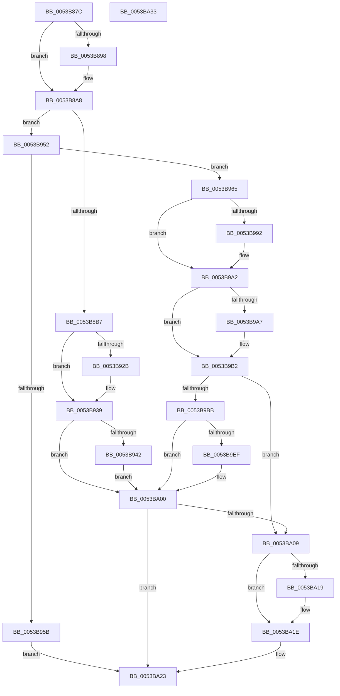

# DisplayBootBitmap

- RVA: `0x0053B87C`–`0x0053BA34` (길이 `440` bytes)
- VA: `0x000000014053B87C`
- 실행 섹션: `.text`
- PDB 이름 있음: `예`; PDB Function 태그: `아니요`
- unwind 정보 RVA: `0x000C3834`
- 디코드: `108`개 명령, `440/440` bytes 표시
- 미해석 바이트: `0` (있으면 어셈블리에 `.byte`로 보존)

> 이 문서는 커널 이미지의 기계어와 PDB 기호를 분석해 생성했습니다. 4번과 5번은 함수 원형과 자료형을 바이너리 사용 방식에서 추정한 C 해석이며 원본 소스 복구 결과는 아닙니다.

## 1. Dependencies

- 직접 호출 지점: **21**; 고유 호출 대상: **12**
- 직접 호출자로 확인된 함수: **2**
- RIP 상대 이미지 참조: **8**

### Outgoing calls
- `0x0053B898` → [InbvAcquireLock](../59/InbvAcquireLock_function_0059012C.md) (function, `0x0059012C`)
- `0x0053B8A3` → [InbvReleaseLock](../59/InbvReleaseLock_function_005903BC.md) (function, `0x005903BC`)
- `0x0053B8BC` → [InbvSetTextColor](../59/InbvSetTextColor_function_005904F0.md) (function, `0x005904F0`)
- `0x0053B8D9` → [InbvSolidColorFill](../59/InbvSolidColorFill_function_00590560.md) (function, `0x00590560`)
- `0x0053B8EE` → [InbvSolidColorFill](../59/InbvSolidColorFill_function_00590560.md) (function, `0x00590560`)
- `0x0053B8F8` → [InbvGetResourceAddress](../59/InbvGetResourceAddress_function_00590340.md) (function, `0x00590340`)
- `0x0053B905` → [InbvGetResourceAddress](../59/InbvGetResourceAddress_function_00590340.md) (function, `0x00590340`)
- `0x0053B921` → [InbvSetScrollRegion](../59/InbvSetScrollRegion_function_005904C0.md) (function, `0x005904C0`)
- `0x0053B934` → [InbvBitBlt](../59/InbvBitBlt_function_0059015C.md) (function, `0x0059015C`)
- `0x0053B948` → [InbvBitBlt](../59/InbvBitBlt_function_0059015C.md) (function, `0x0059015C`)
- `0x0053B952` → [InbvIsBootDriverInstalled](../4F/InbvIsBootDriverInstalled_function_004FC1E0.md) (function, `0x004FC1E0`)
- `0x0053B95B` → [InbvReleaseResources](../59/InbvReleaseResources_function_005903EC.md) (function, `0x005903EC`)
- `0x0053B978` → [InbvGetResourceAddress](../59/InbvGetResourceAddress_function_00590340.md) (function, `0x00590340`)
- `0x0053B985` → [InbvGetResourceAddress](../59/InbvGetResourceAddress_function_00590340.md) (function, `0x00590340`)
- `0x0053B99D` → [InbvBitBlt](../59/InbvBitBlt_function_0059015C.md) (function, `0x0059015C`)
- `0x0053B9AD` → [InbvBitBlt](../59/InbvBitBlt_function_0059015C.md) (function, `0x0059015C`)
- `0x0053B9E6` → [PsCreateSystemThread](../../page/9E/PsCreateSystemThread_function_009ED0D0.md) (function, `0x009ED0D0`)
- `0x0053B9F4` → [ZwClose](../6A/ZwClose_function_006AD2B0.md) (function, `0x006AD2B0`)
- `0x0053BA09` → [InbvAcquireLock](../59/InbvAcquireLock_function_0059012C.md) (function, `0x0059012C`)
- `0x0053BA19` → [RotBarInit](../59/RotBarInit_function_005906E0.md) (function, `0x005906E0`)
- `0x0053BA1E` → [InbvReleaseLock](../59/InbvReleaseLock_function_005903BC.md) (function, `0x005903BC`)

### Direct callers
- [DisplayFilter](DisplayFilter_function_0053BA40.md) at `0x0053BA87`
- [Phase1InitializationDiscard](../../init/C1/Phase1InitializationDiscard_function_00C1C728.md) at `0x00C1CB38`

### Static image references
- `0x0053B890` → RVA `0x00E0F3E8` (`.data`; read)
- `0x0053B89D` → RVA `0x00E65E68` (`.data`; read/write)
- `0x0053B8A8` → RVA `0x00E0A9B0` (`.data`; write)
- `0x0053B965` → RVA `0x0053BA40` (`DisplayFilter`; read)
- `0x0053B971` → RVA `0x00E65E50` (`.data`; write)
- `0x0053B9C1` → RVA `0x00590680` (`InbvRotateGuiBootDisplay`; read)
- `0x0053B9F9` → RVA `0x00E0F3E8` (`.data`; write)
- `0x0053BA0E` → RVA `0x00E65E68` (`.data`; write)

## 2. Other-region calls and transfers

- 다른 실행 섹션으로 향하는 call: **1**
  - `0x0053B9E6` → [PsCreateSystemThread](../../page/9E/PsCreateSystemThread_function_009ED0D0.md) (`.text` → `PAGE`)
- 별도 외부 분기/꼬리 이동을 확인하지 못했습니다.

## 3. Assembly (complete function range)

```asm
0053B87C  48 89 5C 24 08                  mov qword ptr [rsp + 8], rbx
0053B881  48 89 74 24 18                  mov qword ptr [rsp + 0x18], rsi
0053B886  57                              push rdi
0053B887  48 83 EC 40                     sub rsp, 0x40
0053B88B  33 DB                           xor ebx, ebx
0053B88D  40 8A F9                        mov dil, cl
0053B890  38 1D 52 3B 8D 00               cmp byte ptr [rip + 0x8d3b52], bl
0053B896  74 10                           je 0x14053b8a8
0053B898  E8 8F 48 05 00                  call 0x14059012c
0053B89D  21 1D C5 A5 92 00               and dword ptr [rip + 0x92a5c5], ebx
0053B8A3  E8 14 4B 05 00                  call 0x1405903bc
0053B8A8  88 1D 02 F1 8C 00               mov byte ptr [rip + 0x8cf102], bl
0053B8AE  40 84 FF                        test dil, dil
0053B8B1  0F 84 9B 00 00 00               je 0x14053b952
0053B8B7  B9 0F 00 00 00                  mov ecx, 0xf
0053B8BC  E8 2F 4C 05 00                  call 0x1405904f0
0053B8C1  21 5C 24 20                     and dword ptr [rsp + 0x20], ebx
0053B8C5  BF DF 01 00 00                  mov edi, 0x1df
0053B8CA  BB 7F 02 00 00                  mov ebx, 0x27f
0053B8CF  44 8B CF                        mov r9d, edi
0053B8D2  44 8B C3                        mov r8d, ebx
0053B8D5  33 D2                           xor edx, edx
0053B8D7  33 C9                           xor ecx, ecx
0053B8D9  E8 82 4C 05 00                  call 0x140590560
0053B8DE  83 64 24 20 00                  and dword ptr [rsp + 0x20], 0
0053B8E3  8D 57 C6                        lea edx, [rdi - 0x3a]
0053B8E6  44 8B CF                        mov r9d, edi
0053B8E9  44 8B C3                        mov r8d, ebx
0053B8EC  33 C9                           xor ecx, ecx
0053B8EE  E8 6D 4C 05 00                  call 0x140590560
0053B8F3  B9 06 00 00 00                  mov ecx, 6
0053B8F8  E8 43 4A 05 00                  call 0x140590340
0053B8FD  B9 07 00 00 00                  mov ecx, 7
0053B902  48 8B F8                        mov rdi, rax
0053B905  E8 36 4A 05 00                  call 0x140590340
0053B90A  33 DB                           xor ebx, ebx
0053B90C  41 B9 90 01 00 00               mov r9d, 0x190
0053B912  41 B8 77 02 00 00               mov r8d, 0x277
0053B918  48 8B F0                        mov rsi, rax
0053B91B  8D 53 50                        lea edx, [rbx + 0x50]
0053B91E  8D 4B 20                        lea ecx, [rbx + 0x20]
0053B921  E8 9A 4B 05 00                  call 0x1405904c0
0053B926  48 85 F6                        test rsi, rsi
0053B929  74 0E                           je 0x14053b939
0053B92B  41 B8 A3 01 00 00               mov r8d, 0x1a3
0053B931  48 8B CE                        mov rcx, rsi
0053B934  E8 23 48 05 00                  call 0x14059015c
0053B939  48 85 FF                        test rdi, rdi
0053B93C  0F 84 BE 00 00 00               je 0x14053ba00
0053B942  45 33 C0                        xor r8d, r8d
0053B945  48 8B CF                        mov rcx, rdi
0053B948  E8 0F 48 05 00                  call 0x14059015c
0053B94D  E9 AE 00 00 00                  jmp 0x14053ba00
0053B952  E8 89 08 FC FF                  call 0x1404fc1e0
0053B957  84 C0                           test al, al
0053B959  75 0A                           jne 0x14053b965
0053B95B  E8 8C 4A 05 00                  call 0x1405903ec
0053B960  E9 BE 00 00 00                  jmp 0x14053ba23
0053B965  48 8D 05 D4 00 00 00            lea rax, [rip + 0xd4]
0053B96C  B9 01 00 00 00                  mov ecx, 1
0053B971  48 89 05 D8 A4 92 00            mov qword ptr [rip + 0x92a4d8], rax
0053B978  E8 C3 49 05 00                  call 0x140590340
0053B97D  B9 04 00 00 00                  mov ecx, 4
0053B982  48 8B F0                        mov rsi, rax
0053B985  E8 B6 49 05 00                  call 0x140590340
0053B98A  48 8B F8                        mov rdi, rax
0053B98D  48 85 F6                        test rsi, rsi
0053B990  74 10                           je 0x14053b9a2
0053B992  45 33 C0                        xor r8d, r8d
0053B995  48 8B CE                        mov rcx, rsi
0053B998  BB 01 00 00 00                  mov ebx, 1
0053B99D  E8 BA 47 05 00                  call 0x14059015c
0053B9A2  48 85 FF                        test rdi, rdi
0053B9A5  74 0B                           je 0x14053b9b2
0053B9A7  45 33 C0                        xor r8d, r8d
0053B9AA  48 8B CF                        mov rcx, rdi
0053B9AD  E8 AA 47 05 00                  call 0x14059015c
0053B9B2  80 3D 2F 3A 8D 00 00            cmp byte ptr [rip + 0x8d3a2f], 0
0053B9B9  75 4E                           jne 0x14053ba09
0053B9BB  48 83 64 24 30 00               and qword ptr [rsp + 0x30], 0
0053B9C1  48 8D 05 B8 4C 05 00            lea rax, [rip + 0x54cb8]
0053B9C8  48 83 64 24 58 00               and qword ptr [rsp + 0x58], 0
0053B9CE  48 8D 4C 24 58                  lea rcx, [rsp + 0x58]
0053B9D3  48 89 44 24 28                  mov qword ptr [rsp + 0x28], rax
0053B9D8  45 33 C9                        xor r9d, r9d
0053B9DB  48 83 64 24 20 00               and qword ptr [rsp + 0x20], 0
0053B9E1  45 33 C0                        xor r8d, r8d
0053B9E4  33 D2                           xor edx, edx
0053B9E6  E8 E5 16 4B 00                  call 0x1409ed0d0
0053B9EB  85 C0                           test eax, eax
0053B9ED  78 11                           js 0x14053ba00
0053B9EF  48 8B 4C 24 58                  mov rcx, qword ptr [rsp + 0x58]
0053B9F4  E8 B7 18 17 00                  call 0x1406ad2b0
0053B9F9  C6 05 E8 39 8D 00 01            mov byte ptr [rip + 0x8d39e8], 1
0053BA00  80 3D E1 39 8D 00 00            cmp byte ptr [rip + 0x8d39e1], 0
0053BA07  74 1A                           je 0x14053ba23
0053BA09  E8 1E 47 05 00                  call 0x14059012c
0053BA0E  89 1D 54 A4 92 00               mov dword ptr [rip + 0x92a454], ebx
0053BA14  83 FB 01                        cmp ebx, 1
0053BA17  75 05                           jne 0x14053ba1e
0053BA19  E8 C2 4C 05 00                  call 0x1405906e0
0053BA1E  E8 99 49 05 00                  call 0x1405903bc
0053BA23  48 8B 5C 24 50                  mov rbx, qword ptr [rsp + 0x50]
0053BA28  48 8B 74 24 60                  mov rsi, qword ptr [rsp + 0x60]
0053BA2D  48 83 C4 40                     add rsp, 0x40
0053BA31  5F                              pop rdi
0053BA32  C3                              ret
0053BA33  CC                              int3
```

## 4. C-style interpretation (structured pseudocode)

```c
__int64 __fastcall DisplayBootBitmap(unsigned __int8 a1, int a2)
{
    __int64 result;
    __int64 v_rbx;
    __int64 v_rsp;
    unsigned __int64 v_stack_m18;
    unsigned __int64 v_stack_m20;
    unsigned int v_stack_m28;
    unsigned __int64 v_stack_p10;
    unsigned __int64 v_stack_p18;
    unsigned __int64 v_stack_p8;

    v_stack_p8 = v_rbx;
    v_stack_p18 = v_rsi;
    v_rsp = (v_rsp) - (64);
    v_rbx = 0;
    if ((*(unsigned __int8 *)(v_rip + 9255762)) != 0) {
        result = InbvAcquireLock(a1, a2, a3, a4);
        result = InbvReleaseLock(a1, a2, a3, a4);
    }
    *(unsigned __int8 *)(v_rip + 9236738) = 0;
    if (a1 == 0) goto loc_0053B952;
    result = InbvSetTextColor(15, a2, a3, a4);
    a2 = 0;
    a1 = 0;
    result = InbvSolidColorFill(a1, a2, 639, 479);
    a1 = 0;
    result = InbvSolidColorFill(a1, 479 - 58, 639, 479);
    result = InbvGetResourceAddress(6, 479 - 58, 639, 479);
    result = InbvGetResourceAddress(7, 479 - 58, 639, 479);
    v_rbx = 0;
    result = InbvSetScrollRegion(v_rbx + 32, v_rbx + 80, 631, 400);
    if (result != 0) {
        a3 = 419;
        a1 = result;
        result = InbvBitBlt(a1, v_rbx + 80, a3, 400);
    }
    if (result == 0) goto loc_0053BA00;
    a3 = 0;
    result = InbvBitBlt(result, v_rbx + 80, a3, 400);
    goto loc_0053BA00;
loc_0053B952:
    result = InbvIsBootDriverInstalled(result, v_rbx + 80, a3, 400);
    if ((unsigned __int8)(result) != 0) goto loc_0053B965;
    result = InbvReleaseResources(result, v_rbx + 80, a3, 400);
    goto loc_0053BA23;
loc_0053B965:
    *(unsigned __int64 *)(v_rip + 9610456) = v_rip + 212;
    result = InbvGetResourceAddress(1, v_rbx + 80, a3, 400);
    result = InbvGetResourceAddress(4, v_rbx + 80, a3, 400);
    if (result != 0) {
        a3 = 0;
        a1 = result;
        v_rbx = 1;
        result = InbvBitBlt(a1, v_rbx + 80, a3, 400);
    }
    if (result != 0) {
        a3 = 0;
        a1 = result;
        result = InbvBitBlt(a1, v_rbx + 80, a3, 400);
    }
    if ((*(unsigned __int8 *)(v_rip + 9255471)) != 0) goto loc_0053BA09;
    v_stack_m20 = v_rip + 347320;
    a4 = 0;
    a3 = 0;
    a2 = 0;
    result = PsCreateSystemThread(v_stack_p10, a2, a3, a4);
    if (!(sign_flag)) {
        a1 = v_stack_p10;
        result = ZwClose(a1, a2, a3, a4);
        *(unsigned __int8 *)(v_rip + 9255400) = 1;
    }
    if ((*(unsigned __int8 *)(v_rip + 9255393)) == 0) goto loc_0053BA23;
loc_0053BA09:
    result = InbvAcquireLock(a1, a2, a3, a4);
    *(unsigned int *)(v_rip + 9610324) = (unsigned int)(v_rbx);
    if (((unsigned int)(v_rbx)) == 1) {
        result = RotBarInit(a1, a2, a3, a4);
    }
    result = InbvReleaseLock(a1, a2, a3, a4);
loc_0053BA23:
    v_rsp = (v_rsp) + (64);
    return result;
}
```

## 5. (Beta) C Style

```c
int64_t DisplayBootBitmap(uint8_t Arg1, int32_t Arg2)
{
    int64_t result;
    int64_t local_rbx;
    int64_t local_rsp;
    uint64_t v_stack_m18;
    uint64_t v_stack_m20;
    uint32_t v_stack_m28;
    uint64_t v_stack_p10;
    uint64_t v_stack_p18;
    uint64_t v_stack_p8;

    v_stack_p8 = local_rbx;
    v_stack_p18 = local_rsi;
    local_rsp = (local_rsp) - (64);
    local_rbx = 0;
    if ((*(uint8_t *)(v_rip + 0x8D3B52)) != 0) {
        result = InbvAcquireLock(Arg1, Arg2, a3, a4);
        result = InbvReleaseLock(Arg1, Arg2, a3, a4);
    }
    *(uint8_t *)(v_rip + 0x8CF102) = 0;
    if (Arg1 == 0) goto loc_0053B952;
    result = InbvSetTextColor(15, Arg2, a3, a4);
    Arg2 = 0;
    Arg1 = 0;
    result = InbvSolidColorFill(Arg1, Arg2, 639, 479);
    Arg1 = 0;
    result = InbvSolidColorFill(Arg1, 479 - 58, 639, 479);
    result = InbvGetResourceAddress(6, 479 - 58, 639, 479);
    result = InbvGetResourceAddress(7, 479 - 58, 639, 479);
    local_rbx = 0;
    result = InbvSetScrollRegion(local_rbx + 32, local_rbx + 80, 631, 400);
    if (result != 0) {
        a3 = 419;
        Arg1 = result;
        result = InbvBitBlt(Arg1, local_rbx + 80, a3, 400);
    }
    if (result == 0) goto loc_0053BA00;
    a3 = 0;
    result = InbvBitBlt(result, local_rbx + 80, a3, 400);
    goto loc_0053BA00;
loc_0053B952:
    result = InbvIsBootDriverInstalled(result, local_rbx + 80, a3, 400);
    if ((uint8_t)(result) != 0) goto loc_0053B965;
    result = InbvReleaseResources(result, local_rbx + 80, a3, 400);
    goto loc_0053BA23;
loc_0053B965:
    *(uint64_t *)(v_rip + 0x92A4D8) = v_rip + 212;
    result = InbvGetResourceAddress(1, local_rbx + 80, a3, 400);
    result = InbvGetResourceAddress(4, local_rbx + 80, a3, 400);
    if (result != 0) {
        a3 = 0;
        Arg1 = result;
        local_rbx = 1;
        result = InbvBitBlt(Arg1, local_rbx + 80, a3, 400);
    }
    if (result != 0) {
        a3 = 0;
        Arg1 = result;
        result = InbvBitBlt(Arg1, local_rbx + 80, a3, 400);
    }
    if ((*(uint8_t *)(v_rip + 0x8D3A2F)) != 0) goto loc_0053BA09;
    v_stack_m20 = v_rip + 347320;
    a4 = 0;
    a3 = 0;
    Arg2 = 0;
    result = PsCreateSystemThread(v_stack_p10, Arg2, a3, a4);
    if (!(sign_flag)) {
        Arg1 = v_stack_p10;
        result = ZwClose(Arg1, Arg2, a3, a4);
        *(uint8_t *)(v_rip + 0x8D39E8) = 1;
    }
    if ((*(uint8_t *)(v_rip + 0x8D39E1)) == 0) goto loc_0053BA23;
loc_0053BA09:
    result = InbvAcquireLock(Arg1, Arg2, a3, a4);
    *(uint32_t *)(v_rip + 0x92A454) = (uint32_t)(local_rbx);
    if (((uint32_t)(local_rbx)) == 1) {
        result = RotBarInit(Arg1, Arg2, a3, a4);
    }
    result = InbvReleaseLock(Arg1, Arg2, a3, a4);
loc_0053BA23:
    local_rsp = (local_rsp) + (64);
    return result;
}
```

## 6. Execution-region graph

[열기: 2D/3D 그래프와 함수 탐색 컨트롤 패널](../../../control-panel.html?section=text&rva=0x0053B87C&view=graph)

- 2D 그래프는 위에서 아래로 흐르고, 3D 그래프는 빈 공간을 드래그해 회전합니다. Shift+드래그는 이동, 휠은 확대·축소, 함수 노드 선택은 대상 보고서 이동입니다.

### Static fallback


