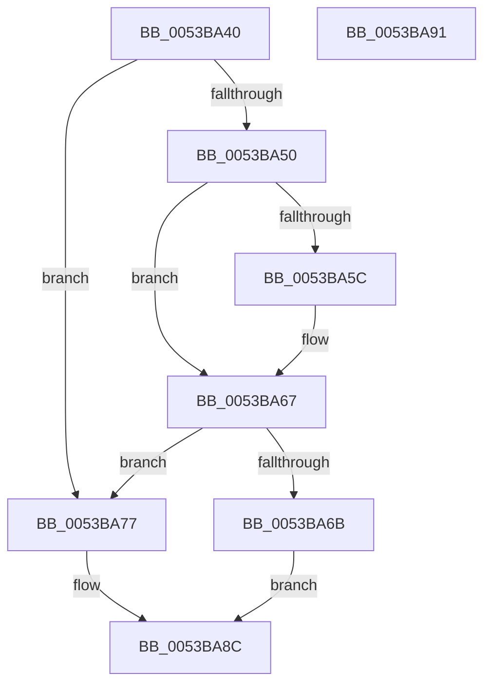

# DisplayFilter

- RVA: `0x0053BA40`–`0x0053BA92` (길이 `82` bytes)
- VA: `0x000000014053BA40`
- 실행 섹션: `.text`
- PDB 이름 있음: `예`; PDB Function 태그: `아니요`
- unwind 정보 RVA: `0x0005C788`
- 디코드: `23`개 명령, `82/82` bytes 표시
- 미해석 바이트: `0` (있으면 어셈블리에 `.byte`로 보존)

> 이 문서는 커널 이미지의 기계어와 PDB 기호를 분석해 생성했습니다. 4번과 5번은 함수 원형과 자료형을 바이너리 사용 방식에서 추정한 C 해석이며 원본 소스 복구 결과는 아닙니다.

## 1. Dependencies

- 직접 호출 지점: **1**; 고유 호출 대상: **1**
- 직접 호출자로 확인된 함수: **0**
- RIP 상대 이미지 참조: **4**

### Outgoing calls
- `0x0053BA87` → [DisplayBootBitmap](DisplayBootBitmap_function_0053B87C.md) (function, `0x0053B87C`)

### Direct callers
- 이 함수 시작 RVA로 연결되는 직접 call은 확인되지 않았습니다. 간접 호출은 완전히 역산할 수 없습니다.

### Static image references
- `0x0053BA47` → RVA `0x00E0F420` (`.data`; read)
- `0x0053BA6B` → RVA `0x00020AF0` (`.rdata`; read)
- `0x0053BA79` → RVA `0x00E0F420` (`.data`; write)
- `0x0053BA80` → RVA `0x00E65E50` (`.data`; write)

## 2. Other-region calls and transfers

- 다른 실행 섹션으로 향하는 call: **0**
- 별도 외부 분기/꼬리 이동을 확인하지 못했습니다.

## 3. Assembly (complete function range)

```asm
0053BA40  48 83 EC 28                     sub rsp, 0x28
0053BA44  45 33 C9                        xor r9d, r9d
0053BA47  44 38 0D D2 39 8D 00            cmp byte ptr [rip + 0x8d39d2], r9b
0053BA4E  75 27                           jne 0x14053ba77
0053BA50  4C 8B 01                        mov r8, qword ptr [rcx]
0053BA53  41 0F B6 10                     movzx edx, byte ptr [r8]
0053BA57  83 EA 2E                        sub edx, 0x2e
0053BA5A  75 0B                           jne 0x14053ba67
0053BA5C  41 0F B6 50 01                  movzx edx, byte ptr [r8 + 1]
0053BA61  41 0F B6 C1                     movzx eax, r9b
0053BA65  2B D0                           sub edx, eax
0053BA67  85 D2                           test edx, edx
0053BA69  75 0C                           jne 0x14053ba77
0053BA6B  48 8D 05 7E 50 AE FF            lea rax, [rip - 0x51af82]
0053BA72  48 89 01                        mov qword ptr [rcx], rax
0053BA75  EB 15                           jmp 0x14053ba8c
0053BA77  B1 01                           mov cl, 1
0053BA79  C6 05 A0 39 8D 00 01            mov byte ptr [rip + 0x8d39a0], 1
0053BA80  4C 89 0D C9 A3 92 00            mov qword ptr [rip + 0x92a3c9], r9
0053BA87  E8 F0 FD FF FF                  call 0x14053b87c
0053BA8C  48 83 C4 28                     add rsp, 0x28
0053BA90  C3                              ret
0053BA91  CC                              int3
```

## 4. C-style interpretation (structured pseudocode)

```c
__int64 __fastcall DisplayFilter(__int64 a1, __int64 a2, __int64 a3, int a4)
{
    __int64 result;
    __int64 v_rsp;

    v_rsp = (v_rsp) - (40);
    a4 = 0;
    if ((*(unsigned __int8 *)(v_rip + 9255378)) != 0) goto loc_0053BA77;
    a2 = (unsigned int)((*(unsigned __int8 *)(*(unsigned __int64 *)(a1))) - (46));
    if (!(condition_is_not_equal)) {
        a2 = *(unsigned __int8 *)(*(unsigned __int64 *)(a1) + 1);
        result = 0;
        a2 = (unsigned int)((a2) - ((unsigned int)(result)));
    }
    if ((unsigned int)(a2) != 0) goto loc_0053BA77;
    *(unsigned __int64 *)(a1) = v_rip - 5353346;
    goto loc_0053BA8C;
loc_0053BA77:
    *(unsigned __int8 *)(v_rip + 9255328) = 1;
    *(unsigned __int64 *)(v_rip + 9610185) = 0;
    result = DisplayBootBitmap(1, a2, *(unsigned __int64 *)(a1), a4);
loc_0053BA8C:
    v_rsp = (v_rsp) + (40);
    return result;
}
```

## 5. (Beta) C Style

```c
int64_t DisplayFilter(void *Arg1, int64_t Arg2, int64_t Arg3, int32_t Arg4)
{
    uint8_t *arg1 = (uint8_t *)Arg1;

    int64_t result;
    int64_t local_rsp;

    local_rsp = (local_rsp) - (40);
    Arg4 = 0;
    if ((*(uint8_t *)(v_rip + 0x8D39D2)) != 0) goto loc_0053BA77;
    Arg2 = (uint32_t)((*(uint8_t *)(*(uint64_t *)(arg1))) - (46));
    if (!(condition_is_not_equal)) {
        Arg2 = *(uint8_t *)(*(uint64_t *)(arg1) + 0x1);
        result = 0;
        Arg2 = (uint32_t)((Arg2) - ((uint32_t)(result)));
    }
    if ((uint32_t)(Arg2) != 0) goto loc_0053BA77;
    *(uint64_t *)(arg1) = v_rip - 5353346;
    goto loc_0053BA8C;
loc_0053BA77:
    *(uint8_t *)(v_rip + 0x8D39A0) = 1;
    *(uint64_t *)(v_rip + 0x92A3C9) = 0;
    result = DisplayBootBitmap(1, Arg2, *(uint64_t *)(arg1), Arg4);
loc_0053BA8C:
    local_rsp = (local_rsp) + (40);
    return result;
}
```

### 관측된 메모리 오프셋

구조체 형식이 확인되지 않은 접근은 인자 기준의 오프셋으로만 기록했습니다.

| 기준 인자 | 오프셋 표현 | 폭 (bit) | 접근 |
|---|---:|---:|---|
| `Arg1` | `+ 0x0` | `64` | `R` |
| `Arg1` | `+ 0x0` | `64` | `W` |

## 6. Execution-region graph

[열기: 2D/3D 그래프와 함수 탐색 컨트롤 패널](../../../control-panel.html?section=text&rva=0x0053BA40&view=graph)

- 2D 그래프는 위에서 아래로 흐르고, 3D 그래프는 빈 공간을 드래그해 회전합니다. Shift+드래그는 이동, 휠은 확대·축소, 함수 노드 선택은 대상 보고서 이동입니다.

### Static fallback


