# HalAcpiEmCheckOperator

- RVA: `0x0053E7D0`–`0x0053E9A4` (길이 `468` bytes)
- VA: `0x000000014053E7D0`
- 실행 섹션: `.text`
- PDB 이름 있음: `예`; PDB Function 태그: `아니요`
- unwind 정보 RVA: `0x00069588`
- 디코드: `154`개 명령, `468/468` bytes 표시
- 미해석 바이트: `0` (있으면 어셈블리에 `.byte`로 보존)

> 이 문서는 커널 이미지의 기계어와 PDB 기호를 분석해 생성했습니다. 4번과 5번은 함수 원형과 자료형을 바이너리 사용 방식에서 추정한 C 해석이며 원본 소스 복구 결과는 아닙니다.

## 1. Dependencies

- 직접 호출 지점: **0**; 고유 호출 대상: **0**
- 직접 호출자로 확인된 함수: **3**
- RIP 상대 이미지 참조: **0**

### Outgoing calls
- 직접 디코드된 call 명령이 없습니다.

### Direct callers
- [HalMatchAcpiCreatorRevision](HalMatchAcpiCreatorRevision_function_0053EA20.md) at `0x0053EA79`
- [HalMatchAcpiOemRevision](HalMatchAcpiOemRevision_function_0053EB00.md) at `0x0053EB59`
- [HalMatchAcpiRevision](HalMatchAcpiRevision_function_0053EC60.md) at `0x0053ECBA`

### Static image references
- 디코드된 RIP-relative 메모리 참조가 없습니다.

## 2. Other-region calls and transfers

- 다른 실행 섹션으로 향하는 call: **0**
- 별도 외부 분기/꼬리 이동을 확인하지 못했습니다.

## 3. Assembly (complete function range)

```asm
0053E7D0  48 89 5C 24 08                  mov qword ptr [rsp + 8], rbx
0053E7D5  48 89 74 24 10                  mov qword ptr [rsp + 0x10], rsi
0053E7DA  48 89 7C 24 18                  mov qword ptr [rsp + 0x18], rdi
0053E7DF  44 0F B6 11                     movzx r10d, byte ptr [rcx]
0053E7E3  45 33 C9                        xor r9d, r9d
0053E7E6  44 8B DA                        mov r11d, edx
0053E7E9  41 8D 59 3D                     lea ebx, [r9 + 0x3d]
0053E7ED  44 2B D3                        sub r10d, ebx
0053E7F0  75 0C                           jne 0x14053e7fe
0053E7F2  44 0F B6 51 01                  movzx r10d, byte ptr [rcx + 1]
0053E7F7  41 0F B6 C1                     movzx eax, r9b
0053E7FB  44 2B D0                        sub r10d, eax
0053E7FE  45 85 D2                        test r10d, r10d
0053E801  0F 84 82 01 00 00               je 0x14053e989
0053E807  0F B6 11                        movzx edx, byte ptr [rcx]
0053E80A  2B D3                           sub edx, ebx
0053E80C  75 12                           jne 0x14053e820
0053E80E  0F B6 51 01                     movzx edx, byte ptr [rcx + 1]
0053E812  2B D3                           sub edx, ebx
0053E814  75 0A                           jne 0x14053e820
0053E816  0F B6 51 02                     movzx edx, byte ptr [rcx + 2]
0053E81A  41 0F B6 C1                     movzx eax, r9b
0053E81E  2B D0                           sub edx, eax
0053E820  85 D2                           test edx, edx
0053E822  0F 84 61 01 00 00               je 0x14053e989
0053E828  0F B6 11                        movzx edx, byte ptr [rcx]
0053E82B  41 BA 21 00 00 00               mov r10d, 0x21
0053E831  41 2B D2                        sub edx, r10d
0053E834  75 12                           jne 0x14053e848
0053E836  0F B6 51 01                     movzx edx, byte ptr [rcx + 1]
0053E83A  2B D3                           sub edx, ebx
0053E83C  75 0A                           jne 0x14053e848
0053E83E  0F B6 51 02                     movzx edx, byte ptr [rcx + 2]
0053E842  41 0F B6 C1                     movzx eax, r9b
0053E846  2B D0                           sub edx, eax
0053E848  85 D2                           test edx, edx
0053E84A  0F 84 30 01 00 00               je 0x14053e980
0053E850  0F B6 11                        movzx edx, byte ptr [rcx]
0053E853  BF 3C 00 00 00                  mov edi, 0x3c
0053E858  8D 77 02                        lea esi, [rdi + 2]
0053E85B  2B D7                           sub edx, edi
0053E85D  75 12                           jne 0x14053e871
0053E85F  0F B6 51 01                     movzx edx, byte ptr [rcx + 1]
0053E863  2B D6                           sub edx, esi
0053E865  75 0A                           jne 0x14053e871
0053E867  0F B6 51 02                     movzx edx, byte ptr [rcx + 2]
0053E86B  41 0F B6 C1                     movzx eax, r9b
0053E86F  2B D0                           sub edx, eax
0053E871  85 D2                           test edx, edx
0053E873  0F 84 07 01 00 00               je 0x14053e980
0053E879  0F B6 11                        movzx edx, byte ptr [rcx]
0053E87C  2B D3                           sub edx, ebx
0053E87E  75 13                           jne 0x14053e893
0053E880  0F B6 51 01                     movzx edx, byte ptr [rcx + 1]
0053E884  41 2B D2                        sub edx, r10d
0053E887  75 0A                           jne 0x14053e893
0053E889  0F B6 51 02                     movzx edx, byte ptr [rcx + 2]
0053E88D  41 0F B6 C1                     movzx eax, r9b
0053E891  2B D0                           sub edx, eax
0053E893  85 D2                           test edx, edx
0053E895  0F 84 E5 00 00 00               je 0x14053e980
0053E89B  0F B6 11                        movzx edx, byte ptr [rcx]
0053E89E  2B D7                           sub edx, edi
0053E8A0  75 0A                           jne 0x14053e8ac
0053E8A2  0F B6 51 01                     movzx edx, byte ptr [rcx + 1]
0053E8A6  41 0F B6 C1                     movzx eax, r9b
0053E8AA  2B D0                           sub edx, eax
0053E8AC  85 D2                           test edx, edx
0053E8AE  75 0C                           jne 0x14053e8bc
0053E8B0  45 3B D8                        cmp r11d, r8d
0053E8B3  41 0F 92 C1                     setb r9b
0053E8B7  E9 D4 00 00 00                  jmp 0x14053e990
0053E8BC  0F B6 11                        movzx edx, byte ptr [rcx]
0053E8BF  2B D7                           sub edx, edi
0053E8C1  75 12                           jne 0x14053e8d5
0053E8C3  0F B6 51 01                     movzx edx, byte ptr [rcx + 1]
0053E8C7  2B D3                           sub edx, ebx
0053E8C9  75 0A                           jne 0x14053e8d5
0053E8CB  0F B6 51 02                     movzx edx, byte ptr [rcx + 2]
0053E8CF  41 0F B6 C1                     movzx eax, r9b
0053E8D3  2B D0                           sub edx, eax
0053E8D5  85 D2                           test edx, edx
0053E8D7  0F 84 9A 00 00 00               je 0x14053e977
0053E8DD  0F B6 11                        movzx edx, byte ptr [rcx]
0053E8E0  2B D3                           sub edx, ebx
0053E8E2  75 12                           jne 0x14053e8f6
0053E8E4  0F B6 51 01                     movzx edx, byte ptr [rcx + 1]
0053E8E8  2B D7                           sub edx, edi
0053E8EA  75 0A                           jne 0x14053e8f6
0053E8EC  0F B6 51 02                     movzx edx, byte ptr [rcx + 2]
0053E8F0  41 0F B6 C1                     movzx eax, r9b
0053E8F4  2B D0                           sub edx, eax
0053E8F6  85 D2                           test edx, edx
0053E8F8  74 7D                           je 0x14053e977
0053E8FA  0F B6 11                        movzx edx, byte ptr [rcx]
0053E8FD  2B D6                           sub edx, esi
0053E8FF  75 0A                           jne 0x14053e90b
0053E901  0F B6 51 01                     movzx edx, byte ptr [rcx + 1]
0053E905  41 0F B6 C1                     movzx eax, r9b
0053E909  2B D0                           sub edx, eax
0053E90B  85 D2                           test edx, edx
0053E90D  75 09                           jne 0x14053e918
0053E90F  45 3B D8                        cmp r11d, r8d
0053E912  41 0F 97 C1                     seta r9b
0053E916  EB 78                           jmp 0x14053e990
0053E918  0F B6 11                        movzx edx, byte ptr [rcx]
0053E91B  2B D6                           sub edx, esi
0053E91D  75 12                           jne 0x14053e931
0053E91F  0F B6 51 01                     movzx edx, byte ptr [rcx + 1]
0053E923  2B D3                           sub edx, ebx
0053E925  75 0A                           jne 0x14053e931
0053E927  0F B6 51 02                     movzx edx, byte ptr [rcx + 2]
0053E92B  41 0F B6 C1                     movzx eax, r9b
0053E92F  2B D0                           sub edx, eax
0053E931  85 D2                           test edx, edx
0053E933  74 39                           je 0x14053e96e
0053E935  0F B6 11                        movzx edx, byte ptr [rcx]
0053E938  2B D3                           sub edx, ebx
0053E93A  75 12                           jne 0x14053e94e
0053E93C  0F B6 51 01                     movzx edx, byte ptr [rcx + 1]
0053E940  2B D6                           sub edx, esi
0053E942  75 0A                           jne 0x14053e94e
0053E944  0F B6 51 02                     movzx edx, byte ptr [rcx + 2]
0053E948  41 0F B6 C1                     movzx eax, r9b
0053E94C  2B D0                           sub edx, eax
0053E94E  85 D2                           test edx, edx
0053E950  74 1C                           je 0x14053e96e
0053E952  0F B6 11                        movzx edx, byte ptr [rcx]
0053E955  83 EA 2A                        sub edx, 0x2a
0053E958  75 0A                           jne 0x14053e964
0053E95A  0F B6 51 01                     movzx edx, byte ptr [rcx + 1]
0053E95E  41 0F B6 C1                     movzx eax, r9b
0053E962  2B D0                           sub edx, eax
0053E964  85 D2                           test edx, edx
0053E966  75 28                           jne 0x14053e990
0053E968  44 8D 4A 01                     lea r9d, [rdx + 1]
0053E96C  EB 22                           jmp 0x14053e990
0053E96E  45 3B D8                        cmp r11d, r8d
0053E971  41 0F 93 C1                     setae r9b
0053E975  EB 19                           jmp 0x14053e990
0053E977  45 3B D8                        cmp r11d, r8d
0053E97A  41 0F 96 C1                     setbe r9b
0053E97E  EB 10                           jmp 0x14053e990
0053E980  45 3B D8                        cmp r11d, r8d
0053E983  41 0F 95 C1                     setne r9b
0053E987  EB 07                           jmp 0x14053e990
0053E989  45 3B D8                        cmp r11d, r8d
0053E98C  41 0F 94 C1                     sete r9b
0053E990  48 8B 5C 24 08                  mov rbx, qword ptr [rsp + 8]
0053E995  41 8B C1                        mov eax, r9d
0053E998  48 8B 74 24 10                  mov rsi, qword ptr [rsp + 0x10]
0053E99D  48 8B 7C 24 18                  mov rdi, qword ptr [rsp + 0x18]
0053E9A2  C3                              ret
0053E9A3  CC                              int3
```

## 4. C-style interpretation (structured pseudocode)

```c
__int64 __fastcall HalAcpiEmCheckOperator(__int64 a1, int a2, int a3, int a4)
{
    __int64 result;
    __int64 v_r10;
    unsigned __int64 v_stack_p10;
    unsigned __int64 v_stack_p18;
    unsigned __int64 v_stack_p8;

    v_stack_p8 = v_rbx;
    v_stack_p10 = v_rsi;
    v_stack_p18 = v_rdi;
    a4 = 0;
    v_r10 = (unsigned int)((*(unsigned __int8 *)(a1)) - ((unsigned int)(a4 + 61)));
    if (!(condition_is_not_equal)) {
        v_r10 = *(unsigned __int8 *)(a1 + 1);
        result = 0;
        v_r10 = (unsigned int)((v_r10) - ((unsigned int)(result)));
    }
    if ((unsigned int)(v_r10) == 0) goto loc_0053E989;
    a2 = (unsigned int)((*(unsigned __int8 *)(a1)) - ((unsigned int)(a4 + 61)));
    if (condition_is_not_equal) goto loc_0053E820;
    a2 = (unsigned int)((*(unsigned __int8 *)(a1 + 1)) - ((unsigned int)(a4 + 61)));
    if (!(condition_is_not_equal)) {
        a2 = *(unsigned __int8 *)(a1 + 2);
        result = 0;
        a2 = (unsigned int)((a2) - ((unsigned int)(result)));
    }
    if (a2 == 0) goto loc_0053E989;
    a2 = (unsigned int)((*(unsigned __int8 *)(a1)) - (33));
    if (condition_is_not_equal) goto loc_0053E848;
    a2 = (unsigned int)((*(unsigned __int8 *)(a1 + 1)) - ((unsigned int)(a4 + 61)));
    if (!(condition_is_not_equal)) {
        a2 = *(unsigned __int8 *)(a1 + 2);
        result = 0;
        a2 = (unsigned int)((a2) - ((unsigned int)(result)));
    }
    if (a2 == 0) goto loc_0053E980;
    a2 = (unsigned int)((*(unsigned __int8 *)(a1)) - (60));
    if (condition_is_not_equal) goto loc_0053E871;
    a2 = (unsigned int)((*(unsigned __int8 *)(a1 + 1)) - ((unsigned int)(60 + 2)));
    if (!(condition_is_not_equal)) {
        a2 = *(unsigned __int8 *)(a1 + 2);
        result = 0;
        a2 = (unsigned int)((a2) - ((unsigned int)(result)));
    }
    if (a2 == 0) goto loc_0053E980;
    a2 = (unsigned int)((*(unsigned __int8 *)(a1)) - ((unsigned int)(a4 + 61)));
    if (condition_is_not_equal) goto loc_0053E893;
    a2 = (unsigned int)((*(unsigned __int8 *)(a1 + 1)) - (33));
    if (!(condition_is_not_equal)) {
        a2 = *(unsigned __int8 *)(a1 + 2);
        result = 0;
        a2 = (unsigned int)((a2) - ((unsigned int)(result)));
    }
    if (a2 == 0) goto loc_0053E980;
    a2 = (unsigned int)((*(unsigned __int8 *)(a1)) - (60));
    if (!(condition_is_not_equal)) {
        a2 = *(unsigned __int8 *)(a1 + 1);
        result = 0;
        a2 = (unsigned int)((a2) - ((unsigned int)(result)));
    }
    if (a2 != 0) goto loc_0053E8BC;
    a4 = (((unsigned int)((unsigned int)(a2))) < a3) ? 1 : 0;
    goto loc_0053E990;
loc_0053E8BC:
    a2 = (unsigned int)((*(unsigned __int8 *)(a1)) - (60));
    if (condition_is_not_equal) goto loc_0053E8D5;
    a2 = (unsigned int)((*(unsigned __int8 *)(a1 + 1)) - ((unsigned int)(a4 + 61)));
    if (!(condition_is_not_equal)) {
        a2 = *(unsigned __int8 *)(a1 + 2);
        result = (unsigned __int8)(a4);
        a2 = (unsigned int)((a2) - ((unsigned int)(result)));
    }
    if (a2 == 0) goto loc_0053E977;
    a2 = (unsigned int)((*(unsigned __int8 *)(a1)) - ((unsigned int)(a4 + 61)));
    if (condition_is_not_equal) goto loc_0053E8F6;
    a2 = (unsigned int)((*(unsigned __int8 *)(a1 + 1)) - (60));
    if (!(condition_is_not_equal)) {
        a2 = *(unsigned __int8 *)(a1 + 2);
        result = (unsigned __int8)(a4);
        a2 = (unsigned int)((a2) - ((unsigned int)(result)));
    }
    if (a2 == 0) goto loc_0053E977;
    a2 = (unsigned int)((*(unsigned __int8 *)(a1)) - ((unsigned int)(60 + 2)));
    if (!(condition_is_not_equal)) {
        a2 = *(unsigned __int8 *)(a1 + 1);
        result = (unsigned __int8)(a4);
        a2 = (unsigned int)((a2) - ((unsigned int)(result)));
    }
    if (a2 != 0) goto loc_0053E918;
    a4 = (((unsigned int)((unsigned int)(a2))) > a3) ? 1 : 0;
    goto loc_0053E990;
loc_0053E918:
    a2 = (unsigned int)((*(unsigned __int8 *)(a1)) - ((unsigned int)(60 + 2)));
    if (condition_is_not_equal) goto loc_0053E931;
    a2 = (unsigned int)((*(unsigned __int8 *)(a1 + 1)) - ((unsigned int)(a4 + 61)));
    if (!(condition_is_not_equal)) {
        a2 = *(unsigned __int8 *)(a1 + 2);
        result = (unsigned __int8)(a4);
        a2 = (unsigned int)((a2) - ((unsigned int)(result)));
    }
    if (a2 == 0) goto loc_0053E96E;
    a2 = (unsigned int)((*(unsigned __int8 *)(a1)) - ((unsigned int)(a4 + 61)));
    if (condition_is_not_equal) goto loc_0053E94E;
    a2 = (unsigned int)((*(unsigned __int8 *)(a1 + 1)) - ((unsigned int)(60 + 2)));
    if (!(condition_is_not_equal)) {
        a2 = *(unsigned __int8 *)(a1 + 2);
        result = (unsigned __int8)(a4);
        a2 = (unsigned int)((a2) - ((unsigned int)(result)));
    }
    if (a2 == 0) goto loc_0053E96E;
    a2 = (unsigned int)((*(unsigned __int8 *)(a1)) - (42));
    if (!(condition_is_not_equal)) {
        a2 = *(unsigned __int8 *)(a1 + 1);
        result = (unsigned __int8)(a4);
        a2 = (unsigned int)((a2) - ((unsigned int)(result)));
    }
    if (a2 != 0) goto loc_0053E990;
    goto loc_0053E990;
loc_0053E96E:
    a4 = (((unsigned int)((unsigned int)(a2))) >= a3) ? 1 : 0;
    goto loc_0053E990;
loc_0053E977:
    a4 = (((unsigned int)((unsigned int)(a2))) <= a3) ? 1 : 0;
    goto loc_0053E990;
loc_0053E980:
    a4 = (((unsigned int)((unsigned int)(a2))) != a3) ? 1 : 0;
    goto loc_0053E990;
loc_0053E989:
    a4 = (((unsigned int)((unsigned int)(a2))) == a3) ? 1 : 0;
loc_0053E990:
    return (unsigned int)(a4);
}
```

## 5. (Beta) C Style

```c
int64_t HalAcpiEmCheckOperator(void *Arg1, int32_t Arg2, int32_t Arg3, int32_t Arg4)
{
    uint8_t *arg1 = (uint8_t *)Arg1;

    int64_t result;
    int64_t local_r10;
    uint64_t v_stack_p10;
    uint64_t v_stack_p18;
    uint64_t v_stack_p8;

    v_stack_p8 = local_rbx;
    v_stack_p10 = local_rsi;
    v_stack_p18 = local_rdi;
    Arg4 = 0;
    local_r10 = (uint32_t)((*(uint8_t *)(arg1)) - ((uint32_t)(Arg4 + 61)));
    if (!(condition_is_not_equal)) {
        local_r10 = *(uint8_t *)(arg1 + 0x1);
        result = 0;
        local_r10 = (uint32_t)((local_r10) - ((uint32_t)(result)));
    }
    if ((uint32_t)(local_r10) == 0) goto loc_0053E989;
    Arg2 = (uint32_t)((*(uint8_t *)(arg1)) - ((uint32_t)(Arg4 + 61)));
    if (condition_is_not_equal) goto loc_0053E820;
    Arg2 = (uint32_t)((*(uint8_t *)(arg1 + 0x1)) - ((uint32_t)(Arg4 + 61)));
    if (!(condition_is_not_equal)) {
        Arg2 = *(uint8_t *)(arg1 + 0x2);
        result = 0;
        Arg2 = (uint32_t)((Arg2) - ((uint32_t)(result)));
    }
    if (Arg2 == 0) goto loc_0053E989;
    Arg2 = (uint32_t)((*(uint8_t *)(arg1)) - (33));
    if (condition_is_not_equal) goto loc_0053E848;
    Arg2 = (uint32_t)((*(uint8_t *)(arg1 + 0x1)) - ((uint32_t)(Arg4 + 61)));
    if (!(condition_is_not_equal)) {
        Arg2 = *(uint8_t *)(arg1 + 0x2);
        result = 0;
        Arg2 = (uint32_t)((Arg2) - ((uint32_t)(result)));
    }
    if (Arg2 == 0) goto loc_0053E980;
    Arg2 = (uint32_t)((*(uint8_t *)(arg1)) - (60));
    if (condition_is_not_equal) goto loc_0053E871;
    Arg2 = (uint32_t)((*(uint8_t *)(arg1 + 0x1)) - ((uint32_t)(60 + 2)));
    if (!(condition_is_not_equal)) {
        Arg2 = *(uint8_t *)(arg1 + 0x2);
        result = 0;
        Arg2 = (uint32_t)((Arg2) - ((uint32_t)(result)));
    }
    if (Arg2 == 0) goto loc_0053E980;
    Arg2 = (uint32_t)((*(uint8_t *)(arg1)) - ((uint32_t)(Arg4 + 61)));
    if (condition_is_not_equal) goto loc_0053E893;
    Arg2 = (uint32_t)((*(uint8_t *)(arg1 + 0x1)) - (33));
    if (!(condition_is_not_equal)) {
        Arg2 = *(uint8_t *)(arg1 + 0x2);
        result = 0;
        Arg2 = (uint32_t)((Arg2) - ((uint32_t)(result)));
    }
    if (Arg2 == 0) goto loc_0053E980;
    Arg2 = (uint32_t)((*(uint8_t *)(arg1)) - (60));
    if (!(condition_is_not_equal)) {
        Arg2 = *(uint8_t *)(arg1 + 0x1);
        result = 0;
        Arg2 = (uint32_t)((Arg2) - ((uint32_t)(result)));
    }
    if (Arg2 != 0) goto loc_0053E8BC;
    Arg4 = (((uint32_t)((uint32_t)(Arg2))) < Arg3) ? 1 : 0;
    goto loc_0053E990;
loc_0053E8BC:
    Arg2 = (uint32_t)((*(uint8_t *)(arg1)) - (60));
    if (condition_is_not_equal) goto loc_0053E8D5;
    Arg2 = (uint32_t)((*(uint8_t *)(arg1 + 0x1)) - ((uint32_t)(Arg4 + 61)));
    if (!(condition_is_not_equal)) {
        Arg2 = *(uint8_t *)(arg1 + 0x2);
        result = (uint8_t)(Arg4);
        Arg2 = (uint32_t)((Arg2) - ((uint32_t)(result)));
    }
    if (Arg2 == 0) goto loc_0053E977;
    Arg2 = (uint32_t)((*(uint8_t *)(arg1)) - ((uint32_t)(Arg4 + 61)));
    if (condition_is_not_equal) goto loc_0053E8F6;
    Arg2 = (uint32_t)((*(uint8_t *)(arg1 + 0x1)) - (60));
    if (!(condition_is_not_equal)) {
        Arg2 = *(uint8_t *)(arg1 + 0x2);
        result = (uint8_t)(Arg4);
        Arg2 = (uint32_t)((Arg2) - ((uint32_t)(result)));
    }
    if (Arg2 == 0) goto loc_0053E977;
    Arg2 = (uint32_t)((*(uint8_t *)(arg1)) - ((uint32_t)(60 + 2)));
    if (!(condition_is_not_equal)) {
        Arg2 = *(uint8_t *)(arg1 + 0x1);
        result = (uint8_t)(Arg4);
        Arg2 = (uint32_t)((Arg2) - ((uint32_t)(result)));
    }
    if (Arg2 != 0) goto loc_0053E918;
    Arg4 = (((uint32_t)((uint32_t)(Arg2))) > Arg3) ? 1 : 0;
    goto loc_0053E990;
loc_0053E918:
    Arg2 = (uint32_t)((*(uint8_t *)(arg1)) - ((uint32_t)(60 + 2)));
    if (condition_is_not_equal) goto loc_0053E931;
    Arg2 = (uint32_t)((*(uint8_t *)(arg1 + 0x1)) - ((uint32_t)(Arg4 + 61)));
    if (!(condition_is_not_equal)) {
        Arg2 = *(uint8_t *)(arg1 + 0x2);
        result = (uint8_t)(Arg4);
        Arg2 = (uint32_t)((Arg2) - ((uint32_t)(result)));
    }
    if (Arg2 == 0) goto loc_0053E96E;
    Arg2 = (uint32_t)((*(uint8_t *)(arg1)) - ((uint32_t)(Arg4 + 61)));
    if (condition_is_not_equal) goto loc_0053E94E;
    Arg2 = (uint32_t)((*(uint8_t *)(arg1 + 0x1)) - ((uint32_t)(60 + 2)));
    if (!(condition_is_not_equal)) {
        Arg2 = *(uint8_t *)(arg1 + 0x2);
        result = (uint8_t)(Arg4);
        Arg2 = (uint32_t)((Arg2) - ((uint32_t)(result)));
    }
    if (Arg2 == 0) goto loc_0053E96E;
    Arg2 = (uint32_t)((*(uint8_t *)(arg1)) - (42));
    if (!(condition_is_not_equal)) {
        Arg2 = *(uint8_t *)(arg1 + 0x1);
        result = (uint8_t)(Arg4);
        Arg2 = (uint32_t)((Arg2) - ((uint32_t)(result)));
    }
    if (Arg2 != 0) goto loc_0053E990;
    goto loc_0053E990;
loc_0053E96E:
    Arg4 = (((uint32_t)((uint32_t)(Arg2))) >= Arg3) ? 1 : 0;
    goto loc_0053E990;
loc_0053E977:
    Arg4 = (((uint32_t)((uint32_t)(Arg2))) <= Arg3) ? 1 : 0;
    goto loc_0053E990;
loc_0053E980:
    Arg4 = (((uint32_t)((uint32_t)(Arg2))) != Arg3) ? 1 : 0;
    goto loc_0053E990;
loc_0053E989:
    Arg4 = (((uint32_t)((uint32_t)(Arg2))) == Arg3) ? 1 : 0;
loc_0053E990:
    return (uint32_t)(Arg4);
}
```

### 관측된 메모리 오프셋

구조체 형식이 확인되지 않은 접근은 인자 기준의 오프셋으로만 기록했습니다.

| 기준 인자 | 오프셋 표현 | 폭 (bit) | 접근 |
|---|---:|---:|---|
| `Arg1` | `+ 0x0` | `8` | `R` |
| `Arg1` | `+ 0x1` | `8` | `R` |
| `Arg1` | `+ 0x2` | `8` | `R` |

## 6. Execution-region graph

[열기: 2D/3D 그래프와 함수 탐색 컨트롤 패널](../../../control-panel.html?section=text&rva=0x0053E7D0&view=graph)

- 2D 그래프는 위에서 아래로 흐르고, 3D 그래프는 빈 공간을 드래그해 회전합니다. Shift+드래그는 이동, 휠은 확대·축소, 함수 노드 선택은 대상 보고서 이동입니다.

### Static fallback

```mermaid
flowchart TD
  bb_0053E7D0[BB_0053E7D0]
  bb_0053E7F2[BB_0053E7F2]
  bb_0053E7FE[BB_0053E7FE]
  bb_0053E807[BB_0053E807]
  bb_0053E80E[BB_0053E80E]
  bb_0053E816[BB_0053E816]
  bb_0053E820[BB_0053E820]
  bb_0053E828[BB_0053E828]
  bb_0053E836[BB_0053E836]
  bb_0053E83E[BB_0053E83E]
  bb_0053E848[BB_0053E848]
  bb_0053E850[BB_0053E850]
  bb_0053E85F[BB_0053E85F]
  bb_0053E867[BB_0053E867]
  bb_0053E871[BB_0053E871]
  bb_0053E879[BB_0053E879]
  bb_0053E880[BB_0053E880]
  bb_0053E889[BB_0053E889]
  bb_0053E893[BB_0053E893]
  bb_0053E89B[BB_0053E89B]
  bb_0053E8A2[BB_0053E8A2]
  bb_0053E8AC[BB_0053E8AC]
  bb_0053E8B0[BB_0053E8B0]
  bb_0053E8BC[BB_0053E8BC]
  bb_0053E8C3[BB_0053E8C3]
  bb_0053E8CB[BB_0053E8CB]
  bb_0053E8D5[BB_0053E8D5]
  bb_0053E8DD[BB_0053E8DD]
  bb_0053E8E4[BB_0053E8E4]
  bb_0053E8EC[BB_0053E8EC]
  bb_0053E8F6[BB_0053E8F6]
  bb_0053E8FA[BB_0053E8FA]
  bb_0053E901[BB_0053E901]
  bb_0053E90B[BB_0053E90B]
  bb_0053E90F[BB_0053E90F]
  bb_0053E918[BB_0053E918]
  bb_0053E91F[BB_0053E91F]
  bb_0053E927[BB_0053E927]
  bb_0053E931[BB_0053E931]
  bb_0053E935[BB_0053E935]
  bb_0053E93C[BB_0053E93C]
  bb_0053E944[BB_0053E944]
  bb_0053E94E[BB_0053E94E]
  bb_0053E952[BB_0053E952]
  bb_0053E95A[BB_0053E95A]
  bb_0053E964[BB_0053E964]
  bb_0053E968[BB_0053E968]
  bb_0053E96E[BB_0053E96E]
  bb_0053E977[BB_0053E977]
  bb_0053E980[BB_0053E980]
  bb_0053E989[BB_0053E989]
  bb_0053E990[BB_0053E990]
  bb_0053E9A3[BB_0053E9A3]
  bb_0053E7D0 -->|branch| bb_0053E7FE
  bb_0053E7D0 -->|fallthrough| bb_0053E7F2
  bb_0053E7F2 -->|flow| bb_0053E7FE
  bb_0053E7FE -->|branch| bb_0053E989
  bb_0053E7FE -->|fallthrough| bb_0053E807
  bb_0053E807 -->|branch| bb_0053E820
  bb_0053E807 -->|fallthrough| bb_0053E80E
  bb_0053E80E -->|branch| bb_0053E820
  bb_0053E80E -->|fallthrough| bb_0053E816
  bb_0053E816 -->|flow| bb_0053E820
  bb_0053E820 -->|branch| bb_0053E989
  bb_0053E820 -->|fallthrough| bb_0053E828
  bb_0053E828 -->|branch| bb_0053E848
  bb_0053E828 -->|fallthrough| bb_0053E836
  bb_0053E836 -->|branch| bb_0053E848
  bb_0053E836 -->|fallthrough| bb_0053E83E
  bb_0053E83E -->|flow| bb_0053E848
  bb_0053E848 -->|branch| bb_0053E980
  bb_0053E848 -->|fallthrough| bb_0053E850
  bb_0053E850 -->|branch| bb_0053E871
  bb_0053E850 -->|fallthrough| bb_0053E85F
  bb_0053E85F -->|branch| bb_0053E871
  bb_0053E85F -->|fallthrough| bb_0053E867
  bb_0053E867 -->|flow| bb_0053E871
  bb_0053E871 -->|branch| bb_0053E980
  bb_0053E871 -->|fallthrough| bb_0053E879
  bb_0053E879 -->|branch| bb_0053E893
  bb_0053E879 -->|fallthrough| bb_0053E880
  bb_0053E880 -->|branch| bb_0053E893
  bb_0053E880 -->|fallthrough| bb_0053E889
  bb_0053E889 -->|flow| bb_0053E893
  bb_0053E893 -->|branch| bb_0053E980
  bb_0053E893 -->|fallthrough| bb_0053E89B
  bb_0053E89B -->|branch| bb_0053E8AC
  bb_0053E89B -->|fallthrough| bb_0053E8A2
  bb_0053E8A2 -->|flow| bb_0053E8AC
  bb_0053E8AC -->|branch| bb_0053E8BC
  bb_0053E8AC -->|fallthrough| bb_0053E8B0
  bb_0053E8B0 -->|branch| bb_0053E990
  bb_0053E8BC -->|branch| bb_0053E8D5
  bb_0053E8BC -->|fallthrough| bb_0053E8C3
  bb_0053E8C3 -->|branch| bb_0053E8D5
  bb_0053E8C3 -->|fallthrough| bb_0053E8CB
  bb_0053E8CB -->|flow| bb_0053E8D5
  bb_0053E8D5 -->|branch| bb_0053E977
  bb_0053E8D5 -->|fallthrough| bb_0053E8DD
  bb_0053E8DD -->|branch| bb_0053E8F6
  bb_0053E8DD -->|fallthrough| bb_0053E8E4
  bb_0053E8E4 -->|branch| bb_0053E8F6
  bb_0053E8E4 -->|fallthrough| bb_0053E8EC
  bb_0053E8EC -->|flow| bb_0053E8F6
  bb_0053E8F6 -->|branch| bb_0053E977
  bb_0053E8F6 -->|fallthrough| bb_0053E8FA
  bb_0053E8FA -->|branch| bb_0053E90B
  bb_0053E8FA -->|fallthrough| bb_0053E901
  bb_0053E901 -->|flow| bb_0053E90B
  bb_0053E90B -->|branch| bb_0053E918
  bb_0053E90B -->|fallthrough| bb_0053E90F
  bb_0053E90F -->|branch| bb_0053E990
  bb_0053E918 -->|branch| bb_0053E931
  bb_0053E918 -->|fallthrough| bb_0053E91F
  bb_0053E91F -->|branch| bb_0053E931
  bb_0053E91F -->|fallthrough| bb_0053E927
  bb_0053E927 -->|flow| bb_0053E931
  bb_0053E931 -->|branch| bb_0053E96E
  bb_0053E931 -->|fallthrough| bb_0053E935
  bb_0053E935 -->|branch| bb_0053E94E
  bb_0053E935 -->|fallthrough| bb_0053E93C
  bb_0053E93C -->|branch| bb_0053E94E
  bb_0053E93C -->|fallthrough| bb_0053E944
  bb_0053E944 -->|flow| bb_0053E94E
  bb_0053E94E -->|branch| bb_0053E96E
  bb_0053E94E -->|fallthrough| bb_0053E952
  bb_0053E952 -->|branch| bb_0053E964
  bb_0053E952 -->|fallthrough| bb_0053E95A
  bb_0053E95A -->|flow| bb_0053E964
  bb_0053E964 -->|branch| bb_0053E990
  bb_0053E964 -->|fallthrough| bb_0053E968
  bb_0053E968 -->|branch| bb_0053E990
  bb_0053E96E -->|branch| bb_0053E990
  bb_0053E977 -->|branch| bb_0053E990
  bb_0053E980 -->|branch| bb_0053E990
  bb_0053E989 -->|flow| bb_0053E990
```


