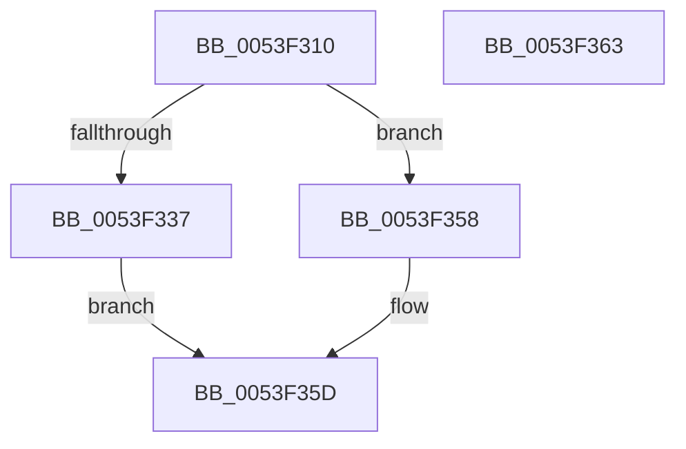

# HalAllocateAdapterChannel

- RVA: `0x0053F310`–`0x0053F364` (길이 `84` bytes)
- VA: `0x000000014053F310`
- 실행 섹션: `.text`
- PDB 이름 있음: `예`; PDB Function 태그: `아니요`
- unwind 정보 RVA: `0x00064C80`
- 디코드: `24`개 명령, `84/84` bytes 표시
- 미해석 바이트: `0` (있으면 어셈블리에 `.byte`로 보존)

> 이 문서는 커널 이미지의 기계어와 PDB 기호를 분석해 생성했습니다. 4번과 5번은 함수 원형과 자료형을 바이너리 사용 방식에서 추정한 C 해석이며 원본 소스 복구 결과는 아닙니다.

## 1. Dependencies

- 직접 호출 지점: **4**; 고유 호출 대상: **4**
- 직접 호출자로 확인된 함수: **0**
- RIP 상대 이미지 참조: **0**

### Outgoing calls
- `0x0053F31C` → [HalpDmaExtractFromVerifierShadowAdapter](../4B/HalpDmaExtractFromVerifierShadowAdapter_function_004B8DA4.md) (function, `0x004B8DA4`)
- `0x0053F327` → [HalpDmaGetAdapterVersion](../3D/HalpDmaGetAdapterVersion_function_003DEC8C.md) (function, `0x003DEC8C`)
- `0x0053F351` → [HalpAllocateAdapterChannel](../3D/HalpAllocateAdapterChannel_function_003DA544.md) (function, `0x003DA544`)
- `0x0053F358` → [HalAllocateAdapterChannelV2](../3D/HalAllocateAdapterChannelV2_function_003DC714.md) (function, `0x003DC714`)

### Direct callers
- 이 함수 시작 RVA로 연결되는 직접 call은 확인되지 않았습니다. 간접 호출은 완전히 역산할 수 없습니다.

### Static image references
- 디코드된 RIP-relative 메모리 참조가 없습니다.

## 2. Other-region calls and transfers

- 다른 실행 섹션으로 향하는 call: **0**
- 별도 외부 분기/꼬리 이동을 확인하지 못했습니다.

## 3. Assembly (complete function range)

```asm
0053F310  40 53                           push rbx
0053F312  48 83 EC 30                     sub rsp, 0x30
0053F316  49 8B D9                        mov rbx, r9
0053F319  4C 8B D2                        mov r10, rdx
0053F31C  E8 83 9A F7 FF                  call 0x1404b8da4
0053F321  48 8B C8                        mov rcx, rax
0053F324  4C 8B D8                        mov r11, rax
0053F327  E8 60 F9 E9 FF                  call 0x1403dec8c
0053F32C  49 8B D2                        mov rdx, r10
0053F32F  49 8B CB                        mov rcx, r11
0053F332  83 E8 02                        sub eax, 2
0053F335  74 21                           je 0x14053f358
0053F337  41 83 62 14 FD                  and dword ptr [r10 + 0x14], 0xfffffffd
0053F33C  45 8B 8B FC 00 00 00            mov r9d, dword ptr [r11 + 0xfc]
0053F343  48 89 5C 24 28                  mov qword ptr [rsp + 0x28], rbx
0053F348  83 64 24 20 00                  and dword ptr [rsp + 0x20], 0
0053F34D  41 C1 E9 0C                     shr r9d, 0xc
0053F351  E8 EE B1 E9 FF                  call 0x1403da544
0053F356  EB 05                           jmp 0x14053f35d
0053F358  E8 B7 D3 E9 FF                  call 0x1403dc714
0053F35D  48 83 C4 30                     add rsp, 0x30
0053F361  5B                              pop rbx
0053F362  C3                              ret
0053F363  CC                              int3
```

## 4. C-style interpretation (structured pseudocode)

```c
__int64 __fastcall HalAllocateAdapterChannel(__int64 a1, __int64 a2, __int64 a3, __int64 a4)
{
    __int64 result;
    __int64 v_rsp;
    unsigned __int64 v_stack_m10;
    unsigned int v_stack_m18;

    v_rsp = (v_rsp) - (48);
    result = HalpDmaExtractFromVerifierShadowAdapter(a1, a2, a3, a4);
    result = HalpDmaGetAdapterVersion(result, a2, a3, a4);
    result = (unsigned int)((result) - (2));
    if (condition_is_equal) goto loc_0053F358;
    v_stack_m10 = a4;
    a4 = (unsigned int)(((unsigned int)(*(unsigned int *)(result + 252))) >> (12));
    result = HalpAllocateAdapterChannel(result, a2, a3, a4);
    goto loc_0053F35D;
loc_0053F358:
    result = HalAllocateAdapterChannelV2(result, a2, a3, a4);
loc_0053F35D:
    v_rsp = (v_rsp) + (48);
    return result;
}
```

## 5. (Beta) C Style

```c
int64_t HalAllocateAdapterChannel(int64_t Arg1, int64_t Arg2, int64_t Arg3, int64_t Arg4)
{
    int64_t result;
    int64_t local_rsp;
    uint64_t v_stack_m10;
    uint32_t v_stack_m18;

    local_rsp = (local_rsp) - (48);
    result = HalpDmaExtractFromVerifierShadowAdapter(Arg1, Arg2, Arg3, Arg4);
    result = HalpDmaGetAdapterVersion(result, Arg2, Arg3, Arg4);
    result = (uint32_t)((result) - (2));
    if (condition_is_equal) goto loc_0053F358;
    v_stack_m10 = Arg4;
    Arg4 = (uint32_t)(((uint32_t)(*(uint32_t *)(result + 0xFC))) >> (12));
    result = HalpAllocateAdapterChannel(result, Arg2, Arg3, Arg4);
    goto loc_0053F35D;
loc_0053F358:
    result = HalAllocateAdapterChannelV2(result, Arg2, Arg3, Arg4);
loc_0053F35D:
    local_rsp = (local_rsp) + (48);
    return result;
}
```

## 6. Execution-region graph

[열기: 2D/3D 그래프와 함수 탐색 컨트롤 패널](../../../control-panel.html?section=text&rva=0x0053F310&view=graph)

- 2D 그래프는 위에서 아래로 흐르고, 3D 그래프는 빈 공간을 드래그해 회전합니다. Shift+드래그는 이동, 휠은 확대·축소, 함수 노드 선택은 대상 보고서 이동입니다.

### Static fallback


