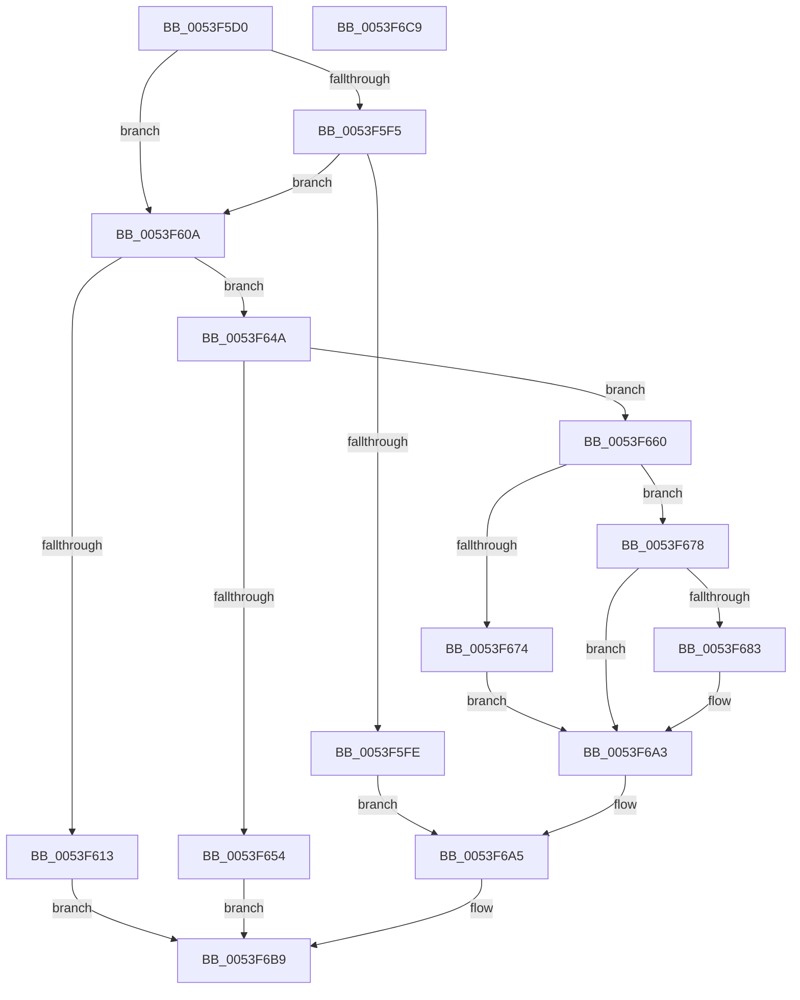

# HalAllocateCrashDumpRegisters

- RVA: `0x0053F5D0`–`0x0053F6CA` (길이 `250` bytes)
- VA: `0x000000014053F5D0`
- 실행 섹션: `.text`
- PDB 이름 있음: `예`; PDB Function 태그: `아니요`
- unwind 정보 RVA: `0x00060BC4`
- 디코드: `64`개 명령, `250/250` bytes 표시
- 미해석 바이트: `0` (있으면 어셈블리에 `.byte`로 보존)

> 이 문서는 커널 이미지의 기계어와 PDB 기호를 분석해 생성했습니다. 4번과 5번은 함수 원형과 자료형을 바이너리 사용 방식에서 추정한 C 해석이며 원본 소스 복구 결과는 아닙니다.

## 1. Dependencies

- 직접 호출 지점: **2**; 고유 호출 대상: **2**
- 직접 호출자로 확인된 함수: **1**
- RIP 상대 이미지 참조: **7**

### Outgoing calls
- `0x0053F5E2` → [HalpDmaExtractFromVerifierShadowAdapter](../4B/HalpDmaExtractFromVerifierShadowAdapter_function_004B8DA4.md) (function, `0x004B8DA4`)
- `0x0053F663` → [HalpDmaAllocateMapRegistersAtHighLevel](../55/HalpDmaAllocateMapRegistersAtHighLevel_function_005507A8.md) (function, `0x005507A8`)

### Direct callers
- [DifHalAllocateCrashDumpRegistersWrapper](../62/DifHalAllocateCrashDumpRegistersWrapper_function_006241C0.md) at `0x00624294`

### Static image references
- `0x0053F60A` → RVA `0x00FC3E68` (`.data`; read)
- `0x0053F613` → RVA `0x00FC3E88` (`.data`; read)
- `0x0053F619` → RVA `0x00FC3EE0` (`.data`; read)
- `0x0053F642` → RVA `0x00FC3E88` (`.data`; write)
- `0x0053F678` → RVA `0x00FC3E8C` (`.data`; read)
- `0x0053F69D` → RVA `0x00FC3E8C` (`.data`; write)
- `0x0053F6B2` → RVA `0x00FC3E60` (`.data`; write)

## 2. Other-region calls and transfers

- 다른 실행 섹션으로 향하는 call: **0**
- 별도 외부 분기/꼬리 이동을 확인하지 못했습니다.

## 3. Assembly (complete function range)

```asm
0053F5D0  48 89 5C 24 08                  mov qword ptr [rsp + 8], rbx
0053F5D5  48 89 74 24 10                  mov qword ptr [rsp + 0x10], rsi
0053F5DA  57                              push rdi
0053F5DB  48 83 EC 20                     sub rsp, 0x20
0053F5DF  48 8B F2                        mov rsi, rdx
0053F5E2  E8 BD 97 F7 FF                  call 0x1404b8da4
0053F5E7  33 FF                           xor edi, edi
0053F5E9  48 8B D8                        mov rbx, rax
0053F5EC  40 38 B8 B8 01 00 00            cmp byte ptr [rax + 0x1b8], dil
0053F5F3  75 15                           jne 0x14053f60a
0053F5F5  40 38 B8 BD 01 00 00            cmp byte ptr [rax + 0x1bd], dil
0053F5FC  74 0C                           je 0x14053f60a
0053F5FE  48 89 B8 F0 00 00 00            mov qword ptr [rax + 0xf0], rdi
0053F605  E9 9B 00 00 00                  jmp 0x14053f6a5
0053F60A  83 3D 57 48 A8 00 01            cmp dword ptr [rip + 0xa84857], 1
0053F611  75 37                           jne 0x14053f64a
0053F613  8B 15 6F 48 A8 00               mov edx, dword ptr [rip + 0xa8486f]
0053F619  4C 8D 05 C0 48 A8 00            lea r8, [rip + 0xa848c0]
0053F620  8B CA                           mov ecx, edx
0053F622  48 03 C9                        add rcx, rcx
0053F625  41 8B 44 C8 08                  mov eax, dword ptr [r8 + rcx*8 + 8]
0053F62A  89 06                           mov dword ptr [rsi], eax
0053F62C  49 8B 04 C8                     mov rax, qword ptr [r8 + rcx*8]
0053F630  48 89 83 F0 00 00 00            mov qword ptr [rbx + 0xf0], rax
0053F637  8B 0E                           mov ecx, dword ptr [rsi]
0053F639  89 8B F8 00 00 00               mov dword ptr [rbx + 0xf8], ecx
0053F63F  8D 4A 01                        lea ecx, [rdx + 1]
0053F642  89 0D 40 48 A8 00               mov dword ptr [rip + 0xa84840], ecx
0053F648  EB 6F                           jmp 0x14053f6b9
0053F64A  8B 80 E8 00 00 00               mov eax, dword ptr [rax + 0xe8]
0053F650  39 02                           cmp dword ptr [rdx], eax
0053F652  76 0C                           jbe 0x14053f660
0053F654  89 BB F8 00 00 00               mov dword ptr [rbx + 0xf8], edi
0053F65A  33 C0                           xor eax, eax
0053F65C  89 3A                           mov dword ptr [rdx], edi
0053F65E  EB 59                           jmp 0x14053f6b9
0053F660  48 8B CB                        mov rcx, rbx
0053F663  E8 40 11 01 00                  call 0x1405507a8
0053F668  48 89 83 F0 00 00 00            mov qword ptr [rbx + 0xf0], rax
0053F66F  48 85 C0                        test rax, rax
0053F672  75 04                           jne 0x14053f678
0053F674  89 3E                           mov dword ptr [rsi], edi
0053F676  EB 2B                           jmp 0x14053f6a3
0053F678  8B 15 0E 48 A8 00               mov edx, dword ptr [rip + 0xa8480e]
0053F67E  83 FA 04                        cmp edx, 4
0053F681  73 20                           jae 0x14053f6a3
0053F683  4C 8D 05 56 48 A8 00            lea r8, [rip + 0xa84856]
0053F68A  8B CA                           mov ecx, edx
0053F68C  48 03 C9                        add rcx, rcx
0053F68F  49 89 04 C8                     mov qword ptr [r8 + rcx*8], rax
0053F693  8B 06                           mov eax, dword ptr [rsi]
0053F695  41 89 44 C8 08                  mov dword ptr [r8 + rcx*8 + 8], eax
0053F69A  8D 42 01                        lea eax, [rdx + 1]
0053F69D  89 05 E9 47 A8 00               mov dword ptr [rip + 0xa847e9], eax
0053F6A3  8B 3E                           mov edi, dword ptr [rsi]
0053F6A5  89 BB F8 00 00 00               mov dword ptr [rbx + 0xf8], edi
0053F6AB  48 8B 83 F0 00 00 00            mov rax, qword ptr [rbx + 0xf0]
0053F6B2  48 89 1D A7 47 A8 00            mov qword ptr [rip + 0xa847a7], rbx
0053F6B9  48 8B 5C 24 30                  mov rbx, qword ptr [rsp + 0x30]
0053F6BE  48 8B 74 24 38                  mov rsi, qword ptr [rsp + 0x38]
0053F6C3  48 83 C4 20                     add rsp, 0x20
0053F6C7  5F                              pop rdi
0053F6C8  C3                              ret
0053F6C9  CC                              int3
```

## 4. C-style interpretation (structured pseudocode)

```c
__int64 __fastcall HalAllocateCrashDumpRegisters(__int64 a1, __int64 a2)
{
    __int64 result;
    __int64 v_rdi;
    __int64 v_rsp;
    unsigned __int64 v_stack_p10;
    unsigned __int64 v_stack_p8;

    v_stack_p8 = v_rbx;
    v_stack_p10 = v_rsi;
    v_rsp = (v_rsp) - (32);
    result = HalpDmaExtractFromVerifierShadowAdapter(a1, a2, a3, a4);
    v_rdi = 0;
    if ((*(unsigned __int8 *)(result + 440)) != 0) goto loc_0053F60A;
    if ((*(unsigned __int8 *)(result + 445)) == 0) goto loc_0053F60A;
    *(unsigned __int64 *)(result + 240) = 0;
    goto loc_0053F6A5;
loc_0053F60A:
    if ((*(unsigned int *)(v_rip + 11028567)) != 1) goto loc_0053F64A;
    a1 = ((unsigned int)((unsigned int)((unsigned int)(*(unsigned int *)(v_rip + 11028591))))) + ((unsigned int)((unsigned int)((unsigned int)(*(unsigned int *)(v_rip + 11028591)))));
    *(unsigned int *)(a2) = (unsigned int)((unsigned int)(*(unsigned int *)(v_rip + 11028672 + a1 * 8 + 8)));
    *(unsigned __int64 *)(result + 240) = *(unsigned __int64 *)(v_rip + 11028672 + a1 * 8);
    *(unsigned int *)(result + 248) = (unsigned int)((unsigned int)(*(unsigned int *)(a2)));
    *(unsigned int *)(v_rip + 11028544) = (unsigned int)((unsigned int)(*(unsigned int *)(v_rip + 11028591)) + 1);
    goto loc_0053F6B9;
loc_0053F64A:
    if ((*(unsigned int *)((unsigned int)(*(unsigned int *)(v_rip + 11028591)))) <= ((unsigned int)((unsigned int)(*(unsigned int *)(*(unsigned __int64 *)(v_rip + 11028672 + a1 * 8) + 232))))) goto loc_0053F660;
    *(unsigned int *)(result + 248) = 0;
    result = 0;
    *(unsigned int *)((unsigned int)(*(unsigned int *)(v_rip + 11028591))) = 0;
    goto loc_0053F6B9;
loc_0053F660:
    result = HalpDmaAllocateMapRegistersAtHighLevel(0, (unsigned int)(*(unsigned int *)(v_rip + 11028591)), v_rip + 11028672, a4);
    *(unsigned __int64 *)(result + 240) = result;
    if (result != 0) goto loc_0053F678;
    *(unsigned int *)(a2) = 0;
    goto loc_0053F6A3;
loc_0053F678:
    if (((unsigned int)((unsigned int)(*(unsigned int *)(v_rip + 11028494)))) < 4) {
        a3 = v_rip + 11028566;
        a1 = (unsigned int)((unsigned int)(*(unsigned int *)(v_rip + 11028494)));
        a1 = (a1) + (a1);
        *(unsigned __int64 *)(a3 + a1 * 8) = result;
        result = *(unsigned int *)(a2);
        *(unsigned int *)(a3 + a1 * 8 + 8) = (unsigned int)(result);
        result = (unsigned int)(*(unsigned int *)(v_rip + 11028494)) + 1;
        *(unsigned int *)(v_rip + 11028457) = (unsigned int)(result);
    }
loc_0053F6A5:
    *(unsigned int *)(result + 248) = (unsigned int)((unsigned int)(*(unsigned int *)(a2)));
    *(unsigned __int64 *)(v_rip + 11028391) = result;
loc_0053F6B9:
    v_rsp = (v_rsp) + (32);
    return *(unsigned __int64 *)(result + 240);
}
```

## 5. (Beta) C Style

```c
int64_t HalAllocateCrashDumpRegisters(int64_t Arg1, void *Arg2)
{
    uint8_t *arg2 = (uint8_t *)Arg2;

    int64_t result;
    int64_t local_rdi;
    int64_t local_rsp;
    uint64_t v_stack_p10;
    uint64_t v_stack_p8;

    v_stack_p8 = local_rbx;
    v_stack_p10 = local_rsi;
    local_rsp = (local_rsp) - (32);
    result = HalpDmaExtractFromVerifierShadowAdapter(Arg1, Arg2, a3, a4);
    local_rdi = 0;
    if ((*(uint8_t *)(result + 0x1B8)) != 0) goto loc_0053F60A;
    if ((*(uint8_t *)(result + 0x1BD)) == 0) goto loc_0053F60A;
    *(uint64_t *)(result + 0xF0) = 0;
    goto loc_0053F6A5;
loc_0053F60A:
    if ((*(uint32_t *)(v_rip + 0xA84857)) != 1) goto loc_0053F64A;
    Arg1 = ((uint32_t)((uint32_t)((uint32_t)(*(uint32_t *)(v_rip + 0xA8486F))))) + ((uint32_t)((uint32_t)((uint32_t)(*(uint32_t *)(v_rip + 0xA8486F)))));
    *(uint32_t *)(arg2) = (uint32_t)((uint32_t)(*(uint32_t *)(v_rip + 0xA848C0 + Arg1 * 8 + 0x8)));
    *(uint64_t *)(result + 0xF0) = *(uint64_t *)(v_rip + 0xA848C0 + Arg1 * 8);
    *(uint32_t *)(result + 0xF8) = (uint32_t)((uint32_t)(*(uint32_t *)(arg2)));
    *(uint32_t *)(v_rip + 0xA84840) = (uint32_t)((uint32_t)(*(uint32_t *)(v_rip + 0xA8486F)) + 1);
    goto loc_0053F6B9;
loc_0053F64A:
    if ((*(uint32_t *)((uint32_t)(*(uint32_t *)(v_rip + 0xA8486F)))) <= ((uint32_t)((uint32_t)(*(uint32_t *)(*(uint64_t *)(v_rip + 0xA848C0 + Arg1 * 8) + 0xE8))))) goto loc_0053F660;
    *(uint32_t *)(result + 0xF8) = 0;
    result = 0;
    *(uint32_t *)((uint32_t)(*(uint32_t *)(v_rip + 0xA8486F))) = 0;
    goto loc_0053F6B9;
loc_0053F660:
    result = HalpDmaAllocateMapRegistersAtHighLevel(0, (uint32_t)(*(uint32_t *)(v_rip + 0xA8486F)), v_rip + 11028672, a4);
    *(uint64_t *)(result + 0xF0) = result;
    if (result != 0) goto loc_0053F678;
    *(uint32_t *)(arg2) = 0;
    goto loc_0053F6A3;
loc_0053F678:
    if (((uint32_t)((uint32_t)(*(uint32_t *)(v_rip + 0xA8480E)))) < 4) {
        a3 = v_rip + 11028566;
        Arg1 = (uint32_t)((uint32_t)(*(uint32_t *)(v_rip + 0xA8480E)));
        Arg1 = (Arg1) + (Arg1);
        *(uint64_t *)(a3 + Arg1 * 8) = result;
        result = *(uint32_t *)(arg2);
        *(uint32_t *)(a3 + Arg1 * 8 + 0x8) = (uint32_t)(result);
        result = (uint32_t)(*(uint32_t *)(v_rip + 0xA8480E)) + 1;
        *(uint32_t *)(v_rip + 0xA847E9) = (uint32_t)(result);
    }
loc_0053F6A5:
    *(uint32_t *)(result + 0xF8) = (uint32_t)((uint32_t)(*(uint32_t *)(arg2)));
    *(uint64_t *)(v_rip + 0xA847A7) = result;
loc_0053F6B9:
    local_rsp = (local_rsp) + (32);
    return *(uint64_t *)(result + 0xF0);
}
```

### 관측된 메모리 오프셋

구조체 형식이 확인되지 않은 접근은 인자 기준의 오프셋으로만 기록했습니다.

| 기준 인자 | 오프셋 표현 | 폭 (bit) | 접근 |
|---|---:|---:|---|
| `Arg2` | `+ 0x0` | `32` | `R` |
| `Arg2` | `+ 0x0` | `32` | `W` |

## 6. Execution-region graph

[열기: 2D/3D 그래프와 함수 탐색 컨트롤 패널](../../../control-panel.html?section=text&rva=0x0053F5D0&view=graph)

- 2D 그래프는 위에서 아래로 흐르고, 3D 그래프는 빈 공간을 드래그해 회전합니다. Shift+드래그는 이동, 휠은 확대·축소, 함수 노드 선택은 대상 보고서 이동입니다.

### Static fallback


