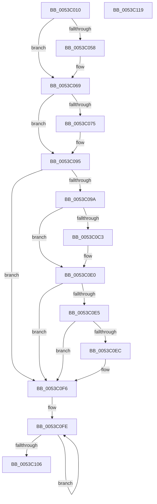

# HalCalibratePerformanceCounter

- RVA: `0x0053C010`–`0x0053C11A` (길이 `266` bytes)
- VA: `0x000000014053C010`
- 실행 섹션: `.text`
- PDB 이름 있음: `예`; PDB Function 태그: `아니요`
- unwind 정보 RVA: `0x000C38DC`
- 디코드: `71`개 명령, `266/266` bytes 표시
- 미해석 바이트: `0` (있으면 어셈블리에 `.byte`로 보존)

> 이 문서는 커널 이미지의 기계어와 PDB 기호를 분석해 생성했습니다. 4번과 5번은 함수 원형과 자료형을 바이너리 사용 방식에서 추정한 C 해석이며 원본 소스 복구 결과는 아닙니다.

## 1. Dependencies

- 직접 호출 지점: **8**; 고유 호출 대상: **5**
- 직접 호출자로 확인된 함수: **2**
- RIP 상대 이미지 참조: **3**

### Outgoing calls
- `0x0053C061` → [HalpTimerScaleCounter](../37/HalpTimerScaleCounter_function_0037B354.md) (function, `0x0037B354`)
- `0x0053C08D` → [HalpTimerScaleCounter](../37/HalpTimerScaleCounter_function_0037B354.md) (function, `0x0037B354`)
- `0x0053C0A4` → [HalpQueryVirtualRtc](../54/HalpQueryVirtualRtc_function_0054C4D0.md) (function, `0x0054C4D0`)
- `0x0053C0B2` → [HalpTimerCalibratePerformanceCounter](../4A/HalpTimerCalibratePerformanceCounter_function_004AB874.md) (function, `0x004AB874`)
- `0x0053C0D0` → [HalpTimerScaleCounter](../37/HalpTimerScaleCounter_function_0037B354.md) (function, `0x0037B354`)
- `0x0053C0DB` → [HalpTimerCalibratePerformanceCounter](../4A/HalpTimerCalibratePerformanceCounter_function_004AB874.md) (function, `0x004AB874`)
- `0x0053C0F1` → [HalpSetVirtualRtc](../42/HalpSetVirtualRtc_function_0042DF30.md) (function, `0x0042DF30`)
- `0x0053C0F6` → [HalpTimerResetProfileAdjustment](../54/HalpTimerResetProfileAdjustment_function_0054B660.md) (function, `0x0054B660`)

### Direct callers
- [HalpTscFallback](../54/HalpTscFallback_function_0054AC40.md) at `0x0054ACF7`
- [KiCalibrateTimeAdjustment](../../pagelk/B7/KiCalibrateTimeAdjustment_function_00B797E0.md) at `0x00B79951`

### Static image references
- `0x0053C02F` → RVA `0x00FC3FD0` (`.data`; read)
- `0x0053C069` → RVA `0x00FC3FC8` (`.data`; read)
- `0x0053C0B7` → RVA `0x00FC4140` (`.data`; read)

## 2. Other-region calls and transfers

- 다른 실행 섹션으로 향하는 call: **0**
- 별도 외부 분기/꼬리 이동을 확인하지 못했습니다.

## 3. Assembly (complete function range)

```asm
0053C010  48 8B C4                        mov rax, rsp
0053C013  48 89 58 10                     mov qword ptr [rax + 0x10], rbx
0053C017  48 89 68 20                     mov qword ptr [rax + 0x20], rbp
0053C01B  56                              push rsi
0053C01C  57                              push rdi
0053C01D  41 56                           push r14
0053C01F  48 83 EC 20                     sub rsp, 0x20
0053C023  65 44 8B 1C 25 A4 01 00 00      mov r11d, dword ptr gs:[0x1a4]
0053C02C  48 8B EA                        mov rbp, rdx
0053C02F  48 8B 35 9A 7F A8 00            mov rsi, qword ptr [rip + 0xa87f9a]
0053C036  48 8B D9                        mov rbx, rcx
0053C039  48 83 60 18 00                  and qword ptr [rax + 0x18], 0
0053C03E  41 BE 80 96 98 00               mov r14d, 0x989680
0053C044  C6 40 08 00                     mov byte ptr [rax + 8], 0
0053C048  83 BE E4 00 00 00 05            cmp dword ptr [rsi + 0xe4], 5
0053C04F  48 8D BE C0 00 00 00            lea rdi, [rsi + 0xc0]
0053C056  75 11                           jne 0x14053c069
0053C058  4C 8B 07                        mov r8, qword ptr [rdi]
0053C05B  41 8B D6                        mov edx, r14d
0053C05E  48 8B CD                        mov rcx, rbp
0053C061  E8 EE F2 E3 FF                  call 0x14037b354
0053C066  48 8B E8                        mov rbp, rax
0053C069  48 8B 05 58 7F A8 00            mov rax, qword ptr [rip + 0xa87f58]
0053C070  48 3B F0                        cmp rsi, rax
0053C073  74 20                           je 0x14053c095
0053C075  83 B8 E4 00 00 00 05            cmp dword ptr [rax + 0xe4], 5
0053C07C  48 8B CD                        mov rcx, rbp
0053C07F  48 8B 90 C0 00 00 00            mov rdx, qword ptr [rax + 0xc0]
0053C086  4C 8B 07                        mov r8, qword ptr [rdi]
0053C089  49 0F 44 D6                     cmove rdx, r14
0053C08D  E8 C2 F2 E3 FF                  call 0x14037b354
0053C092  48 8B E8                        mov rbp, rax
0053C095  45 85 DB                        test r11d, r11d
0053C098  75 5C                           jne 0x14053c0f6
0053C09A  48 8D 54 24 40                  lea rdx, [rsp + 0x40]
0053C09F  48 8D 4C 24 50                  lea rcx, [rsp + 0x50]
0053C0A4  E8 27 04 01 00                  call 0x14054c4d0
0053C0A9  48 8B D5                        mov rdx, rbp
0053C0AC  48 8B CE                        mov rcx, rsi
0053C0AF  44 8A F0                        mov r14b, al
0053C0B2  E8 BD F7 F6 FF                  call 0x1404ab874
0053C0B7  4C 8B 1D 82 80 A8 00            mov r11, qword ptr [rip + 0xa88082]
0053C0BE  4D 85 DB                        test r11, r11
0053C0C1  74 1D                           je 0x14053c0e0
0053C0C3  4D 8B 83 C0 00 00 00            mov r8, qword ptr [r11 + 0xc0]
0053C0CA  48 8B CD                        mov rcx, rbp
0053C0CD  48 8B 17                        mov rdx, qword ptr [rdi]
0053C0D0  E8 7F F2 E3 FF                  call 0x14037b354
0053C0D5  48 8B D0                        mov rdx, rax
0053C0D8  49 8B CB                        mov rcx, r11
0053C0DB  E8 94 F7 F6 FF                  call 0x1404ab874
0053C0E0  45 84 F6                        test r14b, r14b
0053C0E3  74 11                           je 0x14053c0f6
0053C0E5  80 7C 24 40 00                  cmp byte ptr [rsp + 0x40], 0
0053C0EA  74 0A                           je 0x14053c0f6
0053C0EC  48 8D 4C 24 50                  lea rcx, [rsp + 0x50]
0053C0F1  E8 3A 1E EF FF                  call 0x14042df30
0053C0F6  E8 65 F5 00 00                  call 0x14054b660
0053C0FB  F0 FF 0B                        lock dec dword ptr [rbx]
0053C0FE  F3 90                           pause
0053C100  8B 03                           mov eax, dword ptr [rbx]
0053C102  85 C0                           test eax, eax
0053C104  7F F8                           jg 0x14053c0fe
0053C106  48 8B 5C 24 48                  mov rbx, qword ptr [rsp + 0x48]
0053C10B  48 8B 6C 24 58                  mov rbp, qword ptr [rsp + 0x58]
0053C110  48 83 C4 20                     add rsp, 0x20
0053C114  41 5E                           pop r14
0053C116  5F                              pop rdi
0053C117  5E                              pop rsi
0053C118  C3                              ret
0053C119  CC                              int3
```

## 4. C-style interpretation (structured pseudocode)

```c
__int64 __fastcall HalCalibratePerformanceCounter(__int64 a1, __int64 a2)
{
    __int64 result;
    __int64 v_rbp;
    __int64 v_rsp;
    unsigned __int64 v_stack_p10;
    unsigned __int64 v_stack_p18;
    unsigned __int64 v_stack_p20;
    unsigned __int64 v_stack_p8;

    *(unsigned __int64 *)(v_rsp + 16) = v_rbx;
    *(unsigned __int64 *)(v_rsp + 32) = v_rbp;
    v_rsp = (v_rsp) - (32);
    *(unsigned __int8 *)(v_rsp + 8) = 0;
    result = v_rsp;
    v_rbp = a2;
    if ((*(unsigned int *)(*(unsigned __int64 *)(v_rip + 11042714) + 228)) == 5) {
        a3 = *(unsigned __int64 *)(*(unsigned __int64 *)(v_rip + 11042714) + 192);
        a2 = (unsigned int)((unsigned int)(0x989680ULL));
        a1 = a2;
        result = HalpTimerScaleCounter(a1, a2, a3, a4);
        v_rbp = result;
    }
    result = *(unsigned __int64 *)(v_rip + 11042648);
    if ((*(unsigned __int64 *)(v_rip + 11042714)) != (*(unsigned __int64 *)(v_rip + 11042648))) {
        a1 = v_rbp;
        a2 = *(unsigned __int64 *)(*(unsigned __int64 *)(v_rip + 11042648) + 192);
        a3 = *(unsigned __int64 *)(*(unsigned __int64 *)(v_rip + 11042714) + 192);
        if ((*(unsigned int *)(*(unsigned __int64 *)(v_rip + 11042648) + 228)) == 5) { a2 = (unsigned int)(0x989680ULL); }
        result = HalpTimerScaleCounter(a1, a2, a3, a4);
        v_rbp = result;
    }
    if ((unsigned int)((unsigned int)(*(unsigned int *)(gs_base + (0 + 420)))) != 0) goto loc_0053C0F6;
    result = HalpQueryVirtualRtc(v_stack_p18, v_stack_p8, a3, a4);
    result = HalpTimerCalibratePerformanceCounter(*(unsigned __int64 *)(v_rip + 11042714), v_rbp, a3, a4);
    if (*(unsigned __int64 *)(v_rip + 11042946) != 0) {
        a3 = *(unsigned __int64 *)(*(unsigned __int64 *)(v_rip + 11042946) + 192);
        a1 = v_rbp;
        a2 = *(unsigned __int64 *)(*(unsigned __int64 *)(v_rip + 11042714) + 192);
        result = HalpTimerScaleCounter(a1, a2, a3, a4);
        a2 = result;
        a1 = *(unsigned __int64 *)(v_rip + 11042946);
        result = HalpTimerCalibratePerformanceCounter(a1, a2, a3, a4);
    }
    if ((unsigned __int8)((unsigned __int8)(result)) == 0) goto loc_0053C0F6;
    if (v_stack_p8 != 0) {
        a1 = v_stack_p18;
        result = HalpSetVirtualRtc(a1, a2, a3, a4);
    }
    result = HalpTimerResetProfileAdjustment(a1, a2, a3, a4);
loc_0053C0FE:
    if (condition_is_greater) goto loc_0053C0FE;
    v_rsp = (v_rsp) + (32);
    return (unsigned int)(*(unsigned int *)(a1));
}
```

## 5. (Beta) C Style

```c
int64_t HalCalibratePerformanceCounter(void *Arg1, int64_t Arg2)
{
    uint8_t *arg1 = (uint8_t *)Arg1;

    int64_t result;
    int64_t local_rbp;
    int64_t local_rsp;
    uint64_t v_stack_p10;
    uint64_t v_stack_p18;
    uint64_t v_stack_p20;
    uint64_t v_stack_p8;

    *(uint64_t *)(local_rsp + 0x10) = local_rbx;
    *(uint64_t *)(local_rsp + 0x20) = local_rbp;
    local_rsp = (local_rsp) - (32);
    *(uint8_t *)(local_rsp + 0x8) = 0;
    result = local_rsp;
    local_rbp = Arg2;
    if ((*(uint32_t *)(*(uint64_t *)(v_rip + 0xA87F9A) + 0xE4)) == 5) {
        a3 = *(uint64_t *)(*(uint64_t *)(v_rip + 0xA87F9A) + 0xC0);
        Arg2 = (uint32_t)((uint32_t)(0x989680ULL));
        Arg1 = Arg2;
        result = HalpTimerScaleCounter(Arg1, Arg2, a3, a4);
        local_rbp = result;
    }
    result = *(uint64_t *)(v_rip + 0xA87F58);
    if ((*(uint64_t *)(v_rip + 0xA87F9A)) != (*(uint64_t *)(v_rip + 0xA87F58))) {
        Arg1 = local_rbp;
        Arg2 = *(uint64_t *)(*(uint64_t *)(v_rip + 0xA87F58) + 0xC0);
        a3 = *(uint64_t *)(*(uint64_t *)(v_rip + 0xA87F9A) + 0xC0);
        if ((*(uint32_t *)(*(uint64_t *)(v_rip + 0xA87F58) + 0xE4)) == 5) { Arg2 = (uint32_t)(0x989680ULL); }
        result = HalpTimerScaleCounter(Arg1, Arg2, a3, a4);
        local_rbp = result;
    }
    if ((uint32_t)((uint32_t)(*(uint32_t *)(gs_base + (0 + 0x1A4)))) != 0) goto loc_0053C0F6;
    result = HalpQueryVirtualRtc(v_stack_p18, v_stack_p8, a3, a4);
    result = HalpTimerCalibratePerformanceCounter(*(uint64_t *)(v_rip + 0xA87F9A), local_rbp, a3, a4);
    if (*(uint64_t *)(v_rip + 0xA88082) != 0) {
        a3 = *(uint64_t *)(*(uint64_t *)(v_rip + 0xA88082) + 0xC0);
        Arg1 = local_rbp;
        Arg2 = *(uint64_t *)(*(uint64_t *)(v_rip + 0xA87F9A) + 0xC0);
        result = HalpTimerScaleCounter(Arg1, Arg2, a3, a4);
        Arg2 = result;
        Arg1 = *(uint64_t *)(v_rip + 0xA88082);
        result = HalpTimerCalibratePerformanceCounter(Arg1, Arg2, a3, a4);
    }
    if ((uint8_t)((uint8_t)(result)) == 0) goto loc_0053C0F6;
    if (v_stack_p8 != 0) {
        Arg1 = v_stack_p18;
        result = HalpSetVirtualRtc(Arg1, Arg2, a3, a4);
    }
    result = HalpTimerResetProfileAdjustment(Arg1, Arg2, a3, a4);
loc_0053C0FE:
    if (condition_is_greater) goto loc_0053C0FE;
    local_rsp = (local_rsp) + (32);
    return (uint32_t)(*(uint32_t *)(arg1));
}
```

### 관측된 메모리 오프셋

구조체 형식이 확인되지 않은 접근은 인자 기준의 오프셋으로만 기록했습니다.

| 기준 인자 | 오프셋 표현 | 폭 (bit) | 접근 |
|---|---:|---:|---|
| `Arg1` | `+ 0x0` | `32` | `R` |
| `Arg1` | `+ 0x0` | `32` | `R/W` |

## 6. Execution-region graph

[열기: 2D/3D 그래프와 함수 탐색 컨트롤 패널](../../../control-panel.html?section=text&rva=0x0053C010&view=graph)

- 2D 그래프는 위에서 아래로 흐르고, 3D 그래프는 빈 공간을 드래그해 회전합니다. Shift+드래그는 이동, 휠은 확대·축소, 함수 노드 선택은 대상 보고서 이동입니다.

### Static fallback


