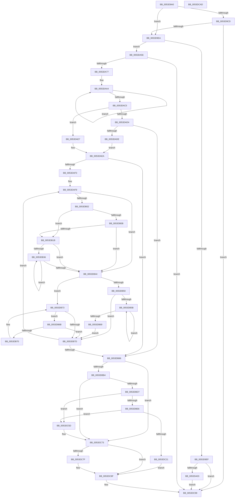

# HalInitializeBios

- RVA: `0x0053D9A0`–`0x0053DCAE` (길이 `782` bytes)
- VA: `0x000000014053D9A0`
- 실행 섹션: `.text`
- PDB 이름 있음: `예`; PDB Function 태그: `아니요`
- unwind 정보 RVA: `0x000C3934`
- 디코드: `197`개 명령, `782/782` bytes 표시
- 미해석 바이트: `0` (있으면 어셈블리에 `.byte`로 보존)

> 이 문서는 커널 이미지의 기계어와 PDB 기호를 분석해 생성했습니다. 4번과 5번은 함수 원형과 자료형을 바이너리 사용 방식에서 추정한 C 해석이며 원본 소스 복구 결과는 아닙니다.

## 1. Dependencies

- 직접 호출 지점: **17**; 고유 호출 대상: **12**
- 직접 호출자로 확인된 함수: **2**
- RIP 상대 이미지 참조: **9**

### Outgoing calls
- `0x0053D9CD` → [strupr](../4F/strupr_function_004FEEE0.md) (function, `0x004FEEE0`)
- `0x0053D9DC` → [strstr](../4F/strstr_function_004FF680.md) (function, `0x004FF680`)
- `0x0053DA33` → [x86BiosInitializeBiosEx](../54/x86BiosInitializeBiosEx_function_00547C88.md) (function, `0x00547C88`)
- `0x0053DA3C` → [x86BiosTranslateAddress](../47/x86BiosTranslateAddress_function_004736C0.md) (function, `0x004736C0`)
- `0x0053DA4C` → [memcpy](../6C/memcpy_function_006C6840.md) (function, `0x006C6840`)
- `0x0053DA66` → [ExAllocatePool2](../../poolcode/B8/ExAllocatePool2_function_00B820F0.md) (function, `0x00B820F0`)
- `0x0053DB9F` → [MmMapLockedPagesSpecifyCache](../31/MmMapLockedPagesSpecifyCache_function_00318800.md) (function, `0x00318800`)
- `0x0053DBC6` → [MmMapIoSpaceEx](../32/MmMapIoSpaceEx_function_00327830.md) (function, `0x00327830`)
- `0x0053DBDC` → [HalpMmAllocCtxAlloc](../3E/HalpMmAllocCtxAlloc_function_003E10B8.md) (function, `0x003E10B8`)
- `0x0053DBFE` → [x86BiosInitializeBiosEx](../54/x86BiosInitializeBiosEx_function_00547C88.md) (function, `0x00547C88`)
- `0x0053DC14` → [MmMapIoSpaceEx](../32/MmMapIoSpaceEx_function_00327830.md) (function, `0x00327830`)
- `0x0053DC25` → [x86BiosTranslateAddress](../47/x86BiosTranslateAddress_function_004736C0.md) (function, `0x004736C0`)
- `0x0053DC33` → [memcpy](../6C/memcpy_function_006C6840.md) (function, `0x006C6840`)
- `0x0053DC41` → [MiUnmapContiguousMemory](../3F/MiUnmapContiguousMemory_function_003F7908.md) (function, `0x003F7908`)
- `0x0053DC66` → [MiUnmapContiguousMemory](../3F/MiUnmapContiguousMemory_function_003F7908.md) (function, `0x003F7908`)
- `0x0053DC82` → [MmUnmapLockedPages](../24/MmUnmapLockedPages_function_00246E60.md) (function, `0x00246E60`)
- `0x0053DC94` → [ExFreePoolWithTag](../../poolcode/B8/ExFreePoolWithTag_function_00B82870.md) (function, `0x00B82870`)

### Direct callers
- [KiInitializeBootStructures](../../pagelk/B6/KiInitializeBootStructures_function_00B68530.md) at `0x00B6881A`
- [InitBootProcessor](../../init/C1/InitBootProcessor_function_00C1B1C8.md) at `0x00C1B7F2`

### Static image references
- `0x0053D9D2` → RVA `0x0002385C` (`.rdata`; read)
- `0x0053DA03` → RVA `0x00FC3F80` (`.data`; read/write)
- `0x0053DA0B` → RVA `0x0053DCC0` (`HalpBiosDisplayReset`; read)
- `0x0053DA12` → RVA `0x00FC3F88` (`.data`; read/write)
- `0x0053DA23` → RVA `0x00E00848` (`.data`; write)
- `0x0053DA2C` → RVA `0x00E0F598` (`.data`; write)
- `0x0053DBA4` → RVA `0x00FC3F80` (`.data`; write)
- `0x0053DBE6` → RVA `0x00FC3F80` (`.data`; read)
- `0x0053DBF7` → RVA `0x00FC3F88` (`.data`; write)

## 2. Other-region calls and transfers

- 다른 실행 섹션으로 향하는 call: **2**
  - `0x0053DA66` → [ExAllocatePool2](../../poolcode/B8/ExAllocatePool2_function_00B820F0.md) (`.text` → `POOLCODE`)
  - `0x0053DC94` → [ExFreePoolWithTag](../../poolcode/B8/ExFreePoolWithTag_function_00B82870.md) (`.text` → `POOLCODE`)
- 별도 외부 분기/꼬리 이동을 확인하지 못했습니다.

## 3. Assembly (complete function range)

```asm
0053D9A0  48 89 6C 24 08                  mov qword ptr [rsp + 8], rbp
0053D9A5  48 89 74 24 18                  mov qword ptr [rsp + 0x18], rsi
0053D9AA  57                              push rdi
0053D9AB  41 56                           push r14
0053D9AD  41 57                           push r15
0053D9AF  48 83 EC 30                     sub rsp, 0x30
0053D9B3  8B F9                           mov edi, ecx
0053D9B5  48 C7 44 24 58 00 00 0A 00      mov qword ptr [rsp + 0x58], 0xa0000
0053D9BE  48 8B 8A D8 00 00 00            mov rcx, qword ptr [rdx + 0xd8]
0053D9C5  48 8B F2                        mov rsi, rdx
0053D9C8  48 85 C9                        test rcx, rcx
0053D9CB  74 1D                           je 0x14053d9ea
0053D9CD  E8 0E 15 FC FF                  call 0x1404feee0
0053D9D2  48 8D 15 83 5E AE FF            lea rdx, [rip - 0x51a17d]
0053D9D9  48 8B C8                        mov rcx, rax
0053D9DC  E8 9F 1C FC FF                  call 0x1404ff680
0053D9E1  48 85 C0                        test rax, rax
0053D9E4  0F 85 AF 02 00 00               jne 0x14053dc99
0053D9EA  83 FF FF                        cmp edi, -1
0053D9ED  75 67                           jne 0x14053da56
0053D9EF  48 8B 86 F0 00 00 00            mov rax, qword ptr [rsi + 0xf0]
0053D9F6  F6 80 60 0A 00 00 04            test byte ptr [rax + 0xa60], 4
0053D9FD  0F 85 96 02 00 00               jne 0x14053dc99
0053DA03  48 83 25 75 65 A8 00 00         and qword ptr [rip + 0xa86575], 0
0053DA0B  48 8D 05 AE 02 00 00            lea rax, [rip + 0x2ae]
0053DA12  48 83 25 6E 65 A8 00 00         and qword ptr [rip + 0xa8656e], 0
0053DA1A  41 B9 00 00 02 00               mov r9d, 0x20000
0053DA20  45 33 C0                        xor r8d, r8d
0053DA23  48 89 05 1E 2E 8C 00            mov qword ptr [rip + 0x8c2e1e], rax
0053DA2A  33 D2                           xor edx, edx
0053DA2C  C6 05 65 1B 8D 00 01            mov byte ptr [rip + 0x8d1b65], 1
0053DA33  E8 50 A2 00 00                  call 0x140547c88
0053DA38  33 D2                           xor edx, edx
0053DA3A  33 C9                           xor ecx, ecx
0053DA3C  E8 7F 5C F3 FF                  call 0x1404736c0
0053DA41  48 8B C8                        mov rcx, rax
0053DA44  33 D2                           xor edx, edx
0053DA46  41 B8 00 08 00 00               mov r8d, 0x800
0053DA4C  E8 EF 8D 18 00                  call 0x1406c6840
0053DA51  E9 43 02 00 00                  jmp 0x14053dc99
0053DA56  BA 30 08 00 00                  mov edx, 0x830
0053DA5B  B9 40 00 00 00                  mov ecx, 0x40
0053DA60  41 B8 48 61 6C 46               mov r8d, 0x466c6148
0053DA66  E8 85 46 64 00                  call 0x140b820f0
0053DA6B  48 8B F8                        mov rdi, rax
0053DA6E  48 85 C0                        test rax, rax
0053DA71  0F 84 22 02 00 00               je 0x14053dc99
0053DA77  48 83 20 00                     and qword ptr [rax], 0
0053DA7B  4C 8D 48 30                     lea r9, [rax + 0x30]
0053DA7F  48 83 60 20 00                  and qword ptr [rax + 0x20], 0
0053DA84  BD F0 00 00 00                  mov ebp, 0xf0
0053DA89  83 60 2C 00                     and dword ptr [rax + 0x2c], 0
0053DA8D  33 D2                           xor edx, edx
0053DA8F  C7 40 08 30 08 02 08            mov dword ptr [rax + 8], 0x8020830
0053DA96  45 33 C0                        xor r8d, r8d
0053DA99  C7 40 28 00 00 10 00            mov dword ptr [rax + 0x28], 0x100000
0053DAA0  44 8D 5D 10                     lea r11d, [rbp + 0x10]
0053DAA4  8D 82 60 FF FF FF               lea eax, [rdx - 0xa0]
0053DAAA  49 8B C8                        mov rcx, r8
0053DAAD  83 F8 1F                        cmp eax, 0x1f
0053DAB0  48 0F 46 CD                     cmovbe rcx, rbp
0053DAB4  FF C2                           inc edx
0053DAB6  49 FF C0                        inc r8
0053DAB9  49 89 09                        mov qword ptr [r9], rcx
0053DABC  4D 8D 49 08                     lea r9, [r9 + 8]
0053DAC0  41 3B D3                        cmp edx, r11d
0053DAC3  72 DF                           jb 0x14053daa4
0053DAC5  48 8D 8E 60 01 00 00            lea rcx, [rsi + 0x160]
0053DACC  48 8B 41 08                     mov rax, qword ptr [rcx + 8]
0053DAD0  A8 01                           test al, 1
0053DAD2  74 13                           je 0x14053dae7
0053DAD4  48 83 F8 01                     cmp rax, 1
0053DAD8  0F 84 A8 00 00 00               je 0x14053db86
0053DADE  48 83 C9 01                     or rcx, 1
0053DAE2  48 33 C8                        xor rcx, rax
0053DAE5  EB 03                           jmp 0x14053daea
0053DAE7  48 8B C8                        mov rcx, rax
0053DAEA  48 85 C9                        test rcx, rcx
0053DAED  0F 84 93 00 00 00               je 0x14053db86
0053DAF3  41 B9 FF 00 00 00               mov r9d, 0xff
0053DAF9  48 8B 51 20                     mov rdx, qword ptr [rcx + 0x20]
0053DAFD  49 3B D3                        cmp rdx, r11
0053DB00  73 42                           jae 0x14053db44
0053DB02  48 63 41 18                     movsxd rax, dword ptr [rcx + 0x18]
0053DB06  83 F8 23                        cmp eax, 0x23
0053DB09  77 10                           ja 0x14053db1b
0053DB0B  49 B8 40 00 40 C0 0B 00 00 00   movabs r8, 0xbc0400040
0053DB15  49 0F A3 C0                     bt r8, rax
0053DB19  72 29                           jb 0x14053db44
0053DB1B  8B 41 20                        mov eax, dword ptr [rcx + 0x20]
0053DB1E  48 FF CA                        dec rdx
0053DB21  4C 8B 41 28                     mov r8, qword ptr [rcx + 0x28]
0053DB25  4C 03 C2                        add r8, rdx
0053DB28  8B D0                           mov edx, eax
0053DB2A  4D 3B C1                        cmp r8, r9
0053DB2D  4D 0F 47 C1                     cmova r8, r9
0053DB31  49 3B C0                        cmp rax, r8
0053DB34  77 0E                           ja 0x14053db44
0053DB36  FF C0                           inc eax
0053DB38  48 89 6C D7 30                  mov qword ptr [rdi + rdx*8 + 0x30], rbp
0053DB3D  8B D0                           mov edx, eax
0053DB3F  49 3B D0                        cmp rdx, r8
0053DB42  76 F2                           jbe 0x14053db36
0053DB44  48 8B 41 08                     mov rax, qword ptr [rcx + 8]
0053DB48  48 8B D1                        mov rdx, rcx
0053DB4B  48 85 C0                        test rax, rax
0053DB4E  74 23                           je 0x14053db73
0053DB50  48 8B 10                        mov rdx, qword ptr [rax]
0053DB53  48 8B C8                        mov rcx, rax
0053DB56  48 85 D2                        test rdx, rdx
0053DB59  74 22                           je 0x14053db7d
0053DB5B  48 8B 02                        mov rax, qword ptr [rdx]
0053DB5E  48 8B CA                        mov rcx, rdx
0053DB61  48 8B D0                        mov rdx, rax
0053DB64  48 85 C0                        test rax, rax
0053DB67  75 F2                           jne 0x14053db5b
0053DB69  EB 12                           jmp 0x14053db7d
0053DB6B  48 39 11                        cmp qword ptr [rcx], rdx
0053DB6E  74 0D                           je 0x14053db7d
0053DB70  48 8B D1                        mov rdx, rcx
0053DB73  48 8B 49 10                     mov rcx, qword ptr [rcx + 0x10]
0053DB77  48 83 E1 FC                     and rcx, 0xfffffffffffffffc
0053DB7B  75 EE                           jne 0x14053db6b
0053DB7D  48 85 C9                        test rcx, rcx
0053DB80  0F 85 73 FF FF FF               jne 0x14053daf9
0053DB86  45 33 C9                        xor r9d, r9d
0053DB89  C7 44 24 28 20 00 00 40         mov dword ptr [rsp + 0x28], 0x40000020
0053DB91  83 64 24 20 00                  and dword ptr [rsp + 0x20], 0
0053DB96  33 D2                           xor edx, edx
0053DB98  48 8B CF                        mov rcx, rdi
0053DB9B  45 8D 41 01                     lea r8d, [r9 + 1]
0053DB9F  E8 5C AC DD FF                  call 0x140318800
0053DBA4  48 89 05 D5 63 A8 00            mov qword ptr [rip + 0xa863d5], rax
0053DBAB  48 85 C0                        test rax, rax
0053DBAE  0F 84 BF 00 00 00               je 0x14053dc73
0053DBB4  48 8B 4C 24 58                  mov rcx, qword ptr [rsp + 0x58]
0053DBB9  BE 00 00 02 00                  mov esi, 0x20000
0053DBBE  8B D6                           mov edx, esi
0053DBC0  41 B8 04 02 00 00               mov r8d, 0x204
0053DBC6  E8 65 9C DE FF                  call 0x140327830
0053DBCB  48 8B E8                        mov rbp, rax
0053DBCE  48 85 C0                        test rax, rax
0053DBD1  0F 84 9C 00 00 00               je 0x14053dc73
0053DBD7  BA 00 20 00 00                  mov edx, 0x2000
0053DBDC  E8 D7 34 EA FF                  call 0x1403e10b8
0053DBE1  48 85 C0                        test rax, rax
0053DBE4  74 77                           je 0x14053dc5d
0053DBE6  48 8B 15 93 63 A8 00            mov rdx, qword ptr [rip + 0xa86393]
0053DBED  4C 8D 85 00 00 F6 FF            lea r8, [rbp - 0xa0000]
0053DBF4  4C 8B C8                        mov r9, rax
0053DBF7  4C 89 05 8A 63 A8 00            mov qword ptr [rip + 0xa8638a], r8
0053DBFE  E8 85 A0 00 00                  call 0x140547c88
0053DC03  41 BE 00 08 00 00               mov r14d, 0x800
0053DC09  41 B8 04 00 00 00               mov r8d, 4
0053DC0F  41 8B D6                        mov edx, r14d
0053DC12  33 C9                           xor ecx, ecx
0053DC14  E8 17 9C DE FF                  call 0x140327830
0053DC19  4C 8B F8                        mov r15, rax
0053DC1C  48 85 C0                        test rax, rax
0053DC1F  74 3C                           je 0x14053dc5d
0053DC21  33 D2                           xor edx, edx
0053DC23  33 C9                           xor ecx, ecx
0053DC25  E8 96 5A F3 FF                  call 0x1404736c0
0053DC2A  48 8B C8                        mov rcx, rax
0053DC2D  49 8B D7                        mov rdx, r15
0053DC30  45 8B C6                        mov r8d, r14d
0053DC33  E8 08 8C 18 00                  call 0x1406c6840
0053DC38  41 B0 01                        mov r8b, 1
0053DC3B  41 8B D6                        mov edx, r14d
0053DC3E  49 8B CF                        mov rcx, r15
0053DC41  E8 C2 9C EB FF                  call 0x1403f7908
0053DC46  48 8D 05 73 00 00 00            lea rax, [rip + 0x73]
0053DC4D  C6 05 44 19 8D 00 01            mov byte ptr [rip + 0x8d1944], 1
0053DC54  48 89 05 ED 2B 8C 00            mov qword ptr [rip + 0x8c2bed], rax
0053DC5B  EB 32                           jmp 0x14053dc8f
0053DC5D  41 B0 01                        mov r8b, 1
0053DC60  48 8B D6                        mov rdx, rsi
0053DC63  48 8B CD                        mov rcx, rbp
0053DC66  E8 9D 9C EB FF                  call 0x1403f7908
0053DC6B  48 83 25 15 63 A8 00 00         and qword ptr [rip + 0xa86315], 0
0053DC73  48 8B 0D 06 63 A8 00            mov rcx, qword ptr [rip + 0xa86306]
0053DC7A  48 85 C9                        test rcx, rcx
0053DC7D  74 10                           je 0x14053dc8f
0053DC7F  48 8B D7                        mov rdx, rdi
0053DC82  E8 D9 91 D0 FF                  call 0x140246e60
0053DC87  48 83 25 F1 62 A8 00 00         and qword ptr [rip + 0xa862f1], 0
0053DC8F  33 D2                           xor edx, edx
0053DC91  48 8B CF                        mov rcx, rdi
0053DC94  E8 D7 4B 64 00                  call 0x140b82870
0053DC99  48 8B 6C 24 50                  mov rbp, qword ptr [rsp + 0x50]
0053DC9E  48 8B 74 24 60                  mov rsi, qword ptr [rsp + 0x60]
0053DCA3  48 83 C4 30                     add rsp, 0x30
0053DCA7  41 5F                           pop r15
0053DCA9  41 5E                           pop r14
0053DCAB  5F                              pop rdi
0053DCAC  C3                              ret
0053DCAD  CC                              int3
```

## 4. C-style interpretation (structured pseudocode)

```c
__int64 __fastcall HalInitializeBios(int a1, __int64 a2, int a3)
{
    __int64 result;
    __int64 v_rsp;
    unsigned int v_stack_m20;
    unsigned int v_stack_m28;
    unsigned __int64 v_stack_p10;
    unsigned __int64 v_stack_p18;
    unsigned __int64 v_stack_p8;

    v_stack_p8 = v_rbp;
    v_stack_p18 = v_rsi;
    v_rsp = (v_rsp) - (48);
    v_stack_p10 = 0xA0000ULL;
    if (*(unsigned __int64 *)(a2 + 216) == 0) goto loc_0053D9EA;
    result = strupr(*(unsigned __int64 *)(a2 + 216), a2, a3, a4);
    result = strstr(result, v_rip - 5349757, a3, a4);
    if (result != 0) goto loc_0053DC99;
loc_0053D9EA:
    if (((unsigned int)((unsigned int)(a1))) != -1) goto loc_0053DA56;
    if (((*(unsigned __int8 *)(*(unsigned __int64 *)(a2 + 240) + 2656)) & (4)) != 0) goto loc_0053DC99;
    a3 = 0;
    *(unsigned __int64 *)(v_rip + 9186846) = v_rip + 686;
    a2 = 0;
    *(unsigned __int8 *)(v_rip + 9247589) = 1;
    result = x86BiosInitializeBiosEx(result, a2, a3, (unsigned int)(0x20000ULL));
    a2 = 0;
    a1 = 0;
    result = x86BiosTranslateAddress(a1, a2, a3, (unsigned int)(0x20000ULL));
    a2 = 0;
    result = memcpy(result, a2, (unsigned int)(0x800ULL), (unsigned int)(0x20000ULL));
    goto loc_0053DC99;
loc_0053DA56:
    result = ExAllocatePool2(64, (unsigned int)(0x830ULL), (unsigned int)(0x466C6148ULL), (unsigned int)(0x20000ULL));
    if (result == 0) goto loc_0053DC99;
    a2 = 0;
    *(unsigned int *)(result + 8) = 0x8020830ULL;
    a3 = 0;
    *(unsigned int *)(result + 40) = 0x100000ULL;
loc_0053DAA4:
    a1 = 0;
    if (((unsigned int)(a2 - 160)) <= 31) { a1 = 240; }
    a2 = (unsigned int)((a2) + 1);
    a3 = (a3) + 1;
    *(unsigned __int64 *)(result + 48) = a1;
    if (((unsigned int)(a2)) < ((unsigned int)(240 + 16))) goto loc_0053DAA4;
    if ((((unsigned __int8)(*(unsigned __int64 *)(a2 + 352 + 8))) & (1)) == 0) goto loc_0053DAE7;
    if ((*(unsigned __int64 *)(a2 + 352 + 8)) == 1) goto loc_0053DB86;
    a1 = (a2 + 352) | (1);
    a1 = (a1) ^ (*(unsigned __int64 *)(a2 + 352 + 8));
    goto loc_0053DAEA;
loc_0053DAE7:
loc_0053DAEA:
    if (*(unsigned __int64 *)(a2 + 352 + 8) == 0) goto loc_0053DB86;
loc_0053DAF9:
    if ((*(unsigned __int64 *)(*(unsigned __int64 *)(a2 + 352 + 8) + 32)) >= (240 + 16)) goto loc_0053DB44;
    if (((unsigned int)((int)(*(unsigned int *)(*(unsigned __int64 *)(a2 + 352 + 8) + 24)))) > 35) goto loc_0053DB1B;
    if (((unsigned int)((int)(*(unsigned int *)(*(unsigned __int64 *)(a2 + 352 + 8) + 24)))) < 35) goto loc_0053DB44;
loc_0053DB1B:
    a2 = (*(unsigned __int64 *)(*(unsigned __int64 *)(a2 + 352 + 8) + 32)) - 1;
    a3 = (*(unsigned __int64 *)(*(unsigned __int64 *)(a2 + 352 + 8) + 40)) + (a2);
    if (a3 > 255) { a3 = 255; }
    if (((unsigned int)(*(unsigned int *)(*(unsigned __int64 *)(a2 + 352 + 8) + 32))) > a3) goto loc_0053DB44;
loc_0053DB36:
    result = (unsigned int)(((unsigned int)(*(unsigned int *)(*(unsigned __int64 *)(a2 + 352 + 8) + 32))) + 1);
    *(unsigned __int64 *)(result + (unsigned int)((unsigned int)((unsigned int)(*(unsigned int *)(*(unsigned __int64 *)(a2 + 352 + 8) + 32)))) * 8 + 48) = 240;
    if (((unsigned int)((unsigned int)(result))) <= a3) goto loc_0053DB36;
loc_0053DB44:
    if (*(unsigned __int64 *)(*(unsigned __int64 *)(a2 + 352 + 8) + 8) == 0) goto loc_0053DB73;
    if (*(unsigned __int64 *)(*(unsigned __int64 *)(*(unsigned __int64 *)(a2 + 352 + 8) + 8)) == 0) goto loc_0053DB7D;
loc_0053DB5B:
    if (*(unsigned __int64 *)(*(unsigned __int64 *)(*(unsigned __int64 *)(*(unsigned __int64 *)(a2 + 352 + 8) + 8))) != 0) goto loc_0053DB5B;
    goto loc_0053DB7D;
loc_0053DB6B:
    if ((*(unsigned __int64 *)(*(unsigned __int64 *)(*(unsigned __int64 *)(*(unsigned __int64 *)(a2 + 352 + 8) + 8)))) == (*(unsigned __int64 *)(*(unsigned __int64 *)(*(unsigned __int64 *)(*(unsigned __int64 *)(a2 + 352 + 8) + 8))))) goto loc_0053DB7D;
loc_0053DB73:
    a1 = (*(unsigned __int64 *)(*(unsigned __int64 *)(*(unsigned __int64 *)(*(unsigned __int64 *)(a2 + 352 + 8) + 8)) + 16)) & (-4);
    if (condition_is_not_equal) goto loc_0053DB6B;
loc_0053DB7D:
    if (a1 != 0) goto loc_0053DAF9;
loc_0053DB86:
    a4 = 0;
    v_stack_m20 = 0x40000020ULL;
    a2 = 0;
    result = MmMapLockedPagesSpecifyCache(result, a2, a4 + 1, a4);
    *(unsigned __int64 *)(v_rip + 11035605) = result;
    if (result == 0) goto loc_0053DC73;
    result = MmMapIoSpaceEx(v_stack_p10, (unsigned int)((unsigned int)((unsigned int)(0x20000ULL))), 516, a4);
    if (result == 0) goto loc_0053DC73;
    result = HalpMmAllocCtxAlloc(v_stack_p10, (unsigned int)(0x2000ULL), 516, a4);
    if (result == 0) goto loc_0053DC5D;
    *(unsigned __int64 *)(v_rip + 11035530) = result - 655360;
    result = x86BiosInitializeBiosEx(v_stack_p10, *(unsigned __int64 *)(v_rip + 11035539), result - 655360, result);
    a1 = 0;
    result = MmMapIoSpaceEx(a1, (unsigned int)((unsigned int)((unsigned int)(0x800ULL))), 4, result);
    if (result == 0) goto loc_0053DC5D;
    a2 = 0;
    a1 = 0;
    result = x86BiosTranslateAddress(a1, a2, 4, result);
    result = memcpy(result, result, (unsigned int)((unsigned int)((unsigned int)(0x800ULL))), result);
    result = MiUnmapContiguousMemory(result, (unsigned int)((unsigned int)((unsigned int)(0x800ULL))), 1, result);
    *(unsigned __int8 *)(v_rip + 9247044) = 1;
    *(unsigned __int64 *)(v_rip + 9186285) = v_rip + 115;
    goto loc_0053DC8F;
loc_0053DC5D:
    result = MiUnmapContiguousMemory(result, (unsigned int)(0x20000ULL), 1, result);
loc_0053DC73:
    if (*(unsigned __int64 *)(v_rip + 11035398) != 0) {
        a2 = result;
        result = MmUnmapLockedPages(*(unsigned __int64 *)(v_rip + 11035398), a2, 1, result);
    }
    a2 = 0;
    result = ExFreePoolWithTag(result, a2, 1, result);
loc_0053DC99:
    v_rsp = (v_rsp) + (48);
    return result;
}
```

## 5. (Beta) C Style

```c
int64_t HalInitializeBios(int32_t Arg1, void *Arg2, int32_t Arg3)
{
    uint8_t *arg2 = (uint8_t *)Arg2;

    int64_t result;
    int64_t local_rsp;
    uint32_t v_stack_m20;
    uint32_t v_stack_m28;
    uint64_t v_stack_p10;
    uint64_t v_stack_p18;
    uint64_t v_stack_p8;

    v_stack_p8 = local_rbp;
    v_stack_p18 = local_rsi;
    local_rsp = (local_rsp) - (48);
    v_stack_p10 = 0xA0000ULL;
    if (*(uint64_t *)(arg2 + 0xD8) == 0) goto loc_0053D9EA;
    result = strupr(*(uint64_t *)(arg2 + 0xD8), Arg2, Arg3, a4);
    result = strstr(result, v_rip - 5349757, Arg3, a4);
    if (result != 0) goto loc_0053DC99;
loc_0053D9EA:
    if (((uint32_t)((uint32_t)(Arg1))) != -1) goto loc_0053DA56;
    if (((*(uint8_t *)(*(uint64_t *)(arg2 + 0xF0) + 0xA60)) & (4)) != 0) goto loc_0053DC99;
    Arg3 = 0;
    *(uint64_t *)(v_rip + 0x8C2E1E) = v_rip + 686;
    Arg2 = 0;
    *(uint8_t *)(v_rip + 0x8D1B65) = 1;
    result = x86BiosInitializeBiosEx(result, Arg2, Arg3, (uint32_t)(0x20000ULL));
    Arg2 = 0;
    Arg1 = 0;
    result = x86BiosTranslateAddress(Arg1, Arg2, Arg3, (uint32_t)(0x20000ULL));
    Arg2 = 0;
    result = memcpy(result, Arg2, (uint32_t)(0x800ULL), (uint32_t)(0x20000ULL));
    goto loc_0053DC99;
loc_0053DA56:
    result = ExAllocatePool2(64, (uint32_t)(0x830ULL), (uint32_t)(0x466C6148ULL), (uint32_t)(0x20000ULL));
    if (result == 0) goto loc_0053DC99;
    Arg2 = 0;
    *(uint32_t *)(result + 0x8) = 0x8020830ULL;
    Arg3 = 0;
    *(uint32_t *)(result + 0x28) = 0x100000ULL;
loc_0053DAA4:
    Arg1 = 0;
    if (((uint32_t)(Arg2 - 160)) <= 31) { Arg1 = 240; }
    Arg2 = (uint32_t)((Arg2) + 1);
    Arg3 = (Arg3) + 1;
    *(uint64_t *)(result + 0x30) = Arg1;
    if (((uint32_t)(Arg2)) < ((uint32_t)(240 + 16))) goto loc_0053DAA4;
    if ((((uint8_t)(*(uint64_t *)(arg2 + 0x160 + 0x8))) & (1)) == 0) goto loc_0053DAE7;
    if ((*(uint64_t *)(arg2 + 0x160 + 0x8)) == 1) goto loc_0053DB86;
    Arg1 = (Arg2 + 352) | (1);
    Arg1 = (Arg1) ^ (*(uint64_t *)(arg2 + 0x160 + 0x8));
    goto loc_0053DAEA;
loc_0053DAE7:
loc_0053DAEA:
    if (*(uint64_t *)(arg2 + 0x160 + 0x8) == 0) goto loc_0053DB86;
loc_0053DAF9:
    if ((*(uint64_t *)(*(uint64_t *)(arg2 + 0x160 + 0x8) + 0x20)) >= (240 + 16)) goto loc_0053DB44;
    if (((uint32_t)((int32_t)(*(uint32_t *)(*(uint64_t *)(arg2 + 0x160 + 0x8) + 0x18)))) > 35) goto loc_0053DB1B;
    if (((uint32_t)((int32_t)(*(uint32_t *)(*(uint64_t *)(arg2 + 0x160 + 0x8) + 0x18)))) < 35) goto loc_0053DB44;
loc_0053DB1B:
    Arg2 = (*(uint64_t *)(*(uint64_t *)(arg2 + 0x160 + 0x8) + 0x20)) - 1;
    Arg3 = (*(uint64_t *)(*(uint64_t *)(arg2 + 0x160 + 0x8) + 0x28)) + (Arg2);
    if (Arg3 > 255) { Arg3 = 255; }
    if (((uint32_t)(*(uint32_t *)(*(uint64_t *)(arg2 + 0x160 + 0x8) + 0x20))) > Arg3) goto loc_0053DB44;
loc_0053DB36:
    result = (uint32_t)(((uint32_t)(*(uint32_t *)(*(uint64_t *)(arg2 + 0x160 + 0x8) + 0x20))) + 1);
    *(uint64_t *)(result + (uint32_t)((uint32_t)((uint32_t)(*(uint32_t *)(*(uint64_t *)(arg2 + 0x160 + 0x8) + 0x20)))) * 8 + 0x30) = 240;
    if (((uint32_t)((uint32_t)(result))) <= Arg3) goto loc_0053DB36;
loc_0053DB44:
    if (*(uint64_t *)(*(uint64_t *)(arg2 + 0x160 + 0x8) + 0x8) == 0) goto loc_0053DB73;
    if (*(uint64_t *)(*(uint64_t *)(*(uint64_t *)(arg2 + 0x160 + 0x8) + 0x8)) == 0) goto loc_0053DB7D;
loc_0053DB5B:
    if (*(uint64_t *)(*(uint64_t *)(*(uint64_t *)(*(uint64_t *)(arg2 + 0x160 + 0x8) + 0x8))) != 0) goto loc_0053DB5B;
    goto loc_0053DB7D;
loc_0053DB6B:
    if ((*(uint64_t *)(*(uint64_t *)(*(uint64_t *)(*(uint64_t *)(arg2 + 0x160 + 0x8) + 0x8)))) == (*(uint64_t *)(*(uint64_t *)(*(uint64_t *)(*(uint64_t *)(arg2 + 0x160 + 0x8) + 0x8))))) goto loc_0053DB7D;
loc_0053DB73:
    Arg1 = (*(uint64_t *)(*(uint64_t *)(*(uint64_t *)(*(uint64_t *)(arg2 + 0x160 + 0x8) + 0x8)) + 0x10)) & (-4);
    if (condition_is_not_equal) goto loc_0053DB6B;
loc_0053DB7D:
    if (Arg1 != 0) goto loc_0053DAF9;
loc_0053DB86:
    a4 = 0;
    v_stack_m20 = 0x40000020ULL;
    Arg2 = 0;
    result = MmMapLockedPagesSpecifyCache(result, Arg2, a4 + 1, a4);
    *(uint64_t *)(v_rip + 0xA863D5) = result;
    if (result == 0) goto loc_0053DC73;
    result = MmMapIoSpaceEx(v_stack_p10, (uint32_t)((uint32_t)((uint32_t)(0x20000ULL))), 516, a4);
    if (result == 0) goto loc_0053DC73;
    result = HalpMmAllocCtxAlloc(v_stack_p10, (uint32_t)(0x2000ULL), 516, a4);
    if (result == 0) goto loc_0053DC5D;
    *(uint64_t *)(v_rip + 0xA8638A) = result - 655360;
    result = x86BiosInitializeBiosEx(v_stack_p10, *(uint64_t *)(v_rip + 0xA86393), result - 655360, result);
    Arg1 = 0;
    result = MmMapIoSpaceEx(Arg1, (uint32_t)((uint32_t)((uint32_t)(0x800ULL))), 4, result);
    if (result == 0) goto loc_0053DC5D;
    Arg2 = 0;
    Arg1 = 0;
    result = x86BiosTranslateAddress(Arg1, Arg2, 4, result);
    result = memcpy(result, result, (uint32_t)((uint32_t)((uint32_t)(0x800ULL))), result);
    result = MiUnmapContiguousMemory(result, (uint32_t)((uint32_t)((uint32_t)(0x800ULL))), 1, result);
    *(uint8_t *)(v_rip + 0x8D1944) = 1;
    *(uint64_t *)(v_rip + 0x8C2BED) = v_rip + 115;
    goto loc_0053DC8F;
loc_0053DC5D:
    result = MiUnmapContiguousMemory(result, (uint32_t)(0x20000ULL), 1, result);
loc_0053DC73:
    if (*(uint64_t *)(v_rip + 0xA86306) != 0) {
        Arg2 = result;
        result = MmUnmapLockedPages(*(uint64_t *)(v_rip + 0xA86306), Arg2, 1, result);
    }
    Arg2 = 0;
    result = ExFreePoolWithTag(result, Arg2, 1, result);
loc_0053DC99:
    local_rsp = (local_rsp) + (48);
    return result;
}
```

### 관측된 메모리 오프셋

구조체 형식이 확인되지 않은 접근은 인자 기준의 오프셋으로만 기록했습니다.

| 기준 인자 | 오프셋 표현 | 폭 (bit) | 접근 |
|---|---:|---:|---|
| `Arg2` | `+ 0x8` | `64` | `R` |
| `Arg2` | `+ 0xD8` | `64` | `R` |
| `Arg2` | `+ 0xF0` | `64` | `R` |
| `Arg2` | `+ 0x160` | `64` | `R` |

## 6. Execution-region graph

[열기: 2D/3D 그래프와 함수 탐색 컨트롤 패널](../../../control-panel.html?section=text&rva=0x0053D9A0&view=graph)

- 2D 그래프는 위에서 아래로 흐르고, 3D 그래프는 빈 공간을 드래그해 회전합니다. Shift+드래그는 이동, 휠은 확대·축소, 함수 노드 선택은 대상 보고서 이동입니다.

### Static fallback


