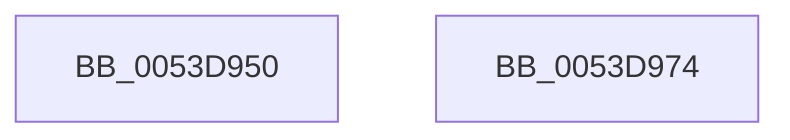

# HalInitializeProcessor

- RVA: `0x0053D950`–`0x0053D975` (길이 `37` bytes)
- VA: `0x000000014053D950`
- 실행 섹션: `.text`
- PDB 이름 있음: `예`; PDB Function 태그: `아니요`
- unwind 정보 RVA: `0x0005C788`
- 디코드: `14`개 명령, `37/37` bytes 표시
- 미해석 바이트: `0` (있으면 어셈블리에 `.byte`로 보존)

> 이 문서는 커널 이미지의 기계어와 PDB 기호를 분석해 생성했습니다. 4번과 5번은 함수 원형과 자료형을 바이너리 사용 방식에서 추정한 C 해석이며 원본 소스 복구 결과는 아닙니다.

## 1. Dependencies

- 직접 호출 지점: **1**; 고유 호출 대상: **1**
- 직접 호출자로 확인된 함수: **1**
- RIP 상대 이미지 참조: **0**

### Outgoing calls
- `0x0053D96A` → [HalpInitSystemHelper](../../pagelk/B5/HalpInitSystemHelper_function_00B5B738.md) (function, `0x00B5B738`)

### Direct callers
- [KiInitializeBootStructures](../../pagelk/B6/KiInitializeBootStructures_function_00B68530.md) at `0x00B688AA`

### Static image references
- 디코드된 RIP-relative 메모리 참조가 없습니다.

## 2. Other-region calls and transfers

- 다른 실행 섹션으로 향하는 call: **1**
  - `0x0053D96A` → [HalpInitSystemHelper](../../pagelk/B5/HalpInitSystemHelper_function_00B5B738.md) (`.text` → `PAGELK`)
- 별도 외부 분기/꼬리 이동을 확인하지 못했습니다.

## 3. Assembly (complete function range)

```asm
0053D950  48 83 EC 28                     sub rsp, 0x28
0053D954  8B C1                           mov eax, ecx
0053D956  4C 8B C2                        mov r8, rdx
0053D959  F7 D8                           neg eax
0053D95B  1B D2                           sbb edx, edx
0053D95D  83 E2 03                        and edx, 3
0053D960  83 C2 03                        add edx, 3
0053D963  F7 D9                           neg ecx
0053D965  1B C9                           sbb ecx, ecx
0053D967  83 E1 04                        and ecx, 4
0053D96A  E8 C9 DD 61 00                  call 0x140b5b738
0053D96F  48 83 C4 28                     add rsp, 0x28
0053D973  C3                              ret
0053D974  CC                              int3
```

## 4. C-style interpretation (structured pseudocode)

```c
__int64 __fastcall HalInitializeProcessor(int a1, __int64 a2)
{
    __int64 result;
    __int64 v_rsp;

    v_rsp = (v_rsp) - (40);
    result = (unsigned int)(-((unsigned int)(a1)));
    a2 = (unsigned int)((a2) & (3));
    a2 = (unsigned int)((a2) + (3));
    a1 = (unsigned int)(-(a1));
    a1 = (unsigned int)((a1) & (4));
    result = HalpInitSystemHelper(a1, a2, a2, a4);
    v_rsp = (v_rsp) + (40);
    return result;
}
```

## 5. (Beta) C Style

```c
int64_t HalInitializeProcessor(int32_t Arg1, int64_t Arg2)
{
    int64_t result;
    int64_t local_rsp;

    local_rsp = (local_rsp) - (40);
    result = (uint32_t)(-((uint32_t)(Arg1)));
    Arg2 = (uint32_t)((Arg2) & (3));
    Arg2 = (uint32_t)((Arg2) + (3));
    Arg1 = (uint32_t)(-(Arg1));
    Arg1 = (uint32_t)((Arg1) & (4));
    result = HalpInitSystemHelper(Arg1, Arg2, Arg2, a4);
    local_rsp = (local_rsp) + (40);
    return result;
}
```

## 6. Execution-region graph

[열기: 2D/3D 그래프와 함수 탐색 컨트롤 패널](../../../control-panel.html?section=text&rva=0x0053D950&view=graph)

- 2D 그래프는 위에서 아래로 흐르고, 3D 그래프는 빈 공간을 드래그해 회전합니다. Shift+드래그는 이동, 휠은 확대·축소, 함수 노드 선택은 대상 보고서 이동입니다.

### Static fallback


