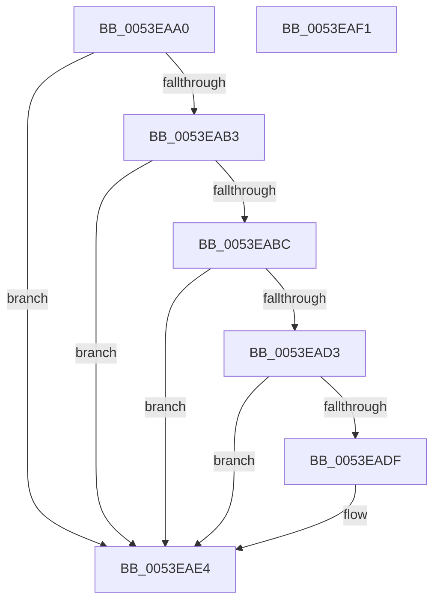

# HalMatchAcpiFADTBootArch

- RVA: `0x0053EAA0`–`0x0053EAF2` (길이 `82` bytes)
- VA: `0x000000014053EAA0`
- 실행 섹션: `.text`
- PDB 이름 있음: `예`; PDB Function 태그: `아니요`
- unwind 정보 RVA: `0x0005CAAC`
- 디코드: `28`개 명령, `82/82` bytes 표시
- 미해석 바이트: `0` (있으면 어셈블리에 `.byte`로 보존)

> 이 문서는 커널 이미지의 기계어와 PDB 기호를 분석해 생성했습니다. 4번과 5번은 함수 원형과 자료형을 바이너리 사용 방식에서 추정한 C 해석이며 원본 소스 복구 결과는 아닙니다.

## 1. Dependencies

- 직접 호출 지점: **1**; 고유 호출 대상: **1**
- 직접 호출자로 확인된 함수: **0**
- RIP 상대 이미지 참조: **0**

### Outgoing calls
- `0x0053EAC9` → [HalpAcpiGetTable](../3F/HalpAcpiGetTable_function_003F6BF8.md) (function, `0x003F6BF8`)

### Direct callers
- 이 함수 시작 RVA로 연결되는 직접 call은 확인되지 않았습니다. 간접 호출은 완전히 역산할 수 없습니다.

### Static image references
- 디코드된 RIP-relative 메모리 참조가 없습니다.

## 2. Other-region calls and transfers

- 다른 실행 섹션으로 향하는 call: **0**
- 별도 외부 분기/꼬리 이동을 확인하지 못했습니다.

## 3. Assembly (complete function range)

```asm
0053EAA0  48 89 5C 24 08                  mov qword ptr [rsp + 8], rbx
0053EAA5  57                              push rdi
0053EAA6  48 83 EC 20                     sub rsp, 0x20
0053EAAA  33 DB                           xor ebx, ebx
0053EAAC  83 7C 24 58 01                  cmp dword ptr [rsp + 0x58], 1
0053EAB1  75 31                           jne 0x14053eae4
0053EAB3  48 8B 7C 24 50                  mov rdi, qword ptr [rsp + 0x50]
0053EAB8  39 1F                           cmp dword ptr [rdi], ebx
0053EABA  74 28                           je 0x14053eae4
0053EABC  45 33 C9                        xor r9d, r9d
0053EABF  45 33 C0                        xor r8d, r8d
0053EAC2  BA 46 41 43 50                  mov edx, 0x50434146
0053EAC7  33 C9                           xor ecx, ecx
0053EAC9  E8 2A 81 EB FF                  call 0x1403f6bf8
0053EACE  48 85 C0                        test rax, rax
0053EAD1  74 11                           je 0x14053eae4
0053EAD3  8B 0F                           mov ecx, dword ptr [rdi]
0053EAD5  0F B7 40 6D                     movzx eax, word ptr [rax + 0x6d]
0053EAD9  23 C1                           and eax, ecx
0053EADB  3B C1                           cmp eax, ecx
0053EADD  75 05                           jne 0x14053eae4
0053EADF  BB 02 00 00 00                  mov ebx, 2
0053EAE4  8B C3                           mov eax, ebx
0053EAE6  48 8B 5C 24 30                  mov rbx, qword ptr [rsp + 0x30]
0053EAEB  48 83 C4 20                     add rsp, 0x20
0053EAEF  5F                              pop rdi
0053EAF0  C3                              ret
0053EAF1  CC                              int3
```

## 4. C-style interpretation (structured pseudocode)

```c
__int64 __fastcall HalMatchAcpiFADTBootArch(int a1, __int64 a2, int a3, int a4, __int64 a5, unsigned int a6)
{
    __int64 result;
    __int64 v_rbx;
    __int64 v_rsp;
    unsigned __int64 v_stack_p8;

    v_stack_p8 = v_rbx;
    v_rsp = (v_rsp) - (32);
    v_rbx = 0;
    if (a6 != 1) goto loc_0053EAE4;
    if ((*(unsigned int *)(a5)) == 0) goto loc_0053EAE4;
    a4 = 0;
    a3 = 0;
    a1 = 0;
    result = HalpAcpiGetTable(a1, (unsigned int)(0x50434146ULL), a3, a4);
    if (result == 0) goto loc_0053EAE4;
    result = (unsigned int)((*(unsigned __int16 *)(result + 109)) & ((unsigned int)((unsigned int)(*(unsigned int *)(a5)))));
    if (((unsigned int)(result)) == ((unsigned int)((unsigned int)(*(unsigned int *)(a5))))) {
        v_rbx = 2;
    }
    v_rsp = (v_rsp) + (32);
    return (unsigned int)((unsigned int)(v_rbx));
}
```

## 5. (Beta) C Style

```c
int64_t HalMatchAcpiFADTBootArch(int32_t Arg1, int64_t Arg2, int32_t Arg3, int32_t Arg4, void *Arg5, uint32_t Arg6)
{
    uint8_t *arg5 = (uint8_t *)Arg5;

    int64_t result;
    int64_t local_rbx;
    int64_t local_rsp;
    uint64_t v_stack_p8;

    v_stack_p8 = local_rbx;
    local_rsp = (local_rsp) - (32);
    local_rbx = 0;
    if (Arg6 != 1) goto loc_0053EAE4;
    if ((*(uint32_t *)(arg5)) == 0) goto loc_0053EAE4;
    Arg4 = 0;
    Arg3 = 0;
    Arg1 = 0;
    result = HalpAcpiGetTable(Arg1, (uint32_t)(0x50434146ULL), Arg3, Arg4);
    if (result == 0) goto loc_0053EAE4;
    result = (uint32_t)((*(uint16_t *)(result + 0x6D)) & ((uint32_t)((uint32_t)(*(uint32_t *)(arg5)))));
    if (((uint32_t)(result)) == ((uint32_t)((uint32_t)(*(uint32_t *)(arg5))))) {
        local_rbx = 2;
    }
    local_rsp = (local_rsp) + (32);
    return (uint32_t)((uint32_t)(local_rbx));
}
```

### 관측된 메모리 오프셋

구조체 형식이 확인되지 않은 접근은 인자 기준의 오프셋으로만 기록했습니다.

| 기준 인자 | 오프셋 표현 | 폭 (bit) | 접근 |
|---|---:|---:|---|
| `Arg5` | `+ 0x0` | `32` | `R` |

## 6. Execution-region graph

[열기: 2D/3D 그래프와 함수 탐색 컨트롤 패널](../../../control-panel.html?section=text&rva=0x0053EAA0&view=graph)

- 2D 그래프는 위에서 아래로 흐르고, 3D 그래프는 빈 공간을 드래그해 회전합니다. Shift+드래그는 이동, 휠은 확대·축소, 함수 노드 선택은 대상 보고서 이동입니다.

### Static fallback


