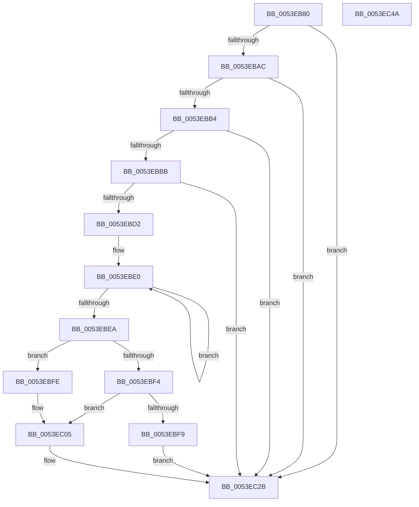

# HalMatchAcpiOemTableId

- RVA: `0x0053EB80`–`0x0053EC4B` (길이 `203` bytes)
- VA: `0x000000014053EB80`
- 실행 섹션: `.text`
- PDB 이름 있음: `예`; PDB Function 태그: `아니요`
- unwind 정보 RVA: `0x000C39A8`
- 디코드: `60`개 명령, `203/203` bytes 표시
- 미해석 바이트: `0` (있으면 어셈블리에 `.byte`로 보존)

> 이 문서는 커널 이미지의 기계어와 PDB 기호를 분석해 생성했습니다. 4번과 5번은 함수 원형과 자료형을 바이너리 사용 방식에서 추정한 C 해석이며 원본 소스 복구 결과는 아닙니다.

## 1. Dependencies

- 직접 호출 지점: **4**; 고유 호출 대상: **4**
- 직접 호출자로 확인된 함수: **0**
- RIP 상대 이미지 참조: **1**

### Outgoing calls
- `0x0053EBC5` → [HalpAcpiGetTable](../3F/HalpAcpiGetTable_function_003F6BF8.md) (function, `0x003F6BF8`)
- `0x0053EC0A` → [memcpy](../6C/memcpy_function_006C6840.md) (function, `0x006C6840`)
- `0x0053EC1B` → [memcmp](../6C/memcmp_function_006C6B10.md) (function, `0x006C6B10`)
- `0x0053EC35` → [_security_check_cookie](../6A/_security_check_cookie_function_006AC640.md) (function, `0x006AC640`)

### Direct callers
- 이 함수 시작 RVA로 연결되는 직접 call은 확인되지 않았습니다. 간접 호출은 완전히 역산할 수 없습니다.

### Static image references
- `0x0053EB8F` → RVA `0x00E0A740` (`.data`; read)

## 2. Other-region calls and transfers

- 다른 실행 섹션으로 향하는 call: **0**
- 별도 외부 분기/꼬리 이동을 확인하지 못했습니다.

## 3. Assembly (complete function range)

```asm
0053EB80  48 89 5C 24 08                  mov qword ptr [rsp + 8], rbx
0053EB85  48 89 74 24 10                  mov qword ptr [rsp + 0x10], rsi
0053EB8A  57                              push rdi
0053EB8B  48 83 EC 30                     sub rsp, 0x30
0053EB8F  48 8B 05 AA BB 8C 00            mov rax, qword ptr [rip + 0x8cbbaa]
0053EB96  48 33 C4                        xor rax, rsp
0053EB99  48 89 44 24 28                  mov qword ptr [rsp + 0x28], rax
0053EB9E  49 8B F8                        mov rdi, r8
0053EBA1  BB 01 00 00 00                  mov ebx, 1
0053EBA6  41 83 F9 02                     cmp r9d, 2
0053EBAA  75 7F                           jne 0x14053ec2b
0053EBAC  49 8B 10                        mov rdx, qword ptr [r8]
0053EBAF  48 85 D2                        test rdx, rdx
0053EBB2  74 77                           je 0x14053ec2b
0053EBB4  49 83 78 08 00                  cmp qword ptr [r8 + 8], 0
0053EBB9  74 70                           je 0x14053ec2b
0053EBBB  8B 12                           mov edx, dword ptr [rdx]
0053EBBD  45 33 C9                        xor r9d, r9d
0053EBC0  45 33 C0                        xor r8d, r8d
0053EBC3  33 C9                           xor ecx, ecx
0053EBC5  E8 2E 80 EB FF                  call 0x1403f6bf8
0053EBCA  48 8B F0                        mov rsi, rax
0053EBCD  48 85 C0                        test rax, rax
0053EBD0  74 59                           je 0x14053ec2b
0053EBD2  48 83 64 24 20 00               and qword ptr [rsp + 0x20], 0
0053EBD8  48 8B 57 08                     mov rdx, qword ptr [rdi + 8]
0053EBDC  49 83 C8 FF                     or r8, 0xffffffffffffffff
0053EBE0  49 FF C0                        inc r8
0053EBE3  42 80 3C 02 00                  cmp byte ptr [rdx + r8], 0
0053EBE8  75 F6                           jne 0x14053ebe0
0053EBEA  BF 08 00 00 00                  mov edi, 8
0053EBEF  4C 3B C3                        cmp r8, rbx
0053EBF2  75 0A                           jne 0x14053ebfe
0053EBF4  80 3A 2A                        cmp byte ptr [rdx], 0x2a
0053EBF7  75 0C                           jne 0x14053ec05
0053EBF9  8D 5F FA                        lea ebx, [rdi - 6]
0053EBFC  EB 2D                           jmp 0x14053ec2b
0053EBFE  4C 3B C7                        cmp r8, rdi
0053EC01  4C 0F 47 C7                     cmova r8, rdi
0053EC05  48 8D 4C 24 20                  lea rcx, [rsp + 0x20]
0053EC0A  E8 31 7C 18 00                  call 0x1406c6840
0053EC0F  48 8D 56 10                     lea rdx, [rsi + 0x10]
0053EC13  4C 8B C7                        mov r8, rdi
0053EC16  48 8D 4C 24 20                  lea rcx, [rsp + 0x20]
0053EC1B  E8 F0 7E 18 00                  call 0x1406c6b10
0053EC20  F7 D8                           neg eax
0053EC22  1B C9                           sbb ecx, ecx
0053EC24  F7 D1                           not ecx
0053EC26  83 E1 02                        and ecx, 2
0053EC29  8B D9                           mov ebx, ecx
0053EC2B  8B C3                           mov eax, ebx
0053EC2D  48 8B 4C 24 28                  mov rcx, qword ptr [rsp + 0x28]
0053EC32  48 33 CC                        xor rcx, rsp
0053EC35  E8 06 DA 16 00                  call 0x1406ac640
0053EC3A  48 8B 5C 24 40                  mov rbx, qword ptr [rsp + 0x40]
0053EC3F  48 8B 74 24 48                  mov rsi, qword ptr [rsp + 0x48]
0053EC44  48 83 C4 30                     add rsp, 0x30
0053EC48  5F                              pop rdi
0053EC49  C3                              ret
0053EC4A  CC                              int3
```

## 4. C-style interpretation (structured pseudocode)

```c
__int64 __fastcall HalMatchAcpiOemTableId(int a1, __int64 a2, __int64 a3, int a4)
{
    __int64 result;
    __int64 v_rsp;
    unsigned __int64 v_stack_m10;
    unsigned __int64 v_stack_m18;
    unsigned __int64 v_stack_p10;
    unsigned __int64 v_stack_p8;

    v_stack_p8 = v_rbx;
    v_stack_p10 = v_rsi;
    v_rsp = (v_rsp) - (48);
    result = (*(unsigned __int64 *)(v_rip + 9223082)) ^ (v_rsp);
    v_stack_m10 = result;
    if (a4 != 2) goto loc_0053EC2B;
    if (*(unsigned __int64 *)(a3) == 0) goto loc_0053EC2B;
    if ((*(unsigned __int64 *)(a3 + 8)) == 0) goto loc_0053EC2B;
    a4 = 0;
    a3 = 0;
    a1 = 0;
    result = HalpAcpiGetTable(a1, (unsigned int)(*(unsigned int *)(*(unsigned __int64 *)(a3))), a3, a4);
    if (result == 0) goto loc_0053EC2B;
    a3 = (a3) | (-1);
loc_0053EBE0:
    a3 = (a3) + 1;
    if ((*(unsigned __int8 *)(*(unsigned __int64 *)(a3 + 8) + a3 * 1)) != 0) goto loc_0053EBE0;
    if (a3 != 1) goto loc_0053EBFE;
    if ((*(unsigned __int8 *)(*(unsigned __int64 *)(a3 + 8))) != 42) goto loc_0053EC05;
    goto loc_0053EC2B;
loc_0053EBFE:
    if (a3 > 8) { a3 = 8; }
loc_0053EC05:
    result = memcpy(v_stack_m18, *(unsigned __int64 *)(a3 + 8), a3, a4);
    result = memcmp(v_stack_m18, result + 16, 8, a4);
    result = (unsigned int)(-(result));
    a1 = (unsigned int)(~(v_stack_m18));
    a1 = (unsigned int)((a1) & (2));
loc_0053EC2B:
    a1 = (v_stack_m10) ^ (v_rsp);
    result = _security_check_cookie(a1, result + 16, 8, a4);
    v_rsp = (v_rsp) + (48);
    return result;
}
```

## 5. (Beta) C Style

```c
int64_t HalMatchAcpiOemTableId(int32_t Arg1, int64_t Arg2, void *Arg3, int32_t Arg4)
{
    uint8_t *arg3 = (uint8_t *)Arg3;

    int64_t result;
    int64_t local_rsp;
    uint64_t v_stack_m10;
    uint64_t v_stack_m18;
    uint64_t v_stack_p10;
    uint64_t v_stack_p8;

    v_stack_p8 = local_rbx;
    v_stack_p10 = local_rsi;
    local_rsp = (local_rsp) - (48);
    result = (*(uint64_t *)(v_rip + 0x8CBBAA)) ^ (local_rsp);
    v_stack_m10 = result;
    if (Arg4 != 2) goto loc_0053EC2B;
    if (*(uint64_t *)(arg3) == 0) goto loc_0053EC2B;
    if ((*(uint64_t *)(arg3 + 0x8)) == 0) goto loc_0053EC2B;
    Arg4 = 0;
    Arg3 = 0;
    Arg1 = 0;
    result = HalpAcpiGetTable(Arg1, (uint32_t)(*(uint32_t *)(*(uint64_t *)(arg3))), Arg3, Arg4);
    if (result == 0) goto loc_0053EC2B;
    Arg3 = (Arg3) | (-1);
loc_0053EBE0:
    Arg3 = (Arg3) + 1;
    if ((*(uint8_t *)(*(uint64_t *)(arg3 + 0x8) + arg3 * 1)) != 0) goto loc_0053EBE0;
    if (Arg3 != 1) goto loc_0053EBFE;
    if ((*(uint8_t *)(*(uint64_t *)(arg3 + 0x8))) != 42) goto loc_0053EC05;
    goto loc_0053EC2B;
loc_0053EBFE:
    if (Arg3 > 8) { Arg3 = 8; }
loc_0053EC05:
    result = memcpy(v_stack_m18, *(uint64_t *)(arg3 + 0x8), Arg3, Arg4);
    result = memcmp(v_stack_m18, result + 16, 8, Arg4);
    result = (uint32_t)(-(result));
    Arg1 = (uint32_t)(~(v_stack_m18));
    Arg1 = (uint32_t)((Arg1) & (2));
loc_0053EC2B:
    Arg1 = (v_stack_m10) ^ (local_rsp);
    result = _security_check_cookie(Arg1, result + 16, 8, Arg4);
    local_rsp = (local_rsp) + (48);
    return result;
}
```

### 관측된 메모리 오프셋

구조체 형식이 확인되지 않은 접근은 인자 기준의 오프셋으로만 기록했습니다.

| 기준 인자 | 오프셋 표현 | 폭 (bit) | 접근 |
|---|---:|---:|---|
| `Arg3` | `+ 0x0` | `64` | `R` |
| `Arg3` | `+ 0x8` | `64` | `R` |

## 6. Execution-region graph

[열기: 2D/3D 그래프와 함수 탐색 컨트롤 패널](../../../control-panel.html?section=text&rva=0x0053EB80&view=graph)

- 2D 그래프는 위에서 아래로 흐르고, 3D 그래프는 빈 공간을 드래그해 회전합니다. Shift+드래그는 이동, 휠은 확대·축소, 함수 노드 선택은 대상 보고서 이동입니다.

### Static fallback


