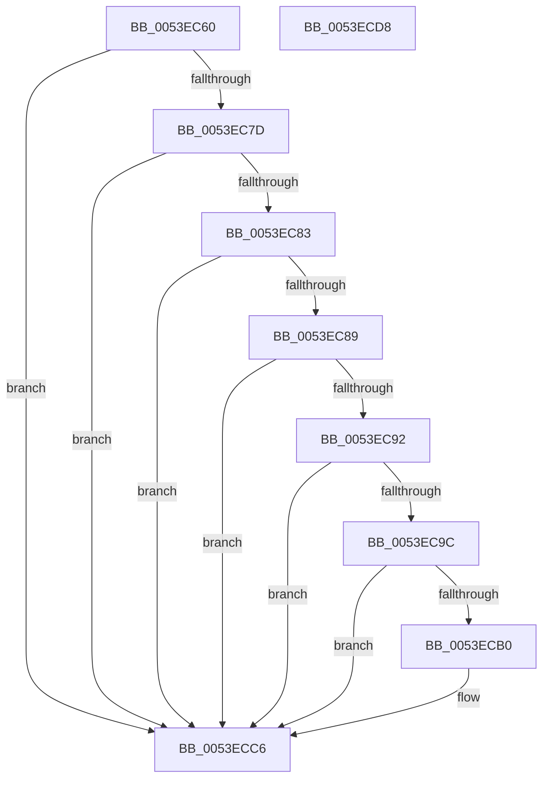

# HalMatchAcpiRevision

- RVA: `0x0053EC60`–`0x0053ECD9` (길이 `121` bytes)
- VA: `0x000000014053EC60`
- 실행 섹션: `.text`
- PDB 이름 있음: `예`; PDB Function 태그: `아니요`
- unwind 정보 RVA: `0x00060BC4`
- 디코드: `39`개 명령, `121/121` bytes 표시
- 미해석 바이트: `0` (있으면 어셈블리에 `.byte`로 보존)

> 이 문서는 커널 이미지의 기계어와 PDB 기호를 분석해 생성했습니다. 4번과 5번은 함수 원형과 자료형을 바이너리 사용 방식에서 추정한 C 해석이며 원본 소스 복구 결과는 아닙니다.

## 1. Dependencies

- 직접 호출 지점: **2**; 고유 호출 대상: **2**
- 직접 호출자로 확인된 함수: **0**
- RIP 상대 이미지 참조: **0**

### Outgoing calls
- `0x0053ECA6` → [HalpAcpiGetTable](../3F/HalpAcpiGetTable_function_003F6BF8.md) (function, `0x003F6BF8`)
- `0x0053ECBA` → [HalAcpiEmCheckOperator](HalAcpiEmCheckOperator_function_0053E7D0.md) (function, `0x0053E7D0`)

### Direct callers
- 이 함수 시작 RVA로 연결되는 직접 call은 확인되지 않았습니다. 간접 호출은 완전히 역산할 수 없습니다.

### Static image references
- 디코드된 RIP-relative 메모리 참조가 없습니다.

## 2. Other-region calls and transfers

- 다른 실행 섹션으로 향하는 call: **0**
- 별도 외부 분기/꼬리 이동을 확인하지 못했습니다.

## 3. Assembly (complete function range)

```asm
0053EC60  48 89 5C 24 08                  mov qword ptr [rsp + 8], rbx
0053EC65  48 89 74 24 10                  mov qword ptr [rsp + 0x10], rsi
0053EC6A  57                              push rdi
0053EC6B  48 83 EC 20                     sub rsp, 0x20
0053EC6F  49 8B F8                        mov rdi, r8
0053EC72  BB 01 00 00 00                  mov ebx, 1
0053EC77  41 83 F9 02                     cmp r9d, 2
0053EC7B  75 49                           jne 0x14053ecc6
0053EC7D  39 5C 24 58                     cmp dword ptr [rsp + 0x58], ebx
0053EC81  75 43                           jne 0x14053ecc6
0053EC83  49 83 38 00                     cmp qword ptr [r8], 0
0053EC87  74 3D                           je 0x14053ecc6
0053EC89  49 8B 50 08                     mov rdx, qword ptr [r8 + 8]
0053EC8D  48 85 D2                        test rdx, rdx
0053EC90  74 34                           je 0x14053ecc6
0053EC92  48 8B 74 24 50                  mov rsi, qword ptr [rsp + 0x50]
0053EC97  48 85 F6                        test rsi, rsi
0053EC9A  74 2A                           je 0x14053ecc6
0053EC9C  8B 12                           mov edx, dword ptr [rdx]
0053EC9E  45 33 C9                        xor r9d, r9d
0053ECA1  45 33 C0                        xor r8d, r8d
0053ECA4  33 C9                           xor ecx, ecx
0053ECA6  E8 4D 7F EB FF                  call 0x1403f6bf8
0053ECAB  48 85 C0                        test rax, rax
0053ECAE  74 16                           je 0x14053ecc6
0053ECB0  0F B6 50 08                     movzx edx, byte ptr [rax + 8]
0053ECB4  48 8B 0F                        mov rcx, qword ptr [rdi]
0053ECB7  44 8B 06                        mov r8d, dword ptr [rsi]
0053ECBA  E8 11 FB FF FF                  call 0x14053e7d0
0053ECBF  F7 D8                           neg eax
0053ECC1  1B DB                           sbb ebx, ebx
0053ECC3  83 E3 02                        and ebx, 2
0053ECC6  48 8B 74 24 38                  mov rsi, qword ptr [rsp + 0x38]
0053ECCB  8B C3                           mov eax, ebx
0053ECCD  48 8B 5C 24 30                  mov rbx, qword ptr [rsp + 0x30]
0053ECD2  48 83 C4 20                     add rsp, 0x20
0053ECD6  5F                              pop rdi
0053ECD7  C3                              ret
0053ECD8  CC                              int3
```

## 4. C-style interpretation (structured pseudocode)

```c
__int64 __fastcall HalMatchAcpiRevision(int a1, __int64 a2, __int64 a3, int a4, __int64 a5, unsigned int a6)
{
    __int64 result;
    __int64 v_rbx;
    __int64 v_rsp;
    unsigned __int64 v_stack_p10;
    unsigned __int64 v_stack_p8;

    v_stack_p8 = v_rbx;
    v_stack_p10 = v_rsi;
    v_rsp = (v_rsp) - (32);
    if (a4 != 2) goto loc_0053ECC6;
    if (a6 != 1) goto loc_0053ECC6;
    if ((*(unsigned __int64 *)(a3)) == 0) goto loc_0053ECC6;
    if (*(unsigned __int64 *)(a3 + 8) == 0) goto loc_0053ECC6;
    if (a5 == 0) goto loc_0053ECC6;
    a4 = 0;
    a3 = 0;
    a1 = 0;
    result = HalpAcpiGetTable(a1, (unsigned int)(*(unsigned int *)(*(unsigned __int64 *)(a3 + 8))), a3, a4);
    v_rbx = 1;
    if (result != 0) {
        a2 = *(unsigned __int8 *)(result + 8);
        a1 = *(unsigned __int64 *)(a3);
        a3 = *(unsigned int *)(a5);
        result = HalAcpiEmCheckOperator(a1, a2, a3, a4);
        result = (unsigned int)(-(result));
        v_rbx = (unsigned int)((1) & (2));
    }
    v_rsp = (v_rsp) + (32);
    return (unsigned int)((unsigned int)(v_rbx));
}
```

## 5. (Beta) C Style

```c
int64_t HalMatchAcpiRevision(int32_t Arg1, int64_t Arg2, void *Arg3, int32_t Arg4, int64_t Arg5, uint32_t Arg6)
{
    uint8_t *arg3 = (uint8_t *)Arg3;

    int64_t result;
    int64_t local_rbx;
    int64_t local_rsp;
    uint64_t v_stack_p10;
    uint64_t v_stack_p8;

    v_stack_p8 = local_rbx;
    v_stack_p10 = local_rsi;
    local_rsp = (local_rsp) - (32);
    if (Arg4 != 2) goto loc_0053ECC6;
    if (Arg6 != 1) goto loc_0053ECC6;
    if ((*(uint64_t *)(arg3)) == 0) goto loc_0053ECC6;
    if (*(uint64_t *)(arg3 + 0x8) == 0) goto loc_0053ECC6;
    if (Arg5 == 0) goto loc_0053ECC6;
    Arg4 = 0;
    Arg3 = 0;
    Arg1 = 0;
    result = HalpAcpiGetTable(Arg1, (uint32_t)(*(uint32_t *)(*(uint64_t *)(arg3 + 0x8))), Arg3, Arg4);
    local_rbx = 1;
    if (result != 0) {
        Arg2 = *(uint8_t *)(result + 0x8);
        Arg1 = *(uint64_t *)(arg3);
        Arg3 = *(uint32_t *)(Arg5);
        result = HalAcpiEmCheckOperator(Arg1, Arg2, Arg3, Arg4);
        result = (uint32_t)(-(result));
        local_rbx = (uint32_t)((1) & (2));
    }
    local_rsp = (local_rsp) + (32);
    return (uint32_t)((uint32_t)(local_rbx));
}
```

### 관측된 메모리 오프셋

구조체 형식이 확인되지 않은 접근은 인자 기준의 오프셋으로만 기록했습니다.

| 기준 인자 | 오프셋 표현 | 폭 (bit) | 접근 |
|---|---:|---:|---|
| `Arg3` | `+ 0x0` | `64` | `R` |
| `Arg3` | `+ 0x8` | `64` | `R` |

## 6. Execution-region graph

[열기: 2D/3D 그래프와 함수 탐색 컨트롤 패널](../../../control-panel.html?section=text&rva=0x0053EC60&view=graph)

- 2D 그래프는 위에서 아래로 흐르고, 3D 그래프는 빈 공간을 드래그해 회전합니다. Shift+드래그는 이동, 휠은 확대·축소, 함수 노드 선택은 대상 보고서 이동입니다.

### Static fallback


