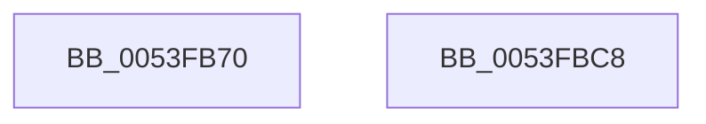

# HalReadDmaCounterV2

- RVA: `0x0053FB70`–`0x0053FBC9` (길이 `89` bytes)
- VA: `0x000000014053FB70`
- 실행 섹션: `.text`
- PDB 이름 있음: `예`; PDB Function 태그: `아니요`
- unwind 정보 RVA: `0x000697A4`
- 디코드: `23`개 명령, `89/89` bytes 표시
- 미해석 바이트: `0` (있으면 어셈블리에 `.byte`로 보존)

> 이 문서는 커널 이미지의 기계어와 PDB 기호를 분석해 생성했습니다. 4번과 5번은 함수 원형과 자료형을 바이너리 사용 방식에서 추정한 C 해석이며 원본 소스 복구 결과는 아닙니다.

## 1. Dependencies

- 직접 호출 지점: **3**; 고유 호출 대상: **3**
- 직접 호출자로 확인된 함수: **0**
- RIP 상대 이미지 참조: **1**

### Outgoing calls
- `0x0053FB98` → [KeAcquireInStackQueuedSpinLock](../27/KeAcquireInStackQueuedSpinLock_function_002757A0.md) (function, `0x002757A0`)
- `0x0053FBAF` → [guard_dispatch_icall](../6B/guard_dispatch_icall_function_006BAAD0.md) (function, `0x006BAAD0`)
- `0x0053FBBB` → [KeReleaseInStackQueuedSpinLock](../34/KeReleaseInStackQueuedSpinLock_function_00342CE0.md) (function, `0x00342CE0`)

### Direct callers
- 이 함수 시작 RVA로 연결되는 직접 call은 확인되지 않았습니다. 간접 호출은 완전히 역산할 수 없습니다.

### Static image references
- `0x0053FB9D` → RVA `0x00FC3E58` (`.data`; read)

## 2. Other-region calls and transfers

- 다른 실행 섹션으로 향하는 call: **0**
- 별도 외부 분기/꼬리 이동을 확인하지 못했습니다.

## 3. Assembly (complete function range)

```asm
0053FB70  40 53                           push rbx
0053FB72  48 83 EC 40                     sub rsp, 0x40
0053FB76  48 8B D9                        mov rbx, rcx
0053FB79  48 8D 54 24 20                  lea rdx, [rsp + 0x20]
0053FB7E  48 8B 89 A0 00 00 00            mov rcx, qword ptr [rcx + 0xa0]
0053FB85  0F 57 C0                        xorps xmm0, xmm0
0053FB88  33 C0                           xor eax, eax
0053FB8A  48 83 E9 80                     sub rcx, -0x80
0053FB8E  0F 11 44 24 20                  movups xmmword ptr [rsp + 0x20], xmm0
0053FB93  48 89 44 24 30                  mov qword ptr [rsp + 0x30], rax
0053FB98  E8 03 5C D3 FF                  call 0x1402757a0
0053FB9D  48 8B 05 B4 42 A8 00            mov rax, qword ptr [rip + 0xa842b4]
0053FBA4  48 8B 8B B0 01 00 00            mov rcx, qword ptr [rbx + 0x1b0]
0053FBAB  48 8B 40 38                     mov rax, qword ptr [rax + 0x38]
0053FBAF  E8 1C AF 17 00                  call 0x1406baad0
0053FBB4  48 8D 4C 24 20                  lea rcx, [rsp + 0x20]
0053FBB9  8B D8                           mov ebx, eax
0053FBBB  E8 20 31 E0 FF                  call 0x140342ce0
0053FBC0  8B C3                           mov eax, ebx
0053FBC2  48 83 C4 40                     add rsp, 0x40
0053FBC6  5B                              pop rbx
0053FBC7  C3                              ret
0053FBC8  CC                              int3
```

## 4. C-style interpretation (structured pseudocode)

```c
__int64 __fastcall HalReadDmaCounterV2(__int64 a1)
{
    __int64 result;
    __int64 v_rsp;
    unsigned __int64 v_stack_m18;
    unsigned __int64 v_stack_m28;

    v_rsp = (v_rsp) - (64);
    result = 0;
    a1 = (*(unsigned __int64 *)(a1 + 160)) - (-128);
    v_stack_m28 = v_xmm0;
    v_stack_m18 = 0;
    result = KeAcquireInStackQueuedSpinLock(a1, v_stack_m28, a3, a4);
    result = guard_dispatch_icall(*(unsigned __int64 *)(a1 + 432), v_stack_m28, a3, a4);
    result = KeReleaseInStackQueuedSpinLock(v_stack_m28, v_stack_m28, a3, a4);
    v_rsp = (v_rsp) + (64);
    return (unsigned int)((unsigned int)((unsigned int)((unsigned int)(result))));
}
```

## 5. (Beta) C Style

```c
int64_t HalReadDmaCounterV2(void *Arg1)
{
    uint8_t *arg1 = (uint8_t *)Arg1;

    int64_t result;
    int64_t local_rsp;
    uint64_t v_stack_m18;
    uint64_t v_stack_m28;

    local_rsp = (local_rsp) - (64);
    result = 0;
    Arg1 = (*(uint64_t *)(arg1 + 0xA0)) - (-128);
    v_stack_m28 = v_xmm0;
    v_stack_m18 = 0;
    result = KeAcquireInStackQueuedSpinLock(Arg1, v_stack_m28, a3, a4);
    result = guard_dispatch_icall(*(uint64_t *)(arg1 + 0x1B0), v_stack_m28, a3, a4);
    result = KeReleaseInStackQueuedSpinLock(v_stack_m28, v_stack_m28, a3, a4);
    local_rsp = (local_rsp) + (64);
    return (uint32_t)((uint32_t)((uint32_t)((uint32_t)(result))));
}
```

### 관측된 메모리 오프셋

구조체 형식이 확인되지 않은 접근은 인자 기준의 오프셋으로만 기록했습니다.

| 기준 인자 | 오프셋 표현 | 폭 (bit) | 접근 |
|---|---:|---:|---|
| `Arg1` | `+ 0xA0` | `64` | `R` |
| `Arg1` | `+ 0x1B0` | `64` | `R` |

## 6. Execution-region graph

[열기: 2D/3D 그래프와 함수 탐색 컨트롤 패널](../../../control-panel.html?section=text&rva=0x0053FB70&view=graph)

- 2D 그래프는 위에서 아래로 흐르고, 3D 그래프는 빈 공간을 드래그해 회전합니다. Shift+드래그는 이동, 휠은 확대·축소, 함수 노드 선택은 대상 보고서 이동입니다.

### Static fallback


