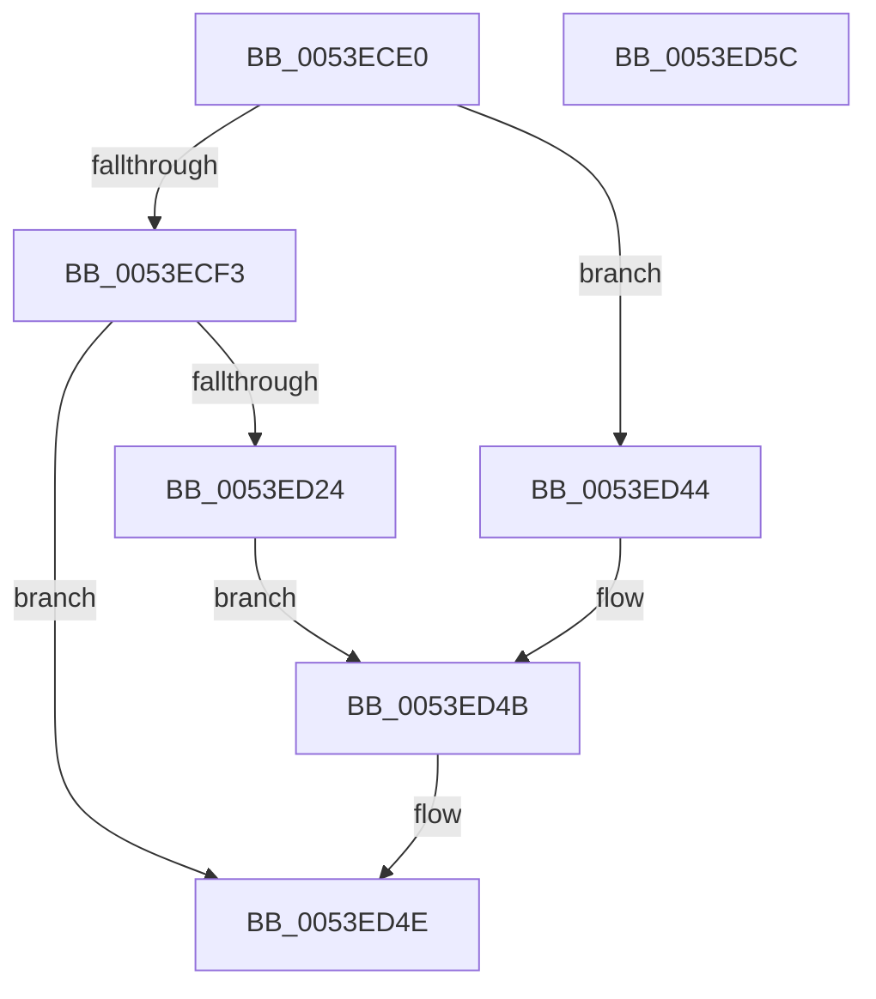

# HalpAcpiAllocateMemory

- RVA: `0x0053ECE0`–`0x0053ED5D` (길이 `125` bytes)
- VA: `0x000000014053ECE0`
- 실행 섹션: `.text`
- PDB 이름 있음: `예`; PDB Function 태그: `아니요`
- unwind 정보 RVA: `0x000BDD0C`
- 디코드: `37`개 명령, `125/125` bytes 표시
- 미해석 바이트: `0` (있으면 어셈블리에 `.byte`로 보존)

> 이 문서는 커널 이미지의 기계어와 PDB 기호를 분석해 생성했습니다. 4번과 5번은 함수 원형과 자료형을 바이너리 사용 방식에서 추정한 C 해석이며 원본 소스 복구 결과는 아닙니다.

## 1. Dependencies

- 직접 호출 지점: **3**; 고유 호출 대상: **3**
- 직접 호출자로 확인된 함수: **4**
- RIP 상대 이미지 참조: **0**

### Outgoing calls
- `0x0053ED1A` → [HalpAllocPhysicalMemoryEx](../../init/C7/HalpAllocPhysicalMemoryEx_function_00C771DC.md) (function, `0x00C771DC`)
- `0x0053ED3D` → [HalpMap](../3F/HalpMap_function_003F88F4.md) (function, `0x003F88F4`)
- `0x0053ED46` → [HalpMmAllocCtxAlloc](../3E/HalpMmAllocCtxAlloc_function_003E10B8.md) (function, `0x003E10B8`)

### Direct callers
- [HalpAcpiCopyBiosTable](HalpAcpiCopyBiosTable_function_0053EDD0.md) at `0x0053EDF2`
- [HalpAcpiGetAllTablesWork](HalpAcpiGetAllTablesWork_function_0053EEE8.md) at `0x0053F06B`
- [HalpAcpiFindRsdp](../../init/C1/HalpAcpiFindRsdp_function_00C1DF48.md) at `0x00C1DFF9`
- [HalpAcpiTableCacheInit](../../init/C7/HalpAcpiTableCacheInit_function_00C77650.md) at `0x00C77727`

### Static image references
- 디코드된 RIP-relative 메모리 참조가 없습니다.

## 2. Other-region calls and transfers

- 다른 실행 섹션으로 향하는 call: **1**
  - `0x0053ED1A` → [HalpAllocPhysicalMemoryEx](../../init/C7/HalpAllocPhysicalMemoryEx_function_00C771DC.md) (`.text` → `INIT`)
- 별도 외부 분기/꼬리 이동을 확인하지 못했습니다.

## 3. Assembly (complete function range)

```asm
0053ECE0  48 8B C4                        mov rax, rsp
0053ECE3  48 89 58 10                     mov qword ptr [rax + 0x10], rbx
0053ECE7  57                              push rdi
0053ECE8  48 83 EC 30                     sub rsp, 0x30
0053ECEC  33 DB                           xor ebx, ebx
0053ECEE  48 85 C9                        test rcx, rcx
0053ECF1  74 51                           je 0x14053ed44
0053ECF3  F7 C2 FF 0F 00 00               test edx, 0xfff
0053ECF9  48 C7 40 08 00 00 00 01         mov qword ptr [rax + 8], 0x1000000
0053ED01  8B FB                           mov edi, ebx
0053ED03  48 89 58 E8                     mov qword ptr [rax - 0x18], rbx
0053ED07  40 0F 95 C7                     setne dil
0053ED0B  C1 EA 0C                        shr edx, 0xc
0053ED0E  03 FA                           add edi, edx
0053ED10  45 33 C9                        xor r9d, r9d
0053ED13  44 8B C7                        mov r8d, edi
0053ED16  48 8D 50 08                     lea rdx, [rax + 8]
0053ED1A  E8 BD 84 73 00                  call 0x140c771dc
0053ED1F  48 85 C0                        test rax, rax
0053ED22  74 2A                           je 0x14053ed4e
0053ED24  48 89 5C 24 28                  mov qword ptr [rsp + 0x28], rbx
0053ED29  44 8D 43 01                     lea r8d, [rbx + 1]
0053ED2D  45 33 C9                        xor r9d, r9d
0053ED30  C7 44 24 20 04 00 00 00         mov dword ptr [rsp + 0x20], 4
0053ED38  8B D7                           mov edx, edi
0053ED3A  48 8B C8                        mov rcx, rax
0053ED3D  E8 B2 9B EB FF                  call 0x1403f88f4
0053ED42  EB 07                           jmp 0x14053ed4b
0053ED44  8B D2                           mov edx, edx
0053ED46  E8 6D 23 EA FF                  call 0x1403e10b8
0053ED4B  48 8B D8                        mov rbx, rax
0053ED4E  48 8B C3                        mov rax, rbx
0053ED51  48 8B 5C 24 48                  mov rbx, qword ptr [rsp + 0x48]
0053ED56  48 83 C4 30                     add rsp, 0x30
0053ED5A  5F                              pop rdi
0053ED5B  C3                              ret
0053ED5C  CC                              int3
```

## 4. C-style interpretation (structured pseudocode)

```c
__int64 __fastcall HalpAcpiAllocateMemory(__int64 a1, int a2, __int64 a3, int a4)
{
    __int64 result;
    __int64 v_rbx;
    __int64 v_rdi;
    __int64 v_rsp;
    unsigned __int64 v_stack_m10;
    unsigned int v_stack_m18;
    unsigned __int64 v_stack_p10;

    *(unsigned __int64 *)(v_rsp + 16) = v_rbx;
    v_rsp = (v_rsp) - (48);
    v_rbx = 0;
    if (a1 == 0) goto loc_0053ED44;
    *(unsigned __int64 *)(v_rsp + 8) = 0x1000000ULL;
    *(unsigned __int64 *)(v_rsp - 24) = 0;
    v_rdi = (((a2) & (0xFFFULL)) != 0) ? 1 : 0;
    a2 = (unsigned int)((a2) >> (12));
    v_rdi = (unsigned int)((v_rdi) + (a2));
    a4 = 0;
    result = HalpAllocPhysicalMemoryEx(a1, v_rsp + 8, (unsigned int)((unsigned int)(v_rdi)), a4);
    if (result == 0) goto loc_0053ED4E;
    v_stack_m10 = 0;
    a4 = 0;
    v_stack_m18 = 4;
    result = HalpMap(result, (unsigned int)((unsigned int)(v_rdi)), v_rbx + 1, a4);
    goto loc_0053ED4B;
loc_0053ED44:
    result = HalpMmAllocCtxAlloc(result, (unsigned int)((unsigned int)((unsigned int)((unsigned int)(v_rdi)))), v_rbx + 1, a4);
loc_0053ED4B:
loc_0053ED4E:
    v_rsp = (v_rsp) + (48);
    return result;
}
```

## 5. (Beta) C Style

```c
int64_t HalpAcpiAllocateMemory(int64_t Arg1, int32_t Arg2, int64_t Arg3, int32_t Arg4)
{
    int64_t result;
    int64_t local_rbx;
    int64_t local_rdi;
    int64_t local_rsp;
    uint64_t v_stack_m10;
    uint32_t v_stack_m18;
    uint64_t v_stack_p10;

    *(uint64_t *)(local_rsp + 0x10) = local_rbx;
    local_rsp = (local_rsp) - (48);
    local_rbx = 0;
    if (Arg1 == 0) goto loc_0053ED44;
    *(uint64_t *)(local_rsp + 0x8) = 0x1000000ULL;
    *(uint64_t *)(local_rsp - 0x18) = 0;
    local_rdi = (((Arg2) & (0xFFFULL)) != 0) ? 1 : 0;
    Arg2 = (uint32_t)((Arg2) >> (12));
    local_rdi = (uint32_t)((local_rdi) + (Arg2));
    Arg4 = 0;
    result = HalpAllocPhysicalMemoryEx(Arg1, local_rsp + 8, (uint32_t)((uint32_t)(local_rdi)), Arg4);
    if (result == 0) goto loc_0053ED4E;
    v_stack_m10 = 0;
    Arg4 = 0;
    v_stack_m18 = 4;
    result = HalpMap(result, (uint32_t)((uint32_t)(local_rdi)), local_rbx + 1, Arg4);
    goto loc_0053ED4B;
loc_0053ED44:
    result = HalpMmAllocCtxAlloc(result, (uint32_t)((uint32_t)((uint32_t)((uint32_t)(local_rdi)))), local_rbx + 1, Arg4);
loc_0053ED4B:
loc_0053ED4E:
    local_rsp = (local_rsp) + (48);
    return result;
}
```

## 6. Execution-region graph

[열기: 2D/3D 그래프와 함수 탐색 컨트롤 패널](../../../control-panel.html?section=text&rva=0x0053ECE0&view=graph)

- 2D 그래프는 위에서 아래로 흐르고, 3D 그래프는 빈 공간을 드래그해 회전합니다. Shift+드래그는 이동, 휠은 확대·축소, 함수 노드 선택은 대상 보고서 이동입니다.

### Static fallback


