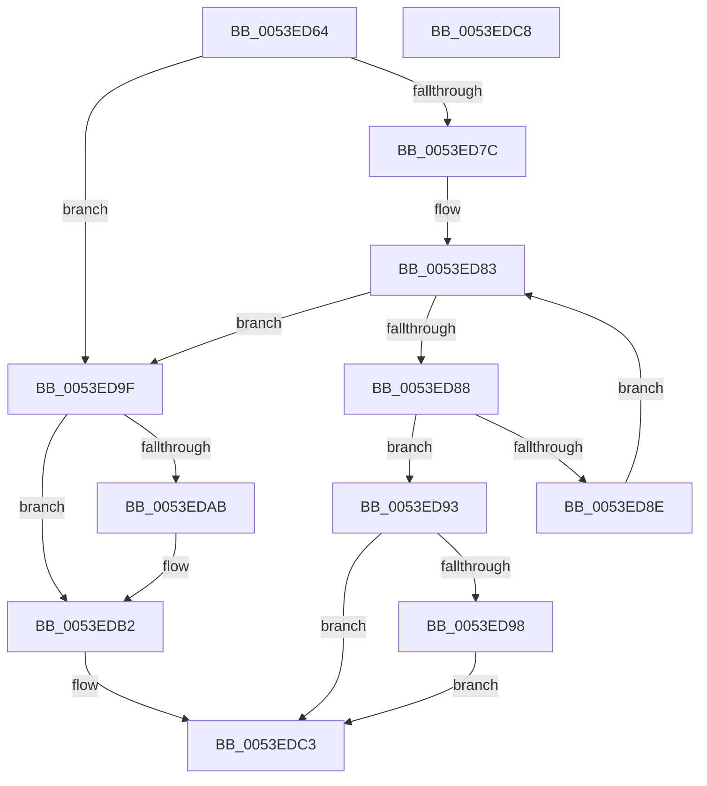

# HalpAcpiCacheTable

- RVA: `0x0053ED64`–`0x0053EDC9` (길이 `101` bytes)
- VA: `0x000000014053ED64`
- 실행 섹션: `.text`
- PDB 이름 있음: `예`; PDB Function 태그: `아니요`
- unwind 정보 RVA: `0x0005C788`
- 디코드: `29`개 명령, `101/101` bytes 표시
- 미해석 바이트: `0` (있으면 어셈블리에 `.byte`로 보존)

> 이 문서는 커널 이미지의 기계어와 PDB 기호를 분석해 생성했습니다. 4번과 5번은 함수 원형과 자료형을 바이너리 사용 방식에서 추정한 C 해석이며 원본 소스 복구 결과는 아닙니다.

## 1. Dependencies

- 직접 호출 지점: **1**; 고유 호출 대상: **1**
- 직접 호출자로 확인된 함수: **4**
- RIP 상대 이미지 참조: **3**

### Outgoing calls
- `0x0053ED98` → [HalpMmAllocCtxFree](../3E/HalpMmAllocCtxFree_function_003E1904.md) (function, `0x003E1904`)

### Direct callers
- [HalpAcpiGetAllTablesWork](HalpAcpiGetAllTablesWork_function_0053EEE8.md) at `0x0053F005`
- [sub_006EB980](../6E/Unknown_function_006EB980.md) at `0x006EB99A`
- [HalpAcpiCacheOverrideTables](../../init/C1/HalpAcpiCacheOverrideTables_function_00C1DE54.md) at `0x00C1DEB5`
- [HalpAcpiTableCacheInit](../../init/C7/HalpAcpiTableCacheInit_function_00C77650.md) at `0x00C778F3`

### Static image references
- `0x0053ED6C` → RVA `0x00E0F660` (`.data`; read)
- `0x0053ED9F` → RVA `0x00E0F668` (`.data`; read)
- `0x0053EDBC` → RVA `0x00E0F668` (`.data`; write)

## 2. Other-region calls and transfers

- 다른 실행 섹션으로 향하는 call: **0**
- 별도 외부 분기/꼬리 이동을 확인하지 못했습니다.

## 3. Assembly (complete function range)

```asm
0053ED64  48 83 EC 28                     sub rsp, 0x28
0053ED68  4C 8B 42 F8                     mov r8, qword ptr [rdx - 8]
0053ED6C  4C 8D 0D ED 08 8D 00            lea r9, [rip + 0x8d08ed]
0053ED73  48 83 C2 E8                     add rdx, -0x18
0053ED77  4D 85 C0                        test r8, r8
0053ED7A  74 23                           je 0x14053ed9f
0053ED7C  48 8B 05 DD 08 8D 00            mov rax, qword ptr [rip + 0x8d08dd]
0053ED83  49 3B C1                        cmp rax, r9
0053ED86  74 17                           je 0x14053ed9f
0053ED88  4C 3B 40 10                     cmp r8, qword ptr [rax + 0x10]
0053ED8C  74 05                           je 0x14053ed93
0053ED8E  48 8B 00                        mov rax, qword ptr [rax]
0053ED91  EB F0                           jmp 0x14053ed83
0053ED93  48 85 C9                        test rcx, rcx
0053ED96  74 2B                           je 0x14053edc3
0053ED98  E8 67 2B EA FF                  call 0x1403e1904
0053ED9D  EB 24                           jmp 0x14053edc3
0053ED9F  48 8B 05 C2 08 8D 00            mov rax, qword ptr [rip + 0x8d08c2]
0053EDA6  4C 39 08                        cmp qword ptr [rax], r9
0053EDA9  74 07                           je 0x14053edb2
0053EDAB  B9 03 00 00 00                  mov ecx, 3
0053EDB0  CD 29                           int 0x29
0053EDB2  4C 89 0A                        mov qword ptr [rdx], r9
0053EDB5  48 89 42 08                     mov qword ptr [rdx + 8], rax
0053EDB9  48 89 10                        mov qword ptr [rax], rdx
0053EDBC  48 89 15 A5 08 8D 00            mov qword ptr [rip + 0x8d08a5], rdx
0053EDC3  48 83 C4 28                     add rsp, 0x28
0053EDC7  C3                              ret
0053EDC8  CC                              int3
```

## 4. C-style interpretation (structured pseudocode)

```c
__int64 __fastcall HalpAcpiCacheTable(__int64 a1, __int64 a2)
{
    __int64 result;
    __int64 v_rsp;

    v_rsp = (v_rsp) - (40);
    a2 = (a2) + (-24);
    if (*(unsigned __int64 *)(a2 - 8) == 0) goto loc_0053ED9F;
loc_0053ED83:
    if ((*(unsigned __int64 *)(v_rip + 9242845)) == (v_rip + 9242861)) goto loc_0053ED9F;
    if ((*(unsigned __int64 *)(a2 - 8)) == (*(unsigned __int64 *)(*(unsigned __int64 *)(v_rip + 9242845) + 16))) goto loc_0053ED93;
    goto loc_0053ED83;
loc_0053ED93:
    if (a1 == 0) goto loc_0053EDC3;
    result = HalpMmAllocCtxFree(a1, a2, *(unsigned __int64 *)(a2 - 8), v_rip + 9242861);
    goto loc_0053EDC3;
loc_0053ED9F:
    if ((*(unsigned __int64 *)(*(unsigned __int64 *)(v_rip + 9242818))) != (v_rip + 9242861)) {
        a1 = 3;
    }
    *(unsigned __int64 *)(a2) = v_rip + 9242861;
    *(unsigned __int64 *)(a2 + 8) = *(unsigned __int64 *)(v_rip + 9242818);
    *(unsigned __int64 *)(*(unsigned __int64 *)(v_rip + 9242818)) = a2;
    *(unsigned __int64 *)(v_rip + 9242789) = a2;
loc_0053EDC3:
    v_rsp = (v_rsp) + (40);
    return *(unsigned __int64 *)(v_rip + 9242818);
}
```

## 5. (Beta) C Style

```c
int64_t HalpAcpiCacheTable(int64_t Arg1, void *Arg2)
{
    uint8_t *arg2 = (uint8_t *)Arg2;

    int64_t result;
    int64_t local_rsp;

    local_rsp = (local_rsp) - (40);
    Arg2 = (Arg2) + (-24);
    if (*(uint64_t *)(arg2 - 0x8) == 0) goto loc_0053ED9F;
loc_0053ED83:
    if ((*(uint64_t *)(v_rip + 0x8D08DD)) == (v_rip + 9242861)) goto loc_0053ED9F;
    if ((*(uint64_t *)(arg2 - 0x8)) == (*(uint64_t *)(*(uint64_t *)(v_rip + 0x8D08DD) + 0x10))) goto loc_0053ED93;
    goto loc_0053ED83;
loc_0053ED93:
    if (Arg1 == 0) goto loc_0053EDC3;
    result = HalpMmAllocCtxFree(Arg1, Arg2, *(uint64_t *)(arg2 - 0x8), v_rip + 9242861);
    goto loc_0053EDC3;
loc_0053ED9F:
    if ((*(uint64_t *)(*(uint64_t *)(v_rip + 0x8D08C2))) != (v_rip + 9242861)) {
        Arg1 = 3;
    }
    *(uint64_t *)(arg2) = v_rip + 9242861;
    *(uint64_t *)(arg2 + 0x8) = *(uint64_t *)(v_rip + 0x8D08C2);
    *(void **)(*(uint64_t *)(v_rip + 0x8D08C2)) = Arg2;
    *(void **)(v_rip + 0x8D08A5) = Arg2;
loc_0053EDC3:
    local_rsp = (local_rsp) + (40);
    return *(uint64_t *)(v_rip + 0x8D08C2);
}
```

### 관측된 메모리 오프셋

구조체 형식이 확인되지 않은 접근은 인자 기준의 오프셋으로만 기록했습니다.

| 기준 인자 | 오프셋 표현 | 폭 (bit) | 접근 |
|---|---:|---:|---|
| `Arg2` | `- 0x8` | `64` | `R` |
| `Arg2` | `+ 0x0` | `64` | `W` |
| `Arg2` | `+ 0x8` | `64` | `W` |

## 6. Execution-region graph

[열기: 2D/3D 그래프와 함수 탐색 컨트롤 패널](../../../control-panel.html?section=text&rva=0x0053ED64&view=graph)

- 2D 그래프는 위에서 아래로 흐르고, 3D 그래프는 빈 공간을 드래그해 회전합니다. Shift+드래그는 이동, 휠은 확대·축소, 함수 노드 선택은 대상 보고서 이동입니다.

### Static fallback


