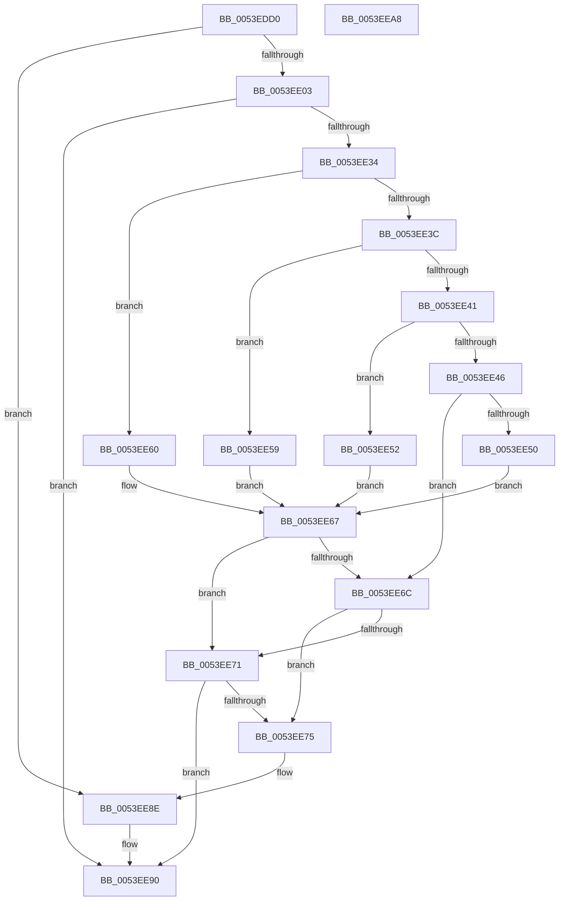

# HalpAcpiCopyBiosTable

- RVA: `0x0053EDD0`–`0x0053EEA9` (길이 `217` bytes)
- VA: `0x000000014053EDD0`
- 실행 섹션: `.text`
- PDB 이름 있음: `예`; PDB Function 태그: `아니요`
- unwind 정보 RVA: `0x00066400`
- 디코드: `66`개 명령, `217/217` bytes 표시
- 미해석 바이트: `0` (있으면 어셈블리에 `.byte`로 보존)

> 이 문서는 커널 이미지의 기계어와 PDB 기호를 분석해 생성했습니다. 4번과 5번은 함수 원형과 자료형을 바이너리 사용 방식에서 추정한 C 해석이며 원본 소스 복구 결과는 아닙니다.

## 1. Dependencies

- 직접 호출 지점: **4**; 고유 호출 대상: **4**
- 직접 호출자로 확인된 함수: **4**
- RIP 상대 이미지 참조: **0**

### Outgoing calls
- `0x0053EDF2` → [HalpAcpiAllocateMemory](HalpAcpiAllocateMemory_function_0053ECE0.md) (function, `0x0053ECE0`)
- `0x0053EE0B` → [memset](../6C/memset_function_006C6C40.md) (function, `0x006C6C40`)
- `0x0053EE22` → [RtlCopyDeviceMemory](../52/RtlCopyDeviceMemory_function_00522BFC.md) (function, `0x00522BFC`)
- `0x0053EE88` → [KeBugCheckEx](../4F/KeBugCheckEx_function_004FD660.md) (function, `0x004FD660`)

### Direct callers
- [HalpAcpiGetTableWork](../3F/HalpAcpiGetTableWork_function_003F6CDC.md) at `0x003F6D91`
- [HalpAcpiGetAllTablesWork](HalpAcpiGetAllTablesWork_function_0053EEE8.md) at `0x0053EFE4`
- [sub_006EBA20](../6E/Unknown_function_006EBA20.md) at `0x006EBAF0`
- [HalpAcpiTableCacheInit](../../init/C7/HalpAcpiTableCacheInit_function_00C77650.md) at `0x00C77884`

### Static image references
- 디코드된 RIP-relative 메모리 참조가 없습니다.

## 2. Other-region calls and transfers

- 다른 실행 섹션으로 향하는 call: **0**
- 별도 외부 분기/꼬리 이동을 확인하지 못했습니다.

## 3. Assembly (complete function range)

```asm
0053EDD0  48 89 5C 24 08                  mov qword ptr [rsp + 8], rbx
0053EDD5  48 89 6C 24 10                  mov qword ptr [rsp + 0x10], rbp
0053EDDA  48 89 74 24 18                  mov qword ptr [rsp + 0x18], rsi
0053EDDF  57                              push rdi
0053EDE0  48 83 EC 30                     sub rsp, 0x30
0053EDE4  8B 72 04                        mov esi, dword ptr [rdx + 4]
0053EDE7  48 8B FA                        mov rdi, rdx
0053EDEA  83 C6 18                        add esi, 0x18
0053EDED  49 8B D8                        mov rbx, r8
0053EDF0  8B D6                           mov edx, esi
0053EDF2  E8 E9 FE FF FF                  call 0x14053ece0
0053EDF7  48 8B E8                        mov rbp, rax
0053EDFA  48 85 C0                        test rax, rax
0053EDFD  0F 84 8B 00 00 00               je 0x14053ee8e
0053EE03  44 8B C6                        mov r8d, esi
0053EE06  33 D2                           xor edx, edx
0053EE08  48 8B C8                        mov rcx, rax
0053EE0B  E8 30 7E 18 00                  call 0x1406c6c40
0053EE10  48 89 5D 10                     mov qword ptr [rbp + 0x10], rbx
0053EE14  48 8B D7                        mov rdx, rdi
0053EE17  44 8B 47 04                     mov r8d, dword ptr [rdi + 4]
0053EE1B  48 8D 5D 18                     lea rbx, [rbp + 0x18]
0053EE1F  48 8B CB                        mov rcx, rbx
0053EE22  E8 D5 3D FE FF                  call 0x140522bfc
0053EE27  33 D2                           xor edx, edx
0053EE29  41 B8 46 41 43 50               mov r8d, 0x50434146
0053EE2F  44 39 07                        cmp dword ptr [rdi], r8d
0053EE32  75 5C                           jne 0x14053ee90
0053EE34  0F B6 4F 08                     movzx ecx, byte ptr [rdi + 8]
0053EE38  85 C9                           test ecx, ecx
0053EE3A  74 24                           je 0x14053ee60
0053EE3C  83 E9 01                        sub ecx, 1
0053EE3F  74 18                           je 0x14053ee59
0053EE41  83 E9 01                        sub ecx, 1
0053EE44  74 0C                           je 0x14053ee52
0053EE46  B8 F4 00 00 00                  mov eax, 0xf4
0053EE4B  83 F9 01                        cmp ecx, 1
0053EE4E  75 1C                           jne 0x14053ee6c
0053EE50  EB 15                           jmp 0x14053ee67
0053EE52  B8 81 00 00 00                  mov eax, 0x81
0053EE57  EB 0E                           jmp 0x14053ee67
0053EE59  B8 74 00 00 00                  mov eax, 0x74
0053EE5E  EB 07                           jmp 0x14053ee67
0053EE60  33 C0                           xor eax, eax
0053EE62  BA 0F 00 14 C0                  mov edx, 0xc014000f
0053EE67  39 47 04                        cmp dword ptr [rdi + 4], eax
0053EE6A  77 05                           ja 0x14053ee71
0053EE6C  39 47 04                        cmp dword ptr [rdi + 4], eax
0053EE6F  72 04                           jb 0x14053ee75
0053EE71  85 D2                           test edx, edx
0053EE73  79 1B                           jns 0x14053ee90
0053EE75  48 83 64 24 20 00               and qword ptr [rsp + 0x20], 0
0053EE7B  4C 8B CF                        mov r9, rdi
0053EE7E  BA 0B 00 01 00                  mov edx, 0x1000b
0053EE83  B9 A5 00 00 00                  mov ecx, 0xa5
0053EE88  E8 D3 E7 FB FF                  call 0x1404fd660
0053EE8D  CC                              int3
0053EE8E  33 DB                           xor ebx, ebx
0053EE90  48 8B 6C 24 48                  mov rbp, qword ptr [rsp + 0x48]
0053EE95  48 8B C3                        mov rax, rbx
0053EE98  48 8B 5C 24 40                  mov rbx, qword ptr [rsp + 0x40]
0053EE9D  48 8B 74 24 50                  mov rsi, qword ptr [rsp + 0x50]
0053EEA2  48 83 C4 30                     add rsp, 0x30
0053EEA6  5F                              pop rdi
0053EEA7  C3                              ret
0053EEA8  CC                              int3
```

## 4. C-style interpretation (structured pseudocode)

```c
__int64 __fastcall HalpAcpiCopyBiosTable(__int64 a1, __int64 a2, __int64 a3)
{
    __int64 result;
    __int64 v_rbx;
    __int64 v_rsi;
    __int64 v_rsp;
    unsigned __int64 v_stack_m18;
    unsigned __int64 v_stack_p10;
    unsigned __int64 v_stack_p18;
    unsigned __int64 v_stack_p8;

    v_stack_p8 = v_rbx;
    v_stack_p10 = v_rbp;
    v_stack_p18 = v_rsi;
    v_rsp = (v_rsp) - (48);
    v_rsi = (unsigned int)(((unsigned int)(*(unsigned int *)(a2 + 4))) + (24));
    result = HalpAcpiAllocateMemory(a1, (unsigned int)((unsigned int)(v_rsi)), a3, a4);
    if (result == 0) goto loc_0053EE8E;
    a2 = 0;
    result = memset(result, a2, (unsigned int)((unsigned int)(v_rsi)), a4);
    *(unsigned __int64 *)(result + 16) = a3;
    result = RtlCopyDeviceMemory(result + 24, 0, (unsigned int)(*(unsigned int *)(a2 + 4)), a4);
    a2 = 0;
    if ((*(unsigned int *)(a2)) != ((unsigned int)((unsigned int)(0x50434146ULL)))) goto loc_0053EE90;
    if ((unsigned int)(*(unsigned __int8 *)(a2 + 8)) == 0) goto loc_0053EE60;
    a1 = (unsigned int)((*(unsigned __int8 *)(a2 + 8)) - (1));
    if (condition_is_equal) goto loc_0053EE59;
    a1 = (unsigned int)((a1) - (1));
    if (condition_is_equal) goto loc_0053EE52;
    if (((unsigned int)(a1)) != 1) goto loc_0053EE6C;
    goto loc_0053EE67;
loc_0053EE52:
    goto loc_0053EE67;
loc_0053EE59:
    goto loc_0053EE67;
loc_0053EE60:
    result = 0;
loc_0053EE67:
    if ((*(unsigned int *)(a2 + 4)) > 0) goto loc_0053EE71;
loc_0053EE6C:
    if ((*(unsigned int *)(a2 + 4)) < 0) goto loc_0053EE75;
loc_0053EE71:
    if (!sign_flag) goto loc_0053EE90;
loc_0053EE75:
    result = KeBugCheckEx(165, (unsigned int)(0x1000BULL), (unsigned int)(0x50434146ULL), 0);
loc_0053EE8E:
    v_rbx = 0;
loc_0053EE90:
    v_rsp = (v_rsp) + (48);
    return 0;
}
```

## 5. (Beta) C Style

```c
int64_t HalpAcpiCopyBiosTable(int64_t Arg1, void *Arg2, int64_t Arg3)
{
    uint8_t *arg2 = (uint8_t *)Arg2;

    int64_t result;
    int64_t local_rbx;
    int64_t local_rsi;
    int64_t local_rsp;
    uint64_t v_stack_m18;
    uint64_t v_stack_p10;
    uint64_t v_stack_p18;
    uint64_t v_stack_p8;

    v_stack_p8 = local_rbx;
    v_stack_p10 = local_rbp;
    v_stack_p18 = local_rsi;
    local_rsp = (local_rsp) - (48);
    local_rsi = (uint32_t)(((uint32_t)(*(uint32_t *)(arg2 + 0x4))) + (24));
    result = HalpAcpiAllocateMemory(Arg1, (uint32_t)((uint32_t)(local_rsi)), Arg3, a4);
    if (result == 0) goto loc_0053EE8E;
    Arg2 = 0;
    result = memset(result, Arg2, (uint32_t)((uint32_t)(local_rsi)), a4);
    *(uint64_t *)(result + 0x10) = Arg3;
    result = RtlCopyDeviceMemory(result + 24, 0, (uint32_t)(*(uint32_t *)(arg2 + 0x4)), a4);
    Arg2 = 0;
    if ((*(uint32_t *)(arg2)) != ((uint32_t)((uint32_t)(0x50434146ULL)))) goto loc_0053EE90;
    if ((uint32_t)(*(uint8_t *)(arg2 + 0x8)) == 0) goto loc_0053EE60;
    Arg1 = (uint32_t)((*(uint8_t *)(arg2 + 0x8)) - (1));
    if (condition_is_equal) goto loc_0053EE59;
    Arg1 = (uint32_t)((Arg1) - (1));
    if (condition_is_equal) goto loc_0053EE52;
    if (((uint32_t)(Arg1)) != 1) goto loc_0053EE6C;
    goto loc_0053EE67;
loc_0053EE52:
    goto loc_0053EE67;
loc_0053EE59:
    goto loc_0053EE67;
loc_0053EE60:
    result = 0;
loc_0053EE67:
    if ((*(uint32_t *)(arg2 + 0x4)) > 0) goto loc_0053EE71;
loc_0053EE6C:
    if ((*(uint32_t *)(arg2 + 0x4)) < 0) goto loc_0053EE75;
loc_0053EE71:
    if (!sign_flag) goto loc_0053EE90;
loc_0053EE75:
    result = KeBugCheckEx(165, (uint32_t)(0x1000BULL), (uint32_t)(0x50434146ULL), 0);
loc_0053EE8E:
    local_rbx = 0;
loc_0053EE90:
    local_rsp = (local_rsp) + (48);
    return 0;
}
```

### 관측된 메모리 오프셋

구조체 형식이 확인되지 않은 접근은 인자 기준의 오프셋으로만 기록했습니다.

| 기준 인자 | 오프셋 표현 | 폭 (bit) | 접근 |
|---|---:|---:|---|
| `Arg2` | `+ 0x0` | `32` | `R` |
| `Arg2` | `+ 0x4` | `32` | `R` |
| `Arg2` | `+ 0x8` | `8` | `R` |

## 6. Execution-region graph

[열기: 2D/3D 그래프와 함수 탐색 컨트롤 패널](../../../control-panel.html?section=text&rva=0x0053EDD0&view=graph)

- 2D 그래프는 위에서 아래로 흐르고, 3D 그래프는 빈 공간을 드래그해 회전합니다. Shift+드래그는 이동, 휠은 확대·축소, 함수 노드 선택은 대상 보고서 이동입니다.

### Static fallback


