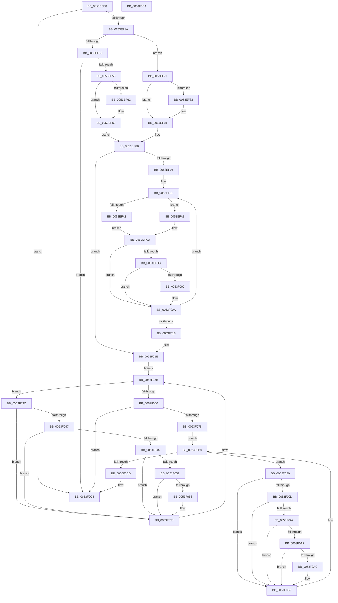

# HalpAcpiGetAllTablesWork

- RVA: `0x0053EEE8`–`0x0053F0EA` (길이 `514` bytes)
- VA: `0x000000014053EEE8`
- 실행 섹션: `.text`
- PDB 이름 있음: `예`; PDB Function 태그: `아니요`
- unwind 정보 RVA: `0x000C397C`
- 디코드: `156`개 명령, `514/514` bytes 표시
- 미해석 바이트: `0` (있으면 어셈블리에 `.byte`로 보존)

> 이 문서는 커널 이미지의 기계어와 PDB 기호를 분석해 생성했습니다. 4번과 5번은 함수 원형과 자료형을 바이너리 사용 방식에서 추정한 C 해석이며 원본 소스 복구 결과는 아닙니다.

## 1. Dependencies

- 직접 호출 지점: **8**; 고유 호출 대상: **7**
- 직접 호출자로 확인된 함수: **1**
- RIP 상대 이미지 참조: **3**

### Outgoing calls
- `0x0053EF2B` → [HalpAcpiGetTableWork](../3F/HalpAcpiGetTableWork_function_003F6CDC.md) (function, `0x003F6CDC`)
- `0x0053EF44` → [HalpAcpiGetTableWork](../3F/HalpAcpiGetTableWork_function_003F6CDC.md) (function, `0x003F6CDC`)
- `0x0053EFCF` → [HalpAcpiCheckAndMapTable](../3F/HalpAcpiCheckAndMapTable_function_003F75D8.md) (function, `0x003F75D8`)
- `0x0053EFE4` → [HalpAcpiCopyBiosTable](HalpAcpiCopyBiosTable_function_0053EDD0.md) (function, `0x0053EDD0`)
- `0x0053EFF6` → [MiUnmapContiguousMemory](../3F/MiUnmapContiguousMemory_function_003F7908.md) (function, `0x003F7908`)
- `0x0053F005` → [HalpAcpiCacheTable](HalpAcpiCacheTable_function_0053ED64.md) (function, `0x0053ED64`)
- `0x0053F06B` → [HalpAcpiAllocateMemory](HalpAcpiAllocateMemory_function_0053ECE0.md) (function, `0x0053ECE0`)
- `0x0053F080` → [memset](../6C/memset_function_006C6C40.md) (function, `0x006C6C40`)

### Direct callers
- [HalpAcpiGetAllTables](HalpAcpiGetAllTables_function_0053EEB0.md) at `0x0053EEC2`

### Static image references
- `0x0053EF0A` → RVA `0x00E0F670` (`.data`; read)
- `0x0053F01E` → RVA `0x00E0F660` (`.data`; read)
- `0x0053F0BD` → RVA `0x00E0F670` (`.data`; write)

## 2. Other-region calls and transfers

- 다른 실행 섹션으로 향하는 call: **0**
- 별도 외부 분기/꼬리 이동을 확인하지 못했습니다.

## 3. Assembly (complete function range)

```asm
0053EEE8  48 8B C4                        mov rax, rsp
0053EEEB  48 89 58 10                     mov qword ptr [rax + 0x10], rbx
0053EEEF  48 89 68 18                     mov qword ptr [rax + 0x18], rbp
0053EEF3  48 89 70 20                     mov qword ptr [rax + 0x20], rsi
0053EEF7  48 89 48 08                     mov qword ptr [rax + 8], rcx
0053EEFB  57                              push rdi
0053EEFC  41 54                           push r12
0053EEFE  41 55                           push r13
0053EF00  41 56                           push r14
0053EF02  41 57                           push r15
0053EF04  48 83 EC 40                     sub rsp, 0x40
0053EF08  33 FF                           xor edi, edi
0053EF0A  48 39 3D 5F 07 8D 00            cmp qword ptr [rip + 0x8d075f], rdi
0053EF11  89 78 08                        mov dword ptr [rax + 8], edi
0053EF14  0F 85 AA 01 00 00               jne 0x14053f0c4
0053EF1A  41 BD 58 53 44 54               mov r13d, 0x54445358
0053EF20  45 33 C9                        xor r9d, r9d
0053EF23  41 8B D5                        mov edx, r13d
0053EF26  45 33 C0                        xor r8d, r8d
0053EF29  33 C9                           xor ecx, ecx
0053EF2B  E8 AC 7D EB FF                  call 0x1403f6cdc
0053EF30  48 8B E8                        mov rbp, rax
0053EF33  48 85 C0                        test rax, rax
0053EF36  75 39                           jne 0x14053ef71
0053EF38  45 33 C9                        xor r9d, r9d
0053EF3B  41 8D 55 FA                     lea edx, [r13 - 6]
0053EF3F  45 33 C0                        xor r8d, r8d
0053EF42  33 C9                           xor ecx, ecx
0053EF44  E8 93 7D EB FF                  call 0x1403f6cdc
0053EF49  48 8B C8                        mov rcx, rax
0053EF4C  48 85 C0                        test rax, rax
0053EF4F  0F 84 6F 01 00 00               je 0x14053f0c4
0053EF55  8B 50 04                        mov edx, dword ptr [rax + 4]
0053EF58  8D 77 24                        lea esi, [rdi + 0x24]
0053EF5B  44 8B C2                        mov r8d, edx
0053EF5E  3B D6                           cmp edx, esi
0053EF60  72 03                           jb 0x14053ef65
0053EF62  44 8B C6                        mov r8d, esi
0053EF65  48 8B C2                        mov rax, rdx
0053EF68  49 2B C0                        sub rax, r8
0053EF6B  48 C1 E8 02                     shr rax, 2
0053EF6F  EB 1A                           jmp 0x14053ef8b
0053EF71  8B 40 04                        mov eax, dword ptr [rax + 4]
0053EF74  BE 24 00 00 00                  mov esi, 0x24
0053EF79  48 8B CF                        mov rcx, rdi
0053EF7C  8B D0                           mov edx, eax
0053EF7E  3B C6                           cmp eax, esi
0053EF80  72 02                           jb 0x14053ef84
0053EF82  8B D6                           mov edx, esi
0053EF84  48 2B C2                        sub rax, rdx
0053EF87  48 C1 E8 03                     shr rax, 3
0053EF8B  85 C0                           test eax, eax
0053EF8D  0F 84 8B 00 00 00               je 0x14053f01e
0053EF93  4C 8D 71 24                     lea r14, [rcx + 0x24]
0053EF97  44 8B E0                        mov r12d, eax
0053EF9A  4C 8D 7D 24                     lea r15, [rbp + 0x24]
0053EF9E  48 85 ED                        test rbp, rbp
0053EFA1  74 05                           je 0x14053efa8
0053EFA3  49 8B 1F                        mov rbx, qword ptr [r15]
0053EFA6  EB 03                           jmp 0x14053efab
0053EFA8  41 8B 1E                        mov ebx, dword ptr [r14]
0053EFAB  48 8D 44 24 70                  lea rax, [rsp + 0x70]
0053EFB0  45 33 C9                        xor r9d, r9d
0053EFB3  48 89 44 24 38                  mov qword ptr [rsp + 0x38], rax
0053EFB8  44 8B C6                        mov r8d, esi
0053EFBB  C6 44 24 30 01                  mov byte ptr [rsp + 0x30], 1
0053EFC0  48 8B D3                        mov rdx, rbx
0053EFC3  48 89 7C 24 28                  mov qword ptr [rsp + 0x28], rdi
0053EFC8  33 C9                           xor ecx, ecx
0053EFCA  48 89 7C 24 20                  mov qword ptr [rsp + 0x20], rdi
0053EFCF  E8 04 86 EB FF                  call 0x1403f75d8
0053EFD4  4C 8B E8                        mov r13, rax
0053EFD7  48 85 C0                        test rax, rax
0053EFDA  74 2E                           je 0x14053f00a
0053EFDC  4C 8B C3                        mov r8, rbx
0053EFDF  48 8B D0                        mov rdx, rax
0053EFE2  33 C9                           xor ecx, ecx
0053EFE4  E8 E7 FD FF FF                  call 0x14053edd0
0053EFE9  8B 54 24 70                     mov edx, dword ptr [rsp + 0x70]
0053EFED  41 B0 01                        mov r8b, 1
0053EFF0  49 8B CD                        mov rcx, r13
0053EFF3  48 8B D8                        mov rbx, rax
0053EFF6  E8 0D 89 EB FF                  call 0x1403f7908
0053EFFB  48 85 DB                        test rbx, rbx
0053EFFE  74 0A                           je 0x14053f00a
0053F000  48 8B D3                        mov rdx, rbx
0053F003  33 C9                           xor ecx, ecx
0053F005  E8 5A FD FF FF                  call 0x14053ed64
0053F00A  49 83 C6 04                     add r14, 4
0053F00E  49 83 C7 08                     add r15, 8
0053F012  49 83 EC 01                     sub r12, 1
0053F016  75 86                           jne 0x14053ef9e
0053F018  41 BD 58 53 44 54               mov r13d, 0x54445358
0053F01E  48 8B 05 3B 06 8D 00            mov rax, qword ptr [rip + 0x8d063b]
0053F025  4C 8D 35 34 06 8D 00            lea r14, [rip + 0x8d0634]
0053F02C  8B F7                           mov esi, edi
0053F02E  41 BF 46 41 43 53               mov r15d, 0x53434146
0053F034  41 BC 44 53 44 54               mov r12d, 0x54445344
0053F03A  EB 1F                           jmp 0x14053f05b
0053F03C  8B 48 18                        mov ecx, dword ptr [rax + 0x18]
0053F03F  81 F9 52 53 44 54               cmp ecx, 0x54445352
0053F045  74 11                           je 0x14053f058
0053F047  41 3B CD                        cmp ecx, r13d
0053F04A  74 0C                           je 0x14053f058
0053F04C  41 3B CF                        cmp ecx, r15d
0053F04F  74 07                           je 0x14053f058
0053F051  41 3B CC                        cmp ecx, r12d
0053F054  74 02                           je 0x14053f058
0053F056  FF C6                           inc esi
0053F058  48 8B 00                        mov rax, qword ptr [rax]
0053F05B  49 3B C6                        cmp rax, r14
0053F05E  75 DC                           jne 0x14053f03c
0053F060  8D 2C F5 08 00 00 00            lea ebp, [rsi*8 + 8]
0053F067  33 C9                           xor ecx, ecx
0053F069  8B D5                           mov edx, ebp
0053F06B  E8 70 FC FF FF                  call 0x14053ece0
0053F070  48 8B D8                        mov rbx, rax
0053F073  48 85 C0                        test rax, rax
0053F076  74 4C                           je 0x14053f0c4
0053F078  44 8B C5                        mov r8d, ebp
0053F07B  33 D2                           xor edx, edx
0053F07D  48 8B C8                        mov rcx, rax
0053F080  E8 BB 7B 18 00                  call 0x1406c6c40
0053F085  89 33                           mov dword ptr [rbx], esi
0053F087  48 8B 0D D2 05 8D 00            mov rcx, qword ptr [rip + 0x8d05d2]
0053F08E  EB 28                           jmp 0x14053f0b8
0053F090  48 8D 51 18                     lea rdx, [rcx + 0x18]
0053F094  8B 02                           mov eax, dword ptr [rdx]
0053F096  3D 52 53 44 54                  cmp eax, 0x54445352
0053F09B  74 18                           je 0x14053f0b5
0053F09D  41 3B C5                        cmp eax, r13d
0053F0A0  74 13                           je 0x14053f0b5
0053F0A2  41 3B C7                        cmp eax, r15d
0053F0A5  74 0E                           je 0x14053f0b5
0053F0A7  41 3B C4                        cmp eax, r12d
0053F0AA  74 09                           je 0x14053f0b5
0053F0AC  8B C7                           mov eax, edi
0053F0AE  FF C7                           inc edi
0053F0B0  48 89 54 C3 08                  mov qword ptr [rbx + rax*8 + 8], rdx
0053F0B5  48 8B 09                        mov rcx, qword ptr [rcx]
0053F0B8  49 3B CE                        cmp rcx, r14
0053F0BB  75 D3                           jne 0x14053f090
0053F0BD  48 89 1D AC 05 8D 00            mov qword ptr [rip + 0x8d05ac], rbx
0053F0C4  48 8B 05 A5 05 8D 00            mov rax, qword ptr [rip + 0x8d05a5]
0053F0CB  4C 8D 5C 24 40                  lea r11, [rsp + 0x40]
0053F0D0  49 8B 5B 38                     mov rbx, qword ptr [r11 + 0x38]
0053F0D4  49 8B 6B 40                     mov rbp, qword ptr [r11 + 0x40]
0053F0D8  49 8B 73 48                     mov rsi, qword ptr [r11 + 0x48]
0053F0DC  49 8B E3                        mov rsp, r11
0053F0DF  41 5F                           pop r15
0053F0E1  41 5E                           pop r14
0053F0E3  41 5D                           pop r13
0053F0E5  41 5C                           pop r12
0053F0E7  5F                              pop rdi
0053F0E8  C3                              ret
0053F0E9  CC                              int3
```

## 4. C-style interpretation (structured pseudocode)

```c
__int64 __fastcall HalpAcpiGetAllTablesWork(__int64 a1, __int64 a2, int a3, int a4)
{
    __int64 result;
    __int64 v_r12;
    __int64 v_r14;
    __int64 v_r15;
    __int64 v_rdi;
    __int64 v_rsi;
    __int64 v_rsp;
    unsigned __int64 v_stack_m28;
    unsigned __int64 v_stack_m30;
    unsigned __int8 v_stack_m38;
    unsigned __int64 v_stack_m40;
    unsigned __int64 v_stack_m48;
    unsigned __int64 v_stack_p8;

    *(unsigned __int64 *)(v_rsp + 16) = v_rbx;
    *(unsigned __int64 *)(v_rsp + 24) = v_rbp;
    *(unsigned __int64 *)(v_rsp + 32) = v_rsi;
    *(unsigned __int64 *)(v_rsp + 8) = a1;
    v_rsp = (v_rsp) - (64);
    v_rdi = 0;
    *(unsigned int *)(v_rsp + 8) = 0;
    if ((*(unsigned __int64 *)(v_rip + 9242463)) != 0) goto loc_0053F0C4;
    a4 = 0;
    a3 = 0;
    a1 = 0;
    result = HalpAcpiGetTableWork(a1, (unsigned int)((unsigned int)((unsigned int)(0x54445358ULL))), a3, a4);
    if (result != 0) goto loc_0053EF71;
    a4 = 0;
    a3 = 0;
    a1 = 0;
    result = HalpAcpiGetTableWork(a1, (unsigned int)(0x54445358ULL) - 6, a3, a4);
    if (result == 0) goto loc_0053F0C4;
    if (((unsigned int)((unsigned int)(*(unsigned int *)(result + 4)))) >= ((unsigned int)(v_rdi + 36))) {
        a3 = (unsigned int)(v_rdi + 36);
    }
    result = ((unsigned int)(*(unsigned int *)(result + 4))) - (a3);
    result = (result) >> (2);
    goto loc_0053EF8B;
loc_0053EF71:
    if (((unsigned int)((unsigned int)(*(unsigned int *)(result + 4)))) >= 36) {
        a2 = 36;
    }
    result = ((unsigned int)(*(unsigned int *)(result + 4))) - (a2);
    result = (result) >> (3);
loc_0053EF8B:
    if ((unsigned int)(result) == 0) goto loc_0053F01E;
loc_0053EF9E:
    if (result == 0) goto loc_0053EFA8;
    goto loc_0053EFAB;
loc_0053EFA8:
loc_0053EFAB:
    a4 = 0;
    v_stack_m30 = v_stack_p8;
    v_stack_m38 = 1;
    v_stack_m40 = 0;
    a1 = 0;
    v_stack_m48 = 0;
    result = HalpAcpiCheckAndMapTable(a1, (unsigned int)(*(unsigned int *)(0 + 36)), 36, a4);
    if (result == 0) goto loc_0053F00A;
    a1 = 0;
    result = HalpAcpiCopyBiosTable(a1, result, (unsigned int)(*(unsigned int *)(0 + 36)), a4);
    result = MiUnmapContiguousMemory(result, (unsigned int)(v_stack_p8), 1, a4);
    if (result != 0) {
        a2 = result;
        a1 = 0;
        result = HalpAcpiCacheTable(a1, a2, 1, a4);
    }
    v_r14 = (0 + 36) + (4);
    v_r15 = (result + 36) + (8);
    v_r12 = ((unsigned int)((unsigned int)(result))) - (1);
    if (condition_is_not_equal) goto loc_0053EF9E;
loc_0053F01E:
    goto loc_0053F05B;
loc_0053F03C:
    if (((unsigned int)((unsigned int)(*(unsigned int *)(*(unsigned __int64 *)(v_rip + 9242171) + 24)))) == 0x54445352ULL) goto loc_0053F058;
    if (((unsigned int)((unsigned int)(*(unsigned int *)(*(unsigned __int64 *)(v_rip + 9242171) + 24)))) == ((unsigned int)((unsigned int)(0x54445358ULL)))) goto loc_0053F058;
    if (((unsigned int)((unsigned int)(*(unsigned int *)(*(unsigned __int64 *)(v_rip + 9242171) + 24)))) == ((unsigned int)((unsigned int)(0x53434146ULL)))) goto loc_0053F058;
    v_rsi = 0;
    if (((unsigned int)((unsigned int)(*(unsigned int *)(*(unsigned __int64 *)(v_rip + 9242171) + 24)))) != ((unsigned int)((unsigned int)(0x54445344ULL)))) {
        v_rsi = (unsigned int)((0) + 1);
    }
loc_0053F05B:
    if ((*(unsigned __int64 *)(*(unsigned __int64 *)(v_rip + 9242171))) != (v_rip + 9242164)) goto loc_0053F03C;
    a1 = 0;
    result = HalpAcpiAllocateMemory(a1, (unsigned int)((unsigned int)(v_rsi * 8 + 8)), 1, a4);
    if (result == 0) goto loc_0053F0C4;
    a2 = 0;
    result = memset(result, a2, (unsigned int)((unsigned int)(v_rsi * 8 + 8)), a4);
    *(unsigned int *)(result) = (unsigned int)(v_rsi);
    goto loc_0053F0B8;
loc_0053F090:
    if (((unsigned int)((unsigned int)(*(unsigned int *)(*(unsigned __int64 *)(v_rip + 9242066) + 24)))) == 0x54445352ULL) goto loc_0053F0B5;
    if (((unsigned int)((unsigned int)(*(unsigned int *)(*(unsigned __int64 *)(v_rip + 9242066) + 24)))) == ((unsigned int)((unsigned int)(0x54445358ULL)))) goto loc_0053F0B5;
    if (((unsigned int)((unsigned int)(*(unsigned int *)(*(unsigned __int64 *)(v_rip + 9242066) + 24)))) == ((unsigned int)((unsigned int)(0x53434146ULL)))) goto loc_0053F0B5;
    result = (unsigned int)(*(unsigned int *)(*(unsigned __int64 *)(v_rip + 9242066) + 24));
    if (((unsigned int)((unsigned int)(*(unsigned int *)(*(unsigned __int64 *)(v_rip + 9242066) + 24)))) != ((unsigned int)((unsigned int)(0x54445344ULL)))) {
        result = 0;
        v_rdi = (unsigned int)((v_rdi) + 1);
        *(unsigned __int64 *)(result + result * 8 + 8) = *(unsigned __int64 *)(v_rip + 9242066) + 24;
    }
loc_0053F0B8:
    if ((*(unsigned __int64 *)(*(unsigned __int64 *)(v_rip + 9242066))) != (v_rip + 9242164)) goto loc_0053F090;
    *(unsigned __int64 *)(v_rip + 9242028) = result;
loc_0053F0C4:
    return *(unsigned __int64 *)(v_rip + 9242021);
}
```

## 5. (Beta) C Style

```c
int64_t HalpAcpiGetAllTablesWork(int64_t Arg1, int64_t Arg2, int32_t Arg3, int32_t Arg4)
{
    int64_t result;
    int64_t local_r12;
    int64_t local_r14;
    int64_t local_r15;
    int64_t local_rdi;
    int64_t local_rsi;
    int64_t local_rsp;
    uint64_t v_stack_m28;
    uint64_t v_stack_m30;
    uint8_t v_stack_m38;
    uint64_t v_stack_m40;
    uint64_t v_stack_m48;
    uint64_t v_stack_p8;

    *(uint64_t *)(local_rsp + 0x10) = local_rbx;
    *(uint64_t *)(local_rsp + 0x18) = local_rbp;
    *(uint64_t *)(local_rsp + 0x20) = local_rsi;
    *(uint64_t *)(local_rsp + 0x8) = Arg1;
    local_rsp = (local_rsp) - (64);
    local_rdi = 0;
    *(uint32_t *)(local_rsp + 0x8) = 0;
    if ((*(uint64_t *)(v_rip + 0x8D075F)) != 0) goto loc_0053F0C4;
    Arg4 = 0;
    Arg3 = 0;
    Arg1 = 0;
    result = HalpAcpiGetTableWork(Arg1, (uint32_t)((uint32_t)((uint32_t)(0x54445358ULL))), Arg3, Arg4);
    if (result != 0) goto loc_0053EF71;
    Arg4 = 0;
    Arg3 = 0;
    Arg1 = 0;
    result = HalpAcpiGetTableWork(Arg1, (uint32_t)(0x54445358ULL) - 6, Arg3, Arg4);
    if (result == 0) goto loc_0053F0C4;
    if (((uint32_t)((uint32_t)(*(uint32_t *)(result + 0x4)))) >= ((uint32_t)(local_rdi + 36))) {
        Arg3 = (uint32_t)(local_rdi + 36);
    }
    result = ((uint32_t)(*(uint32_t *)(result + 0x4))) - (Arg3);
    result = (result) >> (2);
    goto loc_0053EF8B;
loc_0053EF71:
    if (((uint32_t)((uint32_t)(*(uint32_t *)(result + 0x4)))) >= 36) {
        Arg2 = 36;
    }
    result = ((uint32_t)(*(uint32_t *)(result + 0x4))) - (Arg2);
    result = (result) >> (3);
loc_0053EF8B:
    if ((uint32_t)(result) == 0) goto loc_0053F01E;
loc_0053EF9E:
    if (result == 0) goto loc_0053EFA8;
    goto loc_0053EFAB;
loc_0053EFA8:
loc_0053EFAB:
    Arg4 = 0;
    v_stack_m30 = v_stack_p8;
    v_stack_m38 = 1;
    v_stack_m40 = 0;
    Arg1 = 0;
    v_stack_m48 = 0;
    result = HalpAcpiCheckAndMapTable(Arg1, (uint32_t)(*(uint32_t *)(0 + 0x24)), 36, Arg4);
    if (result == 0) goto loc_0053F00A;
    Arg1 = 0;
    result = HalpAcpiCopyBiosTable(Arg1, result, (uint32_t)(*(uint32_t *)(0 + 0x24)), Arg4);
    result = MiUnmapContiguousMemory(result, (uint32_t)(v_stack_p8), 1, Arg4);
    if (result != 0) {
        Arg2 = result;
        Arg1 = 0;
        result = HalpAcpiCacheTable(Arg1, Arg2, 1, Arg4);
    }
    local_r14 = (0 + 36) + (4);
    local_r15 = (result + 36) + (8);
    local_r12 = ((uint32_t)((uint32_t)(result))) - (1);
    if (condition_is_not_equal) goto loc_0053EF9E;
loc_0053F01E:
    goto loc_0053F05B;
loc_0053F03C:
    if (((uint32_t)((uint32_t)(*(uint32_t *)(*(uint64_t *)(v_rip + 0x8D063B) + 0x18)))) == 0x54445352ULL) goto loc_0053F058;
    if (((uint32_t)((uint32_t)(*(uint32_t *)(*(uint64_t *)(v_rip + 0x8D063B) + 0x18)))) == ((uint32_t)((uint32_t)(0x54445358ULL)))) goto loc_0053F058;
    if (((uint32_t)((uint32_t)(*(uint32_t *)(*(uint64_t *)(v_rip + 0x8D063B) + 0x18)))) == ((uint32_t)((uint32_t)(0x53434146ULL)))) goto loc_0053F058;
    local_rsi = 0;
    if (((uint32_t)((uint32_t)(*(uint32_t *)(*(uint64_t *)(v_rip + 0x8D063B) + 0x18)))) != ((uint32_t)((uint32_t)(0x54445344ULL)))) {
        local_rsi = (uint32_t)((0) + 1);
    }
loc_0053F05B:
    if ((*(uint64_t *)(*(uint64_t *)(v_rip + 0x8D063B))) != (v_rip + 9242164)) goto loc_0053F03C;
    Arg1 = 0;
    result = HalpAcpiAllocateMemory(Arg1, (uint32_t)((uint32_t)(local_rsi * 8 + 8)), 1, Arg4);
    if (result == 0) goto loc_0053F0C4;
    Arg2 = 0;
    result = memset(result, Arg2, (uint32_t)((uint32_t)(local_rsi * 8 + 8)), Arg4);
    *(uint32_t *)(result) = (uint32_t)(local_rsi);
    goto loc_0053F0B8;
loc_0053F090:
    if (((uint32_t)((uint32_t)(*(uint32_t *)(*(uint64_t *)(v_rip + 0x8D05D2) + 0x18)))) == 0x54445352ULL) goto loc_0053F0B5;
    if (((uint32_t)((uint32_t)(*(uint32_t *)(*(uint64_t *)(v_rip + 0x8D05D2) + 0x18)))) == ((uint32_t)((uint32_t)(0x54445358ULL)))) goto loc_0053F0B5;
    if (((uint32_t)((uint32_t)(*(uint32_t *)(*(uint64_t *)(v_rip + 0x8D05D2) + 0x18)))) == ((uint32_t)((uint32_t)(0x53434146ULL)))) goto loc_0053F0B5;
    result = (uint32_t)(*(uint32_t *)(*(uint64_t *)(v_rip + 0x8D05D2) + 0x18));
    if (((uint32_t)((uint32_t)(*(uint32_t *)(*(uint64_t *)(v_rip + 0x8D05D2) + 0x18)))) != ((uint32_t)((uint32_t)(0x54445344ULL)))) {
        result = 0;
        local_rdi = (uint32_t)((local_rdi) + 1);
        *(uint64_t *)(result + result * 8 + 0x8) = *(uint64_t *)(v_rip + 0x8D05D2) + 24;
    }
loc_0053F0B8:
    if ((*(uint64_t *)(*(uint64_t *)(v_rip + 0x8D05D2))) != (v_rip + 9242164)) goto loc_0053F090;
    *(uint64_t *)(v_rip + 0x8D05AC) = result;
loc_0053F0C4:
    return *(uint64_t *)(v_rip + 0x8D05A5);
}
```

## 6. Execution-region graph

[열기: 2D/3D 그래프와 함수 탐색 컨트롤 패널](../../../control-panel.html?section=text&rva=0x0053EEE8&view=graph)

- 2D 그래프는 위에서 아래로 흐르고, 3D 그래프는 빈 공간을 드래그해 회전합니다. Shift+드래그는 이동, 휠은 확대·축소, 함수 노드 선택은 대상 보고서 이동입니다.

### Static fallback


