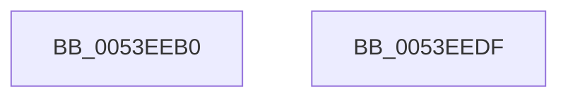

# HalpAcpiGetAllTables

- RVA: `0x0053EEB0`–`0x0053EEE0` (길이 `48` bytes)
- VA: `0x000000014053EEB0`
- 실행 섹션: `.text`
- PDB 이름 있음: `예`; PDB Function 태그: `아니요`
- unwind 정보 RVA: `0x0005CF00`
- 디코드: `13`개 명령, `48/48` bytes 표시
- 미해석 바이트: `0` (있으면 어셈블리에 `.byte`로 보존)

> 이 문서는 커널 이미지의 기계어와 PDB 기호를 분석해 생성했습니다. 4번과 5번은 함수 원형과 자료형을 바이너리 사용 방식에서 추정한 C 해석이며 원본 소스 복구 결과는 아닙니다.

## 1. Dependencies

- 직접 호출 지점: **3**; 고유 호출 대상: **3**
- 직접 호출자로 확인된 함수: **2**
- RIP 상대 이미지 참조: **1**

### Outgoing calls
- `0x0053EEBD` → [ExAcquireFastMutex](../20/ExAcquireFastMutex_function_0020E5A0.md) (function, `0x0020E5A0`)
- `0x0053EEC2` → [HalpAcpiGetAllTablesWork](HalpAcpiGetAllTablesWork_function_0053EEE8.md) (function, `0x0053EEE8`)
- `0x0053EED1` → [ExReleaseFastMutex](../25/ExReleaseFastMutex_function_002519C0.md) (function, `0x002519C0`)

### Direct callers
- [HalAcpiGetAllTablesDispatch](HalAcpiGetAllTablesDispatch_function_0053E9B0.md) at `0x0053E9B4`
- [HalpAcpiPopulateTableCacheWork](../54/HalpAcpiPopulateTableCacheWork_function_0054E870.md) at `0x0054E87C`

### Static image references
- `0x0053EEB6` → RVA `0x00FC3F40` (`.data`; read)

## 2. Other-region calls and transfers

- 다른 실행 섹션으로 향하는 call: **0**
- 별도 외부 분기/꼬리 이동을 확인하지 못했습니다.

## 3. Assembly (complete function range)

```asm
0053EEB0  40 53                           push rbx
0053EEB2  48 83 EC 20                     sub rsp, 0x20
0053EEB6  48 8D 0D 83 50 A8 00            lea rcx, [rip + 0xa85083]
0053EEBD  E8 DE F6 CC FF                  call 0x14020e5a0
0053EEC2  E8 21 00 00 00                  call 0x14053eee8
0053EEC7  48 8D 0D 72 50 A8 00            lea rcx, [rip + 0xa85072]
0053EECE  48 8B D8                        mov rbx, rax
0053EED1  E8 EA 2A D1 FF                  call 0x1402519c0
0053EED6  48 8B C3                        mov rax, rbx
0053EED9  48 83 C4 20                     add rsp, 0x20
0053EEDD  5B                              pop rbx
0053EEDE  C3                              ret
0053EEDF  CC                              int3
```

## 4. C-style interpretation (structured pseudocode)

```c
__int64 __fastcall HalpAcpiGetAllTables(void)
{
    __int64 result;
    __int64 v_rsp;

    v_rsp = (v_rsp) - (32);
    result = ExAcquireFastMutex(v_rip + 11030659, a2, a3, a4);
    result = HalpAcpiGetAllTablesWork(v_rip + 11030659, a2, a3, a4);
    result = ExReleaseFastMutex(v_rip + 11030642, a2, a3, a4);
    v_rsp = (v_rsp) + (32);
    return result;
}
```

## 5. (Beta) C Style

```c
void HalpAcpiGetAllTables(void)
{
    int64_t result;
    int64_t local_rsp;

    local_rsp = (local_rsp) - (32);
    result = ExAcquireFastMutex(v_rip + 11030659, a2, a3, a4);
    result = HalpAcpiGetAllTablesWork(v_rip + 11030659, a2, a3, a4);
    result = ExReleaseFastMutex(v_rip + 11030642, a2, a3, a4);
    local_rsp = (local_rsp) + (32);
    return result;
}
```

## 6. Execution-region graph

[열기: 2D/3D 그래프와 함수 탐색 컨트롤 패널](../../../control-panel.html?section=text&rva=0x0053EEB0&view=graph)

- 2D 그래프는 위에서 아래로 흐르고, 3D 그래프는 빈 공간을 드래그해 회전합니다. Shift+드래그는 이동, 휠은 확대·축소, 함수 노드 선택은 대상 보고서 이동입니다.

### Static fallback


