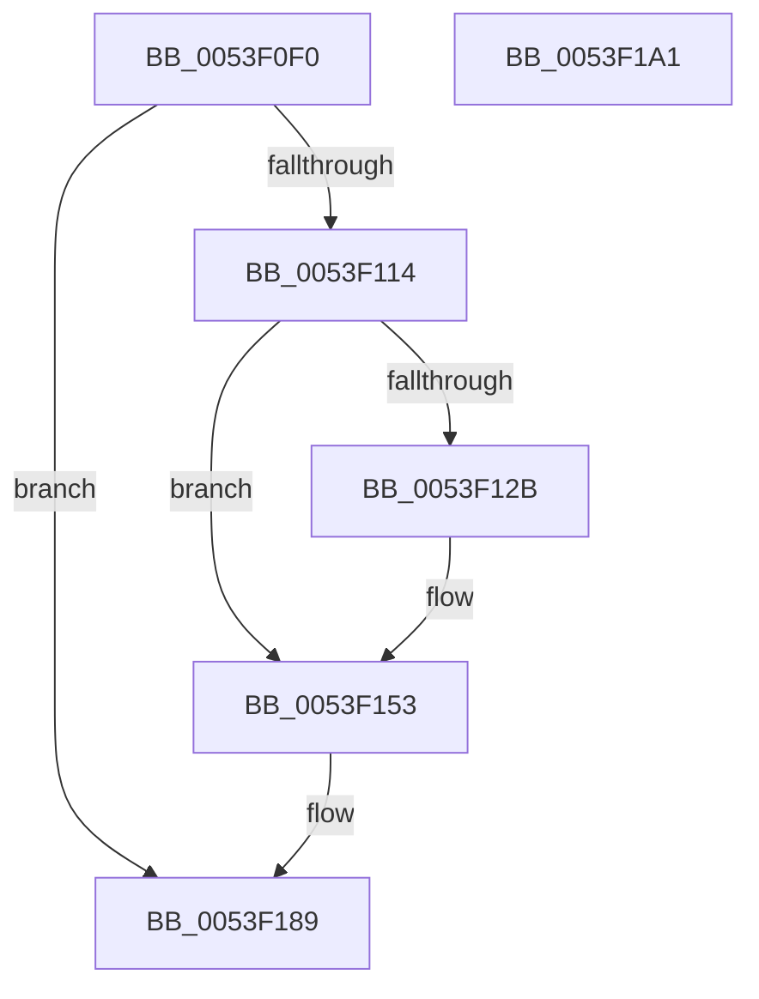

# HalpAcpiGetFacsMapping

- RVA: `0x0053F0F0`–`0x0053F1A2` (길이 `178` bytes)
- VA: `0x000000014053F0F0`
- 실행 섹션: `.text`
- PDB 이름 있음: `예`; PDB Function 태그: `아니요`
- unwind 정보 RVA: `0x000C399C`
- 디코드: `40`개 명령, `178/178` bytes 표시
- 미해석 바이트: `0` (있으면 어셈블리에 `.byte`로 보존)

> 이 문서는 커널 이미지의 기계어와 PDB 기호를 분석해 생성했습니다. 4번과 5번은 함수 원형과 자료형을 바이너리 사용 방식에서 추정한 C 해석이며 원본 소스 복구 결과는 아닙니다.

## 1. Dependencies

- 직접 호출 지점: **6**; 고유 호출 대상: **6**
- 직접 호출자로 확인된 함수: **2**
- RIP 상대 이미지 참조: **4**

### Outgoing calls
- `0x0053F105` → [ExAcquireFastMutex](../20/ExAcquireFastMutex_function_0020E5A0.md) (function, `0x0020E5A0`)
- `0x0053F121` → [HalpAcpiGetTableWork](../3F/HalpAcpiGetTableWork_function_003F6CDC.md) (function, `0x003F6CDC`)
- `0x0053F132` → [DbgPrint](../35/DbgPrint_function_00358CB0.md) (function, `0x00358CB0`)
- `0x0053F14D` → [KeBugCheckEx](../4F/KeBugCheckEx_function_004FD660.md) (function, `0x004FD660`)
- `0x0053F17D` → [HalpAcpiCheckAndMapTable](../3F/HalpAcpiCheckAndMapTable_function_003F75D8.md) (function, `0x003F75D8`)
- `0x0053F190` → [ExReleaseFastMutex](../25/ExReleaseFastMutex_function_002519C0.md) (function, `0x002519C0`)

### Direct callers
- [HalAcpiGetFacsMappingDispatch](HalAcpiGetFacsMappingDispatch_function_0053E9D0.md) at `0x0053E9D4`
- [HaliInitPowerManagement](../../page/70/HaliInitPowerManagement_function_0070BAE0.md) at `0x0070BBB1`

### Static image references
- `0x0053F0FE` → RVA `0x00FC3F40` (`.data`; read)
- `0x0053F10A` → RVA `0x00E0F698` (`.data`; read)
- `0x0053F12B` → RVA `0x00023868` (`.rdata`; read)
- `0x0053F182` → RVA `0x00E0F698` (`.data`; write)

## 2. Other-region calls and transfers

- 다른 실행 섹션으로 향하는 call: **0**
- 별도 외부 분기/꼬리 이동을 확인하지 못했습니다.

## 3. Assembly (complete function range)

```asm
0053F0F0  48 89 4C 24 08                  mov qword ptr [rsp + 8], rcx
0053F0F5  48 83 EC 48                     sub rsp, 0x48
0053F0F9  83 64 24 50 00                  and dword ptr [rsp + 0x50], 0
0053F0FE  48 8D 0D 3B 4E A8 00            lea rcx, [rip + 0xa84e3b]
0053F105  E8 96 F4 CC FF                  call 0x14020e5a0
0053F10A  48 83 3D 86 05 8D 00 00         cmp qword ptr [rip + 0x8d0586], 0
0053F112  75 75                           jne 0x14053f189
0053F114  45 33 C9                        xor r9d, r9d
0053F117  45 33 C0                        xor r8d, r8d
0053F11A  BA 46 41 43 50                  mov edx, 0x50434146
0053F11F  33 C9                           xor ecx, ecx
0053F121  E8 B6 7B EB FF                  call 0x1403f6cdc
0053F126  48 85 C0                        test rax, rax
0053F129  75 28                           jne 0x14053f153
0053F12B  48 8D 0D 36 47 AE FF            lea rcx, [rip - 0x51b8ca]
0053F132  E8 79 9B E1 FF                  call 0x140358cb0
0053F137  48 83 64 24 20 00               and qword ptr [rsp + 0x20], 0
0053F13D  45 33 C9                        xor r9d, r9d
0053F140  45 33 C0                        xor r8d, r8d
0053F143  BA 09 00 01 00                  mov edx, 0x10009
0053F148  B9 A5 00 00 00                  mov ecx, 0xa5
0053F14D  E8 0E E5 FB FF                  call 0x1404fd660
0053F152  CC                              int3
0053F153  8B 50 24                        mov edx, dword ptr [rax + 0x24]
0053F156  33 C9                           xor ecx, ecx
0053F158  48 8D 44 24 50                  lea rax, [rsp + 0x50]
0053F15D  41 B9 46 41 43 53               mov r9d, 0x53434146
0053F163  48 89 44 24 38                  mov qword ptr [rsp + 0x38], rax
0053F168  C6 44 24 30 00                  mov byte ptr [rsp + 0x30], 0
0053F16D  48 83 64 24 28 00               and qword ptr [rsp + 0x28], 0
0053F173  44 8D 41 21                     lea r8d, [rcx + 0x21]
0053F177  48 83 64 24 20 00               and qword ptr [rsp + 0x20], 0
0053F17D  E8 56 84 EB FF                  call 0x1403f75d8
0053F182  48 89 05 0F 05 8D 00            mov qword ptr [rip + 0x8d050f], rax
0053F189  48 8D 0D B0 4D A8 00            lea rcx, [rip + 0xa84db0]
0053F190  E8 2B 28 D1 FF                  call 0x1402519c0
0053F195  48 8B 05 FC 04 8D 00            mov rax, qword ptr [rip + 0x8d04fc]
0053F19C  48 83 C4 48                     add rsp, 0x48
0053F1A0  C3                              ret
0053F1A1  CC                              int3
```

## 4. C-style interpretation (structured pseudocode)

```c
__int64 __fastcall HalpAcpiGetFacsMapping(__int64 a1, __int64 a2, int a3, int a4)
{
    __int64 result;
    __int64 v_rsp;
    unsigned __int64 v_stack_m10;
    unsigned __int8 v_stack_m18;
    unsigned __int64 v_stack_m20;
    unsigned __int64 v_stack_m28;
    unsigned __int64 v_stack_p8;

    v_stack_p8 = a1;
    v_rsp = (v_rsp) - (72);
    result = ExAcquireFastMutex(v_rip + 11030075, a2, a3, a4);
    if ((*(unsigned __int64 *)(v_rip + 9241990)) != 0) goto loc_0053F189;
    a4 = 0;
    a3 = 0;
    a1 = 0;
    result = HalpAcpiGetTableWork(a1, (unsigned int)(0x50434146ULL), a3, a4);
    if (result == 0) {
        a1 = v_rip - 5355722;
        result = DbgPrint(a1, (unsigned int)(0x50434146ULL), a3, a4);
        a4 = 0;
        a3 = 0;
        a2 = 0x10009ULL;
        a1 = 165;
        result = KeBugCheckEx(a1, a2, a3, a4);
    }
    a1 = 0;
    v_stack_m10 = v_stack_p8;
    v_stack_m18 = 0;
    result = HalpAcpiCheckAndMapTable(a1, (unsigned int)(*(unsigned int *)(result + 36)), a1 + 33, (unsigned int)(0x53434146ULL));
    *(unsigned __int64 *)(v_rip + 9241871) = result;
loc_0053F189:
    result = ExReleaseFastMutex(v_rip + 11029936, (unsigned int)(*(unsigned int *)(result + 36)), a1 + 33, (unsigned int)(0x53434146ULL));
    v_rsp = (v_rsp) + (72);
    return *(unsigned __int64 *)(v_rip + 9241852);
}
```

## 5. (Beta) C Style

```c
int64_t HalpAcpiGetFacsMapping(int64_t Arg1, int64_t Arg2, int32_t Arg3, int32_t Arg4)
{
    int64_t result;
    int64_t local_rsp;
    uint64_t v_stack_m10;
    uint8_t v_stack_m18;
    uint64_t v_stack_m20;
    uint64_t v_stack_m28;
    uint64_t v_stack_p8;

    v_stack_p8 = Arg1;
    local_rsp = (local_rsp) - (72);
    result = ExAcquireFastMutex(v_rip + 11030075, Arg2, Arg3, Arg4);
    if ((*(uint64_t *)(v_rip + 0x8D0586)) != 0) goto loc_0053F189;
    Arg4 = 0;
    Arg3 = 0;
    Arg1 = 0;
    result = HalpAcpiGetTableWork(Arg1, (uint32_t)(0x50434146ULL), Arg3, Arg4);
    if (result == 0) {
        Arg1 = v_rip - 5355722;
        result = DbgPrint(Arg1, (uint32_t)(0x50434146ULL), Arg3, Arg4);
        Arg4 = 0;
        Arg3 = 0;
        Arg2 = 0x10009ULL;
        Arg1 = 165;
        result = KeBugCheckEx(Arg1, Arg2, Arg3, Arg4);
    }
    Arg1 = 0;
    v_stack_m10 = v_stack_p8;
    v_stack_m18 = 0;
    result = HalpAcpiCheckAndMapTable(Arg1, (uint32_t)(*(uint32_t *)(result + 0x24)), Arg1 + 33, (uint32_t)(0x53434146ULL));
    *(uint64_t *)(v_rip + 0x8D050F) = result;
loc_0053F189:
    result = ExReleaseFastMutex(v_rip + 11029936, (uint32_t)(*(uint32_t *)(result + 0x24)), Arg1 + 33, (uint32_t)(0x53434146ULL));
    local_rsp = (local_rsp) + (72);
    return *(uint64_t *)(v_rip + 0x8D04FC);
}
```

## 6. Execution-region graph

[열기: 2D/3D 그래프와 함수 탐색 컨트롤 패널](../../../control-panel.html?section=text&rva=0x0053F0F0&view=graph)

- 2D 그래프는 위에서 아래로 흐르고, 3D 그래프는 빈 공간을 드래그해 회전합니다. Shift+드래그는 이동, 휠은 확대·축소, 함수 노드 선택은 대상 보고서 이동입니다.

### Static fallback


