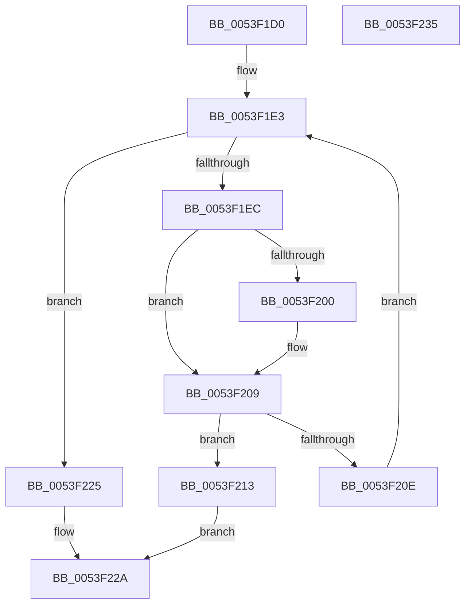

# HalpAcpiInvokePrmFwHandler

- RVA: `0x0053F1D0`–`0x0053F236` (길이 `102` bytes)
- VA: `0x000000014053F1D0`
- 실행 섹션: `.text`
- PDB 이름 있음: `예`; PDB Function 태그: `아니요`
- unwind 정보 RVA: `0x0005CAAC`
- 디코드: `31`개 명령, `102/102` bytes 표시
- 미해석 바이트: `0` (있으면 어셈블리에 `.byte`로 보존)

> 이 문서는 커널 이미지의 기계어와 PDB 기호를 분석해 생성했습니다. 4번과 5번은 함수 원형과 자료형을 바이너리 사용 방식에서 추정한 C 해석이며 원본 소스 복구 결과는 아닙니다.

## 1. Dependencies

- 직접 호출 지점: **1**; 고유 호출 대상: **1**
- 직접 호출자로 확인된 함수: **0**
- RIP 상대 이미지 참조: **2**

### Outgoing calls
- `0x0053F21E` → `indirect target` (indirect, 간접 대상)

### Direct callers
- 이 함수 시작 RVA로 연결되는 직접 call은 확인되지 않았습니다. 간접 호출은 완전히 역산할 수 없습니다.

### Static image references
- `0x0053F1E3` → RVA `0x01202030` (`CFGRO`; read)
- `0x0053F1EC` → RVA `0x01202038` (`CFGRO`; read)

## 2. Other-region calls and transfers

- 다른 실행 섹션으로 향하는 call: **0**
- 별도 외부 분기/꼬리 이동을 확인하지 못했습니다.

## 3. Assembly (complete function range)

```asm
0053F1D0  48 89 5C 24 08                  mov qword ptr [rsp + 8], rbx
0053F1D5  57                              push rdi
0053F1D6  48 83 EC 20                     sub rsp, 0x20
0053F1DA  48 8B FA                        mov rdi, rdx
0053F1DD  48 8B D9                        mov rbx, rcx
0053F1E0  45 33 C9                        xor r9d, r9d
0053F1E3  44 3B 0D 46 2E CC 00            cmp r9d, dword ptr [rip + 0xcc2e46]
0053F1EA  73 39                           jae 0x14053f225
0053F1EC  4C 8B 1D 45 2E CC 00            mov r11, qword ptr [rip + 0xcc2e45]
0053F1F3  4F 8D 14 49                     lea r10, [r9 + r9*2]
0053F1F7  4B 8B 0C D3                     mov rcx, qword ptr [r11 + r10*8]
0053F1FB  48 2B 0B                        sub rcx, qword ptr [rbx]
0053F1FE  75 09                           jne 0x14053f209
0053F200  4B 8B 4C D3 08                  mov rcx, qword ptr [r11 + r10*8 + 8]
0053F205  48 2B 4B 08                     sub rcx, qword ptr [rbx + 8]
0053F209  48 85 C9                        test rcx, rcx
0053F20C  74 05                           je 0x14053f213
0053F20E  41 FF C1                        inc r9d
0053F211  EB D0                           jmp 0x14053f1e3
0053F213  4B 8B 44 D3 10                  mov rax, qword ptr [r11 + r10*8 + 0x10]
0053F218  49 8B D0                        mov rdx, r8
0053F21B  48 8B CF                        mov rcx, rdi
0053F21E  FF D0                           call rax
0053F220  0F 1F 00                        nop dword ptr [rax]
0053F223  EB 05                           jmp 0x14053f22a
0053F225  B8 25 02 00 C0                  mov eax, 0xc0000225
0053F22A  48 8B 5C 24 30                  mov rbx, qword ptr [rsp + 0x30]
0053F22F  48 83 C4 20                     add rsp, 0x20
0053F233  5F                              pop rdi
0053F234  C3                              ret
0053F235  CC                              int3
```

## 4. C-style interpretation (structured pseudocode)

```c
__int64 __fastcall HalpAcpiInvokePrmFwHandler(__int64 a1, __int64 a2, __int64 a3, int a4)
{
    __int64 result;
    __int64 v_rsp;
    unsigned __int64 v_stack_p8;

    v_stack_p8 = v_rbx;
    v_rsp = (v_rsp) - (32);
    a4 = 0;
loc_0053F1E3:
    if (0 >= (*(unsigned int *)(v_rip + 13381190))) goto loc_0053F225;
    a1 = (*(unsigned __int64 *)(*(unsigned __int64 *)(v_rip + 13381189) + a4 + a4 * 2 * 8)) - (*(unsigned __int64 *)(a1));
    if (!(condition_is_not_equal)) {
        a1 = *(unsigned __int64 *)(*(unsigned __int64 *)(v_rip + 13381189) + a4 + a4 * 2 * 8 + 8);
        a1 = (a1) - (*(unsigned __int64 *)(a1 + 8));
    }
    if (a1 == 0) goto loc_0053F213;
    a4 = (unsigned int)((a4) + 1);
    goto loc_0053F1E3;
loc_0053F213:
    result = kernel_indirect_call(a2, a3, a3, a4);
    goto loc_0053F22A;
loc_0053F225:
loc_0053F22A:
    v_rsp = (v_rsp) + (32);
    return (unsigned int)(0xC0000225ULL);
}
```

## 5. (Beta) C Style

```c
int64_t HalpAcpiInvokePrmFwHandler(void *Arg1, int64_t Arg2, int64_t Arg3, int32_t Arg4)
{
    uint8_t *arg1 = (uint8_t *)Arg1;

    int64_t result;
    int64_t local_rsp;
    uint64_t v_stack_p8;

    v_stack_p8 = local_rbx;
    local_rsp = (local_rsp) - (32);
    Arg4 = 0;
loc_0053F1E3:
    if (0 >= (*(uint32_t *)(v_rip + 0xCC2E46))) goto loc_0053F225;
    Arg1 = (*(uint64_t *)(*(uint64_t *)(v_rip + 0xCC2E45) + Arg4 + Arg4 * 2 * 8)) - (*(uint64_t *)(arg1));
    if (!(condition_is_not_equal)) {
        Arg1 = *(uint64_t *)(*(uint64_t *)(v_rip + 0xCC2E45) + Arg4 + Arg4 * 2 * 8 + 0x8);
        Arg1 = (Arg1) - (*(uint64_t *)(arg1 + 0x8));
    }
    if (Arg1 == NULL) goto loc_0053F213;
    Arg4 = (uint32_t)((Arg4) + 1);
    goto loc_0053F1E3;
loc_0053F213:
    result = kernel_indirect_call(Arg2, Arg3, Arg3, Arg4);
    goto loc_0053F22A;
loc_0053F225:
loc_0053F22A:
    local_rsp = (local_rsp) + (32);
    return (uint32_t)(0xC0000225ULL);
}
```

### 관측된 메모리 오프셋

구조체 형식이 확인되지 않은 접근은 인자 기준의 오프셋으로만 기록했습니다.

| 기준 인자 | 오프셋 표현 | 폭 (bit) | 접근 |
|---|---:|---:|---|
| `Arg1` | `+ 0x0` | `64` | `R` |
| `Arg1` | `+ 0x8` | `64` | `R` |

## 6. Execution-region graph

[열기: 2D/3D 그래프와 함수 탐색 컨트롤 패널](../../../control-panel.html?section=text&rva=0x0053F1D0&view=graph)

- 2D 그래프는 위에서 아래로 흐르고, 3D 그래프는 빈 공간을 드래그해 회전합니다. Shift+드래그는 이동, 휠은 확대·축소, 함수 노드 선택은 대상 보고서 이동입니다.

### Static fallback


