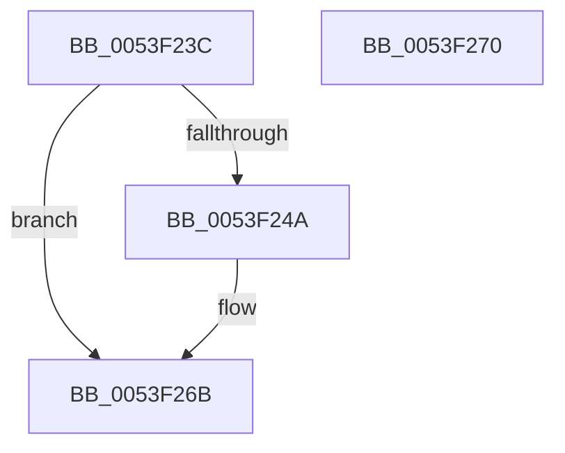

# HalpAcpiMarkHiberPhase

- RVA: `0x0053F23C`–`0x0053F271` (길이 `53` bytes)
- VA: `0x000000014053F23C`
- 실행 섹션: `.text`
- PDB 이름 있음: `예`; PDB Function 태그: `아니요`
- unwind 정보 RVA: `0x0005D2F4`
- 디코드: `13`개 명령, `53/53` bytes 표시
- 미해석 바이트: `0` (있으면 어셈블리에 `.byte`로 보존)

> 이 문서는 커널 이미지의 기계어와 PDB 기호를 분석해 생성했습니다. 4번과 5번은 함수 원형과 자료형을 바이너리 사용 방식에서 추정한 C 해석이며 원본 소스 복구 결과는 아닙니다.

## 1. Dependencies

- 직접 호출 지점: **1**; 고유 호출 대상: **1**
- 직접 호출자로 확인된 함수: **1**
- RIP 상대 이미지 참조: **2**

### Outgoing calls
- `0x0053F266` → [PoSetHiberRange](../47/PoSetHiberRange_function_0047C580.md) (function, `0x0047C580`)

### Direct callers
- [HaliLocateHiberRanges](../../pagelk/B5/HaliLocateHiberRanges_function_00B5CE50.md) at `0x00B5CF2F`
- [HaliLocateHiberRanges](../../pagelk/B5/HaliLocateHiberRanges_function_00B5CE50.md) at `0x00B5D071`

### Static image references
- `0x0053F240` → RVA `0x01202030` (`CFGRO`; read)
- `0x0053F24A` → RVA `0x01202038` (`CFGRO`; read)

## 2. Other-region calls and transfers

- 다른 실행 섹션으로 향하는 call: **0**
- 별도 외부 분기/꼬리 이동을 확인하지 못했습니다.

## 3. Assembly (complete function range)

```asm
0053F23C  48 83 EC 38                     sub rsp, 0x38
0053F240  8B 05 EA 2D CC 00               mov eax, dword ptr [rip + 0xcc2dea]
0053F246  85 C0                           test eax, eax
0053F248  74 21                           je 0x14053f26b
0053F24A  4C 8B 05 E7 2D CC 00            mov r8, qword ptr [rip + 0xcc2de7]
0053F251  4C 8D 0C 40                     lea r9, [rax + rax*2]
0053F255  49 C1 E1 03                     shl r9, 3
0053F259  BA 00 00 01 00                  mov edx, 0x10000
0053F25E  C7 44 24 20 48 61 6C 41         mov dword ptr [rsp + 0x20], 0x416c6148
0053F266  E8 15 D3 F3 FF                  call 0x14047c580
0053F26B  48 83 C4 38                     add rsp, 0x38
0053F26F  C3                              ret
0053F270  CC                              int3
```

## 4. C-style interpretation (structured pseudocode)

```c
__int64 __fastcall HalpAcpiMarkHiberPhase(void)
{
    __int64 result;
    __int64 v_rsp;
    unsigned int v_stack_m18;

    v_rsp = (v_rsp) - (56);
    result = (unsigned int)(*(unsigned int *)(v_rip + 13381098));
    if ((unsigned int)((unsigned int)(*(unsigned int *)(v_rip + 13381098))) != 0) {
        a3 = *(unsigned __int64 *)(v_rip + 13381095);
        a4 = (unsigned int)(*(unsigned int *)(v_rip + 13381098)) + (unsigned int)(*(unsigned int *)(v_rip + 13381098)) * 2;
        a4 = (a4) << (3);
        a2 = 0x10000ULL;
        v_stack_m18 = 0x416C6148ULL;
        result = PoSetHiberRange(a1, a2, a3, a4);
    }
    v_rsp = (v_rsp) + (56);
    return result;
}
```

## 5. (Beta) C Style

```c
void HalpAcpiMarkHiberPhase(void)
{
    int64_t result;
    int64_t local_rsp;
    uint32_t v_stack_m18;

    local_rsp = (local_rsp) - (56);
    result = (uint32_t)(*(uint32_t *)(v_rip + 0xCC2DEA));
    if ((uint32_t)((uint32_t)(*(uint32_t *)(v_rip + 0xCC2DEA))) != 0) {
        a3 = *(uint64_t *)(v_rip + 0xCC2DE7);
        a4 = (uint32_t)(*(uint32_t *)(v_rip + 0xCC2DEA)) + (uint32_t)(*(uint32_t *)(v_rip + 0xCC2DEA)) * 2;
        a4 = (a4) << (3);
        a2 = 0x10000ULL;
        v_stack_m18 = 0x416C6148ULL;
        result = PoSetHiberRange(a1, a2, a3, a4);
    }
    local_rsp = (local_rsp) + (56);
    return result;
}
```

## 6. Execution-region graph

[열기: 2D/3D 그래프와 함수 탐색 컨트롤 패널](../../../control-panel.html?section=text&rva=0x0053F23C&view=graph)

- 2D 그래프는 위에서 아래로 흐르고, 3D 그래프는 빈 공간을 드래그해 회전합니다. Shift+드래그는 이동, 휠은 확대·축소, 함수 노드 선택은 대상 보고서 이동입니다.

### Static fallback


