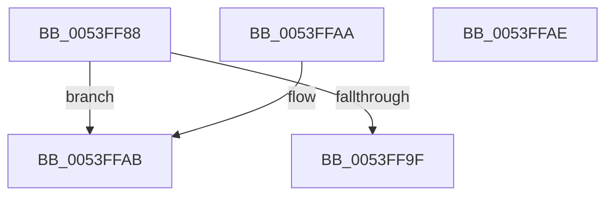

# HalpAllocateHalCounters

- RVA: `0x0053FF88`–`0x0053FFAF` (길이 `39` bytes)
- VA: `0x000000014053FF88`
- 실행 섹션: `.text`
- PDB 이름 있음: `예`; PDB Function 태그: `아니요`
- unwind 정보 RVA: `0x000DB714`
- 디코드: `12`개 명령, `39/39` bytes 표시
- 미해석 바이트: `0` (있으면 어셈블리에 `.byte`로 보존)

> 이 문서는 커널 이미지의 기계어와 PDB 기호를 분석해 생성했습니다. 4번과 5번은 함수 원형과 자료형을 바이너리 사용 방식에서 추정한 C 해석이며 원본 소스 복구 결과는 아닙니다.

## 1. Dependencies

- 직접 호출 지점: **0**; 고유 호출 대상: **0**
- 직접 호출자로 확인된 함수: **4**
- RIP 상대 이미지 참조: **0**

### Outgoing calls
- 직접 디코드된 call 명령이 없습니다.

### Direct callers
- [EmonAllocateCounterEnhanced](../55/EmonAllocateCounterEnhanced_function_0055C0B0.md) at `0x0055C0D8`
- [EmonAllocateCounterOriginal](../55/EmonAllocateCounterOriginal_function_0055C24C.md) at `0x0055C274`
- [EmonMarkCountersReserved](../55/EmonMarkCountersReserved_function_0055D600.md) at `0x0055D651`
- [Amd64AllocateCounter](../56/Amd64AllocateCounter_function_0056B92C.md) at `0x0056B95A`

### Static image references
- 디코드된 RIP-relative 메모리 참조가 없습니다.

## 2. Other-region calls and transfers

- 다른 실행 섹션으로 향하는 call: **0**
- 별도 외부 분기/꼬리 이동을 확인하지 못했습니다.

## 3. Assembly (complete function range)

```asm
0053FF88  65 48 8B 0C 25 20 00 00 00      mov rcx, qword ptr gs:[0x20]
0053FF91  B8 02 00 00 00                  mov eax, 2
0053FF96  F0 0F C1 41 60                  lock xadd dword ptr [rcx + 0x60], eax
0053FF9B  A8 01                           test al, 1
0053FF9D  74 0C                           je 0x14053ffab
0053FF9F  F0 83 41 60 FE                  lock add dword ptr [rcx + 0x60], -2
0053FFA4  B8 01 00 00 C0                  mov eax, 0xc0000001
0053FFA9  C3                              ret
0053FFAA  CC                              int3
0053FFAB  33 C0                           xor eax, eax
0053FFAD  C3                              ret
0053FFAE  CC                              int3
```

## 4. C-style interpretation (structured pseudocode)

```c
__int64 __fastcall HalpAllocateHalCounters(void)
{
    __int64 result;

    if (((2) & (1)) == 0) goto loc_0053FFAB;
    return (unsigned int)(0xC0000001ULL);
loc_0053FFAB:
    result = 0;
    return result;
}
```

## 5. (Beta) C Style

```c
void HalpAllocateHalCounters(void)
{
    int64_t result;

    if (((2) & (1)) == 0) goto loc_0053FFAB;
    return (uint32_t)(0xC0000001ULL);
loc_0053FFAB:
    result = 0;
    return result;
}
```

## 6. Execution-region graph

[열기: 2D/3D 그래프와 함수 탐색 컨트롤 패널](../../../control-panel.html?section=text&rva=0x0053FF88&view=graph)

- 2D 그래프는 위에서 아래로 흐르고, 3D 그래프는 빈 공간을 드래그해 회전합니다. Shift+드래그는 이동, 휠은 확대·축소, 함수 노드 선택은 대상 보고서 이동입니다.

### Static fallback


