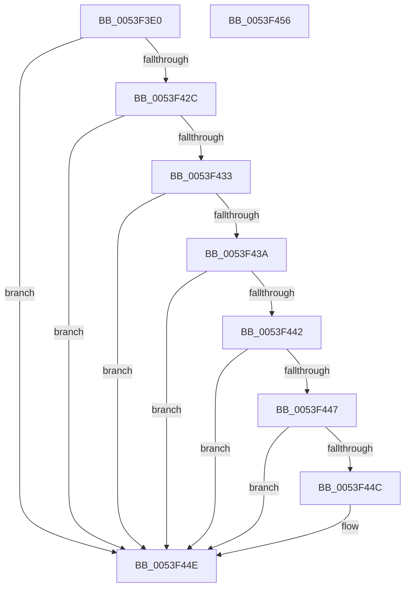

# HalpAreDriversDmarCompatible

- RVA: `0x0053F3E0`–`0x0053F457` (길이 `119` bytes)
- VA: `0x000000014053F3E0`
- 실행 섹션: `.text`
- PDB 이름 있음: `예`; PDB Function 태그: `아니요`
- unwind 정보 RVA: `0x0007F554`
- 디코드: `37`개 명령, `119/119` bytes 표시
- 미해석 바이트: `0` (있으면 어셈블리에 `.byte`로 보존)

> 이 문서는 커널 이미지의 기계어와 PDB 기호를 분석해 생성했습니다. 4번과 5번은 함수 원형과 자료형을 바이너리 사용 방식에서 추정한 C 해석이며 원본 소스 복구 결과는 아닙니다.

## 1. Dependencies

- 직접 호출 지점: **1**; 고유 호출 대상: **1**
- 직접 호출자로 확인된 함수: **1**
- RIP 상대 이미지 참조: **1**

### Outgoing calls
- `0x0053F423` → [IoGetDevicePropertyData](../../page/90/IoGetDevicePropertyData_function_009005E0.md) (function, `0x009005E0`)

### Direct callers
- [HalpGetAdapter](../../page/70/HalpGetAdapter_function_00706EBC.md) at `0x00706EF0`

### Static image references
- `0x0053F3F2` → RVA `0x00022A50` (`.rdata`; read)

## 2. Other-region calls and transfers

- 다른 실행 섹션으로 향하는 call: **1**
  - `0x0053F423` → [IoGetDevicePropertyData](../../page/90/IoGetDevicePropertyData_function_009005E0.md) (`.text` → `PAGE`)
- 별도 외부 분기/꼬리 이동을 확인하지 못했습니다.

## 3. Assembly (complete function range)

```asm
0053F3E0  4C 8B DC                        mov r11, rsp
0053F3E3  53                              push rbx
0053F3E4  48 83 EC 40                     sub rsp, 0x40
0053F3E8  49 8D 43 10                     lea rax, [r11 + 0x10]
0053F3EC  33 DB                           xor ebx, ebx
0053F3EE  49 89 43 F0                     mov qword ptr [r11 - 0x10], rax
0053F3F2  48 8D 15 57 36 AE FF            lea rdx, [rip - 0x51c9a9]
0053F3F9  49 8D 43 18                     lea rax, [r11 + 0x18]
0053F3FD  89 5C 24 68                     mov dword ptr [rsp + 0x68], ebx
0053F401  49 89 43 E8                     mov qword ptr [r11 - 0x18], rax
0053F405  45 33 C9                        xor r9d, r9d
0053F408  49 8D 43 20                     lea rax, [r11 + 0x20]
0053F40C  89 5C 24 60                     mov dword ptr [rsp + 0x60], ebx
0053F410  49 89 43 E0                     mov qword ptr [r11 - 0x20], rax
0053F414  45 33 C0                        xor r8d, r8d
0053F417  C7 44 24 20 04 00 00 00         mov dword ptr [rsp + 0x20], 4
0053F41F  89 5C 24 58                     mov dword ptr [rsp + 0x58], ebx
0053F423  E8 B8 11 3C 00                  call 0x1409005e0
0053F428  85 C0                           test eax, eax
0053F42A  78 22                           js 0x14053f44e
0053F42C  83 7C 24 58 07                  cmp dword ptr [rsp + 0x58], 7
0053F431  75 1B                           jne 0x14053f44e
0053F433  83 7C 24 60 04                  cmp dword ptr [rsp + 0x60], 4
0053F438  75 14                           jne 0x14053f44e
0053F43A  8B 4C 24 68                     mov ecx, dword ptr [rsp + 0x68]
0053F43E  85 C9                           test ecx, ecx
0053F440  74 0C                           je 0x14053f44e
0053F442  83 E9 01                        sub ecx, 1
0053F445  74 07                           je 0x14053f44e
0053F447  83 F9 01                        cmp ecx, 1
0053F44A  75 02                           jne 0x14053f44e
0053F44C  8A D9                           mov bl, cl
0053F44E  8A C3                           mov al, bl
0053F450  48 83 C4 40                     add rsp, 0x40
0053F454  5B                              pop rbx
0053F455  C3                              ret
0053F456  CC                              int3
```

## 4. C-style interpretation (structured pseudocode)

```c
__int64 __fastcall HalpAreDriversDmarCompatible(__int64 a1, __int64 a2, int a3, int a4)
{
    __int64 result;
    __int64 v_rbx;
    __int64 v_rsp;
    unsigned int v_stack_m28;
    unsigned int v_stack_p10;
    unsigned int v_stack_p18;
    unsigned int v_stack_p20;

    v_rsp = (v_rsp) - (64);
    v_rbx = 0;
    *(unsigned __int64 *)(v_rsp - 16) = v_rsp + 16;
    v_stack_p20 = 0;
    *(unsigned __int64 *)(v_rsp - 24) = v_rsp + 24;
    a4 = 0;
    v_stack_p18 = 0;
    *(unsigned __int64 *)(v_rsp - 32) = v_rsp + 32;
    a3 = 0;
    v_stack_m28 = 4;
    v_stack_p10 = 0;
    result = IoGetDevicePropertyData(a1, v_rip - 5360041, a3, a4);
    if (sign_flag) goto loc_0053F44E;
    if (v_stack_p10 != 7) goto loc_0053F44E;
    if (v_stack_p18 != 4) goto loc_0053F44E;
    if ((unsigned int)((unsigned int)(v_stack_p20)) == 0) goto loc_0053F44E;
    a1 = (unsigned int)(((unsigned int)(v_stack_p20)) - (1));
    if (condition_is_equal) goto loc_0053F44E;
    if (((unsigned int)(a1)) == 1) {
        v_rbx = (unsigned __int8)(a1);
    }
    v_rsp = (v_rsp) + (64);
    return (unsigned __int8)(v_rbx);
}
```

## 5. (Beta) C Style

```c
int64_t HalpAreDriversDmarCompatible(int64_t Arg1, int64_t Arg2, int32_t Arg3, int32_t Arg4)
{
    int64_t result;
    int64_t local_rbx;
    int64_t local_rsp;
    uint32_t v_stack_m28;
    uint32_t v_stack_p10;
    uint32_t v_stack_p18;
    uint32_t v_stack_p20;

    local_rsp = (local_rsp) - (64);
    local_rbx = 0;
    *(uint64_t *)(local_rsp - 0x10) = local_rsp + 16;
    v_stack_p20 = 0;
    *(uint64_t *)(local_rsp - 0x18) = local_rsp + 24;
    Arg4 = 0;
    v_stack_p18 = 0;
    *(uint64_t *)(local_rsp - 0x20) = local_rsp + 32;
    Arg3 = 0;
    v_stack_m28 = 4;
    v_stack_p10 = 0;
    result = IoGetDevicePropertyData(Arg1, v_rip - 5360041, Arg3, Arg4);
    if (sign_flag) goto loc_0053F44E;
    if (v_stack_p10 != 7) goto loc_0053F44E;
    if (v_stack_p18 != 4) goto loc_0053F44E;
    if ((uint32_t)((uint32_t)(v_stack_p20)) == 0) goto loc_0053F44E;
    Arg1 = (uint32_t)(((uint32_t)(v_stack_p20)) - (1));
    if (condition_is_equal) goto loc_0053F44E;
    if (((uint32_t)(Arg1)) == 1) {
        local_rbx = (uint8_t)(Arg1);
    }
    local_rsp = (local_rsp) + (64);
    return (uint8_t)(local_rbx);
}
```

## 6. Execution-region graph

[열기: 2D/3D 그래프와 함수 탐색 컨트롤 패널](../../../control-panel.html?section=text&rva=0x0053F3E0&view=graph)

- 2D 그래프는 위에서 아래로 흐르고, 3D 그래프는 빈 공간을 드래그해 회전합니다. Shift+드래그는 이동, 휠은 확대·축소, 함수 노드 선택은 대상 보고서 이동입니다.

### Static fallback


