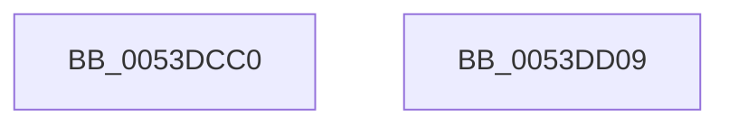

# HalpBiosDisplayReset

- RVA: `0x0053DCC0`–`0x0053DD0A` (길이 `74` bytes)
- VA: `0x000000014053DCC0`
- 실행 섹션: `.text`
- PDB 이름 있음: `예`; PDB Function 태그: `아니요`
- unwind 정보 RVA: `0x00060904`
- 디코드: `17`개 명령, `74/74` bytes 표시
- 미해석 바이트: `0` (있으면 어셈블리에 `.byte`로 보존)

> 이 문서는 커널 이미지의 기계어와 PDB 기호를 분석해 생성했습니다. 4번과 5번은 함수 원형과 자료형을 바이너리 사용 방식에서 추정한 C 해석이며 원본 소스 복구 결과는 아닙니다.

## 1. Dependencies

- 직접 호출 지점: **2**; 고유 호출 대상: **2**
- 직접 호출자로 확인된 함수: **0**
- RIP 상대 이미지 참조: **1**

### Outgoing calls
- `0x0053DCF2` → [x86BiosCall](x86BiosCall_function_0053DD30.md) (function, `0x0053DD30`)
- `0x0053DCFF` → [_security_check_cookie](../6A/_security_check_cookie_function_006AC640.md) (function, `0x006AC640`)

### Direct callers
- 이 함수 시작 RVA로 연결되는 직접 call은 확인되지 않았습니다. 간접 호출은 완전히 역산할 수 없습니다.

### Static image references
- `0x0053DCC4` → RVA `0x00E0A740` (`.data`; read)

## 2. Other-region calls and transfers

- 다른 실행 섹션으로 향하는 call: **0**
- 별도 외부 분기/꼬리 이동을 확인하지 못했습니다.

## 3. Assembly (complete function range)

```asm
0053DCC0  48 83 EC 58                     sub rsp, 0x58
0053DCC4  48 8B 05 75 CA 8C 00            mov rax, qword ptr [rip + 0x8cca75]
0053DCCB  48 33 C4                        xor rax, rsp
0053DCCE  48 89 44 24 40                  mov qword ptr [rsp + 0x40], rax
0053DCD3  0F 57 C0                        xorps xmm0, xmm0
0053DCD6  48 8D 54 24 20                  lea rdx, [rsp + 0x20]
0053DCDB  0F 11 44 24 20                  movups xmmword ptr [rsp + 0x20], xmm0
0053DCE0  B9 10 00 00 00                  mov ecx, 0x10
0053DCE5  C7 44 24 20 12 00 00 00         mov dword ptr [rsp + 0x20], 0x12
0053DCED  0F 11 44 24 30                  movups xmmword ptr [rsp + 0x30], xmm0
0053DCF2  E8 39 00 00 00                  call 0x14053dd30
0053DCF7  48 8B 4C 24 40                  mov rcx, qword ptr [rsp + 0x40]
0053DCFC  48 33 CC                        xor rcx, rsp
0053DCFF  E8 3C E9 16 00                  call 0x1406ac640
0053DD04  48 83 C4 58                     add rsp, 0x58
0053DD08  C3                              ret
0053DD09  CC                              int3
```

## 4. C-style interpretation (structured pseudocode)

```c
__int64 __fastcall HalpBiosDisplayReset(void)
{
    __int64 result;
    __int64 v_rsp;
    unsigned __int64 v_stack_m18;
    unsigned __int64 v_stack_m28;
    unsigned __int64 v_stack_m38;

    v_rsp = (v_rsp) - (88);
    result = (*(unsigned __int64 *)(v_rip + 9226869)) ^ (v_rsp);
    v_stack_m18 = result;
    v_stack_m38 = v_xmm0;
    v_stack_m38 = 18;
    v_stack_m28 = v_xmm0;
    result = x86BiosCall(16, v_stack_m38, a3, a4);
    a1 = (v_stack_m18) ^ (v_rsp);
    result = _security_check_cookie(a1, v_stack_m38, a3, a4);
    v_rsp = (v_rsp) + (88);
    return result;
}
```

## 5. (Beta) C Style

```c
void HalpBiosDisplayReset(void)
{
    int64_t result;
    int64_t local_rsp;
    uint64_t v_stack_m18;
    uint64_t v_stack_m28;
    uint64_t v_stack_m38;

    local_rsp = (local_rsp) - (88);
    result = (*(uint64_t *)(v_rip + 0x8CCA75)) ^ (local_rsp);
    v_stack_m18 = result;
    v_stack_m38 = v_xmm0;
    v_stack_m38 = 18;
    v_stack_m28 = v_xmm0;
    result = x86BiosCall(16, v_stack_m38, a3, a4);
    a1 = (v_stack_m18) ^ (local_rsp);
    result = _security_check_cookie(a1, v_stack_m38, a3, a4);
    local_rsp = (local_rsp) + (88);
    return result;
}
```

## 6. Execution-region graph

[열기: 2D/3D 그래프와 함수 탐색 컨트롤 패널](../../../control-panel.html?section=text&rva=0x0053DCC0&view=graph)

- 2D 그래프는 위에서 아래로 흐르고, 3D 그래프는 빈 공간을 드래그해 회전합니다. Shift+드래그는 이동, 휠은 확대·축소, 함수 노드 선택은 대상 보고서 이동입니다.

### Static fallback


