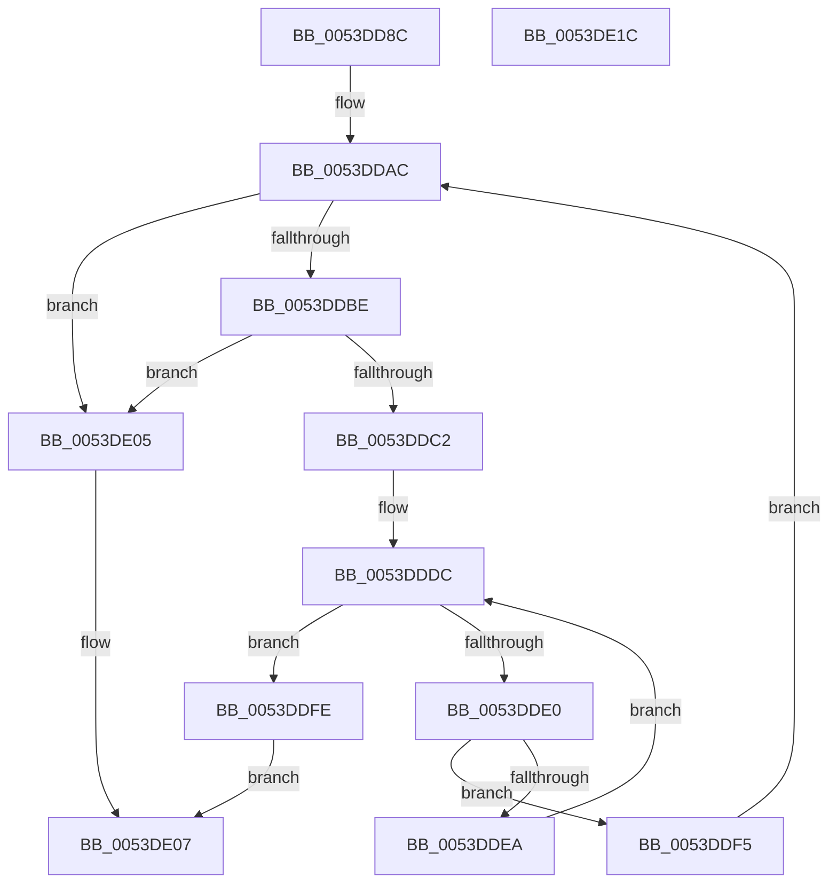

# HalpDmaAllocateContiguousPagesFromContiguousPoolAtHighLevelV3

- RVA: `0x0053DD8C`–`0x0053DE1D` (길이 `145` bytes)
- VA: `0x000000014053DD8C`
- 실행 섹션: `.text`
- PDB 이름 있음: `예`; PDB Function 태그: `아니요`
- unwind 정보 RVA: `0x0005C954`
- 디코드: `47`개 명령, `145/145` bytes 표시
- 미해석 바이트: `0` (있으면 어셈블리에 `.byte`로 보존)

> 이 문서는 커널 이미지의 기계어와 PDB 기호를 분석해 생성했습니다. 4번과 5번은 함수 원형과 자료형을 바이너리 사용 방식에서 추정한 C 해석이며 원본 소스 복구 결과는 아닙니다.

## 1. Dependencies

- 직접 호출 지점: **2**; 고유 호출 대상: **2**
- 직접 호출자로 확인된 함수: **1**
- RIP 상대 이미지 참조: **0**

### Outgoing calls
- `0x0053DDB2` → [RtlFindClearBitsAndSet](../3E/RtlFindClearBitsAndSet_function_003E0CD0.md) (function, `0x003E0CD0`)
- `0x0053DDD0` → [HalpDmaLinkContiguousTranslations](../3E/HalpDmaLinkContiguousTranslations_function_003E1CCC.md) (function, `0x003E1CCC`)

### Direct callers
- [HalpDmaAllocateContiguousPagesFromContiguousPoolAtHighLevel](HalpDmaAllocateContiguousPagesFromContiguousPoolAtHighLevel_function_0053F460.md) at `0x0053F474`

### Static image references
- 디코드된 RIP-relative 메모리 참조가 없습니다.

## 2. Other-region calls and transfers

- 다른 실행 섹션으로 향하는 call: **0**
- 별도 외부 분기/꼬리 이동을 확인하지 못했습니다.

## 3. Assembly (complete function range)

```asm
0053DD8C  48 89 5C 24 08                  mov qword ptr [rsp + 8], rbx
0053DD91  48 89 6C 24 10                  mov qword ptr [rsp + 0x10], rbp
0053DD96  48 89 74 24 18                  mov qword ptr [rsp + 0x18], rsi
0053DD9B  57                              push rdi
0053DD9C  48 83 EC 20                     sub rsp, 0x20
0053DDA0  83 CF FF                        or edi, 0xffffffff
0053DDA3  41 8B F0                        mov esi, r8d
0053DDA6  45 33 C0                        xor r8d, r8d
0053DDA9  48 8B EA                        mov rbp, rdx
0053DDAC  48 8B 4D 18                     mov rcx, qword ptr [rbp + 0x18]
0053DDB0  8B D6                           mov edx, esi
0053DDB2  E8 19 2F EA FF                  call 0x1403e0cd0
0053DDB7  8B D8                           mov ebx, eax
0053DDB9  83 F8 FF                        cmp eax, -1
0053DDBC  74 47                           je 0x14053de05
0053DDBE  3B C7                           cmp eax, edi
0053DDC0  74 43                           je 0x14053de05
0053DDC2  83 FF FF                        cmp edi, -1
0053DDC5  44 8B C6                        mov r8d, esi
0053DDC8  8B D0                           mov edx, eax
0053DDCA  48 8B CD                        mov rcx, rbp
0053DDCD  0F 44 F8                        cmove edi, eax
0053DDD0  E8 F7 3E EA FF                  call 0x1403e1ccc
0053DDD5  33 C9                           xor ecx, ecx
0053DDD7  4C 8B C0                        mov r8, rax
0053DDDA  33 D2                           xor edx, edx
0053DDDC  3B D6                           cmp edx, esi
0053DDDE  73 1E                           jae 0x14053ddfe
0053DDE0  49 F7 40 30 00 F0 FF FF         test qword ptr [r8 + 0x30], -0x1000
0053DDE8  74 0B                           je 0x14053ddf5
0053DDEA  49 8B C8                        mov rcx, r8
0053DDED  FF C2                           inc edx
0053DDEF  4D 8B 40 08                     mov r8, qword ptr [r8 + 8]
0053DDF3  EB E7                           jmp 0x14053dddc
0053DDF5  44 8D 42 01                     lea r8d, [rdx + 1]
0053DDF9  44 03 C3                        add r8d, ebx
0053DDFC  EB AE                           jmp 0x14053ddac
0053DDFE  48 83 61 08 00                  and qword ptr [rcx + 8], 0
0053DE03  EB 02                           jmp 0x14053de07
0053DE05  33 C0                           xor eax, eax
0053DE07  48 8B 5C 24 30                  mov rbx, qword ptr [rsp + 0x30]
0053DE0C  48 8B 6C 24 38                  mov rbp, qword ptr [rsp + 0x38]
0053DE11  48 8B 74 24 40                  mov rsi, qword ptr [rsp + 0x40]
0053DE16  48 83 C4 20                     add rsp, 0x20
0053DE1A  5F                              pop rdi
0053DE1B  C3                              ret
0053DE1C  CC                              int3
```

## 4. C-style interpretation (structured pseudocode)

```c
__int64 __fastcall HalpDmaAllocateContiguousPagesFromContiguousPoolAtHighLevelV3(__int64 a1, __int64 a2, int a3)
{
    __int64 result;
    __int64 v_rdi;
    __int64 v_rsp;
    unsigned __int64 v_stack_p10;
    unsigned __int64 v_stack_p18;
    unsigned __int64 v_stack_p8;

    v_stack_p8 = v_rbx;
    v_stack_p10 = v_rbp;
    v_stack_p18 = v_rsi;
    v_rsp = (v_rsp) - (32);
    v_rdi = (unsigned int)((v_rdi) | (0xFFFFFFFFULL));
    a3 = 0;
loc_0053DDAC:
    result = RtlFindClearBitsAndSet(*(unsigned __int64 *)(a2 + 24), (unsigned int)((unsigned int)((unsigned int)(a3))), a3, a4);
    if (((unsigned int)(result)) == -1) goto loc_0053DE05;
    if (((unsigned int)(result)) == ((unsigned int)(v_rdi))) goto loc_0053DE05;
    if (((unsigned int)(v_rdi)) == -1) { v_rdi = (unsigned int)(result); }
    result = HalpDmaLinkContiguousTranslations(a2, (unsigned int)((unsigned int)(result)), (unsigned int)((unsigned int)((unsigned int)(a3))), a4);
    a1 = 0;
    a2 = 0;
loc_0053DDDC:
    if (0 >= ((unsigned int)((unsigned int)(a3)))) goto loc_0053DDFE;
    if (((*(unsigned __int64 *)(result + 48)) & (0xFFFFFFFFFFFFF000ULL)) == 0) goto loc_0053DDF5;
    a2 = (unsigned int)((a2) + 1);
    goto loc_0053DDDC;
loc_0053DDF5:
    a3 = (unsigned int)((a2 + 1) + ((unsigned int)((unsigned int)((unsigned int)(result)))));
    goto loc_0053DDAC;
loc_0053DDFE:
    goto loc_0053DE07;
loc_0053DE05:
    result = 0;
loc_0053DE07:
    v_rsp = (v_rsp) + (32);
    return result;
}
```

## 5. (Beta) C Style

```c
int64_t HalpDmaAllocateContiguousPagesFromContiguousPoolAtHighLevelV3(int64_t Arg1, void *Arg2, int32_t Arg3)
{
    uint8_t *arg2 = (uint8_t *)Arg2;

    int64_t result;
    int64_t local_rdi;
    int64_t local_rsp;
    uint64_t v_stack_p10;
    uint64_t v_stack_p18;
    uint64_t v_stack_p8;

    v_stack_p8 = local_rbx;
    v_stack_p10 = local_rbp;
    v_stack_p18 = local_rsi;
    local_rsp = (local_rsp) - (32);
    local_rdi = (uint32_t)((local_rdi) | (0xFFFFFFFFULL));
    Arg3 = 0;
loc_0053DDAC:
    result = RtlFindClearBitsAndSet(*(uint64_t *)(arg2 + 0x18), (uint32_t)((uint32_t)((uint32_t)(Arg3))), Arg3, a4);
    if (((uint32_t)(result)) == -1) goto loc_0053DE05;
    if (((uint32_t)(result)) == ((uint32_t)(local_rdi))) goto loc_0053DE05;
    if (((uint32_t)(local_rdi)) == -1) { local_rdi = (uint32_t)(result); }
    result = HalpDmaLinkContiguousTranslations(Arg2, (uint32_t)((uint32_t)(result)), (uint32_t)((uint32_t)((uint32_t)(Arg3))), a4);
    Arg1 = 0;
    Arg2 = 0;
loc_0053DDDC:
    if (0 >= ((uint32_t)((uint32_t)(Arg3)))) goto loc_0053DDFE;
    if (((*(uint64_t *)(result + 0x30)) & (0xFFFFFFFFFFFFF000ULL)) == 0) goto loc_0053DDF5;
    Arg2 = (uint32_t)((Arg2) + 1);
    goto loc_0053DDDC;
loc_0053DDF5:
    Arg3 = (uint32_t)((Arg2 + 1) + ((uint32_t)((uint32_t)((uint32_t)(result)))));
    goto loc_0053DDAC;
loc_0053DDFE:
    goto loc_0053DE07;
loc_0053DE05:
    result = 0;
loc_0053DE07:
    local_rsp = (local_rsp) + (32);
    return result;
}
```

### 관측된 메모리 오프셋

구조체 형식이 확인되지 않은 접근은 인자 기준의 오프셋으로만 기록했습니다.

| 기준 인자 | 오프셋 표현 | 폭 (bit) | 접근 |
|---|---:|---:|---|
| `Arg2` | `+ 0x18` | `64` | `R` |

## 6. Execution-region graph

[열기: 2D/3D 그래프와 함수 탐색 컨트롤 패널](../../../control-panel.html?section=text&rva=0x0053DD8C&view=graph)

- 2D 그래프는 위에서 아래로 흐르고, 3D 그래프는 빈 공간을 드래그해 회전합니다. Shift+드래그는 이동, 휠은 확대·축소, 함수 노드 선택은 대상 보고서 이동입니다.

### Static fallback


