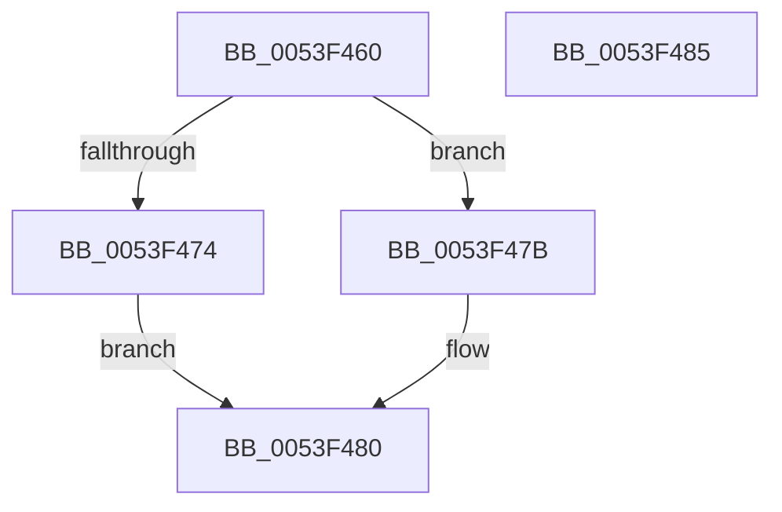

# HalpDmaAllocateContiguousPagesFromContiguousPoolAtHighLevel

- RVA: `0x0053F460`–`0x0053F486` (길이 `38` bytes)
- VA: `0x000000014053F460`
- 실행 섹션: `.text`
- PDB 이름 있음: `예`; PDB Function 태그: `아니요`
- unwind 정보 RVA: `0x0005C788`
- 디코드: `12`개 명령, `38/38` bytes 표시
- 미해석 바이트: `0` (있으면 어셈블리에 `.byte`로 보존)

> 이 문서는 커널 이미지의 기계어와 PDB 기호를 분석해 생성했습니다. 4번과 5번은 함수 원형과 자료형을 바이너리 사용 방식에서 추정한 C 해석이며 원본 소스 복구 결과는 아닙니다.

## 1. Dependencies

- 직접 호출 지점: **3**; 고유 호출 대상: **3**
- 직접 호출자로 확인된 함수: **1**
- RIP 상대 이미지 참조: **0**

### Outgoing calls
- `0x0053F467` → [HalpDmaGetAdapterVersion](../3D/HalpDmaGetAdapterVersion_function_003DEC8C.md) (function, `0x003DEC8C`)
- `0x0053F474` → [HalpDmaAllocateContiguousPagesFromContiguousPoolAtHighLevelV3](HalpDmaAllocateContiguousPagesFromContiguousPoolAtHighLevelV3_function_0053DD8C.md) (function, `0x0053DD8C`)
- `0x0053F47B` → [HalpDmaAllocateContiguousPagesFromContiguousPoolAtHighLevelV2](../55/HalpDmaAllocateContiguousPagesFromContiguousPoolAtHighLevelV2_function_00553DE4.md) (function, `0x00553DE4`)

### Direct callers
- [HalpDmaAllocateMapRegistersAtHighLevel](../55/HalpDmaAllocateMapRegistersAtHighLevel_function_005507A8.md) at `0x00550821`
- [HalpDmaAllocateMapRegistersAtHighLevel](../55/HalpDmaAllocateMapRegistersAtHighLevel_function_005507A8.md) at `0x0055085D`

### Static image references
- 디코드된 RIP-relative 메모리 참조가 없습니다.

## 2. Other-region calls and transfers

- 다른 실행 섹션으로 향하는 call: **0**
- 별도 외부 분기/꼬리 이동을 확인하지 못했습니다.

## 3. Assembly (complete function range)

```asm
0053F460  48 83 EC 28                     sub rsp, 0x28
0053F464  4C 8B CA                        mov r9, rdx
0053F467  E8 20 F8 E9 FF                  call 0x1403dec8c
0053F46C  49 8B D1                        mov rdx, r9
0053F46F  83 E8 02                        sub eax, 2
0053F472  74 07                           je 0x14053f47b
0053F474  E8 13 E9 FF FF                  call 0x14053dd8c
0053F479  EB 05                           jmp 0x14053f480
0053F47B  E8 64 49 01 00                  call 0x140553de4
0053F480  48 83 C4 28                     add rsp, 0x28
0053F484  C3                              ret
0053F485  CC                              int3
```

## 4. C-style interpretation (structured pseudocode)

```c
__int64 __fastcall HalpDmaAllocateContiguousPagesFromContiguousPoolAtHighLevel(__int64 a1, __int64 a2)
{
    __int64 result;
    __int64 v_rsp;

    v_rsp = (v_rsp) - (40);
    result = HalpDmaGetAdapterVersion(a1, a2, a3, a2);
    result = (unsigned int)((result) - (2));
    if (condition_is_equal) goto loc_0053F47B;
    result = HalpDmaAllocateContiguousPagesFromContiguousPoolAtHighLevelV3(a1, a2, a3, a2);
    goto loc_0053F480;
loc_0053F47B:
    result = HalpDmaAllocateContiguousPagesFromContiguousPoolAtHighLevelV2(a1, a2, a3, a2);
loc_0053F480:
    v_rsp = (v_rsp) + (40);
    return result;
}
```

## 5. (Beta) C Style

```c
int64_t HalpDmaAllocateContiguousPagesFromContiguousPoolAtHighLevel(int64_t Arg1, int64_t Arg2)
{
    int64_t result;
    int64_t local_rsp;

    local_rsp = (local_rsp) - (40);
    result = HalpDmaGetAdapterVersion(Arg1, Arg2, a3, Arg2);
    result = (uint32_t)((result) - (2));
    if (condition_is_equal) goto loc_0053F47B;
    result = HalpDmaAllocateContiguousPagesFromContiguousPoolAtHighLevelV3(Arg1, Arg2, a3, Arg2);
    goto loc_0053F480;
loc_0053F47B:
    result = HalpDmaAllocateContiguousPagesFromContiguousPoolAtHighLevelV2(Arg1, Arg2, a3, Arg2);
loc_0053F480:
    local_rsp = (local_rsp) + (40);
    return result;
}
```

## 6. Execution-region graph

[열기: 2D/3D 그래프와 함수 탐색 컨트롤 패널](../../../control-panel.html?section=text&rva=0x0053F460&view=graph)

- 2D 그래프는 위에서 아래로 흐르고, 3D 그래프는 빈 공간을 드래그해 회전합니다. Shift+드래그는 이동, 휠은 확대·축소, 함수 노드 선택은 대상 보고서 이동입니다.

### Static fallback


