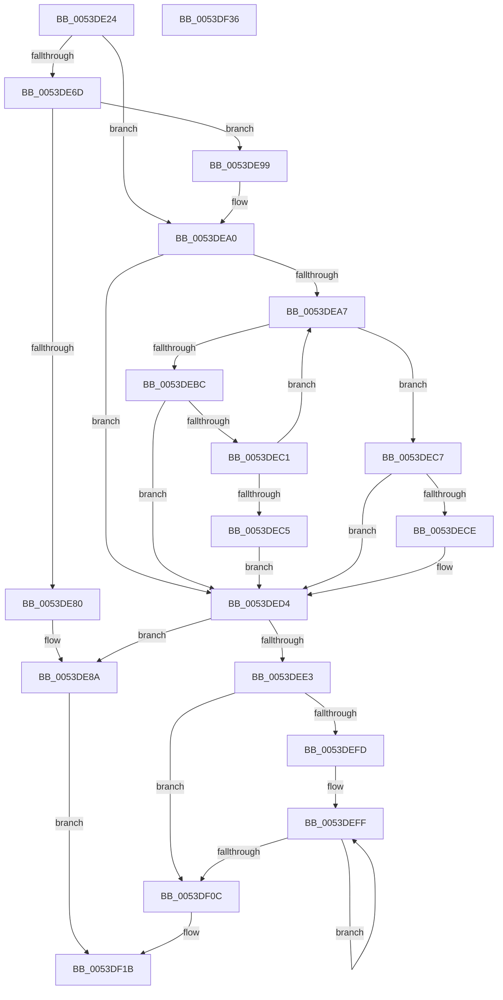

# HalpDmaAllocateContiguousPagesFromContiguousPoolV3

- RVA: `0x0053DE24`–`0x0053DF37` (길이 `275` bytes)
- VA: `0x000000014053DE24`
- 실행 섹션: `.text`
- PDB 이름 있음: `예`; PDB Function 태그: `아니요`
- unwind 정보 RVA: `0x000BE230`
- 디코드: `82`개 명령, `275/275` bytes 표시
- 미해석 바이트: `0` (있으면 어셈블리에 `.byte`로 보존)

> 이 문서는 커널 이미지의 기계어와 PDB 기호를 분석해 생성했습니다. 4번과 5번은 함수 원형과 자료형을 바이너리 사용 방식에서 추정한 C 해석이며 원본 소스 복구 결과는 아닙니다.

## 1. Dependencies

- 직접 호출 지점: **5**; 고유 호출 대상: **4**
- 직접 호출자로 확인된 함수: **2**
- RIP 상대 이미지 참조: **0**

### Outgoing calls
- `0x0053DE61` → [KeAcquireInStackQueuedSpinLock](../27/KeAcquireInStackQueuedSpinLock_function_002757A0.md) (function, `0x002757A0`)
- `0x0053DE85` → [KeReleaseInStackQueuedSpinLock](../34/KeReleaseInStackQueuedSpinLock_function_00342CE0.md) (function, `0x00342CE0`)
- `0x0053DEB0` → [RtlFindClearBitsAndSet](../3E/RtlFindClearBitsAndSet_function_003E0CD0.md) (function, `0x003E0CD0`)
- `0x0053DED9` → [KeReleaseInStackQueuedSpinLock](../34/KeReleaseInStackQueuedSpinLock_function_00342CE0.md) (function, `0x00342CE0`)
- `0x0053DEEB` → [HalpDmaLinkContiguousTranslations](../3E/HalpDmaLinkContiguousTranslations_function_003E1CCC.md) (function, `0x003E1CCC`)

### Direct callers
- [HalpDmaAllocateMapRegisters](../3D/HalpDmaAllocateMapRegisters_function_003DDA0C.md) at `0x003DDD2D`
- [HalpDmaAllocateMapRegisters](../3D/HalpDmaAllocateMapRegisters_function_003DDA0C.md) at `0x003DDD57`
- [HalpDmaAllocateContiguousPagesFromContiguousPool](../3E/HalpDmaAllocateContiguousPagesFromContiguousPool_function_003E024C.md) at `0x003E0292`

### Static image references
- 디코드된 RIP-relative 메모리 참조가 없습니다.

## 2. Other-region calls and transfers

- 다른 실행 섹션으로 향하는 call: **0**
- 별도 외부 분기/꼬리 이동을 확인하지 못했습니다.

## 3. Assembly (complete function range)

```asm
0053DE24  4C 8B DC                        mov r11, rsp
0053DE27  49 89 5B 08                     mov qword ptr [r11 + 8], rbx
0053DE2B  49 89 6B 10                     mov qword ptr [r11 + 0x10], rbp
0053DE2F  49 89 73 18                     mov qword ptr [r11 + 0x18], rsi
0053DE33  49 89 7B 20                     mov qword ptr [r11 + 0x20], rdi
0053DE37  41 57                           push r15
0053DE39  48 83 EC 40                     sub rsp, 0x40
0053DE3D  0F 57 C0                        xorps xmm0, xmm0
0053DE40  48 8D 8A 80 00 00 00            lea rcx, [rdx + 0x80]
0053DE47  48 8B FA                        mov rdi, rdx
0053DE4A  33 C0                           xor eax, eax
0053DE4C  0F 11 44 24 20                  movups xmmword ptr [rsp + 0x20], xmm0
0053DE51  49 8D 53 D8                     lea rdx, [r11 - 0x28]
0053DE55  49 89 43 E8                     mov qword ptr [r11 - 0x18], rax
0053DE59  45 8A F9                        mov r15b, r9b
0053DE5C  41 8B D8                        mov ebx, r8d
0053DE5F  33 ED                           xor ebp, ebp
0053DE61  E8 3A 79 D3 FF                  call 0x1402757a0
0053DE66  40 38 6C 24 70                  cmp byte ptr [rsp + 0x70], bpl
0053DE6B  74 33                           je 0x14053dea0
0053DE6D  8B 87 D8 00 00 00               mov eax, dword ptr [rdi + 0xd8]
0053DE73  48 8B EF                        mov rbp, rdi
0053DE76  8B 8F DC 00 00 00               mov ecx, dword ptr [rdi + 0xdc]
0053DE7C  3B C1                           cmp eax, ecx
0053DE7E  77 19                           ja 0x14053de99
0053DE80  48 8D 4C 24 20                  lea rcx, [rsp + 0x20]
0053DE85  E8 56 4E E0 FF                  call 0x140342ce0
0053DE8A  48 8B 44 24 78                  mov rax, qword ptr [rsp + 0x78]
0053DE8F  83 20 00                        and dword ptr [rax], 0
0053DE92  33 C0                           xor eax, eax
0053DE94  E9 82 00 00 00                  jmp 0x14053df1b
0053DE99  2B C1                           sub eax, ecx
0053DE9B  3B D8                           cmp ebx, eax
0053DE9D  0F 47 D8                        cmova ebx, eax
0053DEA0  83 CE FF                        or esi, 0xffffffff
0053DEA3  85 DB                           test ebx, ebx
0053DEA5  74 2D                           je 0x14053ded4
0053DEA7  48 8B 4F 18                     mov rcx, qword ptr [rdi + 0x18]
0053DEAB  45 33 C0                        xor r8d, r8d
0053DEAE  8B D3                           mov edx, ebx
0053DEB0  E8 1B 2E EA FF                  call 0x1403e0cd0
0053DEB5  8B F0                           mov esi, eax
0053DEB7  83 F8 FF                        cmp eax, -1
0053DEBA  75 0B                           jne 0x14053dec7
0053DEBC  45 84 FF                        test r15b, r15b
0053DEBF  75 13                           jne 0x14053ded4
0053DEC1  D1 EB                           shr ebx, 1
0053DEC3  75 E2                           jne 0x14053dea7
0053DEC5  EB 0D                           jmp 0x14053ded4
0053DEC7  80 7C 24 70 00                  cmp byte ptr [rsp + 0x70], 0
0053DECC  74 06                           je 0x14053ded4
0053DECE  29 9D D8 00 00 00               sub dword ptr [rbp + 0xd8], ebx
0053DED4  48 8D 4C 24 20                  lea rcx, [rsp + 0x20]
0053DED9  E8 02 4E E0 FF                  call 0x140342ce0
0053DEDE  83 FE FF                        cmp esi, -1
0053DEE1  74 A7                           je 0x14053de8a
0053DEE3  44 8B C3                        mov r8d, ebx
0053DEE6  8B D6                           mov edx, esi
0053DEE8  48 8B CF                        mov rcx, rdi
0053DEEB  E8 DC 3D EA FF                  call 0x1403e1ccc
0053DEF0  45 33 C0                        xor r8d, r8d
0053DEF3  4C 8B C8                        mov r9, rax
0053DEF6  48 8B C8                        mov rcx, rax
0053DEF9  85 DB                           test ebx, ebx
0053DEFB  74 0F                           je 0x14053df0c
0053DEFD  8B D3                           mov edx, ebx
0053DEFF  4C 8B C1                        mov r8, rcx
0053DF02  48 8B 49 08                     mov rcx, qword ptr [rcx + 8]
0053DF06  48 83 EA 01                     sub rdx, 1
0053DF0A  75 F3                           jne 0x14053deff
0053DF0C  48 8B 44 24 78                  mov rax, qword ptr [rsp + 0x78]
0053DF11  49 83 60 08 00                  and qword ptr [r8 + 8], 0
0053DF16  89 18                           mov dword ptr [rax], ebx
0053DF18  49 8B C1                        mov rax, r9
0053DF1B  48 8B 5C 24 50                  mov rbx, qword ptr [rsp + 0x50]
0053DF20  48 8B 6C 24 58                  mov rbp, qword ptr [rsp + 0x58]
0053DF25  48 8B 74 24 60                  mov rsi, qword ptr [rsp + 0x60]
0053DF2A  48 8B 7C 24 68                  mov rdi, qword ptr [rsp + 0x68]
0053DF2F  48 83 C4 40                     add rsp, 0x40
0053DF33  41 5F                           pop r15
0053DF35  C3                              ret
0053DF36  CC                              int3
```

## 4. C-style interpretation (structured pseudocode)

```c
__int64 __fastcall HalpDmaAllocateContiguousPagesFromContiguousPoolV3(__int64 a1, __int64 a2, int a3, unsigned __int8 a4, unsigned __int8 a5, __int64 a6)
{
    __int64 result;
    __int64 v_rbp;
    __int64 v_rbx;
    __int64 v_rsi;
    __int64 v_rsp;
    unsigned __int64 v_stack_m28;
    unsigned __int64 v_stack_p10;
    unsigned __int64 v_stack_p18;
    unsigned __int64 v_stack_p20;
    unsigned __int64 v_stack_p8;

    *(unsigned __int64 *)(v_rsp + 8) = v_rbx;
    *(unsigned __int64 *)(v_rsp + 16) = v_rbp;
    *(unsigned __int64 *)(v_rsp + 24) = v_rsi;
    *(unsigned __int64 *)(v_rsp + 32) = v_rdi;
    v_rsp = (v_rsp) - (64);
    result = 0;
    v_stack_m28 = v_xmm0;
    *(unsigned __int64 *)(v_rsp - 24) = 0;
    v_rbp = 0;
    result = KeAcquireInStackQueuedSpinLock(a2 + 128, v_rsp - 40, a3, a4);
    if (a5 == 0) goto loc_0053DEA0;
    if (((unsigned int)((unsigned int)(*(unsigned int *)(a2 + 216)))) > ((unsigned int)((unsigned int)(*(unsigned int *)(a2 + 220))))) goto loc_0053DE99;
    result = KeReleaseInStackQueuedSpinLock(v_stack_m28, v_rsp - 40, a3, a4);
loc_0053DE8A:
    result = 0;
    goto loc_0053DF1B;
loc_0053DE99:
    result = (unsigned int)((result) - ((unsigned int)(v_stack_m28)));
    v_rbx = (unsigned int)(a3);
    if (((unsigned int)((unsigned int)(a3))) > ((unsigned int)(result))) { v_rbx = (unsigned int)(result); }
loc_0053DEA0:
    v_rsi = (unsigned int)((v_rsi) | (0xFFFFFFFFULL));
    if ((unsigned int)(v_rbx) == 0) goto loc_0053DED4;
loc_0053DEA7:
    a3 = 0;
    result = RtlFindClearBitsAndSet(*(unsigned __int64 *)(a2 + 24), (unsigned int)((unsigned int)(v_rbx)), a3, a4);
    if (((unsigned int)(result)) != -1) goto loc_0053DEC7;
    if (a4 != 0) goto loc_0053DED4;
    v_rbx = (unsigned int)((v_rbx) >> (1));
    if (condition_is_not_equal) goto loc_0053DEA7;
    goto loc_0053DED4;
loc_0053DEC7:
    if (a5 != 0) {
    }
    result = KeReleaseInStackQueuedSpinLock(v_stack_m28, (unsigned int)((unsigned int)(v_rbx)), a3, a4);
    if (((unsigned int)((unsigned int)((unsigned int)(result)))) == -1) goto loc_0053DE8A;
    result = HalpDmaLinkContiguousTranslations(a2, (unsigned int)((unsigned int)((unsigned int)((unsigned int)(result)))), (unsigned int)((unsigned int)(v_rbx)), a4);
    a3 = 0;
    if ((unsigned int)(v_rbx) == 0) goto loc_0053DF0C;
loc_0053DEFF:
    a2 = ((unsigned int)((unsigned int)(v_rbx))) - (1);
    if (condition_is_not_equal) goto loc_0053DEFF;
loc_0053DF0C:
    *(unsigned int *)(a6) = (unsigned int)(v_rbx);
loc_0053DF1B:
    v_rsp = (v_rsp) + (64);
    return result;
}
```

## 5. (Beta) C Style

```c
int64_t HalpDmaAllocateContiguousPagesFromContiguousPoolV3(int64_t Arg1, void *Arg2, int32_t Arg3, uint8_t Arg4, uint8_t Arg5, void *Arg6)
{
    uint8_t *arg2 = (uint8_t *)Arg2;
    uint8_t *arg6 = (uint8_t *)Arg6;

    int64_t result;
    int64_t local_rbp;
    int64_t local_rbx;
    int64_t local_rsi;
    int64_t local_rsp;
    uint64_t v_stack_m28;
    uint64_t v_stack_p10;
    uint64_t v_stack_p18;
    uint64_t v_stack_p20;
    uint64_t v_stack_p8;

    *(uint64_t *)(local_rsp + 0x8) = local_rbx;
    *(uint64_t *)(local_rsp + 0x10) = local_rbp;
    *(uint64_t *)(local_rsp + 0x18) = local_rsi;
    *(uint64_t *)(local_rsp + 0x20) = local_rdi;
    local_rsp = (local_rsp) - (64);
    result = 0;
    v_stack_m28 = v_xmm0;
    *(uint64_t *)(local_rsp - 0x18) = 0;
    local_rbp = 0;
    result = KeAcquireInStackQueuedSpinLock(Arg2 + 128, local_rsp - 40, Arg3, Arg4);
    if (Arg5 == 0) goto loc_0053DEA0;
    if (((uint32_t)((uint32_t)(*(uint32_t *)(arg2 + 0xD8)))) > ((uint32_t)((uint32_t)(*(uint32_t *)(arg2 + 0xDC))))) goto loc_0053DE99;
    result = KeReleaseInStackQueuedSpinLock(v_stack_m28, local_rsp - 40, Arg3, Arg4);
loc_0053DE8A:
    result = 0;
    goto loc_0053DF1B;
loc_0053DE99:
    result = (uint32_t)((result) - ((uint32_t)(v_stack_m28)));
    local_rbx = (uint32_t)(Arg3);
    if (((uint32_t)((uint32_t)(Arg3))) > ((uint32_t)(result))) { local_rbx = (uint32_t)(result); }
loc_0053DEA0:
    local_rsi = (uint32_t)((local_rsi) | (0xFFFFFFFFULL));
    if ((uint32_t)(local_rbx) == 0) goto loc_0053DED4;
loc_0053DEA7:
    Arg3 = 0;
    result = RtlFindClearBitsAndSet(*(uint64_t *)(arg2 + 0x18), (uint32_t)((uint32_t)(local_rbx)), Arg3, Arg4);
    if (((uint32_t)(result)) != -1) goto loc_0053DEC7;
    if (Arg4 != 0) goto loc_0053DED4;
    local_rbx = (uint32_t)((local_rbx) >> (1));
    if (condition_is_not_equal) goto loc_0053DEA7;
    goto loc_0053DED4;
loc_0053DEC7:
    if (Arg5 != 0) {
    }
    result = KeReleaseInStackQueuedSpinLock(v_stack_m28, (uint32_t)((uint32_t)(local_rbx)), Arg3, Arg4);
    if (((uint32_t)((uint32_t)((uint32_t)(result)))) == -1) goto loc_0053DE8A;
    result = HalpDmaLinkContiguousTranslations(Arg2, (uint32_t)((uint32_t)((uint32_t)((uint32_t)(result)))), (uint32_t)((uint32_t)(local_rbx)), Arg4);
    Arg3 = 0;
    if ((uint32_t)(local_rbx) == 0) goto loc_0053DF0C;
loc_0053DEFF:
    Arg2 = ((uint32_t)((uint32_t)(local_rbx))) - (1);
    if (condition_is_not_equal) goto loc_0053DEFF;
loc_0053DF0C:
    *(uint32_t *)(arg6) = (uint32_t)(local_rbx);
loc_0053DF1B:
    local_rsp = (local_rsp) + (64);
    return result;
}
```

### 관측된 메모리 오프셋

구조체 형식이 확인되지 않은 접근은 인자 기준의 오프셋으로만 기록했습니다.

| 기준 인자 | 오프셋 표현 | 폭 (bit) | 접근 |
|---|---:|---:|---|
| `Arg2` | `+ 0x18` | `64` | `R` |
| `Arg2` | `+ 0x80` | `64` | `R` |
| `Arg2` | `+ 0xD8` | `32` | `R` |
| `Arg2` | `+ 0xDC` | `32` | `R` |
| `Arg6` | `+ 0x0` | `32` | `R/W` |
| `Arg6` | `+ 0x0` | `32` | `W` |

## 6. Execution-region graph

[열기: 2D/3D 그래프와 함수 탐색 컨트롤 패널](../../../control-panel.html?section=text&rva=0x0053DE24&view=graph)

- 2D 그래프는 위에서 아래로 흐르고, 3D 그래프는 빈 공간을 드래그해 회전합니다. Shift+드래그는 이동, 휠은 확대·축소, 함수 노드 선택은 대상 보고서 이동입니다.

### Static fallback


