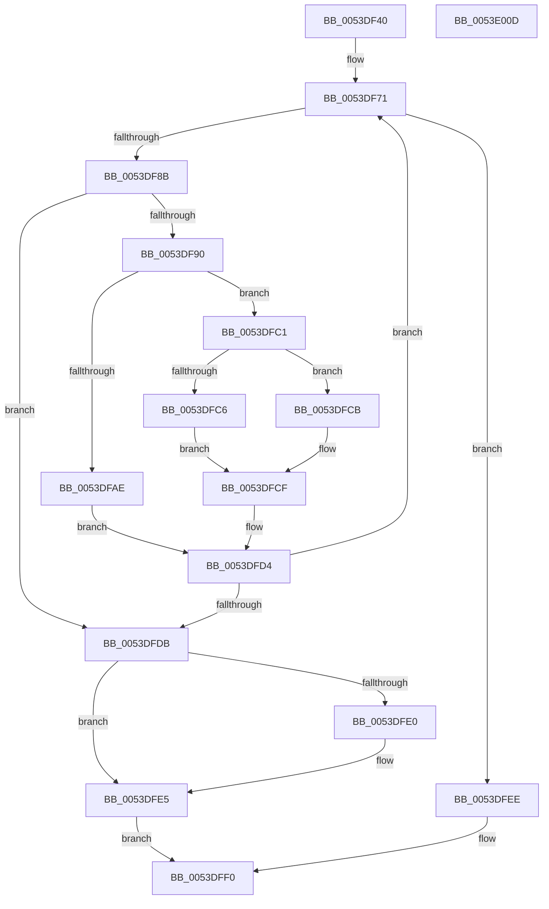

# HalpDmaAllocateScatterPagesFromContiguousPoolAtHighLevelV3

- RVA: `0x0053DF40`–`0x0053E00E` (길이 `206` bytes)
- VA: `0x000000014053DF40`
- 실행 섹션: `.text`
- PDB 이름 있음: `예`; PDB Function 태그: `아니요`
- unwind 정보 RVA: `0x00075C18`
- 디코드: `68`개 명령, `206/206` bytes 표시
- 미해석 바이트: `0` (있으면 어셈블리에 `.byte`로 보존)

> 이 문서는 커널 이미지의 기계어와 PDB 기호를 분석해 생성했습니다. 4번과 5번은 함수 원형과 자료형을 바이너리 사용 방식에서 추정한 C 해석이며 원본 소스 복구 결과는 아닙니다.

## 1. Dependencies

- 직접 호출 지점: **3**; 고유 호출 대상: **3**
- 직접 호출자로 확인된 함수: **1**
- RIP 상대 이미지 참조: **0**

### Outgoing calls
- `0x0053DF7D` → [RtlFindClearBitsAndSet](../3E/RtlFindClearBitsAndSet_function_003E0CD0.md) (function, `0x003E0CD0`)
- `0x0053DF9F` → [HalpDmaIndexToTranslationEntry](../49/HalpDmaIndexToTranslationEntry_function_00495F54.md) (function, `0x00495F54`)
- `0x0053DFBA` → [RtlClearBits](../3E/RtlClearBits_function_003E1A90.md) (function, `0x003E1A90`)

### Direct callers
- [HalpDmaAllocateMapRegistersAtHighLevel](../55/HalpDmaAllocateMapRegistersAtHighLevel_function_005507A8.md) at `0x005508B6`

### Static image references
- 디코드된 RIP-relative 메모리 참조가 없습니다.

## 2. Other-region calls and transfers

- 다른 실행 섹션으로 향하는 call: **0**
- 별도 외부 분기/꼬리 이동을 확인하지 못했습니다.

## 3. Assembly (complete function range)

```asm
0053DF40  48 89 5C 24 08                  mov qword ptr [rsp + 8], rbx
0053DF45  48 89 6C 24 10                  mov qword ptr [rsp + 0x10], rbp
0053DF4A  48 89 74 24 18                  mov qword ptr [rsp + 0x18], rsi
0053DF4F  57                              push rdi
0053DF50  41 54                           push r12
0053DF52  41 55                           push r13
0053DF54  41 56                           push r14
0053DF56  41 57                           push r15
0053DF58  48 83 EC 20                     sub rsp, 0x20
0053DF5C  41 83 CE FF                     or r14d, 0xffffffff
0053DF60  33 DB                           xor ebx, ebx
0053DF62  33 F6                           xor esi, esi
0053DF64  33 ED                           xor ebp, ebp
0053DF66  33 FF                           xor edi, edi
0053DF68  4D 8B E1                        mov r12, r9
0053DF6B  45 8B E8                        mov r13d, r8d
0053DF6E  4C 8B FA                        mov r15, rdx
0053DF71  49 8B 4F 18                     mov rcx, qword ptr [r15 + 0x18]
0053DF75  44 8B C3                        mov r8d, ebx
0053DF78  BA 01 00 00 00                  mov edx, 1
0053DF7D  E8 4E 2D EA FF                  call 0x1403e0cd0
0053DF82  8B D8                           mov ebx, eax
0053DF84  83 C8 FF                        or eax, 0xffffffff
0053DF87  3B D8                           cmp ebx, eax
0053DF89  74 63                           je 0x14053dfee
0053DF8B  41 3B DE                        cmp ebx, r14d
0053DF8E  74 4B                           je 0x14053dfdb
0053DF90  44 3B F0                        cmp r14d, eax
0053DF93  8B D3                           mov edx, ebx
0053DF95  49 8B CF                        mov rcx, r15
0053DF98  44 0F 44 F3                     cmove r14d, ebx
0053DF9C  45 33 C0                        xor r8d, r8d
0053DF9F  E8 B0 7F F5 FF                  call 0x140495f54
0053DFA4  48 F7 40 30 00 F0 FF FF         test qword ptr [rax + 0x30], -0x1000
0053DFAC  75 13                           jne 0x14053dfc1
0053DFAE  49 8B 4F 18                     mov rcx, qword ptr [r15 + 0x18]
0053DFB2  41 B8 01 00 00 00               mov r8d, 1
0053DFB8  8B D3                           mov edx, ebx
0053DFBA  E8 D1 3A EA FF                  call 0x1403e1a90
0053DFBF  EB 13                           jmp 0x14053dfd4
0053DFC1  48 85 ED                        test rbp, rbp
0053DFC4  75 05                           jne 0x14053dfcb
0053DFC6  48 8B E8                        mov rbp, rax
0053DFC9  EB 04                           jmp 0x14053dfcf
0053DFCB  48 89 47 08                     mov qword ptr [rdi + 8], rax
0053DFCF  FF C6                           inc esi
0053DFD1  48 8B F8                        mov rdi, rax
0053DFD4  FF C3                           inc ebx
0053DFD6  41 3B F5                        cmp esi, r13d
0053DFD9  72 96                           jb 0x14053df71
0053DFDB  48 85 FF                        test rdi, rdi
0053DFDE  74 05                           je 0x14053dfe5
0053DFE0  48 83 67 08 00                  and qword ptr [rdi + 8], 0
0053DFE5  41 89 34 24                     mov dword ptr [r12], esi
0053DFE9  48 8B C5                        mov rax, rbp
0053DFEC  EB 02                           jmp 0x14053dff0
0053DFEE  33 C0                           xor eax, eax
0053DFF0  48 8B 5C 24 50                  mov rbx, qword ptr [rsp + 0x50]
0053DFF5  48 8B 6C 24 58                  mov rbp, qword ptr [rsp + 0x58]
0053DFFA  48 8B 74 24 60                  mov rsi, qword ptr [rsp + 0x60]
0053DFFF  48 83 C4 20                     add rsp, 0x20
0053E003  41 5F                           pop r15
0053E005  41 5E                           pop r14
0053E007  41 5D                           pop r13
0053E009  41 5C                           pop r12
0053E00B  5F                              pop rdi
0053E00C  C3                              ret
0053E00D  CC                              int3
```

## 4. C-style interpretation (structured pseudocode)

```c
__int64 __fastcall HalpDmaAllocateScatterPagesFromContiguousPoolAtHighLevelV3(__int64 a1, __int64 a2, int a3, __int64 a4)
{
    __int64 result;
    __int64 v_r14;
    __int64 v_rbp;
    __int64 v_rbx;
    __int64 v_rdi;
    __int64 v_rsi;
    __int64 v_rsp;
    unsigned __int64 v_stack_p10;
    unsigned __int64 v_stack_p18;
    unsigned __int64 v_stack_p8;

    v_stack_p8 = v_rbx;
    v_stack_p10 = v_rbp;
    v_stack_p18 = v_rsi;
    v_rsp = (v_rsp) - (32);
    v_r14 = (unsigned int)((v_r14) | (0xFFFFFFFFULL));
    v_rbx = 0;
    v_rsi = 0;
    v_rbp = 0;
    v_rdi = 0;
loc_0053DF71:
    result = RtlFindClearBitsAndSet(*(unsigned __int64 *)(a2 + 24), 1, 0, a4);
    result = (unsigned int)((result) | (0xFFFFFFFFULL));
    if (((unsigned int)((unsigned int)((unsigned int)(result)))) == ((unsigned int)(result))) goto loc_0053DFEE;
    if (((unsigned int)((unsigned int)((unsigned int)(result)))) == ((unsigned int)(v_r14))) goto loc_0053DFDB;
    if (((unsigned int)(v_r14)) == ((unsigned int)(result))) { v_r14 = (unsigned int)((unsigned int)((unsigned int)(result))); }
    a3 = 0;
    result = HalpDmaIndexToTranslationEntry(a2, (unsigned int)((unsigned int)((unsigned int)((unsigned int)(result)))), a3, a4);
    if (((*(unsigned __int64 *)(result + 48)) & (0xFFFFFFFFFFFFF000ULL)) != 0) goto loc_0053DFC1;
    result = RtlClearBits(*(unsigned __int64 *)(a2 + 24), (unsigned int)((unsigned int)((unsigned int)((unsigned int)(result)))), 1, a4);
    goto loc_0053DFD4;
loc_0053DFC1:
    if (0 != 0) goto loc_0053DFCB;
    goto loc_0053DFCF;
loc_0053DFCB:
    *(unsigned __int64 *)(v_rdi + 8) = result;
loc_0053DFCF:
    v_rsi = (unsigned int)((v_rsi) + 1);
loc_0053DFD4:
    v_rbx = (unsigned int)(((unsigned int)((unsigned int)(result))) + 1);
    if (((unsigned int)(v_rsi)) < ((unsigned int)((unsigned int)(a3)))) goto loc_0053DF71;
loc_0053DFDB:
    if (result != 0) {
    }
    *(unsigned int *)(a4) = (unsigned int)(v_rsi);
    goto loc_0053DFF0;
loc_0053DFEE:
    result = 0;
loc_0053DFF0:
    v_rsp = (v_rsp) + (32);
    return result;
}
```

## 5. (Beta) C Style

```c
int64_t HalpDmaAllocateScatterPagesFromContiguousPoolAtHighLevelV3(int64_t Arg1, void *Arg2, int32_t Arg3, void *Arg4)
{
    uint8_t *arg2 = (uint8_t *)Arg2;
    uint8_t *arg4 = (uint8_t *)Arg4;

    int64_t result;
    int64_t local_r14;
    int64_t local_rbp;
    int64_t local_rbx;
    int64_t local_rdi;
    int64_t local_rsi;
    int64_t local_rsp;
    uint64_t v_stack_p10;
    uint64_t v_stack_p18;
    uint64_t v_stack_p8;

    v_stack_p8 = local_rbx;
    v_stack_p10 = local_rbp;
    v_stack_p18 = local_rsi;
    local_rsp = (local_rsp) - (32);
    local_r14 = (uint32_t)((local_r14) | (0xFFFFFFFFULL));
    local_rbx = 0;
    local_rsi = 0;
    local_rbp = 0;
    local_rdi = 0;
loc_0053DF71:
    result = RtlFindClearBitsAndSet(*(uint64_t *)(arg2 + 0x18), 1, 0, Arg4);
    result = (uint32_t)((result) | (0xFFFFFFFFULL));
    if (((uint32_t)((uint32_t)((uint32_t)(result)))) == ((uint32_t)(result))) goto loc_0053DFEE;
    if (((uint32_t)((uint32_t)((uint32_t)(result)))) == ((uint32_t)(local_r14))) goto loc_0053DFDB;
    if (((uint32_t)(local_r14)) == ((uint32_t)(result))) { local_r14 = (uint32_t)((uint32_t)((uint32_t)(result))); }
    Arg3 = 0;
    result = HalpDmaIndexToTranslationEntry(Arg2, (uint32_t)((uint32_t)((uint32_t)((uint32_t)(result)))), Arg3, Arg4);
    if (((*(uint64_t *)(result + 0x30)) & (0xFFFFFFFFFFFFF000ULL)) != 0) goto loc_0053DFC1;
    result = RtlClearBits(*(uint64_t *)(arg2 + 0x18), (uint32_t)((uint32_t)((uint32_t)((uint32_t)(result)))), 1, Arg4);
    goto loc_0053DFD4;
loc_0053DFC1:
    if (0 != 0) goto loc_0053DFCB;
    goto loc_0053DFCF;
loc_0053DFCB:
    *(uint64_t *)(local_rdi + 0x8) = result;
loc_0053DFCF:
    local_rsi = (uint32_t)((local_rsi) + 1);
loc_0053DFD4:
    local_rbx = (uint32_t)(((uint32_t)((uint32_t)(result))) + 1);
    if (((uint32_t)(local_rsi)) < ((uint32_t)((uint32_t)(Arg3)))) goto loc_0053DF71;
loc_0053DFDB:
    if (result != 0) {
    }
    *(uint32_t *)(arg4) = (uint32_t)(local_rsi);
    goto loc_0053DFF0;
loc_0053DFEE:
    result = 0;
loc_0053DFF0:
    local_rsp = (local_rsp) + (32);
    return result;
}
```

### 관측된 메모리 오프셋

구조체 형식이 확인되지 않은 접근은 인자 기준의 오프셋으로만 기록했습니다.

| 기준 인자 | 오프셋 표현 | 폭 (bit) | 접근 |
|---|---:|---:|---|
| `Arg2` | `+ 0x18` | `64` | `R` |
| `Arg4` | `+ 0x0` | `32` | `W` |

## 6. Execution-region graph

[열기: 2D/3D 그래프와 함수 탐색 컨트롤 패널](../../../control-panel.html?section=text&rva=0x0053DF40&view=graph)

- 2D 그래프는 위에서 아래로 흐르고, 3D 그래프는 빈 공간을 드래그해 회전합니다. Shift+드래그는 이동, 휠은 확대·축소, 함수 노드 선택은 대상 보고서 이동입니다.

### Static fallback


