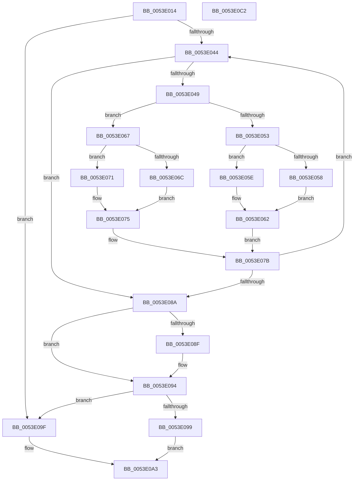

# HalpDmaAllocateScatterPagesFromScatterPoolAtHighLevelV3

- RVA: `0x0053E014`–`0x0053E0C3` (길이 `175` bytes)
- VA: `0x000000014053E014`
- 실행 섹션: `.text`
- PDB 이름 있음: `예`; PDB Function 태그: `아니요`
- unwind 정보 RVA: `0x000A5A38`
- 디코드: `56`개 명령, `175/175` bytes 표시
- 미해석 바이트: `0` (있으면 어셈블리에 `.byte`로 보존)

> 이 문서는 커널 이미지의 기계어와 PDB 기호를 분석해 생성했습니다. 4번과 5번은 함수 원형과 자료형을 바이너리 사용 방식에서 추정한 C 해석이며 원본 소스 복구 결과는 아닙니다.

## 1. Dependencies

- 직접 호출 지점: **0**; 고유 호출 대상: **0**
- 직접 호출자로 확인된 함수: **1**
- RIP 상대 이미지 참조: **0**

### Outgoing calls
- 직접 디코드된 call 명령이 없습니다.

### Direct callers
- [HalpDmaAllocateScatterPagesFromScatterPoolAtHighLevel](HalpDmaAllocateScatterPagesFromScatterPoolAtHighLevel_function_0053F48C.md) at `0x0053F4A0`

### Static image references
- 디코드된 RIP-relative 메모리 참조가 없습니다.

## 2. Other-region calls and transfers

- 다른 실행 섹션으로 향하는 call: **0**
- 별도 외부 분기/꼬리 이동을 확인하지 못했습니다.

## 3. Assembly (complete function range)

```asm
0053E014  48 8B C4                        mov rax, rsp
0053E017  48 89 58 08                     mov qword ptr [rax + 8], rbx
0053E01B  48 89 68 10                     mov qword ptr [rax + 0x10], rbp
0053E01F  48 89 70 18                     mov qword ptr [rax + 0x18], rsi
0053E023  48 89 78 20                     mov qword ptr [rax + 0x20], rdi
0053E027  8B 72 28                        mov esi, dword ptr [rdx + 0x28]
0053E02A  41 8B E8                        mov ebp, r8d
0053E02D  48 8B 4A 20                     mov rcx, qword ptr [rdx + 0x20]
0053E031  45 33 C0                        xor r8d, r8d
0053E034  33 DB                           xor ebx, ebx
0053E036  45 33 D2                        xor r10d, r10d
0053E039  33 FF                           xor edi, edi
0053E03B  45 33 DB                        xor r11d, r11d
0053E03E  33 C0                           xor eax, eax
0053E040  85 F6                           test esi, esi
0053E042  74 5B                           je 0x14053e09f
0053E044  44 3B DD                        cmp r11d, ebp
0053E047  73 41                           jae 0x14053e08a
0053E049  48 F7 41 30 00 F0 FF FF         test qword ptr [rcx + 0x30], -0x1000
0053E051  75 14                           jne 0x14053e067
0053E053  4D 85 D2                        test r10, r10
0053E056  75 06                           jne 0x14053e05e
0053E058  48 89 4A 20                     mov qword ptr [rdx + 0x20], rcx
0053E05C  EB 04                           jmp 0x14053e062
0053E05E  49 89 4A 08                     mov qword ptr [r10 + 8], rcx
0053E062  4C 8B D1                        mov r10, rcx
0053E065  EB 14                           jmp 0x14053e07b
0053E067  48 85 DB                        test rbx, rbx
0053E06A  75 05                           jne 0x14053e071
0053E06C  48 8B D9                        mov rbx, rcx
0053E06F  EB 04                           jmp 0x14053e075
0053E071  48 89 4F 08                     mov qword ptr [rdi + 8], rcx
0053E075  41 FF C3                        inc r11d
0053E078  48 8B F9                        mov rdi, rcx
0053E07B  41 FF C0                        inc r8d
0053E07E  48 8B C1                        mov rax, rcx
0053E081  48 8B 49 08                     mov rcx, qword ptr [rcx + 8]
0053E085  44 3B C6                        cmp r8d, esi
0053E088  72 BA                           jb 0x14053e044
0053E08A  48 85 C0                        test rax, rax
0053E08D  74 05                           je 0x14053e094
0053E08F  48 83 60 08 00                  and qword ptr [rax + 8], 0
0053E094  4D 85 D2                        test r10, r10
0053E097  74 06                           je 0x14053e09f
0053E099  49 89 4A 08                     mov qword ptr [r10 + 8], rcx
0053E09D  EB 04                           jmp 0x14053e0a3
0053E09F  48 89 4A 20                     mov qword ptr [rdx + 0x20], rcx
0053E0A3  44 29 5A 28                     sub dword ptr [rdx + 0x28], r11d
0053E0A7  48 8B C3                        mov rax, rbx
0053E0AA  48 8B 5C 24 08                  mov rbx, qword ptr [rsp + 8]
0053E0AF  48 8B 6C 24 10                  mov rbp, qword ptr [rsp + 0x10]
0053E0B4  48 8B 74 24 18                  mov rsi, qword ptr [rsp + 0x18]
0053E0B9  48 8B 7C 24 20                  mov rdi, qword ptr [rsp + 0x20]
0053E0BE  45 89 19                        mov dword ptr [r9], r11d
0053E0C1  C3                              ret
0053E0C2  CC                              int3
```

## 4. C-style interpretation (structured pseudocode)

```c
__int64 __fastcall HalpDmaAllocateScatterPagesFromScatterPoolAtHighLevelV3(__int64 a1, __int64 a2, int a3, __int64 a4)
{
    __int64 result;
    __int64 v_r10;
    __int64 v_r11;
    __int64 v_rbx;
    __int64 v_rdi;
    unsigned __int64 v_stack_p10;
    unsigned __int64 v_stack_p18;
    unsigned __int64 v_stack_p20;
    unsigned __int64 v_stack_p8;

    *(unsigned __int64 *)(v_rsp + 8) = v_rbx;
    *(unsigned __int64 *)(v_rsp + 16) = v_rbp;
    *(unsigned __int64 *)(v_rsp + 24) = v_rsi;
    *(unsigned __int64 *)(v_rsp + 32) = v_rdi;
    a3 = 0;
    v_rbx = 0;
    v_r10 = 0;
    v_rdi = 0;
    v_r11 = 0;
    result = 0;
    if ((unsigned int)((unsigned int)(*(unsigned int *)(a2 + 40))) == 0) goto loc_0053E09F;
loc_0053E044:
    if (0 >= ((unsigned int)((unsigned int)(a3)))) goto loc_0053E08A;
    if (((*(unsigned __int64 *)(*(unsigned __int64 *)(a2 + 32) + 48)) & (0xFFFFFFFFFFFFF000ULL)) != 0) goto loc_0053E067;
    if (0 != 0) goto loc_0053E05E;
    *(unsigned __int64 *)(a2 + 32) = *(unsigned __int64 *)(a2 + 32);
    goto loc_0053E062;
loc_0053E05E:
    *(unsigned __int64 *)(v_r10 + 8) = *(unsigned __int64 *)(a2 + 32);
loc_0053E062:
    goto loc_0053E07B;
loc_0053E067:
    if (0 != 0) goto loc_0053E071;
    goto loc_0053E075;
loc_0053E071:
    *(unsigned __int64 *)(v_rdi + 8) = *(unsigned __int64 *)(a2 + 32);
loc_0053E075:
    v_r11 = (unsigned int)((v_r11) + 1);
loc_0053E07B:
    a3 = (unsigned int)((a3) + 1);
    if (a3 < ((unsigned int)((unsigned int)(*(unsigned int *)(a2 + 40))))) goto loc_0053E044;
loc_0053E08A:
    if (*(unsigned __int64 *)(a2 + 32) != 0) {
    }
    if (*(unsigned __int64 *)(a2 + 32) == 0) goto loc_0053E09F;
    *(unsigned __int64 *)(*(unsigned __int64 *)(a2 + 32) + 8) = *(unsigned __int64 *)(*(unsigned __int64 *)(a2 + 32) + 8);
    goto loc_0053E0A3;
loc_0053E09F:
    *(unsigned __int64 *)(a2 + 32) = *(unsigned __int64 *)(*(unsigned __int64 *)(a2 + 32) + 8);
loc_0053E0A3:
    *(unsigned int *)(a4) = (unsigned int)(v_r11);
    return *(unsigned __int64 *)(a2 + 32);
}
```

## 5. (Beta) C Style

```c
int64_t HalpDmaAllocateScatterPagesFromScatterPoolAtHighLevelV3(int64_t Arg1, void *Arg2, int32_t Arg3, void *Arg4)
{
    uint8_t *arg2 = (uint8_t *)Arg2;
    uint8_t *arg4 = (uint8_t *)Arg4;

    int64_t result;
    int64_t local_r10;
    int64_t local_r11;
    int64_t local_rbx;
    int64_t local_rdi;
    uint64_t v_stack_p10;
    uint64_t v_stack_p18;
    uint64_t v_stack_p20;
    uint64_t v_stack_p8;

    *(uint64_t *)(local_rsp + 0x8) = local_rbx;
    *(uint64_t *)(local_rsp + 0x10) = local_rbp;
    *(uint64_t *)(local_rsp + 0x18) = local_rsi;
    *(uint64_t *)(local_rsp + 0x20) = local_rdi;
    Arg3 = 0;
    local_rbx = 0;
    local_r10 = 0;
    local_rdi = 0;
    local_r11 = 0;
    result = 0;
    if ((uint32_t)((uint32_t)(*(uint32_t *)(arg2 + 0x28))) == 0) goto loc_0053E09F;
loc_0053E044:
    if (0 >= ((uint32_t)((uint32_t)(Arg3)))) goto loc_0053E08A;
    if (((*(uint64_t *)(*(uint64_t *)(arg2 + 0x20) + 0x30)) & (0xFFFFFFFFFFFFF000ULL)) != 0) goto loc_0053E067;
    if (0 != 0) goto loc_0053E05E;
    *(uint64_t *)(arg2 + 0x20) = *(uint64_t *)(arg2 + 0x20);
    goto loc_0053E062;
loc_0053E05E:
    *(uint64_t *)(local_r10 + 0x8) = *(uint64_t *)(arg2 + 0x20);
loc_0053E062:
    goto loc_0053E07B;
loc_0053E067:
    if (0 != 0) goto loc_0053E071;
    goto loc_0053E075;
loc_0053E071:
    *(uint64_t *)(local_rdi + 0x8) = *(uint64_t *)(arg2 + 0x20);
loc_0053E075:
    local_r11 = (uint32_t)((local_r11) + 1);
loc_0053E07B:
    Arg3 = (uint32_t)((Arg3) + 1);
    if (Arg3 < ((uint32_t)((uint32_t)(*(uint32_t *)(arg2 + 0x28))))) goto loc_0053E044;
loc_0053E08A:
    if (*(uint64_t *)(arg2 + 0x20) != 0) {
    }
    if (*(uint64_t *)(arg2 + 0x20) == 0) goto loc_0053E09F;
    *(uint64_t *)(*(uint64_t *)(arg2 + 0x20) + 0x8) = *(uint64_t *)(*(uint64_t *)(arg2 + 0x20) + 0x8);
    goto loc_0053E0A3;
loc_0053E09F:
    *(uint64_t *)(arg2 + 0x20) = *(uint64_t *)(*(uint64_t *)(arg2 + 0x20) + 0x8);
loc_0053E0A3:
    *(uint32_t *)(arg4) = (uint32_t)(local_r11);
    return *(uint64_t *)(arg2 + 0x20);
}
```

### 관측된 메모리 오프셋

구조체 형식이 확인되지 않은 접근은 인자 기준의 오프셋으로만 기록했습니다.

| 기준 인자 | 오프셋 표현 | 폭 (bit) | 접근 |
|---|---:|---:|---|
| `Arg2` | `+ 0x20` | `64` | `R` |
| `Arg2` | `+ 0x20` | `64` | `W` |
| `Arg2` | `+ 0x28` | `32` | `R` |
| `Arg2` | `+ 0x28` | `32` | `R/W` |
| `Arg4` | `+ 0x0` | `32` | `W` |

## 6. Execution-region graph

[열기: 2D/3D 그래프와 함수 탐색 컨트롤 패널](../../../control-panel.html?section=text&rva=0x0053E014&view=graph)

- 2D 그래프는 위에서 아래로 흐르고, 3D 그래프는 빈 공간을 드래그해 회전합니다. Shift+드래그는 이동, 휠은 확대·축소, 함수 노드 선택은 대상 보고서 이동입니다.

### Static fallback


