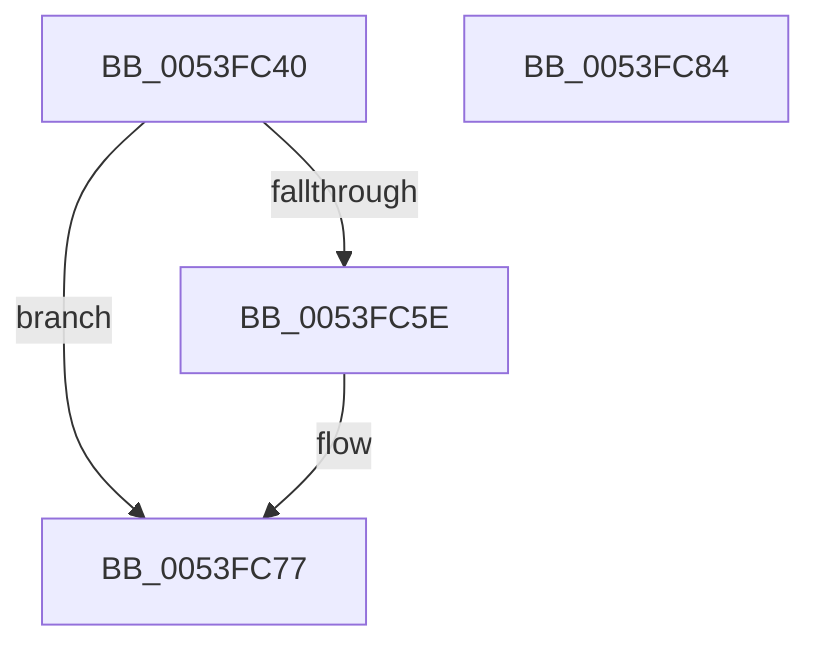

# HalpDmaCheckAdapterToken

- RVA: `0x0053FC40`–`0x0053FC85` (길이 `69` bytes)
- VA: `0x000000014053FC40`
- 실행 섹션: `.text`
- PDB 이름 있음: `예`; PDB Function 태그: `아니요`
- unwind 정보 RVA: `0x0005CAAC`
- 디코드: `24`개 명령, `69/69` bytes 표시
- 미해석 바이트: `0` (있으면 어셈블리에 `.byte`로 보존)

> 이 문서는 커널 이미지의 기계어와 PDB 기호를 분석해 생성했습니다. 4번과 5번은 함수 원형과 자료형을 바이너리 사용 방식에서 추정한 C 해석이며 원본 소스 복구 결과는 아닙니다.

## 1. Dependencies

- 직접 호출 지점: **2**; 고유 호출 대상: **2**
- 직접 호출자로 확인된 함수: **0**
- RIP 상대 이미지 참조: **0**

### Outgoing calls
- `0x0053FC52` → [HalpDmaFindDeviceObjectByToken](HalpDmaFindDeviceObjectByToken_function_0053FD28.md) (function, `0x0053FD28`)
- `0x0053FC66` → [HalpDmaInsertDeviceObjectByToken](HalpDmaInsertDeviceObjectByToken_function_0053FEAC.md) (function, `0x0053FEAC`)

### Direct callers
- 이 함수 시작 RVA로 연결되는 직접 call은 확인되지 않았습니다. 간접 호출은 완전히 역산할 수 없습니다.

### Static image references
- 디코드된 RIP-relative 메모리 참조가 없습니다.

## 2. Other-region calls and transfers

- 다른 실행 섹션으로 향하는 call: **0**
- 별도 외부 분기/꼬리 이동을 확인하지 못했습니다.

## 3. Assembly (complete function range)

```asm
0053FC40  48 89 5C 24 08                  mov qword ptr [rsp + 8], rbx
0053FC45  57                              push rdi
0053FC46  48 83 EC 20                     sub rsp, 0x20
0053FC4A  41 B0 01                        mov r8b, 1
0053FC4D  33 D2                           xor edx, edx
0053FC4F  48 8B F9                        mov rdi, rcx
0053FC52  E8 D1 00 00 00                  call 0x14053fd28
0053FC57  33 DB                           xor ebx, ebx
0053FC59  48 85 C0                        test rax, rax
0053FC5C  75 19                           jne 0x14053fc77
0053FC5E  41 B0 01                        mov r8b, 1
0053FC61  33 D2                           xor edx, edx
0053FC63  48 8B CF                        mov rcx, rdi
0053FC66  E8 41 02 00 00                  call 0x14053feac
0053FC6B  85 C0                           test eax, eax
0053FC6D  B9 25 02 00 C0                  mov ecx, 0xc0000225
0053FC72  0F 49 C1                        cmovns eax, ecx
0053FC75  8B D8                           mov ebx, eax
0053FC77  8B C3                           mov eax, ebx
0053FC79  48 8B 5C 24 30                  mov rbx, qword ptr [rsp + 0x30]
0053FC7E  48 83 C4 20                     add rsp, 0x20
0053FC82  5F                              pop rdi
0053FC83  C3                              ret
0053FC84  CC                              int3
```

## 4. C-style interpretation (structured pseudocode)

```c
__int64 __fastcall HalpDmaCheckAdapterToken(__int64 a1, int a2)
{
    __int64 result;
    __int64 v_rbx;
    __int64 v_rsp;
    unsigned __int64 v_stack_p8;

    v_stack_p8 = v_rbx;
    v_rsp = (v_rsp) - (32);
    a2 = 0;
    result = HalpDmaFindDeviceObjectByToken(a1, a2, 1, a4);
    v_rbx = 0;
    if (result == 0) {
        a3 = 1;
        a2 = 0;
        a1 = a1;
        result = HalpDmaInsertDeviceObjectByToken(a1, a2, a3, a4);
        a1 = 0xC0000225ULL;
        if (!sign_flag) { result = (unsigned int)(a1); }
        v_rbx = (unsigned int)(result);
    }
    v_rsp = (v_rsp) + (32);
    return (unsigned int)((unsigned int)(v_rbx));
}
```

## 5. (Beta) C Style

```c
int64_t HalpDmaCheckAdapterToken(int64_t Arg1, int32_t Arg2)
{
    int64_t result;
    int64_t local_rbx;
    int64_t local_rsp;
    uint64_t v_stack_p8;

    v_stack_p8 = local_rbx;
    local_rsp = (local_rsp) - (32);
    Arg2 = 0;
    result = HalpDmaFindDeviceObjectByToken(Arg1, Arg2, 1, a4);
    local_rbx = 0;
    if (result == 0) {
        a3 = 1;
        Arg2 = 0;
        Arg1 = Arg1;
        result = HalpDmaInsertDeviceObjectByToken(Arg1, Arg2, a3, a4);
        Arg1 = 0xC0000225ULL;
        if (!sign_flag) { result = (uint32_t)(Arg1); }
        local_rbx = (uint32_t)(result);
    }
    local_rsp = (local_rsp) + (32);
    return (uint32_t)((uint32_t)(local_rbx));
}
```

## 6. Execution-region graph

[열기: 2D/3D 그래프와 함수 탐색 컨트롤 패널](../../../control-panel.html?section=text&rva=0x0053FC40&view=graph)

- 2D 그래프는 위에서 아래로 흐르고, 3D 그래프는 빈 공간을 드래그해 회전합니다. Shift+드래그는 이동, 휠은 확대·축소, 함수 노드 선택은 대상 보고서 이동입니다.

### Static fallback


