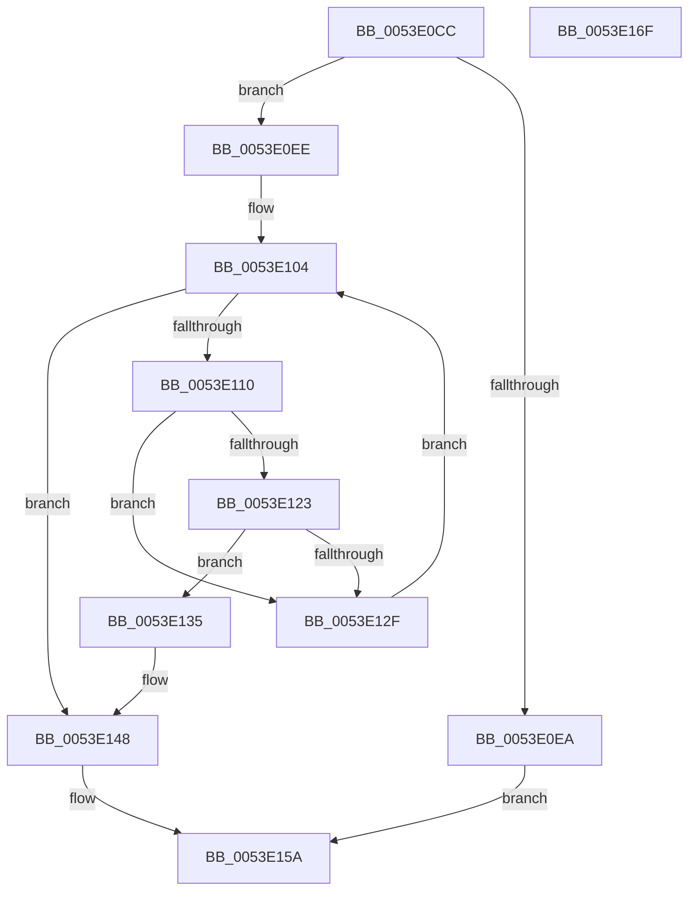

# HalpDmaFindAdapterByDeviceId

- RVA: `0x0053E0CC`–`0x0053E170` (길이 `164` bytes)
- VA: `0x000000014053E0CC`
- 실행 섹션: `.text`
- PDB 이름 있음: `예`; PDB Function 태그: `아니요`
- unwind 정보 RVA: `0x0005C954`
- 디코드: `44`개 명령, `164/164` bytes 표시
- 미해석 바이트: `0` (있으면 어셈블리에 `.byte`로 보존)

> 이 문서는 커널 이미지의 기계어와 PDB 기호를 분석해 생성했습니다. 4번과 5번은 함수 원형과 자료형을 바이너리 사용 방식에서 추정한 C 해석이며 원본 소스 복구 결과는 아닙니다.

## 1. Dependencies

- 직접 호출 지점: **4**; 고유 호출 대상: **4**
- 직접 호출자로 확인된 함수: **1**
- RIP 상대 이미지 참조: **3**

### Outgoing calls
- `0x0053E0F5` → [KeAcquireSpinLockRaiseToDpc](../20/KeAcquireSpinLockRaiseToDpc_function_00208470.md) (function, `0x00208470`)
- `0x0053E126` → [IidAreIdsStrictlyEqual](../6A/IidAreIdsStrictlyEqual_function_006A2BE4.md) (function, `0x006A2BE4`)
- `0x0053E13D` → [ObReferenceObjectSafeWithTag](../21/ObReferenceObjectSafeWithTag_function_00210EE0.md) (function, `0x00210EE0`)
- `0x0053E152` → [KeReleaseSpinLock](../39/KeReleaseSpinLock_function_00392BA0.md) (function, `0x00392BA0`)

### Direct callers
- [HalpDmaAllocateChildAdapterV3](../../page/70/HalpDmaAllocateChildAdapterV3_function_007066A0.md) at `0x00706BB8`

### Static image references
- `0x0053E0EE` → RVA `0x00FC3F30` (`.data`; read)
- `0x0053E0FA` → RVA `0x00FC3F28` (`.data`; read)
- `0x0053E104` → RVA `0x00FC3F20` (`.data`; read)

## 2. Other-region calls and transfers

- 다른 실행 섹션으로 향하는 call: **0**
- 별도 외부 분기/꼬리 이동을 확인하지 못했습니다.

## 3. Assembly (complete function range)

```asm
0053E0CC  48 89 5C 24 08                  mov qword ptr [rsp + 8], rbx
0053E0D1  48 89 6C 24 10                  mov qword ptr [rsp + 0x10], rbp
0053E0D6  48 89 74 24 18                  mov qword ptr [rsp + 0x18], rsi
0053E0DB  57                              push rdi
0053E0DC  48 83 EC 20                     sub rsp, 0x20
0053E0E0  33 DB                           xor ebx, ebx
0053E0E2  48 8B F9                        mov rdi, rcx
0053E0E5  48 85 C9                        test rcx, rcx
0053E0E8  75 04                           jne 0x14053e0ee
0053E0EA  33 C0                           xor eax, eax
0053E0EC  EB 6C                           jmp 0x14053e15a
0053E0EE  48 8D 0D 3B 5E A8 00            lea rcx, [rip + 0xa85e3b]
0053E0F5  E8 76 A3 CC FF                  call 0x140208470
0053E0FA  4C 8B 1D 27 5E A8 00            mov r11, qword ptr [rip + 0xa85e27]
0053E101  40 8A E8                        mov bpl, al
0053E104  48 8D 05 15 5E A8 00            lea rax, [rip + 0xa85e15]
0053E10B  4C 3B D8                        cmp r11, rax
0053E10E  74 38                           je 0x14053e148
0053E110  49 8D B3 30 FE FF FF            lea rsi, [r11 - 0x1d0]
0053E117  48 8B 8E 18 02 00 00            mov rcx, qword ptr [rsi + 0x218]
0053E11E  48 85 C9                        test rcx, rcx
0053E121  74 0C                           je 0x14053e12f
0053E123  48 8B D7                        mov rdx, rdi
0053E126  E8 B9 4A 16 00                  call 0x1406a2be4
0053E12B  84 C0                           test al, al
0053E12D  75 06                           jne 0x14053e135
0053E12F  4D 8B 5B 08                     mov r11, qword ptr [r11 + 8]
0053E133  EB CF                           jmp 0x14053e104
0053E135  BA 44 66 6C 74                  mov edx, 0x746c6644
0053E13A  48 8B CE                        mov rcx, rsi
0053E13D  E8 9E 2D CD FF                  call 0x140210ee0
0053E142  84 C0                           test al, al
0053E144  48 0F 45 DE                     cmovne rbx, rsi
0053E148  40 8A D5                        mov dl, bpl
0053E14B  48 8D 0D DE 5D A8 00            lea rcx, [rip + 0xa85dde]
0053E152  E8 49 4A E5 FF                  call 0x140392ba0
0053E157  48 8B C3                        mov rax, rbx
0053E15A  48 8B 5C 24 30                  mov rbx, qword ptr [rsp + 0x30]
0053E15F  48 8B 6C 24 38                  mov rbp, qword ptr [rsp + 0x38]
0053E164  48 8B 74 24 40                  mov rsi, qword ptr [rsp + 0x40]
0053E169  48 83 C4 20                     add rsp, 0x20
0053E16D  5F                              pop rdi
0053E16E  C3                              ret
0053E16F  CC                              int3
```

## 4. C-style interpretation (structured pseudocode)

```c
__int64 __fastcall HalpDmaFindAdapterByDeviceId(__int64 a1)
{
    __int64 result;
    __int64 v_rbx;
    __int64 v_rsp;
    unsigned __int64 v_stack_p10;
    unsigned __int64 v_stack_p18;
    unsigned __int64 v_stack_p8;

    v_stack_p8 = v_rbx;
    v_stack_p10 = v_rbp;
    v_stack_p18 = v_rsi;
    v_rsp = (v_rsp) - (32);
    v_rbx = 0;
    if (a1 != 0) goto loc_0053E0EE;
    result = 0;
    goto loc_0053E15A;
loc_0053E0EE:
    result = KeAcquireSpinLockRaiseToDpc(v_rip + 11034171, a2, a3, a4);
loc_0053E104:
    if ((*(unsigned __int64 *)(v_rip + 11034151)) == (v_rip + 11034133)) goto loc_0053E148;
    if (*(unsigned __int64 *)(*(unsigned __int64 *)(v_rip + 11034151) - 464 + 536) == 0) goto loc_0053E12F;
    result = IidAreIdsStrictlyEqual(*(unsigned __int64 *)(*(unsigned __int64 *)(v_rip + 11034151) - 464 + 536), a1, a3, a4);
    if ((unsigned __int8)(result) != 0) goto loc_0053E135;
loc_0053E12F:
    goto loc_0053E104;
loc_0053E135:
    result = ObReferenceObjectSafeWithTag(*(unsigned __int64 *)(v_rip + 11034151) - 464, (unsigned int)(0x746C6644ULL), a3, a4);
    if ((unsigned __int8)(result) != 0) { v_rbx = *(unsigned __int64 *)(v_rip + 11034151) - 464; }
loc_0053E148:
    result = KeReleaseSpinLock(v_rip + 11034078, (unsigned __int8)((unsigned __int8)(result)), a3, a4);
loc_0053E15A:
    v_rsp = (v_rsp) + (32);
    return v_rbx;
}
```

## 5. (Beta) C Style

```c
int64_t HalpDmaFindAdapterByDeviceId(int64_t Arg1)
{
    int64_t result;
    int64_t local_rbx;
    int64_t local_rsp;
    uint64_t v_stack_p10;
    uint64_t v_stack_p18;
    uint64_t v_stack_p8;

    v_stack_p8 = local_rbx;
    v_stack_p10 = local_rbp;
    v_stack_p18 = local_rsi;
    local_rsp = (local_rsp) - (32);
    local_rbx = 0;
    if (Arg1 != 0) goto loc_0053E0EE;
    result = 0;
    goto loc_0053E15A;
loc_0053E0EE:
    result = KeAcquireSpinLockRaiseToDpc(v_rip + 11034171, a2, a3, a4);
loc_0053E104:
    if ((*(uint64_t *)(v_rip + 0xA85E27)) == (v_rip + 11034133)) goto loc_0053E148;
    if (*(uint64_t *)(*(uint64_t *)(v_rip + 0xA85E27) - 0x1D0 + 0x218) == 0) goto loc_0053E12F;
    result = IidAreIdsStrictlyEqual(*(uint64_t *)(*(uint64_t *)(v_rip + 0xA85E27) - 0x1D0 + 0x218), Arg1, a3, a4);
    if ((uint8_t)(result) != 0) goto loc_0053E135;
loc_0053E12F:
    goto loc_0053E104;
loc_0053E135:
    result = ObReferenceObjectSafeWithTag(*(uint64_t *)(v_rip + 0xA85E27) - 464, (uint32_t)(0x746C6644ULL), a3, a4);
    if ((uint8_t)(result) != 0) { local_rbx = *(uint64_t *)(v_rip + 0xA85E27) - 464; }
loc_0053E148:
    result = KeReleaseSpinLock(v_rip + 11034078, (uint8_t)((uint8_t)(result)), a3, a4);
loc_0053E15A:
    local_rsp = (local_rsp) + (32);
    return local_rbx;
}
```

## 6. Execution-region graph

[열기: 2D/3D 그래프와 함수 탐색 컨트롤 패널](../../../control-panel.html?section=text&rva=0x0053E0CC&view=graph)

- 2D 그래프는 위에서 아래로 흐르고, 3D 그래프는 빈 공간을 드래그해 회전합니다. Shift+드래그는 이동, 휠은 확대·축소, 함수 노드 선택은 대상 보고서 이동입니다.

### Static fallback


