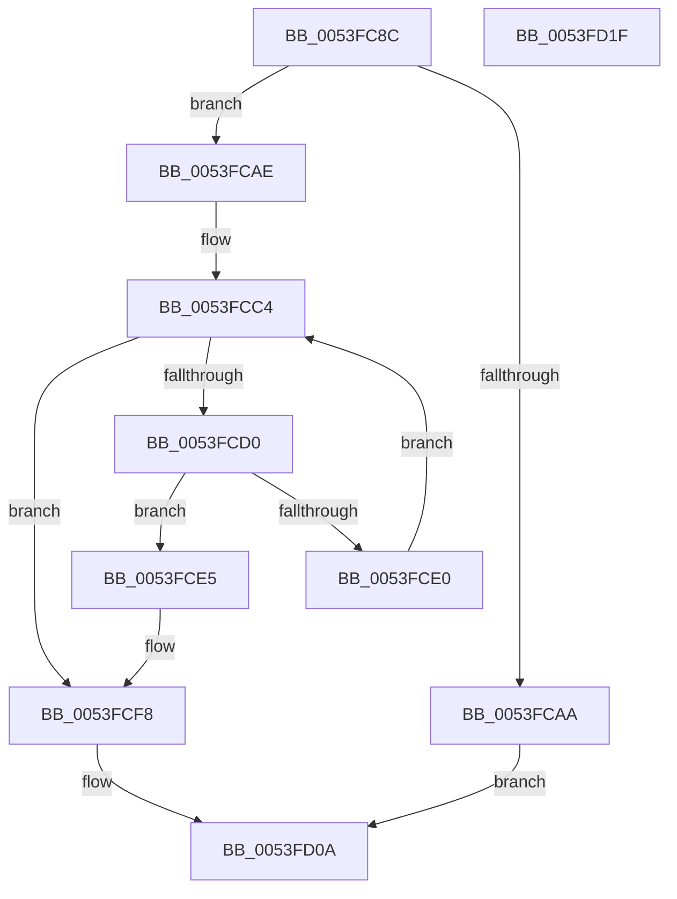

# HalpDmaFindAdapterByDeviceObject

- RVA: `0x0053FC8C`–`0x0053FD20` (길이 `148` bytes)
- VA: `0x000000014053FC8C`
- 실행 섹션: `.text`
- PDB 이름 있음: `예`; PDB Function 태그: `아니요`
- unwind 정보 RVA: `0x0005C954`
- 디코드: `39`개 명령, `148/148` bytes 표시
- 미해석 바이트: `0` (있으면 어셈블리에 `.byte`로 보존)

> 이 문서는 커널 이미지의 기계어와 PDB 기호를 분석해 생성했습니다. 4번과 5번은 함수 원형과 자료형을 바이너리 사용 방식에서 추정한 C 해석이며 원본 소스 복구 결과는 아닙니다.

## 1. Dependencies

- 직접 호출 지점: **3**; 고유 호출 대상: **3**
- 직접 호출자로 확인된 함수: **2**
- RIP 상대 이미지 참조: **2**

### Outgoing calls
- `0x0053FCB5` → [KeAcquireSpinLockRaiseToDpc](../20/KeAcquireSpinLockRaiseToDpc_function_00208470.md) (function, `0x00208470`)
- `0x0053FCED` → [ObReferenceObjectSafeWithTag](../21/ObReferenceObjectSafeWithTag_function_00210EE0.md) (function, `0x00210EE0`)
- `0x0053FD02` → [KeReleaseSpinLock](../39/KeReleaseSpinLock_function_00392BA0.md) (function, `0x00392BA0`)

### Direct callers
- [HalGetAdapterV3](../../page/70/HalGetAdapterV3_function_00709838.md) at `0x00709B62`
- [HalGetAdapterV2](../../page/70/HalGetAdapterV2_function_00709DD8.md) at `0x0070A04E`

### Static image references
- `0x0053FCAE` → RVA `0x00FC3F30` (`.data`; read)
- `0x0053FCBD` → RVA `0x00FC3F20` (`.data`; read)

## 2. Other-region calls and transfers

- 다른 실행 섹션으로 향하는 call: **0**
- 별도 외부 분기/꼬리 이동을 확인하지 못했습니다.

## 3. Assembly (complete function range)

```asm
0053FC8C  48 89 5C 24 08                  mov qword ptr [rsp + 8], rbx
0053FC91  48 89 6C 24 10                  mov qword ptr [rsp + 0x10], rbp
0053FC96  48 89 74 24 18                  mov qword ptr [rsp + 0x18], rsi
0053FC9B  57                              push rdi
0053FC9C  48 83 EC 20                     sub rsp, 0x20
0053FCA0  33 DB                           xor ebx, ebx
0053FCA2  48 8B F9                        mov rdi, rcx
0053FCA5  48 85 C9                        test rcx, rcx
0053FCA8  75 04                           jne 0x14053fcae
0053FCAA  33 C0                           xor eax, eax
0053FCAC  EB 5C                           jmp 0x14053fd0a
0053FCAE  48 8D 0D 7B 42 A8 00            lea rcx, [rip + 0xa8427b]
0053FCB5  E8 B6 87 CC FF                  call 0x140208470
0053FCBA  40 8A E8                        mov bpl, al
0053FCBD  48 8B 05 5C 42 A8 00            mov rax, qword ptr [rip + 0xa8425c]
0053FCC4  48 8D 0D 55 42 A8 00            lea rcx, [rip + 0xa84255]
0053FCCB  48 3B C1                        cmp rax, rcx
0053FCCE  74 28                           je 0x14053fcf8
0053FCD0  48 8D B0 30 FE FF FF            lea rsi, [rax - 0x1d0]
0053FCD7  48 39 BE 10 02 00 00            cmp qword ptr [rsi + 0x210], rdi
0053FCDE  74 05                           je 0x14053fce5
0053FCE0  48 8B 00                        mov rax, qword ptr [rax]
0053FCE3  EB DF                           jmp 0x14053fcc4
0053FCE5  BA 44 66 6C 74                  mov edx, 0x746c6644
0053FCEA  48 8B CE                        mov rcx, rsi
0053FCED  E8 EE 11 CD FF                  call 0x140210ee0
0053FCF2  84 C0                           test al, al
0053FCF4  48 0F 45 DE                     cmovne rbx, rsi
0053FCF8  40 8A D5                        mov dl, bpl
0053FCFB  48 8D 0D 2E 42 A8 00            lea rcx, [rip + 0xa8422e]
0053FD02  E8 99 2E E5 FF                  call 0x140392ba0
0053FD07  48 8B C3                        mov rax, rbx
0053FD0A  48 8B 5C 24 30                  mov rbx, qword ptr [rsp + 0x30]
0053FD0F  48 8B 6C 24 38                  mov rbp, qword ptr [rsp + 0x38]
0053FD14  48 8B 74 24 40                  mov rsi, qword ptr [rsp + 0x40]
0053FD19  48 83 C4 20                     add rsp, 0x20
0053FD1D  5F                              pop rdi
0053FD1E  C3                              ret
0053FD1F  CC                              int3
```

## 4. C-style interpretation (structured pseudocode)

```c
__int64 __fastcall HalpDmaFindAdapterByDeviceObject(__int64 a1)
{
    __int64 result;
    __int64 v_rbx;
    __int64 v_rsp;
    unsigned __int64 v_stack_p10;
    unsigned __int64 v_stack_p18;
    unsigned __int64 v_stack_p8;

    v_stack_p8 = v_rbx;
    v_stack_p10 = v_rbp;
    v_stack_p18 = v_rsi;
    v_rsp = (v_rsp) - (32);
    v_rbx = 0;
    if (a1 != 0) goto loc_0053FCAE;
    result = 0;
    goto loc_0053FD0A;
loc_0053FCAE:
    result = KeAcquireSpinLockRaiseToDpc(v_rip + 11027067, a2, a3, a4);
loc_0053FCC4:
    if ((*(unsigned __int64 *)(v_rip + 11027036)) == (v_rip + 11027029)) goto loc_0053FCF8;
    if ((*(unsigned __int64 *)(*(unsigned __int64 *)(v_rip + 11027036) - 464 + 528)) == a1) goto loc_0053FCE5;
    goto loc_0053FCC4;
loc_0053FCE5:
    result = ObReferenceObjectSafeWithTag(*(unsigned __int64 *)(v_rip + 11027036) - 464, (unsigned int)(0x746C6644ULL), a3, a4);
    if ((unsigned __int8)(result) != 0) { v_rbx = *(unsigned __int64 *)(v_rip + 11027036) - 464; }
loc_0053FCF8:
    result = KeReleaseSpinLock(v_rip + 11026990, (unsigned __int8)((unsigned __int8)(result)), a3, a4);
loc_0053FD0A:
    v_rsp = (v_rsp) + (32);
    return v_rbx;
}
```

## 5. (Beta) C Style

```c
int64_t HalpDmaFindAdapterByDeviceObject(int64_t Arg1)
{
    int64_t result;
    int64_t local_rbx;
    int64_t local_rsp;
    uint64_t v_stack_p10;
    uint64_t v_stack_p18;
    uint64_t v_stack_p8;

    v_stack_p8 = local_rbx;
    v_stack_p10 = local_rbp;
    v_stack_p18 = local_rsi;
    local_rsp = (local_rsp) - (32);
    local_rbx = 0;
    if (Arg1 != 0) goto loc_0053FCAE;
    result = 0;
    goto loc_0053FD0A;
loc_0053FCAE:
    result = KeAcquireSpinLockRaiseToDpc(v_rip + 11027067, a2, a3, a4);
loc_0053FCC4:
    if ((*(uint64_t *)(v_rip + 0xA8425C)) == (v_rip + 11027029)) goto loc_0053FCF8;
    if ((*(uint64_t *)(*(uint64_t *)(v_rip + 0xA8425C) - 0x1D0 + 0x210)) == Arg1) goto loc_0053FCE5;
    goto loc_0053FCC4;
loc_0053FCE5:
    result = ObReferenceObjectSafeWithTag(*(uint64_t *)(v_rip + 0xA8425C) - 464, (uint32_t)(0x746C6644ULL), a3, a4);
    if ((uint8_t)(result) != 0) { local_rbx = *(uint64_t *)(v_rip + 0xA8425C) - 464; }
loc_0053FCF8:
    result = KeReleaseSpinLock(v_rip + 11026990, (uint8_t)((uint8_t)(result)), a3, a4);
loc_0053FD0A:
    local_rsp = (local_rsp) + (32);
    return local_rbx;
}
```

## 6. Execution-region graph

[열기: 2D/3D 그래프와 함수 탐색 컨트롤 패널](../../../control-panel.html?section=text&rva=0x0053FC8C&view=graph)

- 2D 그래프는 위에서 아래로 흐르고, 3D 그래프는 빈 공간을 드래그해 회전합니다. Shift+드래그는 이동, 휠은 확대·축소, 함수 노드 선택은 대상 보고서 이동입니다.

### Static fallback


