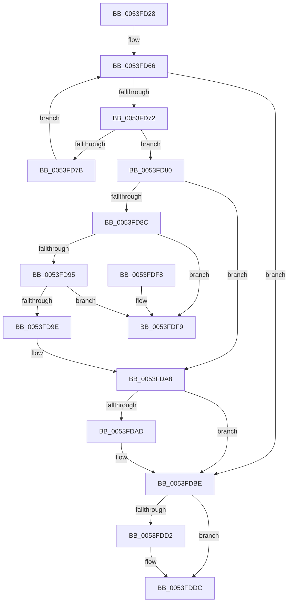

# HalpDmaFindDeviceObjectByToken

- RVA: `0x0053FD28`–`0x0053FE00` (길이 `216` bytes)
- VA: `0x000000014053FD28`
- 실행 섹션: `.text`
- PDB 이름 있음: `예`; PDB Function 태그: `아니요`
- unwind 정보 RVA: `0x00075210`
- 디코드: `65`개 명령, `216/216` bytes 표시
- 미해석 바이트: `0` (있으면 어셈블리에 `.byte`로 보존)

> 이 문서는 커널 이미지의 기계어와 PDB 기호를 분석해 생성했습니다. 4번과 5번은 함수 원형과 자료형을 바이너리 사용 방식에서 추정한 C 해석이며 원본 소스 복구 결과는 아닙니다.

## 1. Dependencies

- 직접 호출 지점: **3**; 고유 호출 대상: **3**
- 직접 호출자로 확인된 함수: **3**
- RIP 상대 이미지 참조: **2**

### Outgoing calls
- `0x0053FD57` → [KeAcquireSpinLockRaiseToDpc](../20/KeAcquireSpinLockRaiseToDpc_function_00208470.md) (function, `0x00208470`)
- `0x0053FDC8` → [KeReleaseSpinLock](../39/KeReleaseSpinLock_function_00392BA0.md) (function, `0x00392BA0`)
- `0x0053FDD7` → [ExFreePoolWithTag](../../poolcode/B8/ExFreePoolWithTag_function_00B82870.md) (function, `0x00B82870`)

### Direct callers
- [HalpDmaCheckAdapterToken](HalpDmaCheckAdapterToken_function_0053FC40.md) at `0x0053FC52`
- [HalPnpGetDmaAdapter](../54/HalPnpGetDmaAdapter_function_00543CC0.md) at `0x00543CDE`
- [HalpDmaLinkDeviceObjectByToken](../../page/70/HalpDmaLinkDeviceObjectByToken_function_00706F70.md) at `0x00706F82`

### Static image references
- `0x0053FD45` → RVA `0x00FC3EC0` (`.data`; read)
- `0x0053FD5C` → RVA `0x00FC3E70` (`.data`; read)

## 2. Other-region calls and transfers

- 다른 실행 섹션으로 향하는 call: **1**
  - `0x0053FDD7` → [ExFreePoolWithTag](../../poolcode/B8/ExFreePoolWithTag_function_00B82870.md) (`.text` → `POOLCODE`)
- 별도 외부 분기/꼬리 이동을 확인하지 못했습니다.

## 3. Assembly (complete function range)

```asm
0053FD28  48 89 5C 24 08                  mov qword ptr [rsp + 8], rbx
0053FD2D  48 89 6C 24 10                  mov qword ptr [rsp + 0x10], rbp
0053FD32  48 89 74 24 18                  mov qword ptr [rsp + 0x18], rsi
0053FD37  57                              push rdi
0053FD38  41 56                           push r14
0053FD3A  41 57                           push r15
0053FD3C  48 83 EC 20                     sub rsp, 0x20
0053FD40  48 8B E9                        mov rbp, rcx
0053FD43  33 FF                           xor edi, edi
0053FD45  48 8D 0D 74 41 A8 00            lea rcx, [rip + 0xa84174]
0053FD4C  33 DB                           xor ebx, ebx
0053FD4E  40 32 F6                        xor sil, sil
0053FD51  45 8A F8                        mov r15b, r8b
0053FD54  44 8A F2                        mov r14b, dl
0053FD57  E8 14 87 CC FF                  call 0x140208470
0053FD5C  4C 8B 0D 0D 41 A8 00            mov r9, qword ptr [rip + 0xa8410d]
0053FD63  44 8A C0                        mov r8b, al
0053FD66  48 8D 05 03 41 A8 00            lea rax, [rip + 0xa84103]
0053FD6D  4C 3B C8                        cmp r9, rax
0053FD70  74 4C                           je 0x14053fdbe
0053FD72  49 8B F9                        mov rdi, r9
0053FD75  49 39 69 10                     cmp qword ptr [r9 + 0x10], rbp
0053FD79  74 05                           je 0x14053fd80
0053FD7B  4D 8B 09                        mov r9, qword ptr [r9]
0053FD7E  EB E6                           jmp 0x14053fd66
0053FD80  49 8B 59 18                     mov rbx, qword ptr [r9 + 0x18]
0053FD84  48 8B D3                        mov rdx, rbx
0053FD87  45 84 F6                        test r14b, r14b
0053FD8A  74 1C                           je 0x14053fda8
0053FD8C  49 8B 09                        mov rcx, qword ptr [r9]
0053FD8F  4C 39 49 08                     cmp qword ptr [rcx + 8], r9
0053FD93  75 64                           jne 0x14053fdf9
0053FD95  49 8B 41 08                     mov rax, qword ptr [r9 + 8]
0053FD99  4C 39 08                        cmp qword ptr [rax], r9
0053FD9C  75 5B                           jne 0x14053fdf9
0053FD9E  48 89 08                        mov qword ptr [rax], rcx
0053FDA1  40 B6 01                        mov sil, 1
0053FDA4  48 89 41 08                     mov qword ptr [rcx + 8], rax
0053FDA8  45 84 FF                        test r15b, r15b
0053FDAB  74 11                           je 0x14053fdbe
0053FDAD  41 8A 41 20                     mov al, byte ptr [r9 + 0x20]
0053FDB1  F6 D8                           neg al
0053FDB3  41 C6 41 20 01                  mov byte ptr [r9 + 0x20], 1
0053FDB8  48 1B DB                        sbb rbx, rbx
0053FDBB  48 23 DA                        and rbx, rdx
0053FDBE  41 8A D0                        mov dl, r8b
0053FDC1  48 8D 0D F8 40 A8 00            lea rcx, [rip + 0xa840f8]
0053FDC8  E8 D3 2D E5 FF                  call 0x140392ba0
0053FDCD  40 84 F6                        test sil, sil
0053FDD0  74 0A                           je 0x14053fddc
0053FDD2  33 D2                           xor edx, edx
0053FDD4  48 8B CF                        mov rcx, rdi
0053FDD7  E8 94 2A 64 00                  call 0x140b82870
0053FDDC  48 8B 6C 24 48                  mov rbp, qword ptr [rsp + 0x48]
0053FDE1  48 8B C3                        mov rax, rbx
0053FDE4  48 8B 5C 24 40                  mov rbx, qword ptr [rsp + 0x40]
0053FDE9  48 8B 74 24 50                  mov rsi, qword ptr [rsp + 0x50]
0053FDEE  48 83 C4 20                     add rsp, 0x20
0053FDF2  41 5F                           pop r15
0053FDF4  41 5E                           pop r14
0053FDF6  5F                              pop rdi
0053FDF7  C3                              ret
0053FDF8  CC                              int3
0053FDF9  B9 03 00 00 00                  mov ecx, 3
0053FDFE  CD 29                           int 0x29
```

## 4. C-style interpretation (structured pseudocode)

```c
__int64 __fastcall HalpDmaFindDeviceObjectByToken(__int64 a1, unsigned __int8 a2, unsigned __int8 a3)
{
    __int64 result;
    __int64 v_rbx;
    __int64 v_rdi;
    __int64 v_rsi;
    __int64 v_rsp;
    unsigned __int64 v_stack_p10;
    unsigned __int64 v_stack_p18;
    unsigned __int64 v_stack_p8;

    v_stack_p8 = v_rbx;
    v_stack_p10 = v_rbp;
    v_stack_p18 = v_rsi;
    v_rsp = (v_rsp) - (32);
    v_rdi = 0;
    v_rbx = 0;
    v_rsi = 0;
    result = KeAcquireSpinLockRaiseToDpc(v_rip + 11026804, a2, a3, a4);
loc_0053FD66:
    if ((*(unsigned __int64 *)(v_rip + 11026701)) == (v_rip + 11026691)) goto loc_0053FDBE;
    if ((*(unsigned __int64 *)(*(unsigned __int64 *)(v_rip + 11026701) + 16)) == a1) goto loc_0053FD80;
    goto loc_0053FD66;
loc_0053FD80:
    if (a2 == 0) goto loc_0053FDA8;
    if ((*(unsigned __int64 *)(*(unsigned __int64 *)(*(unsigned __int64 *)(*(unsigned __int64 *)(v_rip + 11026701))) + 8)) != (*(unsigned __int64 *)(*(unsigned __int64 *)(v_rip + 11026701)))) goto loc_0053FDF9;
    if ((*(unsigned __int64 *)(*(unsigned __int64 *)(*(unsigned __int64 *)(*(unsigned __int64 *)(v_rip + 11026701)) + 8))) != (*(unsigned __int64 *)(*(unsigned __int64 *)(v_rip + 11026701)))) goto loc_0053FDF9;
    *(unsigned __int64 *)(*(unsigned __int64 *)(*(unsigned __int64 *)(*(unsigned __int64 *)(v_rip + 11026701)) + 8)) = *(unsigned __int64 *)(*(unsigned __int64 *)(*(unsigned __int64 *)(v_rip + 11026701)));
    *(unsigned __int64 *)(*(unsigned __int64 *)(*(unsigned __int64 *)(*(unsigned __int64 *)(v_rip + 11026701))) + 8) = *(unsigned __int64 *)(*(unsigned __int64 *)(*(unsigned __int64 *)(v_rip + 11026701)) + 8);
loc_0053FDA8:
    result = *(unsigned __int64 *)(*(unsigned __int64 *)(*(unsigned __int64 *)(v_rip + 11026701)) + 8);
    v_rbx = *(unsigned __int64 *)(*(unsigned __int64 *)(*(unsigned __int64 *)(v_rip + 11026701)) + 24);
    if (a3 != 0) {
        result = *(unsigned __int8 *)(*(unsigned __int64 *)(*(unsigned __int64 *)(v_rip + 11026701)) + 32);
        result = (unsigned __int8)(-(result));
        *(unsigned __int8 *)(*(unsigned __int64 *)(*(unsigned __int64 *)(v_rip + 11026701)) + 32) = 1;
        v_rbx = (*(unsigned __int64 *)(*(unsigned __int64 *)(*(unsigned __int64 *)(v_rip + 11026701)) + 24)) & (*(unsigned __int64 *)(*(unsigned __int64 *)(*(unsigned __int64 *)(v_rip + 11026701)) + 24));
    }
    result = KeReleaseSpinLock(v_rip + 11026680, (unsigned __int8)((unsigned __int8)(result)), (unsigned __int8)(result), *(unsigned __int64 *)(*(unsigned __int64 *)(v_rip + 11026701)));
    if (1 != 0) {
        a2 = 0;
        a1 = *(unsigned __int64 *)(v_rip + 11026701);
        result = ExFreePoolWithTag(a1, a2, (unsigned __int8)(result), *(unsigned __int64 *)(*(unsigned __int64 *)(v_rip + 11026701)));
    }
    v_rsp = (v_rsp) + (32);
    return v_rbx;
loc_0053FDF9:
    return v_rbx;
}
```

## 5. (Beta) C Style

```c
int64_t HalpDmaFindDeviceObjectByToken(int64_t Arg1, uint8_t Arg2, uint8_t Arg3)
{
    int64_t result;
    int64_t local_rbx;
    int64_t local_rdi;
    int64_t local_rsi;
    int64_t local_rsp;
    uint64_t v_stack_p10;
    uint64_t v_stack_p18;
    uint64_t v_stack_p8;

    v_stack_p8 = local_rbx;
    v_stack_p10 = local_rbp;
    v_stack_p18 = local_rsi;
    local_rsp = (local_rsp) - (32);
    local_rdi = 0;
    local_rbx = 0;
    local_rsi = 0;
    result = KeAcquireSpinLockRaiseToDpc(v_rip + 11026804, Arg2, Arg3, a4);
loc_0053FD66:
    if ((*(uint64_t *)(v_rip + 0xA8410D)) == (v_rip + 11026691)) goto loc_0053FDBE;
    if ((*(uint64_t *)(*(uint64_t *)(v_rip + 0xA8410D) + 0x10)) == Arg1) goto loc_0053FD80;
    goto loc_0053FD66;
loc_0053FD80:
    if (Arg2 == 0) goto loc_0053FDA8;
    if ((*(uint64_t *)(*(uint64_t *)(*(uint64_t *)(*(uint64_t *)(v_rip + 0xA8410D))) + 0x8)) != (*(uint64_t *)(*(uint64_t *)(v_rip + 0xA8410D)))) goto loc_0053FDF9;
    if ((*(uint64_t *)(*(uint64_t *)(*(uint64_t *)(*(uint64_t *)(v_rip + 0xA8410D)) + 0x8))) != (*(uint64_t *)(*(uint64_t *)(v_rip + 0xA8410D)))) goto loc_0053FDF9;
    *(uint64_t *)(*(uint64_t *)(*(uint64_t *)(*(uint64_t *)(v_rip + 0xA8410D)) + 0x8)) = *(uint64_t *)(*(uint64_t *)(*(uint64_t *)(v_rip + 0xA8410D)));
    *(uint64_t *)(*(uint64_t *)(*(uint64_t *)(*(uint64_t *)(v_rip + 0xA8410D))) + 0x8) = *(uint64_t *)(*(uint64_t *)(*(uint64_t *)(v_rip + 0xA8410D)) + 0x8);
loc_0053FDA8:
    result = *(uint64_t *)(*(uint64_t *)(*(uint64_t *)(v_rip + 0xA8410D)) + 0x8);
    local_rbx = *(uint64_t *)(*(uint64_t *)(*(uint64_t *)(v_rip + 0xA8410D)) + 0x18);
    if (Arg3 != 0) {
        result = *(uint8_t *)(*(uint64_t *)(*(uint64_t *)(v_rip + 0xA8410D)) + 0x20);
        result = (uint8_t)(-(result));
        *(uint8_t *)(*(uint64_t *)(*(uint64_t *)(v_rip + 0xA8410D)) + 0x20) = 1;
        local_rbx = (*(uint64_t *)(*(uint64_t *)(*(uint64_t *)(v_rip + 0xA8410D)) + 0x18)) & (*(uint64_t *)(*(uint64_t *)(*(uint64_t *)(v_rip + 0xA8410D)) + 0x18));
    }
    result = KeReleaseSpinLock(v_rip + 11026680, (uint8_t)((uint8_t)(result)), (uint8_t)(result), *(uint64_t *)(*(uint64_t *)(v_rip + 0xA8410D)));
    if (1 != 0) {
        Arg2 = 0;
        Arg1 = *(uint64_t *)(v_rip + 0xA8410D);
        result = ExFreePoolWithTag(Arg1, Arg2, (uint8_t)(result), *(uint64_t *)(*(uint64_t *)(v_rip + 0xA8410D)));
    }
    local_rsp = (local_rsp) + (32);
    return local_rbx;
loc_0053FDF9:
    return local_rbx;
}
```

## 6. Execution-region graph

[열기: 2D/3D 그래프와 함수 탐색 컨트롤 패널](../../../control-panel.html?section=text&rva=0x0053FD28&view=graph)

- 2D 그래프는 위에서 아래로 흐르고, 3D 그래프는 빈 공간을 드래그해 회전합니다. Shift+드래그는 이동, 휠은 확대·축소, 함수 노드 선택은 대상 보고서 이동입니다.

### Static fallback


