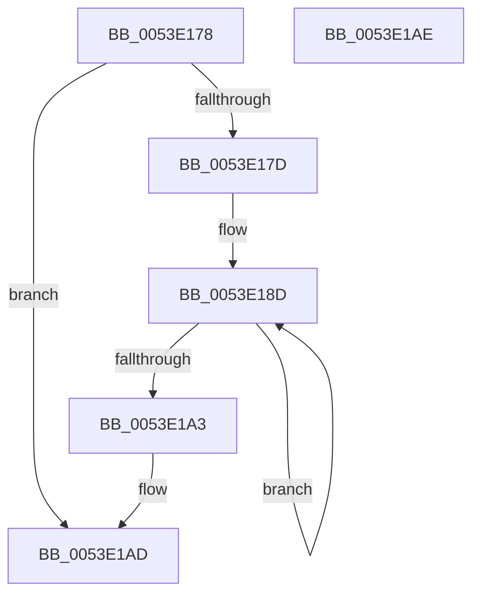

# HalpDmaFlushDriverMdl

- RVA: `0x0053E178`–`0x0053E1AF` (길이 `55` bytes)
- VA: `0x000000014053E178`
- 실행 섹션: `.text`
- PDB 이름 있음: `예`; PDB Function 태그: `아니요`
- unwind 정보 RVA: `0x00084918`
- 디코드: `19`개 명령, `55/55` bytes 표시
- 미해석 바이트: `0` (있으면 어셈블리에 `.byte`로 보존)

> 이 문서는 커널 이미지의 기계어와 PDB 기호를 분석해 생성했습니다. 4번과 5번은 함수 원형과 자료형을 바이너리 사용 방식에서 추정한 C 해석이며 원본 소스 복구 결과는 아닙니다.

## 1. Dependencies

- 직접 호출 지점: **1**; 고유 호출 대상: **1**
- 직접 호출자로 확인된 함수: **2**
- RIP 상대 이미지 참조: **0**

### Outgoing calls
- `0x0053E196` → [KeFlushIoBuffers](../3D/KeFlushIoBuffers_function_003DA340.md) (function, `0x003DA340`)

### Direct callers
- [HalFlushAdapterBuffersEx](../3D/HalFlushAdapterBuffersEx_function_003DADE0.md) at `0x003DB05B`
- [HalMapTransferEx](../3D/HalMapTransferEx_function_003DB450.md) at `0x003DB887`

### Static image references
- 디코드된 RIP-relative 메모리 참조가 없습니다.

## 2. Other-region calls and transfers

- 다른 실행 섹션으로 향하는 call: **0**
- 별도 외부 분기/꼬리 이동을 확인하지 못했습니다.

## 3. Assembly (complete function range)

```asm
0053E178  48 85 C9                        test rcx, rcx
0053E17B  74 30                           je 0x14053e1ad
0053E17D  48 89 5C 24 08                  mov qword ptr [rsp + 8], rbx
0053E182  57                              push rdi
0053E183  48 83 EC 20                     sub rsp, 0x20
0053E187  40 8A FA                        mov dil, dl
0053E18A  48 8B D9                        mov rbx, rcx
0053E18D  41 B0 01                        mov r8b, 1
0053E190  40 8A D7                        mov dl, dil
0053E193  48 8B CB                        mov rcx, rbx
0053E196  E8 A5 C1 E9 FF                  call 0x1403da340
0053E19B  48 8B 1B                        mov rbx, qword ptr [rbx]
0053E19E  48 85 DB                        test rbx, rbx
0053E1A1  75 EA                           jne 0x14053e18d
0053E1A3  48 8B 5C 24 30                  mov rbx, qword ptr [rsp + 0x30]
0053E1A8  48 83 C4 20                     add rsp, 0x20
0053E1AC  5F                              pop rdi
0053E1AD  C3                              ret
0053E1AE  CC                              int3
```

## 4. C-style interpretation (structured pseudocode)

```c
__int64 __fastcall HalpDmaFlushDriverMdl(__int64 a1, unsigned __int8 a2)
{
    __int64 result;
    __int64 v_rsp;
    unsigned __int64 v_stack_p8;

    if (a1 == 0) goto loc_0053E1AD;
    v_stack_p8 = v_rbx;
    v_rsp = (v_rsp) - (32);
loc_0053E18D:
    result = KeFlushIoBuffers(a1, a2, 1, a4);
    if (*(unsigned __int64 *)(a1) != 0) goto loc_0053E18D;
    v_rsp = (v_rsp) + (32);
loc_0053E1AD:
    return result;
}
```

## 5. (Beta) C Style

```c
int64_t HalpDmaFlushDriverMdl(int64_t Arg1, uint8_t Arg2)
{
    int64_t result;
    int64_t local_rsp;
    uint64_t v_stack_p8;

    if (Arg1 == 0) goto loc_0053E1AD;
    v_stack_p8 = local_rbx;
    local_rsp = (local_rsp) - (32);
loc_0053E18D:
    result = KeFlushIoBuffers(Arg1, Arg2, 1, a4);
    if (*(uint64_t *)(Arg1) != 0) goto loc_0053E18D;
    local_rsp = (local_rsp) + (32);
loc_0053E1AD:
    return result;
}
```

## 6. Execution-region graph

[열기: 2D/3D 그래프와 함수 탐색 컨트롤 패널](../../../control-panel.html?section=text&rva=0x0053E178&view=graph)

- 2D 그래프는 위에서 아래로 흐르고, 3D 그래프는 빈 공간을 드래그해 회전합니다. Shift+드래그는 이동, 휠은 확대·축소, 함수 노드 선택은 대상 보고서 이동입니다.

### Static fallback


