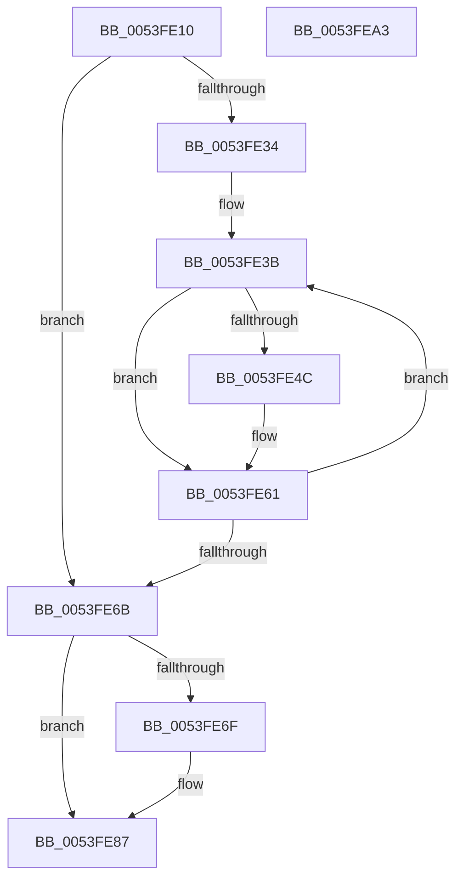

# HalpDmaFreeCrashDumpRegisters

- RVA: `0x0053FE10`–`0x0053FEA4` (길이 `148` bytes)
- VA: `0x000000014053FE10`
- 실행 섹션: `.text`
- PDB 이름 있음: `예`; PDB Function 태그: `아니요`
- unwind 정보 RVA: `0x0006F978`
- 디코드: `38`개 명령, `148/148` bytes 표시
- 미해석 바이트: `0` (있으면 어셈블리에 `.byte`로 보존)

> 이 문서는 커널 이미지의 기계어와 PDB 기호를 분석해 생성했습니다. 4번과 5번은 함수 원형과 자료형을 바이너리 사용 방식에서 추정한 C 해석이며 원본 소스 복구 결과는 아닙니다.

## 1. Dependencies

- 직접 호출 지점: **1**; 고유 호출 대상: **1**
- 직접 호출자로 확인된 함수: **0**
- RIP 상대 이미지 참조: **7**

### Outgoing calls
- `0x0053FE5C` → [HalpDmaFreeMapRegisters](../3D/HalpDmaFreeMapRegisters_function_003DF5F4.md) (function, `0x003DF5F4`)

### Direct callers
- 이 함수 시작 RVA로 연결되는 직접 call은 확인되지 않았습니다. 간접 호출은 완전히 역산할 수 없습니다.

### Static image references
- `0x0053FE29` → RVA `0x00FC3E8C` (`.data`; read)
- `0x0053FE34` → RVA `0x00FC3EE0` (`.data`; read)
- `0x0053FE55` → RVA `0x00FC3E60` (`.data`; read)
- `0x0053FE6F` → RVA `0x00FC3E60` (`.data`; read/write)
- `0x0053FE77` → RVA `0x00FC3E8C` (`.data`; read/write)
- `0x0053FE7E` → RVA `0x00FC3E88` (`.data`; read/write)
- `0x0053FE91` → RVA `0x00FC3E68` (`.data`; write)

## 2. Other-region calls and transfers

- 다른 실행 섹션으로 향하는 call: **0**
- 별도 외부 분기/꼬리 이동을 확인하지 못했습니다.

## 3. Assembly (complete function range)

```asm
0053FE10  48 89 5C 24 08                  mov qword ptr [rsp + 8], rbx
0053FE15  48 89 74 24 10                  mov qword ptr [rsp + 0x10], rsi
0053FE1A  48 89 7C 24 18                  mov qword ptr [rsp + 0x18], rdi
0053FE1F  41 56                           push r14
0053FE21  48 83 EC 20                     sub rsp, 0x20
0053FE25  33 FF                           xor edi, edi
0053FE27  8B F1                           mov esi, ecx
0053FE29  39 3D 5D 40 A8 00               cmp dword ptr [rip + 0xa8405d], edi
0053FE2F  8D 5F 01                        lea ebx, [rdi + 1]
0053FE32  74 37                           je 0x14053fe6b
0053FE34  4C 8D 35 A5 40 A8 00            lea r14, [rip + 0xa840a5]
0053FE3B  8B D7                           mov edx, edi
0053FE3D  48 03 D2                        add rdx, rdx
0053FE40  49 8B 04 D6                     mov rax, qword ptr [r14 + rdx*8]
0053FE44  48 89 40 38                     mov qword ptr [rax + 0x38], rax
0053FE48  85 F6                           test esi, esi
0053FE4A  74 15                           je 0x14053fe61
0053FE4C  45 8B 44 D6 08                  mov r8d, dword ptr [r14 + rdx*8 + 8]
0053FE51  49 8B 14 D6                     mov rdx, qword ptr [r14 + rdx*8]
0053FE55  48 8B 0D 04 40 A8 00            mov rcx, qword ptr [rip + 0xa84004]
0053FE5C  E8 93 F7 E9 FF                  call 0x1403df5f4
0053FE61  03 FB                           add edi, ebx
0053FE63  3B 3D 23 40 A8 00               cmp edi, dword ptr [rip + 0xa84023]
0053FE69  72 D0                           jb 0x14053fe3b
0053FE6B  85 F6                           test esi, esi
0053FE6D  74 18                           je 0x14053fe87
0053FE6F  48 83 25 E9 3F A8 00 00         and qword ptr [rip + 0xa83fe9], 0
0053FE77  83 25 0E 40 A8 00 00            and dword ptr [rip + 0xa8400e], 0
0053FE7E  83 25 03 40 A8 00 00            and dword ptr [rip + 0xa84003], 0
0053FE85  33 DB                           xor ebx, ebx
0053FE87  48 8B 74 24 38                  mov rsi, qword ptr [rsp + 0x38]
0053FE8C  48 8B 7C 24 40                  mov rdi, qword ptr [rsp + 0x40]
0053FE91  89 1D D1 3F A8 00               mov dword ptr [rip + 0xa83fd1], ebx
0053FE97  48 8B 5C 24 30                  mov rbx, qword ptr [rsp + 0x30]
0053FE9C  48 83 C4 20                     add rsp, 0x20
0053FEA0  41 5E                           pop r14
0053FEA2  C3                              ret
0053FEA3  CC                              int3
```

## 4. C-style interpretation (structured pseudocode)

```c
__int64 __fastcall HalpDmaFreeCrashDumpRegisters(int a1)
{
    __int64 result;
    __int64 v_rbx;
    __int64 v_rdi;
    __int64 v_rsp;
    unsigned __int64 v_stack_p10;
    unsigned __int64 v_stack_p18;
    unsigned __int64 v_stack_p8;

    v_stack_p8 = v_rbx;
    v_stack_p10 = v_rsi;
    v_stack_p18 = v_rdi;
    v_rsp = (v_rsp) - (32);
    v_rdi = 0;
    if ((*(unsigned int *)(v_rip + 11026525)) == 0) goto loc_0053FE6B;
loc_0053FE3B:
    a2 = (0) + (0);
    *(unsigned __int64 *)(*(unsigned __int64 *)(v_rip + 11026597 + a2 * 8) + 56) = *(unsigned __int64 *)(v_rip + 11026597 + a2 * 8);
    result = *(unsigned __int64 *)(v_rip + 11026597 + a2 * 8);
    if ((unsigned int)((unsigned int)(a1)) != 0) {
        a3 = *(unsigned int *)(v_rip + 11026597 + a2 * 8 + 8);
        a2 = *(unsigned __int64 *)(v_rip + 11026597 + a2 * 8);
        a1 = *(unsigned __int64 *)(v_rip + 11026436);
        result = HalpDmaFreeMapRegisters(a1, a2, a3, a4);
    }
    v_rdi = (unsigned int)((v_rdi) + ((unsigned int)(v_rdi + 1)));
    if (((unsigned int)(v_rdi)) < (*(unsigned int *)(v_rip + 11026467))) goto loc_0053FE3B;
loc_0053FE6B:
    v_rbx = v_rdi + 1;
    if ((unsigned int)((unsigned int)(a1)) != 0) {
        v_rbx = 0;
    }
    *(unsigned int *)(v_rip + 11026385) = 0;
    v_rsp = (v_rsp) + (32);
    return result;
}
```

## 5. (Beta) C Style

```c
int64_t HalpDmaFreeCrashDumpRegisters(int32_t Arg1)
{
    int64_t result;
    int64_t local_rbx;
    int64_t local_rdi;
    int64_t local_rsp;
    uint64_t v_stack_p10;
    uint64_t v_stack_p18;
    uint64_t v_stack_p8;

    v_stack_p8 = local_rbx;
    v_stack_p10 = local_rsi;
    v_stack_p18 = local_rdi;
    local_rsp = (local_rsp) - (32);
    local_rdi = 0;
    if ((*(uint32_t *)(v_rip + 0xA8405D)) == 0) goto loc_0053FE6B;
loc_0053FE3B:
    a2 = (0) + (0);
    *(uint64_t *)(*(uint64_t *)(v_rip + 0xA840A5 + a2 * 8) + 0x38) = *(uint64_t *)(v_rip + 0xA840A5 + a2 * 8);
    result = *(uint64_t *)(v_rip + 0xA840A5 + a2 * 8);
    if ((uint32_t)((uint32_t)(Arg1)) != 0) {
        a3 = *(uint32_t *)(v_rip + 0xA840A5 + a2 * 8 + 0x8);
        a2 = *(uint64_t *)(v_rip + 0xA840A5 + a2 * 8);
        Arg1 = *(uint64_t *)(v_rip + 0xA84004);
        result = HalpDmaFreeMapRegisters(Arg1, a2, a3, a4);
    }
    local_rdi = (uint32_t)((local_rdi) + ((uint32_t)(local_rdi + 1)));
    if (((uint32_t)(local_rdi)) < (*(uint32_t *)(v_rip + 0xA84023))) goto loc_0053FE3B;
loc_0053FE6B:
    local_rbx = local_rdi + 1;
    if ((uint32_t)((uint32_t)(Arg1)) != 0) {
        local_rbx = 0;
    }
    *(uint32_t *)(v_rip + 0xA83FD1) = 0;
    local_rsp = (local_rsp) + (32);
    return result;
}
```

## 6. Execution-region graph

[열기: 2D/3D 그래프와 함수 탐색 컨트롤 패널](../../../control-panel.html?section=text&rva=0x0053FE10&view=graph)

- 2D 그래프는 위에서 아래로 흐르고, 3D 그래프는 빈 공간을 드래그해 회전합니다. Shift+드래그는 이동, 휠은 확대·축소, 함수 노드 선택은 대상 보고서 이동입니다.

### Static fallback


