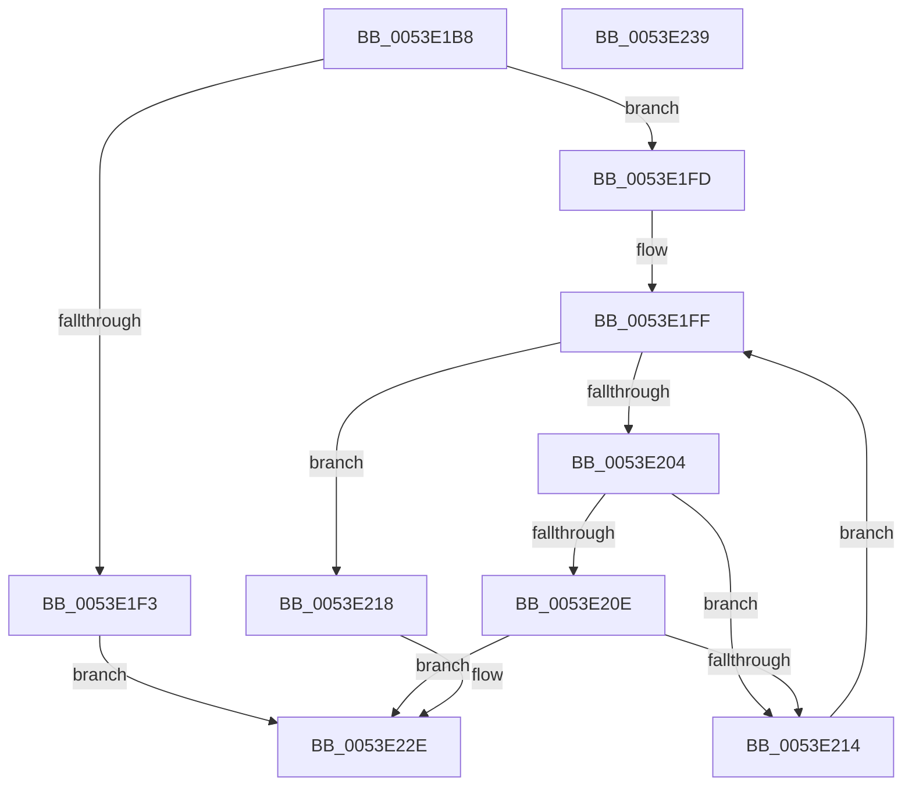

# HalpDmaFreeLa

- RVA: `0x0053E1B8`–`0x0053E23A` (길이 `130` bytes)
- VA: `0x000000014053E1B8`
- 실행 섹션: `.text`
- PDB 이름 있음: `예`; PDB Function 태그: `아니요`
- unwind 정보 RVA: `0x0006E5F8`
- 디코드: `35`개 명령, `130/130` bytes 표시
- 미해석 바이트: `0` (있으면 어셈블리에 `.byte`로 보존)

> 이 문서는 커널 이미지의 기계어와 PDB 기호를 분석해 생성했습니다. 4번과 5번은 함수 원형과 자료형을 바이너리 사용 방식에서 추정한 C 해석이며 원본 소스 복구 결과는 아닙니다.

## 1. Dependencies

- 직접 호출 지점: **3**; 고유 호출 대상: **2**
- 직접 호출자로 확인된 함수: **2**
- RIP 상대 이미지 참조: **1**

### Outgoing calls
- `0x0053E1E5` → [guard_dispatch_icall](../6B/guard_dispatch_icall_function_006BAAD0.md) (function, `0x006BAAD0`)
- `0x0053E1F6` → [HalpDmaReturnEmergencyLogicalAddressResources](HalpDmaReturnEmergencyLogicalAddressResources_function_0053E4E8.md) (function, `0x0053E4E8`)
- `0x0053E229` → [guard_dispatch_icall](../6B/guard_dispatch_icall_function_006BAAD0.md) (function, `0x006BAAD0`)

### Direct callers
- [HalFlushAdapterBuffersEx](../3D/HalFlushAdapterBuffersEx_function_003DADE0.md) at `0x003DAFF3`
- [IoFlushAdapterBuffersV3](../55/IoFlushAdapterBuffersV3_function_005532C0.md) at `0x00553305`

### Static image references
- `0x0053E1C9` → RVA `0x00FC1778` (`.data`; read)

## 2. Other-region calls and transfers

- 다른 실행 섹션으로 향하는 call: **0**
- 별도 외부 분기/꼬리 이동을 확인하지 못했습니다.

## 3. Assembly (complete function range)

```asm
0053E1B8  48 89 5C 24 08                  mov qword ptr [rsp + 8], rbx
0053E1BD  57                              push rdi
0053E1BE  48 83 EC 30                     sub rsp, 0x30
0053E1C2  0F 10 81 00 01 00 00            movups xmm0, xmmword ptr [rcx + 0x100]
0053E1C9  48 8B 05 A8 35 A8 00            mov rax, qword ptr [rip + 0xa835a8]
0053E1D0  48 8B F9                        mov rdi, rcx
0053E1D3  48 8B 1A                        mov rbx, qword ptr [rdx]
0053E1D6  48 8B CA                        mov rcx, rdx
0053E1D9  0F 11 44 24 20                  movups xmmword ptr [rsp + 0x20], xmm0
0053E1DE  48 8B 80 98 00 00 00            mov rax, qword ptr [rax + 0x98]
0053E1E5  E8 E6 C8 17 00                  call 0x1406baad0
0053E1EA  48 3B 9F 30 02 00 00            cmp rbx, qword ptr [rdi + 0x230]
0053E1F1  75 0A                           jne 0x14053e1fd
0053E1F3  48 8B CF                        mov rcx, rdi
0053E1F6  E8 ED 02 00 00                  call 0x14053e4e8
0053E1FB  EB 31                           jmp 0x14053e22e
0053E1FD  33 C9                           xor ecx, ecx
0053E1FF  83 F9 02                        cmp ecx, 2
0053E202  73 14                           jae 0x14053e218
0053E204  48 8B 54 CC 20                  mov rdx, qword ptr [rsp + rcx*8 + 0x20]
0053E209  48 85 D2                        test rdx, rdx
0053E20C  74 06                           je 0x14053e214
0053E20E  48 3B 5A 18                     cmp rbx, qword ptr [rdx + 0x18]
0053E212  74 1A                           je 0x14053e22e
0053E214  FF C1                           inc ecx
0053E216  EB E7                           jmp 0x14053e1ff
0053E218  48 8B 05 59 35 A8 00            mov rax, qword ptr [rip + 0xa83559]
0053E21F  48 8B CB                        mov rcx, rbx
0053E222  48 8B 80 88 00 00 00            mov rax, qword ptr [rax + 0x88]
0053E229  E8 A2 C8 17 00                  call 0x1406baad0
0053E22E  48 8B 5C 24 40                  mov rbx, qword ptr [rsp + 0x40]
0053E233  48 83 C4 30                     add rsp, 0x30
0053E237  5F                              pop rdi
0053E238  C3                              ret
0053E239  CC                              int3
```

## 4. C-style interpretation (structured pseudocode)

```c
__int64 __fastcall HalpDmaFreeLa(__int64 a1, __int64 a2)
{
    __int64 result;
    __int64 v_rsp;
    unsigned __int64 v_stack_m18;
    unsigned __int64 v_stack_p8;

    v_stack_p8 = v_rbx;
    v_rsp = (v_rsp) - (48);
    v_stack_m18 = v_xmm0;
    result = guard_dispatch_icall(a2, a2, a3, a4);
    if ((*(unsigned __int64 *)(a2)) != (*(unsigned __int64 *)(a1 + 560))) goto loc_0053E1FD;
    result = HalpDmaReturnEmergencyLogicalAddressResources(a1, a2, a3, a4);
    goto loc_0053E22E;
loc_0053E1FD:
    a1 = 0;
loc_0053E1FF:
    if (0 >= 2) goto loc_0053E218;
    if (*(unsigned __int64 *)(v_rsp + a1 * 8 + 32) == 0) goto loc_0053E214;
    if ((*(unsigned __int64 *)(a2)) == (*(unsigned __int64 *)(*(unsigned __int64 *)(v_rsp + a1 * 8 + 32) + 24))) goto loc_0053E22E;
loc_0053E214:
    a1 = (unsigned int)((a1) + 1);
    goto loc_0053E1FF;
loc_0053E218:
    result = guard_dispatch_icall(*(unsigned __int64 *)(a2), *(unsigned __int64 *)(v_rsp + a1 * 8 + 32), a3, a4);
loc_0053E22E:
    v_rsp = (v_rsp) + (48);
    return result;
}
```

## 5. (Beta) C Style

```c
int64_t HalpDmaFreeLa(void *Arg1, void *Arg2)
{
    uint8_t *arg1 = (uint8_t *)Arg1;
    uint8_t *arg2 = (uint8_t *)Arg2;

    int64_t result;
    int64_t local_rsp;
    uint64_t v_stack_m18;
    uint64_t v_stack_p8;

    v_stack_p8 = local_rbx;
    local_rsp = (local_rsp) - (48);
    v_stack_m18 = v_xmm0;
    result = guard_dispatch_icall(Arg2, Arg2, a3, a4);
    if ((*(uint64_t *)(arg2)) != (*(uint64_t *)(arg1 + 0x230))) goto loc_0053E1FD;
    result = HalpDmaReturnEmergencyLogicalAddressResources(Arg1, Arg2, a3, a4);
    goto loc_0053E22E;
loc_0053E1FD:
    Arg1 = 0;
loc_0053E1FF:
    if (0 >= 2) goto loc_0053E218;
    if (*(uint64_t *)(local_rsp + arg1 * 8 + 0x20) == 0) goto loc_0053E214;
    if ((*(uint64_t *)(arg2)) == (*(uint64_t *)(*(uint64_t *)(local_rsp + arg1 * 8 + 0x20) + 0x18))) goto loc_0053E22E;
loc_0053E214:
    Arg1 = (uint32_t)((Arg1) + 1);
    goto loc_0053E1FF;
loc_0053E218:
    result = guard_dispatch_icall(*(uint64_t *)(arg2), *(uint64_t *)(local_rsp + arg1 * 8 + 0x20), a3, a4);
loc_0053E22E:
    local_rsp = (local_rsp) + (48);
    return result;
}
```

### 관측된 메모리 오프셋

구조체 형식이 확인되지 않은 접근은 인자 기준의 오프셋으로만 기록했습니다.

| 기준 인자 | 오프셋 표현 | 폭 (bit) | 접근 |
|---|---:|---:|---|
| `Arg1` | `+ 0x100` | `128` | `R` |
| `Arg1` | `+ 0x230` | `64` | `R` |
| `Arg2` | `+ 0x0` | `64` | `R` |

## 6. Execution-region graph

[열기: 2D/3D 그래프와 함수 탐색 컨트롤 패널](../../../control-panel.html?section=text&rva=0x0053E1B8&view=graph)

- 2D 그래프는 위에서 아래로 흐르고, 3D 그래프는 빈 공간을 드래그해 회전합니다. Shift+드래그는 이동, 휠은 확대·축소, 함수 노드 선택은 대상 보고서 이동입니다.

### Static fallback


