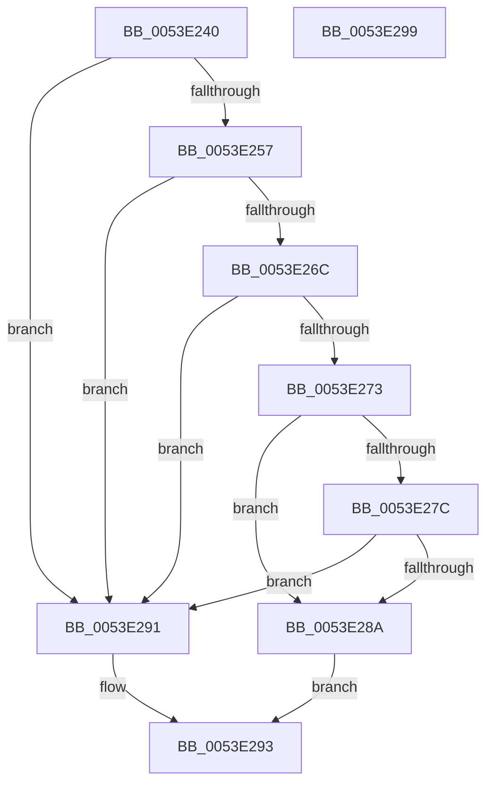

# HalpDmaGetDefaultRemappingDomainPolicy

- RVA: `0x0053E240`–`0x0053E29A` (길이 `90` bytes)
- VA: `0x000000014053E240`
- 실행 섹션: `.text`
- PDB 이름 있음: `예`; PDB Function 태그: `아니요`
- unwind 정보 RVA: `0x0005CF00`
- 디코드: `30`개 명령, `90/90` bytes 표시
- 미해석 바이트: `0` (있으면 어셈블리에 `.byte`로 보존)

> 이 문서는 커널 이미지의 기계어와 PDB 기호를 분석해 생성했습니다. 4번과 5번은 함수 원형과 자료형을 바이너리 사용 방식에서 추정한 C 해석이며 원본 소스 복구 결과는 아닙니다.

## 1. Dependencies

- 직접 호출 지점: **3**; 고유 호출 대상: **3**
- 직접 호출자로 확인된 함수: **1**
- RIP 상대 이미지 참조: **1**

### Outgoing calls
- `0x0053E24E` → [Feature_Test57481295__private_IsEnabledDeviceUsageNoInline](../4F/Feature_Test57481295__private_IsEnabledDeviceUsageNoInline_function_004F7B90.md) (function, `0x004F7B90`)
- `0x0053E263` → [HalpGetCpuInfo](../49/HalpGetCpuInfo_function_00498A70.md) (function, `0x00498A70`)
- `0x0053E281` → [IommupHvIsStage1DmarCompatible](../56/IommupHvIsStage1DmarCompatible_function_00567670.md) (function, `0x00567670`)

### Direct callers
- [HalpDmaAllocateChildAdapterV3](../../page/70/HalpDmaAllocateChildAdapterV3_function_007066A0.md) at `0x00706B5B`

### Static image references
- `0x0053E273` → RVA `0x00FC1710` (`.data`; read)

## 2. Other-region calls and transfers

- 다른 실행 섹션으로 향하는 call: **0**
- 별도 외부 분기/꼬리 이동을 확인하지 못했습니다.

## 3. Assembly (complete function range)

```asm
0053E240  40 53                           push rbx
0053E242  48 83 EC 20                     sub rsp, 0x20
0053E246  48 8B D9                        mov rbx, rcx
0053E249  C6 44 24 38 00                  mov byte ptr [rsp + 0x38], 0
0053E24E  E8 3D 99 FB FF                  call 0x1404f7b90
0053E253  85 C0                           test eax, eax
0053E255  74 3A                           je 0x14053e291
0053E257  4C 8D 4C 24 38                  lea r9, [rsp + 0x38]
0053E25C  45 33 C0                        xor r8d, r8d
0053E25F  33 D2                           xor edx, edx
0053E261  33 C9                           xor ecx, ecx
0053E263  E8 08 A8 F5 FF                  call 0x140498a70
0053E268  84 C0                           test al, al
0053E26A  74 25                           je 0x14053e291
0053E26C  80 7C 24 38 02                  cmp byte ptr [rsp + 0x38], 2
0053E271  75 1E                           jne 0x14053e291
0053E273  80 3D 96 34 A8 00 00            cmp byte ptr [rip + 0xa83496], 0
0053E27A  74 0E                           je 0x14053e28a
0053E27C  33 D2                           xor edx, edx
0053E27E  48 8B CB                        mov rcx, rbx
0053E281  E8 EA 93 02 00                  call 0x140567670
0053E286  84 C0                           test al, al
0053E288  74 07                           je 0x14053e291
0053E28A  B8 01 00 00 00                  mov eax, 1
0053E28F  EB 02                           jmp 0x14053e293
0053E291  33 C0                           xor eax, eax
0053E293  48 83 C4 20                     add rsp, 0x20
0053E297  5B                              pop rbx
0053E298  C3                              ret
0053E299  CC                              int3
```

## 4. C-style interpretation (structured pseudocode)

```c
__int64 __fastcall HalpDmaGetDefaultRemappingDomainPolicy(__int64 a1, int a2, int a3)
{
    __int64 result;
    __int64 v_rsp;
    unsigned __int8 v_stack_p10;

    v_rsp = (v_rsp) - (32);
    v_stack_p10 = 0;
    result = Feature_Test57481295__private_IsEnabledDeviceUsageNoInline(a1, a2, a3, a4);
    if ((unsigned int)(result) == 0) goto loc_0053E291;
    a3 = 0;
    a2 = 0;
    a1 = 0;
    result = HalpGetCpuInfo(a1, a2, a3, v_stack_p10);
    if ((unsigned __int8)(result) == 0) goto loc_0053E291;
    if (v_stack_p10 != 2) goto loc_0053E291;
    if ((*(unsigned __int8 *)(v_rip + 11023510)) == 0) goto loc_0053E28A;
    a2 = 0;
    result = IommupHvIsStage1DmarCompatible(0, a2, a3, v_stack_p10);
    if ((unsigned __int8)(result) == 0) goto loc_0053E291;
loc_0053E28A:
    goto loc_0053E293;
loc_0053E291:
    result = 0;
loc_0053E293:
    v_rsp = (v_rsp) + (32);
    return result;
}
```

## 5. (Beta) C Style

```c
int64_t HalpDmaGetDefaultRemappingDomainPolicy(int64_t Arg1, int32_t Arg2, int32_t Arg3)
{
    int64_t result;
    int64_t local_rsp;
    uint8_t v_stack_p10;

    local_rsp = (local_rsp) - (32);
    v_stack_p10 = 0;
    result = Feature_Test57481295__private_IsEnabledDeviceUsageNoInline(Arg1, Arg2, Arg3, a4);
    if ((uint32_t)(result) == 0) goto loc_0053E291;
    Arg3 = 0;
    Arg2 = 0;
    Arg1 = 0;
    result = HalpGetCpuInfo(Arg1, Arg2, Arg3, v_stack_p10);
    if ((uint8_t)(result) == 0) goto loc_0053E291;
    if (v_stack_p10 != 2) goto loc_0053E291;
    if ((*(uint8_t *)(v_rip + 0xA83496)) == 0) goto loc_0053E28A;
    Arg2 = 0;
    result = IommupHvIsStage1DmarCompatible(0, Arg2, Arg3, v_stack_p10);
    if ((uint8_t)(result) == 0) goto loc_0053E291;
loc_0053E28A:
    goto loc_0053E293;
loc_0053E291:
    result = 0;
loc_0053E293:
    local_rsp = (local_rsp) + (32);
    return result;
}
```

## 6. Execution-region graph

[열기: 2D/3D 그래프와 함수 탐색 컨트롤 패널](../../../control-panel.html?section=text&rva=0x0053E240&view=graph)

- 2D 그래프는 위에서 아래로 흐르고, 3D 그래프는 빈 공간을 드래그해 회전합니다. Shift+드래그는 이동, 휠은 확대·축소, 함수 노드 선택은 대상 보고서 이동입니다.

### Static fallback


