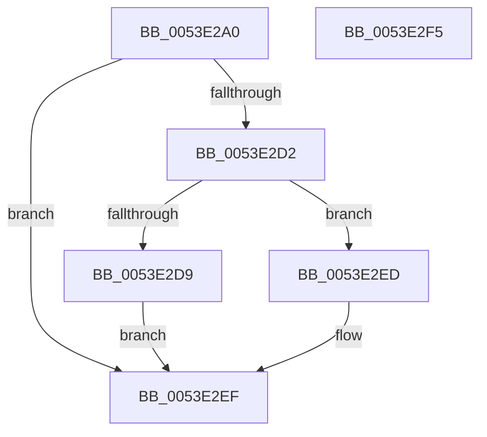

# HalpDmaGetIommuInterface

- RVA: `0x0053E2A0`–`0x0053E2F6` (길이 `86` bytes)
- VA: `0x000000014053E2A0`
- 실행 섹션: `.text`
- PDB 이름 있음: `예`; PDB Function 태그: `아니요`
- unwind 정보 RVA: `0x000697A4`
- 디코드: `24`개 명령, `86/86` bytes 표시
- 미해석 바이트: `0` (있으면 어셈블리에 `.byte`로 보존)

> 이 문서는 커널 이미지의 기계어와 PDB 기호를 분석해 생성했습니다. 4번과 5번은 함수 원형과 자료형을 바이너리 사용 방식에서 추정한 C 해석이며 원본 소스 복구 결과는 아닙니다.

## 1. Dependencies

- 직접 호출 지점: **2**; 고유 호출 대상: **2**
- 직접 호출자로 확인된 함수: **3**
- RIP 상대 이미지 참조: **1**

### Outgoing calls
- `0x0053E2C9` → [IoQueryInterface](../../page/72/IoQueryInterface_function_00729930.md) (function, `0x00729930`)
- `0x0053E2E1` → [guard_dispatch_icall](../6B/guard_dispatch_icall_function_006BAAD0.md) (function, `0x006BAAD0`)

### Direct callers
- [HalpDmaGetReservedRegionsForDeviceResources](../55/HalpDmaGetReservedRegionsForDeviceResources_function_00552018.md) at `0x00552062`
- [HalpDmaAllocateChildAdapterV3](../../page/70/HalpDmaAllocateChildAdapterV3_function_007066A0.md) at `0x007067A5`
- [IommupDeviceEnablePasidTaggedDma](../../page/70/IommupDeviceEnablePasidTaggedDma_function_00708B74.md) at `0x00708C3F`

### Static image references
- `0x0053E2AB` → RVA `0x00019F50` (`.rdata`; read)

## 2. Other-region calls and transfers

- 다른 실행 섹션으로 향하는 call: **1**
  - `0x0053E2C9` → [IoQueryInterface](../../page/72/IoQueryInterface_function_00729930.md) (`.text` → `PAGE`)
- 별도 외부 분기/꼬리 이동을 확인하지 못했습니다.

## 3. Assembly (complete function range)

```asm
0053E2A0  40 53                           push rbx
0053E2A2  48 83 EC 40                     sub rsp, 0x40
0053E2A6  48 89 54 24 30                  mov qword ptr [rsp + 0x30], rdx
0053E2AB  4C 8D 05 9E BC AD FF            lea r8, [rip - 0x524362]
0053E2B2  48 8B DA                        mov rbx, rdx
0053E2B5  48 89 4C 24 28                  mov qword ptr [rsp + 0x28], rcx
0053E2BA  33 D2                           xor edx, edx
0053E2BC  66 C7 44 24 20 02 00            mov word ptr [rsp + 0x20], 2
0053E2C3  41 B9 50 00 00 00               mov r9d, 0x50
0053E2C9  E8 62 B6 1E 00                  call 0x140729930
0053E2CE  85 C0                           test eax, eax
0053E2D0  78 1D                           js 0x14053e2ef
0053E2D2  48 83 7B 40 00                  cmp qword ptr [rbx + 0x40], 0
0053E2D7  75 14                           jne 0x14053e2ed
0053E2D9  48 8B 43 18                     mov rax, qword ptr [rbx + 0x18]
0053E2DD  48 8B 4B 08                     mov rcx, qword ptr [rbx + 8]
0053E2E1  E8 EA C7 17 00                  call 0x1406baad0
0053E2E6  B8 02 00 00 C0                  mov eax, 0xc0000002
0053E2EB  EB 02                           jmp 0x14053e2ef
0053E2ED  33 C0                           xor eax, eax
0053E2EF  48 83 C4 40                     add rsp, 0x40
0053E2F3  5B                              pop rbx
0053E2F4  C3                              ret
0053E2F5  CC                              int3
```

## 4. C-style interpretation (structured pseudocode)

```c
__int64 __fastcall HalpDmaGetIommuInterface(__int64 a1, __int64 a2)
{
    __int64 result;
    __int64 v_rsp;
    unsigned __int64 v_stack_m18;
    unsigned __int64 v_stack_m20;
    unsigned __int16 v_stack_m28;

    v_rsp = (v_rsp) - (64);
    v_stack_m18 = a2;
    v_stack_m20 = a1;
    a2 = 0;
    v_stack_m28 = 2;
    result = IoQueryInterface(a1, a2, v_rip - 5391202, 80);
    if (sign_flag) goto loc_0053E2EF;
    if ((*(unsigned __int64 *)(a2 + 64)) != 0) goto loc_0053E2ED;
    result = guard_dispatch_icall(*(unsigned __int64 *)(a2 + 8), a2, v_rip - 5391202, 80);
    goto loc_0053E2EF;
loc_0053E2ED:
    result = 0;
loc_0053E2EF:
    v_rsp = (v_rsp) + (64);
    return result;
}
```

## 5. (Beta) C Style

```c
int64_t HalpDmaGetIommuInterface(int64_t Arg1, void *Arg2)
{
    uint8_t *arg2 = (uint8_t *)Arg2;

    int64_t result;
    int64_t local_rsp;
    uint64_t v_stack_m18;
    uint64_t v_stack_m20;
    uint16_t v_stack_m28;

    local_rsp = (local_rsp) - (64);
    v_stack_m18 = Arg2;
    v_stack_m20 = Arg1;
    Arg2 = 0;
    v_stack_m28 = 2;
    result = IoQueryInterface(Arg1, Arg2, v_rip - 5391202, 80);
    if (sign_flag) goto loc_0053E2EF;
    if ((*(uint64_t *)(arg2 + 0x40)) != 0) goto loc_0053E2ED;
    result = guard_dispatch_icall(*(uint64_t *)(arg2 + 0x8), Arg2, v_rip - 5391202, 80);
    goto loc_0053E2EF;
loc_0053E2ED:
    result = 0;
loc_0053E2EF:
    local_rsp = (local_rsp) + (64);
    return result;
}
```

### 관측된 메모리 오프셋

구조체 형식이 확인되지 않은 접근은 인자 기준의 오프셋으로만 기록했습니다.

| 기준 인자 | 오프셋 표현 | 폭 (bit) | 접근 |
|---|---:|---:|---|
| `Arg2` | `+ 0x8` | `64` | `R` |
| `Arg2` | `+ 0x18` | `64` | `R` |
| `Arg2` | `+ 0x40` | `64` | `R` |

## 6. Execution-region graph

[열기: 2D/3D 그래프와 함수 탐색 컨트롤 패널](../../../control-panel.html?section=text&rva=0x0053E2A0&view=graph)

- 2D 그래프는 위에서 아래로 흐르고, 3D 그래프는 빈 공간을 드래그해 회전합니다. Shift+드래그는 이동, 휠은 확대·축소, 함수 노드 선택은 대상 보고서 이동입니다.

### Static fallback


