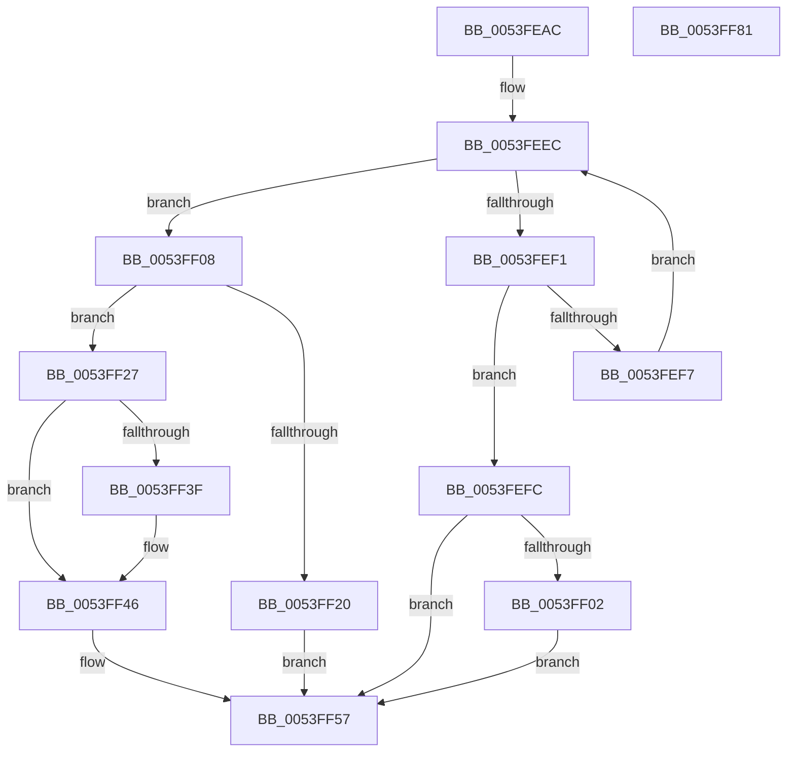

# HalpDmaInsertDeviceObjectByToken

- RVA: `0x0053FEAC`–`0x0053FF82` (길이 `214` bytes)
- VA: `0x000000014053FEAC`
- 실행 섹션: `.text`
- PDB 이름 있음: `예`; PDB Function 태그: `아니요`
- unwind 정보 RVA: `0x00060300`
- 디코드: `59`개 명령, `214/214` bytes 표시
- 미해석 바이트: `0` (있으면 어셈블리에 `.byte`로 보존)

> 이 문서는 커널 이미지의 기계어와 PDB 기호를 분석해 생성했습니다. 4번과 5번은 함수 원형과 자료형을 바이너리 사용 방식에서 추정한 C 해석이며 원본 소스 복구 결과는 아닙니다.

## 1. Dependencies

- 직접 호출 지점: **3**; 고유 호출 대상: **3**
- 직접 호출자로 확인된 함수: **2**
- RIP 상대 이미지 참조: **4**

### Outgoing calls
- `0x0053FED6` → [KeAcquireSpinLockRaiseToDpc](../20/KeAcquireSpinLockRaiseToDpc_function_00208470.md) (function, `0x00208470`)
- `0x0053FF16` → [ExAllocatePool2](../../poolcode/B8/ExAllocatePool2_function_00B820F0.md) (function, `0x00B820F0`)
- `0x0053FF61` → [KeReleaseSpinLock](../39/KeReleaseSpinLock_function_00392BA0.md) (function, `0x00392BA0`)

### Direct callers
- [HalpDmaCheckAdapterToken](HalpDmaCheckAdapterToken_function_0053FC40.md) at `0x0053FC66`
- [HalpDmaLinkDeviceObjectByToken](../../page/70/HalpDmaLinkDeviceObjectByToken_function_00706F70.md) at `0x00706F89`

### Static image references
- `0x0053FEC9` → RVA `0x00FC3EC0` (`.data`; read)
- `0x0053FEDE` → RVA `0x00FC3E70` (`.data`; read)
- `0x0053FF33` → RVA `0x00FC3E78` (`.data`; read)
- `0x0053FF50` → RVA `0x00FC3E78` (`.data`; write)

## 2. Other-region calls and transfers

- 다른 실행 섹션으로 향하는 call: **1**
  - `0x0053FF16` → [ExAllocatePool2](../../poolcode/B8/ExAllocatePool2_function_00B820F0.md) (`.text` → `POOLCODE`)
- 별도 외부 분기/꼬리 이동을 확인하지 못했습니다.

## 3. Assembly (complete function range)

```asm
0053FEAC  48 89 5C 24 08                  mov qword ptr [rsp + 8], rbx
0053FEB1  48 89 6C 24 10                  mov qword ptr [rsp + 0x10], rbp
0053FEB6  48 89 74 24 18                  mov qword ptr [rsp + 0x18], rsi
0053FEBB  57                              push rdi
0053FEBC  41 56                           push r14
0053FEBE  41 57                           push r15
0053FEC0  48 83 EC 20                     sub rsp, 0x20
0053FEC4  48 8B F1                        mov rsi, rcx
0053FEC7  33 DB                           xor ebx, ebx
0053FEC9  48 8D 0D F0 3F A8 00            lea rcx, [rip + 0xa83ff0]
0053FED0  45 8A F0                        mov r14b, r8b
0053FED3  48 8B FA                        mov rdi, rdx
0053FED6  E8 95 85 CC FF                  call 0x140208470
0053FEDB  40 8A E8                        mov bpl, al
0053FEDE  4C 8D 3D 8B 3F A8 00            lea r15, [rip + 0xa83f8b]
0053FEE5  48 8B 05 84 3F A8 00            mov rax, qword ptr [rip + 0xa83f84]
0053FEEC  49 3B C7                        cmp rax, r15
0053FEEF  74 17                           je 0x14053ff08
0053FEF1  48 39 70 10                     cmp qword ptr [rax + 0x10], rsi
0053FEF5  74 05                           je 0x14053fefc
0053FEF7  48 8B 00                        mov rax, qword ptr [rax]
0053FEFA  EB F0                           jmp 0x14053feec
0053FEFC  48 39 58 18                     cmp qword ptr [rax + 0x18], rbx
0053FF00  75 55                           jne 0x14053ff57
0053FF02  48 89 78 18                     mov qword ptr [rax + 0x18], rdi
0053FF06  EB 4F                           jmp 0x14053ff57
0053FF08  BA 28 00 00 00                  mov edx, 0x28
0053FF0D  41 B8 48 61 6C 44               mov r8d, 0x446c6148
0053FF13  8D 4A 1A                        lea ecx, [rdx + 0x1a]
0053FF16  E8 D5 21 64 00                  call 0x140b820f0
0053FF1B  48 85 C0                        test rax, rax
0053FF1E  75 07                           jne 0x14053ff27
0053FF20  BB 9A 00 00 C0                  mov ebx, 0xc000009a
0053FF25  EB 30                           jmp 0x14053ff57
0053FF27  48 89 70 10                     mov qword ptr [rax + 0x10], rsi
0053FF2B  48 89 78 18                     mov qword ptr [rax + 0x18], rdi
0053FF2F  44 88 70 20                     mov byte ptr [rax + 0x20], r14b
0053FF33  48 8B 0D 3E 3F A8 00            mov rcx, qword ptr [rip + 0xa83f3e]
0053FF3A  4C 39 39                        cmp qword ptr [rcx], r15
0053FF3D  74 07                           je 0x14053ff46
0053FF3F  B9 03 00 00 00                  mov ecx, 3
0053FF44  CD 29                           int 0x29
0053FF46  4C 89 38                        mov qword ptr [rax], r15
0053FF49  48 89 48 08                     mov qword ptr [rax + 8], rcx
0053FF4D  48 89 01                        mov qword ptr [rcx], rax
0053FF50  48 89 05 21 3F A8 00            mov qword ptr [rip + 0xa83f21], rax
0053FF57  40 8A D5                        mov dl, bpl
0053FF5A  48 8D 0D 5F 3F A8 00            lea rcx, [rip + 0xa83f5f]
0053FF61  E8 3A 2C E5 FF                  call 0x140392ba0
0053FF66  48 8B 6C 24 48                  mov rbp, qword ptr [rsp + 0x48]
0053FF6B  8B C3                           mov eax, ebx
0053FF6D  48 8B 5C 24 40                  mov rbx, qword ptr [rsp + 0x40]
0053FF72  48 8B 74 24 50                  mov rsi, qword ptr [rsp + 0x50]
0053FF77  48 83 C4 20                     add rsp, 0x20
0053FF7B  41 5F                           pop r15
0053FF7D  41 5E                           pop r14
0053FF7F  5F                              pop rdi
0053FF80  C3                              ret
0053FF81  CC                              int3
```

## 4. C-style interpretation (structured pseudocode)

```c
__int64 __fastcall HalpDmaInsertDeviceObjectByToken(__int64 a1, __int64 a2, unsigned __int8 a3)
{
    __int64 result;
    __int64 v_rbx;
    __int64 v_rsp;
    unsigned __int64 v_stack_p10;
    unsigned __int64 v_stack_p18;
    unsigned __int64 v_stack_p8;

    v_stack_p8 = v_rbx;
    v_stack_p10 = v_rbp;
    v_stack_p18 = v_rsi;
    v_rsp = (v_rsp) - (32);
    v_rbx = 0;
    result = KeAcquireSpinLockRaiseToDpc(v_rip + 11026416, a2, a3, a4);
loc_0053FEEC:
    if ((*(unsigned __int64 *)(v_rip + 11026308)) == (v_rip + 11026315)) goto loc_0053FF08;
    if ((*(unsigned __int64 *)(*(unsigned __int64 *)(v_rip + 11026308) + 16)) == a1) goto loc_0053FEFC;
    goto loc_0053FEEC;
loc_0053FEFC:
    if ((*(unsigned __int64 *)(*(unsigned __int64 *)(*(unsigned __int64 *)(v_rip + 11026308)) + 24)) != 0) goto loc_0053FF57;
    *(unsigned __int64 *)(*(unsigned __int64 *)(*(unsigned __int64 *)(v_rip + 11026308)) + 24) = a2;
    goto loc_0053FF57;
loc_0053FF08:
    result = ExAllocatePool2(40 + 26, 40, (unsigned int)(0x446C6148ULL), a4);
    if (result != 0) goto loc_0053FF27;
    goto loc_0053FF57;
loc_0053FF27:
    *(unsigned __int64 *)(result + 16) = a1;
    *(unsigned __int64 *)(result + 24) = a2;
    *(unsigned __int8 *)(result + 32) = a3;
    if ((*(unsigned __int64 *)(*(unsigned __int64 *)(v_rip + 11026238))) != (v_rip + 11026315)) {
        a1 = 3;
    }
    *(unsigned __int64 *)(result) = v_rip + 11026315;
    *(unsigned __int64 *)(result + 8) = a1;
    *(unsigned __int64 *)(a1) = result;
    *(unsigned __int64 *)(v_rip + 11026209) = result;
loc_0053FF57:
    result = KeReleaseSpinLock(v_rip + 11026271, (unsigned __int8)((unsigned __int8)(result)), (unsigned int)(0x446C6148ULL), a4);
    v_rsp = (v_rsp) + (32);
    return (unsigned int)((unsigned int)((unsigned int)(0xC000009AULL)));
}
```

## 5. (Beta) C Style

```c
int64_t HalpDmaInsertDeviceObjectByToken(int64_t Arg1, int64_t Arg2, uint8_t Arg3)
{
    int64_t result;
    int64_t local_rbx;
    int64_t local_rsp;
    uint64_t v_stack_p10;
    uint64_t v_stack_p18;
    uint64_t v_stack_p8;

    v_stack_p8 = local_rbx;
    v_stack_p10 = local_rbp;
    v_stack_p18 = local_rsi;
    local_rsp = (local_rsp) - (32);
    local_rbx = 0;
    result = KeAcquireSpinLockRaiseToDpc(v_rip + 11026416, Arg2, Arg3, a4);
loc_0053FEEC:
    if ((*(uint64_t *)(v_rip + 0xA83F84)) == (v_rip + 11026315)) goto loc_0053FF08;
    if ((*(uint64_t *)(*(uint64_t *)(v_rip + 0xA83F84) + 0x10)) == Arg1) goto loc_0053FEFC;
    goto loc_0053FEEC;
loc_0053FEFC:
    if ((*(uint64_t *)(*(uint64_t *)(*(uint64_t *)(v_rip + 0xA83F84)) + 0x18)) != 0) goto loc_0053FF57;
    *(uint64_t *)(*(uint64_t *)(*(uint64_t *)(v_rip + 0xA83F84)) + 0x18) = Arg2;
    goto loc_0053FF57;
loc_0053FF08:
    result = ExAllocatePool2(40 + 26, 40, (uint32_t)(0x446C6148ULL), a4);
    if (result != 0) goto loc_0053FF27;
    goto loc_0053FF57;
loc_0053FF27:
    *(uint64_t *)(result + 0x10) = Arg1;
    *(uint64_t *)(result + 0x18) = Arg2;
    *(uint8_t *)(result + 0x20) = Arg3;
    if ((*(uint64_t *)(*(uint64_t *)(v_rip + 0xA83F3E))) != (v_rip + 11026315)) {
        Arg1 = 3;
    }
    *(uint64_t *)(result) = v_rip + 11026315;
    *(uint64_t *)(result + 0x8) = Arg1;
    *(uint64_t *)(Arg1) = result;
    *(uint64_t *)(v_rip + 0xA83F21) = result;
loc_0053FF57:
    result = KeReleaseSpinLock(v_rip + 11026271, (uint8_t)((uint8_t)(result)), (uint32_t)(0x446C6148ULL), a4);
    local_rsp = (local_rsp) + (32);
    return (uint32_t)((uint32_t)((uint32_t)(0xC000009AULL)));
}
```

## 6. Execution-region graph

[열기: 2D/3D 그래프와 함수 탐색 컨트롤 패널](../../../control-panel.html?section=text&rva=0x0053FEAC&view=graph)

- 2D 그래프는 위에서 아래로 흐르고, 3D 그래프는 빈 공간을 드래그해 회전합니다. Shift+드래그는 이동, 휠은 확대·축소, 함수 노드 선택은 대상 보고서 이동입니다.

### Static fallback


